# Design: open the shift on `/desk` itself (owner's choice B)

> designed-by: claude/studio-claude-15 (AG FE desk, under the XC FE lane controller claude/e92db6), 2026-10-30 ICT.
> Order: #564 issuecomment-6514351039. Measured on `origin/main` `a92b80ce`.
> Owner's words (in claude/e92db6's session): *"xchange front end หาที่เปิดกะไม่เจอ"*, then *"ทำ A"*, then ***"เปลี่ยน เป็น B"***.
> B: clock-in and the opening count happen on `/desk`, with no page change.

## 1. What is wrong, and where it is made

| # | What a teller sees | Where it is made (`a92b80ce`) |
|---|---|---|
| 1 | Login lands on `/desk`. | `web/src/screens/login/home.ts`: a TELLER role goes to `/desk`. |
| 2 | `/desk` shows the sale steps with no shift state. The first sign of a missing shift is `error.noOpenShift` "ยังไม่ได้เปิดกะ กรุณาเปิดกะก่อน" after "Confirm booking". | `desk/main.tsx` renders `DeskPage` with its steps unconditionally; nothing on the page reads the teller's shift. `steps/booking/i18n.ts:15`. |
| 3 | Clock-in is only on `/staff`. | `staff/floor/FloorCard.tsx:133-151` `handleClock`, button `:256-264` (`floor-clock`). |
| 4 | The open count is only on `/staff`, behind clock-in. | `staff/shift/ShiftCard.tsx:656-707` (`canOperate() && isClockedIn()`), form `:709-745`, submit `:266-344`. |
| 5 | Nothing on `/desk` links to `/staff`. | The only `href="/staff"` in `web/src` outside `screens/staff/` is the staff report's back link (`staff-report/StaffReport.tsx:195`, `:204`). |

The back end already refuses a live sale without the caller's own open shift.
- `exchange/create.rs:350-364`: a `Mode::Live` customer's sale needs `open_of_teller_in(caller)`, otherwise `NoOpenShift`.
- `save_transaction.rs:497-505`.
- So this is the **client half** of that guard, as v2 had it (`xchange-v3-wave3-desk.md` step 0: *"This is the client half of the shift/rate guard"*). The BE guard stays.

`desk_config.shiftOpen` (`desk/config.rs:59`) means *the branch* has an open shift, not this teller. So the desk reads the teller's state from `staff_floor.myShift` / `myClockIn`, as `/staff` does.

## 2. Class diagram: one shared core, two pages

Nothing is copied into `desk/`. The pieces that open a shift live where `/staff` has them today and become components and readers that both pages mount (♻️).

```mermaid
classDiagram
    class counts {
        <<module staff/shift/counts.ts · this PR>>
        +isWaitingCount(row) boolean
        +myWaitingOpenCount(rows, userId) CashCountRow?
        +myWaitingCloseCount(rows, userId, shiftId) CashCountRow?
        +countsToVerify(rows, userId) CashCountRow[]
        +formatCountTime(iso) string
    }
    class WaitingCounts {
        <<module staff/shift/waiting-counts.ts · this PR>>
        +createWaitingCounts(api, branch, enabled) WaitingCounts
        rows() CashCountRow[]
        loaded() boolean
        error() string?
        reload() Promise
    }
    class StaffContext {
        <<module staff/staff-context.ts · T3>>
        +createStaffContext(opts) StaffContext
        me() StaffMe?
        floor() StaffFloor?
        error() string?
        ctx() StaffCtx?
        refresh() Promise
    }
    class ClockButton {
        <<component staff/floor/ClockButton.tsx · T1>>
        props: ctx, busy, setBusy, onNotice, onError
    }
    class CountForm {
        <<component staff/shift/CountForm.tsx · T2>>
        props: ctx, kind, denominations?, busy, setBusy, onSaved, onCancel, onError
    }
    class CountWaitingLine {
        <<component staff/shift/CountForm.tsx · T2>>
        props: kind, row
    }
    class FloorCard { <<staff/floor/FloorCard.tsx · T1>> }
    class ShiftCard { <<staff/shift/ShiftCard.tsx · T2>> }
    class StaffPage { <<staff/StaffPage.tsx · T3>> }
    class DeskShiftGate {
        <<component desk/shift/DeskShiftGate.tsx · T4>>
        props: branch, children
    }
    class deskShiftPhase {
        <<function desk/shift/phase.ts · T4>>
        +deskShiftPhase(input) DeskShiftPhase
    }
    FloorCard --> ClockButton
    ShiftCard --> CountForm
    ShiftCard --> CountWaitingLine
    ShiftCard --> WaitingCounts
    ShiftCard --> counts
    StaffPage --> StaffContext
    DeskShiftGate --> StaffContext
    DeskShiftGate --> WaitingCounts
    DeskShiftGate --> counts
    DeskShiftGate --> ClockButton
    DeskShiftGate --> CountForm
    DeskShiftGate --> CountWaitingLine
    DeskShiftGate --> deskShiftPhase
    WaitingCounts ..> NoticeFeed : onFreshNotice('cash_count')
```



| Piece | File | Provided by | Used by |
|---|---|---|---|
| `counts` (pure, lifted from `ShiftCard.tsx:49-56`, `:592-625`) | `web/src/screens/staff/shift/counts.ts` | **this PR**, whole, tests C1–C5 | T2, T4 |
| `createWaitingCounts` (lifted from `ShiftCard.tsx:113-136` + `:194-209` + #5591's `countsLoaded`) | `web/src/screens/staff/shift/waiting-counts.ts` | **this PR**, whole, tests W1–W6 | T2, T4 |
| `ClockButton` | `web/src/screens/staff/floor/ClockButton.tsx` (new) | **T1**, which also makes `FloorCard.tsx` mount it | T4 |
| `CountForm`, `CountWaitingLine` | `web/src/screens/staff/shift/CountForm.tsx` (new) | **T2**, which also makes `ShiftCard.tsx` mount them and read `counts` / `createWaitingCounts` | T4 |
| `createStaffContext` | `web/src/screens/staff/staff-context.ts` (new) | **T3**, which also makes `StaffPage.tsx` use it | T4 |
| `DeskShiftGate`, `deskShiftPhase`, desk texts, mount | `web/src/screens/desk/shift/DeskShiftGate.tsx`, `web/src/screens/desk/shift/phase.ts`, `web/src/screens/desk/i18n.ts`, `web/src/screens/desk/main.tsx` | **T4** | — |

- **Why this PR writes `counts.ts` and `waiting-counts.ts` itself.** Both are lifts of code already on main, 56 and 57 lines, with no new rule. Both T2 and T4 build on them, so landing them here keeps T1–T3 parallel. This follows the `notice-feed.ts` precedent in #5564. Until T2 lands, `ShiftCard.tsx` keeps its own copies, and T2 deletes them.
- **Placement.** The shared pieces stay under `screens/staff/`, so their texts stay in the existing `staff.floor` / `staff.shift` tables (TH/EN, staff screens) and no key moves. `/desk` imports them, as `desk-transaction/TransactionScreen.tsx:19-21` already imports `staff/parts`.
- **Waves.**
  - Wave 1: T1, T2 and T3 have disjoint files and go out together.
  - Wave 2: T4 needs the three components to exist, so its up-front tests are written and it is released once wave 1 is merged.

### 2.1 Signatures (`[required]`; the tickets copy them)

```ts
// staff/floor/ClockButton.tsx (T1). The host owns the busy flag and the message lines, so FloorCard keeps
// `floor-notice` / `floor-error` and its tests stay as they are.
export interface ClockButtonProps {
  ctx: StaffCtx;
  busy: Accessor<boolean>;
  setBusy(v: boolean): void;
  onNotice(msg: string | null): void;
  onError(msg: string | null): void;
}
export function ClockButton(p: ClockButtonProps): JSX.Element; // <button data-testid="floor-clock">

// staff/shift/CountForm.tsx (T2)
export interface CountFormProps {
  ctx: StaffCtx;
  kind: 'OPEN' | 'CLOSE';
  /** The host's list when it has one (ShiftCard, for handover too); otherwise the form reads `denominations` itself. */
  denominations?: Accessor<DenominationRow[]>;
  busy: Accessor<boolean>;
  setBusy(v: boolean): void;
  /** After a 2xx `POST /api/cash-counts`; the host refreshes. */
  onSaved(): Promise<void>;
  onCancel(): void;
  onError(msg: string | null): void;
}
export function CountForm(p: CountFormProps): JSX.Element; // <form data-testid="shift-count-form">, save `shift-count-save`
export function CountWaitingLine(p: { kind: 'OPEN' | 'CLOSE'; row: CashCountRow }): JSX.Element;
// <div role="status" data-testid="shift-open-waiting" | "shift-close-waiting">{openWaiting|closeWaiting} (dd/mm hh:mm)</div>

// staff/staff-context.ts (T3): StaffPage.tsx:34-78's loader, unchanged in behaviour.
export interface StaffContext {
  me: Accessor<StaffMe | undefined>;
  floor: Accessor<StaffFloor | undefined>;
  error: Accessor<string | undefined>;
  /** `{ me, floor, refresh }` once `me` is known. */
  ctx: Accessor<StaffCtx | undefined>;
  refresh(): Promise<void>;
}
export function createStaffContext(opts: {
  api: ApiClient;
  /** The page's branch; unset reads the caller's own (StaffPage). */
  branch?: Accessor<string>;
  /** Where a 401 `signIn` goes, e.g. '/login?next=%2Fstaff'. */
  signInUrl: string;
  navigate(url: string): void;
}): StaffContext; // call inside a component: it refreshes on each fresh `cash_count` notice while mounted (X7)

// desk/shift/phase.ts (T4)
export type DeskShiftPhase = 'loading' | 'error' | 'noAccess' | 'clockIn' | 'openCount' | 'waiting' | 'open';
export function deskShiftPhase(i: {
  me: StaffMe | undefined;
  meError: string | undefined;
  floor: StaffFloor | undefined;
  floorError: string | undefined;
  countsLoaded: boolean;
  openWaiting: CashCountRow | undefined;
}): DeskShiftPhase;
```

## 3. Behaviour tables

### T1: `ClockButton` (`/staff` unchanged)
| # | Case | Required |
|---|---|---|
| K1 | not clocked in | the button reads `clockIn` "ลงเวลาเข้า"; clocked in reads `clockOut` |
| K2 | click | one `POST /api/attendance` `{branch: me.branchId, direction: 'IN'|'OUT'}`; `onNotice(t('saved'))`; then `ctx.refresh()` |
| K3 | a second click while in flight | nothing sent; the button is disabled while `busy()` |
| K4 | refused | `onNotice(null)`, `onError(<worded>)`; `busy` false again |
| K5 | FloorCard | mounts `ClockButton` in place of `:256-264`; every existing `FloorCard*.test.tsx` and `floor.test.tsx` stays green unedited |

### T2: `CountForm`, `CountWaitingLine`, and `ShiftCard` reading the shared core (`/staff` unchanged)
| # | Case | Required |
|---|---|---|
| N1 | `CountForm` OPEN | `CurrencyCount` with the denominations (`props.denominations` or its own `denominations` read), THB locked, no expected |
| N2 | `CountForm` CLOSE | reads `my_shift` and passes `expected`/`locked` as `ShiftCard.tsx:234-253` |
| N2b | `CountForm` CLOSE before `my_shift` has answered (#5631) | `shift-count-save` disabled and a submit sends nothing: a THB-only CLOSE count reached finance as a shortage (#5631, PR #5642 verdict). If `my_shift` fails: `onError(<worded>)` and save stays disabled, so the teller cancels and opens the form again `[proposed]` |
| N3 | submit | the same validation and body as `ShiftCard.tsx:266-344`; `shiftId` = `floor.myShift.id` for CLOSE, null for OPEN; on 2xx `onSaved()`; a `lines[i].qty` refusal shows on that line; any other refusal `onError(<worded>)` |
| N4 | in flight | a second submit sends nothing |
| N5 | cancel | `onCancel()`; nothing sent |
| N6 | `CountWaitingLine` | `shift-open-waiting` / `shift-close-waiting` with `openWaiting` / `closeWaiting` and `formatCountTime(row.countedAt)` |
| N7 | ShiftCard | reads `createWaitingCounts` and `counts` (deletes its own `loadCashCounts`, `isWaitingCount`, `waiting*Count`, `countsToVerify`, `formatCountTime`); mounts `CountForm` / `CountWaitingLine`; every existing `ShiftCard*.test.tsx`, `shift.test.tsx`, `worded.test.tsx` stays green unedited (that includes #5567's notice reload and #5591's first-load gate) |

### T3: `createStaffContext` (`/staff` unchanged)
| # | Case | Required |
|---|---|---|
| X1 | refresh | `staff_me`, then `staff_floor` (each with `branch` when given); a newer refresh wins (`seq`) |
| X2 | `staff_me` 401 `signIn` | `navigate(signInUrl)`; nothing set |
| X3 | `staff_me` other failure | `error` = worded; `me` unchanged |
| X4 | `staff_floor` fails | `me` set, `floor` unchanged, `error` = worded |
| X5 | both good | `me`, `floor` set, `error` undefined; `ctx()` = `{me, floor, refresh}` |
| X7 | a fresh `cash_count` notice (#5564 feed) while mounted | `refresh()`, so a verified OPEN count shows the open shift (`myShift`) without a reload, on `/staff` and `/desk` alike. Re-check on `eb1c31e0` (#564 issuecomment-6514647190): after a verify, the card kept "waiting" until a reload. This is the FE half; the BE half (verify sends the counter no notice) is with claude/553782 |
| X6 | StaffPage | uses it with `signInUrl '/login?next=%2Fstaff'`; every existing `StaffPage*.test.tsx` and `main.test.tsx` stays green unedited |

### T4: `/desk` gate (wave 2)
`deskShiftPhase`, first match wins:

| # | Input | Phase | `/desk` shows |
|---|---|---|---|
| G1 | `me` not yet read, no error | `loading` | `shift.checking` "กำลังตรวจสอบกะ…" (v2 L3's wording, shortened) |
| G2 | `meError` | `error` | the worded error and a retry button |
| G3 | `floor.myShift` set | `open` | **the sale steps** (`DeskPage` with its aside), unchanged |
| G4 | no `ShiftOperate` | `noAccess` | v2's bar `shift.noShift` "ยังไม่มีกะเปิด กรุณาเปิดกะจากหน้าแอดมินก่อน" |
| G5 | `floorError` and no `floor` | `error` | the worded error and a retry button |
| G6 | `floor` not yet read | `loading` | as G1 |
| G7 | not clocked in | `clockIn` | `shift.clockInFirst` "กรุณาลงเวลาเข้างานก่อนเปิดกะ" and `ClockButton` |
| G8 | counts not loaded | `loading` | as G1 (no count button before the first read, #5591) |
| G9 | my OPEN count waits | `waiting` | `CountWaitingLine` OPEN |
| G10 | otherwise | `openCount` | `shift.openCountFirst` "ยังไม่มีกะเปิด กรุณานับเงินเปิดกะ", the `shift-open-count` button, and on click `CountForm` OPEN |

`DeskShiftGate` behaviour:

| # | Case | Required |
|---|---|---|
| D1 | mount | `createStaffContext({branch: store.branch, signInUrl: '/login?next=' + encodeURIComponent(location.pathname + location.search)})` and `createWaitingCounts({branch, enabled: ShiftOperate})` |
| D2 | `ClockButton` / `CountForm` saved | `refresh()`; after a count, `reload()` too |
| D3 | a fresh `cash_count` notice | covered by the shared readers: `createStaffContext` refreshes (X7), so a verified OPEN count turns into `myShift` and the steps appear without a reload; the counts reload by themselves (W3) |
| D4 | `open` → not open (shift closed elsewhere) | the steps unmount. The store lives in `main.tsx`, outside the gate, so a draft comes back as it was once the shift is open again. |
| D5 | texts | new keys in `desk/i18n.ts` `th`, the same Thai in `en` (staff screen, TH/EN) |
| D6 | out of scope on `/desk` | clock-out, close count, handover, close certify, day start/cutoff: they stay on `/staff` |

## 4. Decisions

**Decided (claude/e92db6's order, owner's B):**
- states 1 → 4 in that order;
- no sale steps before the shift is open;
- the permissions are `ShiftOperate` / `ShiftCloseCertify`;
- a user without them sees v2's bar;
- everything else stays on `/staff`.

**`[proposed]`, for claude/e92db6:**
1. **G3 before G4.** An open `myShift` shows the steps whatever the permissions say. A `ShiftCloseCertify`-only user (no `ShiftOperate`) cannot open a shift, so they see the bar. The reason: `ShiftCard` offers the open count only to `canOperate()` (`ShiftCard.tsx:656`).
2. **Demo customers are gated too.** `Mode::Demo` sales need no shift (`create.rs:366`), but the customer is chosen inside the steps, after the gate, so the gate cannot tell. A teller opens a shift before any sale, demo or not.
3. **The new Thai lines**, in `shift.checking` / `shift.clockInFirst` / `shift.openCountFirst` (G1, G7, G10).
4. **Both desk paths are gated.** `main.tsx` serves both `/desk` and `/staff/desk` (`desk-path.ts`), and the owner's `?branch=` desk reads that branch's `staff_floor`.

## 5. Out of scope
- `/desk/bookings` and `/desk/queue` (their own `main.tsx`); the queue already words `noOpenShift`.
- A link from `/desk` to `/staff` (choice A, replaced by B).
- `web/src/screens/admin/rates/**`, pricing-formula screens, `qa/e2e`, `api/`.
- No BE change, no migration.
