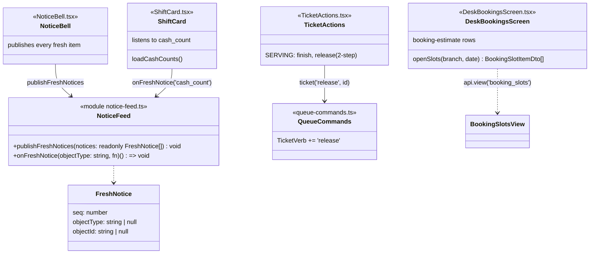

# Design: desk check round 4, FE fixes (P1, P4, P5, labels, #5541 FE-1)

> designed-by: claude/studio-claude-15 (AG FE desk round 4, a sub-controller under the XC FE lane controller claude/e92db6), 2026-10-30 ICT.
> Measured on `origin/main` `bf5305fc`. Sources: desk check round 4 (#564 issuecomment-6495985164), the routing on #564 issuecomment-6497823418,
> and #5541 / `docs/design/blueprint/queue-tickets.md` §4.6 (FE-1).
> Rule for new text: Thai only. The `en` table gets the same Thai string, so the `Record<keyof typeof th, string>` parity holds.

## 1. What is wrong, and where it is made

| # | What staff see (round 4) | Root cause at `bf5305fc` |
|---|---|---|
| P1 | After a branch manager rejects the opening count, the toast says to recount, but the teller's shift card keeps saying "waiting" until a page reload. | `ShiftCard.tsx:110-131` `loadCashCounts` runs only from `onMount` (`:194-197`) and after the card's own writes. `waitingOpenCount` (`:596-600`) reads that stale list. `NoticeBell.tsx:60-73` sees the `cash_count` notice but tells nobody else. |
| P4 | The desk new-booking dialog shows no THB amount; with no benefits the block is empty. | `DeskBookingsScreen.tsx:1322-1328`: the `booking-estimate` block renders only `<BenefitLines>`. The quote's `lines[].settleThb` is never shown. |
| P5 | The slot list offers past slots (21–26 Oct in round 4) and never an empty open one. | `DeskBookingsScreen.tsx:201` `allSlots = groupBookingsBySlot(items())` (`:84-99`): the list is the slots of today's *bookings*. The new-booking select (`:1139`), its default (`:633-636`, `:249-253`) and the reschedule select (`:1045`, default `:573-575`) all read it. The open slots live in view `booking_slots` (`api/src/presentation/http/v3/views/booking_slots.rs:56-60`: `status = 'OPEN' AND start_at > now()`; `need: Public`, `xc-auth/.../areas/bookings.rs:85-89`), which the customer screen already reads (`Book.tsx:259`). |
| L | The four dialogs' "Close" buttons and the reschedule "Slot" label are English. | Hard-coded text at `DeskBookingsScreen.tsx:1000`, `:1037`, `:1063`, `:1340`, `:1386`. |
| FE-1 | A SERVING walk-in whose sale was never saved can only be ended with "เสร็จสิ้น", which records COMPLETED. | The BE route `POST /api/queue/tickets/{id}/release` is on main (`bf5305fc`, #5551). The desk has no button: `queue-commands.ts:16` `TicketVerb` has no `release`, and `TicketActions.tsx:61-63` gives SERVING only `finish`. |
| P2 | (round 4) A walk-in sale could not start while the branch queue was closed. | Fixed in BE: starting the day opens the queue (#5540, `c3738ffb`). The teller's refusal is already worded (`steps/booking/i18n.ts:14` `คิวสาขาปิดอยู่`). **No FE ticket.** |

## 2. Class diagram

| Item | File | Provided by | Used by |
|---|---|---|---|
| `FreshNotice`, `publishFreshNotices`, `onFreshNotice` (whole body, 3 tests) | `web/src/shared/ui/notice-bell/notice-feed.ts` | **this design PR** (the seam both P1 tickets meet at; ten lines, so it is not a ticket) | T1, T2 |
| NoticeBell publishes | `web/src/shared/ui/notice-bell/NoticeBell.tsx` | **T1** | — |
| ShiftCard reloads on a `cash_count` notice | `web/src/screens/staff/shift/ShiftCard.tsx` | **T2** | — |
| open slots, estimate rows, Thai labels | `web/src/screens/desk/bookings/DeskBookingsScreen.tsx`, `web/src/screens/desk/bookings/i18n.ts` | **T3** | — |
| the release verb and button | `web/src/screens/desk/queue/queue-commands.ts`, `web/src/screens/desk/queue/actions/TicketActions.tsx`, `web/src/screens/desk/queue/actions/i18n.ts` | **T4** | — |

No two tickets share a file. No BE change; no migration (FE only, no database touched).

## 3. Behaviour tables

### T1 — NoticeBell publishes fresh notices (P1)

| # | Case | Required | Today |
|---|---|---|---|
| B1 | first answer, any items | publishes nothing (it only sets the highest seq, as the toast rule) | — |
| B2 | a later answer with items above the highest seq | `publishFreshNotices` once with **every** such item, of any `objectType`, in seq order; `objectType`/`objectId` from `item.object`, `null` when absent | nothing published |
| B3 | the same items again | nothing published | — |
| B4 | the toast rule | unchanged: toasts only `cash_count` (pinned by `NoticeBell.test.tsx`) | kept |

### T2 — ShiftCard reloads on a `cash_count` notice (P1)

| # | Case | Required | Today |
|---|---|---|---|
| S1 | card mounted, a `cash_count` notice is published | one more `cash_counts` read (WAITING), and the card redraws from it: after a reject the open-count button is back and the waiting line is gone | no read until reload |
| S2 | a notice of another type | no read | — |
| S3 | the card is unmounted | it stops listening: a later notice reads nothing | — |
| S4 | a caller with neither `ShiftOperate` nor `ShiftCloseCertify` | no read (the guard at `:111`) | kept |

### T3 — desk bookings dialogs (P4, P5, labels)

| # | Case | Required | Today |
|---|---|---|---|
| D1 | open "รับจองใหม่" | a date field `#new-booking-date` (`name="serviceDate"`, label `dialog.date` = `วันที่`) set to today in `Asia/Bangkok` (`YYYY-MM-DD`); one `GET /api/v3/views/booking_slots?branch=<dialog branch>&date=<that date>` | slot list from bookings |
| D2 | the slots answer | the select `#new-booking-slot` offers exactly the answered slots with `available > 0`, in answer order, option value = `id`, text = `formatSlotDate(start) formatSlotTime(start, end)` (the `id` when `start` is empty, today's fallback); the first one is selected | — |
| D3 | change the date or the branch | read again with the new values; an older answer that arrives last is dropped; the selection moves to the first new slot when the old one is not in the list | — |
| D4 | no slot with `available > 0` | one disabled option `dialog.noSlots` = `ไม่มีช่วงเวลาว่าง`; submit books nothing (the existing slot-required check) | — |
| D5 | the slots read fails | the slot field shows `dialog.slotsLoadFailed` = `โหลดช่วงเวลาไม่สำเร็จ`; no stale list | — |
| D6 | reschedule dialog | a date field `#reschedule-date` set to the booking's date in `Asia/Bangkok`; the select offers that date's slots with `available > 0` **except the booking's own slot**; the first is selected | bookings' slots |
| D7 | P4: a quote is shown | inside `[data-row="booking-estimate"]`, per quote line a row `[data-row="booking-estimate-thb"]`: `dialog.estimatedThb` = `ประมาณการยอดเงิน` then `<MoneyText value={line.settleThb} currency="THB">`, above the benefit lines | only benefit lines |
| D8 | labels | the four dialogs' close buttons read `close` = `ปิด`; the reschedule label reads `dialog.slot` | English |
| D9 | the board | the slot groups on the board (`:865-880`) still come from the bookings | kept |

`[proposed]` D7 shows `settleThb`, the amount of the quote whose id the booking carries (fee and price benefits applied), not `thbAmount`. If claude/e92db6 wants the customer screen's figure instead, the test changes, not the code shape.

### T4 — "ไม่มีการขาย" (#5541 FE-1, design §4.6 of `queue-tickets.md`)

| # | Case | Required | Today |
|---|---|---|---|
| R1 | SERVING, the serving teller or a holder of `BranchDayOperate` | `finish` and a `release` button `ไม่มีการขาย`; no other change to the other states' verbs | `finish` only |
| R2 | click `release` | nothing is posted yet; a confirm button `releaseConfirm` = `ยืนยันไม่มีการขาย` shows | — |
| R3 | confirm | one `POST /api/queue/tickets/{id}/release` with body `{"id":…}` (the `ticket(verb, id)` path, keyed write); then `onDone()` | — |
| R4 | refused `ticketHasSale` (409) | `error.ticketHasSale` = `คิวนี้มีรายการขายแล้ว กรุณายกเลิกรายการขายก่อน`; `onDone()` not called | — |
| R5 | refused `notYourTicket` / `noOpenShift` / `staleVersion` | the existing worded lines | kept |
| R6 | SERVING, another teller | no `release` (as `finish`) | — |

## 4. Tickets

| Ticket | Scope | Class / model | Test branch |
|---|---|---|---|
| #5566 T1 NoticeBell publishes | `NoticeBell.tsx` | mechanical / Gemini 3.8 Flash | `test/5566` |
| #5567 T2 ShiftCard listens | `ShiftCard.tsx` | mechanical / Gemini 3.8 Flash | `test/5567` |
| #5568 T3 desk bookings dialogs | `DeskBookingsScreen.tsx`, `bookings/i18n.ts` | logic / Gemini 4 Argon | `test/5568` |
| #5569 T4 release button | `queue-commands.ts`, `actions/TicketActions.tsx`, `actions/i18n.ts` | logic / Gemini 4 Argon | `test/5569` |

All four are released together; none waits for another (T1 and T2 meet only at `notice-feed.ts`, which this PR lands).
Each test branch was checked against a throwaway implementation: T1 17/17, T2 156/156, T3 126/126, T4 64/64, `tsc` clean.
The test branches also move pins of the old behaviour: T3's existing fakes answer `booking_slots` through `booking-slots.testing.ts` and look for `ปิด`; T4's `TicketActions.test.tsx` A1 SERVING rows add `release`.

## 5. Out of scope
- A "ไม่มีการขาย" button on the sale flow's walk-in card (`steps/booking/step.tsx`). The queue screen's button covers round 4's case.
- Making the booking-step `alreadyServing` line point at the release button.
- `web/src/screens/admin/rates/**`, pricing-formula screens, `qa/e2e`, `api/`.
