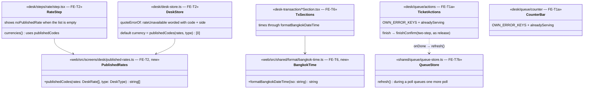

# FE fixes from the 11-01 real-staff e2e day

Status: design, written by the FE sub-controller claude/01TxaRJG for the lane controller claude/608dff to review. Umbrella #564.
Source: the triage at xchange#564 issuecomment-6556012853 (T1–T12) of the e2e report issuecomment-6554085352 (build `b4323213`).
Every `file:line` below was measured on `origin/main` `a174fb95` (2026-11-01).

This doc covers only the **web** halves. The BE halves (T1 booking end state, T2 `desk_config` filter, T3 display fields,
T4/T10 `countedByName` and the AWAITING_FINANCE count status, T6 reversal slip) belong to the BE sub-controller claude/b091f5e0.
Where an FE ticket needs a BE field, it says so and waits for that field. Otherwise it ships on what main returns today.

## 1. Tickets and file ownership

One ticket per row. No two rows share a file, so all of them can be released together. The column lists code files; each ticket's
`## File scope` also locks its up-front and restated test files and any e2e spec it edits. The ticket body is the source for the full list
(checked 16:4x ICT: the ten scopes, 71 paths, share no path).

| Ticket | Group | Files it owns (code + i18n + its tests) | Needs BE first? |
|---|---|---|---|
| FE-T2 #5849 | T2 desk currency list | `web/src/screens/desk/published-rates.ts` (new), `web/src/screens/desk/steps/rate/step.tsx`, `web/src/screens/desk/steps/rate/i18n.ts`, `web/src/screens/desk/desk-store.ts` | no |
| FE-T4 #5850 | T4 variance on /staff + T10(d) shift age | `web/src/screens/staff/shift/CountForm.tsx`, `web/src/screens/staff/shift/ShiftCard.tsx`, `web/src/screens/staff/shift/i18n.ts` | no (names wait for `countedByName`) |
| FE-T1a #5851 | T1 finish confirm + T7(a) `alreadyServing` | `web/src/screens/desk/queue/actions/TicketActions.tsx`, `…/actions/i18n.ts`, `web/src/screens/desk/queue/counter/CounterBar.tsx`, `…/counter/i18n.ts`, `qa/e2e/tests/flow-queue.spec.ts`, `qa/e2e/tests/flow-queue-many.spec.ts`, `qa/e2e/tests/journey-booked-customer.spec.ts` (shared with BE #5862, released first) | no |
| FE-T1b #5852 | T1 cancel an in-service booking | `web/src/screens/desk/bookings/DeskBookingsScreen.tsx` (no new i18n key needed) | no |
| FE-T3a #5853 | T3 approval card shows the payload | `web/src/screens/admin/approvals/Approvals.tsx`, `web/src/screens/admin/approvals/i18n.ts` | no (teller, shift, receipt wait for BE) |
| FE-T6 #5854 | T6 times in ICT + T5 reversal beside the status | `web/src/shared/format/bangkok-time.ts` (new), `web/src/screens/desk-transaction/{HeaderSection,PaymentSection,ReceiptsSection,ReversalSection,AuditSection,Field}.tsx`, `web/src/screens/desk-transaction/header-texts.ts` (new, T5 texts), `web/src/screens/operations/verification/VerificationScreen.tsx` | no |
| FE-T7b #5855 | T7(b) board stale after a write | `web/src/shared/queue/queue-store.ts` | no |
| FE-T8 #5856 | T8 walk-in wording + queue card | `web/src/screens/desk/steps/booking/step.tsx`, `…/booking/i18n.ts`, `web/src/screens/desk/steps/payment/step.tsx`, e2e `desk-exchange.ts`, `flow-desk-extras.spec.ts`, `flow-exchange.spec.ts`, `flow-validation-staff-desk.spec.ts` (regex widened) | no |
| FE-T9 #5857 | T9 users search, reset confirm, sign-in notice | `web/src/screens/admin/users/UsersScreen.tsx`, `…/users/i18n.ts`, `…/users/users.css`, `web/src/screens/login/LoginScreen.tsx`, `web/src/shared/ui/auth.css` | no |
| FE-T11 #5858 | T11 labels | `web/src/screens/staff/floor/i18n.ts`, `web/src/screens/desk-transaction/i18n.ts`, `qa/e2e/tests/flow-floor.spec.ts`, `qa/e2e/tests/flow-sick-teller-handover.spec.ts` (also :187, the walk-in regex of W5), `docs/uat/desk-day-v1.md` | no |

BE contracts as fixed by claude/b091f5e0 (16:4x ICT 11-01): T1 #5859 (finish or release with no sale ends the booking CANCELLED `noSale`;
no new field), T6 #5861 (reversal slip only; the API keeps ISO UTC), T12 #5862. T5 has no BE ticket: `reversal.md:55` (V-2) keeps the
original COMPLETED and the transaction view already returns `reversal` (`views/transaction.rs:161-166`), so T5 is FE and joins FE-T6
(it owns `HeaderSection.tsx`). T3 adds `ApprovalRequestItemDto.requestedByName?` and `subject?` (`ReversalSubject` |
`CountDifferenceSubject`) and turns `ReversalPendingRow` into `{requestId, createdAt, subject}`. T4/T10 adds `CashCountRow.countedByName?`,
`verifiedByName?`, `shiftOpenedAt?`, `approvalRequestId?`, `superseded` and status `AWAITING_FINANCE`.

Follow-ups cut once the BE fields land: FE-T2b (bookings-screen currency list, `DeskBookingsScreen.tsx:357`, after FE-T1b), FE-T3b
(reconciliation reversal row `ReversalsPart.tsx:63-66` and the names on the approval card), FE-T4b (counter name, AWAITING_FINANCE row
without verify/reject on `ShiftCard.tsx`, after FE-T4), and the T7 server wording (BE).

## 2. Class diagram (new and changed units only)

`publishedCodes` maps the desk's `type` to the rate side the quote reads: `shopSide: type()` (`desk-store.ts:297`), so `BUY` reads
`DeskRate.buy` and `SELL` reads `DeskRate.sell`. A code is published for a side when that field is not `null`
(`generated/desk_config.ts`, `DeskRate`). `formatBangkokDateTime` returns `dd/MM/yyyy HH:mm` in `Asia/Bangkok`, returns its input
unchanged when it doesn't parse, and must not use `Number(`, `Math.`, `toFixed` or `parseFloat` (`desk-transaction.source.test.ts:53`).

## 3. Decisions (wording and display)

| # | Decision | Why |
|---|---|---|
| W1 | Desk times show in ICT, `dd/MM/yyyy HH:mm`. `desk-transaction-detail.md` D3 ("no formatting") covers figures (money, rates), not times. | T6. Staff read ICT (rule: every time is Thai time). |
| W2 | Finish needs a second press, like release: `finish` reveals `finishConfirm` "ยืนยันเสร็จสิ้น" / "Confirm finish". | T1: one click ended a booking by mistake. `queue-tickets.md:290` left `finish` alone; this changes only the screen. |
| W3 | `alreadyServing` on the desk queue: th "เคาน์เตอร์นี้กำลังให้บริการคิวอื่นอยู่ กรุณาเสร็จสิ้นคิวปัจจุบันก่อน" / en "This counter is already serving a ticket. Finish it first." | T7(a). WE4 (`web-worded-error.md:49`): a screen maps its own codes. |
| W4 | A CHECKED_IN or IN_SERVICE booking row on the desk gains **cancel** (reason required) and nothing else new; CHECKED_IN keeps its reissue QR. | T1. `blueprint/booking-slots.md:192` already allows it; it is the way out of a stuck IN_SERVICE until the BE fix lands. |
| W5 | Walk-in sale, step index 2: label "ข้อมูลรายการ" / "Details", heading "ข้อมูลรายการ" / "Transaction details", submit "ยืนยันข้อมูล →" / "Confirm details →". A sale started from a booking or kiosk entry keeps today's v2 text. The step still serves the ticket (`step.tsx:66-72`). The step-bar label stays "การจอง": `DeskStep.label` takes no store (`steps.ts:22`), so it can't vary per sale; changing that is outside this round. A teller-called booking with no entry shows the walk-in words until it is submitted. | T8(a). The step can't be skipped: it serves the walk-in ticket (`walkin-queue.md` W1/W4). |
| W6 | The payment step folds the queue card while mounted, with `yieldQueueCard()` (`shared/ui/queue-card-yield.ts:8-18`), and restores it on leave. | T8(b). Same tool as `CountForm.tsx:42-45`. |
| W7 | Day phase `CLOSED` on /staff: th "ปิดวันทำการแล้ว" / en "Day closed". | T11(a). "ปิดกะ" is the shift close; "ปิดวันทำการ" is the canonical day term (`shared/i18n/th.ts:131`). |
| W8 | B04 request button: th "ขอกลับรายการ". The same screen's "คืนรายการ" texts (`desk-transaction/i18n.ts:41,50,51`) become "กลับรายการ". This amends `desk-transaction-detail.md` D6. | T11(b). Finance already says "กลับรายการ" (`admin/approvals/i18n.ts:20`). |
| W9 | Staff see the count difference per currency: "ผลต่าง <CUR> <signed amount>" (`formatMoney`, with `+` for a positive difference), only for non-zero differences. The AWAITING_FINANCE notice drops the approval request id. | T4. The field exists (`CashCountTotalRow.difference`). |
| W10 | The close form says how old the shift is when it opened on an earlier Bangkok date: "กะนี้เปิดเมื่อ dd/MM/yyyy (n วันก่อน)". | T10(d). `MyShift.openedAt` exists. |
| W11 | Admin users: a search box sends `filter.q` (already supported, `admin_users.rs:92-100`); "more" keeps `q`. Reset needs a second press (`reset-confirm`). | T9. |
| W12 | The sign-in page shows `changeDone` in a `role="status"` element styled as success, not in the red `#message` alert. | T9(c): the red text was the sign-in page (`LoginScreen.tsx:106,130`, `auth.css:134`). |
| W13 | The approval card never prints a bare UUID as text. TRANSACTION_REVERSAL shows amount (THB) and reason from the payload; COUNT_DIFFERENCE shows the net difference (THB). Ids, including the decided card's `approverId`, move to `title`. | T3, maker-checker ruling 2026-10-31. |

## 4. Tests that pin today's behaviour

Each ticket's up-front tests restate these on its `test/<n>` branch. Workers never edit them.

- FE-T1a: `TicketActions.test.tsx:93` (A2: finish sends on one click). A1 (`:76-77`) stays: `finishConfirm` shows only after a click.
- FE-T1b: `DeskBookingsScreen.status-actions.test.tsx:26-34` (CHECKED_IN cancel:false; no IN_SERVICE row) and `:157-179` (cancel disappears after a check-in).
- FE-T4: `ShiftCard.awaiting-finance.test.tsx:249-262` (notice = approval request id). `CountForm.test.tsx:294-295` stays green: its fixtures have no non-zero difference.
- FE-T7b: `queue-store.test.ts:401-425` (S4: a refresh during a poll is skipped).
- FE-T2: `desk-store.back-to-edit.test.ts` B4 (a 409 shows the shared "try later").
- FE-T3a: `Approvals.test.tsx:375,380` and `Approvals.decision.test.tsx` rows 3, 4, 8 (ids shown as text).
- FE-T8: `steps/booking/step.test.tsx` G1, G3 and `steps/receipt/page-flow.test.tsx` W2 (walk-in fixtures read the booking text).
- FE-T9: `UsersScreen.w1.test.tsx` rows 6, 6b, 6c (reset is one click).
- FE-T11: `staff/floor/floor.test.tsx:397` (`ปิดกะ`).
- e2e specs that click finish once or match the old text are in the owning ticket's scope; e2e is never run against a host (E-3).

## 5. Data migration

None. No ticket here touches the database.
