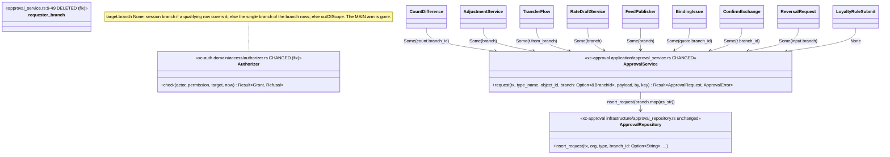

# An organisation-wide actor is never granted the literal branch `MAIN` (XC-ORG-WIDE-BRANCH, #5279)

> Design by claude/2ca5874b (Studio claude-1, sub-controller of #5279 under BE lane controller claude/553782), 2026-10-29 ICT.
> Measured on `origin/main` `28e1fead`. Brief: #5279 issuecomment-6482860815. Owner decision on site 2: #5279 issuecomment-6452390376.

## 0. The rule

Two places invent the branch `MAIN` for an organisation-wide actor:

| Site | Where | Today | After |
|---|---|---|---|
| 1 | `Authorizer::check`, the `has_org_wide` arm (`api/crates/xc-auth/src/domain/access/authorizer.rs:112-113`) | org-wide row, no session branch, and the target names no branch ⇒ grant on `MAIN` | **`outOfScope`**. The grant is the session branch, as for everyone else (`:104-111`). |
| 2 | `requester_branch` (`api/crates/xc-approval/src/application/approval_service.rs:9-49`), used at `:229` | an approval request is filed under the requester's first role row by a priority list. An org-wide row gives `MAIN`, and EXECUTIVE + ADMIN gives `NULL`. | **The object's branch**, passed by the caller. `requester_branch` is deleted. Owner, 2026-10-28: *"เก็บที่สาขาของสิ่งที่ขอ"* ("store it at the branch of the thing requested"). |

`MAIN` is the seeded organisation's branch (`api/migrations/20261007100000_branches_rates.sql:9`). It does not exist in a second organisation, so both stand-ins are wrong there. In the default organisation they are only right by chance.

## 1. Why site 1 changes no production path

- Every production reader turns a session into an actor through `SessionBranch::effective` (`api/src/presentation/extractors/session_actor.rs:29-31`; `extractors/actor.rs:199`).
- That gives anyone holding a valid row a branch. An org-wide row opens every branch, so the session branch is the first by code (`session_branch.rs:34-54`, `:60-68`).
- So a session actor never reaches the `has_org_wide` arm. The arm returns `MAIN` only when the actor has no branch at all, and the qualifying row would already cover the session branch at `:104-111`.

Production actors built without a session, swept by `git grep -n -E "(Actor|AccessActor|AuthActor)::new\(" -- 'api/src/**' 'api/crates/*/src/**'` outside `#[cfg(test)]` at `28e1fead`:

| Actor | Rows | Reaches `Authorizer::check` with a branchless target? |
|---|---|---|
| rate-feed system actor (`feed_publisher.rs:349`, `branch_refresh.rs:124`) | ADMIN at one branch | no: it is only the requester of an approval (site 2) |
| pricing-follow system actor (`market_pricing_loop.rs:214`) | ADMIN org-wide | no: `TierPublisher::publish_in` (`tier_publish.rs:45`) and the push run no `Authorizer::check` |
| `SaveStep::access_actor_at` (`save_step.rs:72-89`) | the owner org-wide, or staff at the branch | no: it is only the requester of an approval (confirm, reversal, binding quote) |
| `handover_service::may_receive` (`handover_service.rs:299`) | the candidate's rows | no: its target names the branch (`:300`) |
| custody saver (`xc-shift/.../custody/service.rs:139`) | no rows | no qualifying row, so the arm is not reached |

The only production checks with a branchless target are `appSettingsSave` (`xc-app/.../app_settings_service.rs:44`) and transfer `reconcile` (`transfer_flow.rs:794`). Both are given session actors. They are unchanged here. Whether organisation-level business should require an org-wide row is a separate question; this design does not decide it.

**The cost is in test fixtures.** About 245 files build org-wide actors with no session branch. Waves 1 and 2 of #5279 fix them, behaviour-neutral, before this lands: #5454 / PR #5455 merged as `28e1fead`, and the `all_1` … `all_4` tickets #5456–#5459. Two tests pin the `MAIN` stand-in itself; they are restated in §5.

## 2. Class diagram



The `request` signature change is the only one. `[required]`: `branch` comes right after `object_id`, and it is `Option<&BranchId>` (`xc_kernel::ids::BranchId`). `None` means the object belongs to the organisation and to no branch.

## 3. Who passes which branch

| # | Caller (`file:line` at `28e1fead`) | Approval type | `branch` | Changes from today when |
|---|---|---|---|---|
| 1 | `xc-cash/.../ledger_approval/count_difference.rs:243` | `COUNT_DIFFERENCE` | `Some(&count.branch_id)` (`cash_count.rs:43`) | never in practice: the counter is at the branch |
| 2 | `xc-cash/.../adjustment/adjustment_service.rs:177` | `LEDGER_ADJUSTMENT` | `Some(branch)` (the adjustment's branch, already checked at `:150-170`) | an org-wide FINANCE requests: `MAIN` → the adjustment's branch |
| 3 | `xc-cash/.../transfer/transfer_flow.rs:588` | `CASH_TRANSFER` | `Some(&t.from_branch)` (the sender, which `policy_actor` already scopes to, `approval/transfer.rs:29-43`) | an org-wide requester: `MAIN` → the sender |
| 4 | `xc-rate/.../draft/rate_draft_service.rs:695` | `RATE_PUBLICATION` | `Some(branch)` (`submit`'s branch; `rate_drafts.branch_id` is NOT NULL) | an org-wide RATE_MANAGER / owner: `MAIN` / `NULL` → the draft's branch |
| 5 | `xc-rate/.../publication/feed_publisher.rs:370` | feed batch | `Some(branch)` | never: the system actor is at that branch |
| 6 | `api/src/.../exchange/binding_issue.rs:225` | `BINDING_QUOTE` | `Some(&req.quote.branch_id)` | the owner requests: `NULL` → the quote's branch |
| 7 | `api/src/.../exchange/confirm.rs:151` | exchange approval | `Some(&t.branch_id)` | the owner requests: `NULL` → the transaction's branch |
| 8 | `api/src/.../exchange/reversal_request.rs:143` | reversal | `Some(&input.branch)` | the owner requests: `NULL` → the exchange's branch |
| 9 | `api/src/presentation/http/v3/commands/loyalty_rule_submit.rs:161` | `LOYALTY_RULE_VERSION` | `None`: a loyalty rule belongs to the organisation | a requester with a branch row: that branch / `MAIN` → `NULL` |

**Who reads the stored branch:**
- The decision policies call `ApprovalDecider::holds_on(who, p, request.branch_id)` (`approval_decider.rs:35-39`): `count_difference.rs:116`, `negative_stock.rs:72`, `exchange/approval.rs:171` and `binding_approval.rs:131`.
- The queue view: `views/approval_requests.rs:66`, `branch_id = $1 OR branch_id IS NULL`.

With the object's branch, a branch manager at that branch can decide an owner's request, as for any other requester. Today the stored `NULL` lets only org-wide rows cover it (`scoped_role.rs:58-63`). The loyalty policy uses `holds_anywhere` (`rule_approval.rs:230-239`), so `NULL` changes nothing for it.

**Decision C of 2026-10-21 (#4094) is replaced** (owner, #5279 issuecomment-6452390376). An org-wide non-executive of a second organisation is no longer refused: its request is stored on its own organisation's branch. The composite FK `approval_requests (organization_id, branch_id) → branches` accepts it, because the branch is that organisation's. Test `approval_request_organisation_test::row6_…` flips (§5).

## 4. Data migration

**None.** `approval_requests.branch_id` is already a nullable `text` column (`api/migrations/20261010110000_approvals.sql:4`), checked against the organisation's branches. "Remove `requester_branch`" removes a function, not a column.
1. **Existing rows** keep the branch they were stored with. A past `MAIN` or `NULL` stays as it is, and a pending one is decided under today's reading of it.
2. **Backfill:** none. Rewriting a decided request's branch would rewrite who was allowed to decide it.
3. **Deploy order:** the binary alone.
4. **Reversal:** a revert of the binary. Nothing in the schema moves.

## 5. Behaviour table and up-front tests

The sub-controller writes these on `test/5279` before release. They compile against the skeleton (§6) and fail on the stored or granted value.

| Row | Case | Required result | Test |
|---|---|---|---|
| S1-1 | org-wide EXECUTIVE, **no** session branch, target names no branch | `Err(OutOfScope)` | `xc-auth/tests/authorizer_test.rs`: restates `an_organisation_wide_user_works_on_the_branch_named_and_on_main_when_none_is` |
| S1-2 | the same actor with session branch `B01` | `Ok`, `grant.branch == B01` | the same test |
| S1-3 | the same actor, target names `B02` | `Ok`, `grant.branch == B02` | the same test |
| S1-4 | branch rows at one branch only, no session branch, target names none | unchanged: that branch | `xc-auth/tests/session_branch_test.rs`: restates `without_a_session_branch_the_old_arms_are_unchanged` |
| S1-5 | branch rows at two branches, no session branch, target names none | unchanged: `outOfScope` | the same test |
| S2-1 | `request(.., Some(B02), ..)` by an org-wide FINANCE | stored `branch_id = 'B02'` | `xc-approval/tests/approval_object_branch_test.rs` (new) |
| S2-2 | `request(.., Some(B02), ..)` by a RATE_MANAGER with rows at `B01` and `B02` | `'B02'` (today: its first row) | the same file |
| S2-3 | `request(.., None, ..)` by a TELLER at `B01` | `NULL` (today: `B01`) | the same file |
| S2-4 | `request(.., Some(B01), ..)` by EXECUTIVE + ADMIN org-wide | `'B01'` (today: `NULL`) | the same file |
| S2-5 | org-wide FINANCE of organisation B requests on B's branch | stored as `(B, <B's branch>)`; decidable by B's decider | `approval_request_organisation_test::row6_…` restated (decision C replaced) |
| S2-6 | an org-wide FINANCE's ledger adjustment on `B01` | `'B01'` (today: `MAIN`) | `xc-cash/tests/ledger_adjustment_approval_test.rs`, one new test |
| S2-7 | the owner's exchange over the limit at `B01` | `'B01'` (today: `NULL`); a BRANCH_MANAGER at `B01` may decide it | `api/tests/approval_object_branch_callers_test.rs` (new) |
| S2-8 | a loyalty rule version submitted by its creator | `NULL` | the same new file |

The fixture reds that wave 2 does not own also move to `test/5279`, behaviour-neutral: `authorizer_test` ×2 (customer, marketing), `xc-auth` `policy.rs` `#[cfg(test)]` ×1 and `xchange` `v3/action.rs` `#[cfg(test)]` ×2.

## 6. Skeleton and ticket

**Skeleton on `test/5279`** (sub-controller, not a ticket):
- the `request` signature of §2;
- the nine callers of §3 passing their branch;
- every test call of `request(..)` given its branch (`xc-approval/tests/approval_rules_test.rs`, `approval_subject_tx_test.rs`, `approval_unavailable_paths_test.rs`, `approval_request_organisation_test.rs`, `or71_stored_actor_test.rs`, and the api / `xc-cash` tests that call it);
- the tests of §5.

The body of `request` still calls `requester_branch` and ignores `branch`. So everything compiles, today's tests stay green, and S1-1 and S2-1 … S2-8 fail on the value.

**Ticket #5279** (`class:logic`, Gemini 4 Argon). File scope:
```
api/crates/xc-auth/src/domain/access/authorizer.rs
api/crates/xc-approval/src/application/approval_service.rs
```
- Remove the `has_org_wide` arm's `MAIN`, so that it refuses `OutOfScope`.
- Store `branch` in `request`, and delete `requester_branch`.
- Done = the §5 tests green, plus the files that waves 1 and 2 touched still green.

## 7. Out of scope

- Whether organisation-level business (`appSettingsSave`, transfer `reconcile`) should require an org-wide row instead of any row covering the session branch.
- Rewriting the branch of approval requests already stored (§4.2).
