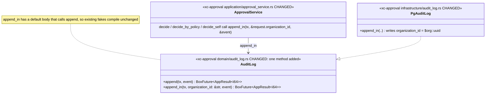
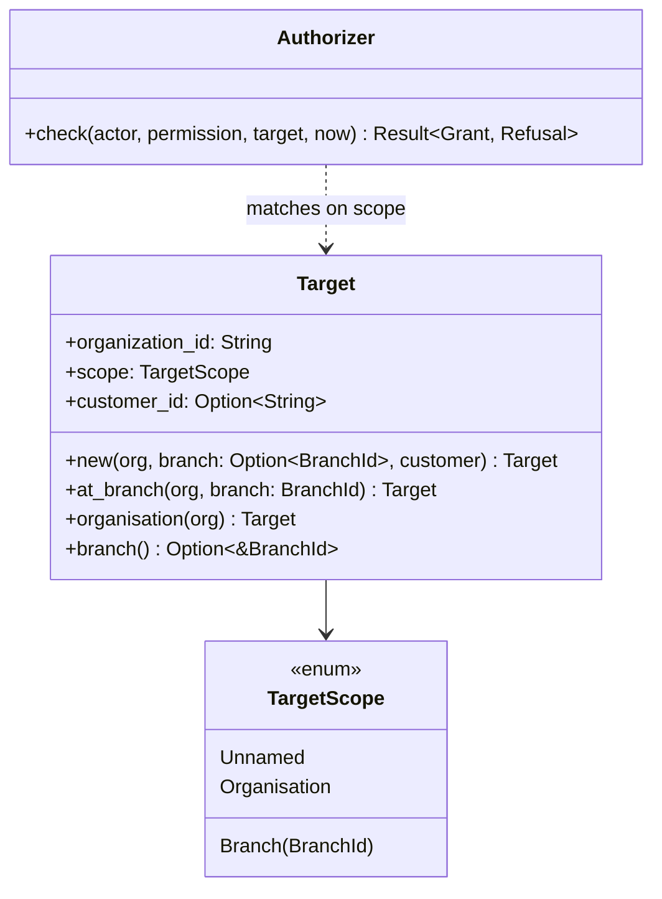

# An organisation-wide actor is never granted the literal branch `MAIN` (XC-ORG-WIDE-BRANCH, #5279)

> Design by claude/2ca5874b (Studio claude-1, sub-controller of #5279 under BE lane controller claude/553782), 2026-10-29 ICT.
> Measured on `origin/main` `28e1fead`. Brief: #5279 issuecomment-6482860815. Owner decision on site 2: #5279 issuecomment-6452390376.

## 0. The rule

Two places invent the branch `MAIN` for an organisation-wide actor:

| Site | Where | Today | After |
|---|---|---|---|
| 1 | `Authorizer::check`, the `has_org_wide` arm (`api/crates/xc-auth/src/domain/access/authorizer.rs:112-113`) | org-wide row, no session branch, and the target names no branch ⇒ grant on `MAIN` | **`outOfScope`**. The grant is the session branch, as for everyone else (`:104-111`). |
| 2 | `requester_branch` (`api/crates/xc-approval/src/application/approval_service.rs:9-49`), used at `:229` | an approval request is filed under the requester's first role row by a priority list. An org-wide row gives `MAIN`, and EXECUTIVE + ADMIN gives `NULL`. | **The object's branch**, passed by the caller. `requester_branch` is deleted. Owner, 2026-10-28: *"เก็บที่สาขาของสิ่งที่ขอ"* ("store it at the branch of the thing requested"). |

`MAIN` is the seeded organisation's branch (`api/migrations/20261007100000_branches_rates.sql:9`). It does not exist in a second organisation, so both stand-ins are wrong there. In the default organisation they are only right by chance.

## 1. Why site 1 changes no production path

- Every production reader turns a session into an actor through `SessionBranch::effective` (`api/src/presentation/extractors/session_actor.rs:29-31`; `extractors/actor.rs:199`).
- That gives anyone holding a valid row a branch. An org-wide row opens every branch, so the session branch is the first by code (`session_branch.rs:34-54`, `:60-68`).
- So a session actor never reaches the `has_org_wide` arm. The arm returns `MAIN` only when the actor has no branch at all, and the qualifying row would already cover the session branch at `:104-111`.

Production actors built without a session, swept by `git grep -n -E "(Actor|AccessActor|AuthActor)::new\(" -- 'api/src/**' 'api/crates/*/src/**'` outside `#[cfg(test)]` at `28e1fead`:

| Actor | Rows | Reaches `Authorizer::check` with a branchless target? |
|---|---|---|
| rate-feed system actor (`feed_publisher.rs:349`, `branch_refresh.rs:124`) | ADMIN at one branch | no: it is only the requester of an approval (site 2) |
| pricing-follow system actor (`market_pricing_loop.rs:214`) | ADMIN org-wide | no: `TierPublisher::publish_in` (`tier_publish.rs:45`) and the push run no `Authorizer::check` |
| `SaveStep::access_actor_at` (`save_step.rs:72-89`) | the owner org-wide, or staff at the branch | no: it is only the requester of an approval (confirm, reversal, binding quote) |
| `handover_service::may_receive` (`handover_service.rs:299`) | the candidate's rows | no: its target names the branch (`:300`) |
| custody saver (`xc-shift/.../custody/service.rs:139`) | no rows | no qualifying row, so the arm is not reached |
| **cash commands' `caller_in`** (`api/src/presentation/http/v3/commands/cash.rs:89-133`), used by 12 commands in `cash.rs`, `cash/handovers.rs` and `cash/transfers.rs` | the caller's rows re-read from `user_roles`, rebuilt with `User::new(..)` and **no branch** | **yes:** transfer `reconcile` (`transfer_flow.rs:794`) by an org-wide FINANCE. **#5279 fixes it**: `caller_in` keeps the session's branch (`.with_branch(who.branch.clone())`). The sweep above matched `Actor::new` only. This row was found by `v3_cash_commands_test::a_branch_transfer_walks_create_submit_dispatch_receive_reconcile_over_http`, red on the trial tree with its fixtures fixed (wave 2, #5458). A `User::new(` sweep outside `#[cfg(test)]` at `88221498` finds no other. |

Apart from `caller_in`, the only production checks with a branchless target are `appSettingsSave` (`xc-app/.../app_settings_service.rs:44`) and transfer `reconcile` (`transfer_flow.rs:794`). Both are given session actors. They are unchanged here. Whether organisation-level business should require an org-wide row is a separate question; this design does not decide it.

**The cost is in test fixtures.** About 245 files build org-wide actors with no session branch. Waves 1 and 2 of #5279 fix them, behaviour-neutral, before this lands: #5454 / PR #5455 merged as `28e1fead`, and the `all_1` … `all_4` tickets #5456–#5459. Two tests pin the `MAIN` stand-in itself; they are restated in §5.

## 2. Class diagram


The `request` signature change is the only one. `[required]`: `branch` comes right after `object_id`, and it is `Option<&BranchId>` (`xc_kernel::ids::BranchId`). `None` means the object belongs to the organisation and to no branch.

## 3. Who passes which branch

| # | Caller (`file:line` at `28e1fead`) | Approval type | `branch` | Changes from today when |
|---|---|---|---|---|
| 1 | `xc-cash/.../ledger_approval/count_difference.rs:243` | `COUNT_DIFFERENCE` | `Some(&count.branch_id)` (`cash_count.rs:43`) | never in practice: the counter is at the branch |
| 2 | `xc-cash/.../adjustment/adjustment_service.rs:177` | `LEDGER_ADJUSTMENT` | `Some(branch)` (the adjustment's branch, already checked at `:150-170`) | an org-wide FINANCE requests: `MAIN` → the adjustment's branch |
| 3 | `xc-cash/.../transfer/transfer_flow.rs:588` | `CASH_TRANSFER` | `Some(&t.from_branch)` (the sender, which `policy_actor` already scopes to, `approval/transfer.rs:29-43`) | an org-wide requester: `MAIN` → the sender |
| 4 | `xc-rate/.../draft/rate_draft_service.rs:695` | `RATE_PUBLICATION` | `Some(branch)` (`submit`'s branch; `rate_drafts.branch_id` is NOT NULL) | an org-wide RATE_MANAGER / owner: `MAIN` / `NULL` → the draft's branch |
| 5 | `xc-rate/.../publication/feed_publisher.rs:370` | feed batch | `Some(branch)` | never: the system actor is at that branch |
| 6 | `api/src/.../exchange/binding_issue.rs:225` | `BINDING_QUOTE` | `Some(&req.quote.branch_id)` | the owner requests: `NULL` → the quote's branch |
| 7 | `api/src/.../exchange/confirm.rs:151` | exchange approval | `Some(&t.branch_id)` | the owner requests: `NULL` → the transaction's branch |
| 8 | `api/src/.../exchange/reversal_request.rs:143` | reversal | `Some(&input.branch)` | the owner requests: `NULL` → the exchange's branch |
| 9 | `api/src/presentation/http/v3/commands/loyalty_rule_submit.rs:161` | `LOYALTY_RULE_VERSION` | `None`: a loyalty rule belongs to the organisation | a requester with a branch row: that branch / `MAIN` → `NULL` |
| 10 | `api/src/application/workflows/exchange/negative_stock_gate.rs:84` (`NegativeStockGate::open_after_refusal`) | `NEGATIVE_STOCK` | `Some(branch)`: the branch whose stock is short. `open_after_refusal` and `stock_refusal_answer` (`v3/negative_stock.rs:27`) gain a `branch: &BranchId` after `object`, which their three callers already hold (`commands/complete.rs:156`, `reversal_post.rs:157`, `cash/transfers.rs:222`, each scoped by `this_branchs`) | an org-wide requester (the owner: `NULL`) → the branch |

**Who reads the stored branch:**
- The decision policies call `ApprovalDecider::holds_on(who, p, request.branch_id)` (`approval_decider.rs:35-39`): `count_difference.rs:116`, `negative_stock.rs:72`, `exchange/approval.rs:171` and `binding_approval.rs:131`.
- The queue view: `views/approval_requests.rs:66`, `branch_id = $1 OR branch_id IS NULL`.

With the object's branch, a branch manager at that branch can decide an owner's request, as for any other requester. Today the stored `NULL` lets only org-wide rows cover it (`scoped_role.rs:58-63`). The loyalty policy uses `holds_anywhere` (`rule_approval.rs:230-239`), so `NULL` changes nothing for it.

**Decision C of 2026-10-21 (#4094) is replaced** (owner, #5279 issuecomment-6452390376). An org-wide non-executive of a second organisation is no longer refused: its request is stored on its own organisation's branch. The composite FK `approval_requests (organization_id, branch_id) → branches` accepts it, because the branch is that organisation's. Test `approval_request_organisation_test::row6_…` flips (§5).

## 4. Data migration

**None.** `approval_requests.branch_id` is already a nullable `text` column (`api/migrations/20261010110000_approvals.sql:4`), checked against the organisation's branches. "Remove `requester_branch`" removes a function, not a column.
1. **Existing rows** keep the branch they were stored with. A past `MAIN` or `NULL` stays as it is, and a pending one is decided under today's reading of it.
2. **Backfill:** none. Rewriting a decided request's branch would rewrite who was allowed to decide it.
3. **Deploy order:** the binary alone.
4. **Reversal:** a revert of the binary. Nothing in the schema moves.

## 5. Behaviour table and up-front tests

The sub-controller writes these on `test/5279` before release. They compile against the skeleton (§6) and fail on the stored or granted value.

| Row | Case | Required result | Test |
|---|---|---|---|
| S1-1 | org-wide EXECUTIVE, **no** session branch, target names no branch | `Err(OutOfScope)` | `xc-auth/tests/authorizer_test.rs`: restates `an_organisation_wide_user_works_on_the_branch_named_and_on_main_when_none_is` |
| S1-2 | the same actor with session branch `B01` | `Ok`, `grant.branch == B01` | the same test |
| S1-3 | the same actor, target names `B02` | `Ok`, `grant.branch == B02` | the same test |
| S1-4 | branch rows at one branch only, no session branch, target names none | unchanged: that branch | `xc-auth/tests/session_branch_test.rs`: restates `without_a_session_branch_the_old_arms_are_unchanged` |
| S1-5 | branch rows at two branches, no session branch, target names none | unchanged: `outOfScope` | the same test |
| S2-1 | `request(.., Some(B02), ..)` by an org-wide FINANCE | stored `branch_id = 'B02'` | `xc-approval/tests/approval_object_branch_test.rs` (new) |
| S2-2 | `request(.., Some(B02), ..)` by a RATE_MANAGER with rows at `B01` and `B02` | `'B02'` (today: its first row) | the same file |
| S2-3 | `request(.., None, ..)` by a TELLER at `B01` | `NULL` (today: `B01`) | the same file |
| S2-4 | `request(.., Some(B01), ..)` by EXECUTIVE + ADMIN org-wide | `'B01'` (today: `NULL`) | the same file |
| S2-5 | org-wide FINANCE of organisation B requests on B's branch | stored as `(B, <B's branch>)`; decidable by B's decider | `approval_request_organisation_test::row6_…` restated (decision C replaced) |
| S2-6 | an org-wide FINANCE's ledger adjustment on `B01` | `'B01'` (today: `MAIN`) | `xc-cash/tests/ledger_adjustment_approval_test.rs`, one new test |
| S2-7 | the owner's exchange over the limit at `B01` | `'B01'` (today: `NULL`); a BRANCH_MANAGER at `B01` may decide it | `api/tests/approval_object_branch_callers_test.rs` (new) |
| S2-8 | a loyalty rule version submitted by its creator | `NULL` | the same new file |

The fixture reds that wave 2 does not own also move to `test/5279`, behaviour-neutral: `authorizer_test` ×2 (customer, marketing), `xc-auth` `policy.rs` `#[cfg(test)]` ×1 and `xchange` `v3/action.rs` `#[cfg(test)]` ×2.

## 6. Skeleton and ticket

**Skeleton on `test/5279`** (sub-controller, not a ticket):
- the `request` signature of §2;
- the ten callers of §3 passing their branch;
- every test call of `request(..)` given its branch (`xc-approval/tests/approval_rules_test.rs`, `approval_subject_tx_test.rs`, `approval_unavailable_paths_test.rs`, `approval_request_organisation_test.rs`, `or71_stored_actor_test.rs`, and the api / `xc-cash` tests that call it);
- the tests of §5.

The body of `request` still calls `requester_branch` and ignores `branch`. So everything compiles, today's tests stay green, and S1-1 and S2-1 … S2-8 fail on the value.

**Ticket #5279** (`class:logic`, Gemini 4 Argon). File scope:
```
api/crates/xc-auth/src/domain/access/authorizer.rs
api/crates/xc-approval/src/application/approval_service.rs
```
- Remove the `has_org_wide` arm's `MAIN`, so that it refuses `OutOfScope`.
- Store `branch` in `request`, and delete `requester_branch`.
- Done = the §5 tests green, plus the files that waves 1 and 2 touched still green.

## 7. Out of scope

- Whether organisation-level business (`appSettingsSave`, transfer `reconcile`) should require an org-wide row instead of any row covering the session branch.
- Rewriting the branch of approval requests already stored (§4.2).

## 8. AP-1's audit row carries the request's organisation (lane controller's ruling A on #5279, 2026-10-29)

Found while writing the #5279 up-front tests.
- **The defect:** `PgAuditLog::append` (`api/crates/xc-approval/src/infrastructure/audit_log.rs:31-36`) writes no `organization_id`, so every audit row takes the seeded organisation (`20261011100000_organizations.sql:47`). The same migration adds `(organization_id, branch_id) → branches` to `audit_events` (`:66`).
- **The effect:** deciding a branch-bound request of a second organisation writes `(seeded organisation, B's branch)`, which breaks that FK. `decide`, `decide_self` and `decide_by_policy` then answer `internalError`.
- This is independent of sites 1 and 2.



- `[required]`: the three AP-1 audit writes (`approval_service.rs:354`, `:427`, `:516`) pass `request.organization_id` (`domain/request.rs:79`). `append` itself is unchanged.
- **Out of scope:** the other `AuditEvent` writers (`git grep -l "AuditEvent {" -- api`, 23 production files at `88221498`) still write the seeded organisation. Each one moving to `append_in` is a follow-up.
- **No migration:** `audit_events.organization_id` already exists.

## 9. An organisation-level target needs an organisation-wide row (#5514)

> Measured on `origin/main` `bdf1b0cd` (the code §9 cites is unchanged at `6d573093`). Ticket #5514 §3. The lane controller's rulings on the two open points: #5514 issuecomment-6495289565 (2026-10-29 18:22 ICT).

### 9.1 Why `Target` must say its kind

`Target.branch == None` means two things today (`api/crates/xc-auth/src/domain/access/authorizer.rs:91-125`):
- **unnamed**: a branch-level request that names no branch. SB-1 §14.3 grants the session branch when a qualifying row covers it, or else the single branch.
- **organisation**: the object belongs to the whole organisation, e.g. app settings (`xc-app/src/application/settings/app_settings_service.rs:41-46`). A branch-scoped row that covers the session branch passes too, so a branch ADMIN changes a setting of every branch.

`None` cannot tell these apart, so `Target` carries its kind. The rule for the organisation kind: **only an organisation-wide qualifying row acts on it**, and the grant is the session branch. With no session branch the answer is `outOfScope`, and no branch is invented (§0).

### 9.2 Class diagram



| Type / fn | File | Provided by | Used by |
|---|---|---|---|
| `TargetScope`; `Target.scope` replaces `Target.branch` | `api/crates/xc-auth/src/domain/access/authorizer.rs` | T1 | `Authorizer::check` only (the sweep in 9.3 found no field read outside this file) |
| `Target::new` | same | unchanged signature; `None` ⇒ `Unnamed`, `Some(b)` ⇒ `Branch(b)` | the 30 `Some(..)` callers and `policy.rs:269` |
| `Target::at_branch(org, b)` = `Target::new(org, Some(b), None)` | same | skeleton on `test/5514` (final form) | T2 (`transfer_flow.rs:802`) |
| `Target::organisation(org)` | same | skeleton on `test/5514` builds today's branchless target; T1 gives it `TargetScope::Organisation` | T1 (`app_settings_service.rs:44`) |
| `Target::branch()` | same | T1 | `Authorizer::check` |
| `TargetScope` re-export | `api/crates/xc-auth/src/domain/access/mod.rs:21` | T1 | — |
| `Authorizer::check`, the `Organisation` arm | `authorizer.rs` | T1 | — |

- `[required]` `Target::new`, `at_branch` and `organisation` keep these names and signatures; the up-front tests call them.
- `[proposed]` `Target::branch()` and the field name `scope`. Nothing outside `authorizer.rs` reads a `Target` field.
- `Target` derives `Serialize`/`Deserialize`; `git grep -n "Target" -- api | grep -i serde` at `6d573093` finds no serialisation of it, so the field rename changes no wire shape.

The `Authorizer::check` arms after T1 (`authorizer.rs:95-125` today):

| `target.scope` | Grant |
|---|---|
| `Branch(b)` | `b` when a qualifying row is org-wide or on `b`; else `outOfScope` (unchanged) |
| `Unnamed` | SB-1 §14.3 as today: the session branch if covered; else `outOfScope` if any row is org-wide (#5279); else the single branch |
| `Organisation` | the session branch when a qualifying row is org-wide **and** the actor has a session branch; else `outOfScope` |

### 9.3 Sweep: every `Target` construction (compiler)

**Method.** In a throwaway edit, `Target::new` and every `Target` field were marked `#[deprecated(note = "SWEEP-…")]`, then `cargo check --workspace --all-targets --message-format short` ran at `bdf1b0cd`. Every construction and field use outside `authorizer.rs` warns. Result: **33** production `Target::new` calls, **no** `Target { .. }` literal and **no** field read outside `authorizer.rs`.

| Row | Site | Target today | After | Tests that pin it |
|---|---|---|---|---|
| S | `xc-app/src/application/settings/app_settings_service.rs:44` (`appSettingsSave`) | `Target::new(org, None, None)` | **`Target::organisation(org)`** (T1) | `xc-app/tests/app_settings_test.rs` (org-wide ADMIN saves, `:71-200`); new `app_settings_org_level_test.rs` |
| R | `xc-cash/src/application/transfer/transfer_flow.rs:802` (`reconcile_on`) | `Target::new(org, None, None)` | **`Target::at_branch(org, t.from_branch)`** (T2); `t` is what `locked(..)` at `:786` already returns | `xc-cash/tests/transfer_flow_test.rs:616`, `lg4_reconcile_versions_test.rs`, `lg4_cutover_transfers_test.rs`, `services_on_caller_tx_test.rs`; api `cash_transfer_reconcile_other_org_test.rs`, `v3_cash_commands_test.rs`; new `transfer_reconcile_at_sender_test.rs` |
| P | `xc-auth/src/domain/policy/entities/policy.rs:269` (`Policy::authorize_with`, ~240 v3 routes plus RPC) | `Target::new(org, named, ..)` | unchanged (`None` ⇒ `Unnamed`) | `session_branch_test.rs`, `or4_routes_guard_test.rs`; route classification is #5526 |
| — | the other 30 calls, each `Some(branch)`: `xc-cash` `count_service.rs:840`, `:1052`, `:1129`; `handover_service.rs:300`, `:330`, `:586`, `:813`, `:879`; `transfer_flow.rs:62`; `domain/transfer/kinds/mod.rs:80`; `xc-customer` `customer/service.rs:354`; `xc-queue` `counter_service.rs:63`, `:123`; `queue_desk.rs:335`; `status_service.rs:277`, `:331`; `xc-shift` `branch_day/service.rs:108`, `:182`, `:230`, `:391`; api `settings/payment_settings.rs:77`; `staff_floor/reader.rs:59`, `:198`; v3 `cash_exception_raise.rs:143`, `cash_exception_review.rs:65`, `segment_define.rs:56`, `segment_snapshot.rs:95`, `supersede_referral.rs:76`, `export_gate.rs:44`, `views/me.rs:62`, `views/segment_preview.rs:55` | `Branch(b)` | unchanged | — |

**Existing tests that pin today's answer for S or R: none found.** With the throwaway fix applied (T1 and T2 together) at `bdf1b0cd`, `cargo nextest run -p xc-auth -p xc-app -p xc-cash` ran 1081 tests, 1081 passed. The api files that reach S or R (`app4_planner_routes_test`, `cash_transfer_reconcile_other_org_test`, `cash_transfer_stored_kind_status_test`, `v3_cash_commands_test`, `or4_routes_guard_test`, `rbac_f12_admin_groups_test`, `staff_entry_by_permission_test`, `v3_me_roles_permissions_test`, `device_after_save_in_test`, `devices_exact_test`, `devices_test`) ran 128 tests, 128 passed. The FINANCE fixtures in those files hold an org-wide row (`transfer_flow_test.rs:249-252`), which covers every sender. So no ticket below needs another test file in scope.

**The `Policy` path (row P) stays out of #5514** (ruling 2). It cannot be classified by permission: `grant_guard.rs:58-73` deliberately lets a branch-scoped ADMIN manage its own branch's users. The route-by-route classification is #5526.
- **Open, for the lane controller's review:** ruling 2 says `AreaRow` gets an optional scope that defaults to `Unnamed`. Rust struct literals have no field defaults, and `AreaRow { .. }` is written **154** times in **42** files (`git grep -c "AreaRow {" -- api/crates api/src` at `6d573093`). If #5514 adds the field, it must edit all 42 files while marking no route, and those files would be locked against other tickets. This design proposes that **the field lands with #5526, its first user**, and that #5514 gives #5526 only `TargetScope`. If you want the field in #5514 anyway, it becomes ticket T3 (the 42 area files, `class:mechanical`), released after T1.

### 9.4 Behaviour table

Organisation and unnamed targets (`Authorizer::check`, `Permission::SystemSettings`, ADMIN rows):

| # | Actor's qualifying rows | Session branch | Target | Today | After | Up-front test (`xc-auth/tests/org_level_target_test.rs`) |
|---|---|---|---|---|---|---|
| O-1 | org-wide | `B1` | organisation | grant `B1` | grant `B1` | `o1_…` |
| O-2 | `B1` only | `B1` | organisation | grant `B1` | **`outOfScope`** | `o2_…` (red today) |
| O-3 | `B1` and org-wide | `B1` | organisation | grant `B1` | grant `B1` | `o3_…` |
| O-4 | org-wide | none | organisation | `outOfScope` (#5279) | `outOfScope` (no invented branch, §0) | `o4_…` |
| O-5 | `B1` only | `B1` | unnamed | grant `B1` | grant `B1` (SB-1 §14.3) | `o5_…` |
| O-6 | `B1` only | none | unnamed | grant `B1` (single branch) | unchanged | `o6_…` |
| O-7 | org-wide, other organisation | `B1` | organisation | `outOfScope` | `outOfScope` | `another_organisation_…` |

The two call sites (the lane controller's four cases):

| # | Case | Today | After | Up-front test |
|---|---|---|---|---|
| S-1 | branch-scoped ADMIN at `MAIN`, session `MAIN`, `appSettingsSave` | saves | **`outOfScope`**, row unchanged | `xc-app/tests/app_settings_org_level_test.rs::a_branch_scoped_admin_in_a_session_is_refused_app_settings_save_and_writes_nothing` (red today) |
| S-2 | org-wide ADMIN, session `MAIN`, `appSettingsSave` | saves | saves | `…::an_organisation_wide_admin_in_a_session_saves_app_settings` |
| R-1 | FINANCE on `B1` (sender), session `B1`, reconciles `B1 → B2` | reconciles | reconciles | `xc-cash/tests/transfer_reconcile_at_sender_test.rs::finance_at_the_sender_branch_reconciles` |
| R-2 | FINANCE on `B2` (receiver), session `B2` | reconciles | **`outOfScope`**, stays RECEIVED | `…::finance_at_the_receiving_branch_is_refused_and_the_transfer_stays_received` (red today) |
| R-3 | FINANCE on `B3`, session `B3` | reconciles | **`outOfScope`**, stays RECEIVED | `…::finance_at_a_third_branch_is_refused_and_the_transfer_stays_received` (red today) |

Kept as they are: the creator and the receiver may not reconcile (`transfer_flow.rs:793-800`, checked before the `Authorizer`).

### 9.5 Up-front tests

Branch **`test/5514`** at `0248793d`, off `origin/main` `6d573093`:
- the skeleton: `Target::at_branch` and `Target::organisation` in `authorizer.rs` (+11 lines). `organisation` still builds today's branchless target;
- the three test files above, 13 tests.

Measured on the Mac Studio, private PG17:
- on `test/5514`: **4 red on the result** (O-2, S-1, R-2, R-3) and 9 green;
- with the throwaway T1 + T2 applied: 13/13 green;
- `cargo clippy -p xc-auth -p xc-app -p xc-cash --all-targets -D warnings` clean; `cargo fmt --all --check` and `bash scripts/fmt-included.sh origin/main` rc 0.

### 9.6 Data migration

None. No table, column, constraint or stored value changes. `Target` is built per request and never stored.

### 9.7 Function tickets

Both are released together, base `main`, branched from `test/5514`, `class:guarded`, Gemini 4 Argon. Their File scopes are disjoint, and each one's tests go green without the other.

| Ticket | File scope | Done line (`cd api`, `TEST_DATABASE_URL` set) |
|---|---|---|
| **T1** `TargetScope` and the `Organisation` arm; `appSettingsSave` uses it | `api/crates/xc-auth/src/domain/access/authorizer.rs`, `api/crates/xc-auth/src/domain/access/mod.rs`, `api/crates/xc-app/src/application/settings/app_settings_service.rs` | `cargo nextest run -p xc-auth -p xc-app -E 'test(/^(org_level_target_test\|app_settings_org_level_test\|app_settings_test\|authorizer_test\|session_branch_test)::/)'` all green |
| **T2** reconcile at the sender branch | `api/crates/xc-cash/src/application/transfer/transfer_flow.rs` | `cargo nextest run -p xc-cash -E 'test(/^(transfer_reconcile_at_sender_test\|transfer_flow_test\|lg4_reconcile_versions_test\|lg4_cutover_transfers_test\|services_on_caller_tx_test)::/)'` and `cargo nextest run -p xchange -E 'test(/^(cash_transfer_reconcile_other_org_test\|v3_cash_commands_test)::/)'` all green |

Both tickets also need `cargo clippy --all-targets -D warnings` on the crates they touch, and `bash scripts/fmt-included.sh origin/main` from the clone root at rc 0. Neither may edit the provided test files.

### 9.8 Out of scope

- The `Policy` route classification and the `AreaRow` scope field (#5526; see 9.3).
- A transfer reconciled at both branches (ruling 1: not taken).
- The other `None` meanings in `Policy::authorize_with` callers (row P).
