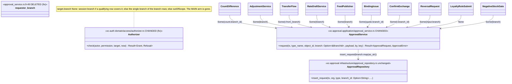
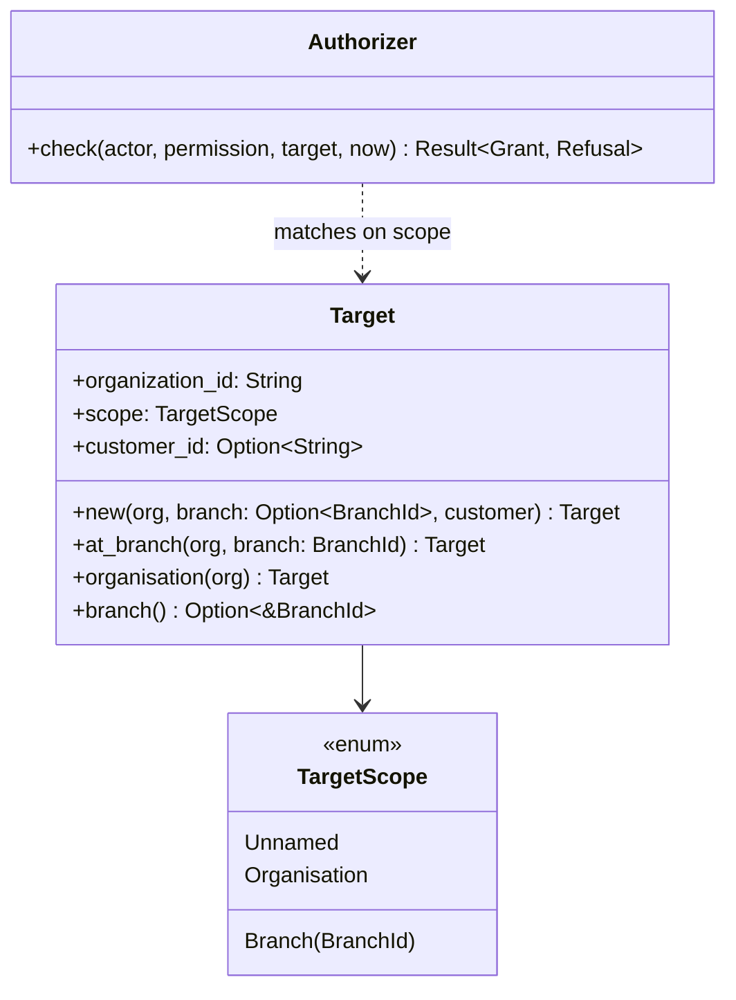
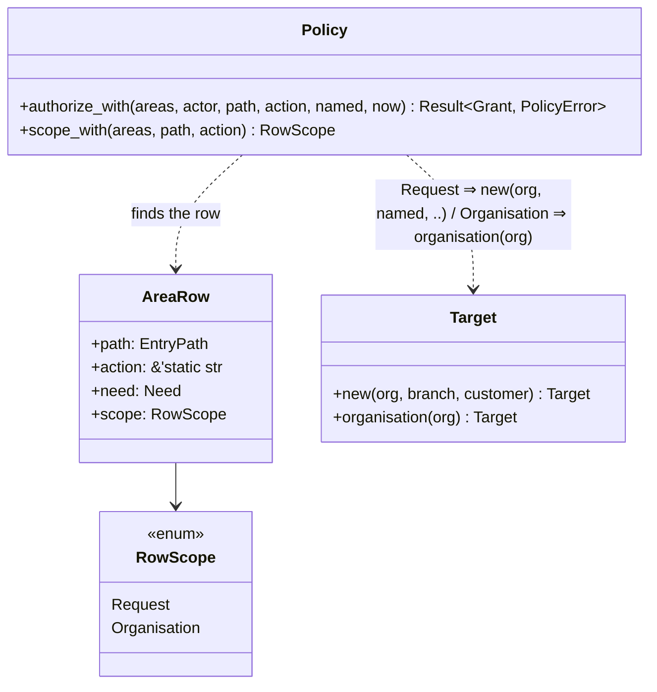

# An organisation-wide actor is never granted the literal branch `MAIN` (XC-ORG-WIDE-BRANCH, #5279)

> Design by claude/2ca5874b (Studio claude-1, sub-controller of #5279 under BE lane controller claude/553782), 2026-10-29 ICT.
> Measured on `origin/main` `28e1fead`. Brief: #5279 issuecomment-6482860815. Owner decision on site 2: #5279 issuecomment-6452390376.

## 0. The rule

Two places invent the branch `MAIN` for an organisation-wide actor:

| Site | Where | Today | After |
|---|---|---|---|
| 1 | `Authorizer::check`, the `has_org_wide` arm (`api/crates/xc-auth/src/domain/access/authorizer.rs:112-113`) | org-wide row, no session branch, and the target names no branch ⇒ grant on `MAIN` | **`outOfScope`**. The grant is the session branch, as for everyone else (`:104-111`). |
| 2 | `requester_branch` (`api/crates/xc-approval/src/application/approval_service.rs:9-49`), used at `:229` | an approval request is filed under the requester's first role row by a priority list. An org-wide row gives `MAIN`, and EXECUTIVE + ADMIN gives `NULL`. | **The object's branch**, passed by the caller. `requester_branch` is deleted. Owner, 2026-10-28: *"เก็บที่สาขาของสิ่งที่ขอ"* ("store it at the branch of the thing requested"). |

`MAIN` is the seeded organisation's branch (`api/migrations/20261007100000_branches_rates.sql:9`). It does not exist in a second organisation, so both stand-ins are wrong there. In the default organisation they are only right by chance.

## 1. Why site 1 changes no production path

- Every production reader turns a session into an actor through `SessionBranch::effective` (`api/src/presentation/extractors/session_actor.rs:29-31`; `extractors/actor.rs:199`).
- That gives anyone holding a valid row a branch. An org-wide row opens every branch, so the session branch is the first by code (`session_branch.rs:34-54`, `:60-68`).
- So a session actor never reaches the `has_org_wide` arm. The arm returns `MAIN` only when the actor has no branch at all, and the qualifying row would already cover the session branch at `:104-111`.

Production actors built without a session, swept by `git grep -n -E "(Actor|AccessActor|AuthActor)::new\(" -- 'api/src/**' 'api/crates/*/src/**'` outside `#[cfg(test)]` at `28e1fead`:

| Actor | Rows | Reaches `Authorizer::check` with a branchless target? |
|---|---|---|
| rate-feed system actor (`feed_publisher.rs:349`, `branch_refresh.rs:124`) | ADMIN at one branch | no: it is only the requester of an approval (site 2) |
| pricing-follow system actor (`market_pricing_loop.rs:214`) | ADMIN org-wide | no: `TierPublisher::publish_in` (`tier_publish.rs:45`) and the push run no `Authorizer::check` |
| `SaveStep::access_actor_at` (`save_step.rs:72-89`) | the owner org-wide, or staff at the branch | no: it is only the requester of an approval (confirm, reversal, binding quote) |
| `handover_service::may_receive` (`handover_service.rs:299`) | the candidate's rows | no: its target names the branch (`:300`) |
| custody saver (`xc-shift/.../custody/service.rs:139`) | no rows | no qualifying row, so the arm is not reached |
| **cash commands' `caller_in`** (`api/src/presentation/http/v3/commands/cash.rs:89-133`), used by 12 commands in `cash.rs`, `cash/handovers.rs` and `cash/transfers.rs` | the caller's rows re-read from `user_roles`, rebuilt with `User::new(..)` and **no branch** | **yes:** transfer `reconcile` (`transfer_flow.rs:794`) by an org-wide FINANCE. **#5279 fixes it**: `caller_in` keeps the session's branch (`.with_branch(who.branch.clone())`). The sweep above matched `Actor::new` only. This row was found by `v3_cash_commands_test::a_branch_transfer_walks_create_submit_dispatch_receive_reconcile_over_http`, red on the trial tree with its fixtures fixed (wave 2, #5458). A `User::new(` sweep outside `#[cfg(test)]` at `88221498` finds no other. |

Apart from `caller_in`, the only production checks with a branchless target are `appSettingsSave` (`xc-app/.../app_settings_service.rs:44`) and transfer `reconcile` (`transfer_flow.rs:794`). Both are given session actors. They are unchanged here. Whether organisation-level business should require an org-wide row is a separate question; this design does not decide it.

**The cost is in test fixtures.** About 245 files build org-wide actors with no session branch. Waves 1 and 2 of #5279 fix them, behaviour-neutral, before this lands: #5454 / PR #5455 merged as `28e1fead`, and the `all_1` … `all_4` tickets #5456–#5459. Two tests pin the `MAIN` stand-in itself; they are restated in §5.

## 2. Class diagram



The `request` signature change is the only one. `[required]`: `branch` comes right after `object_id`, and it is `Option<&BranchId>` (`xc_kernel::ids::BranchId`). `None` means the object belongs to the organisation and to no branch.

## 3. Who passes which branch

| # | Caller (`file:line` at `28e1fead`) | Approval type | `branch` | Changes from today when |
|---|---|---|---|---|
| 1 | `xc-cash/.../ledger_approval/count_difference.rs:243` | `COUNT_DIFFERENCE` | `Some(&count.branch_id)` (`cash_count.rs:43`) | never in practice: the counter is at the branch |
| 2 | `xc-cash/.../adjustment/adjustment_service.rs:177` | `LEDGER_ADJUSTMENT` | `Some(branch)` (the adjustment's branch, already checked at `:150-170`) | an org-wide FINANCE requests: `MAIN` → the adjustment's branch |
| 3 | `xc-cash/.../transfer/transfer_flow.rs:588` | `CASH_TRANSFER` | `Some(&t.from_branch)` (the sender, which `policy_actor` already scopes to, `approval/transfer.rs:29-43`) | an org-wide requester: `MAIN` → the sender |
| 4 | `xc-rate/.../draft/rate_draft_service.rs:695` | `RATE_PUBLICATION` | `Some(branch)` (`submit`'s branch; `rate_drafts.branch_id` is NOT NULL) | an org-wide RATE_MANAGER / owner: `MAIN` / `NULL` → the draft's branch |
| 5 | `xc-rate/.../publication/feed_publisher.rs:370` | feed batch | `Some(branch)` | never: the system actor is at that branch |
| 6 | `api/src/.../exchange/binding_issue.rs:225` | `BINDING_QUOTE` | `Some(&req.quote.branch_id)` | the owner requests: `NULL` → the quote's branch |
| 7 | `api/src/.../exchange/confirm.rs:151` | exchange approval | `Some(&t.branch_id)` | the owner requests: `NULL` → the transaction's branch |
| 8 | `api/src/.../exchange/reversal_request.rs:143` | reversal | `Some(&input.branch)` | the owner requests: `NULL` → the exchange's branch |
| 9 | `api/src/presentation/http/v3/commands/loyalty_rule_submit.rs:161` | `LOYALTY_RULE_VERSION` | `None`: a loyalty rule belongs to the organisation | a requester with a branch row: that branch / `MAIN` → `NULL` |
| 10 | `api/src/application/workflows/exchange/negative_stock_gate.rs:84` (`NegativeStockGate::open_after_refusal`) | `NEGATIVE_STOCK` | `Some(branch)`: the branch whose stock is short. `open_after_refusal` and `stock_refusal_answer` (`v3/negative_stock.rs:27`) gain a `branch: &BranchId` after `object`, which their three callers already hold (`commands/complete.rs:156`, `reversal_post.rs:157`, `cash/transfers.rs:222`, each scoped by `this_branchs`) | an org-wide requester (the owner: `NULL`) → the branch |

**Who reads the stored branch:**
- The decision policies call `ApprovalDecider::holds_on(who, p, request.branch_id)` (`approval_decider.rs:35-39`): `count_difference.rs:116`, `negative_stock.rs:72`, `exchange/approval.rs:171` and `binding_approval.rs:131`.
- The queue view: `views/approval_requests.rs:66`, `branch_id = $1 OR branch_id IS NULL`.

With the object's branch, a branch manager at that branch can decide an owner's request, as for any other requester. Today the stored `NULL` lets only org-wide rows cover it (`scoped_role.rs:58-63`). The loyalty policy uses `holds_anywhere` (`rule_approval.rs:230-239`), so `NULL` changes nothing for it.

**Decision C of 2026-10-21 (#4094) is replaced** (owner, #5279 issuecomment-6452390376). An org-wide non-executive of a second organisation is no longer refused: its request is stored on its own organisation's branch. The composite FK `approval_requests (organization_id, branch_id) → branches` accepts it, because the branch is that organisation's. Test `approval_request_organisation_test::row6_…` flips (§5).

## 4. Data migration

**None.** `approval_requests.branch_id` is already a nullable `text` column (`api/migrations/20261010110000_approvals.sql:4`), checked against the organisation's branches. "Remove `requester_branch`" removes a function, not a column.
1. **Existing rows** keep the branch they were stored with. A past `MAIN` or `NULL` stays as it is, and a pending one is decided under today's reading of it.
2. **Backfill:** none. Rewriting a decided request's branch would rewrite who was allowed to decide it.
3. **Deploy order:** the binary alone.
4. **Reversal:** a revert of the binary. Nothing in the schema moves.

## 5. Behaviour table and up-front tests

The sub-controller writes these on `test/5279` before release. They compile against the skeleton (§6) and fail on the stored or granted value.

| Row | Case | Required result | Test |
|---|---|---|---|
| S1-1 | org-wide EXECUTIVE, **no** session branch, target names no branch | `Err(OutOfScope)` | `xc-auth/tests/authorizer_test.rs`: restates `an_organisation_wide_user_works_on_the_branch_named_and_on_main_when_none_is` |
| S1-2 | the same actor with session branch `B01` | `Ok`, `grant.branch == B01` | the same test |
| S1-3 | the same actor, target names `B02` | `Ok`, `grant.branch == B02` | the same test |
| S1-4 | branch rows at one branch only, no session branch, target names none | unchanged: that branch | `xc-auth/tests/session_branch_test.rs`: restates `without_a_session_branch_the_old_arms_are_unchanged` |
| S1-5 | branch rows at two branches, no session branch, target names none | unchanged: `outOfScope` | the same test |
| S2-1 | `request(.., Some(B02), ..)` by an org-wide FINANCE | stored `branch_id = 'B02'` | `xc-approval/tests/approval_object_branch_test.rs` (new) |
| S2-2 | `request(.., Some(B02), ..)` by a RATE_MANAGER with rows at `B01` and `B02` | `'B02'` (today: its first row) | the same file |
| S2-3 | `request(.., None, ..)` by a TELLER at `B01` | `NULL` (today: `B01`) | the same file |
| S2-4 | `request(.., Some(B01), ..)` by EXECUTIVE + ADMIN org-wide | `'B01'` (today: `NULL`) | the same file |
| S2-5 | org-wide FINANCE of organisation B requests on B's branch | stored as `(B, <B's branch>)`; decidable by B's decider | `approval_request_organisation_test::row6_…` restated (decision C replaced) |
| S2-6 | an org-wide FINANCE's ledger adjustment on `B01` | `'B01'` (today: `MAIN`) | `xc-cash/tests/ledger_adjustment_approval_test.rs`, one new test |
| S2-7 | the owner's exchange over the limit at `B01` | `'B01'` (today: `NULL`); a BRANCH_MANAGER at `B01` may decide it | `api/tests/approval_object_branch_callers_test.rs` (new) |
| S2-8 | a loyalty rule version submitted by its creator | `NULL` | the same new file |

The fixture reds that wave 2 does not own also move to `test/5279`, behaviour-neutral: `authorizer_test` ×2 (customer, marketing), `xc-auth` `policy.rs` `#[cfg(test)]` ×1 and `xchange` `v3/action.rs` `#[cfg(test)]` ×2.

## 6. Skeleton and ticket

**Skeleton on `test/5279`** (sub-controller, not a ticket):
- the `request` signature of §2;
- the ten callers of §3 passing their branch;
- every test call of `request(..)` given its branch (`xc-approval/tests/approval_rules_test.rs`, `approval_subject_tx_test.rs`, `approval_unavailable_paths_test.rs`, `approval_request_organisation_test.rs`, `or71_stored_actor_test.rs`, and the api / `xc-cash` tests that call it);
- the tests of §5.

The body of `request` still calls `requester_branch` and ignores `branch`. So everything compiles, today's tests stay green, and S1-1 and S2-1 … S2-8 fail on the value.

**Ticket #5279** (`class:logic`, Gemini 4 Argon). File scope:
```
api/crates/xc-auth/src/domain/access/authorizer.rs
api/crates/xc-approval/src/application/approval_service.rs
```
- Remove the `has_org_wide` arm's `MAIN`, so that it refuses `OutOfScope`.
- Store `branch` in `request`, and delete `requester_branch`.
- Done = the §5 tests green, plus the files that waves 1 and 2 touched still green.

## 7. Out of scope

- Whether organisation-level business (`appSettingsSave`, transfer `reconcile`) should require an org-wide row instead of any row covering the session branch.
- Rewriting the branch of approval requests already stored (§4.2).

## 8. AP-1's audit row carries the request's organisation (lane controller's ruling A on #5279, 2026-10-29)

Found while writing the #5279 up-front tests.
- **The defect:** `PgAuditLog::append` (`api/crates/xc-approval/src/infrastructure/audit_log.rs:31-36`) writes no `organization_id`, so every audit row takes the seeded organisation (`20261011100000_organizations.sql:47`). The same migration adds `(organization_id, branch_id) → branches` to `audit_events` (`:66`).
- **The effect:** deciding a branch-bound request of a second organisation writes `(seeded organisation, B's branch)`, which breaks that FK. `decide`, `decide_self` and `decide_by_policy` then answer `internalError`.
- This is independent of sites 1 and 2.


- `[required]`: the three AP-1 audit writes (`approval_service.rs:354`, `:427`, `:516`) pass `request.organization_id` (`domain/request.rs:79`). `append` itself is unchanged.
- **Out of scope:** the other `AuditEvent` writers (`git grep -l "AuditEvent {" -- api`, 23 production files at `88221498`) still write the seeded organisation. Each one moving to `append_in` is a follow-up.
- **No migration:** `audit_events.organization_id` already exists.

## 9. An organisation-level target needs an organisation-wide row (#5514)

> Measured on `origin/main` `bdf1b0cd` (the code §9 cites is unchanged at `6d573093`). Ticket #5514 §3. The lane controller's rulings on the two open points: #5514 issuecomment-6495289565 (2026-10-29 18:22 ICT).

### 9.1 Why `Target` must say its kind

`Target.branch == None` means two things today (`api/crates/xc-auth/src/domain/access/authorizer.rs:91-125`):
- **unnamed**: a branch-level request that names no branch. SB-1 §14.3 grants the session branch when a qualifying row covers it, or else the single branch.
- **organisation**: the object belongs to the whole organisation, e.g. app settings (`xc-app/src/application/settings/app_settings_service.rs:41-46`). A branch-scoped row that covers the session branch passes too, so a branch ADMIN changes a setting of every branch.

`None` cannot tell these apart, so `Target` carries its kind. The rule for the organisation kind: **only an organisation-wide qualifying row acts on it**, and the grant is the session branch. With no session branch the answer is `outOfScope`, and no branch is invented (§0).

### 9.2 Class diagram



| Type / fn | File | Provided by | Used by |
|---|---|---|---|
| `TargetScope`; `Target.scope` replaces `Target.branch` | `api/crates/xc-auth/src/domain/access/authorizer.rs` | T1 | `Authorizer::check` only (the sweep in 9.3 found no field read outside this file) |
| `Target::new` | same | unchanged signature; `None` ⇒ `Unnamed`, `Some(b)` ⇒ `Branch(b)` | the 30 `Some(..)` callers and `policy.rs:269` |
| `Target::at_branch(org, b)` = `Target::new(org, Some(b), None)` | same | skeleton on `test/5514` (final form) | T2 (`transfer_flow.rs:802`) |
| `Target::organisation(org)` | same | skeleton on `test/5514` builds today's branchless target; T1 gives it `TargetScope::Organisation` | T1 (`app_settings_service.rs:44`) |
| `Target::branch()` | same | T1 | `Authorizer::check` |
| `TargetScope` re-export | `api/crates/xc-auth/src/domain/access/mod.rs:21` | T1 | — |
| `Authorizer::check`, the `Organisation` arm | `authorizer.rs` | T1 | — |

- `[required]` `Target::new`, `at_branch` and `organisation` keep these names and signatures; the up-front tests call them.
- `[proposed]` `Target::branch()` and the field name `scope`. Nothing outside `authorizer.rs` reads a `Target` field.
- `Target` derives `Serialize`/`Deserialize`; `git grep -n "Target" -- api | grep -i serde` at `6d573093` finds no serialisation of it, so the field rename changes no wire shape.

The `Authorizer::check` arms after T1 (`authorizer.rs:95-125` today):

| `target.scope` | Grant |
|---|---|
| `Branch(b)` | `b` when a qualifying row is org-wide or on `b`; else `outOfScope` (unchanged) |
| `Unnamed` | SB-1 §14.3 as today: the session branch if covered; else `outOfScope` if any row is org-wide (#5279); else the single branch |
| `Organisation` | the session branch when a qualifying row is org-wide **and** the actor has a session branch; else `outOfScope` |

### 9.3 Sweep: every `Target` construction (compiler)

**Method.** In a throwaway edit, `Target::new` and every `Target` field were marked `#[deprecated(note = "SWEEP-…")]`, then `cargo check --workspace --all-targets --message-format short` ran at `bdf1b0cd`. Every construction and field use outside `authorizer.rs` warns. Result: **33** production `Target::new` calls, **no** `Target { .. }` literal and **no** field read outside `authorizer.rs`.

| Row | Site | Target today | After | Tests that pin it |
|---|---|---|---|---|
| S | `xc-app/src/application/settings/app_settings_service.rs:44` (`appSettingsSave`) | `Target::new(org, None, None)` | **`Target::organisation(org)`** (T1) | `xc-app/tests/app_settings_test.rs` (org-wide ADMIN saves, `:71-200`); new `app_settings_org_level_test.rs` |
| R | `xc-cash/src/application/transfer/transfer_flow.rs:802` (`reconcile_on`) | `Target::new(org, None, None)` | **`Target::at_branch(org, t.from_branch)`** (T2); `t` is what `locked(..)` at `:786` already returns | `xc-cash/tests/transfer_flow_test.rs:616`, `lg4_reconcile_versions_test.rs`, `lg4_cutover_transfers_test.rs`, `services_on_caller_tx_test.rs`; api `cash_transfer_reconcile_other_org_test.rs`, `v3_cash_commands_test.rs`; new `transfer_reconcile_at_sender_test.rs` |
| P | `xc-auth/src/domain/policy/entities/policy.rs:269` (`Policy::authorize_with`, ~240 v3 routes plus RPC) | `Target::new(org, named, ..)` | unchanged (`None` ⇒ `Unnamed`) | `session_branch_test.rs`, `or4_routes_guard_test.rs`; route classification is #5526 |
| — | the other 30 calls, each `Some(branch)`: `xc-cash` `count_service.rs:840`, `:1052`, `:1129`; `handover_service.rs:300`, `:330`, `:586`, `:813`, `:879`; `transfer_flow.rs:62`; `domain/transfer/kinds/mod.rs:80`; `xc-customer` `customer/service.rs:354`; `xc-queue` `counter_service.rs:63`, `:123`; `queue_desk.rs:335`; `status_service.rs:277`, `:331`; `xc-shift` `branch_day/service.rs:108`, `:182`, `:230`, `:391`; api `settings/payment_settings.rs:77`; `staff_floor/reader.rs:59`, `:198`; v3 `cash_exception_raise.rs:143`, `cash_exception_review.rs:65`, `segment_define.rs:56`, `segment_snapshot.rs:95`, `supersede_referral.rs:76`, `export_gate.rs:44`, `views/me.rs:62`, `views/segment_preview.rs:55` | `Branch(b)` | unchanged | — |

**Existing tests that pin today's answer for S or R: none found.** With the throwaway fix applied (T1 and T2 together) at `bdf1b0cd`, `cargo nextest run -p xc-auth -p xc-app -p xc-cash` ran 1081 tests, 1081 passed. The api files that reach S or R (`app4_planner_routes_test`, `cash_transfer_reconcile_other_org_test`, `cash_transfer_stored_kind_status_test`, `v3_cash_commands_test`, `or4_routes_guard_test`, `rbac_f12_admin_groups_test`, `staff_entry_by_permission_test`, `v3_me_roles_permissions_test`, `device_after_save_in_test`, `devices_exact_test`, `devices_test`) ran 128 tests, 128 passed. The FINANCE fixtures in those files hold an org-wide row (`transfer_flow_test.rs:249-252`), which covers every sender. So no ticket below needs another test file in scope.

**The `Policy` path (row P) stays out of #5514** (ruling 2). It cannot be classified by permission: `grant_guard.rs:58-73` deliberately lets a branch-scoped ADMIN manage its own branch's users. The route-by-route classification is #5526.
- **Open, for the lane controller's review:** ruling 2 says `AreaRow` gets an optional scope that defaults to `Unnamed`. Rust struct literals have no field defaults, and `AreaRow { .. }` is written **154** times in **42** files (`git grep -c "AreaRow {" -- api/crates api/src` at `6d573093`). If #5514 adds the field, it must edit all 42 files while marking no route, and those files would be locked against other tickets. This design proposes that **the field lands with #5526, its first user**, and that #5514 gives #5526 only `TargetScope`. If you want the field in #5514 anyway, it becomes ticket T3 (the 42 area files, `class:mechanical`), released after T1.

### 9.4 Behaviour table

Organisation and unnamed targets (`Authorizer::check`, `Permission::SystemSettings`, ADMIN rows):

| # | Actor's qualifying rows | Session branch | Target | Today | After | Up-front test (`xc-auth/tests/org_level_target_test.rs`) |
|---|---|---|---|---|---|---|
| O-1 | org-wide | `B1` | organisation | grant `B1` | grant `B1` | `o1_…` |
| O-2 | `B1` only | `B1` | organisation | grant `B1` | **`outOfScope`** | `o2_…` (red today) |
| O-3 | `B1` and org-wide | `B1` | organisation | grant `B1` | grant `B1` | `o3_…` |
| O-4 | org-wide | none | organisation | `outOfScope` (#5279) | `outOfScope` (no invented branch, §0) | `o4_…` |
| O-5 | `B1` only | `B1` | unnamed | grant `B1` | grant `B1` (SB-1 §14.3) | `o5_…` |
| O-6 | `B1` only | none | unnamed | grant `B1` (single branch) | unchanged | `o6_…` |
| O-7 | org-wide, other organisation | `B1` | organisation | `outOfScope` | `outOfScope` | `another_organisation_…` |

The two call sites (the lane controller's four cases):

| # | Case | Today | After | Up-front test |
|---|---|---|---|---|
| S-1 | branch-scoped ADMIN at `MAIN`, session `MAIN`, `appSettingsSave` | saves | **`outOfScope`**, row unchanged | `xc-app/tests/app_settings_org_level_test.rs::a_branch_scoped_admin_in_a_session_is_refused_app_settings_save_and_writes_nothing` (red today) |
| S-2 | org-wide ADMIN, session `MAIN`, `appSettingsSave` | saves | saves | `…::an_organisation_wide_admin_in_a_session_saves_app_settings` |
| R-1 | FINANCE on `B1` (sender), session `B1`, reconciles `B1 → B2` | reconciles | reconciles | `xc-cash/tests/transfer_reconcile_at_sender_test.rs::finance_at_the_sender_branch_reconciles` |
| R-2 | FINANCE on `B2` (receiver), session `B2` | reconciles | **`outOfScope`**, stays RECEIVED | `…::finance_at_the_receiving_branch_is_refused_and_the_transfer_stays_received` (red today) |
| R-3 | FINANCE on `B3`, session `B3` | reconciles | **`outOfScope`**, stays RECEIVED | `…::finance_at_a_third_branch_is_refused_and_the_transfer_stays_received` (red today) |

Kept as they are: the creator and the receiver may not reconcile (`transfer_flow.rs:793-800`, checked before the `Authorizer`).

### 9.5 Up-front tests

Branch **`test/5514`** at `0248793d`, off `origin/main` `6d573093`:
- the skeleton: `Target::at_branch` and `Target::organisation` in `authorizer.rs` (+11 lines). `organisation` still builds today's branchless target;
- the three test files above, 13 tests.

Measured on the Mac Studio, private PG17:
- on `test/5514`: **4 red on the result** (O-2, S-1, R-2, R-3) and 9 green;
- with the throwaway T1 + T2 applied: 13/13 green;
- `cargo clippy -p xc-auth -p xc-app -p xc-cash --all-targets -D warnings` clean; `cargo fmt --all --check` and `bash scripts/fmt-included.sh origin/main` rc 0.

### 9.6 Data migration

None. No table, column, constraint or stored value changes. `Target` is built per request and never stored.

### 9.7 Function tickets

Both are released together, base `main`, branched from `test/5514`, `class:guarded`, Gemini 4 Argon. Their File scopes are disjoint, and each one's tests go green without the other.

| Ticket | File scope | Done line (`cd api`, `TEST_DATABASE_URL` set) |
|---|---|---|
| **T1** `TargetScope` and the `Organisation` arm; `appSettingsSave` uses it | `api/crates/xc-auth/src/domain/access/authorizer.rs`, `api/crates/xc-auth/src/domain/access/mod.rs`, `api/crates/xc-app/src/application/settings/app_settings_service.rs` | `cargo nextest run -p xc-auth -p xc-app -E 'test(/^(org_level_target_test\|app_settings_org_level_test\|app_settings_test\|authorizer_test\|session_branch_test)::/)'` all green |
| **T2** reconcile at the sender branch | `api/crates/xc-cash/src/application/transfer/transfer_flow.rs` | `cargo nextest run -p xc-cash -E 'test(/^(transfer_reconcile_at_sender_test\|transfer_flow_test\|lg4_reconcile_versions_test\|lg4_cutover_transfers_test\|services_on_caller_tx_test)::/)'` and `cargo nextest run -p xchange -E 'test(/^(cash_transfer_reconcile_other_org_test\|v3_cash_commands_test)::/)'` all green |

Both tickets also need `cargo clippy --all-targets -D warnings` on the crates they touch, and `bash scripts/fmt-included.sh origin/main` from the clone root at rc 0. Neither may edit the provided test files.

### 9.8 Out of scope

- The `Policy` route classification and the `AreaRow` scope field (#5526; see 9.3).
- A transfer reconciled at both branches (ruling 1: not taken).
- The other `None` meanings in `Policy::authorize_with` callers (row P).


## 10. Policy rows whose object is the whole organisation (#5526)

> Design by claude/2ca5874b (BE lane, under claude/553782), 2026-10-29 ICT. Measured on `origin/main` `bf5305fc`, which has #5514's `TargetScope` (`82330436`). Ticket #5526 §3. The `AreaRow` scope field lands here (claude/553782's scope note on #5526, 2026-10-29 20:43 ICT).

### 10.1 Why each row says its kind

**The chain.** A branch-scoped role can act on an organisation-level object by naming no branch:
- Every v3 route is authorized by `Policy::authorize_with` (`api/crates/xc-auth/src/domain/policy/entities/policy.rs:269`). It builds `Target::new(org, named, ..)`, where `named` is the request's `branch` (`v3/command.rs:342`, `v3/view.rs:600`), and `None` from an `OrgView` (`v3/org_view.rs:128`).
- With no `branch`, the target is `TargetScope::Unnamed`. `Authorizer::check` then grants the session branch to any qualifying row that covers it (`authorizer.rs:133-155`, SB-1 §14.3).
- So a branch-scoped row passes even when the object belongs to the whole organisation. One example: `margin_guards` has one row per organisation (`margin_guard_set.rs:95-97`), and a group holding `RatePolicySave` on one branch could set it.

**Why the kind goes on each row, not on each permission:**
- Groups are editable (RBAC §11, `role_grants.rs`), so any permission can sit on a branch-scoped row.
- One permission covers objects of both kinds. `BranchesManage` covers `branchSave`, whose object is one branch, and `bookingPolicySet`, whose object is the organisation's single booking policy.
- `grant_guard.rs:58-76` deliberately lets a branch-scoped ADMIN manage its own branch's users.

So the kind is set per row.

### 10.2 Class diagram



| Item | File | Provided by | Used by |
|---|---|---|---|
| `RowScope { Request, Organisation }` and the field `AreaRow.scope` | `api/crates/xc-auth/src/domain/policy/areas/mod.rs` | skeleton on `test/5526` | every area file; `Policy` |
| `scope: RowScope::Request` on every `AreaRow` literal (147 literals: 39 area files and 2 test files) | the area files and `xc-auth/tests/{area_rows_seam,policy_need_any_of}_test.rs` | skeleton (mechanical; compile only) | — |
| `Policy::scope_with` (a route-table row or no row ⇒ `Request`), and the `match` in `authorize_with` that builds the target | `api/crates/xc-auth/src/domain/policy/entities/policy.rs` | skeleton | — |
| the named-branch check: `let checked = named.unwrap_or(&grant.branch)` before `require_branch` / `require_branch_in_caller_org` | `api/src/presentation/http/v3/{command,action,view}.rs` | skeleton | — |
| `scope: RowScope::Organisation` on the rows of 10.3 | each ticket's area files | **T1, T2, T3** | — |

- `[required]` `RowScope`, its two variants, the field name `scope` and `Policy::scope_with(areas, path, action) -> RowScope`. The up-front tests name them.
- `[proposed]` A file whose rows come from a helper adds a second helper for the organisation rows, e.g. `org_row` in `org_admin.rs`, which is `AreaRow { scope: RowScope::Organisation, ..row(action, permission) }`.
- **Why the skeleton carries the wiring.** With every row `Request`, the new `match` builds exactly today's target, so the skeleton changes no answer. The existing suite proves that (10.5). Each ticket then only marks its own rows, and the three run together with no ticket waiting on another.
- An `Organisation` row grants the session branch, whatever `branch` the request names. With no session branch the answer is `outOfScope`, as #5514 §9.2 rules for `Target::organisation`.
- **The transport still checks the branch the request named.** Today the v3 transport checks only `grant.branch`: `require_branch` (`noSuchBranch`) and `require_branch_in_caller_org` (`outOfScope`) at `v3/command.rs:380`, `v3/action.rs:187`, `v3/view.rs:612-617` and `:730-735` on `bf5305fc`. Under an `Organisation` row `grant.branch` is the session branch, so a named branch of another organisation, or one that does not exist, would pass unchecked. The measured result: `view_org_scope_test::a_paged_view_naming_another_organisations_branch_is_out_of_scope` answered 200 and `v3_view_unknown_branch_test::every_generated_view_refuses_an_unknown_branch` answered 200 for `admin_employee_register`. The skeleton therefore checks `named.unwrap_or(grant.branch)` at those four sites. For a `Request` row the two are the same branch whenever a branch is named, so nothing changes today. `Need::Public` rows answer before the target is built (`policy.rs:211` on `test/5526`). An `Organisation` row must not be `Public` or `CustomerSelf`; `row_scope_test.rs::w5_…` pins this.
- The `build.rs` generator (`build_support/area_rows.rs:31-55`) reads only the file names and the `pub const ROWS: &[AreaRow]` line, so it is unchanged.

### 10.3 Every area row (169, from `AREA_ROWS` at `bf5305fc`)

**Method.**
- A throwaway test printed every `AREA_ROWS` row (169: 160 `Rpc`, 9 `StaffRpc`).
- For each action, I found every route whose `INHERITS` or `authenticate_and_authorize` names it (`git grep '"<action>"' -- api/src`). I then read its input, the table it reads or writes, and how it uses `grant.branch`.
- **Kind `Request`** = the object is on a branch (the named branch, the grant's branch, or the object's own branch, which a service re-checks), or it is the caller's own record or one customer's.
- **Kind `Organisation`** = the object is keyed by the organisation alone. A view is marked `Organisation` only when it does not use the named branch, because an `Organisation` row ignores it.

29 rows are marked `Organisation`, in three ticket groups: 17 are decided here, because the object has no branch at all, and 12 are B-1's (10.8, the owner chose `Organisation`). B-2's 4 rows stay `Request` by the owner's answer (10.8). The other 140 stay `Request` too.


| Area file | Path | Action | Need | Kind | Why |
|---|---|---|---|---|---|
| `alert_settings` | Rpc | `branchAlertSettings` | AlertSettingsSave | Request | `branch_alert_settings` (org, branch); the request's `branch` is the object (`branch_alert_settings_save.rs:45`) |
| `alert_settings` | Rpc | `branchAlertSettingsSave` | AlertSettingsSave | Request | `branch_alert_settings` (org, branch); the request's `branch` is the object (`branch_alert_settings_save.rs:45`) |
| `assistant` | Rpc | `assistantAsk` | Public | Request | `Public`; no target is checked |
| `assistant` | Rpc | `my_assistant_conversation` | Public | Request | `Public`; no target is checked |
| `binding_quote` | Rpc | `bindingQuoteIssue` | BindingQuoteIssue | Request | the quote is made at `grant.branch` (`binding_quote_issue.rs:278`) |
| `bookings` | Rpc | `bookingCreate` | AnyOf([CustomerSelf, BookingsDesk]) | Request | a booking, slot or closure of one branch (`grant.branch`, or path `{id}` locked to it) |
| `bookings` | Rpc | `bookingCheckIn` | BookingsDesk | Request | a booking, slot or closure of one branch (`grant.branch`, or path `{id}` locked to it) |
| `bookings` | Rpc | `kioskBookingCheckIn` | QueueOperate | Request | a booking, slot or closure of one branch (`grant.branch`, or path `{id}` locked to it) |
| `bookings` | Rpc | `bookingConfirm` | CustomerSelf | Request | the customer's own booking |
| `bookings` | Rpc | `bookingCancel` | AnyOf([CustomerSelf, BookingsDesk]) | Request | a booking, slot or closure of one branch (`grant.branch`, or path `{id}` locked to it) |
| `bookings` | Rpc | `bookingReschedule` | AnyOf([CustomerSelf, BookingsDesk]) | Request | a booking, slot or closure of one branch (`grant.branch`, or path `{id}` locked to it) |
| `bookings` | Rpc | `bookingQrReissue` | AnyOf([CustomerSelf, BookingsDesk]) | Request | a booking, slot or closure of one branch (`grant.branch`, or path `{id}` locked to it) |
| `bookings` | Rpc | `slotRuleSet` | BranchesManage | Request | a booking, slot or closure of one branch (`grant.branch`, or path `{id}` locked to it) |
| `bookings` | Rpc | `closureAdd` | BranchesManage | Request | a booking, slot or closure of one branch (`grant.branch`, or path `{id}` locked to it) |
| `bookings` | Rpc | `closureRemove` | BranchesManage | Request | a booking, slot or closure of one branch (`grant.branch`, or path `{id}` locked to it) |
| `bookings` | Rpc | `slotCapacitySet` | BranchesManage | Request | a booking, slot or closure of one branch (`grant.branch`, or path `{id}` locked to it) |
| `bookings` | Rpc | `slotClose` | BranchesManage | Request | a booking, slot or closure of one branch (`grant.branch`, or path `{id}` locked to it) |
| `bookings` | Rpc | `slotOpen` | BranchesManage | Request | a booking, slot or closure of one branch (`grant.branch`, or path `{id}` locked to it) |
| `bookings` | Rpc | `bookingPolicySet` | BranchesManage | **Organisation** | `booking_policies` keyed by organisation (`20261205131000_booking_slots.sql:24`); the handler already refuses a non-org-wide scope (`bookings/policy.rs:59-63`) |
| `bookings` | Rpc | `booking_slots` | Public | Request | `Public` |
| `bookings` | Rpc | `desk_bookings` | BookingsDesk | Request | a booking, slot or closure of one branch (`grant.branch`, or path `{id}` locked to it) |
| `bookings` | Rpc | `my_bookings` | CustomerSelf | Request | the customer's own bookings |
| `bookings` | Rpc | `admin_booking_slots` | BranchesManage | Request | a booking, slot or closure of one branch (`grant.branch`, or path `{id}` locked to it) |
| `branch_day` | Rpc | `dayStartService` | BranchDayOperate | Request | the branch day, its attendance or holds at `grant.branch` (`commands/branch_day.rs`) |
| `branch_day` | Rpc | `dayCutoff` | BranchDayOperate | Request | the branch day, its attendance or holds at `grant.branch` (`commands/branch_day.rs`) |
| `branch_day` | Rpc | `dayTarget` | CashTargetSet | Request | the branch day, its attendance or holds at `grant.branch` (`commands/branch_day.rs`) |
| `branch_day` | Rpc | `clock` | AttendanceClock | Request | the branch day, its attendance or holds at `grant.branch` (`commands/branch_day.rs`) |
| `branch_day` | Rpc | `attendanceCloseFor` | AttendanceCloseFor | Request | the branch day, its attendance or holds at `grant.branch` (`commands/branch_day.rs`) |
| `branch_day` | Rpc | `openAttendance` | AttendanceCloseFor | Request | the branch day, its attendance or holds at `grant.branch` (`commands/branch_day.rs`) |
| `branch_day` | Rpc | `holdCreate` | CustomerHoldPlace | Request | the branch day, its attendance or holds at `grant.branch` (`commands/branch_day.rs`) |
| `branch_day` | Rpc | `holdRelease` | VerificationReview | Request | the branch day, its attendance or holds at `grant.branch` (`commands/branch_day.rs`) |
| `branch_day` | Rpc | `draftBegin` | ShiftOperate | Request | the branch day, its attendance or holds at `grant.branch` (`commands/branch_day.rs`) |
| `cash` | Rpc | `countSubmit` | AnyOf([ShiftOperate, CashManage]) | Request | a count, handover, transfer or shift of one branch; the services re-check at the object's branch |
| `cash` | Rpc | `countVerify` | ShiftCloseCertify | Request | a count, handover, transfer or shift of one branch; the services re-check at the object's branch |
| `cash` | Rpc | `countReject` | ShiftCloseCertify | Request | a count, handover, transfer or shift of one branch; the services re-check at the object's branch |
| `cash` | Rpc | `handoverStart` | ShiftOperate | Request | a count, handover, transfer or shift of one branch; the services re-check at the object's branch |
| `cash` | Rpc | `handoverAccept` | ShiftOperate | Request | a count, handover, transfer or shift of one branch; the services re-check at the object's branch |
| `cash` | Rpc | `handoverReject` | ShiftOperate | Request | a count, handover, transfer or shift of one branch; the services re-check at the object's branch |
| `cash` | Rpc | `transferCreate` | CashManage | Request | a count, handover, transfer or shift of one branch; the services re-check at the object's branch |
| `cash` | Rpc | `transferSubmit` | CashManage | Request | a count, handover, transfer or shift of one branch; the services re-check at the object's branch |
| `cash` | Rpc | `transferDispatch` | CashManage | Request | a count, handover, transfer or shift of one branch; the services re-check at the object's branch |
| `cash` | Rpc | `transferReceive` | AnyOf([CashManage, ShiftOperate]) | Request | a count, handover, transfer or shift of one branch; the services re-check at the object's branch |
| `cash` | Rpc | `transferReconcile` | FinanceReconcile | Request | a count, handover, transfer or shift of one branch; the services re-check at the object's branch |
| `cash` | Rpc | `myShift` | ShiftOperate | Request | a count, handover, transfer or shift of one branch; the services re-check at the object's branch |
| `cash` | Rpc | `handoversPending` | ShiftOperate | Request | a count, handover, transfer or shift of one branch; the services re-check at the object's branch |
| `cash` | Rpc | `cashCounts` | AnyOf([ShiftOperate, ShiftCloseCertify, CashManage]) | Request | a count, handover, transfer or shift of one branch; the services re-check at the object's branch |
| `cash` | Rpc | `cashTransfers` | CashManage | Request | a count, handover, transfer or shift of one branch; the services re-check at the object's branch |
| `cash_limits` | Rpc | `cashLimitsSave` | CashLimitsManage | Request | `cash_limits` (org, branch) at `grant.branch` (`cash_limits_save.rs:61`) |
| `cash_limits` | Rpc | `cashLimitsRead` | CashLimitsManage | Request | `cash_limits` (org, branch) at `grant.branch` (`cash_limits_save.rs:61`) |
| `cash_transfer_policy` | Rpc | `transferPolicySave` | CashTransferPolicySet | **Organisation** | `cash_transfer_policy_versions` keyed by organisation only (`commands/cash.rs:552`); `run` ignores `branch` |
| `copy_by_email` | Rpc | `copyByEmail` | CustomerSelf | Request | the customer's own record (`CustomerSelf`) |
| `customer_account` | Rpc | `customerSelf` | CustomerSelf | Request | the customer's own record (`CustomerSelf`) |
| `customer_app` | Rpc | `plannerDraftSave` | Public | Request | `Public`; the planner draft is the caller's |
| `customer_app` | Rpc | `plannerDraftDelete` | Public | Request | `Public`; the planner draft is the caller's |
| `customer_app` | Rpc | `planner_preview` | Public | Request | `Public`; the planner draft is the caller's |
| `customer_app` | Rpc | `my_planner_drafts` | Public | Request | `Public`; the planner draft is the caller's |
| `customer_app` | Rpc | `appSettingsSave` | SystemSettings | **Organisation** | `customer_app_settings` keyed by organisation; the service already checks `Target::organisation` (#5514 T1, `app_settings_service.rs:41-46`) |
| `customer_benefits` | Rpc | `my_benefits` | CustomerSelf | Request | the customer's own record |
| `customer_history` | Rpc | `my_transactions` | CustomerSelf | Request | the customer's own record |
| `desk_transaction` | Rpc | `receiptReprint` | ReceiptReprint | Request | `receipts JOIN transactions WHERE t.branch_id` (`receipt_document.rs:55`) |
| `exchange_settings` | Rpc | `exchangeSettingsSave` | SystemSettings | Request | the command writes an org-level TTL but already refuses a non-org-wide scope (`exchange_settings_save.rs:126`); the row is shared with the `exchange_settings` view, which reads the named branch's limit (`views/exchange_settings.rs:58`), so `Organisation` would answer the session branch's limit instead |
| `exchange_settings` | Rpc | `branchExchangeLimitSave` | BranchesManage | Request | `branch_exchange_limits` (org, branch); path `{id}` locked to `grant.branch` (`exchange_settings_save.rs:184-186`) |
| `executive` | Rpc | `executiveOverview` | OverviewRead | Request | an `OrgView` (named branch is always `None`, `org_view.rs:128`) that filters rows by `BranchScope` (`:142-187`): a branch-scoped reader sees its own branches by design |
| `finance_reconciliation` | Rpc | `financeReconciliation` | FinanceReconcile | Request | the branch-day sheet / certification of the named branch (`reconciliation_certify.rs:55`) |
| `finance_reconciliation` | Rpc | `reconciliationCertify` | FinanceReconcile | Request | the branch-day sheet / certification of the named branch (`reconciliation_certify.rs:55`) |
| `identity_reveal` | Rpc | `identityReveal` | IdentityDocumentRead | Request | one customer's identity, re-checked at the branch (`xc-customer/.../service.rs:352-355`) |
| `ledger_adjustment` | Rpc | `ledgerAdjustmentCreate` | FinanceReconcile | Request | an adjustment of one branch; a payload branch other than `grant.branch` is refused (`adjustment_service.rs:109`, `:219`) |
| `ledger_adjustment` | Rpc | `ledgerAdjustmentPost` | FinanceReconcile | Request | an adjustment of one branch; a payload branch other than `grant.branch` is refused (`adjustment_service.rs:109`, `:219`) |
| `ledger_adjustment` | Rpc | `ledgerAdjustments` | FinanceReconcile | Request | an adjustment of one branch; a payload branch other than `grant.branch` is refused (`adjustment_service.rs:109`, `:219`) |
| `loyalty` | Rpc | `my_membership` | CustomerSelf | Request | the customer's own record, or one customer's tier |
| `loyalty` | Rpc | `customer_tier` | AnyOf([ExchangeTransact, MarketingMembers]) | Request | one customer's tier |
| `loyalty_rules` | StaffRpc | `loyaltyRuleDraft` | LoyaltyRulesManage | **Organisation** | as the `Rpc` row; no route reaches the `StaffRpc` row (see 10.9) |
| `loyalty_rules` | StaffRpc | `loyaltyRuleSubmit` | LoyaltyRulesManage | **Organisation** | as the `Rpc` row; no route reaches the `StaffRpc` row (see 10.9) |
| `loyalty_rules` | Rpc | `loyaltyRuleDraft` | LoyaltyRulesManage | **Organisation** | loyalty rules are one set for the organisation (the loyalty service takes no branch, `http_rule_writer.rs:55-56`) |
| `loyalty_rules` | Rpc | `loyaltyRuleSubmit` | LoyaltyRulesManage | **Organisation** | loyalty rules are one set for the organisation (the loyalty service takes no branch, `http_rule_writer.rs:55-56`) |
| `loyalty_rules` | Rpc | `loyalty_rule_versions` | LoyaltyRulesManage | **Organisation** | loyalty rules are one set for the organisation (the loyalty service takes no branch, `http_rule_writer.rs:55-56`) |
| `marketing` | Rpc | `campaignCreate` | MarketingCampaigns | **Organisation** (owner, B-1) | `campaigns` / `campaign_versions` keyed by organisation (`campaign_create.rs:143`, `:156`); body `branches[]` is data, checked only against the organisation (`:119`). See B-1 |
| `marketing` | Rpc | `campaignVersionSave` | MarketingCampaigns | **Organisation** (owner, B-1) | `campaign_versions` by organisation (`campaign_version_save.rs:193`). See B-1 |
| `marketing` | Rpc | `campaignVersionNew` | MarketingCampaigns | **Organisation** (owner, B-1) | `campaigns` by organisation (`campaign_version_new.rs:90`). See B-1 |
| `marketing` | Rpc | `campaignSimulate` | AnyOf([MarketingCampaigns, MarketingPerformance]) | **Organisation** (owner, B-1) | a version of an organisation campaign (`campaign_simulate.rs:103`). See B-1 |
| `marketing` | Rpc | `campaignSubmit` | MarketingCampaigns | **Organisation** (owner, B-1) | approval with no branch (`campaign_submit.rs:248-251`). See B-1 |
| `marketing` | Rpc | `campaignPause` | MarketingCampaigns | **Organisation** (owner, B-1) | `campaign_versions` by organisation (`campaign_pause.rs:87`). See B-1 |
| `marketing` | Rpc | `campaignResume` | MarketingCampaigns | **Organisation** (owner, B-1) | as `campaignPause` (`campaign_resume.rs:87`). See B-1 |
| `marketing` | Rpc | `couponIssue` | MarketingCampaigns | **Organisation** (owner, B-1) | a coupon of an organisation campaign's rule (`coupon_issue.rs:116`, `:199`). See B-1 |
| `marketing` | Rpc | `marginGuardSet` | RatePolicySave | **Organisation** | `margin_guards` keyed by organisation (`margin_guard_set.rs:95-97`), command and view |
| `marketing` | Rpc | `campaigns` | MarketingCampaigns | Request | lists the organisation's campaigns, but the named branch picks whose redemption totals are shown (`views/campaigns.rs:144`, `:153`); `Organisation` would always answer the session branch's totals. See B-1 |
| `marketing` | Rpc | `campaign` | MarketingCampaigns | **Organisation** (owner, B-1) | one organisation campaign (`views/campaign.rs:63`); `_branch` unused. See B-1 |
| `marketing` | Rpc | `campaignPerformance` | MarketingPerformance | Request | per-branch figures, `PerformanceScope::new(vec![grant.branch])` (`campaign_performance.rs:93`) |
| `notifications` | Rpc | `notificationRead` | SignedIn | Request | the caller's own notifications (`SignedIn`) |
| `notifications` | Rpc | `notificationReadAll` | SignedIn | Request | the caller's own notifications (`SignedIn`) |
| `notifications` | Rpc | `myNotifications` | SignedIn | Request | the caller's own notifications (`SignedIn`) |
| `org_admin` | Rpc | `branchSave` | BranchesManage | Request | the branch itself: the named (or session) branch is the object (`branch_save.rs:144`) |
| `org_admin` | Rpc | `adminBranchesProfile` | BranchesManage | Request | the named (or session) branch's profile (`admin_branches_profile.rs:53-54`) |
| `org_admin` | Rpc | `userGrant` | UsersManage | Request | the role row's branch is the request's `branch` (`user_grant.rs:37`); `GrantGuard` limits a branch ADMIN to its own branches (`grant_guard.rs:58-76`) |
| `org_admin` | Rpc | `userRevoke` | UsersManage | Request | as `userGrant` (`user_revoke.rs:34`, `:68`) |
| `org_admin` | Rpc | `userDisable` | UsersManage | Request | a user of the organisation, limited by `GrantGuard` to users whose live roles sit at the caller's ADMIN branches (`user_service.rs:296`) |
| `org_admin` | Rpc | `adminUsers` | UsersManage | Request (owner, B-2) | every user of the organisation; the branch only finds the organisation (`admin_users.rs:70-75`). See B-2; a branch ADMIN is to see only its own branches, by #5557's filter |
| `org_admin` | Rpc | `userSuspend` | UsersManage | Request | as `userDisable` (`user_service.rs:349`) |
| `org_admin` | Rpc | `userResume` | UsersManage | Request | as `userDisable` (`user_service.rs:401`) |
| `org_admin` | Rpc | `userEnable` | UsersManage | Request | as `userDisable`; Enable also needs EXECUTIVE (`user_service.rs:450`) |
| `org_admin` | Rpc | `userResetPassword` | UsersManage | Request | no route reaches this row (swept `api/src` at `bf5305fc`); left as it is, see 10.9 |
| `org_admin` | Rpc | `userProfileSave` | UsersManage | Request | as `userDisable` (`user_service.rs:506`) |
| `org_admin` | Rpc | `adminPermissionMatrix` | UsersManage | **Organisation** | `role_permission_grants` / `roles`, not keyed by any branch (`role_grant_store.rs:80`) |
| `org_admin` | Rpc | `adminUserAudit` | AuditLogsRead | Request (owner, B-2) | `user_audit WHERE organization_id` (`user_repository.rs:421`). See B-2; a branch ADMIN is to see only its own branches, by #5557's filter |
| `org_admin` | Rpc | `adminLoginHistory` | AuditLogsRead | Request (owner, B-2) | `login_history WHERE organization_id` (`user_repository.rs:472`). See B-2; a branch ADMIN is to see only its own branches, by #5557's filter |
| `org_admin` | Rpc | `adminEmployeeRegister` | UsersManage | Request (owner, B-2) | every user of the organisation (`admin_employee_register.rs:62-64`). See B-2; a branch ADMIN is to see only its own branches, by #5557's filter |
| `org_admin` | Rpc | `adminGroupAdd` | UsersManage | **Organisation** | the groups table, not keyed by any branch (`role_grant_store.rs:321`); the handler also needs an org-wide EXECUTIVE (`admin_groups.rs:105`) |
| `org_admin` | Rpc | `adminGroupSave` | UsersManage | **Organisation** | as `adminGroupAdd` (`role_grant_store.rs:178-258`, `admin_groups.rs:143`) |
| `org_admin` | Rpc | `adminGroupDelete` | UsersManage | **Organisation** | as `adminGroupAdd` (`role_grant_store.rs:359`, `admin_groups.rs:194`) |
| `org_starting_prices` | Rpc | `orgStartingPriceSave` | OrgStartingPricesManage | **Organisation** | `org_starting_prices` keyed by organisation (`org_starting_price_save.rs:216`); the save also drafts every unpublished branch (`:241`) |
| `org_starting_prices` | Rpc | `orgStartingPrices` | OrgStartingPricesManage | **Organisation** | `org_starting_prices` keyed by organisation (`org_starting_price_save.rs:216`); the save also drafts every unpublished branch (`:241`) |
| `queue` | Rpc | `ticketIssueWalkIn` | QueueOperate | Request | a queue ticket, counter or service status of `grant.branch` |
| `queue` | Rpc | `ticketServeWalkIn` | QueueOperate | Request | a queue ticket, counter or service status of `grant.branch` |
| `queue` | Rpc | `ticketCallNext` | QueueOperate | Request | a queue ticket, counter or service status of `grant.branch` |
| `queue` | Rpc | `ticketCall` | QueueOperate | Request | a queue ticket, counter or service status of `grant.branch` |
| `queue` | Rpc | `ticketRecall` | QueueOperate | Request | a queue ticket, counter or service status of `grant.branch` |
| `queue` | Rpc | `ticketSkip` | QueueOperate | Request | a queue ticket, counter or service status of `grant.branch` |
| `queue` | Rpc | `ticketStart` | QueueOperate | Request | a queue ticket, counter or service status of `grant.branch` |
| `queue` | Rpc | `ticketFinish` | QueueOperate | Request | a queue ticket, counter or service status of `grant.branch` |
| `queue` | Rpc | `ticketRelease` | QueueOperate | Request | a queue ticket, counter or service status of `grant.branch` |
| `queue` | Rpc | `ticketCancel` | QueueOperate | Request | a queue ticket, counter or service status of `grant.branch` |
| `queue` | Rpc | `counterPause` | QueueOperate | Request | a queue ticket, counter or service status of `grant.branch` |
| `queue` | Rpc | `counterResume` | QueueOperate | Request | a queue ticket, counter or service status of `grant.branch` |
| `queue` | Rpc | `queueBoard` | QueueOperate | Request | a queue ticket, counter or service status of `grant.branch` |
| `queue` | Rpc | `queueOpen` | BranchDayOperate | Request | a queue ticket, counter or service status of `grant.branch` |
| `queue` | Rpc | `queueClose` | BranchDayOperate | Request | a queue ticket, counter or service status of `grant.branch` |
| `queue` | Rpc | `queueTicketTake` | CustomerSelf | Request | a queue ticket, counter or service status of `grant.branch` |
| `rate_alerts` | Rpc | `rateAlertCreate` | CustomerSelf | Request | the customer's own alert |
| `rate_alerts` | Rpc | `rateAlertPause` | CustomerSelf | Request | the customer's own alert |
| `rate_alerts` | Rpc | `rateAlertResume` | CustomerSelf | Request | the customer's own alert |
| `rate_alerts` | Rpc | `rateAlertDelete` | CustomerSelf | Request | the customer's own alert |
| `rate_alerts` | Rpc | `rateAlertSettingsSave` | RateAlertSettingsSave | **Organisation** | `rate_alert_settings` keyed by organisation (`xc-alert/.../repository.rs:172-175`); `_branch` unused |
| `rate_alerts` | Rpc | `myRateAlerts` | SignedIn | Request | the customer's own alert |
| `rate_alerts` | Rpc | `rateAlertSettings` | RateAlertSettingsSave | **Organisation** | reads `rate_alert_settings WHERE organization_id` (`views/rate_alert_settings.rs:52-53`) |
| `receipts` | Rpc | `my_receipt` | CustomerSelf | Request | the customer's own receipt |
| `referral` | Rpc | `attachReferral` | ReferralAttach | Request | an attribution at `grant.branch` (`attach_referral.rs:58-68`, `supersede_referral.rs:60-68`, `referral_attributions.rs:121`) |
| `referral` | Rpc | `supersedeReferral` | ReferralSupersede | Request | an attribution at `grant.branch` (`attach_referral.rs:58-68`, `supersede_referral.rs:60-68`, `referral_attributions.rs:121`) |
| `referral` | Rpc | `referralAttributions` | ReferralRead | Request | an attribution at `grant.branch` (`attach_referral.rs:58-68`, `supersede_referral.rs:60-68`, `referral_attributions.rs:121`) |
| `segments` | Rpc | `segmentDefine` | MarketingMembers | **Organisation** (owner, B-1) | `segment_definitions` / `segment_snapshots` keyed by organisation, over every customer of it (`segment_service.rs:100`, `:122`). See B-1 |
| `segments` | Rpc | `segmentSnapshot` | MarketingMembers | **Organisation** (owner, B-1) | `segment_definitions` / `segment_snapshots` keyed by organisation, over every customer of it (`segment_service.rs:100`, `:122`). See B-1 |
| `segments` | Rpc | `segment_preview` | MarketingMembers | **Organisation** (owner, B-1) | `segment_definitions` / `segment_snapshots` keyed by organisation, over every customer of it (`segment_service.rs:100`, `:122`). See B-1 |
| `staff_customers` | StaffRpc | `staffCustomers` | CustomerHoldPlace | Request | searches the organisation's customers (`staff_customers.rs:78`), which branch staff serve wherever they come from; the object is a customer, not the organisation |
| `staff_customers` | StaffRpc | `customerContactVerify` | CustomerHoldPlace | Request | one customer's phone identity (`contact_verify.rs:105`) |
| `staff_floor` | StaffRpc | `staffMe` | SignedIn | Request | the floor, holds or attendance of `grant.branch` |
| `staff_floor` | StaffRpc | `staffFloor` | AttendanceClock | Request | the floor, holds or attendance of `grant.branch` |
| `staff_floor` | StaffRpc | `staffHolds` | AnyOf([CustomerHoldPlace, VerificationReview]) | Request | the floor, holds or attendance of `grant.branch` |
| `staff_floor` | StaffRpc | `staffAttendance` | AttendanceClock | Request | the floor, holds or attendance of `grant.branch` |
| `staff_report` | StaffRpc | `staffDailyReport` | AnyOf([ShiftCloseCertify, FinanceReconcile, OverviewRead]) | Request | every query is `branch_id = $1` (`staff_daily_report.rs:114-351`) |
| `transaction_read` | Rpc | `transactionView` | TransactionRead | Request | `transactions WHERE id AND branch_id` (`views/transaction.rs:86`) |
| `user_create` | Rpc | `userCreate` | UsersManage | Request | each new role's branch is checked by `creator_may_grant` (`user_service.rs:699`, `:707`) |
| `verification_branch` | Rpc | `verificationBranchCaseOpen` | VerificationReview | Request | a case filed at the reviewer's branch (`branch_intake.rs:259`) |
| `verification_review` | Rpc | `verification_queue` | VerificationReview | Request | a case, scoped to the reviewer's branches by `BranchScope` (`verification_queue.rs:102`, `review_service.rs:110-130`) |
| `verification_review` | Rpc | `verification_case` | VerificationReview | Request | a case, scoped to the reviewer's branches by `BranchScope` (`verification_queue.rs:102`, `review_service.rs:110-130`) |
| `verification_review` | Rpc | `verification_policy` | VerificationReview | Request (B-3) | reads the organisation's verification policy (`verification_policy.rs:69-71`), which every branch reviewer reviews against. See B-3 |
| `verification_review` | Rpc | `verificationCaseStartReview` | VerificationReview | Request | a case, scoped to the reviewer's branches by `BranchScope` (`verification_queue.rs:102`, `review_service.rs:110-130`) |
| `verification_review` | Rpc | `verificationCaseApprove` | VerificationReview | Request | a case, scoped to the reviewer's branches by `BranchScope` (`verification_queue.rs:102`, `review_service.rs:110-130`) |
| `verification_review` | Rpc | `verificationCaseReject` | VerificationReview | Request | a case, scoped to the reviewer's branches by `BranchScope` (`verification_queue.rs:102`, `review_service.rs:110-130`) |
| `verification_review` | Rpc | `verificationCaseRequestUpdate` | VerificationReview | Request | a case, scoped to the reviewer's branches by `BranchScope` (`verification_queue.rs:102`, `review_service.rs:110-130`) |
| `verification_review` | Rpc | `verificationCaseRevoke` | VerificationReview | Request | a case, scoped to the reviewer's branches by `BranchScope` (`verification_queue.rs:102`, `review_service.rs:110-130`) |
| `verification_review` | Rpc | `verificationDocumentLink` | VerificationReview | Request | a case, scoped to the reviewer's branches by `BranchScope` (`verification_queue.rs:102`, `review_service.rs:110-130`) |
| `verification_self` | Rpc | `my_verification` | CustomerSelf | Request | the customer's own case |
| `verification_self` | Rpc | `verificationCaseOpen` | CustomerSelf | Request | the customer's own case |
| `verification_self` | Rpc | `verificationCaseSubmit` | CustomerSelf | Request | the customer's own case |
| `verification_self` | Rpc | `verificationDocumentRemove` | CustomerSelf | Request | the customer's own case |
| `verification_self` | Rpc | `verificationMyDocumentLink` | CustomerSelf | Request | the customer's own case |
| `verification_self` | Rpc | `verificationDocumentUpload` | CustomerSelf | Request | the customer's own case |
| `web_request` | Rpc | `webRequestCreate` | CustomerSelf | Request | the customer's own request |
| `web_request` | Rpc | `webRequestQrReissue` | CustomerSelf | Request | the customer's own request |
| `web_request` | Rpc | `webRequestCancel` | CustomerSelf | Request | the customer's own request |

### 10.4 Tests that pin today's answer for the `Organisation` rows

**Method.** I ran the whole workspace (`cargo nextest run --workspace`, 8536 tests, private PG17) with all 33 rows then proposed marked `Organisation` on top of the skeleton (B-2's 4 rows included; 10.6 re-measures T3 without them). Every failure was then re-run on the skeleton alone.
- 7 failures also fail on the skeleton alone, so they come from this machine, not from the marking: `pages_test` ×3, `executive_admin_shell_test` ×3 and `marketing_admin_shell_test` ×1 (the web shell is not built in this clone). `main` CI is green at `bf5305fc`.
- 2 failures were the named-branch gap of 10.2. With the transport check in the skeleton they pass, and they stay as guards, unedited: `view_org_scope_test::a_paged_view_naming_another_organisations_branch_is_out_of_scope` (`admin_users`) and `v3_view_unknown_branch_test::every_generated_view_refuses_an_unknown_branch` (`admin_employee_register`). Both reached the gap through B-2's rows, which now stay `Request`; the check stays, because every other `Organisation` view (`campaign`, `orgStartingPrices`, `rateAlertSettings`, `adminPermissionMatrix`) would have the same gap.
- 2 failures (`mk7_campaign_views_test` ×2) came from marking the `campaigns` view, which is why it stays `Request` (10.3).
- **8 tests pin today's answer**: a branch-scoped holder reached the handler and was refused there with 400, or was granted. They are restated on `test/5526` (10.6), each with a `#5526` comment:

| Test | Row | Today | After |
|---|---|---|---|
| `xc-auth/tests/cash_transfer_policy_permission_test.rs::policy_authorize_on_transfer_policy_save_grants_executive_and_finance` | `transferPolicySave` | FINANCE at MAIN is granted | FINANCE organisation-wide is granted; FINANCE at MAIN gets `OutOfScope` |
| `api/tests/margin_guard_set_role_test.rs::m1_…`, `m2_…`, `m5_…` | `marginGuardSet` | RATE_MANAGER at MAIN: 400 `roleNotAllowedHere` | 403 `outOfScope` |
| `api/tests/rbac_f12_admin_groups_test.rs::only_an_org_wide_executive_base_changes_groups` | `adminGroupAdd/Save/Delete` | EXECUTIVE@XC-B01: 400 `roleNotAllowed` | 403 `outOfScope` (ORG_ADMIN unchanged: 400 `roleNotAllowed`) |
| `api/tests/role_refusal_400_admin_groups_test.rs::admin_group_{add,save,delete}_refuses_…` | same | same | same |

- The refusal moves from the handler to the policy, and its code changes from `roleNotAllowed`/`roleNotAllowedHere` to `outOfScope`. The web shows both through the shared worded error (`error.outOfScope`, e.g. `BookingSlots.permission.test.tsx:209`), so no FE ticket follows.
- With the marking, the skeleton and the restated tests, the whole workspace is green apart from the 7 machine-local reds (measured in 10.6).
- Scope of the sweep: the tests that ran at `bf5305fc` + the skeleton. A row with no test that a branch-scoped caller would reach is covered by the up-front tests only.

### 10.5 Behaviour table

| # | Row kind | Caller | Request names | Answer | Up-front test |
|---|---|---|---|---|---|
| W-1 | `Organisation` | holder, branch-scoped at B1 (session B1) | nothing, or B1 | `outOfScope` | `row_scope_test.rs::w1_…`; per area: `org_level_rows_*_test.rs::a2_…`, `a3_…` |
| W-2 | `Organisation` | holder, organisation-wide (session B1) | B2 of its organisation | granted at B1 (the session branch) | `w2_…`; per area `a4_…` |
| W-3 | `Organisation` | organisation-wide, no session branch | — | `outOfScope` | `w2_…` |
| W-4 | `Request` | any | any | as today | `w3_…`; per area `a5_…` (every other row of the file still grants a branch holder at B1) |
| W-5 | `Organisation` | — | — | never `Public` or `CustomerSelf` | `w5_…` |
| W-6 | `Organisation` | organisation-wide | a branch of another organisation | 403 `outOfScope` | `view_org_scope_test` (unedited) |
| W-7 | `Organisation` | organisation-wide | a branch that does not exist | 400 `noSuchBranch` | `v3_view_unknown_branch_test` (unedited) |
| W-8 | — | `Policy::scope_with` | a row / a route-table action / no row | the row's scope / `Request` / `Request` | `w4_…` |
| A-1 | per area | — | — | the `Organisation` rows of the file are exactly 10.3's list | `org_level_rows_*_test.rs::a1_…` |

### 10.6 Up-front tests and measurements

On branch **`test/5526`** at `d876edf0`, off `origin/main` `bf5305fc`: the skeleton commit `53d5d775` (10.2), then the test commit `d876edf0`. Measured at the first test commit (`d79c9552`, which also listed B-2's rows): the 10 files below plus `view_org_scope_test` and `v3_view_unknown_branch_test` ran 64 tests, 44 passed and 20 failed, every failure an assertion on the answer (none a compile error). `d876edf0` only drops B-2's 4 rows from `org_level_rows_org_admin_test`'s list; re-measured there, that file is `a1`..`a4` red and `a5` green.
- `api/crates/xc-auth/tests/row_scope_test.rs` (W-1..W-5, W-8): test-only rows through `Policy::authorize_with`; **green** on `test/5526`, because the skeleton is what it tests.
- `api/crates/xc-auth/tests/org_level_rows_settings_test.rs` (T1, 7 rows), `org_level_rows_marketing_test.rs` (T2, 18 rows), `org_level_rows_org_admin_test.rs` (T3, 4 rows): `a1`..`a4` fail on the result on `test/5526`, `a5` passes.
- The 8 restated tests of 10.4 fail on the result on `test/5526`.
- With a throwaway T3 of its 4 rows only, T3's done line (10.9) ran 109 tests, 109 passed (2026-10-30 ICT).
- With a throwaway T1 + T2 + T3 (the 33 markings, B-2's included): every test named in 10.9 passes, and the whole workspace is green except the 7 machine-local reds of 10.4 (measured 2026-10-30 ICT: `cargo nextest run --workspace --no-fail-fast`, 8556 run, 8549 passed, 7 failed — exactly those 7, 1 skipped).
- clippy `--workspace --all-targets -D warnings`, `cargo fmt --all --check` and `bash scripts/fmt-included.sh origin/main` are clean on `test/5526`.

### 10.7 Data migration

None. `RowScope` is a compile-time field of the policy table; no table, column or row changes.

### 10.8 For the owner: rows whose kind is a business question (answered)

Answered on #5526 by claude/553782, 2026-10-30 07:1x ICT (issuecomment-6511530429), with the owner's labels verbatim. `test/5526` follows the answers.

| # | Answer | Effect here |
|---|---|---|
| B-1 | owner: **"เฉพาะ marketer ระดับองค์กร (Recommended)"** | the 12 rows are `Organisation` (T2). The seeded test marketer is MARKETING @ `MAIN` (`deploy/server/seed-test-booking.sh:300`), so T2 also makes it organisation-wide there (`branch_id` NULL), or the e2e campaign specs lose their user. Its session still stands at `MAIN` (`xc-auth/src/domain/access/standing.rs:12`: a MARKETING row with no branch stands at `MAIN`). Re-seeding a host stays a separate owner order |
| B-2 | owner: **"กรองให้เห็นเฉพาะสาขาตัวเอง (Recommended)"** | the 4 rows stay `Request`. The filter (a branch ADMIN sees only the users its rows cover, by `GrantGuard`'s rule) is #5557, not this design |
| B-3 | claude/553782: keep `Request` | unchanged |
| B-4 | claude/553782: a follow-up | #5558 asks to move the `need_table` rows into area files and classify them |

The questions as they were put:

| # | Rows | Question | Today (measured) | Recommend | Why |
|---|---|---|---|---|---|
| B-1 | `campaignCreate`, `campaignVersionSave`, `campaignVersionNew`, `campaignSimulate`, `campaignSubmit`, `campaignPause`, `campaignResume`, `couponIssue`, the `campaign` view; `segmentDefine`, `segmentSnapshot`, `segment_preview` | May a marketer whose group sits on one branch run the organisation's campaigns and segments? | Yes, and further: the body's `branches[]` is checked only against the organisation (`campaign_create.rs:119`), so a branch marketer can aim a campaign at any branch; segments cover every customer of the organisation (`segment_service.rs:100`) | **`Organisation`**: only an organisation-wide marketing row runs them | campaigns and segments are keyed by the organisation alone. The alternative, keeping `Request`, needs a new `branches ⊆ caller's branches` check in five commands (a separate ticket) |
| B-2 | `adminUsers`, `adminUserAudit`, `adminLoginHistory`, `adminEmployeeRegister` | May a branch ADMIN read every user, audit row and login of the organisation? | Yes; the branch only finds the organisation (`admin_users.rs:70-75`) | **`Organisation`** | the lists are organisation-wide. If branch ADMINs need a list of their own branch's users, that is a new filtered view (a follow-up), not this row |
| B-3 | the `verification_policy` view | Is the verification policy for organisation-wide reviewers only? | Every branch reviewer reads it (`verification_policy.rs:69-71`) | **keep `Request`** | branch reviewers review against it; marking it would refuse them |
| B-4 | `need_table` rows (`adminCreateBranch`, `ratePolicySave`, `consentPolicy`, `marketRatesRefresh`, `rateDraft`, `approvalDecide`/`Read`, `reversalRequest`, …) | — (process) | `Policy::need_with` reads them after the area rows; `scope_with` answers `Request` for them, so this field cannot mark them | a follow-up ticket that moves them into area files, then classifies them | out of #5526's scope (its §3 names `AreaRow`) |

### 10.9 Function tickets

All three are `class:guarded`, Gemini 4 Argon, base `main`, branched from `test/5526` (`Test branch: test/5526`). Each marks rows only (the `scope` field, plus a helper where the file uses one). File scopes are disjoint, so the three run together.

| Ticket | Rows | File scope | Done line (`cd api && cargo nextest run -p xc-auth -p xchange -E 'test(/^(…)::/)'`, all green; clippy and `fmt-included.sh` clean) |
|---|---|---|---|
| **T1** settings | `bookingPolicySet`, `transferPolicySave`, `appSettingsSave`, `orgStartingPriceSave`, `orgStartingPrices`, `rateAlertSettingsSave`, `rateAlertSettings` | `api/crates/xc-auth/src/domain/policy/areas/bookings.rs`, `…/cash_transfer_policy.rs`, `…/customer_app.rs`, `…/org_starting_prices.rs`, `…/rate_alerts.rs` | `row_scope_test`, `org_level_rows_settings_test`, `cash_transfer_policy_permission_test`, `v3_cash_transfer_policy_test`, `v3_cash_commands_test`, `bk6_slot_admin_test`, `booking_policy_org_scope_test`, `r_booking_policy_set_bounds_test`, `app_settings_org_level_test`, `app_settings_test`, `customer_app_rows_test`, `org_starting_price_test`, `org_starting_price_same_day_test`, `org_starting_price_rate_bound_test`, `v3_rate_alerts_http_test`, `alert_settings_test`, `settings_number_bounds_test` |
| **T2** marketing | `marginGuardSet`; B-1's 12 rows; the 5 loyalty rows; the seeded marketer made organisation-wide | `api/crates/xc-auth/src/domain/policy/areas/marketing.rs`, `…/segments.rs`, `…/loyalty_rules.rs`, `deploy/server/seed-test-booking.sh` (step 6d only: `'$BRANCH'` → `NULL` at `:300`, and the `:291` label) | `bash -n deploy/server/seed-test-booking.sh` clean and `grep -n "'MARKETING', '\$ORG_ID', NULL" deploy/server/seed-test-booking.sh` finds step 6d; `row_scope_test`, `org_level_rows_marketing_test`, `margin_guard_set_role_test`, `mk7_campaign_views_test`, `mk4_campaign_commands_test`, `campaign_branches_scope_test`, `campaign_create_blank_name_test`, `coupon_issue_stored_output_test`, `r_campaign_budget_bound_test`, `mk6_segments_test`, `ly6_draft_retry_test`, `ly6_draft_retry_more_test`, `ly6_loyalty_rule_versions_test`, `loyalty_rule_writer_shared_test` |
| **T3** organisation admin | `adminPermissionMatrix`, `adminGroupAdd/Save/Delete` | `api/crates/xc-auth/src/domain/policy/areas/org_admin.rs` | `row_scope_test`, `org_level_rows_org_admin_test`, `rbac_f12_admin_groups_test`, `role_refusal_400_admin_groups_test`, `view_org_scope_test`, `v3_view_unknown_branch_test`, `rbac_c1b_org_admin_rows_test`, `rbac_c1b_audit_rows_test`, `rbac_f4a_test`, `rbac_f4b_test`, `rbac_f5_permission_matrix_view_test`, `rbac_f6_test`, `rbac_f8_test`, `rbac_f10_test`, `admin_users_cursor_org_test`, `admin_users_search_test`, `v3_org_admin_test` |

Each list = the up-front tests plus every existing test file that names the ticket's actions (`git grep -l '<action>' -- api/tests api/crates/*/tests` at `bf5305fc`); all of them pass with the throwaway.

### 10.10 Out of scope, and findings for their own tickets

Out of scope: `appSettingsSave`'s service check and transfer reconcile (#5514), any role ↔ permission change, and the `need_table` rows (B-4, #5558). B-2's branch filter for the admin user lists is #5557.

Found while sweeping (measured at `bf5305fc`; each goes to claude/553782 as a proposed ticket, not opened here):
- `GrantGuard`'s "every live role sits at the caller's ADMIN branches" check is true for a user with no live role (`grant_guard.rs:75`, `.all()` on an empty list). So a branch ADMIN can disable, suspend, resume or edit any role-less user of the organisation.
- `campaignCreate`, `campaignVersionSave` and `campaignSimulate` check `branches[]` only against the organisation (B-1). B-1 is answered `Organisation`, so T2 makes these unreachable for a branch marketer.
- The `StaffRpc` rows `loyaltyRuleDraft` / `loyaltyRuleSubmit` have no handler (no route names them on `StaffRpc`).
- The `userResetPassword` row has no route.
- `loyaltyRuleDraft` derives its draft id from `(kind, grant.branch, key)` (`loyalty_rule_draft.rs:50-53`). Under `Organisation`, `grant.branch` is the session branch, so a retry with the same key from another session branch makes a second draft. A retry from the same session (the case the id serves) is unchanged.
