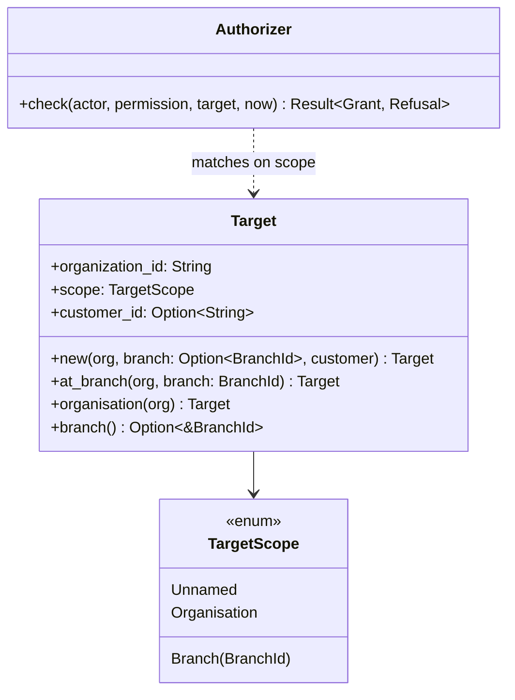
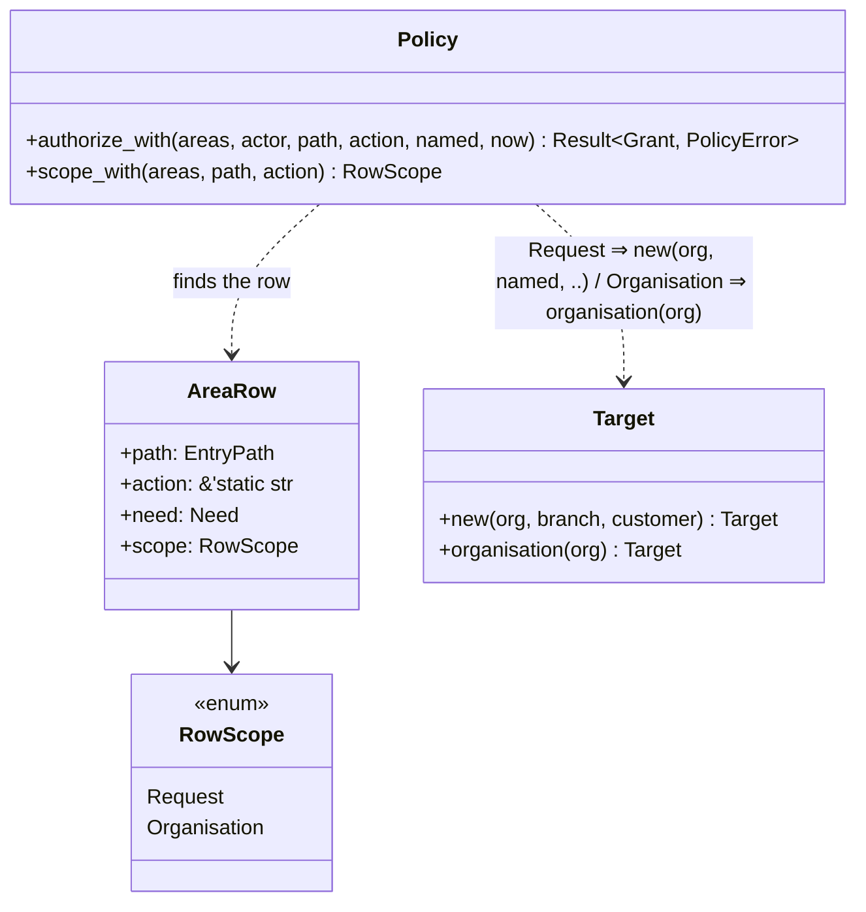
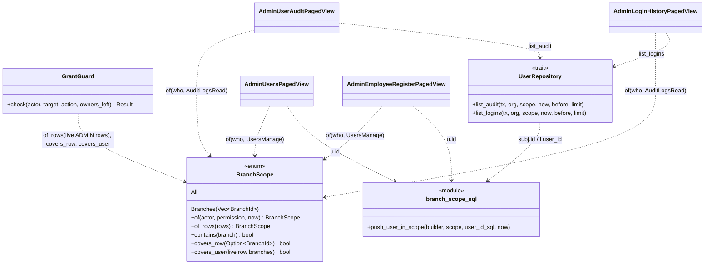
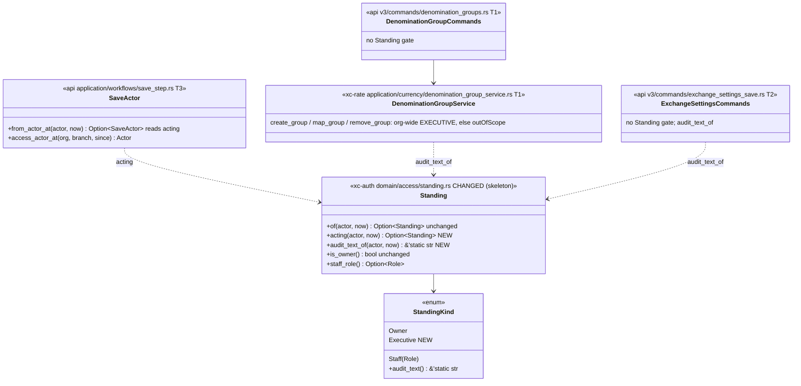
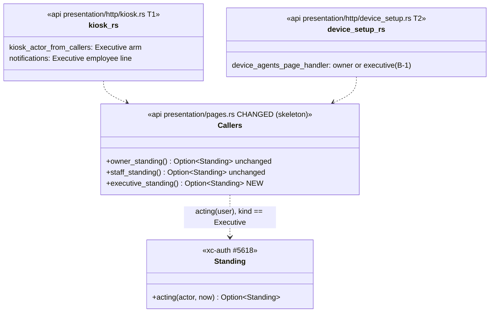
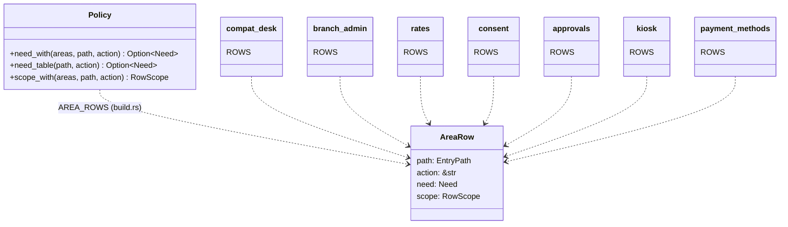

# An organisation-wide actor is never granted the literal branch `MAIN` (XC-ORG-WIDE-BRANCH, #5279)

> Design by claude/2ca5874b (Studio claude-1, sub-controller of #5279 under BE lane controller claude/553782), 2026-10-29 ICT.
> Measured on `origin/main` `28e1fead`. Brief: #5279 issuecomment-6482860815. Owner decision on site 2: #5279 issuecomment-6452390376.

## 0. The rule

Two places invent the branch `MAIN` for an organisation-wide actor:

| Site | Where | Today | After |
|---|---|---|---|
| 1 | `Authorizer::check`, the `has_org_wide` arm (`api/crates/xc-auth/src/domain/access/authorizer.rs:112-113`) | org-wide row, no session branch, and the target names no branch ⇒ grant on `MAIN` | **`outOfScope`**. The grant is the session branch, as for everyone else (`:104-111`). |
| 2 | `requester_branch` (`api/crates/xc-approval/src/application/approval_service.rs:9-49`), used at `:229` | an approval request is filed under the requester's first role row by a priority list. An org-wide row gives `MAIN`, and EXECUTIVE + ADMIN gives `NULL`. | **The object's branch**, passed by the caller. `requester_branch` is deleted. Owner, 2026-10-28: *"เก็บที่สาขาของสิ่งที่ขอ"* ("store it at the branch of the thing requested"). |

`MAIN` is the seeded organisation's branch (`api/migrations/20261007100000_branches_rates.sql:9`). It does not exist in a second organisation, so both stand-ins are wrong there. In the default organisation they are only right by chance.

## 1. Why site 1 changes no production path

- Every production reader turns a session into an actor through `SessionBranch::effective` (`api/src/presentation/extractors/session_actor.rs:29-31`; `extractors/actor.rs:199`).
- That gives anyone holding a valid row a branch. An org-wide row opens every branch, so the session branch is the first by code (`session_branch.rs:34-54`, `:60-68`).
- So a session actor never reaches the `has_org_wide` arm. The arm returns `MAIN` only when the actor has no branch at all, and the qualifying row would already cover the session branch at `:104-111`.

Production actors built without a session, swept by `git grep -n -E "(Actor|AccessActor|AuthActor)::new\(" -- 'api/src/**' 'api/crates/*/src/**'` outside `#[cfg(test)]` at `28e1fead`:

| Actor | Rows | Reaches `Authorizer::check` with a branchless target? |
|---|---|---|
| rate-feed system actor (`feed_publisher.rs:349`, `branch_refresh.rs:124`) | ADMIN at one branch | no: it is only the requester of an approval (site 2) |
| pricing-follow system actor (`market_pricing_loop.rs:214`) | ADMIN org-wide | no: `TierPublisher::publish_in` (`tier_publish.rs:45`) and the push run no `Authorizer::check` |
| `SaveStep::access_actor_at` (`save_step.rs:72-89`) | the owner org-wide, or staff at the branch | no: it is only the requester of an approval (confirm, reversal, binding quote) |
| `handover_service::may_receive` (`handover_service.rs:299`) | the candidate's rows | no: its target names the branch (`:300`) |
| custody saver (`xc-shift/.../custody/service.rs:139`) | no rows | no qualifying row, so the arm is not reached |
| **cash commands' `caller_in`** (`api/src/presentation/http/v3/commands/cash.rs:89-133`), used by 12 commands in `cash.rs`, `cash/handovers.rs` and `cash/transfers.rs` | the caller's rows re-read from `user_roles`, rebuilt with `User::new(..)` and **no branch** | **yes:** transfer `reconcile` (`transfer_flow.rs:794`) by an org-wide FINANCE. **#5279 fixes it**: `caller_in` keeps the session's branch (`.with_branch(who.branch.clone())`). The sweep above matched `Actor::new` only. This row was found by `v3_cash_commands_test::a_branch_transfer_walks_create_submit_dispatch_receive_reconcile_over_http`, red on the trial tree with its fixtures fixed (wave 2, #5458). A `User::new(` sweep outside `#[cfg(test)]` at `88221498` finds no other. |

Apart from `caller_in`, the only production checks with a branchless target are `appSettingsSave` (`xc-app/.../app_settings_service.rs:44`) and transfer `reconcile` (`transfer_flow.rs:794`). Both are given session actors. They are unchanged here. Whether organisation-level business should require an org-wide row is a separate question; this design does not decide it.

**The cost is in test fixtures.** About 245 files build org-wide actors with no session branch. Waves 1 and 2 of #5279 fix them, behaviour-neutral, before this lands: #5454 / PR #5455 merged as `28e1fead`, and the `all_1` … `all_4` tickets #5456–#5459. Two tests pin the `MAIN` stand-in itself; they are restated in §5.

## 2. Class diagram


The `request` signature change is the only one. `[required]`: `branch` comes right after `object_id`, and it is `Option<&BranchId>` (`xc_kernel::ids::BranchId`). `None` means the object belongs to the organisation and to no branch.

## 3. Who passes which branch

| # | Caller (`file:line` at `28e1fead`) | Approval type | `branch` | Changes from today when |
|---|---|---|---|---|
| 1 | `xc-cash/.../ledger_approval/count_difference.rs:243` | `COUNT_DIFFERENCE` | `Some(&count.branch_id)` (`cash_count.rs:43`) | never in practice: the counter is at the branch |
| 2 | `xc-cash/.../adjustment/adjustment_service.rs:177` | `LEDGER_ADJUSTMENT` | `Some(branch)` (the adjustment's branch, already checked at `:150-170`) | an org-wide FINANCE requests: `MAIN` → the adjustment's branch |
| 3 | `xc-cash/.../transfer/transfer_flow.rs:588` | `CASH_TRANSFER` | `Some(&t.from_branch)` (the sender, which `policy_actor` already scopes to, `approval/transfer.rs:29-43`) | an org-wide requester: `MAIN` → the sender |
| 4 | `xc-rate/.../draft/rate_draft_service.rs:695` | `RATE_PUBLICATION` | `Some(branch)` (`submit`'s branch; `rate_drafts.branch_id` is NOT NULL) | an org-wide RATE_MANAGER / owner: `MAIN` / `NULL` → the draft's branch |
| 5 | `xc-rate/.../publication/feed_publisher.rs:370` | feed batch | `Some(branch)` | never: the system actor is at that branch |
| 6 | `api/src/.../exchange/binding_issue.rs:225` | `BINDING_QUOTE` | `Some(&req.quote.branch_id)` | the owner requests: `NULL` → the quote's branch |
| 7 | `api/src/.../exchange/confirm.rs:151` | exchange approval | `Some(&t.branch_id)` | the owner requests: `NULL` → the transaction's branch |
| 8 | `api/src/.../exchange/reversal_request.rs:143` | reversal | `Some(&input.branch)` | the owner requests: `NULL` → the exchange's branch |
| 9 | `api/src/presentation/http/v3/commands/loyalty_rule_submit.rs:161` | `LOYALTY_RULE_VERSION` | `None`: a loyalty rule belongs to the organisation | a requester with a branch row: that branch / `MAIN` → `NULL` |
| 10 | `api/src/application/workflows/exchange/negative_stock_gate.rs:84` (`NegativeStockGate::open_after_refusal`) | `NEGATIVE_STOCK` | `Some(branch)`: the branch whose stock is short. `open_after_refusal` and `stock_refusal_answer` (`v3/negative_stock.rs:27`) gain a `branch: &BranchId` after `object`, which their three callers already hold (`commands/complete.rs:156`, `reversal_post.rs:157`, `cash/transfers.rs:222`, each scoped by `this_branchs`) | an org-wide requester (the owner: `NULL`) → the branch |

**Who reads the stored branch:**
- The decision policies call `ApprovalDecider::holds_on(who, p, request.branch_id)` (`approval_decider.rs:35-39`): `count_difference.rs:116`, `negative_stock.rs:72`, `exchange/approval.rs:171` and `binding_approval.rs:131`.
- The queue view: `views/approval_requests.rs:66`, `branch_id = $1 OR branch_id IS NULL`.

With the object's branch, a branch manager at that branch can decide an owner's request, as for any other requester. Today the stored `NULL` lets only org-wide rows cover it (`scoped_role.rs:58-63`). The loyalty policy uses `holds_anywhere` (`rule_approval.rs:230-239`), so `NULL` changes nothing for it.

**Decision C of 2026-10-21 (#4094) is replaced** (owner, #5279 issuecomment-6452390376). An org-wide non-executive of a second organisation is no longer refused: its request is stored on its own organisation's branch. The composite FK `approval_requests (organization_id, branch_id) → branches` accepts it, because the branch is that organisation's. Test `approval_request_organisation_test::row6_…` flips (§5).

## 4. Data migration

**None.** `approval_requests.branch_id` is already a nullable `text` column (`api/migrations/20261010110000_approvals.sql:4`), checked against the organisation's branches. "Remove `requester_branch`" removes a function, not a column.
1. **Existing rows** keep the branch they were stored with. A past `MAIN` or `NULL` stays as it is, and a pending one is decided under today's reading of it.
2. **Backfill:** none. Rewriting a decided request's branch would rewrite who was allowed to decide it.
3. **Deploy order:** the binary alone.
4. **Reversal:** a revert of the binary. Nothing in the schema moves.

## 5. Behaviour table and up-front tests

The sub-controller writes these on `test/5279` before release. They compile against the skeleton (§6) and fail on the stored or granted value.

| Row | Case | Required result | Test |
|---|---|---|---|
| S1-1 | org-wide EXECUTIVE, **no** session branch, target names no branch | `Err(OutOfScope)` | `xc-auth/tests/authorizer_test.rs`: restates `an_organisation_wide_user_works_on_the_branch_named_and_on_main_when_none_is` |
| S1-2 | the same actor with session branch `B01` | `Ok`, `grant.branch == B01` | the same test |
| S1-3 | the same actor, target names `B02` | `Ok`, `grant.branch == B02` | the same test |
| S1-4 | branch rows at one branch only, no session branch, target names none | unchanged: that branch | `xc-auth/tests/session_branch_test.rs`: restates `without_a_session_branch_the_old_arms_are_unchanged` |
| S1-5 | branch rows at two branches, no session branch, target names none | unchanged: `outOfScope` | the same test |
| S2-1 | `request(.., Some(B02), ..)` by an org-wide FINANCE | stored `branch_id = 'B02'` | `xc-approval/tests/approval_object_branch_test.rs` (new) |
| S2-2 | `request(.., Some(B02), ..)` by a RATE_MANAGER with rows at `B01` and `B02` | `'B02'` (today: its first row) | the same file |
| S2-3 | `request(.., None, ..)` by a TELLER at `B01` | `NULL` (today: `B01`) | the same file |
| S2-4 | `request(.., Some(B01), ..)` by EXECUTIVE + ADMIN org-wide | `'B01'` (today: `NULL`) | the same file |
| S2-5 | org-wide FINANCE of organisation B requests on B's branch | stored as `(B, <B's branch>)`; decidable by B's decider | `approval_request_organisation_test::row6_…` restated (decision C replaced) |
| S2-6 | an org-wide FINANCE's ledger adjustment on `B01` | `'B01'` (today: `MAIN`) | `xc-cash/tests/ledger_adjustment_approval_test.rs`, one new test |
| S2-7 | the owner's exchange over the limit at `B01` | `'B01'` (today: `NULL`); a BRANCH_MANAGER at `B01` may decide it | `api/tests/approval_object_branch_callers_test.rs` (new) |
| S2-8 | a loyalty rule version submitted by its creator | `NULL` | the same new file |

The fixture reds that wave 2 does not own also move to `test/5279`, behaviour-neutral: `authorizer_test` ×2 (customer, marketing), `xc-auth` `policy.rs` `#[cfg(test)]` ×1 and `xchange` `v3/action.rs` `#[cfg(test)]` ×2.

## 6. Skeleton and ticket

**Skeleton on `test/5279`** (sub-controller, not a ticket):
- the `request` signature of §2;
- the ten callers of §3 passing their branch;
- every test call of `request(..)` given its branch (`xc-approval/tests/approval_rules_test.rs`, `approval_subject_tx_test.rs`, `approval_unavailable_paths_test.rs`, `approval_request_organisation_test.rs`, `or71_stored_actor_test.rs`, and the api / `xc-cash` tests that call it);
- the tests of §5.

The body of `request` still calls `requester_branch` and ignores `branch`. So everything compiles, today's tests stay green, and S1-1 and S2-1 … S2-8 fail on the value.

**Ticket #5279** (`class:logic`, Gemini 4 Argon). File scope:
```
api/crates/xc-auth/src/domain/access/authorizer.rs
api/crates/xc-approval/src/application/approval_service.rs
```
- Remove the `has_org_wide` arm's `MAIN`, so that it refuses `OutOfScope`.
- Store `branch` in `request`, and delete `requester_branch`.
- Done = the §5 tests green, plus the files that waves 1 and 2 touched still green.

## 7. Out of scope

- Whether organisation-level business (`appSettingsSave`, transfer `reconcile`) should require an org-wide row instead of any row covering the session branch.
- Rewriting the branch of approval requests already stored (§4.2).

## 8. AP-1's audit row carries the request's organisation (lane controller's ruling A on #5279, 2026-10-29)

Found while writing the #5279 up-front tests.
- **The defect:** `PgAuditLog::append` (`api/crates/xc-approval/src/infrastructure/audit_log.rs:31-36`) writes no `organization_id`, so every audit row takes the seeded organisation (`20261011100000_organizations.sql:47`). The same migration adds `(organization_id, branch_id) → branches` to `audit_events` (`:66`).
- **The effect:** deciding a branch-bound request of a second organisation writes `(seeded organisation, B's branch)`, which breaks that FK. `decide`, `decide_self` and `decide_by_policy` then answer `internalError`.
- This is independent of sites 1 and 2.


- `[required]`: the three AP-1 audit writes (`approval_service.rs:354`, `:427`, `:516`) pass `request.organization_id` (`domain/request.rs:79`). `append` itself is unchanged.
- **Out of scope:** the other `AuditEvent` writers (`git grep -l "AuditEvent {" -- api`, 23 production files at `88221498`) still write the seeded organisation. Each one moving to `append_in` is a follow-up.
- **No migration:** `audit_events.organization_id` already exists.

## 9. An organisation-level target needs an organisation-wide row (#5514)

> Measured on `origin/main` `bdf1b0cd` (the code §9 cites is unchanged at `6d573093`). Ticket #5514 §3. The lane controller's rulings on the two open points: #5514 issuecomment-6495289565 (2026-10-29 18:22 ICT).

### 9.1 Why `Target` must say its kind

`Target.branch == None` means two things today (`api/crates/xc-auth/src/domain/access/authorizer.rs:91-125`):
- **unnamed**: a branch-level request that names no branch. SB-1 §14.3 grants the session branch when a qualifying row covers it, or else the single branch.
- **organisation**: the object belongs to the whole organisation, e.g. app settings (`xc-app/src/application/settings/app_settings_service.rs:41-46`). A branch-scoped row that covers the session branch passes too, so a branch ADMIN changes a setting of every branch.

`None` cannot tell these apart, so `Target` carries its kind. The rule for the organisation kind: **only an organisation-wide qualifying row acts on it**, and the grant is the session branch. With no session branch the answer is `outOfScope`, and no branch is invented (§0).

### 9.2 Class diagram



| Type / fn | File | Provided by | Used by |
|---|---|---|---|
| `TargetScope`; `Target.scope` replaces `Target.branch` | `api/crates/xc-auth/src/domain/access/authorizer.rs` | T1 | `Authorizer::check` only (the sweep in 9.3 found no field read outside this file) |
| `Target::new` | same | unchanged signature; `None` ⇒ `Unnamed`, `Some(b)` ⇒ `Branch(b)` | the 30 `Some(..)` callers and `policy.rs:269` |
| `Target::at_branch(org, b)` = `Target::new(org, Some(b), None)` | same | skeleton on `test/5514` (final form) | T2 (`transfer_flow.rs:802`) |
| `Target::organisation(org)` | same | skeleton on `test/5514` builds today's branchless target; T1 gives it `TargetScope::Organisation` | T1 (`app_settings_service.rs:44`) |
| `Target::branch()` | same | T1 | `Authorizer::check` |
| `TargetScope` re-export | `api/crates/xc-auth/src/domain/access/mod.rs:21` | T1 | — |
| `Authorizer::check`, the `Organisation` arm | `authorizer.rs` | T1 | — |

- `[required]` `Target::new`, `at_branch` and `organisation` keep these names and signatures; the up-front tests call them.
- `[proposed]` `Target::branch()` and the field name `scope`. Nothing outside `authorizer.rs` reads a `Target` field.
- `Target` derives `Serialize`/`Deserialize`; `git grep -n "Target" -- api | grep -i serde` at `6d573093` finds no serialisation of it, so the field rename changes no wire shape.

The `Authorizer::check` arms after T1 (`authorizer.rs:95-125` today):

| `target.scope` | Grant |
|---|---|
| `Branch(b)` | `b` when a qualifying row is org-wide or on `b`; else `outOfScope` (unchanged) |
| `Unnamed` | SB-1 §14.3 as today: the session branch if covered; else `outOfScope` if any row is org-wide (#5279); else the single branch |
| `Organisation` | the session branch when a qualifying row is org-wide **and** the actor has a session branch; else `outOfScope` |

### 9.3 Sweep: every `Target` construction (compiler)

**Method.** In a throwaway edit, `Target::new` and every `Target` field were marked `#[deprecated(note = "SWEEP-…")]`, then `cargo check --workspace --all-targets --message-format short` ran at `bdf1b0cd`. Every construction and field use outside `authorizer.rs` warns. Result: **33** production `Target::new` calls, **no** `Target { .. }` literal and **no** field read outside `authorizer.rs`.

| Row | Site | Target today | After | Tests that pin it |
|---|---|---|---|---|
| S | `xc-app/src/application/settings/app_settings_service.rs:44` (`appSettingsSave`) | `Target::new(org, None, None)` | **`Target::organisation(org)`** (T1) | `xc-app/tests/app_settings_test.rs` (org-wide ADMIN saves, `:71-200`); new `app_settings_org_level_test.rs` |
| R | `xc-cash/src/application/transfer/transfer_flow.rs:802` (`reconcile_on`) | `Target::new(org, None, None)` | **`Target::at_branch(org, t.from_branch)`** (T2); `t` is what `locked(..)` at `:786` already returns | `xc-cash/tests/transfer_flow_test.rs:616`, `lg4_reconcile_versions_test.rs`, `lg4_cutover_transfers_test.rs`, `services_on_caller_tx_test.rs`; api `cash_transfer_reconcile_other_org_test.rs`, `v3_cash_commands_test.rs`; new `transfer_reconcile_at_sender_test.rs` |
| P | `xc-auth/src/domain/policy/entities/policy.rs:269` (`Policy::authorize_with`, ~240 v3 routes plus RPC) | `Target::new(org, named, ..)` | unchanged (`None` ⇒ `Unnamed`) | `session_branch_test.rs`, `or4_routes_guard_test.rs`; route classification is #5526 |
| — | the other 30 calls, each `Some(branch)`: `xc-cash` `count_service.rs:840`, `:1052`, `:1129`; `handover_service.rs:300`, `:330`, `:586`, `:813`, `:879`; `transfer_flow.rs:62`; `domain/transfer/kinds/mod.rs:80`; `xc-customer` `customer/service.rs:354`; `xc-queue` `counter_service.rs:63`, `:123`; `queue_desk.rs:335`; `status_service.rs:277`, `:331`; `xc-shift` `branch_day/service.rs:108`, `:182`, `:230`, `:391`; api `settings/payment_settings.rs:77`; `staff_floor/reader.rs:59`, `:198`; v3 `cash_exception_raise.rs:143`, `cash_exception_review.rs:65`, `segment_define.rs:56`, `segment_snapshot.rs:95`, `supersede_referral.rs:76`, `export_gate.rs:44`, `views/me.rs:62`, `views/segment_preview.rs:55` | `Branch(b)` | unchanged | — |

**Existing tests that pin today's answer for S or R: none found.** With the throwaway fix applied (T1 and T2 together) at `bdf1b0cd`, `cargo nextest run -p xc-auth -p xc-app -p xc-cash` ran 1081 tests, 1081 passed. The api files that reach S or R (`app4_planner_routes_test`, `cash_transfer_reconcile_other_org_test`, `cash_transfer_stored_kind_status_test`, `v3_cash_commands_test`, `or4_routes_guard_test`, `rbac_f12_admin_groups_test`, `staff_entry_by_permission_test`, `v3_me_roles_permissions_test`, `device_after_save_in_test`, `devices_exact_test`, `devices_test`) ran 128 tests, 128 passed. The FINANCE fixtures in those files hold an org-wide row (`transfer_flow_test.rs:249-252`), which covers every sender. So no ticket below needs another test file in scope.

**The `Policy` path (row P) stays out of #5514** (ruling 2). It cannot be classified by permission: `grant_guard.rs:58-73` deliberately lets a branch-scoped ADMIN manage its own branch's users. The route-by-route classification is #5526.
- **Open, for the lane controller's review:** ruling 2 says `AreaRow` gets an optional scope that defaults to `Unnamed`. Rust struct literals have no field defaults, and `AreaRow { .. }` is written **154** times in **42** files (`git grep -c "AreaRow {" -- api/crates api/src` at `6d573093`). If #5514 adds the field, it must edit all 42 files while marking no route, and those files would be locked against other tickets. This design proposes that **the field lands with #5526, its first user**, and that #5514 gives #5526 only `TargetScope`. If you want the field in #5514 anyway, it becomes ticket T3 (the 42 area files, `class:mechanical`), released after T1.

### 9.4 Behaviour table

Organisation and unnamed targets (`Authorizer::check`, `Permission::SystemSettings`, ADMIN rows):

| # | Actor's qualifying rows | Session branch | Target | Today | After | Up-front test (`xc-auth/tests/org_level_target_test.rs`) |
|---|---|---|---|---|---|---|
| O-1 | org-wide | `B1` | organisation | grant `B1` | grant `B1` | `o1_…` |
| O-2 | `B1` only | `B1` | organisation | grant `B1` | **`outOfScope`** | `o2_…` (red today) |
| O-3 | `B1` and org-wide | `B1` | organisation | grant `B1` | grant `B1` | `o3_…` |
| O-4 | org-wide | none | organisation | `outOfScope` (#5279) | `outOfScope` (no invented branch, §0) | `o4_…` |
| O-5 | `B1` only | `B1` | unnamed | grant `B1` | grant `B1` (SB-1 §14.3) | `o5_…` |
| O-6 | `B1` only | none | unnamed | grant `B1` (single branch) | unchanged | `o6_…` |
| O-7 | org-wide, other organisation | `B1` | organisation | `outOfScope` | `outOfScope` | `another_organisation_…` |

The two call sites (the lane controller's four cases):

| # | Case | Today | After | Up-front test |
|---|---|---|---|---|
| S-1 | branch-scoped ADMIN at `MAIN`, session `MAIN`, `appSettingsSave` | saves | **`outOfScope`**, row unchanged | `xc-app/tests/app_settings_org_level_test.rs::a_branch_scoped_admin_in_a_session_is_refused_app_settings_save_and_writes_nothing` (red today) |
| S-2 | org-wide ADMIN, session `MAIN`, `appSettingsSave` | saves | saves | `…::an_organisation_wide_admin_in_a_session_saves_app_settings` |
| R-1 | FINANCE on `B1` (sender), session `B1`, reconciles `B1 → B2` | reconciles | reconciles | `xc-cash/tests/transfer_reconcile_at_sender_test.rs::finance_at_the_sender_branch_reconciles` |
| R-2 | FINANCE on `B2` (receiver), session `B2` | reconciles | **`outOfScope`**, stays RECEIVED | `…::finance_at_the_receiving_branch_is_refused_and_the_transfer_stays_received` (red today) |
| R-3 | FINANCE on `B3`, session `B3` | reconciles | **`outOfScope`**, stays RECEIVED | `…::finance_at_a_third_branch_is_refused_and_the_transfer_stays_received` (red today) |

Kept as they are: the creator and the receiver may not reconcile (`transfer_flow.rs:793-800`, checked before the `Authorizer`).

### 9.5 Up-front tests

Branch **`test/5514`** at `0248793d`, off `origin/main` `6d573093`:
- the skeleton: `Target::at_branch` and `Target::organisation` in `authorizer.rs` (+11 lines). `organisation` still builds today's branchless target;
- the three test files above, 13 tests.

Measured on the Mac Studio, private PG17:
- on `test/5514`: **4 red on the result** (O-2, S-1, R-2, R-3) and 9 green;
- with the throwaway T1 + T2 applied: 13/13 green;
- `cargo clippy -p xc-auth -p xc-app -p xc-cash --all-targets -D warnings` clean; `cargo fmt --all --check` and `bash scripts/fmt-included.sh origin/main` rc 0.

### 9.6 Data migration

None. No table, column, constraint or stored value changes. `Target` is built per request and never stored.

### 9.7 Function tickets

Both are released together, base `main`, branched from `test/5514`, `class:guarded`, Gemini 4 Argon. Their File scopes are disjoint, and each one's tests go green without the other.

| Ticket | File scope | Done line (`cd api`, `TEST_DATABASE_URL` set) |
|---|---|---|
| **T1** `TargetScope` and the `Organisation` arm; `appSettingsSave` uses it | `api/crates/xc-auth/src/domain/access/authorizer.rs`, `api/crates/xc-auth/src/domain/access/mod.rs`, `api/crates/xc-app/src/application/settings/app_settings_service.rs` | `cargo nextest run -p xc-auth -p xc-app -E 'test(/^(org_level_target_test\|app_settings_org_level_test\|app_settings_test\|authorizer_test\|session_branch_test)::/)'` all green |
| **T2** reconcile at the sender branch | `api/crates/xc-cash/src/application/transfer/transfer_flow.rs` | `cargo nextest run -p xc-cash -E 'test(/^(transfer_reconcile_at_sender_test\|transfer_flow_test\|lg4_reconcile_versions_test\|lg4_cutover_transfers_test\|services_on_caller_tx_test)::/)'` and `cargo nextest run -p xchange -E 'test(/^(cash_transfer_reconcile_other_org_test\|v3_cash_commands_test)::/)'` all green |

Both tickets also need `cargo clippy --all-targets -D warnings` on the crates they touch, and `bash scripts/fmt-included.sh origin/main` from the clone root at rc 0. Neither may edit the provided test files.

### 9.8 Out of scope

- The `Policy` route classification and the `AreaRow` scope field (#5526; see 9.3).
- A transfer reconciled at both branches (ruling 1: not taken).
- The other `None` meanings in `Policy::authorize_with` callers (row P).


## 10. Policy rows whose object is the whole organisation (#5526)

> Design by claude/2ca5874b (BE lane, under claude/553782), 2026-10-29 ICT. Measured on `origin/main` `bf5305fc`, which has #5514's `TargetScope` (`82330436`). Ticket #5526 §3. The `AreaRow` scope field lands here (claude/553782's scope note on #5526, 2026-10-29 20:43 ICT).

### 10.1 Why each row says its kind

**The chain.** A branch-scoped role can act on an organisation-level object by naming no branch:
- Every v3 route is authorized by `Policy::authorize_with` (`api/crates/xc-auth/src/domain/policy/entities/policy.rs:269`). It builds `Target::new(org, named, ..)`, where `named` is the request's `branch` (`v3/command.rs:342`, `v3/view.rs:600`), and `None` from an `OrgView` (`v3/org_view.rs:128`).
- With no `branch`, the target is `TargetScope::Unnamed`. `Authorizer::check` then grants the session branch to any qualifying row that covers it (`authorizer.rs:133-155`, SB-1 §14.3).
- So a branch-scoped row passes even when the object belongs to the whole organisation. One example: `margin_guards` has one row per organisation (`margin_guard_set.rs:95-97`), and a group holding `RatePolicySave` on one branch could set it.

**Why the kind goes on each row, not on each permission:**
- Groups are editable (RBAC §11, `role_grants.rs`), so any permission can sit on a branch-scoped row.
- One permission covers objects of both kinds. `BranchesManage` covers `branchSave`, whose object is one branch, and `bookingPolicySet`, whose object is the organisation's single booking policy.
- `grant_guard.rs:58-76` deliberately lets a branch-scoped ADMIN manage its own branch's users.

So the kind is set per row.

### 10.2 Class diagram



| Item | File | Provided by | Used by |
|---|---|---|---|
| `RowScope { Request, Organisation }` and the field `AreaRow.scope` | `api/crates/xc-auth/src/domain/policy/areas/mod.rs` | skeleton on `test/5526` | every area file; `Policy` |
| `scope: RowScope::Request` on every `AreaRow` literal (147 literals: 39 area files and 2 test files) | the area files and `xc-auth/tests/{area_rows_seam,policy_need_any_of}_test.rs` | skeleton (mechanical; compile only) | — |
| `Policy::scope_with` (a route-table row or no row ⇒ `Request`), and the `match` in `authorize_with` that builds the target | `api/crates/xc-auth/src/domain/policy/entities/policy.rs` | skeleton | — |
| the named-branch check: `let checked = named.unwrap_or(&grant.branch)` before `require_branch` / `require_branch_in_caller_org` | `api/src/presentation/http/v3/{command,action,view}.rs` | skeleton | — |
| `scope: RowScope::Organisation` on the rows of 10.3 | each ticket's area files | **T1, T2, T3** | — |

- `[required]` `RowScope`, its two variants, the field name `scope` and `Policy::scope_with(areas, path, action) -> RowScope`. The up-front tests name them.
- `[proposed]` A file whose rows come from a helper adds a second helper for the organisation rows, e.g. `org_row` in `org_admin.rs`, which is `AreaRow { scope: RowScope::Organisation, ..row(action, permission) }`.
- **Why the skeleton carries the wiring.** With every row `Request`, the new `match` builds exactly today's target, so the skeleton changes no answer. The existing suite proves that (10.5). Each ticket then only marks its own rows, and the three run together with no ticket waiting on another.
- An `Organisation` row grants the session branch, whatever `branch` the request names. With no session branch the answer is `outOfScope`, as #5514 §9.2 rules for `Target::organisation`.
- **The transport still checks the branch the request named.** Today the v3 transport checks only `grant.branch`: `require_branch` (`noSuchBranch`) and `require_branch_in_caller_org` (`outOfScope`) at `v3/command.rs:380`, `v3/action.rs:187`, `v3/view.rs:612-617` and `:730-735` on `bf5305fc`. Under an `Organisation` row `grant.branch` is the session branch, so a named branch of another organisation, or one that does not exist, would pass unchecked. The measured result: `view_org_scope_test::a_paged_view_naming_another_organisations_branch_is_out_of_scope` answered 200 and `v3_view_unknown_branch_test::every_generated_view_refuses_an_unknown_branch` answered 200 for `admin_employee_register`. The skeleton therefore checks `named.unwrap_or(grant.branch)` at those four sites. For a `Request` row the two are the same branch whenever a branch is named, so nothing changes today. `Need::Public` rows answer before the target is built (`policy.rs:211` on `test/5526`). An `Organisation` row must not be `Public` or `CustomerSelf`; `row_scope_test.rs::w5_…` pins this.
- The `build.rs` generator (`build_support/area_rows.rs:31-55`) reads only the file names and the `pub const ROWS: &[AreaRow]` line, so it is unchanged.

### 10.3 Every area row (169, from `AREA_ROWS` at `bf5305fc`)

**Method.**
- A throwaway test printed every `AREA_ROWS` row (169: 160 `Rpc`, 9 `StaffRpc`).
- For each action, I found every route whose `INHERITS` or `authenticate_and_authorize` names it (`git grep '"<action>"' -- api/src`). I then read its input, the table it reads or writes, and how it uses `grant.branch`.
- **Kind `Request`** = the object is on a branch (the named branch, the grant's branch, or the object's own branch, which a service re-checks), or it is the caller's own record or one customer's.
- **Kind `Organisation`** = the object is keyed by the organisation alone. A view is marked `Organisation` only when it does not use the named branch, because an `Organisation` row ignores it.

29 rows are marked `Organisation`, in three ticket groups: 17 are decided here, because the object has no branch at all, and 12 are B-1's (10.8, the owner chose `Organisation`). B-2's 4 rows stay `Request` by the owner's answer (10.8). The other 140 stay `Request` too.


| Area file | Path | Action | Need | Kind | Why |
|---|---|---|---|---|---|
| `alert_settings` | Rpc | `branchAlertSettings` | AlertSettingsSave | Request | `branch_alert_settings` (org, branch); the request's `branch` is the object (`branch_alert_settings_save.rs:45`) |
| `alert_settings` | Rpc | `branchAlertSettingsSave` | AlertSettingsSave | Request | `branch_alert_settings` (org, branch); the request's `branch` is the object (`branch_alert_settings_save.rs:45`) |
| `assistant` | Rpc | `assistantAsk` | Public | Request | `Public`; no target is checked |
| `assistant` | Rpc | `my_assistant_conversation` | Public | Request | `Public`; no target is checked |
| `binding_quote` | Rpc | `bindingQuoteIssue` | BindingQuoteIssue | Request | the quote is made at `grant.branch` (`binding_quote_issue.rs:278`) |
| `bookings` | Rpc | `bookingCreate` | AnyOf([CustomerSelf, BookingsDesk]) | Request | a booking, slot or closure of one branch (`grant.branch`, or path `{id}` locked to it) |
| `bookings` | Rpc | `bookingCheckIn` | BookingsDesk | Request | a booking, slot or closure of one branch (`grant.branch`, or path `{id}` locked to it) |
| `bookings` | Rpc | `kioskBookingCheckIn` | QueueOperate | Request | a booking, slot or closure of one branch (`grant.branch`, or path `{id}` locked to it) |
| `bookings` | Rpc | `bookingConfirm` | CustomerSelf | Request | the customer's own booking |
| `bookings` | Rpc | `bookingCancel` | AnyOf([CustomerSelf, BookingsDesk]) | Request | a booking, slot or closure of one branch (`grant.branch`, or path `{id}` locked to it) |
| `bookings` | Rpc | `bookingReschedule` | AnyOf([CustomerSelf, BookingsDesk]) | Request | a booking, slot or closure of one branch (`grant.branch`, or path `{id}` locked to it) |
| `bookings` | Rpc | `bookingQrReissue` | AnyOf([CustomerSelf, BookingsDesk]) | Request | a booking, slot or closure of one branch (`grant.branch`, or path `{id}` locked to it) |
| `bookings` | Rpc | `slotRuleSet` | BranchesManage | Request | a booking, slot or closure of one branch (`grant.branch`, or path `{id}` locked to it) |
| `bookings` | Rpc | `closureAdd` | BranchesManage | Request | a booking, slot or closure of one branch (`grant.branch`, or path `{id}` locked to it) |
| `bookings` | Rpc | `closureRemove` | BranchesManage | Request | a booking, slot or closure of one branch (`grant.branch`, or path `{id}` locked to it) |
| `bookings` | Rpc | `slotCapacitySet` | BranchesManage | Request | a booking, slot or closure of one branch (`grant.branch`, or path `{id}` locked to it) |
| `bookings` | Rpc | `slotClose` | BranchesManage | Request | a booking, slot or closure of one branch (`grant.branch`, or path `{id}` locked to it) |
| `bookings` | Rpc | `slotOpen` | BranchesManage | Request | a booking, slot or closure of one branch (`grant.branch`, or path `{id}` locked to it) |
| `bookings` | Rpc | `bookingPolicySet` | BranchesManage | **Organisation** | `booking_policies` keyed by organisation (`20261205131000_booking_slots.sql:24`); the handler already refuses a non-org-wide scope (`bookings/policy.rs:59-63`) |
| `bookings` | Rpc | `booking_slots` | Public | Request | `Public` |
| `bookings` | Rpc | `desk_bookings` | BookingsDesk | Request | a booking, slot or closure of one branch (`grant.branch`, or path `{id}` locked to it) |
| `bookings` | Rpc | `my_bookings` | CustomerSelf | Request | the customer's own bookings |
| `bookings` | Rpc | `admin_booking_slots` | BranchesManage | Request | a booking, slot or closure of one branch (`grant.branch`, or path `{id}` locked to it) |
| `branch_day` | Rpc | `dayStartService` | BranchDayOperate | Request | the branch day, its attendance or holds at `grant.branch` (`commands/branch_day.rs`) |
| `branch_day` | Rpc | `dayCutoff` | BranchDayOperate | Request | the branch day, its attendance or holds at `grant.branch` (`commands/branch_day.rs`) |
| `branch_day` | Rpc | `dayTarget` | CashTargetSet | Request | the branch day, its attendance or holds at `grant.branch` (`commands/branch_day.rs`) |
| `branch_day` | Rpc | `clock` | AttendanceClock | Request | the branch day, its attendance or holds at `grant.branch` (`commands/branch_day.rs`) |
| `branch_day` | Rpc | `attendanceCloseFor` | AttendanceCloseFor | Request | the branch day, its attendance or holds at `grant.branch` (`commands/branch_day.rs`) |
| `branch_day` | Rpc | `openAttendance` | AttendanceCloseFor | Request | the branch day, its attendance or holds at `grant.branch` (`commands/branch_day.rs`) |
| `branch_day` | Rpc | `holdCreate` | CustomerHoldPlace | Request | the branch day, its attendance or holds at `grant.branch` (`commands/branch_day.rs`) |
| `branch_day` | Rpc | `holdRelease` | VerificationReview | Request | the branch day, its attendance or holds at `grant.branch` (`commands/branch_day.rs`) |
| `branch_day` | Rpc | `draftBegin` | ShiftOperate | Request | the branch day, its attendance or holds at `grant.branch` (`commands/branch_day.rs`) |
| `cash` | Rpc | `countSubmit` | AnyOf([ShiftOperate, CashManage]) | Request | a count, handover, transfer or shift of one branch; the services re-check at the object's branch |
| `cash` | Rpc | `countVerify` | ShiftCloseCertify | Request | a count, handover, transfer or shift of one branch; the services re-check at the object's branch |
| `cash` | Rpc | `countReject` | ShiftCloseCertify | Request | a count, handover, transfer or shift of one branch; the services re-check at the object's branch |
| `cash` | Rpc | `handoverStart` | ShiftOperate | Request | a count, handover, transfer or shift of one branch; the services re-check at the object's branch |
| `cash` | Rpc | `handoverAccept` | ShiftOperate | Request | a count, handover, transfer or shift of one branch; the services re-check at the object's branch |
| `cash` | Rpc | `handoverReject` | ShiftOperate | Request | a count, handover, transfer or shift of one branch; the services re-check at the object's branch |
| `cash` | Rpc | `transferCreate` | CashManage | Request | a count, handover, transfer or shift of one branch; the services re-check at the object's branch |
| `cash` | Rpc | `transferSubmit` | CashManage | Request | a count, handover, transfer or shift of one branch; the services re-check at the object's branch |
| `cash` | Rpc | `transferDispatch` | CashManage | Request | a count, handover, transfer or shift of one branch; the services re-check at the object's branch |
| `cash` | Rpc | `transferReceive` | AnyOf([CashManage, ShiftOperate]) | Request | a count, handover, transfer or shift of one branch; the services re-check at the object's branch |
| `cash` | Rpc | `transferReconcile` | FinanceReconcile | Request | a count, handover, transfer or shift of one branch; the services re-check at the object's branch |
| `cash` | Rpc | `myShift` | ShiftOperate | Request | a count, handover, transfer or shift of one branch; the services re-check at the object's branch |
| `cash` | Rpc | `handoversPending` | ShiftOperate | Request | a count, handover, transfer or shift of one branch; the services re-check at the object's branch |
| `cash` | Rpc | `cashCounts` | AnyOf([ShiftOperate, ShiftCloseCertify, CashManage]) | Request | a count, handover, transfer or shift of one branch; the services re-check at the object's branch |
| `cash` | Rpc | `cashTransfers` | CashManage | Request | a count, handover, transfer or shift of one branch; the services re-check at the object's branch |
| `cash_limits` | Rpc | `cashLimitsSave` | CashLimitsManage | Request | `cash_limits` (org, branch) at `grant.branch` (`cash_limits_save.rs:61`) |
| `cash_limits` | Rpc | `cashLimitsRead` | CashLimitsManage | Request | `cash_limits` (org, branch) at `grant.branch` (`cash_limits_save.rs:61`) |
| `cash_transfer_policy` | Rpc | `transferPolicySave` | CashTransferPolicySet | **Organisation** | `cash_transfer_policy_versions` keyed by organisation only (`commands/cash.rs:552`); `run` ignores `branch` |
| `copy_by_email` | Rpc | `copyByEmail` | CustomerSelf | Request | the customer's own record (`CustomerSelf`) |
| `customer_account` | Rpc | `customerSelf` | CustomerSelf | Request | the customer's own record (`CustomerSelf`) |
| `customer_app` | Rpc | `plannerDraftSave` | Public | Request | `Public`; the planner draft is the caller's |
| `customer_app` | Rpc | `plannerDraftDelete` | Public | Request | `Public`; the planner draft is the caller's |
| `customer_app` | Rpc | `planner_preview` | Public | Request | `Public`; the planner draft is the caller's |
| `customer_app` | Rpc | `my_planner_drafts` | Public | Request | `Public`; the planner draft is the caller's |
| `customer_app` | Rpc | `appSettingsSave` | SystemSettings | **Organisation** | `customer_app_settings` keyed by organisation; the service already checks `Target::organisation` (#5514 T1, `app_settings_service.rs:41-46`) |
| `customer_benefits` | Rpc | `my_benefits` | CustomerSelf | Request | the customer's own record |
| `customer_history` | Rpc | `my_transactions` | CustomerSelf | Request | the customer's own record |
| `desk_transaction` | Rpc | `receiptReprint` | ReceiptReprint | Request | `receipts JOIN transactions WHERE t.branch_id` (`receipt_document.rs:55`) |
| `exchange_settings` | Rpc | `exchangeSettingsSave` | SystemSettings | Request | the command writes an org-level TTL but already refuses a non-org-wide scope (`exchange_settings_save.rs:126`); the row is shared with the `exchange_settings` view, which reads the named branch's limit (`views/exchange_settings.rs:58`), so `Organisation` would answer the session branch's limit instead |
| `exchange_settings` | Rpc | `branchExchangeLimitSave` | BranchesManage | Request | `branch_exchange_limits` (org, branch); path `{id}` locked to `grant.branch` (`exchange_settings_save.rs:184-186`) |
| `executive` | Rpc | `executiveOverview` | OverviewRead | Request | an `OrgView` (named branch is always `None`, `org_view.rs:128`) that filters rows by `BranchScope` (`:142-187`): a branch-scoped reader sees its own branches by design |
| `finance_reconciliation` | Rpc | `financeReconciliation` | FinanceReconcile | Request | the branch-day sheet / certification of the named branch (`reconciliation_certify.rs:55`) |
| `finance_reconciliation` | Rpc | `reconciliationCertify` | FinanceReconcile | Request | the branch-day sheet / certification of the named branch (`reconciliation_certify.rs:55`) |
| `identity_reveal` | Rpc | `identityReveal` | IdentityDocumentRead | Request | one customer's identity, re-checked at the branch (`xc-customer/.../service.rs:352-355`) |
| `ledger_adjustment` | Rpc | `ledgerAdjustmentCreate` | FinanceReconcile | Request | an adjustment of one branch; a payload branch other than `grant.branch` is refused (`adjustment_service.rs:109`, `:219`) |
| `ledger_adjustment` | Rpc | `ledgerAdjustmentPost` | FinanceReconcile | Request | an adjustment of one branch; a payload branch other than `grant.branch` is refused (`adjustment_service.rs:109`, `:219`) |
| `ledger_adjustment` | Rpc | `ledgerAdjustments` | FinanceReconcile | Request | an adjustment of one branch; a payload branch other than `grant.branch` is refused (`adjustment_service.rs:109`, `:219`) |
| `loyalty` | Rpc | `my_membership` | CustomerSelf | Request | the customer's own record, or one customer's tier |
| `loyalty` | Rpc | `customer_tier` | AnyOf([ExchangeTransact, MarketingMembers]) | Request | one customer's tier |
| `loyalty_rules` | StaffRpc | `loyaltyRuleDraft` | LoyaltyRulesManage | **Organisation** | as the `Rpc` row; no route reaches the `StaffRpc` row (see 10.9) |
| `loyalty_rules` | StaffRpc | `loyaltyRuleSubmit` | LoyaltyRulesManage | **Organisation** | as the `Rpc` row; no route reaches the `StaffRpc` row (see 10.9) |
| `loyalty_rules` | Rpc | `loyaltyRuleDraft` | LoyaltyRulesManage | **Organisation** | loyalty rules are one set for the organisation (the loyalty service takes no branch, `http_rule_writer.rs:55-56`) |
| `loyalty_rules` | Rpc | `loyaltyRuleSubmit` | LoyaltyRulesManage | **Organisation** | loyalty rules are one set for the organisation (the loyalty service takes no branch, `http_rule_writer.rs:55-56`) |
| `loyalty_rules` | Rpc | `loyalty_rule_versions` | LoyaltyRulesManage | **Organisation** | loyalty rules are one set for the organisation (the loyalty service takes no branch, `http_rule_writer.rs:55-56`) |
| `marketing` | Rpc | `campaignCreate` | MarketingCampaigns | **Organisation** (owner, B-1) | `campaigns` / `campaign_versions` keyed by organisation (`campaign_create.rs:143`, `:156`); body `branches[]` is data, checked only against the organisation (`:119`). See B-1 |
| `marketing` | Rpc | `campaignVersionSave` | MarketingCampaigns | **Organisation** (owner, B-1) | `campaign_versions` by organisation (`campaign_version_save.rs:193`). See B-1 |
| `marketing` | Rpc | `campaignVersionNew` | MarketingCampaigns | **Organisation** (owner, B-1) | `campaigns` by organisation (`campaign_version_new.rs:90`). See B-1 |
| `marketing` | Rpc | `campaignSimulate` | AnyOf([MarketingCampaigns, MarketingPerformance]) | **Organisation** (owner, B-1) | a version of an organisation campaign (`campaign_simulate.rs:103`). See B-1 |
| `marketing` | Rpc | `campaignSubmit` | MarketingCampaigns | **Organisation** (owner, B-1) | approval with no branch (`campaign_submit.rs:248-251`). See B-1 |
| `marketing` | Rpc | `campaignPause` | MarketingCampaigns | **Organisation** (owner, B-1) | `campaign_versions` by organisation (`campaign_pause.rs:87`). See B-1 |
| `marketing` | Rpc | `campaignResume` | MarketingCampaigns | **Organisation** (owner, B-1) | as `campaignPause` (`campaign_resume.rs:87`). See B-1 |
| `marketing` | Rpc | `couponIssue` | MarketingCampaigns | **Organisation** (owner, B-1) | a coupon of an organisation campaign's rule (`coupon_issue.rs:116`, `:199`). See B-1 |
| `marketing` | Rpc | `marginGuardSet` | RatePolicySave | **Organisation** | `margin_guards` keyed by organisation (`margin_guard_set.rs:95-97`), command and view |
| `marketing` | Rpc | `campaigns` | MarketingCampaigns | Request | lists the organisation's campaigns, but the named branch picks whose redemption totals are shown (`views/campaigns.rs:144`, `:153`); `Organisation` would always answer the session branch's totals. See B-1 |
| `marketing` | Rpc | `campaign` | MarketingCampaigns | **Organisation** (owner, B-1) | one organisation campaign (`views/campaign.rs:63`); `_branch` unused. See B-1 |
| `marketing` | Rpc | `campaignPerformance` | MarketingPerformance | Request | per-branch figures, `PerformanceScope::new(vec![grant.branch])` (`campaign_performance.rs:93`) |
| `notifications` | Rpc | `notificationRead` | SignedIn | Request | the caller's own notifications (`SignedIn`) |
| `notifications` | Rpc | `notificationReadAll` | SignedIn | Request | the caller's own notifications (`SignedIn`) |
| `notifications` | Rpc | `myNotifications` | SignedIn | Request | the caller's own notifications (`SignedIn`) |
| `org_admin` | Rpc | `branchSave` | BranchesManage | Request | the branch itself: the named (or session) branch is the object (`branch_save.rs:144`) |
| `org_admin` | Rpc | `adminBranchesProfile` | BranchesManage | Request | the named (or session) branch's profile (`admin_branches_profile.rs:53-54`) |
| `org_admin` | Rpc | `userGrant` | UsersManage | Request | the role row's branch is the request's `branch` (`user_grant.rs:37`); `GrantGuard` limits a branch ADMIN to its own branches (`grant_guard.rs:58-76`) |
| `org_admin` | Rpc | `userRevoke` | UsersManage | Request | as `userGrant` (`user_revoke.rs:34`, `:68`) |
| `org_admin` | Rpc | `userDisable` | UsersManage | Request | a user of the organisation, limited by `GrantGuard` to users whose live roles sit at the caller's ADMIN branches (`user_service.rs:296`) |
| `org_admin` | Rpc | `adminUsers` | UsersManage | Request (owner, B-2) | every user of the organisation; the branch only finds the organisation (`admin_users.rs:70-75`). See B-2; a branch ADMIN is to see only its own branches, by #5557's filter |
| `org_admin` | Rpc | `userSuspend` | UsersManage | Request | as `userDisable` (`user_service.rs:349`) |
| `org_admin` | Rpc | `userResume` | UsersManage | Request | as `userDisable` (`user_service.rs:401`) |
| `org_admin` | Rpc | `userEnable` | UsersManage | Request | as `userDisable`; Enable also needs EXECUTIVE (`user_service.rs:450`) |
| `org_admin` | Rpc | `userResetPassword` | UsersManage | Request | no route reaches this row (swept `api/src` at `bf5305fc`); left as it is, see 10.9 |
| `org_admin` | Rpc | `userProfileSave` | UsersManage | Request | as `userDisable` (`user_service.rs:506`) |
| `org_admin` | Rpc | `adminPermissionMatrix` | UsersManage | **Organisation** | `role_permission_grants` / `roles`, not keyed by any branch (`role_grant_store.rs:80`) |
| `org_admin` | Rpc | `adminUserAudit` | AuditLogsRead | Request (owner, B-2) | `user_audit WHERE organization_id` (`user_repository.rs:421`). See B-2; a branch ADMIN is to see only its own branches, by #5557's filter |
| `org_admin` | Rpc | `adminLoginHistory` | AuditLogsRead | Request (owner, B-2) | `login_history WHERE organization_id` (`user_repository.rs:472`). See B-2; a branch ADMIN is to see only its own branches, by #5557's filter |
| `org_admin` | Rpc | `adminEmployeeRegister` | UsersManage | Request (owner, B-2) | every user of the organisation (`admin_employee_register.rs:62-64`). See B-2; a branch ADMIN is to see only its own branches, by #5557's filter |
| `org_admin` | Rpc | `adminGroupAdd` | UsersManage | **Organisation** | the groups table, not keyed by any branch (`role_grant_store.rs:321`); the handler also needs an org-wide EXECUTIVE (`admin_groups.rs:105`) |
| `org_admin` | Rpc | `adminGroupSave` | UsersManage | **Organisation** | as `adminGroupAdd` (`role_grant_store.rs:178-258`, `admin_groups.rs:143`) |
| `org_admin` | Rpc | `adminGroupDelete` | UsersManage | **Organisation** | as `adminGroupAdd` (`role_grant_store.rs:359`, `admin_groups.rs:194`) |
| `org_starting_prices` | Rpc | `orgStartingPriceSave` | OrgStartingPricesManage | **Organisation** | `org_starting_prices` keyed by organisation (`org_starting_price_save.rs:216`); the save also drafts every unpublished branch (`:241`) |
| `org_starting_prices` | Rpc | `orgStartingPrices` | OrgStartingPricesManage | **Organisation** | `org_starting_prices` keyed by organisation (`org_starting_price_save.rs:216`); the save also drafts every unpublished branch (`:241`) |
| `queue` | Rpc | `ticketIssueWalkIn` | QueueOperate | Request | a queue ticket, counter or service status of `grant.branch` |
| `queue` | Rpc | `ticketServeWalkIn` | QueueOperate | Request | a queue ticket, counter or service status of `grant.branch` |
| `queue` | Rpc | `ticketCallNext` | QueueOperate | Request | a queue ticket, counter or service status of `grant.branch` |
| `queue` | Rpc | `ticketCall` | QueueOperate | Request | a queue ticket, counter or service status of `grant.branch` |
| `queue` | Rpc | `ticketRecall` | QueueOperate | Request | a queue ticket, counter or service status of `grant.branch` |
| `queue` | Rpc | `ticketSkip` | QueueOperate | Request | a queue ticket, counter or service status of `grant.branch` |
| `queue` | Rpc | `ticketStart` | QueueOperate | Request | a queue ticket, counter or service status of `grant.branch` |
| `queue` | Rpc | `ticketFinish` | QueueOperate | Request | a queue ticket, counter or service status of `grant.branch` |
| `queue` | Rpc | `ticketRelease` | QueueOperate | Request | a queue ticket, counter or service status of `grant.branch` |
| `queue` | Rpc | `ticketCancel` | QueueOperate | Request | a queue ticket, counter or service status of `grant.branch` |
| `queue` | Rpc | `counterPause` | QueueOperate | Request | a queue ticket, counter or service status of `grant.branch` |
| `queue` | Rpc | `counterResume` | QueueOperate | Request | a queue ticket, counter or service status of `grant.branch` |
| `queue` | Rpc | `queueBoard` | QueueOperate | Request | a queue ticket, counter or service status of `grant.branch` |
| `queue` | Rpc | `queueOpen` | BranchDayOperate | Request | a queue ticket, counter or service status of `grant.branch` |
| `queue` | Rpc | `queueClose` | BranchDayOperate | Request | a queue ticket, counter or service status of `grant.branch` |
| `queue` | Rpc | `queueTicketTake` | CustomerSelf | Request | a queue ticket, counter or service status of `grant.branch` |
| `rate_alerts` | Rpc | `rateAlertCreate` | CustomerSelf | Request | the customer's own alert |
| `rate_alerts` | Rpc | `rateAlertPause` | CustomerSelf | Request | the customer's own alert |
| `rate_alerts` | Rpc | `rateAlertResume` | CustomerSelf | Request | the customer's own alert |
| `rate_alerts` | Rpc | `rateAlertDelete` | CustomerSelf | Request | the customer's own alert |
| `rate_alerts` | Rpc | `rateAlertSettingsSave` | RateAlertSettingsSave | **Organisation** | `rate_alert_settings` keyed by organisation (`xc-alert/.../repository.rs:172-175`); `_branch` unused |
| `rate_alerts` | Rpc | `myRateAlerts` | SignedIn | Request | the customer's own alert |
| `rate_alerts` | Rpc | `rateAlertSettings` | RateAlertSettingsSave | **Organisation** | reads `rate_alert_settings WHERE organization_id` (`views/rate_alert_settings.rs:52-53`) |
| `receipts` | Rpc | `my_receipt` | CustomerSelf | Request | the customer's own receipt |
| `referral` | Rpc | `attachReferral` | ReferralAttach | Request | an attribution at `grant.branch` (`attach_referral.rs:58-68`, `supersede_referral.rs:60-68`, `referral_attributions.rs:121`) |
| `referral` | Rpc | `supersedeReferral` | ReferralSupersede | Request | an attribution at `grant.branch` (`attach_referral.rs:58-68`, `supersede_referral.rs:60-68`, `referral_attributions.rs:121`) |
| `referral` | Rpc | `referralAttributions` | ReferralRead | Request | an attribution at `grant.branch` (`attach_referral.rs:58-68`, `supersede_referral.rs:60-68`, `referral_attributions.rs:121`) |
| `segments` | Rpc | `segmentDefine` | MarketingMembers | **Organisation** (owner, B-1) | `segment_definitions` / `segment_snapshots` keyed by organisation, over every customer of it (`segment_service.rs:100`, `:122`). See B-1 |
| `segments` | Rpc | `segmentSnapshot` | MarketingMembers | **Organisation** (owner, B-1) | `segment_definitions` / `segment_snapshots` keyed by organisation, over every customer of it (`segment_service.rs:100`, `:122`). See B-1 |
| `segments` | Rpc | `segment_preview` | MarketingMembers | **Organisation** (owner, B-1) | `segment_definitions` / `segment_snapshots` keyed by organisation, over every customer of it (`segment_service.rs:100`, `:122`). See B-1 |
| `staff_customers` | StaffRpc | `staffCustomers` | CustomerHoldPlace | Request | searches the organisation's customers (`staff_customers.rs:78`), which branch staff serve wherever they come from; the object is a customer, not the organisation |
| `staff_customers` | StaffRpc | `customerContactVerify` | CustomerHoldPlace | Request | one customer's phone identity (`contact_verify.rs:105`) |
| `staff_floor` | StaffRpc | `staffMe` | SignedIn | Request | the floor, holds or attendance of `grant.branch` |
| `staff_floor` | StaffRpc | `staffFloor` | AttendanceClock | Request | the floor, holds or attendance of `grant.branch` |
| `staff_floor` | StaffRpc | `staffHolds` | AnyOf([CustomerHoldPlace, VerificationReview]) | Request | the floor, holds or attendance of `grant.branch` |
| `staff_floor` | StaffRpc | `staffAttendance` | AttendanceClock | Request | the floor, holds or attendance of `grant.branch` |
| `staff_report` | StaffRpc | `staffDailyReport` | AnyOf([ShiftCloseCertify, FinanceReconcile, OverviewRead]) | Request | every query is `branch_id = $1` (`staff_daily_report.rs:114-351`) |
| `transaction_read` | Rpc | `transactionView` | TransactionRead | Request | `transactions WHERE id AND branch_id` (`views/transaction.rs:86`) |
| `user_create` | Rpc | `userCreate` | UsersManage | Request | each new role's branch is checked by `creator_may_grant` (`user_service.rs:699`, `:707`) |
| `verification_branch` | Rpc | `verificationBranchCaseOpen` | VerificationReview | Request | a case filed at the reviewer's branch (`branch_intake.rs:259`) |
| `verification_review` | Rpc | `verification_queue` | VerificationReview | Request | a case, scoped to the reviewer's branches by `BranchScope` (`verification_queue.rs:102`, `review_service.rs:110-130`) |
| `verification_review` | Rpc | `verification_case` | VerificationReview | Request | a case, scoped to the reviewer's branches by `BranchScope` (`verification_queue.rs:102`, `review_service.rs:110-130`) |
| `verification_review` | Rpc | `verification_policy` | VerificationReview | Request (B-3) | reads the organisation's verification policy (`verification_policy.rs:69-71`), which every branch reviewer reviews against. See B-3 |
| `verification_review` | Rpc | `verificationCaseStartReview` | VerificationReview | Request | a case, scoped to the reviewer's branches by `BranchScope` (`verification_queue.rs:102`, `review_service.rs:110-130`) |
| `verification_review` | Rpc | `verificationCaseApprove` | VerificationReview | Request | a case, scoped to the reviewer's branches by `BranchScope` (`verification_queue.rs:102`, `review_service.rs:110-130`) |
| `verification_review` | Rpc | `verificationCaseReject` | VerificationReview | Request | a case, scoped to the reviewer's branches by `BranchScope` (`verification_queue.rs:102`, `review_service.rs:110-130`) |
| `verification_review` | Rpc | `verificationCaseRequestUpdate` | VerificationReview | Request | a case, scoped to the reviewer's branches by `BranchScope` (`verification_queue.rs:102`, `review_service.rs:110-130`) |
| `verification_review` | Rpc | `verificationCaseRevoke` | VerificationReview | Request | a case, scoped to the reviewer's branches by `BranchScope` (`verification_queue.rs:102`, `review_service.rs:110-130`) |
| `verification_review` | Rpc | `verificationDocumentLink` | VerificationReview | Request | a case, scoped to the reviewer's branches by `BranchScope` (`verification_queue.rs:102`, `review_service.rs:110-130`) |
| `verification_self` | Rpc | `my_verification` | CustomerSelf | Request | the customer's own case |
| `verification_self` | Rpc | `verificationCaseOpen` | CustomerSelf | Request | the customer's own case |
| `verification_self` | Rpc | `verificationCaseSubmit` | CustomerSelf | Request | the customer's own case |
| `verification_self` | Rpc | `verificationDocumentRemove` | CustomerSelf | Request | the customer's own case |
| `verification_self` | Rpc | `verificationMyDocumentLink` | CustomerSelf | Request | the customer's own case |
| `verification_self` | Rpc | `verificationDocumentUpload` | CustomerSelf | Request | the customer's own case |
| `web_request` | Rpc | `webRequestCreate` | CustomerSelf | Request | the customer's own request |
| `web_request` | Rpc | `webRequestQrReissue` | CustomerSelf | Request | the customer's own request |
| `web_request` | Rpc | `webRequestCancel` | CustomerSelf | Request | the customer's own request |

### 10.4 Tests that pin today's answer for the `Organisation` rows

**Method.** I ran the whole workspace (`cargo nextest run --workspace`, 8536 tests, private PG17) with all 33 rows then proposed marked `Organisation` on top of the skeleton (B-2's 4 rows included; 10.6 re-measures T3 without them). Every failure was then re-run on the skeleton alone.
- 7 failures also fail on the skeleton alone, so they come from this machine, not from the marking: `pages_test` ×3, `executive_admin_shell_test` ×3 and `marketing_admin_shell_test` ×1 (the web shell is not built in this clone). `main` CI is green at `bf5305fc`.
- 2 failures were the named-branch gap of 10.2. With the transport check in the skeleton they pass, and they stay as guards, unedited: `view_org_scope_test::a_paged_view_naming_another_organisations_branch_is_out_of_scope` (`admin_users`) and `v3_view_unknown_branch_test::every_generated_view_refuses_an_unknown_branch` (`admin_employee_register`). Both reached the gap through B-2's rows, which now stay `Request`; the check stays, because every other `Organisation` view (`campaign`, `orgStartingPrices`, `rateAlertSettings`, `adminPermissionMatrix`) would have the same gap.
- 2 failures (`mk7_campaign_views_test` ×2) came from marking the `campaigns` view, which is why it stays `Request` (10.3).
- **8 tests pin today's answer**: a branch-scoped holder reached the handler and was refused there with 400, or was granted. They are restated on `test/5526` (10.6), each with a `#5526` comment:

| Test | Row | Today | After |
|---|---|---|---|
| `xc-auth/tests/cash_transfer_policy_permission_test.rs::policy_authorize_on_transfer_policy_save_grants_executive_and_finance` | `transferPolicySave` | FINANCE at MAIN is granted | FINANCE organisation-wide is granted; FINANCE at MAIN gets `OutOfScope` |
| `api/tests/margin_guard_set_role_test.rs::m1_…`, `m2_…`, `m5_…` | `marginGuardSet` | RATE_MANAGER at MAIN: 400 `roleNotAllowedHere` | 403 `outOfScope` |
| `api/tests/rbac_f12_admin_groups_test.rs::only_an_org_wide_executive_base_changes_groups` | `adminGroupAdd/Save/Delete` | EXECUTIVE@XC-B01: 400 `roleNotAllowed` | 403 `outOfScope` (ORG_ADMIN unchanged: 400 `roleNotAllowed`) |
| `api/tests/role_refusal_400_admin_groups_test.rs::admin_group_{add,save,delete}_refuses_…` | same | same | same |

- The refusal moves from the handler to the policy, and its code changes from `roleNotAllowed`/`roleNotAllowedHere` to `outOfScope`. The web shows both through the shared worded error (`error.outOfScope`, e.g. `BookingSlots.permission.test.tsx:209`), so no FE ticket follows.
- With the marking, the skeleton and the restated tests, the whole workspace is green apart from the 7 machine-local reds (measured in 10.6).
- Scope of the sweep: the tests that ran at `bf5305fc` + the skeleton. A row with no test that a branch-scoped caller would reach is covered by the up-front tests only.

### 10.5 Behaviour table

| # | Row kind | Caller | Request names | Answer | Up-front test |
|---|---|---|---|---|---|
| W-1 | `Organisation` | holder, branch-scoped at B1 (session B1) | nothing, or B1 | `outOfScope` | `row_scope_test.rs::w1_…`; per area: `org_level_rows_*_test.rs::a2_…`, `a3_…` |
| W-2 | `Organisation` | holder, organisation-wide (session B1) | B2 of its organisation | granted at B1 (the session branch) | `w2_…`; per area `a4_…` |
| W-3 | `Organisation` | organisation-wide, no session branch | — | `outOfScope` | `w2_…` |
| W-4 | `Request` | any | any | as today | `w3_…`; per area `a5_…` (every other row of the file still grants a branch holder at B1) |
| W-5 | `Organisation` | — | — | never `Public` or `CustomerSelf` | `w5_…` |
| W-6 | `Organisation` | organisation-wide | a branch of another organisation | 403 `outOfScope` | `view_org_scope_test` (unedited) |
| W-7 | `Organisation` | organisation-wide | a branch that does not exist | 400 `noSuchBranch` | `v3_view_unknown_branch_test` (unedited) |
| W-8 | — | `Policy::scope_with` | a row / a route-table action / no row | the row's scope / `Request` / `Request` | `w4_…` |
| A-1 | per area | — | — | the `Organisation` rows of the file are exactly 10.3's list | `org_level_rows_*_test.rs::a1_…` |

### 10.6 Up-front tests and measurements

On branch **`test/5526`** at `d876edf0`, off `origin/main` `bf5305fc`: the skeleton commit `53d5d775` (10.2), then the test commit `d876edf0`. Measured at the first test commit (`d79c9552`, which also listed B-2's rows): the 10 files below plus `view_org_scope_test` and `v3_view_unknown_branch_test` ran 64 tests, 44 passed and 20 failed, every failure an assertion on the answer (none a compile error). `d876edf0` only drops B-2's 4 rows from `org_level_rows_org_admin_test`'s list; re-measured there, that file is `a1`..`a4` red and `a5` green.
- `api/crates/xc-auth/tests/row_scope_test.rs` (W-1..W-5, W-8): test-only rows through `Policy::authorize_with`; **green** on `test/5526`, because the skeleton is what it tests.
- `api/crates/xc-auth/tests/org_level_rows_settings_test.rs` (T1, 7 rows), `org_level_rows_marketing_test.rs` (T2, 18 rows), `org_level_rows_org_admin_test.rs` (T3, 4 rows): `a1`..`a4` fail on the result on `test/5526`, `a5` passes.
- The 8 restated tests of 10.4 fail on the result on `test/5526`.
- With a throwaway T3 of its 4 rows only, T3's done line (10.9) ran 109 tests, 109 passed (2026-10-30 ICT).
- With a throwaway T1 + T2 + T3 (the 33 markings, B-2's included): every test named in 10.9 passes, and the whole workspace is green except the 7 machine-local reds of 10.4 (measured 2026-10-30 ICT: `cargo nextest run --workspace --no-fail-fast`, 8556 run, 8549 passed, 7 failed — exactly those 7, 1 skipped).
- clippy `--workspace --all-targets -D warnings`, `cargo fmt --all --check` and `bash scripts/fmt-included.sh origin/main` are clean on `test/5526`.

### 10.7 Data migration

None. `RowScope` is a compile-time field of the policy table; no table, column or row changes.

### 10.8 For the owner: rows whose kind is a business question (answered)

Answered on #5526 by claude/553782, 2026-10-30 07:1x ICT (issuecomment-6511530429), with the owner's labels verbatim. `test/5526` follows the answers.

| # | Answer | Effect here |
|---|---|---|
| B-1 | owner: **"เฉพาะ marketer ระดับองค์กร (Recommended)"** | the 12 rows are `Organisation` (T2). The seeded test marketer is MARKETING @ `MAIN` (`deploy/server/seed-test-booking.sh:300`), so T2 also makes it organisation-wide there (`branch_id` NULL), or the e2e campaign specs lose their user. Its session still stands at `MAIN` (`xc-auth/src/domain/access/standing.rs:12`: a MARKETING row with no branch stands at `MAIN`). Re-seeding a host stays a separate owner order |
| B-2 | owner: **"กรองให้เห็นเฉพาะสาขาตัวเอง (Recommended)"** | the 4 rows stay `Request`. The filter (a branch ADMIN sees only the users its rows cover, by `GrantGuard`'s rule) is #5557, not this design |
| B-3 | claude/553782: keep `Request` | unchanged |
| B-4 | claude/553782: a follow-up | #5558 asks to move the `need_table` rows into area files and classify them |

The questions as they were put:

| # | Rows | Question | Today (measured) | Recommend | Why |
|---|---|---|---|---|---|
| B-1 | `campaignCreate`, `campaignVersionSave`, `campaignVersionNew`, `campaignSimulate`, `campaignSubmit`, `campaignPause`, `campaignResume`, `couponIssue`, the `campaign` view; `segmentDefine`, `segmentSnapshot`, `segment_preview` | May a marketer whose group sits on one branch run the organisation's campaigns and segments? | Yes, and further: the body's `branches[]` is checked only against the organisation (`campaign_create.rs:119`), so a branch marketer can aim a campaign at any branch; segments cover every customer of the organisation (`segment_service.rs:100`) | **`Organisation`**: only an organisation-wide marketing row runs them | campaigns and segments are keyed by the organisation alone. The alternative, keeping `Request`, needs a new `branches ⊆ caller's branches` check in five commands (a separate ticket) |
| B-2 | `adminUsers`, `adminUserAudit`, `adminLoginHistory`, `adminEmployeeRegister` | May a branch ADMIN read every user, audit row and login of the organisation? | Yes; the branch only finds the organisation (`admin_users.rs:70-75`) | **`Organisation`** | the lists are organisation-wide. If branch ADMINs need a list of their own branch's users, that is a new filtered view (a follow-up), not this row |
| B-3 | the `verification_policy` view | Is the verification policy for organisation-wide reviewers only? | Every branch reviewer reads it (`verification_policy.rs:69-71`) | **keep `Request`** | branch reviewers review against it; marking it would refuse them |
| B-4 | `need_table` rows (`adminCreateBranch`, `ratePolicySave`, `consentPolicy`, `marketRatesRefresh`, `rateDraft`, `approvalDecide`/`Read`, `reversalRequest`, …) | — (process) | `Policy::need_with` reads them after the area rows; `scope_with` answers `Request` for them, so this field cannot mark them | a follow-up ticket that moves them into area files, then classifies them | out of #5526's scope (its §3 names `AreaRow`) |

### 10.9 Function tickets

All three are `class:guarded`, Gemini 4 Argon, base `main`, branched from `test/5526` (`Test branch: test/5526`). Each marks rows only (the `scope` field, plus a helper where the file uses one). File scopes are disjoint, so the three run together.

| Ticket | Rows | File scope | Done line (`cd api && cargo nextest run -p xc-auth -p xchange -E 'test(/^(…)::/)'`, all green; clippy and `fmt-included.sh` clean) |
|---|---|---|---|
| **T1** settings | `bookingPolicySet`, `transferPolicySave`, `appSettingsSave`, `orgStartingPriceSave`, `orgStartingPrices`, `rateAlertSettingsSave`, `rateAlertSettings` | `api/crates/xc-auth/src/domain/policy/areas/bookings.rs`, `…/cash_transfer_policy.rs`, `…/customer_app.rs`, `…/org_starting_prices.rs`, `…/rate_alerts.rs` | `row_scope_test`, `org_level_rows_settings_test`, `cash_transfer_policy_permission_test`, `v3_cash_transfer_policy_test`, `v3_cash_commands_test`, `bk6_slot_admin_test`, `booking_policy_org_scope_test`, `r_booking_policy_set_bounds_test`, `app_settings_org_level_test`, `app_settings_test`, `customer_app_rows_test`, `org_starting_price_test`, `org_starting_price_same_day_test`, `org_starting_price_rate_bound_test`, `v3_rate_alerts_http_test`, `alert_settings_test`, `settings_number_bounds_test` |
| **T2** marketing | `marginGuardSet`; B-1's 12 rows; the 5 loyalty rows; the seeded marketer made organisation-wide | `api/crates/xc-auth/src/domain/policy/areas/marketing.rs`, `…/segments.rs`, `…/loyalty_rules.rs`, `deploy/server/seed-test-booking.sh` (step 6d only: `'$BRANCH'` → `NULL` at `:300`, and the `:291` label) | `bash -n deploy/server/seed-test-booking.sh` clean and `grep -n "'MARKETING', '\$ORG_ID', NULL" deploy/server/seed-test-booking.sh` finds step 6d; `row_scope_test`, `org_level_rows_marketing_test`, `margin_guard_set_role_test`, `mk7_campaign_views_test`, `mk4_campaign_commands_test`, `campaign_branches_scope_test`, `campaign_create_blank_name_test`, `coupon_issue_stored_output_test`, `r_campaign_budget_bound_test`, `mk6_segments_test`, `ly6_draft_retry_test`, `ly6_draft_retry_more_test`, `ly6_loyalty_rule_versions_test`, `loyalty_rule_writer_shared_test` |
| **T3** organisation admin | `adminPermissionMatrix`, `adminGroupAdd/Save/Delete` | `api/crates/xc-auth/src/domain/policy/areas/org_admin.rs` | `row_scope_test`, `org_level_rows_org_admin_test`, `rbac_f12_admin_groups_test`, `role_refusal_400_admin_groups_test`, `view_org_scope_test`, `v3_view_unknown_branch_test`, `rbac_c1b_org_admin_rows_test`, `rbac_c1b_audit_rows_test`, `rbac_f4a_test`, `rbac_f4b_test`, `rbac_f5_permission_matrix_view_test`, `rbac_f6_test`, `rbac_f8_test`, `rbac_f10_test`, `admin_users_cursor_org_test`, `admin_users_search_test`, `v3_org_admin_test` |

Each list = the up-front tests plus every existing test file that names the ticket's actions (`git grep -l '<action>' -- api/tests api/crates/*/tests` at `bf5305fc`); all of them pass with the throwaway.

### 10.10 Out of scope, and findings for their own tickets

Out of scope: `appSettingsSave`'s service check and transfer reconcile (#5514), any role ↔ permission change, and the `need_table` rows (B-4, #5558). B-2's branch filter for the admin user lists is #5557.

Found while sweeping (measured at `bf5305fc`; each goes to claude/553782 as a proposed ticket, not opened here):
- `GrantGuard`'s "every live role sits at the caller's ADMIN branches" check is true for a user with no live role (`grant_guard.rs:75`, `.all()` on an empty list). So a branch ADMIN can disable, suspend, resume or edit any role-less user of the organisation.
- `campaignCreate`, `campaignVersionSave` and `campaignSimulate` check `branches[]` only against the organisation (B-1). B-1 is answered `Organisation`, so T2 makes these unreachable for a branch marketer.
- The `StaffRpc` rows `loyaltyRuleDraft` / `loyaltyRuleSubmit` have no handler (no route names them on `StaffRpc`).
- The `userResetPassword` row has no route.
- `loyaltyRuleDraft` derives its draft id from `(kind, grant.branch, key)` (`loyalty_rule_draft.rs:50-53`). Under `Organisation`, `grant.branch` is the session branch, so a retry with the same key from another session branch makes a second draft. A retry from the same session (the case the id serves) is unchanged.

## 11. A branch admin sees only its own branches' users (#5557)

> Design by claude/2ca5874b (BE lane, under claude/553782), 2026-10-30 ICT. Code cited on `origin/main` `78123f9c` (the cited lines are unchanged at `f978e089`, except `org_admin.rs`, cited there). Ticket #5557 §4.
> Owner's decision, 2026-10-30 07:1x ICT, in claude/553782's session (label verbatim): **"กรองให้เห็นเฉพาะสาขาตัวเอง (Recommended)"**. It answers #5526's B-2 (10.8), which keeps the four rows below `Request`.

### 11.1 The rule

A holder sees, in the four lists, only the users its **qualifying rows** cover:
- **Qualifying rows** are the rows `Authorizer::check` already counts for the list's permission (`authorizer.rs:88`, `qualifying`). For `admin_users` and `admin_employee_register` the permission is `UsersManage`; for the audit and the logins it is `AuditLogsRead` (the rows at `areas/org_admin.rs:35`, `:42-44` on `f978e089`). Groups are editable (RBAC §11), so the rule reads the permission, not a role name.
- One organisation-wide qualifying row covers **every** user, as today.
- Otherwise a user is covered when they have **at least one live row**, and **every** live row sits on a branch the holder's qualifying rows name. That is `GrantGuard`'s rule (`grant_guard.rs:70-75`): a user with a row on another branch, or an organisation-wide row, is not covered.
- **A user with no live row** (all rows ended, or created with `roles: []`, `presentation/http/users.rs:54`) is covered only by an organisation-wide holder (#5557 §4: hidden from branch admins). Today `GrantGuard`'s `.all()` is true for such a user (`grant_guard.rs:75`, 10.10's finding), so G-3 below makes the guard agree.
- "Live" is `valid_from <= now < valid_to`, as everywhere else (`authorizer.rs:94-95`).

### 11.2 Class diagram

The shared core already exists: `BranchScope` (`domain/access/branch_scope.rs`, EX-1 #1070) is "which branches a permission reaches", built from the same `qualifying` rows. #5557 adds the user-level question to it, and one SQL form of the same question for the paged reads.



| Item | File | Provided by | Used by |
|---|---|---|---|
| `BranchScope::of_rows` (the body of today's `of`, which now calls it) | `api/crates/xc-auth/src/domain/access/branch_scope.rs` | skeleton on `test/5557` | `of`; `GrantGuard` |
| `BranchScope::covers_row`, `covers_user` (signatures; skeleton answers `true`, today's "no filter") | same file | skeleton | the views (through the SQL form), `GrantGuard` |
| their bodies | same file | **T1** | — |
| `GrantGuard::check` reads `BranchScope` instead of its own `admin_scopes` / `covers` | `api/crates/xc-auth/src/domain/access/grant_guard.rs` | **T1** | user commands |
| `push_user_in_scope(builder, scope, user_id_sql, now)` (signature; skeleton pushes nothing) | `api/crates/xc-auth/src/infrastructure/access/branch_scope_sql.rs` (new) | skeleton | the two views and the repository |
| its body | same file | **T2** | — |
| `list_audit` / `list_logins` take `scope: &BranchScope, now` and build their SQL with `QueryBuilder` | `api/crates/xc-auth/src/domain/user/user_repository.rs`, `api/crates/xc-auth/src/infrastructure/user/user_repository.rs` | skeleton | the two history views |
| the four views compute `BranchScope::of(who, <permission>, now)` and pass it | `api/src/presentation/http/v3/views/admin_users.rs`, `admin_employee_register.rs`, `admin_user_audit.rs`, `admin_login_history.rs` | skeleton | — |

- `[required]` the signatures above. `[proposed]` the SQL helper's name and module.
- **Why two forms of one rule:** the lists page in the database (`LIMIT` + keyset cursor), so the filter must be in the `WHERE`, or a page would come back short and the cursor would skip covered users. `covers_user` (Rust) and `push_user_in_scope` (SQL) state the same rule, and the up-front tests pin both on the same seven kinds of user (11.4).
- **The SQL form**, for `Branches(list)`: ` AND EXISTS (a live user_roles row of the user) AND NOT EXISTS (a live row of the user whose branch_id IS NULL OR NOT (branch_id = ANY(list)))`. A NULL user id (an audit subject that is not a user, or a login of an unknown identifier) fails the `EXISTS`, so it is hidden from a branch holder. `All` adds nothing.
- The skeleton's callers change only by passing `&BranchScope::All, Utc::now()` in the two repository test files (`rbac_c1c_repository_test.rs`, `rbac_f24_cursor_test.rs`), the same answer as today.

### 11.3 The four reads

| Read | Where (on `78123f9c`) | Today | Filters on |
|---|---|---|---|
| `admin_users` | `views/admin_users.rs:48-117`: `users u JOIN branches b ON b.id = $branch AND u.organization_id = b.organization_id` (`:72`) | every user of the organisation | the user (`u.id`) |
| `admin_employee_register` | `views/admin_employee_register.rs:51-80` (`:64`), then one row per live role | every user of the organisation | the user (`u.id`); a covered user's rows are all on covered branches by the rule |
| `admin_user_audit` | `views/admin_user_audit.rs:63` → `PgUserRepository::list_audit` (`infrastructure/user/user_repository.rs:395`), `WHERE a.organization_id` (`:421`) | every audit row of the organisation | the row's subject (`subj.id`, the `LEFT JOIN users subj` of `:420`) |
| `admin_login_history` | `views/admin_login_history.rs:63` → `list_logins` (`:451`), `WHERE l.organization_id` (`:472`) | every login of the organisation | the login's user (`l.user_id`) |

All four `page` functions receive the caller as `_who` and ignore it today (`admin_users.rs:51`, `admin_employee_register.rs:54`, `admin_user_audit.rs:42`, `admin_login_history.rs:42`).

### 11.4 Behaviour table

Users of the tests: `b1` TELLER @ B01; `b1b` TELLER and BRANCH_MANAGER @ B01; `b2` TELLER @ B02; `both` TELLER @ B01 and @ B02; `org` FINANCE organisation-wide; `none` no row; `ended` a TELLER @ B01 row that ended.

| # | Who | Case | Answer | Up-front test |
|---|---|---|---|---|
| C-1 | `All` | any row or user, including `none` | covered | `branch_scope_covers_test::c1_…` (green today) |
| C-2 | `Branches[B01]` | a row on B01 / B02 / organisation-wide | yes / no / no | `c2_…` (red today) |
| C-3 | `Branches[B01,B02]` | live rows {B01}, {B01,B02} | covered | `c3_…` (green today) |
| C-4 | `Branches[B01,B02]` | live rows {B01,B03}, {B01, org-wide}, {org-wide} | not covered | `c4_…` (red today) |
| C-5 | `Branches[B01]` | no live row | not covered | `c5_…` (red today) |
| C-6 | — | `of_rows`: one org-wide row ⇒ `All`, else sorted unique branches | as stated | `c6_…` (green: the skeleton moves `of`'s body) |
| G-1 | ADMIN @ B01 | suspends a user live only on B01 (an ended B02 row too) | `Ok` | `g1_…` (green today) |
| G-2 | ADMIN @ B01 | suspends `both` | `NoScope` | `g2_…` (green today) |
| G-3 | ADMIN @ B01 | suspends a user with no live row; grants that user a B01 row; an org-wide ADMIN suspends them | `NoScope`; `Ok`; `Ok` | `g3_…` (red today: the vacuous `.all()`) |
| V-1 | ADMIN @ B01 | `admin_users` | `b1`, `b1b` | `admin_lists_branch_scope_test::v1_…` (red today) |
| V-2 | ADMIN @ B01 and @ B02 | `admin_users` | `b1`, `b1b`, `b2`, `both` | `v2_…` (red today) |
| V-3 | ADMIN organisation-wide | `admin_users` | all seven | `v3_…` (green today) |
| V-4 | ADMIN @ B01 | `admin_users`, `limit=1`, then `before=b1` (`b2` sorts between `b1` and `b1b`) | `b1`, then `b1b` | `v4_…` (red today) |
| V-5 | ADMIN @ B01 / org-wide | `admin_employee_register` | `b1`, `b1b` / all seven | `v5_…` (red today) |
| V-6 | ADMIN @ B01 | `admin_user_audit` (one row per user, plus a subject that is no user) | the 2 rows of `b1`, `b1b` | `v6_…` (red today) |
| V-7 | ADMIN @ B01 | `admin_login_history` (one per user, plus an unknown identifier) | the 2 logins of `b1`, `b1b` | `v7_…` (red today) |
| V-8 | ADMIN organisation-wide | audit and logins | all 8 of each | `v8_…` (green today) |

- **G-3 is for claude/553782 to confirm** (one line). #5557 §4 decides that a user with no live row is hidden from branch admins. Sharing the rule (♻️) makes `GrantGuard` refuse a branch ADMIN's suspend, disable, reset or profile edit of such a user too, while a grant on the admin's own branch still passes (`covers_row` of the granted row, as today). **Default if no answer: as written**, so that a branch admin cannot manage a user its lists hide. The alternative keeps `.all()` in `GrantGuard` and uses `covers_user` only in the views, and drops `g3_…`'s first assert.

### 11.5 Tests that pin today's answer

None found. Method: a throwaway with all of 11.2 written (T1 + T2 bodies) ran the whole `xc-auth` crate (467/467 green) and the 21 api test files that name the four reads or a user command (`git grep -l -E 'admin_users|adminUsers|admin_user_audit|…|userGrant|…|GrantGuard' -- api/tests`, 161/161 green), on 2026-10-30 ICT. The existing list tests call as an organisation-wide ADMIN (for example `admin_users_search_test.rs`, `ADMIN@*`), so they keep their answer. No existing GrantGuard test acts on a user with no live row.

### 11.6 Up-front tests and measurements

On branch **`test/5557`** at `f6b53b3d`, off `origin/main` `f978e089` (which has #5526's three tickets): the skeleton commit `2af5df38` (11.2), then the test commit `f6b53b3d`.
- `api/crates/xc-auth/tests/branch_scope_covers_test.rs` (T1): C-1..C-6, G-1..G-3. Pure.
- `api/tests/admin_lists_branch_scope_test.rs` (T2): V-1..V-8, through the four routes with a private schema.
- Measured on `test/5557` (2026-10-30 ICT), with T1's and T2's done lines together (17 files, `-p xc-auth -p xchange -p xc-verification`): 155 run. On the skeleton, 10 fail on the answer (C-2, C-4, C-5, G-3, V-1, V-2, V-4..V-7) and 145 pass. With the throwaway bodies, 155/155 pass.
- clippy `--workspace --all-targets -D warnings`, `cargo fmt --all --check` and `bash scripts/fmt-included.sh origin/main` are clean on `test/5557`.
- T1 alone turns the C and G tests green. V-1..V-7 need T2, because the lists filter in SQL; T1's `covers_user` is the same rule's Rust form.

### 11.7 Data migration

None. No table, column or row changes; the filter reads `user_roles` as it is.

### 11.8 Function tickets

Both `class:guarded` (authorization, PII), Gemini 4 Argon, base `main`, branched from `test/5557` (`Test branch: test/5557`). File scopes are disjoint, so they run together; they merge back to back. #5526's lesson: once the first one squash-merges (carrying the skeleton), the second conflicts on the skeleton's lines, so the merger replays the second ticket's own commit onto `origin/main` and re-runs its done line before merging.

| Ticket | What | File scope | Done line (`cd api && cargo nextest run -p xc-auth -p xchange -E 'test(/^(…)::/)'`, all green; clippy and `fmt-included.sh` clean) |
|---|---|---|---|
| **T1** coverage rule (`-p xc-verification` added to the done line for `document_access_test`) | `covers_row`, `covers_user` bodies; `GrantGuard` reads `BranchScope::of_rows(live ADMIN rows)` and its `covers_row` / `covers_user` in place of `admin_scopes` / `covers` (`grant_guard.rs:58-75`) | `api/crates/xc-auth/src/domain/access/branch_scope.rs`, `api/crates/xc-auth/src/domain/access/grant_guard.rs` | `branch_scope_covers_test`, `branch_scope_test`, `rbac_c1a_grant_guard_test`, `rbac_c1a_user_service_test`, `rbac_c1c_user_service_test`, `user_service_test`, `document_access_test` |
| **T2** SQL form | `push_user_in_scope` body (11.2's predicate) | `api/crates/xc-auth/src/infrastructure/access/branch_scope_sql.rs` | `admin_lists_branch_scope_test`, `rbac_c1c_repository_test`, `rbac_f24_cursor_test`, `admin_users_search_test`, `admin_users_cursor_org_test`, `rbac_f4a_test`, `rbac_f4b_test`, `view_org_scope_test`, `v3_view_unknown_branch_test`, `c5_xlsx_export_test` |

### 11.9 Out of scope

- The web: the lists answer fewer rows in the same shape (`AdminUserRow`, `AdminEmployeeRegisterRow`, `AdminUserAuditRow`, `AdminLoginHistoryRow` unchanged), so no FE ticket.
- The `need_table` rows (#5558), and any other list keyed by the organisation.

## 12. A v3 command does not re-gate with the v2 `Standing` after its permission check (#5618)

> Design by claude/studio-claude-17 (Studio claude-17, sub-controller of #5618 under BE lane controller claude/553782), 2026-10-30 ICT. Measured on `origin/main` `4f662955`. Ticket #5618 §3.

### 12.1 The chain

- `denominationGroupCreate` as an EXECUTIVE alone answers `400 roleNotAllowedHere` (e2e row A, #564 issuecomment-6512214772).
- The command inherits `rateDraft` (`denomination_groups.rs:56`). EXECUTIVE holds `RatesDraft` (`RATES_STOCK` FULL, RBAC §11.2; `role_grants.rs:167-177`), so `Policy::authorize` passes (`v3/command.rs:369`).
- `run` then calls `Standing::of(who, ..).ok_or_else(role_not_allowed_here)` (`denomination_groups.rs:70`).
- `Standing::of` answers `None` for an EXECUTIVE alone (`standing.rs:59-91`): only EXECUTIVE + ADMIN (the owner, B3) or a `STAFF_PRIORITY` role gets a standing.
- **Root cause:** `Standing` is what a v2 surface knows about a caller (`standing.rs:1`). v3 code reads it after the v3 permission check has decided, and turns its `None` into a refusal. EXECUTIVE is always organisation-wide (`scope_rule.rs:28-31`), and RBAC §11.2 maps V.9's OWNER to EXECUTIVE, so a v3 caller holding the permission and no v2 standing is exactly an EXECUTIVE alone.

### 12.2 The rule

- A v3 command reads **`Standing::acting(actor, now)`**: `Standing::of`, else, for an EXECUTIVE row that is organisation-wide and valid at `now`, the new **`StandingKind::Executive`**, with no branch.
- `Standing::of`, `is_owner` and every v2 surface are unchanged (B3 stands: OWNER = EXECUTIVE + ADMIN).
- An audit row's `actor_role` comes from **`Standing::audit_text_of(actor, now)`**: the acting standing's text, else `STAFF`. It never refuses. An executive alone is written `EXECUTIVE`, as `price_source.rs:102` already writes it.
- Where a v3 command used the standing only as a gate, the gate goes: the permission check decided.

### 12.3 Every `Standing::of` site outside `standing.rs` (13, the ticket's sweep, re-run at `4f662955`)

| # | Site | What the standing is used for | What the permission check already decided | Ruling |
|---|---|---|---|---|
| 1–3 | `api/src/presentation/http/v3/commands/denomination_groups.rs:70`, `:146`, `:227` | nothing (the value is dropped) | `rateDraft`: EXECUTIVE, RATE_MANAGER (seed) | **(a) redundant: drop** |
| 4–6 | `api/crates/xc-rate/src/application/currency/denomination_group_service.rs:37`, `:98`, `:204` | `.filter(is_owner)`, refused `outOfScope`; the audit text | not the group rule: a RATE_MANAGER passes `rateDraft` | **(b) a real rule, restated.** R-3 (#986, `rate-feed-connector.md:17`, §3.2): *"เจ้าของร้าน/แอดมินใน v3"*, the owner creates the groups. The sibling "only OWNER" rule of the same design, `BranchPriceSource`, was already restated as **an organisation-wide EXECUTIVE** (#1021 issuecomment-6116975975 ruling 3, mirroring #1020 ruling 3; `price_source.rs:59-67`, `:129-137`). This one follows it: the owner and an EXECUTIVE alone pass, a RATE_MANAGER and an ADMIN alone stay `outOfScope`. The audit text comes from `audit_text_of`. |
| 7 | `api/src/presentation/http/v3/commands/exchange_settings_save.rs:129` | the audit text only | `exchangeSettingsSave` → `SystemSettings` (EXECUTIVE, ADMIN), then `BranchScope::All` (`:126`) | **(a) drop the gate**; audit via `audit_text_of` |
| 8 | `exchange_settings_save.rs:196` | the audit text only | `branchExchangeLimitSave` → `BranchesManage` (EXECUTIVE, ADMIN), then `Locks::One(path branch)` | **(a) drop the gate**; audit via `audit_text_of` |
| 9 | `api/src/application/workflows/save_step.rs:45` (`SaveActor::from_actor_at`) | who saves an exchange: `employee_id`, the audit text, the kiosk role, the approval requester (`access_actor_at`) | its six v3 callers (`transactions.rs:204`, `complete.rs:81`, `quotes.rs:254`, `reversal_post.rs:89`, `reversal_requests.rs:83`, `binding_quote_issue.rs:295`) passed `ExchangeTransact` / `ReversalRequest` / `BindingQuoteIssue`; EXECUTIVE holds the first two (`CUSTOMERS` FULL) | **(b) identity, kept; built from `Standing::acting`.** An executive alone saves as the owner does: no `employee_id`, kiosk role `Owner`, audit `EXECUTIVE`. As an approval requester it is EXECUTIVE organisation-wide, **not** the owner's EXECUTIVE + ADMIN: `access_actor_at` must not grant a role the caller does not hold. The callers keep their `ok_or_else(role_not_allowed_here)`; only a caller the permission check already refused could reach it. |
| 10 | `api/src/presentation/http/rpc.rs:271` | `/api/rpc` identity (v2 surface) | — (v2 RPC) | **out of scope, unchanged.** #5484 already gives a staff caller with no standing the owner's standing; since EXECUTIVE is always organisation-wide, that caller is an EXECUTIVE alone. |
| 11 | `rpc.rs:298` | `/api/staff/rpc` identity (v2 surface) | — | **out of scope, unchanged** (#5484) |
| 12–13 | `api/src/presentation/pages.rs:27`, `:35` (`Callers::owner_standing`, `staff_standing`) | v2 surfaces: `device_setup.rs:66`, `files.rs:144`, `:262`, `kiosk.rs:98-103`, `:329`, `:481-488`, `payment_methods.rs:124-125`, `pages.rs:319-320`, `:498`, `:638`, `screens.rs:156` | — (no v3 permission check before them) | **out of scope, unchanged.** Not a re-gate after a v3 check. An EXECUTIVE alone is neither owner nor staff there; whether each of those v2 routes should admit it is a separate question (12.9). |

The sweep's `save_step.rs:45` hides six callers, listed in row 9. A sweep of every `role_not_allowed_here` in `api/src/presentation/http/v3` at `4f662955` finds no other identity re-gate: `rate_alert_create.rs:90`, `rate_alert_lifecycle.rs:87/139/191` and `copy_by_email.rs:123` need the caller's own `customer_id`; `org_starting_price_save.rs:79` and `rate_alert_settings_save.rs:56-57` parse ids; `margin_guard_set.rs:58` checks EXECUTIVE itself, which admits this case.

### 12.4 Class diagram



- `[required]` `StandingKind::Executive`, `Standing::acting(&Actor, DateTime<Utc>) -> Option<Standing>`, `Standing::audit_text_of(&Actor, DateTime<Utc>) -> &'static str`; `StandingKind::Executive.audit_text() == "EXECUTIVE"`. The up-front tests name them.
- **Why the skeleton carries the core.** `acting` and `audit_text_of` are 20 lines in one file that all three tickets read. Written in the skeleton, the three tickets have disjoint files and run together. `Standing::of` never answers `Executive`, so the skeleton changes no answer.
- The new variant breaks two exhaustive matches in `save_step.rs` (`:46`, `:79`). The skeleton gives them `todo!("#5618 T3 …")` arms, unreachable until T3 makes `from_actor_at` read `acting`. `kiosk_role` (`kiosk_save_step.rs:40`) has a `_` arm, so it compiles and answers `Other` until T3.

### 12.5 Behaviour table

| Row | Caller | Route or call | Today | Required | Test |
|---|---|---|---|---|---|
| S-1..S-7 | EXECUTIVE alone, owner, staff, branch EXECUTIVE, expired, customer | `Standing::acting`, `audit_text_of` | — (new) | as 12.2 | `xc-auth/tests/standing_acting_test.rs` (green on the skeleton) |
| H-1 | EXECUTIVE@* | `POST /api/denomination-groups` | 400 `roleNotAllowedHere` | 200; audit `EXECUTIVE` | `api/tests/standing_regate_5618_test.rs` |
| H-2 | EXECUTIVE@* | `…/map`, `…/remove` | 400 `roleNotAllowedHere` | 200 each; audit `EXECUTIVE` | the same file |
| H-3 | RATE_MANAGER@MAIN | `POST /api/denomination-groups` | 403 `outOfScope` | unchanged | the same file |
| D-1 | EXECUTIVE alone | `DenominationGroupService` create, map, remove | `outOfScope` | `Ok`; audit `EXECUTIVE` | `xc-rate/tests/denomination_group_executive_test.rs` |
| D-2 | owner | create | `Ok`, `OWNER` | unchanged | the same file |
| D-3 | EXECUTIVE at a branch | create | `outOfScope` | unchanged | the same file |
| D-4 | RATE_MANAGER | create, map, remove | `outOfScope` | unchanged | the same file |
| D-5 | ADMIN alone, org-wide | create | `outOfScope` | unchanged | the same file |
| H-4 | EXECUTIVE@* | `PUT /api/exchange-settings` | 400 `roleNotAllowedHere` | 200; audit `EXECUTIVE` | `standing_regate_5618_test.rs` |
| H-5 | ADMIN@* | the same | 200, `SYSTEM` | unchanged | the same file |
| H-6 | EXECUTIVE@* | `PUT /api/branches/MAIN/exchange-limit` | 400 `roleNotAllowedHere` | 200; audit `EXECUTIVE` | the same file |
| H-7 | ADMIN@* | the same | 200, `SYSTEM` | unchanged | the same file |
| H-8 | TELLER@MAIN | `PUT /api/exchange-settings` | refused by the seam | unchanged | the same file |
| X-1 | EXECUTIVE alone, session `MAIN` | `POST /api/transactions`, `…/confirm`, `…/complete` | 400 `roleNotAllowedHere` | `COMPLETED`; audit `EXECUTIVE`; `staff_id` = `recorded_by` = the user | `api/tests/or7_5_save_actor_test.rs::x1_…` (added) |
| K-1 | — | `kiosk_role(StandingKind::Executive)` | `Other` | `Owner` | `kiosk_save_step.rs` `#[cfg(test)]` `an_executive_is_the_kiosk_owner` (added) |

**Tests that pin today's refusal**, swept with `git grep -l 'roleNotAllowedHere\|RoleNotAllowed' -- api/tests api/crates/*/tests` and the commands' names and routes at `4f662955`: none pins an EXECUTIVE alone. The matches are a TELLER or a caller without the permission (`exchange_settings_org_scope_test::e3`, `exchange_settings_view_test::r5`, `tx4_settings_routes_test`, `or7_5_save_actor_test::each_v3_role_…`), and RATE_MANAGER on groups (`denomination_groups_test::only_the_owner_may_change_groups`, `v3_denomination_group_remove_refusals_test::a_non_owner_caller_…`). All of them keep their answer. No test is restated.

### 12.6 Up-front tests and measurements

On branch **`test/5618`** at `86939b0a`, off `origin/main` `4f662955`: the skeleton commit `6c620d16` (12.4), then the test commit `86939b0a`. Measured 2026-10-30 ICT on the Mac Studio with a throwaway PostgreSQL 17:
- The 22 up-front tests: 15 passed and 7 failed. The 7 are H-1, H-2, H-4, H-6 (400 `roleNotAllowedHere`), D-1 (`outOfScope`), X-1 (`Refused(400, "roleNotAllowedHere")`) and K-1 (`Other`): every failure is an assertion on the answer, none a compile error. S-1..S-7, D-2..D-5, H-3, H-5, H-7 and H-8 pass.
- With a throwaway T1 + T2 + T3 (not committed): the three done lines of 12.8 together ran 76 tests, 76 passed. The 18 other test files that drive these routes or `SaveActor` with an EXECUTIVE row (`git grep -l -E 'EXECUTIVE@\*"|Role::Executive'` in `api/tests` and `api/crates/*/tests`, intersected with the routes' names) ran 168 tests, 168 passed.
- `cargo clippy -p xc-auth -p xc-rate -p xchange --all-targets -- -D warnings`, `cargo fmt --all --check` and `bash scripts/fmt-included.sh origin/main` are clean on `test/5618`.

### 12.7 Data migration

None. `audit_events.actor_role` is free text; a new value `EXECUTIVE` is already written by `price_source.rs:102`.

### 12.8 Function tickets

All three are `class:guarded`, Gemini 4 Argon, base `main`, branched from `test/5618`. File scopes are disjoint; they run together.

| Ticket | Change | File scope | Done line |
|---|---|---|---|
| **T1** denomination groups | drop the three command gates (rows 1–3); restate the service rule as "org-wide EXECUTIVE valid at now, else `outOfScope`" and write the audit text with `audit_text_of` (rows 4–6) | `api/src/presentation/http/v3/commands/denomination_groups.rs`, `api/crates/xc-rate/src/application/currency/denomination_group_service.rs` | `denomination_group_executive_test`, `denomination_groups_test`, `v3_denomination_group_remove_refusals_test`, `standing_regate_5618_test::h1_`, `h2_`, `h3_` green |
| **T2** exchange settings | drop the two gates; audit via `audit_text_of` (rows 7–8) | `api/src/presentation/http/v3/commands/exchange_settings_save.rs` | `standing_regate_5618_test::h4_`..`h8_`, `exchange_settings_org_scope_test`, `exchange_settings_view_test`, `tx4_settings_routes_test` green |
| **T3** the saver | `from_actor_at` reads `Standing::acting`; the two `Executive` arms (`employee_id` `None`; `access_actor_at` = EXECUTIVE organisation-wide only); `kiosk_role(Executive) = Owner` (row 9) | `api/src/application/workflows/save_step.rs`, `api/src/application/workflows/kiosk_save_step.rs` | `or7_5_save_actor_test`, the `xchange` lib tests `save_step::` and `kiosk_save_step::` green |

### 12.9 Out of scope, and findings for their own tickets

- `rpc.rs` and `pages.rs` (rows 10–13): v2 surfaces, unchanged.
- **Finding:** an EXECUTIVE alone is neither `owner_standing` nor `staff_standing` on the v2 routes listed in row 12–13, so e.g. `payment_methods.rs:124` and `device_setup.rs:66` treat it as neither. #5446 / #5480 moved the page gates to `is_staff_caller`; these route-level readers were not swept there. Whether each should admit an executive alone is a separate ticket (proposed to claude/553782, not opened here).
- **Finding:** the audit `actor_role` is computed four ways in v3 (`audit_text`, `cash_exception_raise.rs:36` first role or `STAFF`, `approval_service.rs:10` a priority list, `price_source.rs:102` a literal). `audit_text_of` is the place they could share; unifying them is a separate ticket.

## 13. The v2 route readers and an EXECUTIVE alone (#5629)

> Design by claude/studio-claude-17 (sub-controller of #5629 under BE lane controller claude/553782), 2026-10-30 ICT. Measured on `origin/main` `29aa1183`. Ticket #5629 §3; it follows §12.9's first finding.

### 13.1 The question

- `Callers::owner_standing` is `Standing::of(user)` filtered to the owner. `staff_standing` is `Standing::of(staff_user)` filtered to staff (`pages.rs:24-38`).
- For an EXECUTIVE alone (organisation-wide, no ADMIN), both answer `None` (§12.1).
- The v2 routes below read them **before** any v3 permission check, so what they do with "neither" is a rule, not a redundant gate (#5629 §2).
- Each row asks whether the route should treat an EXECUTIVE alone as the owner. That is the rule §12 applied to v3 (V.9's OWNER maps to EXECUTIVE, RBAC §11.2), and #5618 K-1 already set kiosk role `Owner` for it.

### 13.2 Every reader (`git grep -n -E 'owner_standing\(\)|staff_standing\(\)' -- api/src` at `29aa1183`, 17 call sites in 11 readers)

| # | Reader | What it guards | EXECUTIVE alone today | Owner today | Required | Source |
|---|---|---|---|---|---|---|
| R-1 | `device_setup.rs:66` `device_agents_page_handler` | the pairing page `GET /_xc/device-agents`; its API `POST /api/device-setup` needs `SystemSettings` (`policy.rs:171`) | **303 `/login`**, though the API admits it | 200 | **B-1** (business question, 13.6). Recommended: 200, as the owner | the AG design calls it "the owner's page" (`device_setup_http_test.rs:2`) |
| R-2 | `files.rs:144` `upload`: `is_staff` | which upload path: staff (session branch) or owner/customer (`?branch=`) | the owner's path (it is not staff) | the owner's path | **unchanged** | already as the owner |
| R-3 | `files.rs:262-263` `file`: `is_owner` | which read: `open_owned` (the caller's own uploads) or `open_in_branch` | the owner's path (`user` is set and `staff_standing` is `None`) | the owner's path | **unchanged** | already as the owner |
| R-4 | `kiosk.rs:97-118` `kiosk_actor_from_callers` | the actor the kiosk service is given | **`KioskActor::Customer`**: a staff `cancel` is refused `notCancellable` (`kiosk_machine.rs:319-325`), `get` and `publishReceipt` `staffRequired` (`:343-375`), though the policy admits the action (`QueueOperate`, `policy.rs:149-152`) | `Staff { username: "owner", role: Owner }` | **`Staff { username: <its user id>, role: Owner }`** | #5618 K-1: kiosk role `Owner` for `StandingKind::Executive`. Its own id, not the literal `owner`: it is one user among several, as the save step records it (#5618 X-1) |
| R-5 | `kiosk.rs:329` the named-branch rule | whether a named `branchId` is authorised, or replaced by the staff branch | the named branch (it is not staff) | the named branch | **unchanged** | already as the owner. Only a password session reaches the replacement, and since OR-7.m w2 none signs in |
| R-6 | `kiosk.rs:481-503` `notifications`' employee line | who the notification screen says is signed in | **500** (neither arm ⇒ `kiosk_server_error`) | `{ id: "owner", username: "owner", name: "Owner", role: "OWNER" }` | **`{ id: <user id>, username/name: <users.name>, role: "EXECUTIVE" }`** | as R-4. The role is `audit_text()` of its standing, as the staff arm writes (`:496`) |
| R-7 | `payment_methods.rs:124-133` | the D-4 scope check: a staff member naming another branch ⇒ 403 | not checked (it is not staff) | not checked | **unchanged** | already as the owner. `save` still needs `SystemSettings` (`policy.rs:166`) |
| R-8 | `pages.rs:319-352` `devices_receipt_handler` | the receipt's branch: the URL's, or the staff branch | the URL's branch | the URL's branch | **unchanged** | already as the owner |
| R-9 | `pages.rs:498-502` `DeskVariant` pages | a teller-only page | to `/staff` | to `/staff` | **unchanged** | teller only, by design |
| R-10 | `pages.rs:637-660` `page_branch` (`Gate::Branch`, `screens.rs:142-151`) | a page's branch: the query's, or the staff branch | the query's | the query's | **unchanged** | already as the owner |
| R-11 | `screens.rs:153-161` `Gate::Front` | a teller-only screen | to `/staff` | to `/staff` | **unchanged** | teller only, by design |

**So three readers change** (R-1, R-4, R-6). Six already treat an EXECUTIVE alone as the owner, because they branch on "not staff" (R-2, R-3, R-5, R-7, R-8, R-10). The two teller gates (R-9, R-11) stay closed to it, as they are to the owner.

### 13.3 Class diagram



- `[required]` `Callers::executive_standing(&self) -> Option<Standing>`: `Standing::acting(user, now)` with `kind == StandingKind::Executive`, read from `user` as `owner_standing` is. It is on `test/5629`.
- **Why one reader, not three hand-written checks:** "an organisation-wide EXECUTIVE valid at now" is already written once, in `Standing::acting` (§12.2). The readers ask `Callers` for it, just as they ask for the owner and for staff.
- `owner_standing` and `staff_standing` keep their answers. The eight unchanged readers are not touched.

### 13.4 Behaviour table

| Row | Caller | Route | Today | Required | Test |
|---|---|---|---|---|---|
| K-1 | EXECUTIVE alone | `/api/kiosk` `notifications` | 500 | 200; employee `{ id: user id, username/name: users.name, role: EXECUTIVE }` | `api/tests/kiosk_executive_alone_test.rs` |
| K-2 | owner | the same | 200, `owner` / `OWNER` | unchanged | the same file |
| K-3 | EXECUTIVE alone | `manage` | 200 | unchanged (it does not read the actor) | the same file |
| K-4 | EXECUTIVE alone | `list` | 200 | unchanged | the same file |
| K-5 | EXECUTIVE alone | `cancel` a WAITING request, reason `DUPLICATE` | 400 `คำขอนี้ยกเลิกไม่ได้` (`notCancellable`) | 200, the request `CANCELLED` | the same file |
| P-1 | EXECUTIVE alone | `GET /_xc/device-agents` | 303 `/login` | 200, HTML, `no-store` (B-1 recommended answer) | `api/tests/device_agents_page_executive_test.rs` |
| P-2 | owner; every staff role of `one_of_each_role` | the same | 200; 303 | unchanged | the same file, and `device_setup_http_test::the_owner_s_page_is_served_to_the_owner_only` |

**Tests that pin today's answer**, swept with `git grep -l -E 'device-agents|"notifications"|kiosk_actor_from_callers' -- api/tests` at `29aa1183`: `device_setup_http_test::the_owner_s_page_…` (owner 200, staff 303) and `kiosk_http_test` (owner and staff). Under the recommended B-1, none has an EXECUTIVE alone, and none flips. Under B-1 option A, the `SYSTEM` (ADMIN at `MAIN`) row of `the_owner_s_page_…` flips to 200 and is restated.

### 13.5 Up-front tests and measurements

On `test/5629` at `1538f15b`, off `origin/main` `29aa1183`: the skeleton `afb540be`, then the tests. Measured 2026-10-30 ICT on the Mac Studio with a throwaway PostgreSQL 17:
- The 7 up-front tests: 4 passed and 3 failed. The failures are K-1 (500), K-5 (400 `คำขอนี้ยกเลิกไม่ได้`) and P-1 (303), each on the answer. K-2, K-3, K-4 and P-2 pass, as the table says.
- With a throwaway T1 + T2 (B-1 recommended): those 7, plus `kiosk_http_test`, `device_setup_http_test`, `device_setup_branch_scope_test`, `gapsa6_queue_skip_cancel_kiosk_route_test` and every test whose name contains `kiosk`, ran 254 and passed 254.
- clippy `-D warnings`, `cargo fmt --all --check` and `scripts/fmt-included.sh origin/main` are clean on `test/5629`. The two new files were also run through `rustfmt` directly, since they are `include!`d and `cargo fmt` skips them (the miss found in #5618's review).

### 13.6 For claude/553782: the one business question

| # | Question | Today | Options | Recommend | Why |
|---|---|---|---|---|---|
| B-1 | Who gets the pairing page `GET /_xc/device-agents`? | the owner only (EXECUTIVE + ADMIN). Its API `POST /api/device-setup` admits every `SystemSettings` holder: EXECUTIVE, ADMIN (org-wide or at a branch), and any group given it | **A.** Whoever holds `SystemSettings`, the same check as the API. An ADMIN alone, including a branch ADMIN, gets the page; `the_owner_s_page_…`'s `SYSTEM` row flips. **B.** The owner or an EXECUTIVE alone (`owner_standing \|\| executive_standing`); no other caller changes. **C.** Unchanged: an EXECUTIVE alone keeps the API but not the page. | **B** | It is "the owner's page" (AG design), and V.9's OWNER maps to EXECUTIVE (§11.2), the same reading as §12 and R-4/R-6. A widens a page to ADMIN, which is the owner's choice to make. C leaves an executive with an API it can use and no page to use it from |

Until B-1 is answered, T2 is not released; T1 does not depend on it.

### 13.7 Data migration

None.

### 13.8 Function tickets

Both `class:guarded`, Gemini 4 Argon, base `main`, branched from `test/5629`. Their File scopes are disjoint, so they run together.

| Ticket | Change | File scope | Done line |
|---|---|---|---|
| **T1** kiosk | R-4: an `executive_standing()` arm between the owner and staff arms of `kiosk_actor_from_callers`: `Staff { username: exec.user_id, role: KioskRole::Owner }`. R-6: the same arm in `notifications`' employee line: `id` the user id, `username` and `name` from `usernames(..)` / `username_or_id` as the staff arm, `role` `exec.kind.audit_text()` | `api/src/presentation/http/kiosk.rs` | `kiosk_executive_alone_test`, `kiosk_http_test`, `gapsa6_queue_skip_cancel_kiosk_route_test`, and `test(/kiosk/)` green |
| **T2** pairing page | R-1 per B-1 (B: `owner_standing().is_some() \|\| executive_standing().is_some()`) | `api/src/presentation/http/device_setup.rs` | `device_agents_page_executive_test`, `device_setup_http_test`, `device_setup_branch_scope_test` green |

### 13.9 Out of scope

- The eight unchanged readers (13.2). The two teller gates (R-9, R-11) stay teller-only.
- The literal `"owner"` username the kiosk gives the owner (R-4, R-6) is v2's and is not changed here.

## 14. One rule for an audit row's `actor_role` (#5630)

> Design by claude/studio-claude-17 (sub-controller of #5630 under BE lane controller claude/553782), 2026-10-30 ICT. Measured on `origin/main` `75a687ec`. Ticket #5630 §3; it follows §12.9's second finding.

### 14.1 The question

- An `audit_events` row stores who acted (`actor_id`) and as what (`actor_role`, free text).
- The web shows that text raw: `AuditSection.tsx:25` (`{e.actorId} · {e.actorRole}`) and `VerificationScreen.tsx:719`.
- Today the text comes from **13 different rules in two vocabularies** (14.2). So the same person, acting the same way, is written `FRONT` in one place, `TELLER` in another and `TELLER,FINANCE` in a third.
- #5630 asks for one rule. Two parts of the answer are business choices (14.4); the rest follows from them.

### 14.2 Every writer (`git grep -n actor_role` and `INSERT INTO audit_events` in `api/src` and `api/crates/*/src`, outside tests, at `75a687ec`)

| # | Writer | Rule today | Vocabulary | Values it writes |
|---|---|---|---|---|
| W-1 | the exchange workflows: `cancel.rs:93`, `complete.rs:388`, `confirm.rs:188`, `:223`, `create.rs:454` (`SaveActor::audit_role`, `save_step.rs:66`) | the caller's `Standing` (`Standing::acting` since #5618): TELLER first, then BRANCH_MANAGER, RATE_MANAGER, FINANCE, ADMIN, VERIFICATION_REVIEWER, MARKETING; owner first of all | **V.9** (`StandingKind::audit_text`) | `OWNER`, `EXECUTIVE`, `FRONT`, `MANAGER`, `RATES`, `FINANCE`, `SYSTEM`, `DOCUMENT_REVIEW`, `MARKETING` |
| W-2 | `denomination_group_service.rs:81`, `:181`, `:297`; `exchange_settings_save.rs:143`, `:231` | `Standing::audit_text_of` (#5618) | V.9 | as W-1, else `STAFF` |
| W-3 | `approval_service.rs:305`, `:467` (`approver_role`, `:10-28`) | the first role held, by EXECUTIVE, FINANCE, BRANCH_MANAGER, RATE_MANAGER, ADMIN, TELLER, VERIFICATION_REVIEWER, MARKETING, CUSTOMER. It ignores validity and branch | **Blueprint** | the role name, else `UNKNOWN` |
| W-4 | `approval_service.rs:378` (decision by policy) | literal | — | `POLICY` |
| W-5 | `cash_exception_raise.rs:36`, `cash_exception_review.rs:30` | the first row (`roles.first()`), in whatever order the rows were loaded | Blueprint | the role name, else `STAFF` |
| W-6 | `phone_verification_service.rs:129` | the first row | Blueprint | the role name, else `""` |
| W-7 | `contact_verify.rs:204` (raw SQL) | the first row | Blueprint | the role name, else `TELLER` |
| W-8 | `customer/service.rs:402` (raw SQL, `identityReveal`) | **the grant's first role used** (`grant.roles_used.first()`) | Blueprint | the role name, else `TELLER` |
| W-9 | `supersede_referral.rs:79` → `capture_service.rs:225` | the grant's first role used | Blueprint | the role name |
| W-10 | `export_gate.rs:69` | the role that granted the export (`ExportGrant.role`, `:52`) | Blueprint | the role name |
| W-11 | `document_access.rs:171`, `:242` | the first row | Blueprint | the role name, else `staff_role` / `owner_role` |
| W-12 | `branch_alert_settings_save.rs:178`, `ledger_adjustment_create.rs:108`, `ledger_adjustment_post.rs:171`, `reconciliation_certify.rs:128` | **every** row's role, de-duplicated, joined with `,` | Blueprint | e.g. `EXECUTIVE,ADMIN` |
| W-13 | `price_source.rs:102`, `:168` | literal (the check requires an org-wide EXECUTIVE) | Blueprint | `EXECUTIVE` |
| W-14 | `review_service.rs:190`, `:282`, `:348`, `:412`, `:478`; `branch_intake.rs:352`; `case_service.rs` reviewer arm | literal, whatever the reviewer's own role (the check is the `VerificationReview` permission) | Blueprint | `VERIFICATION_REVIEWER` |
| W-15 | `case_service.rs` customer arm; `system_phone.rs:119` | literal, for a **customer** or the **system**, not a staff member | — | `CUSTOMER`, `SYSTEM` |

- 14 staff rules, W-1..W-14 (W-4 is a policy, not a person), plus non-staff literals.
- **Two vocabularies.** W-1 and W-2 write V.9's names. Every other staff writer writes the Blueprint's.
- **Four ways to choose among several roles:**
  - a priority list (W-1/W-2, and a different list in W-3);
  - the first row in load order (W-5, W-6, W-7, W-11);
  - the role the grant used (W-8, W-9, W-10);
  - all of them (W-12).
- **Five different fallbacks:** `STAFF`, `UNKNOWN`, `""`, `TELLER`, `staff_role`/`owner_role`. A fallback of `TELLER` claims a role the caller may not hold.

### 14.3 What reads the text

- **Readers:** `transaction_audit` (`views/transaction_audit.rs:64-81`) and `verification_case` (`views/verification_case.rs:169-198`). Both pass it through unchanged, and the web prints it raw (14.1). No code compares the stored text to a value.
- **Tests that assert a value:** 11 files, swept with `git grep -l actor_role -- api/tests 'api/crates/*/tests'` at `75a687ec`:
  - `or7_5_save_actor_test`, `v3_b04_reads_test` and `exchange_transaction_audit_test` pin the V.9 names of W-1;
  - `standing_regate_5618_test` pins W-2;
  - `customer_contact_verify_test`, `customer_phone_verification_test`, `customer_system_phone_test`, `v3_export_gate_test`, `v3_referral_routes_test`, `verification_c10_rework_test` and `verification_f02_test` pin Blueprint names or literals.
- **Stored rows are not rewritten** (#5630 §3). Whatever the answer, rows written before it keep their text, so the screens will show both spellings for history. Rewriting them would be a backfill, which is Data Risk and is not proposed.

### 14.4 Two business questions: answered

**Rulings**, by claude/553782 on #5661, 2026-10-30 ICT (the rulings comment on the PR):
- **Q-1: A.** The Blueprint role names (`Role::as_str`). This applies RBAC §0 row 1 (`user-management-rbac.md:29`, owner #564): *"V.9's own role names are not imported"*. #1020 ruling 5 kept V.9's spelling only so that OR-7 changed nothing.
- **Q-2: A.** The role whose row granted the action (`Grant.roles_used`).
  - Where no grant reaches the writer (W-1 and W-3), use B: the `Standing` order, with the owner written `EXECUTIVE`.
  - C is not used; W-12 stops joining roles.
  - The `TELLER` fallback (W-7, W-8) goes; the final fallback is `STAFF`.
- **Web:** `AuditSection.tsx:25` and `VerificationScreen.tsx:719` print the text raw, and nothing maps a V.9 name, so no web change follows.

The questions as they were put:


| # | Question | Options | Recommend | Why |
|---|---|---|---|---|
| Q-1 | **Which names?** | **A.** The Blueprint role names: `EXECUTIVE`, `ADMIN`, `TELLER`, `BRANCH_MANAGER`, `RATE_MANAGER`, `FINANCE`, `VERIFICATION_REVIEWER`, `MARKETING` (`Role::as_str`). W-1/W-2 change: `FRONT` → `TELLER`, `OWNER` → see Q-2, and so on. **B.** V.9's names (`StandingKind::audit_text`): `OWNER`, `FRONT`, `MANAGER`, … Every Blueprint writer changes (W-3, W-5..W-14). | **A** | RBAC §0 row 1 (`user-management-rbac.md:29`): *"V.9's own role names are not imported"*. 12 of the 14 staff rules already write Blueprint names. They are the names of the groups the owner edits (§11). #1020 ruling 5 kept the V.9 spelling only so that OR-7 changed nothing; it was not a choice of vocabulary |
| Q-2 | **Which role, when the caller holds several?** | **A.** The role whose row granted this action (`Grant.roles_used`, as W-8/W-9/W-10 already do). Each writer must be handed the grant or its role. **B.** One role by one fixed priority list: the `Standing` order, with the owner (EXECUTIVE + ADMIN) as `EXECUTIVE`. Works from the actor alone. **C.** Every valid role, joined with `,` (W-12). | **A**, else **B** where no grant reaches the writer | A answers "as what did they act" exactly. A teller who is also FINANCE and approves a reversal is written `FINANCE`, not `TELLER`. B can name a role that had nothing to do with the action. C is honest but not a role. Where the writer sits behind a service that has no grant (W-1 inside the exchange workflow, W-3 inside `ApprovalService`), threading the grant through is a bigger change, so B is the fallback rule there |

Non-staff writers keep their literals: `CUSTOMER`, `SYSTEM`, `POLICY` (W-4, W-15). They name who acted, and that is not a staff role.

### 14.5 The design (Q-1 A, Q-2 A)

- **The core**, `[required]`, in `xc-auth` `domain/access/standing.rs`, exported from `xc_auth::domain::access`:
  - `pub fn audit_role(roles_used: &[Role], actor: &Actor, now: DateTime<Utc>) -> &'static str`;
  - `roles_used` not empty ⇒ `roles_used[0].as_str()` (Q-2 A);
  - else `Standing::acting(actor, now)` (Q-2 B): `Owner` or `Executive` ⇒ `"EXECUTIVE"`, `Staff(r)` ⇒ `r.as_str()`;
  - else `"STAFF"`;
  - it never refuses.
  - `Standing::audit_text_of` (§12, V.9 spelling) is removed by the ticket that moves its last callers (W-2). `StandingKind::audit_text` stays: the kiosk's employee line and the v2 compat snapshots still read it, and they are not audit rows.
- **How the grant reaches a v3 command.** `CommandAction::run(tx, branch, who, input, key)` gets no grant (`v3/command.rs:102-109`), and 107 commands implement it, so its signature does not change. Instead:
  - `[required]` `Caller` (`v3/caller.rs:20`) gains `pub granted: Vec<Role>`. It is empty where `Caller` is built (`caller.rs:113`, `views/my_assistant_conversation.rs:50`, `views/my_planner_drafts.rs:44`).
  - The transport sets it to `grant.roles_used` after `Policy::authorize` (`command.rs:369`), before `run_as`.
  - A command that writes an audit row implements `run_as` instead of `run` and reads `caller.granted`. The other 100 commands are untouched.
  - All of this is in the skeleton. It changes no answer: nothing reads `granted` yet.
- **Each writer, under the rulings:**

| # | Writer | Grant reaches it? | Rule | Today → after (examples) |
|---|---|---|---|---|
| W-1 | the exchange workflows (`SaveActor::audit_role`) | no: the save step has the actor only | B | `FRONT` → `TELLER`, `MANAGER` → `BRANCH_MANAGER`, `RATES` → `RATE_MANAGER`, `SYSTEM` → `ADMIN`, `DOCUMENT_REVIEW` → `VERIFICATION_REVIEWER`, `OWNER` → `EXECUTIVE` |
| W-2 | `denomination_groups.rs` → `DenominationGroupService` ×3; `exchange_settings_save.rs` ×2 | yes, through `Caller.granted`; the service gains a `roles_used: &[Role]` argument | A | owner `OWNER` → `EXECUTIVE` (its `RatesDraft` / `SystemSettings` row); `ADMIN@*` `SYSTEM` → `ADMIN` |
| W-3 | `ApprovalService` decisions (`approval_service.rs:305`, `:467`) | no: `ApprovalService` has the actor only | B | a FINANCE + TELLER decider: `EXECUTIVE`-first list → the `Standing` order (`TELLER`) |
| W-5 | `cash_exception_raise.rs`, `cash_exception_review.rs` | yes, `Caller.granted` | A | first row → the granting row |
| W-6 | `PhoneVerificationService` via `customer_phone_start.rs` / `customer_phone_confirm.rs` | yes, `Caller.granted`; the service gains `roles_used` | A | first row, else `""` → granting row, else `STAFF` |
| W-7 | `contact_verify.rs` via `customer_contact_verify.rs` | yes, the same | A | first row, else `TELLER` → granting row, else `STAFF` |
| W-8 | `customer/service.rs` `identityReveal` | yes, already | A | only the fallback: `TELLER` → `STAFF` |
| W-9 | `supersede_referral.rs` → `capture_service.rs` | yes, already | A | unchanged values; it calls the core |
| W-10 | `export_gate.rs` | yes, already | A | unchanged values; it calls the core |
| W-11 | `DocumentAccess` via `verification_document_link.rs` / `verification_my_document_link.rs` | yes, `Caller.granted`; `link_for_*` gain `roles_used` | A | first row, else `staff_role` / `owner_role` → granting row, else `STAFF` |
| W-12 | `branch_alert_settings_save.rs`, `ledger_adjustment_create.rs`, `ledger_adjustment_post.rs`, `reconciliation_certify.rs` | yes, `Caller.granted` | A | `EXECUTIVE,ADMIN` → the one granting role |
| W-13 | `price_source.rs` ×2 | the service checks EXECUTIVE itself | B | unchanged: `EXECUTIVE`; it calls the core |
| W-14 | `ReviewService` ×5 via `verification_case_approve.rs` / `_reject.rs` / …; `branch_intake.rs:352` via `branch_verification_intake.rs:194` (its `_grant`) | yes; the services gain `roles_used` | A | literal `VERIFICATION_REVIEWER` → the granting row (`VERIFICATION_REVIEWER` for the built-in group) |

- **As built on `test/5630`** (skeleton `2c04df2b`, `045fbea1`, `99c93b3d`; up-front tests `7b8af7af`, `4183ef26`). Two details differ from the table above:
  - **W-14:** the reviewer's granting role travels as a field, `ReviewerActor.role: Role`, not as an argument. `ReviewService` (5 methods), `BranchIntake::open` and `CaseService`'s reviewer arm all take a `ReviewerActor`. The two production builders (`v3/verification_reviewer.rs`, `branch_verification_intake.rs`) set it, and so do the 24 test literals (`Role::VerificationReviewer` in the skeleton).
  - **W-5:** `cash_exception_raise` / `_review` run their own `Authorizer::check` for `FinanceReconcile` (`cash_exception_raise.rs:148`). That check's `roles_used` is the granting role, not `Caller.granted`, which is the transport's `CompatRead` (`adminSnapshot`).
  - Everything else is as the table says: `roles_used: &[Role]` is the **last** argument of the W-2, W-6, W-7 and W-11 write methods. Every caller passes `&[]` in the skeleton, which is behaviour-neutral: 32 files are identical once whitespace and the insertions are removed, and the touched suites run 241 green.
- `Standing::audit_text_of` is deleted by T5, which moves all of its callers (W-2) in one ticket.
- **Tests:** the up-front tests pin one row per writer. The V.9-name assertions in `or7_5_save_actor_test`, `v3_b04_reads_test`, `exchange_transaction_audit_test`, `standing_regate_5618_test` and `denomination_group_executive_test` are restated, citing the rulings.
- **Function tickets**, Gemini 4 Argon, `class:guarded`, branched from `test/5630`, File scopes disjoint (each crate's writers with the v3 files that call them):

| Ticket | Writers | File scope (summary) |
|---|---|---|
| T1 approval | W-3 | `api/crates/xc-approval/src/application/approval_service.rs` |
| T2 customer | W-6, W-7, W-8 | `xc-customer` `phone_verification_service.rs`, `contact_verify.rs`, `customer/service.rs`; `customer_phone_start.rs`, `customer_phone_confirm.rs`, `customer_contact_verify.rs` |
| T3 verification | W-11, W-14 | `xc-verification` `document_access.rs`, `review_service.rs`, `branch_intake.rs`, `case_service.rs`; the verification commands that call them; `branch_verification_intake.rs` |
| T4 v3 commands | W-5, W-9, W-10, W-12 | `cash_exception_raise.rs`, `cash_exception_review.rs`, `supersede_referral.rs`, `xc-referral` `capture_service.rs`, `export_gate.rs`, the four W-12 commands |
| T5 the #5618 writers | W-2, W-13; deletes `audit_text_of` | `denomination_groups.rs`, `denomination_group_service.rs`, `exchange_settings_save.rs`, `price_source.rs`, `standing.rs` |
| T6 the exchange save | W-1 | `api/src/application/workflows/save_step.rs` |

The up-front tests go on `test/5630` and the per-crate tickets are released together, after this design merges.

### 14.6 Data migration

None: no schema change, and stored rows are not rewritten (14.3).

## 15. The route table's rows move to area files and are classified (#5558)

> Design by claude/2ca5874b (BE lane, under claude/553782), 2026-10-30 ICT. Measured on `origin/main` `fd78337d`. Ticket #5558 §3; it follows #5526's B-4 (10.8).
> The batch (15.6) went to claude/553782 at #5558 issuecomment-6513222613. claude/553782 answered at #5558 issuecomment-6515987193 (2026-10-30 12:49 ICT), accepting every recommendation. Under the owner's delegation that is a security decision: a branch-scoped grant must not act on an organisation-wide object. The owner's role tables still decide **which** role may act; these answers decide only **where**.

### 15.1 Why the rows move

`Policy::need_with` reads the area rows first, then `need_table` (`policy.rs:58-73`). `scope_with` answers `Request` for any `(path, action)` that has no area row (`policy.rs:76-87`). So #5526's `RowScope` field cannot mark a `need_table` row (#5526 B-4). #5558 moves every per-action row into an area file. Then `scope` can mark it, and §10's method applies to it.

### 15.2 The move (skeleton) and the class diagram



| Item | File | Provided by | Used by |
|---|---|---|---|
| The `Rpc`, `StaffRpc`, `Kiosk` and `PaymentMethods` rows of `need_table`, unchanged in `need`, all `Request` | new `api/crates/xc-auth/src/domain/policy/areas/compat_desk.rs`, `branch_admin.rs`, `rates.rs`, `consent.rs`, `approvals.rs`, `kiosk.rs`, `payment_methods.rs` | skeleton on `test/5558` | `AREA_ROWS` (generated by `xc-auth/build.rs`; no shared registration line) |
| `need_table` keeps only the whole-path rows (`Upload`, `StaffUpload`, `File`, `StaffFile`, `StaffDesk`, `Custody`, `DrawerPassport`, `DeviceSetup`) and the three paths with a catch-all default (`Devices`, `OwnerRoute`, `UserRoute`) | `policy.rs` | skeleton | — |
| Own rows for the organisation-level routes that borrowed a branch row (15.3), same `Need`, `Request` | `areas/branch_admin.rs`, `areas/rates.rs`; the `INHERITS` line of `views/admin_branches.rs`, `views/admin_denomination_groups.rs`, `views/pricing_formula.rs`, `commands/denomination_groups.rs` (×3), `commands/rate_reference_fetch.rs`, `commands/pricing_formula_save.rs`, `commands/pricing_mode_save.rs` | skeleton | — |
| `scope: RowScope::Organisation` on the rows of 15.4 | each ticket's area file | **T1, T2, T3** | — |

- **Why `Devices`, `OwnerRoute` and `UserRoute` stay whole:** `shadowed()` counts a catch-all answer as answered (`area_rows_seam_test::shadowed_counts_a_catch_all_answer_as_answered`), so a named row of those paths cannot move while the default stays.
  - Their defaults are reached by no production route (`git grep -P 'EntryPath::(OwnerRoute|UserRoute)\b' -- api/src` names only `/api/reference-rates`, `queueTicketTake` and `documents`). `Devices`' default answers `snapshot` for the device views.
  - But 11 `policy_test` / `policy_route_table_test` cases call them with other names. Removing the defaults is a separate proposal (15.8). Every route of the three paths acts on a branch (15.3), so leaving them changes nothing for #5558.
- **Measured on the skeleton:** `xc-auth` ran 487/487, and the 63 api test files that name an entry path, `INHERITS` or `need` ran 839/839 (2026-10-30 ICT, on `882467d1`). `area_rows_seam_test` is restated (15.5): `TODAY` is now what `Policy::need` answers, with every row unchanged.

### 15.3 Each row's routes, and what they act on

Method: for every route that `INHERITS` a row, or authorizes on it, the handler was followed to its SQL (a read of about 60 route files on `882467d1`; the rows below cite the deciding lines). Spot-checked: `views/admin_branches.rs:53`, `commands/pricing_mode_save.rs:62`, `commands/pricing_formula_save.rs:74-81`, `xc-rate/src/infrastructure/branch/branch_repository.rs:159`, `commands/denomination_groups.rs:56`.

| Row | Routes | What they act on | Kind |
|---|---|---|---|
| `adminSnapshot` | 21: compat snapshot, 18 `admin_*` / stock / published-rate views and actions | every one by `branch_id`, except `admin_branches` (all branches of the org, `admin_branches.rs:53`) and `profit_summary` (no table) | Request; `admin_branches` gets its own row (N-8) |
| `adminDeskConfig`, `getConnectionStatus`, `adminAbandonRequest`, `reversalRequest` | compat and v3 | the branch (desk config, abandon, `reversals.branch_id`) or nothing | Request |
| `me` | `views/me.rs:100` | the caller's own user | Request |
| `reserveCustomer`, `saveTransaction` | compat save, `complete`, `transactions`, `quotes`, phone verification, passport read | the branch's transactions and quotes; customers are org-keyed but the action is desk work at a branch | Request |
| `rateDraft` | 14 | the branch's drafts, policies, publications, price source; except `denomination_groups` ×3 and `admin_denomination_groups` (`denominations`, no org column), `rate_reference_fetch` (global batches), `pricing_formula` (org formula) | Request; those 6 get their own rows (N-4, N-6, N-7) |
| `ratePolicySave` | 9 | the branch's policies and settings; except `pricing_formula_save` (org formula, inline org-wide EXECUTIVE check `:74-81`) and `pricing_mode_save` (global `pricing_modes`, `branch == "MAIN"` gate `:62`); `pricing_formula_preview` depends on its input's scope | Request; those 2 get their own rows (N-4, N-5) |
| `marketRatesRefresh` | `commands/market_rates_refresh.rs:68` | the global market feed, gated on `MAIN` | N-3 |
| `approvalDecide`, `approvalRead` | `approval_decide.rs:54`, `views/approval_requests.rs:41` | each request's own branch, re-checked per type (`approval_service.rs:257`) | Request |
| `consentPolicy` | consent text publish, retention, the consent view | org-keyed (`consent_service.rs:84`, `retention_job.rs:85`) | N-1 |
| `adminCreateBranch` | compat `rpc.rs:256` | a new branch of the organisation | N-2 |
| `documents` (StaffRpc), Kiosk, PaymentMethods | | the branch | Request |
| `Devices`, `OwnerRoute`, `UserRoute`, `Upload`, `StaffUpload`, `File`, `StaffFile`, `DeviceSetup`, `DrawerPassport` (stay in `need_table`) | | the branch, or the caller's own file | Request |

### 15.4 Classification

Decided at #5558 issuecomment-6515987193. The answers decide only the scope; each row's `Need` (which permission) is unchanged.

| # | Row (area file) | Scope | Why |
|---|---|---|---|
| N-1 | `consentPolicy` (`consent.rs`) | **Organisation** | consent text and retention are org-keyed (`consent_service.rs:84`, `retention_job.rs:85`) |
| N-2 | `adminCreateBranch` (`branch_admin.rs`) | **Organisation** | it creates a branch of the organisation; no existing branch is acted on |
| N-3 | `marketRatesRefresh` (`rates.rs`) | **Organisation** | the market feed is one for the organisation |
| N-4 | `pricing_formula`, `pricingFormulaSave` (`rates.rs`, own rows) | **Organisation** | the organisation's formula (`pricing_formula_save.rs:74-81`) |
| N-5 | `pricingModeSave` (`rates.rs`, own row) | **Organisation** | `pricing_modes` is one per currency for all (#5666) |
| N-6 | `denominationGroupCreate`, `denominationGroupMap`, `denominationGroupRemove`, `admin_denomination_groups` (`rates.rs`, own rows) | **Organisation** | `denominations` has no branch (#5666) |
| N-7 | `rateReferenceFetch` (`rates.rs`, own row) | Request | a read-only fetch that the branch draft screen needs |
| N-8 | `admin_branches` (`branch_admin.rs`, own row) | Request | filtering it to the caller's own branches is a follow-up (15.10), as #5557 did for marketing |
| — | every other row of the seven area files (15.3) | Request | each acts on one branch, or on the caller's own record |

The `MAIN` gate (N-3, N-5) and the inline EXECUTIVE check (N-4) stay in this change, and a follow-up deletes them (15.10). While they stay, an org-wide holder whose session branch is not `MAIN` is still refused `validationFailed` by `pricingModeSave`, and `marketRatesRefresh` plans nothing for them.

### 15.5 Tests that pin today's answer

**Method.** A throwaway marked the 10 rows the batch recommends (N-1..N-6) `Organisation` on the skeleton. It ran the whole `xc-auth` crate and the 74 api test files that name one of their routes (2026-10-30 ICT): `xc-auth` 483/487, api 549/551. The 6 that failed are the pins below.

| Test | Today's answer | Answer after #5558 | Restated on `test/5558` as |
|---|---|---|---|
| `xc-auth` `policy_test::every_mapped_case_is_answered_as_mapped` | 22 v2-mapped `adminCreateBranch` cases replayed as granted at the named branch | a branch-scoped grant is refused; an org-wide holder runs at its session branch | counted, not replayed (`organisation_level_by_5558`, `ORG_5558_CASES = 22`), like RE-7/CA-10/BK-11; the new answer is pinned by `org_level_rows_branch_admin_test` |
| `policy_test::every_call_runs_on_the_branch_named_in_scope` | OWNER naming `B9` runs on `B9` | runs on `MAIN` (session branch) | same skip; totals `(448, 76)` unchanged |
| `policy_test::which_branch_an_employee_belongs_to_changes_no_answer` | SYSTEM of MAIN/B9/… granted | refused out of scope | same skip |
| `policy_test::what_each_role_may_write_on_both_paths` | `adminCreateBranch` roles `["EXECUTIVE", "ADMIN"]` (each held at B2) | `["EXECUTIVE"]`: ADMIN held at B2 alone no longer reaches it | expected `["EXECUTIVE"]`; **red until T3** |
| api `v9_pricing_follow_test::pricing_mode_save_at_another_branch_is_validation_failed` | OWNER naming B → `validationFailed` (MAIN gate) | the named branch no longer reaches the command; it runs at MAIN and saves | `pricing_mode_save_naming_another_branch_runs_at_the_session_branch`; **red until T1** |
| api `v9_pricing_board_test::market_rates_refresh_plans_only_at_main_and_needs_the_permission` | OWNER naming B → `followResults: []` | runs at MAIN, plans USD | `market_rates_refresh_naming_another_branch_plans_at_the_session_branch`; **red until T1** |

- **`area_rows_seam_test`** (four cases) pins `need_table`'s own contents, PL-0b's snapshot. It is restated on `test/5558` the way RE-7 and CA-10 restated it: `TODAY` is now what `Policy::need` answers, and with no area rows `need` is the table alone. Every row of `TODAY` keeps its answer.

### 15.6 For the owner: the batch

Sent to claude/553782 at #5558 issuecomment-6513222613 (2026-10-30 ICT, F-2 corrected there at 13:30 ICT) and answered at #5558 issuecomment-6515987193: every recommendation was accepted (15.4). The answer also accepted:
- deleting `EntryPath::Custody`, `EntryPath::StaffDesk`, and the `OwnerRoute _ => UsersManage` and `UserRoute _ => SignedIn` defaults;
- making `Devices`' `snapshot` an explicit row, so that an unknown action is refused, not granted by a default (F-3, 15.10);
- giving each organisation-level route its own row instead of the borrowed branch row (done in the skeleton, 15.2).

F-1 and F-2 are opened as #5665 and #5666.

### 15.7 Up-front tests and measurements

On branch **`test/5558`** `aa191e62`, off `origin/main` `fd78337d`: the skeleton commit `460be5d7` (15.2), then the test commit `aa191e62`.
- `api/crates/xc-auth/tests/org_level_rows_rates_test.rs` (T1), `org_level_rows_consent_test.rs` (T2) and `org_level_rows_branch_admin_test.rs` (T3) use #5526's template: `a1` (exactly these rows are `Organisation`), `a2`/`a3` (a branch holder is refused), `a4` (an org-wide holder is granted the session branch), `a5` (every other row of the file still grants a branch holder).
- Measured on `aa191e62` (2026-10-30 ICT): the whole `xc-auth` crate ran 518, with 505 passed and 13 failed. The 13 are the 12 `a1`..`a4` up-front cases and `policy_test::what_each_role_may_write_on_both_paths`; the 3 `a5` cases pass. The 74 api files ran 551, with 549 passed and 2 failed: the two restated v9 tests. All 15 fail on the answer, none on setup. With the throwaway marks (`Organisation` on the 10 rows of N-1..N-6), every one passes: `xc-auth` 518/518 and api 551/551.
- `bash scripts/fmt-included.sh origin/main` and `cargo clippy -p xc-auth --tests -- -D warnings` are clean.
- Restated on the same commit (15.5): `policy_test` (4 cases), `v9_pricing_follow_test` (1) and `v9_pricing_board_test` (1). On the skeleton, `what_each_role_may_write_on_both_paths` and the two v9 tests fail on the answer, and the other three `policy_test` cases pass. With the throwaway marks all pass.

### 15.8 Function tickets

All `class:guarded`, Gemini 4 Argon, base `main`, from `test/5558` (`Test branch: test/5558`). Scopes are disjoint, so they run together. They merge back to back: once the first squash-merges with the skeleton, each later one is replayed onto main (cherry-pick of its own commit) and its done line re-run.

| Ticket | File scope (one file each) | Change | Done line (tests by name) |
|---|---|---|---|
| T1 rates | `api/crates/xc-auth/src/domain/policy/areas/rates.rs` | `scope: RowScope::Organisation` on the 8 rows of N-3..N-6 (`org_row`, as #5526's area files do); N-7 stays `Request` | `org_level_rows_rates_test` 5/5; api `pricing_formula_save_command_test`, `v3_admin_denomination_groups_view_test`, `v3_denomination_group_remove_refusals_test`, `v9_pricing_board_test`, `v9_pricing_follow_test` all pass |
| T2 consent | `api/crates/xc-auth/src/domain/policy/areas/consent.rs` | `consentPolicy` → `Organisation` (N-1) | `org_level_rows_consent_test` 5/5; api `consent_retention_test`, `s6_public_consent_texts_test` all pass |
| T3 branch admin | `api/crates/xc-auth/src/domain/policy/areas/branch_admin.rs` | `adminCreateBranch` → `Organisation` (N-2); `admin_branches` stays `Request` | `org_level_rows_branch_admin_test` 5/5, `policy_test` all pass; api `create_branch_race_test`, `rpc_test`, `v3_admin_branches_view_test` all pass |

Each ticket also runs `bash scripts/fmt-included.sh origin/main` (area files are `include!`d) and `cargo clippy -p xc-auth --tests -- -D warnings`. No ticket edits a provided test.

### 15.9 Data migration

None. Rows of the policy table are code; no table, column or row changes.

### 15.10 Out of scope, and follow-ups

- **F-1 (#5665), multi-organisation defect:** `adminCreateBranch` inserts `branches` with no `organization_id` (`xc-rate/src/infrastructure/branch/branch_repository.rs:159`). The column's default (`20261011100000_organizations.sql:13`) puts every new branch in the seeded organisation, and the name and count checks are global (`:135`, `:143`).
- **F-2 (#5666):** `pricing_modes` has no organisation column (`20261226100000_v9_pricing.sql:22-28`). `denominations` and `rate_reference_batches` have one, but their writers never set it (`denomination_group_service.rs:71`, `pg_reference_batch_store.rs:84`, `org_starting_price_save.rs:185`).
- **F-3 (accepted at #5558 issuecomment-6515987193, ticket to cut):** delete the catch-all defaults `OwnerRoute _ => UsersManage` and `UserRoute _ => SignedIn` (`policy.rs:119`, `:123`), make `Devices`' `snapshot` a named row in place of `_ => SignedIn` (`:114`), and delete `EntryPath::Custody` and `EntryPath::StaffDesk` (`entry_path.rs:12`, `:17`; no `authorize` caller). It is larger than one area file. Besides `policy.rs` and `entry_path.rs`, it touches the v2 fixtures that name the two paths (`tests/fixtures/blueprint_policy_cases.json`, `v2_policy_cases.json`), their generators (`api/tools/policy-map.mjs`, `v2-fixtures/gen_policy.mjs`), `area_rows_seam_test` (98 lines) and the 11 policy tests that call the defaults. So it is its own ticket, after T1–T3.
- **F-4 (ruled a follow-up at #5558 issuecomment-6515987193 for N-3, N-4, N-5):** delete the `branch == "MAIN"` gates (`market_rates_refresh.rs:106`, `pricing_mode_save.rs:62`) and `pricing_formula_save`'s inline org-wide EXECUTIVE check (`:74-81`), now that the rows say `Organisation`. It goes after T1.
- **F-5 (N-8 follow-up):** filter `admin_branches` to the caller's own branches with `BranchScope` (#5557's §11).
