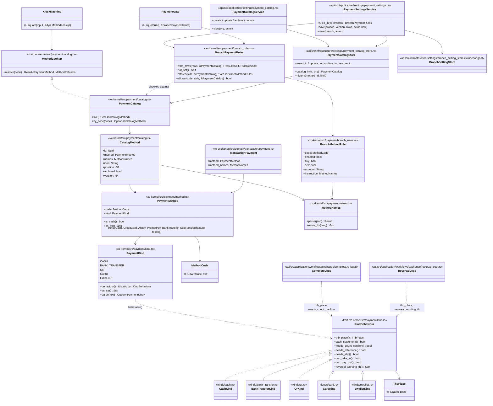

# Configurable payment methods: from a fixed enum to Owner-set data (#564)

> designed-by: claude/022a7453 (subagent of the lane controller), 2026-11-05 09:57 ICT · measured on `origin/main` `c2eccf746`.
> Every `file:line` below is at that sha unless it says otherwise.

## 1. Goal, the owner's words, scope

**The owner's order** (lane controller's session, 2026-11-05 09:47 ICT, recorded on #564 in the comment *"owner decision: configurable payment methods (migration approved)"*), verbatim:
- *"ให้ คอนฟิก เอา เข้า ออกได้"* (make it configurable: methods can be added and removed);
- *"เพื่อ อนาคต"* (for the future);
- *"อนุมัติ"* (approved), given after the migration below was described to him;
- and, on the same order: *"ต้องให้ คอนฟิก ได้ ผมได้ตั้งกฏไว้แล้ว"* (it must be configurable; I already set the rule).

**The rule this follows.** The owner's standing rule is [user-set-settings](blueprint/user-set-settings.md):
- every business value is stored data saved from a screen, never a constant in Rust or TypeScript, a config file or a migration seed (`user-set-settings.md:17`);
- the Owner sets it through an EXECUTIVE-only permission, and the other roles read it (`:18`);
- "not set" behaves safely and the screen shows it (`:23`);
- a change takes effect without a deploy and is stamped with who saved it (`:24`);
- changes are kept as versions, not overwritten (banking control 5, `:34`).

The precedent for applying it is [owner-set-values](blueprint/owner-set-values.md) §3, the hidden fallbacks (`owner-set-values.md:69-79`). The permission split is RBAC §11.11, where `SystemSettings` is a setting and is seeded to EXECUTIVE only, and the payment-methods save stays on it (`blueprint/user-management-rbac.md:1031`; the `SystemSettings` row is `:1061`).

**Payment methods move from code to Owner-set configuration under that rule.** Today the list of methods is fixed in code in nine places (§2). After this design:
- the **methods** are data;
- the **kinds** are code;
- every money rule hangs off the kind, and none hangs off a method's name or code.

This follows ♻️ in the fleet rules ("several variants of one job = one shared core + one small trait implementation per variant"): the kinds are the variants.

**In scope.**
- The Owner can add, archive (soft-delete) and restore payment methods for the organisation. Each method has:
  - display names in the kiosk's 16 languages, with English as the fallback;
  - an icon;
  - a fixed kind.
- Per branch, the Owner can:
  - add a method to the branch;
  - remove it from the branch;
  - disable it;
  - choose its BUY and SELL sides, its account text and its instruction.
- One migration: create the tables, move today's 5 methods in, keep every branch's settings, snapshot the kind on each payment, and drop the fixed CHECK. **The owner approved it.**
- Every reader of a method moves to the kind or to the catalog: legs, drawer checks, quotes, receipts, reports, exports, reconciliation, the desk, the kiosk and the customer queue.

**Out of scope.**
- **Deploy.** The owner did not approve it, and it stays a separate owner order.
- The Owner's OTP step-up and the "department asks, Owner approves" path (`user-set-settings.md:19-22`). They wrap this save like every other settings save when the OTP design lands. Nothing here waits for them (as in `owner-set-values.md:49`).
- Per-method fees and per-method settlement accounts (follow-ups F3 and F4, §11).
- The static v2 kiosk files served from `/opt/xc-v3/web`. They are not in this repo, and they are retired at V4 (`docs/design/blueprint/rates.md:714`; #564 comment by claude/94389a6b, 2026-11-05 09:15 ICT).

## 2. Current state (main `c2eccf746`)

### 2.1 Where the five methods are fixed

| # | Where | What is fixed |
|---|---|---|
| 1 | `api/migrations/20261007170000_kiosk.sql:17-18` | `kiosk_requests.payment_method CHECK (payment_method IN ('Cash', 'Credit Card', 'Alipay', 'PromptPay', 'Bank Transfer'))`. It is the only CHECK on a method (`grep payment_method api/migrations/*.sql`: 2 hits, both here). |
| 2 | `api/crates/xc-exchange/src/domain/exchange/value_objects/payment_method.rs:3-11` | `enum PaymentMethod { Cash, ScbTransfer, BankTransfer, CreditCard, Alipay, PromptPay }`. `is_cash` is at `:25-27`; `parse` is at `:29-39`, and an unknown name returns `None`. |
| 3 | `api/crates/xc-kiosk/src/domain/kiosk/value_objects/payment_method.rs:1-31` | A second copy of the enum without `ScbTransfer`. ♻️ This is a defect today. |
| 4 | `api/crates/xc-kernel/src/payment/channel_rule.rs:4-10` | `METHODS: [&str; 5]` |
| 5 | `api/crates/xc-kernel/src/payment/payment_rules.rs` | `rows: [ChannelRule; 5]` (`:9`); `defaults()` (`:20-65`), with Bank Transfer's instruction text written in code (`:61`); `from_rows` refuses anything but exactly 5 rows (`:69`) and refuses BUY on anything but Cash or Bank Transfer (`:81`); `allows` reads `SCB Transfer` as Bank Transfer (`:121-134`) |
| 6 | `api/src/application/settings/payment_json.rs:61-63`, `payment_input.rs:68` | The stored body must have 5 rows; BUY is limited to Cash and Bank Transfer |
| 7 | `api/crates/xc-kiosk/src/domain/kiosk/entities/kiosk_machine.rs:104-117` | No method or `""` means `"Cash"`; BUY must be Cash or Bank Transfer (`BuyPaidInCashOrTransfer`); then `PaymentMethod::parse` |
| 8 | `api/src/presentation/http/v3/views/admin_reports.rs:23-37` | `CHANNELS` and `EMPLOYEE_CHANNELS`, two orders of the five, used at `:287` and `:416` |
| 9 | web: `web/src/screens/admin/payments/Payments.tsx:33-41`, `web/src/screens/desk/steps/payment/channels.ts:5`, `web/src/screens/admin/parts/transaction.ts:15-31`, `web/src/screens/admin/reports/Reports.tsx:52-56` | `CHANNELS` with glyph icons and `BUY_CHANNELS`; the desk's six `METHODS`, including `SCB Transfer`; `methodName` (anything else is "Other"); `employeeMethodName` |

### 2.2 Per-branch settings today

- **Store.** Settings are one versioned document per branch: `branch_settings` with `name = 'paymentMethods'`, plus `branch_setting_history` (`api/migrations/20261008100000_branch_settings.sql`; design `docs/design/xchange-v3.md` §5.5.1, lines 1332-1388).
- **The body** is 5 rows `{id, enabled, buy, sell, account, instruction}`, and `id` is the method's wire name (`payment_json.rs:31-56`).
- **Service.** `PaymentSettingsService` (`api/src/application/settings/payment_settings.rs`):
  - `SETTING_NAME = "paymentMethods"` (`:17`);
  - `rules`/`rules_in` answer `PaymentRules::defaults()` when a branch has no row, **or when the stored body does not parse** (`:52-72`);
  - `view` uses the defaults when there is no row (`:90`);
  - `can_edit` is `Permission::SystemSettings` (`:79`).
- **The no-row fallback is a hidden fallback** of the kind `owner-set-values.md:71` forbids: a branch the Owner never set up offers all five methods.
- **Routes.**
  - The v2 route is `POST /api/payment-methods`: route at `api/src/presentation/http/payment_methods.rs:34`, policy at `:152`, rows 9–14 at `:181-184`. Its refusals are listed in `xchange-v3.md:1413-1433`.
  - Policy rows: `save` needs `SystemSettings` and `list` needs `SignedIn` (`api/crates/xc-auth/src/domain/policy/areas/payment_methods.rs:21-28`).
  - `SystemSettings` is EXECUTIVE-only from seed version 10 (`api/crates/xc-auth/src/domain/access/role_grants.rs:154`, `:256`).
  - The v3 read is the `admin_payments` view (`api/src/presentation/http/v3/views/admin_payments.rs:36-37`, DTO `api/src/presentation/dto/v3/admin_payments.rs:11-47`).
  - The web saves through the v2 route (`Payments.tsx:336`).
- **Readers of the rules.**
  - The desk config: `api/src/presentation/http/v3/desk/config.rs:77-92`, DTO `api/src/presentation/dto/v3/desk_config.rs:11-18`.
  - The compat snapshot: `api/src/application/compat/snapshot.rs:160`, `:176`.
  - The kiosk `rates` answer: `api/src/presentation/dto/kiosk.rs:157-160`, built by `KioskService::public_rates` (`api/crates/xc-kiosk/src/application/kiosk/customer.rs:52`) and answered at `api/src/presentation/http/kiosk.rs:396-402`.
  - The kiosk quote and confirm gates: `customer.rs:151-152`, `:597-598`.
  - The transaction save step: `api/src/application/workflows/payment_save_step.rs:24-38`.
- **The kiosk ports trait** also answers the defaults when a port does not override it (`api/crates/xc-kiosk/src/domain/kiosk/repositories/kiosk_ports.rs:40-56`).

### 2.3 How transactions store the method

- **The method column is free text with no constraint.** `transaction_payments.method text NOT NULL` has no CHECK and no FK (`api/migrations/20261111170000_transaction_states.sql:96-111`, `method` at `:101`). The wide `transactions.method` was dropped by TX-9 (`api/migrations/20261216100000_drop_wide_transaction_columns.sql:53`).
- **The stored value is `PaymentMethod::as_str()`.** That is one of `Cash`, `SCB Transfer`, `Bank Transfer`, `Credit Card`, `Alipay`, `PromptPay`.
- **Reading an exchange back fails on any other value.** `parse_payment_method` answers `AppError::Internal("unknown payment method")` (`api/crates/xc-exchange/src/infrastructure/transaction/store.rs:44-56`), and so does the list reader (`api/crates/xc-exchange/src/infrastructure/exchange/transaction_repository.rs:60-72`). So **a sixth method would make every exchange that used it unreadable.** Readers must therefore stop parsing the name (§3.4).
- **Kiosk requests** store `kiosk_requests.payment_method` under the CHECK. They are read back with `PaymentMethod::parse` (`api/crates/xc-kiosk/src/infrastructure/kiosk/kiosk_repository.rs:240`).
- **Quotes store no method,** only `quotes.cash_settlement` (`docs/design/blueprint/quote-transaction.md` §13.4, around line 1077; §13.6).

### 2.4 Every decision taken on a method today

Swept on `c2eccf746` with `git grep -n -w "PaymentMethod\|is_cash"` and with `"Cash"`/`"PromptPay"`/`"Bank Transfer"`/`"SCB Transfer"` literals over `api/src`, `api/crates/*/src` and `web/src`, tests excluded.

| Decision | Where | Rule today |
|---|---|---|
| Where the THB leg lands on complete | `api/src/application/workflows/exchange/complete.rs:95-99` | cash → the drawer; anything else → `CashPlace::Bank` |
| Same, on reversal | `api/src/application/workflows/exchange/reversal_post.rs:76-80` | the same |
| Reversal document wording | `reversal_post.rs:181-184` | `PaymentMethod::Cash` → "เงินสด"; otherwise "ช่องทางเดิมที่ชำระ" |
| Cash count confirmed before complete | `complete.rs:332` | cash only |
| Cash rounding on the quote | `api/src/application/workflows/exchange/quote.rs:381`; `quote-transaction.md` §13.4 (around line 1077) | `cash_settlement = method.is_cash()` |
| Quote vs transaction mismatch | `api/src/application/workflows/exchange/create.rs:281` | `is_cash()` must equal `cash_settlement` |
| Reference and slip required | `create.rs:370`; `api/src/application/workflows/exchange/backdate.rs:216`; `api/crates/xc-exchange/src/domain/exchange/value_objects/transaction_form.rs:225`, `:274` | for anything but cash |
| Drawer payout check on quote | `api/src/presentation/http/v3/commands/quotes.rs:339` | `Payout::Cash` when cash |
| Drawer open / device job | `api/src/application/workflows/device_save_step.rs:34`, `:60`; `api/src/application/workflows/save_transaction.rs:489`; `api/src/presentation/http/v3/commands/transactions.rs:405` | cash only |
| Parsing the wire name | `quotes.rs:232`; `api/src/presentation/http/v3/commands/binding_quote_issue.rs:253`; `api/src/presentation/http/v3/commands/transaction_backdate.rs:155`; `transactions.rs:200-202`; `transaction_form.rs:205-213` | a fixed match; unknown → `validationFailed` |
| BUY side limited | `payment_rules.rs:81`; `payment_input.rs:68`; `kiosk_machine.rs:109-112`; `Payments.tsx:41` | Cash and Bank Transfer only |
| Receipt "Pay Via" | `api/crates/xc-exchange/src/domain/exchange/entities/receipt.rs:117` | `form.method.as_str()` |
| Cash summary of a shift | `api/src/presentation/http/v3/views/admin_cash.rs:357`, `:378` | SQL `tp.method = 'Cash'` |
| Report grouping and order | `admin_reports.rs:23-37`, `:287`, `:416` | the two fixed arrays |
| `SCB Transfer` shown as Bank Transfer | `api/src/presentation/dto/v3/transaction_row.rs:302-306`; `snapshot.rs:52-53`; `channels.ts:8-14` | special case |
| Executive and finance totals per method | `api/src/infrastructure/executive/wide_transaction_facts.rs:173-174`; `api/src/application/finance/reconciliation.rs:202-206` | group by the stored text; no fixed list, so these keep working |
| Desk payment step | `web/src/screens/desk/steps/payment/step.tsx:40`, `:66-75`, `:82-83`, `:166-173`; `web/src/screens/desk/desk-store.ts:389-391`; `web/src/screens/desk/save.ts:340` | `=== 'Cash'` and the fixed `METHODS` |
| Backdated keying default | `web/src/screens/desk-backdated/BackdatedScreen.tsx:171` | `'Cash'` |
| Customer queue | `web/src/screens/customer/queue/queue-api.ts:50`, `:72` | `paymentMethods: unknown[]` is read but not used; `paymentMethod?` is sent |
| e2e | `qa/e2e/tests/desk-exchange.ts`, `flow-exchange.spec.ts`, `flow-desk-extras.spec.ts`, `flow-desk-kiosk-cancel.spec.ts`, `flow-sick-teller-handover.spec.ts`, `flow-validation-staff-desk.spec.ts` | pick methods by their English name |

**Tests.** 74 test files name `PaymentMethod::` 236 times. Of those, 183 are `Cash`, 24 `BankTransfer`, 14 `PromptPay`, 4 `CreditCard`, 3 `Alipay` and 3 `ScbTransfer` (`git grep -c "PaymentMethod::" -- 'api/tests/*' 'api/crates/*/tests/*'`). §4.3 keeps them compiling.

### 2.5 What the existing designs already say

- **`docs/design/xchange-v3.md` §5.5.2** (lines 1391-1471) designed the per-branch payment settings for exactly the 5 channels. **This design supersedes** its fixed-five parts:
  - refusal row 9 (*"กรุณาตั้งค่าให้ครบทั้ง 5 ช่องทาง"*);
  - refusal row 11 (BUY only on Cash or Bank Transfer), which becomes a kind rule;
  - the no-row defaults.

  Its store (§5.5.1), its 409 on a stale version, its history and its refusal order otherwise stay.
- `xchange-v3.md:58` (D10) and `docs/design/xchange-v3-web.md:623` ("V2-payments", PR 372) are the history of that route.
- `docs/design/v9-v3-comparison-mapping.md:48` (row 15) asks for "one name per channel on every screen". This design gives each method one set of names, read from one place.
- `docs/design/xc-desk-blueprint-v2-mapping.md:110-111` names the counter payment methods and the per-branch settings as Blueprint gaps.

## 3. Data model

### 3.1 Tables

The methods are an **organisation catalog**. Per-branch settings stay where they are today, in the per-branch versioned document, because that store already has versions, 409s and history (`xchange-v3.md:1340-1346`). That store was designed so that a second use is a small service over the same tables.

```sql
CREATE TABLE payment_methods (
    id               uuid        PRIMARY KEY,
    organization_id  uuid        NOT NULL REFERENCES organizations (id),
    code             text        NOT NULL CHECK (code ~ '^[A-Za-z][A-Za-z0-9 _-]{0,39}$'),
    kind             text        NOT NULL CHECK (kind IN ('CASH', 'BANK_TRANSFER', 'QR', 'CARD', 'EWALLET')),
    names            jsonb       NOT NULL CHECK (jsonb_typeof(names) = 'object' AND names ? 'en'),
    icon             text        NOT NULL CHECK (char_length(icon) BETWEEN 1 AND 8),
    position         integer     NOT NULL CHECK (position >= 0),
    archived_at      timestamptz NULL,
    version          bigint      NOT NULL CHECK (version >= 1),
    created_at       timestamptz NOT NULL,
    updated_at       timestamptz NOT NULL,
    updated_by       text        NOT NULL,
    UNIQUE (organization_id, code)
);
CREATE INDEX payment_methods_org_live ON payment_methods (organization_id, position) WHERE archived_at IS NULL;

CREATE TABLE payment_method_history (
    method_id  uuid        NOT NULL REFERENCES payment_methods (id),
    version    bigint      NOT NULL,
    actor      text        NOT NULL,
    at         timestamptz NOT NULL,
    before     jsonb       NULL,      -- NULL on the version that created the method
    after      jsonb       NOT NULL,
    PRIMARY KEY (method_id, version)
);
```

**The `code` is the method's stable key.**
- It is set when the method is created and **never changes**. A changed `code` or `kind` is refused (`validationFailed`, field `code` / `kind`).
- The five migrated methods keep today's wire names as their codes: `Cash`, `Credit Card`, `Alipay`, `PromptPay` and `Bank Transfer`. A sixth, `SCB Transfer`, is archived (Q2).
- The pattern admits those names, so no stored body, transaction or kiosk request is rewritten.
- New codes are typed on the screen, and the screen pre-fills them from the English name (e.g. `TrueMoney`).

**Names** are one JSON object, keyed by the 16 kiosk languages: `en th zh zh-HK ja ko ru hi ar lo my vi ms de fr id`, the codes of `app/assets/l10n/kiosk.json` `langs`.
- `en` is required, and the CHECK enforces it.
- The other keys are optional; a missing key reads as `en`.
- The save refuses any key outside the 16 and any name that is empty after trimming or longer than 40 characters.
- The list of 16 languages is the kiosk's own: protocol, not a business value.

Names are in a column, not a child table, because:
- they are saved, versioned and shown as one unit;
- the history row stores the whole method before and after;
- nothing queries one language alone.

**The icon** is a short glyph (≤ 8 characters), as on the admin screen today (`Payments.tsx:34-38`: `฿ ▣ 支 ▦ ⇄`). Uploaded images are Q3.

**`position`** is the catalog order on the admin screen. The branch's own order is the order of its document (§3.2).

**`archived_at`** is the soft delete (§6.3). A row is never hard-deleted, so every code a transaction holds always finds its method.

**Versions** follow `branch_settings`: optimistic `version`, `staleVersion` 409 on mismatch, and one history row per save (banking control 5). Each save also writes one AP-1 `AuditLog` row, as the v3 settings commands do (`api/src/presentation/http/v3/commands/exchange_settings_save.rs:1-4`).

### 3.2 Per-branch settings

`branch_settings` with `name = 'paymentMethods'` stays. Its body becomes **a list of any length**, in the branch's display order:

```json
[{"id": "Cash", "enabled": true, "buy": true, "sell": true, "account": "", "instruction": {"en": "..."}}, ...]
```

- **`id` is the method's `code`.** The stored key stays `id`, so every body and every history row written so far still reads.
- **A method is offered at a branch** when its row is in the body, `enabled` is true and the side flag is on, and the method is not archived.
- **Removing a method from a branch** removes its row. **Disabling it** sets `enabled: false` and keeps its account and instruction.
- **`instruction`** becomes a names-shaped object, so the kiosk can show it in the customer's language. Its key set is the same as for names. A stored plain string (every body written so far) reads as `{"en": <string>}`, so no stored body is rewritten.
  - This is a reversible choice: an object is a superset of today's string.
  - The account text stays one string, because only staff see it (`xchange-v3.md:1395-1396`).
- **The save checks against the catalog in the same transaction.** Every `id` must be a live method of the branch's organisation. BUY is allowed only on a kind that can pay out, and SELL only on a kind that can take in (§4.1). An enabled row needs a side. The branch must keep at least one enabled BUY and one enabled SELL method, as today's row 14 (`payment_rules.rs:96-103`) requires. Length and control-character bounds stay as in row 13.
- **No row means "not set".** The branch then offers no method: the desk cannot save, the kiosk offers nothing and says so, and the screen shows "not set". This replaces `PaymentRules::defaults()`. An unreadable body is a `500`, never a silent fallback to the defaults (`payment_settings.rs:56`, `:69`, `:82` today). The migration writes every branch's row, so no branch is "not set" right after it (§5, Q1).

### 3.3 How a payment references its method: by code, plus a snapshot of kind and names

```sql
ALTER TABLE transaction_payments
    ADD COLUMN method_kind  text  NULL,
    ADD COLUMN method_names jsonb NULL;
-- after the backfill (§5): SET NOT NULL, CHECK on kind, and
ALTER TABLE transaction_payments
    ADD CONSTRAINT transaction_payments_method_fkey
    FOREIGN KEY (organization_id, method) REFERENCES payment_methods (organization_id, code);

ALTER TABLE kiosk_requests ADD COLUMN payment_method_kind text NULL;   -- backfilled, then NOT NULL + CHECK
```

**By `code`, not by the uuid.**
- The code is already what every wire carries: `POST /api/transactions`, `POST /api/quotes`, the kiosk `quote`, binding quotes, backdating and the compat `saveTransaction`.
- The code is already what every stored row holds.
- So referencing by code needs no new column on old rows and no change of wire.
- The FK on `(organization_id, code)` gives the same integrity as the id would.
- The uuid stays internal: the history key and the admin commands' path.

**Plus a kind snapshot (`method_kind`).**
- Money rules on a saved payment read the kind **as it was when the payment was made** (legs on reversal, cash summaries, reports).
- Readers stop parsing the name, so the `Internal("unknown payment method")` of §2.3 cannot happen for a new method.
- The kind cannot change on a method anyway (§3.1). The snapshot makes old rows independent of the catalog, and it lets SQL readers filter by kind without a join.

**Plus a names snapshot (`method_names`).**
- **Old transactions keep the name they were made with, in every language**, even after the method is renamed or archived. A record shows what was used at the time.
- The receipt already freezes the printed text in its document (`receipts.document_ref`). The snapshot gives the screens and exports the same.

**Kiosk requests** get the kind snapshot only. A kiosk request is an indicative quote and is never posted: the desk prices it again with a fresh quote that carries the method (`quote-transaction.md` §13.4, around line 1077). It has no `organization_id`, so it gets no FK. The method is checked against the catalog when the request is written.

### 3.4 Old rows read correctly

| Old row | After the migration |
|---|---|
| `transaction_payments.method = 'Cash'` | `method_kind = 'CASH'`, names = Cash's names: posts and reverses exactly as before |
| `'SCB Transfer'` | the archived `SCB Transfer` method, kind `BANK_TRANSFER`, names = Bank Transfer's (today's screens already show it as Bank Transfer, `transaction_row.rs:302-306`) |
| any other text | **the migration stops** (precheck, §5 step 3); the read-only count before deploy tells whether any exists |
| a stored branch body | read unchanged (`id` = code; a plain-string instruction = `{en}`) |
| a `branch_setting_history` row | read unchanged; the screen's change list compares by `id` as today (`Payments.tsx:381-386`) |
| `kiosk_requests.payment_method` | `payment_method_kind` from the same mapping |

## 4. The kind and the core

### 4.1 Kinds and what each one does

The kind list is **code**: it is behaviour, not a business value (`user-set-settings.md:36`). A new kind needs a design and a deploy. A new method of an existing kind needs neither.

| Kind | Example methods | THB leg on complete and reversal | Cash rounding (`cash_settlement`) | Cash count confirmed before complete; drawer device job | Reference and slip | Can take THB in (SELL) | Can pay THB out (BUY) | Reversal wording |
|---|---|---|---|---|---|---|---|---|
| `CASH` | Cash | the shift's drawer | yes | yes | no | yes | yes | "เงินสด" |
| `BANK_TRANSFER` | Bank Transfer, `SCB Transfer` (archived) | `CashPlace::Bank` | no | no | yes | yes | yes | "ช่องทางเดิมที่ชำระ" |
| `QR` | PromptPay | `CashPlace::Bank` | no | no | yes | yes | no | same |
| `CARD` | Credit Card | `CashPlace::Bank` | no | no | yes | yes | no | same |
| `EWALLET` | Alipay | `CashPlace::Bank` | no | no | yes | yes | no | same |

- **Today's behaviour is preserved row by row:**
  - every non-cash rule of §2.4 is "not CASH";
  - the BUY limit (Cash and Bank Transfer) becomes `can_pay_out`, which is true for `CASH` and `BANK_TRANSFER`.
- **A shop that wants to pay THB out by PromptPay** adds a `BANK_TRANSFER` method, for example "PromptPay transfer". This needs no code change.
- **`QR`, `CARD` and `EWALLET` are distinct today only in their name** and behave the same. They are separate kinds so that a later rule for one of them changes one file, and so that reports can group by kind. Examples are a card surcharge, a separate settlement account, or wallet reconciliation (F3, F4).

### 4.2 Where it lives

Everything below goes in **xc-kernel** (`api/crates/xc-kernel/src/payment/`), because `xc-exchange`, `xc-kiosk` and `api` all need it. This is the same dependency rule that put `PaymentRules` there (`xchange-v3.md:1451`).

- `PaymentKind`: the enum of the five kinds, with `as_str`/`parse` for the column.
- `KindBehaviour`: the trait. **One unit struct per kind implements it**: `CashKind`, `BankTransferKind`, `QrKind`, `CardKind`, `EwalletKind`, each in its own file.
  - `PaymentKind::behaviour() -> &'static dyn KindBehaviour` is the only `match` on the kind.
  - The trait's methods are the columns of §4.1: `thb_place() -> ThbPlace`, `cash_settlement()`, `needs_count_confirm()`, `needs_reference()`, `needs_slip()`, `can_take_in()`, `can_pay_out()`, `reversal_wording_th()`.
  - `ThbPlace` is `{Drawer, Bank}`. xc-kernel does not depend on xc-cash, so `complete.rs` and `reversal_post.rs` map it onto `CashPlace`.
- `PaymentMethod { code: MethodCode, kind: PaymentKind }`: **the one type that replaces both enums**. `xc-exchange`'s and `xc-kiosk`'s `payment_method.rs` re-export it.
  - `is_cash()` stays as `self.kind == PaymentKind::Cash`, so the 14 production `is_cash()` calls of §2.4 keep their shape.
  - It is `Clone`, not `Copy`.
- `MethodNames`: the 16-language map, with `name_for(lang)` falling back to `en`. It is used for names and for instructions.
- `CatalogMethod`: `{id, code, kind, names, icon, position, archived, version}`.
- `PaymentCatalog`: the organisation's methods.
  - `resolve(code) -> Result<PaymentMethod, MethodRefusal>`: unknown → `Unknown`; archived → `Archived`.
  - `live()` returns the live methods in catalog order.
- `BranchPaymentRules`: replaces `PaymentRules`.
  - `from_rows(rows, &PaymentCatalog) -> Result<Self, RuleRefusal>` runs every check of §3.2, in the order of today's rows 10–14.
  - `offered(side) -> Vec<&BranchMethodRule>` returns rows in branch order: enabled, live, with the side flag on.
  - `allows(code, side) -> bool`.
  - `not_set()` is the empty rules.
- `MethodLookup`: a small trait with `resolve(code)`, implemented by `PaymentCatalog`. Pure domain parsers such as `TransactionForm::parse` and `KioskMachine::quote` take `&dyn MethodLookup` instead of matching names.

**The core decides; the kinds only answer.** The legs, gates and checks call `method.kind.behaviour()`, or `is_cash()` where only "cash or not" matters. They never call `code`. A gate test (T11) fails when production code names a method literal (§9).

### 4.3 Keeping the 236 test uses compiling

`PaymentMethod` keeps associated consts named like the old variants: `PaymentMethod::Cash`, `::CreditCard`, `::Alipay`, `::PromptPay`, `::BankTransfer` and `::ScbTransfer`. Each holds the migrated code and kind.
- **They are behind the kernel's new `testing` feature,** which only dev-dependencies enable. Production code cannot name them, and a release build fails if it tries.
  - At PR time that build is not always run. `cargo clippy --all-targets` compiles the library with dev-dependency features on, and `cargo check --release` runs only when `release_check` is set (`.github/workflows/api.yml:477`, `:616-619`). So the PR-time guard is T11's literal gate (PM-25), which names `PaymentMethod::Cash` and the others.
- Tests set methods through these consts or through catalog fixture rows, never through a business constant in production code (`user-set-settings.md:43`).
- `MethodCode` wraps `Cow<'static, str>`, so the consts are `const`.

### 4.4 Services and stores (api)

| Class | File | What |
|---|---|---|
| `PaymentCatalogStore` | `api/src/infrastructure/settings/payment_catalog_store.rs` (new) | `catalog_in(tx, org) -> PaymentCatalog`; `insert_in`, `update_in(expected_version)`, `archive_in`, `restore_in`. Each write adds a history row in the same transaction; `history(method_id, limit)` reads them |
| `PaymentCatalogService` | `api/src/application/settings/payment_catalog.rs` (new) | `create`, `update`, `archive`, `restore`, `view(org, actor)`. Validates names, icon and the immutable `code`/`kind`; writes the AP-1 audit row |
| `PaymentSettingsService` | `api/src/application/settings/payment_settings.rs` (changed) | `rules_in(tx, branch) -> BranchPaymentRules`, where no row → `not_set()` and a bad body → `Err`; `save` validates through `BranchPaymentRules::from_rows` against `catalog_in`; `view` joins the catalog |

## 5. The migration

**Slot:** `api/migrations/<slot>_payment_methods.sql`. `scripts/migration-slot.sh next` on main answered `20261226220000` at 09:5x ICT on 2026-11-05, but `feat/configurable-shifts` already holds `20261226220000_shift_templates`, which is not on main yet. So T1 takes its slot with `scripts/migration-slot.sh next` right before `pr_open`, ordered after `shift_templates`, and `migration-slot.sh renumber` runs at merge (`docs/design/migration-slots.md`). The `updated_by` marker `migration:payment_methods` does not carry the number, so a renumber changes nothing else.

The migration is embedded and runs at boot, before the server binds. It is forward-only: a wrong migration is a wrong deployment. The **owner approved** it on 2026-11-05.

**Steps, in one file and one transaction:**

1. **Create** `payment_methods` and `payment_method_history` (§3.1).
2. **Backfill the catalog.** For every row of `organizations`, insert the six methods, version 1, `updated_by = 'migration:payment_methods'`, with one history row each (`before` NULL):

   | position | code | kind | icon | names | archived |
   |---|---|---|---|---|---|
   | 0 | `Cash` | `CASH` | `฿` | en "Cash"; 15 others from `kiosk.json` key `cash` | no |
   | 1 | `Credit Card` | `CARD` | `▣` | en "Credit Card"; others from `kiosk.json` key `creditCard` | no |
   | 2 | `Alipay` | `EWALLET` | `支` | en "Alipay" (brand; no other key) | no |
   | 3 | `PromptPay` | `QR` | `▦` | en "PromptPay", th "พร้อมเพย์" (`web/src/screens/admin/payments/i18n.ts:29`) | no |
   | 4 | `Bank Transfer` | `BANK_TRANSFER` | `⇄` | en "Bank Transfer"; others from `kiosk.json` key `transfer` | no |
   | 5 | `SCB Transfer` | `BANK_TRANSFER` | `⇄` | Bank Transfer's names | **yes** (Q2) |

   - The English names are the admin's (`i18n.ts:99-103`), and the Thai names are `i18n.ts:26-30`.
   - This moves today's labels into data. It **writes no business value the Owner has not already chosen**: these are the five methods the owner approved moving, with their current names and icons.
3. **Payments.**
   - **Precheck:** `RAISE EXCEPTION` when any `transaction_payments.method` is outside the six codes, with the count. The migration then stops the boot and changes nothing.
   - Set `method_kind` from the code mapping, and `method_names` from the catalog row of the payment's organisation.
   - `SET NOT NULL`; add `CHECK (method_kind IN (...))`; add the FK of §3.3.
4. **Kiosk requests.**
   - Set `payment_method_kind` from the mapping, then `SET NOT NULL` and add the CHECK.
   - **Drop the fixed CHECK** `kiosk_requests_payment_method_check`. That is Postgres's default name for the column CHECK at `20261007170000_kiosk.sql:18`. The migration asserts that it exists in `pg_constraint` before dropping it, so a renamed constraint stops the migration instead of being silently kept.
5. **Branch settings, today's settings kept** (Q1, recommendation A).
   - A branch with a `paymentMethods` row keeps it byte for byte, version and history included. Its five `id`s are now catalog codes.
   - A branch **without** a row runs on the code defaults today (`payment_rules.rs:20-65`). It gets those defaults as its row, version 1, `updated_by = 'migration:payment_methods'`, with one history row (`before` = `[]`). The screen shows that this row came from the migration and was never saved by the Owner.
   - Bank Transfer's default instruction becomes `{"en": "If transfer, call agent · หากโอนเงิน กรุณาติดต่อพนักงาน"}` (`payment_rules.rs:61`).
6. **Readers switch** in the same deploy (§7 tickets). The new binary reads only the catalog, the snapshots and `BranchPaymentRules`. `PaymentRules::defaults()`, `METHODS` and both enums are gone.

**Read-only counts before deploy** (on the target, by whoever deploys):

```sql
SELECT method, count(*) FROM transaction_payments GROUP BY method ORDER BY 1;   -- must be within the six codes
SELECT payment_method, count(*) FROM kiosk_requests GROUP BY 1;
SELECT count(*) FROM branches b WHERE NOT EXISTS
  (SELECT 1 FROM branch_settings s WHERE s.branch_id = b.id AND s.name = 'paymentMethods');   -- rows step 5 writes
SELECT conname FROM pg_constraint WHERE conrelid = 'kiosk_requests'::regclass AND contype = 'c';
```

**Deploy order and rolling back.**
- The migration runs before the new binary serves. The **old binary does not work on the new schema**: it inserts `transaction_payments` and `kiosk_requests` without the new NOT NULL kind columns, so its saves fail. The migration and the binary therefore go in one deploy, the normal boot order, as in `owner-set-values.md:236`.
- **Rolling back is a forward fix**: a new migration and a new binary, never redeploying the old binary. That is the repo's rule for boot migrations.
- The file carries a commented `down`, as `20261216100000_drop_wide_transaction_columns.sql:58-` does:
  - re-add the kiosk CHECK, which fails, and names the rows, if a kiosk request holds a code outside the five;
  - drop the FK, the snapshot columns, the two tables, and the branch rows step 5 wrote (`updated_by = 'migration:payment_methods'` and version 1).
  - **`down` loses** every method the Owner added, every catalog version and every names snapshot. Payments made with an added method keep their `method` text, but the old binary cannot read them (§2.3).

## 6. API and screens

### 6.1 Admin: the catalog (organisation)

| Name | Kind | Permission | Body / answer |
|---|---|---|---|
| `payment_methods` view | view | `SettingsRead` (every staff role, RBAC §11.11) | `{methods: [{id, code, kind, names, icon, position, archived, version, updatedAt, updatedBy, updatedByName}], kinds: [{kind, canTakeIn, canPayOut, needsReference, needsSlip}], canEdit}`, plus `history` (≤ 20 per method) for a caller with `SystemSettings`, else `[]` (as `payment_settings.rs:93-107`). `updatedByName` comes through `SetterNames::of_in` (`user-set-settings.md:62`). |
| `paymentMethodCreate` | command | `SystemSettings` (EXECUTIVE only) | `{code, kind, names, icon, position}` → the method at version 1 |
| `paymentMethodUpdate` | command | `SystemSettings` | `{id, version, names?, icon?, position?}`; a `code` or `kind` in the body that differs from the stored one is `validationFailed`; a stale `version` is 409 `staleVersion` |
| `paymentMethodArchive` / `paymentMethodRestore` | command | `SystemSettings` | `{id, version}` |

- **Each command writes one catalog version, one history row and one AP-1 audit row,** inside one transaction.
- **The kinds list comes from code,** so the screen shows a new kind without changes of its own.
- **Commands and views need no shared registration.** v3 commands and views are generated from one file per item (`api/build.rs:167-184`, `docs/design/build-time-registries.md`), and so are policy area rows (`api/crates/xc-auth/build.rs`).

### 6.2 Admin: the branch's methods

- **`admin_payments`** (exists) answers the branch's rows joined with the catalog: `{code, kind, names, icon, archived, enabled, buy, sell, account, instruction}`, in branch order. It adds `available`, the live catalog methods not yet in the branch, and `notSet: true` when the branch has no row. Every other field is unchanged.
- **`branchPaymentMethodsSave`** is new: `{branchId, version, methods: [{code, enabled, buy, sell, account, instruction}]}`, needing `SystemSettings`. It is checked by §3.2, and its refusals are worded per row as `xchange-v3.md:1413-1433` lists. It writes the `branch_settings` version and history through `BranchSettingStore::write_in` under the branch lock, as today.
- **The v2 `POST /api/payment-methods`** keeps its 17-row order:
  - `list` answers the branch's rows of any count;
  - `save` validates through the same `BranchPaymentRules::from_rows`, so row 9 becomes "every `id` a live catalog method, no duplicates" and row 11 becomes "BUY only on a kind that can pay out";
  - one line in `docs/design/xchange-v3-known-differences.md` records the change. The web moves to `branchPaymentMethodsSave`.
- **The screen** (`web/src/screens/admin/payments/`) gets:
  - a **Methods** card for the organisation: add, edit names in 16 languages, choose the icon and kind, archive and restore, with history;
  - the **branch** card: add from `available`, remove, reorder, enable, BUY/SELL (the BUY box only on kinds that can pay out), account, and the instruction per language.

  Read-only callers see "ตั้งค่าโดยเจ้าของ" (RBAC §11.11). A branch with `notSet` shows "not set: this branch takes no payment".

### 6.3 Deleting a method that transactions use: archive, never delete

- **"Remove" in the catalog is `paymentMethodArchive`.** It sets `archived_at` and keeps the row and its history. An archived method:
  - is offered nowhere: not on the desk, not on the kiosk, not on the customer queue;
  - is refused on a new quote, a new transaction save or a new kiosk request (`paymentMethodUnavailable`);
  - is refused when a branch save adds it.
- **Branch documents that list it keep their row,** greyed "archived" on the screen. `paymentMethodRestore` brings the method back with each branch's settings intact. This is why an archive does not rewrite every branch.
- **Saved payments keep `method` as the FK,** so the method stays readable, and they show their `method_names` snapshot.
- **There is no hard delete.** A method that was never used could be deleted, but one rule is simpler and it is reversible: the same `archived` state for every method.
- **"Remove from this branch"** is the branch save without that row. It changes nothing in the catalog.

### 6.4 Desk, kiosk and customer queue

- **Desk** (`adminDeskConfig` / v3 `desk_config` and `staff_desk_config`).
  - `paymentMethods` gains `kind`, `names` and `icon` per row and lists only the branch's live rows, in branch order (`desk_config.rs:11-18`, `config.rs:77-92`).
  - The payment step builds its list from it:
    - the fixed `METHODS` (`channels.ts:5`) goes, and the `SCB Transfer` alias goes (`channels.ts:8-14`);
    - `isCash` becomes `kind === 'CASH'` (`step.tsx:40`, `desk-store.ts:389-391`, `save.ts:340`);
    - the backdated screen starts with no method instead of `'Cash'` (`BackdatedScreen.tsx:171`).
  - Labels come from `names` in the staff language (th/en), through one `methodLabel(names, lang)` helper (`web/src/shared/payment/method-label.ts`, new). That helper also replaces `methodName` (`admin/parts/transaction.ts:15-31`) and `employeeMethodName` (`Reports.tsx:52-56`).
- **Kiosk `rates`.**
  - `paymentMethods` lists the branch's **offered** methods, meaning live and enabled, as `{id, kind, names, icon, buy, sell, instruction}` (no `account`, as today). `enabled` is always true, kept for the v2 shape.
  - The quote and confirm gates (`customer.rs:151-152`, `:597-598`) call `BranchPaymentRules::allows`.
  - `KioskMachine::quote` resolves the method through `&dyn MethodLookup`, and BUY is refused by `!can_pay_out()` (`kiosk_machine.rs:109-117`).
  - **A new method shows on the kiosk with no deploy,** because the answer carries its names and icon.
- **Customer queue** (`/app/queue`). `QueueRates.paymentMethods` gets the type of the kiosk row above, in place of `unknown[]` (`queue-api.ts:50`). The new web kiosk look (`feat/kiosk-web-look`, #564 comment by claude/aed28a21) renders from it, and `paymentMethod` is sent as the code (`:72`).

### 6.5 Money readers

- **Quotes and transactions.**
  - `POST /api/quotes`, `/api/transactions`, binding quotes, backdating and the compat save resolve the code through `PaymentCatalog::resolve` in their own transaction. An unknown code is `validationFailed`, field `paymentMethod`. An archived code, or one not offered for the side at the branch, is `paymentMethodUnavailable`. The `PaymentSaveStep` keeps its "first LIVE save only" rule (`payment_save_step.rs:24-38`).
  - The insert writes `method`, `method_kind` and `method_names`. The readers (`store.rs:44-56`, `transaction_repository.rs:60-72`, `kiosk_repository.rs:240`) build `PaymentMethod` from the stored code and kind, and never parse.
- **Legs.** `complete.rs:95-99` and `reversal_post.rs:76-80` call `kind.behaviour().thb_place()`; `complete.rs:332` calls `needs_count_confirm()`; `reversal_post.rs:181-184` calls `reversal_wording_th()`. Cash keeps posting to the drawer.
- **Receipt.** "Pay Via" prints `method_names.name_for(en)` (`receipt.rs:117`). Receipts already issued keep their stored document.
- **Reports and views.**
  - `admin_reports` groups by `method` in catalog order, then archived methods that have rows in the period. The two arrays (`admin_reports.rs:23-37`) go.
  - `admin_cash` filters `tp.method_kind = 'CASH'` (`admin_cash.rs:357`, `:378`). A second CASH-kind method counts in the drawer, as it must.
  - `transaction_row` answers `methodNames` and drops the `SCB Transfer` special case (`:302-306`).
  - Exports (`live-csv`) and reconciliation (`Reconciliation.tsx:169`) print `methodLabel(methodNames, lang)`.
  - Executive and finance totals keep grouping by code (`wide_transaction_facts.rs:173-174`, `reconciliation.rs:202-206`) and label through the catalog.

## 7. Class diagram



## 8. Behaviour (the rows the tests pin)

| # | Case | Result |
|---|---|---|
| PM-1 | Branch rules: Cash on, BUY+SELL; PromptPay on, SELL only; Alipay disabled. Kiosk `rates` | `paymentMethods` = [Cash, PromptPay] in branch order; Alipay absent; PromptPay `buy: false`. The kiosk lists Cash and PromptPay for a SELL and only Cash for a BUY. |
| PM-2 | EXECUTIVE creates `TrueMoney`, kind `EWALLET`, names en/th, icon; adds it to MAIN with SELL on; **no deploy, no restart** | the next kiosk `rates`, `desk_config` and `/app/queue` rates list it with its names and icon; a kiosk SELL quote with `paymentMethod: "TrueMoney"` is admitted |
| PM-3 | The same method with `buy: true` in the branch save | refused, `validationFailed`, field `methods[i].buy`: an `EWALLET` cannot pay THB out |
| PM-4 | PromptPay disabled at MAIN; a first LIVE `POST /api/transactions` SELL with `PromptPay` | refused `paymentMethodUnavailable` ("Payment method unavailable. Please contact staff."); nothing is written |
| PM-5 | PromptPay enabled for SELL only; a BUY transaction with it | refused `paymentMethodUnavailable` |
| PM-6 | An unknown code `Zelle` on a quote or transaction | `validationFailed`, field `paymentMethod` |
| PM-7 | `Alipay` archived; read a transaction saved with Alipay before; the admin list, the export and the receipt | the transaction reads; `methodNames.en` = "Alipay" and the Thai name is the snapshot's. The receipt document is unchanged. No `Internal` error. |
| PM-8 | Rename `Credit Card`'s en name to "Card"; read a transaction saved before | it still shows "Credit Card" (snapshot); a new transaction shows "Card" |
| PM-9 | Complete a cash SELL with `Cash` | THB leg to the shift's drawer, count confirmed required, cash rounding applied: as today's CR9 (`quote-transaction.md` §13.7) |
| PM-10 | A second CASH-kind method `Cash counter 2`; complete a cash BUY with it | THB leg from the drawer; `admin_cash` counts it in "cash paid"; rounding applied |
| PM-11 | Complete a SELL with the new `EWALLET` method | THB leg to `CashPlace::Bank`; reference and slip required |
| PM-12 | Reverse a cash transaction and an EWALLET one | drawer and "เงินสด" / Bank and "ช่องทางเดิมที่ชำระ" (wording by kind) |
| PM-13 | `paymentMethodUpdate` with a different `kind` or `code` | `validationFailed`, field `kind` / `code`; nothing written |
| PM-14 | Two updates with the same `version` | the second is 409 `staleVersion`; one history row |
| PM-15 | FINANCE, BRANCH_MANAGER, ADMIN without EXECUTIVE: any of the four catalog commands or `branchPaymentMethodsSave` | refused, permission; they still read `payment_methods` and `admin_payments` |
| PM-16 | Names `{th: "..."}` without `en`; a key `xx`; an empty name | `validationFailed`, field `names` |
| PM-17 | A name missing in `ja`; kiosk in Japanese | shows the `en` name |
| PM-18 | A branch with no `paymentMethods` row (made after the migration) | `rates` and `desk_config` list no method; the desk cannot save; `admin_payments` says `notSet`; no code default |
| PM-19 | A stored body that does not parse | `500`, never a fallback to defaults |
| PM-20 | Branch save leaving no enabled BUY method | refused, as today's row 14 |
| PM-21 | Migration on a database with today's data: 5 methods' rows, a branch with a saved body, a branch with none, `SCB Transfer` payments | catalog of 6 per organisation (`SCB Transfer` archived); the saved body is unchanged byte for byte; the empty branch gets the defaults at version 1 by `migration:payment_methods`; every payment has `method_kind`/`method_names`; the kiosk CHECK is gone |
| PM-22 | Migration on a database holding a payment with method `Other` | stops with the count; nothing changed |
| PM-23 | After the migration, insert a kiosk request with `TrueMoney` | accepted by the database (the CHECK is gone); the service refuses an unknown or archived code before that |
| PM-24 | Archive `PromptPay`, then restore it | while archived it is offered nowhere and greyed in MAIN's card; after restore MAIN offers it with its old account and instruction |
| PM-25 | Production code under `api/src`, `api/crates/*/src`, `web/src` (tests, inline `#[cfg(test)]` modules such as `booking_save_step.rs:372`, `:455`, and generated files excluded) | no method literal (`"Cash"`, `'PromptPay'`, `PaymentMethod::Cash`, …) outside `xc-kernel/src/payment/method.rs`'s `testing` consts and the migration: the gate of T11 |

**Tests that pin today's fixed five and are restated** (each sets methods through catalog fixture rows or the `testing` consts):
- `api/crates/xc-kernel/tests/payment_rules_test.rs` and its `fixtures/v2_payment_rules_cases.json`: the v2 cases stay as the parity of the five migrated methods; the "exactly 5" cases become "unknown id";
- `api/tests/payment_methods_http_test.rs` with `api/tests/fixtures/payment_methods/`;
- `api/tests/desk_config_payment_test.rs`;
- `api/crates/xc-kiosk/tests/kiosk_payment_test.rs`, `kiosk_machine_test.rs` (`BuyPaidInCashOrTransfer`);
- `api/tests/admin_reports_aggregates_test.rs`;
- `api/tests/branch_settings_migration_test.rs`;
- the six fakes that implement `KioskPorts` (`api/crates/xc-kiosk/tests/kiosk_payment_test.rs`, `kiosk_service_common/mod.rs`, `api/tests/gapsa5_kiosk_customer_differs_save_test.rs`, `kiosk_save_step_test.rs`, `kiosk_save_step_time_test.rs`, `kiosk_stale_rate_refusal_test.rs`), which today get the defaults from the trait;
- web: `web/src/screens/admin/payments/*.test.tsx`, `web/src/screens/admin/admin-inputs.bounds.test.tsx` (A2), the desk payment step tests.

A ticket's flip table is measured by running the touched crates against the ticket author's throwaway branch, not by this list (as `owner-set-values.md:294`).

**Tests that create their own organisation or branch** also flip. These were swept on `c2eccf746` with `git grep -l -i 'insert into organizations|branches'`.
- An organisation a test inserts has no catalog, so its payments fail the FK of §3.3. 7 test files both insert an organisation and save payments, for example `api/tests/executive_overview_test.rs` and `ex11a_transactions_drilldown_test.rs`.
- A branch a test inserts is "not set" (§3.2), so a save through the payment gate is refused. 24 test files both insert a branch and save payments.
- T0 adds one seeding helper per test tree: it writes the six catalog rows for an organisation and the migration's default row for a branch. The flip run assigns each of these files to exactly one ticket's File scope before `ready`.

## 9. Tickets

**Shape** (skill `lane-controllers`):
- One sub-controller session on `feat/payment-methods-config` writes **T0, the skeleton**: types and signatures, behaviour unchanged, fmt-clean and clippy-clean.
- The rest are function tickets for **Gemini workers**: Argon for `class:logic` and `class:guarded`, Flash for `class:mechanical`.
- **File scopes are disjoint**, so T2–T10 release together once T0 and T1 are on the branch.
- Every logic ticket has **one up-front test file**, written by the sub-controller before `ready`. Workers must not edit provided tests.

| T | Class | Files (the `## File scope` block) | Up-front test | Needs |
|---|---|---|---|---|
| **T0** skeleton (sub-controller, Claude) | — | `api/crates/xc-kernel/Cargo.toml` (feature `testing`), `api/crates/xc-kernel/src/payment/mod.rs`, `.../payment/kind.rs`, `.../payment/kinds/{mod,cash,bank_transfer,qr,card,ewallet}.rs`, `.../payment/method.rs`, `.../payment/names.rs`, `.../payment/catalog.rs`, `.../payment/branch_rules.rs` (signatures and `PaymentMethod`; consts behave as today); `api/crates/xc-exchange/src/domain/exchange/value_objects/payment_method.rs`, `api/crates/xc-kiosk/src/domain/kiosk/value_objects/payment_method.rs` (re-exports); the `dev-dependencies` lines of `api/Cargo.toml`, `api/crates/xc-exchange/Cargo.toml`, `api/crates/xc-kiosk/Cargo.toml`; the compile-only fixes for `Copy`→`Clone` and `reversal_post.rs:181-184`'s `match` | — | — |
| **T1** migration | `class:guarded` | `api/migrations/<slot>_payment_methods.sql` | `api/tests/payment_methods_migration_test.rs` (PM-21, PM-22, PM-23) | owner approval (given) |
| **T2** kinds and branch rules | `class:logic` | `api/crates/xc-kernel/src/payment/kind.rs`, `kinds/*.rs`, `names.rs`, `catalog.rs`, `branch_rules.rs`; delete `payment_rules.rs`, `channel_rule.rs`; `api/crates/xc-kernel/tests/payment_rules_test.rs`, `api/crates/xc-kernel/tests/fixtures/v2_payment_rules_cases.json` (restated) | `api/crates/xc-kernel/tests/payment_kind_test.rs` (§4.1 table; PM-3, PM-16, PM-17, PM-20 at the domain level) | T0 |
| **T3** catalog store, service, commands, view | `class:logic` | `api/src/infrastructure/settings/payment_catalog_store.rs`, `api/src/application/settings/payment_catalog.rs`, `api/src/presentation/http/v3/commands/payment_method_create.rs`, `payment_method_update.rs`, `payment_method_archive.rs`, `api/src/presentation/http/v3/views/payment_methods.rs`, `api/src/presentation/dto/v3/payment_methods.rs`, `api/crates/xc-auth/src/domain/policy/areas/payment_method_catalog.rs` (new area file), `web/src/shared/api/generated/payment_methods.ts` | `api/tests/payment_method_catalog_test.rs` (PM-2 catalog half, PM-13, PM-14, PM-15, PM-24 catalog half) | T0, T1 |
| **T4** branch settings | `class:logic` | `api/src/application/settings/payment_settings.rs`, `payment_input.rs`, `payment_json.rs`, `api/src/presentation/http/payment_methods.rs`, `api/src/presentation/dto/payment_methods.rs`, `api/src/presentation/http/v3/views/admin_payments.rs`, `api/src/presentation/dto/v3/admin_payments.rs`, `api/src/presentation/http/v3/commands/branch_payment_methods_save.rs`, `api/src/application/workflows/payment_save_step.rs`, `api/tests/payment_methods_http_test.rs`, `api/tests/fixtures/payment_methods/`, `api/tests/branch_settings_migration_test.rs`, `web/src/shared/api/generated/admin_payments.ts`, `web/src/shared/testing/fixtures/admin_payments.ts`, `docs/design/xchange-v3-known-differences.md` | `api/tests/branch_payment_methods_test.rs` (PM-3, PM-4, PM-5, PM-18, PM-19, PM-20, PM-24 branch half) | T0, T1 |
| **T5** money write and read path | `class:logic` | `api/crates/xc-exchange/src/infrastructure/transaction/store.rs`, `api/crates/xc-exchange/src/infrastructure/exchange/transaction_repository.rs`, `api/crates/xc-exchange/src/domain/transaction/payment.rs`, `api/crates/xc-exchange/src/domain/exchange/entities/transaction.rs`, `api/crates/xc-exchange/src/domain/exchange/value_objects/transaction_form.rs`, `api/crates/xc-exchange/src/domain/exchange/entities/receipt.rs`, `api/src/application/workflows/exchange/{create.rs,quote.rs,complete.rs,reversal_post.rs,backdate.rs}`, `api/src/application/workflows/save_transaction.rs`, `api/src/application/workflows/device_save_step.rs`, `api/src/presentation/http/v3/commands/{transactions.rs,quotes.rs,binding_quote_issue.rs,transaction_backdate.rs}` | `api/tests/payment_method_money_path_test.rs` (PM-4 save half, PM-6, PM-7 read half, PM-8, PM-9, PM-10 legs, PM-11, PM-12) | T0, T1 |
| **T6** reports and admin views | `class:logic` | `api/src/presentation/http/v3/views/admin_reports.rs`, `api/src/presentation/http/v3/views/admin_cash.rs`, `api/src/presentation/dto/v3/transaction_row.rs`, `api/src/infrastructure/executive/wide_transaction_facts.rs`, `api/src/application/finance/reconciliation.rs`, `api/tests/admin_reports_aggregates_test.rs`, `web/src/shared/api/generated/transaction_row.ts`, `web/src/shared/testing/fixtures/transaction_row.ts` | `api/tests/payment_method_reports_test.rs` (PM-7 list and export half, PM-10 cash summary, report order) | T0, T1 |
| **T7** kiosk | `class:logic` | `api/crates/xc-kiosk/src/domain/kiosk/entities/kiosk_machine.rs`, `.../entities/payment_gate.rs`, `.../value_objects/kiosk_quote.rs`, `.../value_objects/public_rates.rs`, `.../repositories/kiosk_ports.rs`, `api/crates/xc-kiosk/src/infrastructure/kiosk/kiosk_repository.rs`, `api/crates/xc-kiosk/src/application/kiosk/customer.rs`, `api/src/infrastructure/kiosk/kiosk_ports.rs`, `api/src/presentation/dto/kiosk.rs`, the six `KioskPorts` fakes of §8, `api/crates/xc-kiosk/tests/kiosk_machine_test.rs` | `api/crates/xc-kiosk/tests/kiosk_payment_config_test.rs` (PM-1, PM-2 kiosk half, PM-23 service half) | T0, T2 |
| **T8** desk config and compat snapshot | `class:logic` | `api/src/presentation/http/v3/desk/config.rs`, `api/src/presentation/dto/v3/desk_config.rs`, `api/src/application/compat/snapshot.rs`, `api/src/application/compat/snapshot_sources.rs`, `api/src/infrastructure/compat/snapshot_sources.rs`, `api/tests/snapshot_common/mod.rs`, `api/tests/desk_config_payment_test.rs`, `web/src/shared/api/generated/desk_config.ts`, `web/src/shared/testing/fixtures/desk_config.ts` | `api/tests/desk_config_payment_methods_test.rs` (PM-1 desk half, PM-2 desk half, PM-18 desk half) | T0, T2 |
| **T9** FE admin payments | `class:logic` (FE) | `web/src/screens/admin/payments/**`, `web/src/screens/admin/admin-inputs.bounds.test.tsx`, `web/src/shared/testing/fixtures/index.ts` | `web/src/screens/admin/payments/Payments.catalog.test.tsx` (add, archive, restore, 16-language names, BUY box by kind, not-set banner) | T3, T4 (generated TS) |
| **T10** FE desk, labels, customer queue, e2e | `class:logic` (FE) | `web/src/shared/payment/method-label.ts` (new), `web/src/screens/desk/steps/payment/{channels.ts,step.tsx}`, `web/src/screens/desk/desk-store.ts`, `web/src/screens/desk/save.ts`, `web/src/screens/desk-backdated/BackdatedScreen.tsx`, `web/src/screens/admin/parts/transaction.ts`, `web/src/screens/admin/reports/Reports.tsx`, `web/src/screens/admin/reconciliation/Reconciliation.tsx`, `web/src/screens/customer/queue/queue-api.ts`, `qa/e2e/tests/flow-payment-methods-config.spec.ts` (new) | `web/src/shared/payment/method-label.test.ts` (en fallback, th/en pick) and `web/src/screens/desk/steps/payment/channels.test.ts` (list from config; `kind === 'CASH'`) | T6, T8 (generated TS) |
| **T11** literal gate | `class:mechanical` (Flash) | `api/tests/payment_method_literals_gate_test.rs`, `web/src/shared/payment/method-literals.gate.test.ts` | the gate itself (PM-25) | T5–T8, T10 merged into the feature branch |

**Notes for the sub-controller.**
- T0 must leave every existing test green: the consts keep today's codes and kinds, and `is_cash` keeps its meaning.
- T1 merges into the feature branch first, because the DB tests of T3–T8 need its tables.
- The feature branch → main PR runs the full suite once (fleet rule).
- The FE half (T9, T10) goes to the FE sub-controller's workers, as `owner-set-values.md:308` does.

## 10. Open questions for the owner

| # | Question | Options | Recommendation |
|---|---|---|---|
| Q1 | A branch that never saved payment settings runs today on the code defaults (all five on). After the migration, what should it have? | **A.** The migration writes those defaults as the branch's row, marked "from the migration, never saved by the Owner". Behaviour is unchanged. **B.** Leave it "not set": it takes no payment until the Owner saves. This is the pricing-rules precedent (`owner-set-values.md:233`). | **A.** The owner approved moving the methods "with today's settings", and B would stop the counter at every such branch on deploy. The row is visibly not the Owner's, so nothing is hidden. Reversible: the Owner edits it. |
| Q2 | `SCB Transfer`, v2's old name for a bank transfer, is still accepted at the desk and shown as Bank Transfer. Keep it? | **A.** An archived method: old payments read "Bank Transfer"; the desk stops offering a duplicate. **B.** A live method the Owner can switch on per branch. | **A.** It is a duplicate of Bank Transfer and no screen shows it separately (`transaction_row.rs:302-306`, `channels.ts:8-14`). The Owner can restore it in one click. |
| Q3 | What is the icon? | **A.** A short glyph or emoji typed on the screen, as today's admin icons. **B.** An uploaded image (needs the file pipeline and an image check). | **A now.** It matches today exactly and needs no new upload path. An image can be added later as a nullable column, without touching A. |

**If no answer:** the tickets are cut with A, A, A. T1 holds Q1 and Q2, so it waits for the answer before `ready`. T2–T10 do not depend on them.

## 11. Follow-ups: other values in the payment path that are still fixed in code

These come under the same rule, but they are not moved by this design. Each needs its own ticket or design.

| # | Value | Where | Proposal |
|---|---|---|---|
| F1 | A kiosk request with no method means Cash | `kiosk_machine.rs:104-107` | Refuse a missing method (`PaymentMethodInvalid`) once the web kiosk always sends one. Until then, keep v2 parity. |
| F2 | Reference and slip are required for every non-cash payment | `transaction_form.rs:225`, `:274`; `create.rs:370`; `backdate.rs:216` | Owned by the kind here (`needs_reference`/`needs_slip`). If the Owner wants evidence per method, for example no slip for card terminals, it becomes a per-method setting. |
| F3 | All non-cash THB lands in one `CashPlace::Bank` | `complete.rs:95-99`, `reversal_post.rs:76-80` | There is no settlement or clearing account per method (card acquirer, Alipay). A finance design with the ledger owner (`blueprint/ledger-inventory.md`). |
| F4 | No fee or surcharge per method | — (not modelled) | If the Owner charges card fees, it is a per-method setting in the quote, designed with `pricing-tiers`. |
| F5 | Payment settings saves have no OTP step-up and no delegated-request path yet | `user-set-settings.md:19-22` | Wraps `branchPaymentMethodsSave` and the catalog commands when the shared OTP design lands. |
| F6 | The static v2 kiosk (`/opt/xc-v3/web/kiosk.js`, outside this repo) labels methods from its own text table | #564 comment by claude/94389a6b | It shows a new method only if it has a label for it. Retire it with V4, or render `names` from the answer if it must live longer. |
