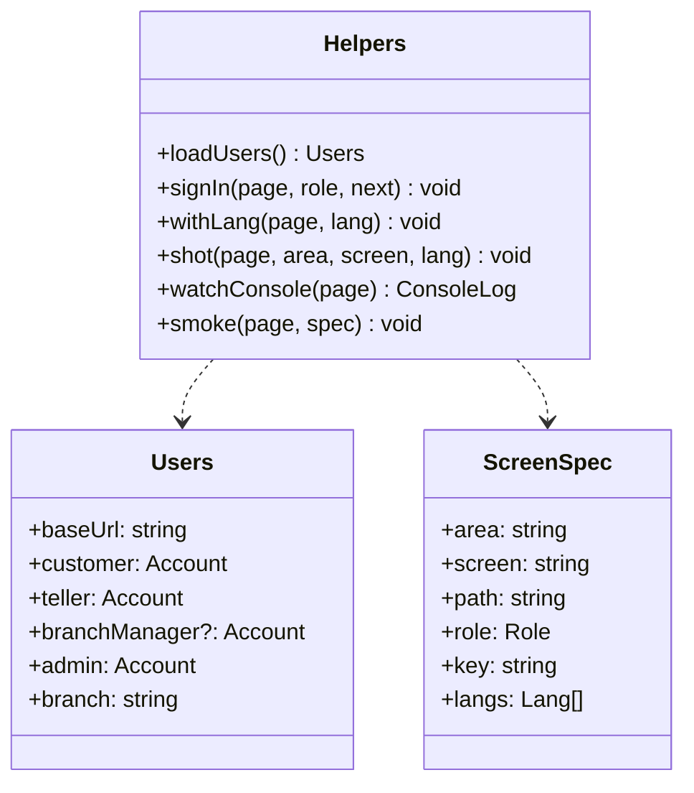

# QA end-to-end: Playwright over every screen (#564)

> designed-by: claude/dell-claude-1 (FE qa-e2e sub-controller), on the FE lane controller claude/5edf7bb5's order ·
> owner, 2026-10-20: *"ใช้ playwright เทส งาน ทั้งหมด"* (use Playwright to test all the work) · measured on `main`
> `9170be76` (every route, file and count below) · builds on PR 3838 (`qa/booking-e2e/`, the #1683 booking check)

## 0. Decided

| # | Rule | Source |
|---|---|---|
| E-1 | The suite is a standalone package outside `web/` (its own `package.json` and lock); the web lockfile is never touched | PR 3838 |
| E-2 | Accounts come from `users.json` (gitignored). **The owner runs the suite.** No agent signs in on the host | owner, 2026-10-20 (*"อ่าน user จาก json file"*); FE lane order |
| E-3 | Workers check their specs with `npx playwright test --list` and `npx tsc --noEmit` only. They never run against a host | FE lane order |
| E-4 | A flow that writes uses only the seeded test branch and test accounts (`deploy/server/seed-test-booking.sh`, PR 3837). It never changes shared settings unless it restores them in the same test | FE lane order |
| E-5 | OCR is not automated: *"OCR ยังไม่ต้อง เทส ให้คนเทส"* | owner, 2026-10-20 |

## 1. Package layout

`qa/booking-e2e/` is renamed `qa/e2e/` (a `git mv` in the skeleton). One spec file per area, so the tickets have disjoint files:

```
qa/e2e/
  package.json  package-lock.json  tsconfig.json  playwright.config.ts
  users.example.json            # shape of users.json; users.json is gitignored
  tests/helpers.ts              # skeleton: the only shared file (§2)
  tests/smoke-public.spec.ts         QA-S1
  tests/smoke-app-a.spec.ts          QA-S2
  tests/smoke-app-b.spec.ts          QA-S3
  tests/smoke-admin-money.spec.ts    QA-S4
  tests/smoke-admin-org.spec.ts      QA-S5
  tests/smoke-admin-policy.spec.ts   QA-S6
  tests/smoke-staff.spec.ts          QA-S7
  tests/smoke-desk-ops.spec.ts       QA-S8
  tests/flow-booking.spec.ts         QA-F1 (PR 3838's booking.spec.ts, moved onto the helpers)
  tests/flow-queue.spec.ts           QA-F2
  tests/flow-cash.spec.ts            QA-F3
  tests/flow-rates.spec.ts           QA-F4
  tests/flow-approvals.spec.ts       QA-F5
```

`playwright.config.ts` keeps PR 3838's settings (one worker, no retries, phone viewport 430×932 for `/app`, desktop
1280×800 for staff and admin through a second project). Outputs: `results/<area>/<screen>-<lang>.png`,
`test-results/`, `playwright-report/`, all gitignored.

## 2. Shared helpers (`tests/helpers.ts`, written by the skeleton, owned by nobody else)



| Function | Contract |
|---|---|
| `loadUsers()` | Reads `users.json`; **if it is missing, reads `users.example.json`**, so `--list` and `tsc` work on a worker's machine with no secrets (a real run with the example file fails at sign-in, by design) |
| `signIn(page, role, next)` | `role`: `customer`, `teller`, `branchManager`, `admin`. Goes to `/login?next=…`, fills `input[autocomplete="username"]` / `"current-password"` (`web/src/screens/login/LoginScreen.tsx:114`, `:121`), submits, and waits until the URL has left `/login` and starts with `next` (the PR 3838 fix). A role with no account in `users.json` ⇒ `test.skip` with a reason |
| `withLang(page, lang)` | `page.addInitScript` sets `localStorage['xc.lang']` before the page loads (`web/src/shared/i18n/index.ts:9-17`). Customer pages allow th/en/zh, staff and admin th/en (`web/src/shared/i18n/languages.ts:7-8`); any other choice falls back to th (`index.ts:40-44`) |
| `watchConsole(page)` | Collects `console` errors and `pageerror`s; `smoke` fails the test if any appear |
| `shot(page, area, screen, lang)` | `results/<area>/<screen>-<lang>.png`, full page |
| `smoke(page, spec)` | For each `lang` of `spec.langs`: `withLang`, `goto(spec.path)`, expect `spec.key` visible, no console error, `shot` |

Specs import only from `helpers.ts`. A spec that needs a new helper comments on its ticket; it never edits `helpers.ts`.

## 3. Inventory (measured on `main` `9170be76`)

**Pages:** `web/pages/*.html`, 31 files, each with `xc-path` and `xc-gate`. A route is served from that meta at build time
(`api/build_support/screens.rs:52`). `/desk` and `/staff/desk` are still v2's kept `desk.html`
(`api/src/presentation/pages.rs:229`, `PageKind::DeskVariant`); v3's desk steps (`web/src/screens/desk/steps/`) are not served
until #542.

| Route | Page | Gate | Role in the suite | Writes | Spec |
|---|---|---|---|---|---|
| `/login` | `login.html` | anyone | anonymous | sign-in | S1 |
| `/app/sign-in` | `app-sign-in.html` | anyone | anonymous | OTP (not run, E-5 note §6) | S1 |
| `/app/sign-up` | `app-sign-up.html` | anyone | anonymous | sign-up (smoke only) | S1 |
| `/rates` | `rates.html` | anyone | anonymous | no | S1 |
| `/app` | `app-home.html` | anyone | customer | plan save | S2 |
| `/app/branches` | `app-branches.html` | anyone | customer | no | S2 |
| `/app/journey` | `app-journey.html` | anyone | customer | plan delete | S2 |
| `/app/assistant` | `app-assistant.html` | anyone | customer | message send | S2 |
| `/app/history` | `app-history.html` | anyone | customer | no | S2 |
| `/app/book` | `app-book.html` | anyone | customer | booking | S2 (smoke), F1 (flow) |
| `/app/bookings` | `app-bookings.html` | anyone | customer | cancel, reschedule | S3, F1 |
| `/app/member` | `app-member.html` | anyone | customer | no | S3 |
| `/app/notifications` | `app-notifications.html` | anyone | customer | mark read | S3 |
| `/app/profile` | `app-profile.html` | anyone | customer | profile, consent | S3 |
| `/app/rate-alerts` | `app-rate-alerts.html` | anyone | customer | alert create | S3 |
| `/app/verification` | `app-verification.html` | anyone | customer | document upload (OCR side: E-5) | S3 |
| `/` (admin, 27 menus at `#<id>`) | `admin.html` | branch | admin | per menu, table below | S4–S6 |
| `/staff` (6 cards) | `staff.html` | signed-in | teller | per card, table below | S7, F3 |
| `/staff/report` | `staff-report.html` | anyone | teller | no | S7 |
| `/staff/documents` | `staff-documents.html` | anyone | teller | no | S7 |
| `/staff-guide`, `/staff-guide.html` | `staff-guide.html`, `staff-guide-html.html` | signed-in | teller | no | S7 |
| `/desk/bookings` | `desk-bookings.html` | branch | teller | check-in, cancel, QR | S8, F1 |
| `/desk/queue` | `desk-queue.html` | branch | teller (open/close: branch manager) | queue commands | S8, F2 |
| `/desk/transactions/{id}` | `desk-transaction.html` | branch | teller | reprint, reversal request | S8 (an unknown id: its not-found state) |
| `/receipt-sample` | `receipt-sample.html` | branch | admin | no | S8 |
| `/devices` | `devices.html` | signed-in | admin | device pairing (smoke only) | S8 |
| `/documents` | `documents.html` | signed-in | admin | no | S8 |
| `/operations/verification` | `operations-verification.html` | signed-in | admin | review decisions (smoke only) | S8 |
| `/kiosk-currencies.html` | `kiosk-currencies.html` | signed-in | admin | currency switches (smoke only) | S8 |
| `/kiosk-queue.html` | `kiosk-queue.html` | signed-in | teller | accept (smoke only) | S8 |

**Admin menus** (`web/src/screens/admin/*/menu.ts`: id · order · `needs` · writes):

| Spec | Menus |
|---|---|
| S4 money | `overview` 1 all · `transactions` 2 all · `cash` 4 all, writes · `rates` 5 all, writes · `payments` 6 all, writes · `reports` 7 all · `slips` 9 all · `reconciliation` 19 FinanceReconcile, writes · `starting-prices` 22 OrgStartingPricesManage, writes · `denomination-groups` 13 RatesDraft, writes |
| S5 org | `customers` 8 all · `employees` 10 all, writes · `approvals` 11 ApprovalsDecide · `consent` 12 ConsentPolicyManage, writes · `branches` 14 BranchesManage, writes · `users` 15 UsersManage, writes · `executive` 17 OverviewRead · `notices` 21 all · `booking-slots` 25 BranchesManage, writes |
| S6 policy | `alert-settings` 16 AlertSettingsSave, writes · `cash-policy` 18 CashTransferPolicySet, writes · `rate-alert-settings` 20 RateAlertSettingsSave, writes · `campaigns` 23 MarketingCampaigns, writes · `campaign-performance` 24 MarketingPerformance · `members` 26 MarketingMembers, writes · `loyalty` 27 LoyaltyRulesManage, writes · `cash-limits` 28 CashLimitsManage, writes |

**Staff cards** (`web/src/screens/staff/*/card.ts`): `attendance` (AttendanceClock) · `floor` (BranchDayOperate, CashTargetSet; writes) ·
`holds` (CustomerHoldPlace; writes) · `rates` (read) · `shift` (ShiftOperate, ShiftCloseCertify; writes) · `transfers` (CashManage; writes).
Whether `attendance` writes is not measured here; S7 only smokes it.

Totals: 31 pages; 15 customer screens, 27 admin menus, 6 staff cards, 2 v3 desk pages + the transaction detail.
The order's counts (customer 15, desk 29, staff 19, admin 41) are entries per directory, files included; the screen
directories are 15, 8, 7 and 29. Of admin's 29, `parts/` is shared code and `queue/` is the QueueBar that `AdminShell.tsx`
shows on every menu (smoked with S5, not a menu). Of desk's 8, only `bookings/` and `queue/` are pages; the rest are v3
desk steps not served yet (#542).

## 4. Two tiers

**Smoke, on every screen above.** It opens, its key element shows, there is no console error, and a screenshot is taken in
each language the page allows (customer: th, en, zh; staff and admin: th, en). Smoke never clicks a button that writes.
The key element is a `data-testid` or role the screen already renders; a screen with neither gets the heading text from its
`i18n.ts` `title`, cited in the spec.

**Flows, only where a design names a user journey.**

| Flow | Journey (design) | Steps | Writes, and where |
|---|---|---|---|
| F1 booking | `blueprint/booking-slots.md` §4.2–4.4, #1683 | PR 3838's: book from `?ref=`, book again, C03 lists both and cancels one, the desk shows the kept one, admin booking-slots opens | bookings on MAIN for the test customer |
| F2 queue | `blueprint/queue-tickets.md` §3, §4.3–4.4 | teller: issue a walk-in, call next, start, finish; the board shows each state | queue tickets on MAIN. A call needs the teller's OPEN shift (Q7; F3 first) and an ACTIVE counter, and issuing needs an open queue (`queueOpen`, `BranchDayOperate`). The seed makes neither a counter nor a branch manager, so F2 skips with the reason logged when either is missing |
| F3 cash | `blueprint/cash-shift-transfer.md` §3.1, `/staff` shift card | teller: open count, close count with the same figures | the teller's own shift on MAIN |
| F4 rates | `blueprint/rates.md` §4.4 | admin: open A02, create a draft, simulate. **Never submit**: a publish changes the shared counter prices (E-4). The test deletes its draft at the end | one draft, removed |
| F5 approvals | `blueprint/rates.md` §5, A06 | admin: the list loads with its filters; if a PENDING request exists, open it (read only) | none |

**Not a flow yet:** the transaction journey (`blueprint/quote-transaction.md`). v3's desk is not served at `/desk` until #542, so
a flow there would test v2. It is cut when #542 merges.

## 5. Order and data

- `fullyParallel: false`, one worker; files run in name order, so `flow-cash` (F3) runs before `flow-queue` (F2): the skeleton
  names them so (`flow-cash.spec.ts` < `flow-queue.spec.ts`).
- Every flow uses only branch `MAIN` and the seeded `customer` and `teller` (E-4). The seed does not create a branch manager;
  F2's open/close step skips when `users.json` has none, and logs that.
- No flow deletes data it did not create.

## 6. What the suite cannot do (by hand, with screenshots)

- **OCR** (E-5): the desk's passport reader and the verification document reading.
- **OTP sign-in** at `/app/sign-in`: the test host's Identity sends no OTP (`noop` delivery, PR 3837); customers sign in at
  `/login`.
- **Refusal states the seed cannot make:** `capacityFull`, `slotUnavailable`, `bookingsClosed` (#1683), a stale or
  out-of-bound rate, a count difference over the branch limit.
- **Anything that changes shared settings without a restore:** a rate publish, campaign approval, policy saves.

## 7. Tickets (cut after this document merges)

Base and PR target `feat/qa-e2e`. Each ticket owns exactly one spec file. Done = its tests listed by
`npx playwright test --list` and `npx tsc --noEmit -p qa/e2e` clean, with no run against a host (E-3).

| # | Spec | Class | Model |
|---|---|---|---|
| QA-S1 … QA-S8 | the eight `smoke-*.spec.ts` of §1 | mechanical | Flash |
| QA-F1 | `flow-booking.spec.ts` (PR 3838's test, moved onto the helpers) | logic | Argon |
| QA-F2 … QA-F5 | `flow-queue`, `flow-cash`, `flow-rates`, `flow-approvals` | logic | Argon |

The skeleton (Claude, STEP 2): the `git mv`, `tsconfig.json`, the config's two projects, `helpers.ts` complete, and the
13 spec files as empty `test.describe` blocks with their area named.

## 8. Data migration

None: the suite reads and writes only through the app, on the seeded test branch.
