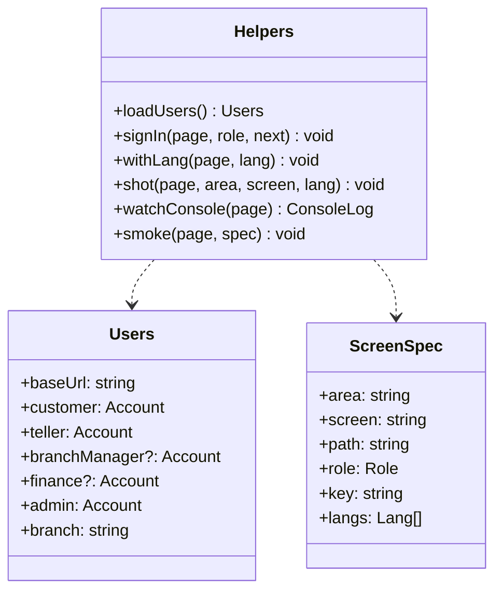

# QA end-to-end: Playwright over every screen (#564)

> designed-by: claude/dell-claude-1 (FE qa-e2e sub-controller), on the FE lane controller claude/5edf7bb5's order ·
> owner, 2026-10-20: *"ใช้ playwright เทส งาน ทั้งหมด"* (use Playwright to test all the work) · measured on `main`
> `9170be76` (every route, file and count below) · builds on PR 3838 (`qa/booking-e2e/`, the #1683 booking check)

## 0. Decided

| # | Rule | Source |
|---|---|---|
| E-1 | The suite is a standalone package outside `web/` (its own `package.json` and lock); the web lockfile is never touched | PR 3838 |
| E-2 | Accounts come from `users.json` (gitignored). **The owner runs the suite.** No agent signs in on the host | owner, 2026-10-20 (*"อ่าน user จาก json file"*); FE lane order |
| E-3 | Workers check their specs with `npx playwright test --list` and `npx tsc --noEmit` only. They never run against a host | FE lane order |
| E-4 | A flow that writes uses only the seeded test branches (`MAIN`, and `TEST2` for F12b only) and test accounts (`deploy/server/seed-test-booking.sh`, PR 3837; `TEST2` added on the owner's order 2026-10-21, *"ใส่สาขาที่สองใน seed ด้วย"*). It never changes shared settings unless it restores them in the same test | FE lane order |
| E-5 | OCR is not automated: *"OCR ยังไม่ต้อง เทส ให้คนเทส"* | owner, 2026-10-20 |

## 1. Package layout

`qa/booking-e2e/` is renamed `qa/e2e/` (a `git mv` in the skeleton). One spec file per area, so the tickets have disjoint files:

```
qa/e2e/
  package.json  package-lock.json  tsconfig.json  playwright.config.ts
  users.example.json            # shape of users.json; users.json is gitignored
  tests/helpers.ts              # skeleton: the only shared file (§2)
  tests/smoke-public.spec.ts         QA-S1
  tests/smoke-app-a.spec.ts          QA-S2
  tests/smoke-app-b.spec.ts          QA-S3
  tests/smoke-admin-money.spec.ts    QA-S4
  tests/smoke-admin-org.spec.ts      QA-S5
  tests/smoke-admin-policy.spec.ts   QA-S6
  tests/smoke-staff.spec.ts          QA-S7
  tests/smoke-desk-ops.spec.ts       QA-S8
  tests/flow-booking.spec.ts         QA-F1 (PR 3838's booking.spec.ts, moved onto the helpers)
  tests/flow-queue.spec.ts           QA-F2
  tests/flow-cash.spec.ts            QA-F3 (PR 3838's shift.spec.ts, moved onto the helpers)
  tests/flow-rates.spec.ts           QA-F4
  tests/flow-approvals.spec.ts       QA-F5
  tests/flow-exchange.spec.ts        QA-F6 (added after #542; not in the skeleton)
  tests/flow-count-difference.spec.ts  QA-F7 (round 2)
  tests/smoke-admin-pricing.spec.ts  QA-F10 (round 2: the `pricing` menu, added after the inventory)
  tests/flow-queue-many.spec.ts      QA-F8 (round 3)
  tests/flow-verification.spec.ts    QA-F9 (round 3)
  tests/smoke-rbac-matrix.spec.ts    QA-F11 (round 3; "F11" is also the name of the api password tests, unrelated)
  tests/flow-transfer-escalation.spec.ts  QA-F12 (round 3)
  tests/flow-transfer-branch.spec.ts  QA-F12b (round 4; needs the seeded second branch)
```

`playwright.config.ts` keeps PR 3838's settings (one worker, no retries, phone viewport 430×932 for `/app`, desktop
1280×800 for staff and admin through a second project). Outputs: `results/<area>/<screen>-<lang>.png`,
`test-results/`, `playwright-report/`, all gitignored.

## 2. Shared helpers (`tests/helpers.ts`, written by the skeleton, owned by nobody else)



| Function | Contract |
|---|---|
| `loadUsers()` | Reads `users.json`; **if it is missing, reads `users.example.json`**, so `--list` and `tsc` work on a worker's machine with no secrets (a real run with the example file fails at sign-in, by design) |
| `signIn(page, role, next)` | `role`: `customer`, `teller`, `branchManager`, `finance`, `admin`. Goes to `/login?next=…`, fills `input[autocomplete="username"]` / `"current-password"` (`web/src/screens/login/LoginScreen.tsx:114`, `:121`), submits, and waits until the URL has left `/login` and starts with `next` (the PR 3838 fix). A role with no account in `users.json` ⇒ `test.skip` with a reason |
| `withLang(page, lang)` | `page.addInitScript` sets `localStorage['xc.lang']` before the page loads (`web/src/shared/i18n/index.ts:9-17`). Customer pages allow th/en/zh, staff and admin th/en (`web/src/shared/i18n/languages.ts:7-8`); any other choice falls back to th (`index.ts:40-44`) |
| `watchConsole(page)` | Collects `console` errors and `pageerror`s; `smoke` fails the test if any appear |
| `shot(page, area, screen, lang)` | `results/<area>/<screen>-<lang>.png`, full page |
| `smoke(page, spec)` | For each `lang` of `spec.langs`: `withLang`, `goto(spec.path)`, expect `spec.key` visible, no console error, `shot` |

Specs import only from `helpers.ts`. A spec that needs a new helper comments on its ticket; it never edits `helpers.ts`.

## 3. Inventory (measured on `main` `9170be76`)

**Pages:** `web/pages/*.html`, 31 files, each with `xc-path` and `xc-gate`. A route is served from that meta at build time
(`api/build_support/screens.rs:52`). Since #542 (PR 3891, merged 2026-10-20) `/desk` is v3's desk: `web/pages/desk.html:7`
declares `xc-path=/desk`, and the screen table is registered before the old page routes (`api/src/bootstrap/mod.rs:290-291`),
so it wins. `/staff/desk` is v3 too since #546: `web/pages/staff-desk.html:7` declares `xc-path=/staff/desk` (gate `front`),
so v2's `PageKind::DeskVariant` entry (`api/src/presentation/pages.rs:241-243`) is shadowed. Re-measured on `main` `af61661c`,
where `web/pages/` holds 33 files.

| Route | Page | Gate | Role in the suite | Writes | Spec |
|---|---|---|---|---|---|
| `/login` | `login.html` | anyone | anonymous | sign-in | S1 |
| `/app/sign-in` | `app-sign-in.html` | anyone | anonymous | OTP (not run, E-5 note §6) | S1 |
| `/app/sign-up` | `app-sign-up.html` | anyone | anonymous | sign-up (smoke only) | S1 |
| `/rates` | `rates.html` | anyone | anonymous | no | S1 |
| `/app` | `app-home.html` | anyone | customer | plan save | S2 |
| `/app/branches` | `app-branches.html` | anyone | customer | no | S2 |
| `/app/journey` | `app-journey.html` | anyone | customer | plan delete | S2 |
| `/app/assistant` | `app-assistant.html` | anyone | customer | message send | S2 |
| `/app/history` | `app-history.html` | anyone | customer | no | S2 |
| `/app/book` | `app-book.html` | anyone | customer | booking | S2 (smoke), F1 (flow) |
| `/app/bookings` | `app-bookings.html` | anyone | customer | cancel, reschedule | S3, F1 |
| `/app/member` | `app-member.html` | anyone | customer | no | S3 |
| `/app/notifications` | `app-notifications.html` | anyone | customer | mark read | S3 |
| `/app/profile` | `app-profile.html` | anyone | customer | profile, consent | S3 |
| `/app/rate-alerts` | `app-rate-alerts.html` | anyone | customer | alert create | S3 |
| `/app/verification` | `app-verification.html` | anyone | customer | document upload (OCR side: E-5) | S3 |
| `/` (admin, 27 menus at `#<id>`) | `admin.html` | branch | admin | per menu, table below | S4–S6 |
| `/staff` (6 cards) | `staff.html` | signed-in | teller | per card, table below | S7, F3 |
| `/staff/report` | `staff-report.html` | anyone | teller | no | S7 |
| `/staff/documents` | `staff-documents.html` | anyone | teller | no | S7 |
| `/staff-guide`, `/staff-guide.html` | `staff-guide.html`, `staff-guide-html.html` | signed-in | teller | no | S7 |
| `/desk/bookings` | `desk-bookings.html` | branch | teller | check-in, cancel, QR | S8, F1 |
| `/desk/queue` | `desk-queue.html` | branch | teller (open/close: branch manager) | queue commands | S8, F2 |
| `/desk/transactions/{id}` | `desk-transaction.html` | branch | teller | reprint, reversal request | S8 (an unknown id: its not-found state) |
| `/receipt-sample` | `receipt-sample.html` | branch | admin | no | S8 |
| `/devices` | `devices.html` | signed-in | admin | device pairing (smoke only) | S8 |
| `/documents` | `documents.html` | signed-in | admin | no | S8 |
| `/operations/verification` | `operations-verification.html` | signed-in | admin | review decisions (smoke only) | S8 |
| `/kiosk-currencies.html` | `kiosk-currencies.html` | signed-in | admin | currency switches (smoke only) | S8 |
| `/kiosk-queue.html` | `kiosk-queue.html` | signed-in | teller | accept (smoke only) | S8 |

**Admin menus** (`web/src/screens/admin/*/menu.ts`: id · order · `needs` · writes):

| Spec | Menus |
|---|---|
| S4 money | `overview` 1 all · `transactions` 2 all · `cash` 4 all, writes · `rates` 5 all, writes · `payments` 6 all, writes · `reports` 7 all · `slips` 9 all · `reconciliation` 19 FinanceReconcile, writes · `starting-prices` 22 OrgStartingPricesManage, writes · `denomination-groups` 13 RatesDraft, writes |
| S5 org | `customers` 8 all · `approvals` 11 ApprovalsDecide · `consent` 12 ConsentPolicyManage, writes · `branches` 14 BranchesManage, writes · `users` 15 UsersManage, writes · `executive` 17 OverviewRead · `notices` 21 all · `booking-slots` 25 BranchesManage, writes |
| F10 pricing | `pricing` 29 ReferenceRatesRead, writes (every write changes shared prices or policy: smoke and read-only clicks only) |
| S6 policy | `alert-settings` 16 AlertSettingsSave, writes · `cash-policy` 18 CashTransferPolicySet, writes · `rate-alert-settings` 20 RateAlertSettingsSave, writes · `campaigns` 23 MarketingCampaigns, writes · `campaign-performance` 24 MarketingPerformance · `members` 26 MarketingMembers, writes · `loyalty` 27 LoyaltyRulesManage, writes · `cash-limits` 28 CashLimitsManage, writes |

`employees` was removed by #3284 (`cc7f60ac`, 2026-10-19) and `pricing` was added after this inventory, so the count is
still 27 (re-measured on `main` `2e9c8c39`).

**Staff cards** (`web/src/screens/staff/*/card.ts`): `attendance` (AttendanceClock) · `floor` (BranchDayOperate, CashTargetSet; writes) ·
`holds` (CustomerHoldPlace; writes) · `rates` (read) · `shift` (ShiftOperate, ShiftCloseCertify; writes) · `transfers` (CashManage; writes).
Whether `attendance` writes is not measured here; S7 only smokes it.

Totals: 31 pages; 15 customer screens, 27 admin menus, 6 staff cards, 2 v3 desk pages + the transaction detail.
The order's counts (customer 15, desk 29, staff 19, admin 41) are entries per directory, files included; the screen
directories are 15, 8, 7 and 29. Of admin's 29, `parts/` is shared code and `queue/` is the QueueBar that `AdminShell.tsx`
shows on every menu (smoked with S5, not a menu). Of desk's 8, `bookings/` and `queue/` were the only pages when this was
measured; since #542 `/desk` serves the v3 desk steps too (F6).

## 4. Two tiers

**Smoke, on every screen above.** It opens, its key element shows, there is no console error, and a screenshot is taken in
each language the page allows (customer: th, en, zh; staff and admin: th, en). Smoke never clicks a button that writes.
The key element is a `data-testid` or role the screen already renders; a screen with neither gets the heading text from its
`i18n.ts` `title`, cited in the spec.

**Flows, only where a design names a user journey.**

| Flow | Journey (design) | Steps | Writes, and where |
|---|---|---|---|
| F1 booking | `blueprint/booking-slots.md` §4.2–4.4, #1683 | PR 3838's: book from `?ref=`, book again, C03 lists both and cancels one, the desk shows the kept one, admin booking-slots opens | bookings on MAIN for the test customer |
| F2 queue | `blueprint/queue-tickets.md` §3, §4.3–4.4 | teller: issue a walk-in, call next, start, finish; the board shows each state | queue tickets on MAIN. A counter is a teller with an OPEN shift (Q7), so F2 opens and closes the teller's shift with `helpers.ts` `openShift` / `closeShift` (the same steps as F3, which funds the safe first). Issuing needs an open queue (`queueOpen`, `BranchDayOperate`: the branch manager) |
| F3 cash | `blueprint/cash-shift-transfer.md` §3.1, A5; `ledger-inventory.md` §4.4 | (1) fund the safe: finance records an EXTERNAL_IN on `/staff` › transfers, the branch manager approves it on `/#approvals` (A5: never the creator), finance dispatches and receives it; (2) the teller clocks in and counts the opening, the branch manager verifies it (`person_rules.rs` `verifier_is_not_counter`); (3) the same for the close, with the same figures. Since LG-4 (#929) the opening count leaves the safe, so (1) must come first. Needs #3858 (CASH_TRANSFER in the approval registry) on the host | one EXTERNAL_IN transfer and the teller's own shift on MAIN |
| F4 rates | `blueprint/rates.md` §4.4 | admin: open A02, create a draft, simulate. **Never submit**: a publish changes the shared counter prices (E-4). The test deletes its draft at the end | one draft, removed |
| F5 approvals | `blueprint/rates.md` §5, A06 | admin: the list loads with its filters; if a PENDING request exists, open it (read only) | none |
| F6 desk exchange | `blueprint/quote-transaction.md`; reversal V-2 | teller, inside its own shift (`openShift` … `closeShift`): `/desk?branch=MAIN`, rate step BUY `users.currency` × a small amount, skip customer details (WALK-IN), confirm the booking, pay cash (accept the count `window.confirm`), the receipt shows `XC-YYYYMMDD-NNNNNN`. Cleanup in the same test: the teller requests a reversal on `/desk/transactions/<id>`, finance approves it (admin › `reconciliation`; never the requester), the teller posts it from the desk's refunds task. The reversal must post the same business day (`xc-exchange/src/domain/reversal/window.rs`) and before the close, so the drawer nets back to the opening figures | one COMPLETED exchange, its reversal and receipt revision 2 on MAIN. They stay: a completed exchange is never changed or deleted (V-2), so the test leaves the stock where it found it, not the rows |
| F7 count difference | `ledger-inventory.md` §4.4; `xc-cash/src/application/ledger_approval/count_difference.rs` | inside the teller's own shift: the teller counts the close one THB note short (its own locators + `posted`, since `submitCount` always fills `SHIFT_QTY`); the branch manager's verify answers 200 `AWAITING_FINANCE` and the shift stays open; admin `/#cash` › `counts-waiting` shows the difference; finance approves the `COUNT_DIFFERENCE` request on `/#approvals`; the branch manager verifies again ⇒ `VERIFIED`, the shift closes; the teller clocks out. Approval is reached because the seed writes no `cash_limits` row, so any non-zero difference is over the limit | one decided `COUNT_DIFFERENCE` request, one open cash exception, VARIANCE one note larger; the safe is not touched, so the next opening still works |
| F8 queue, several tickets | `blueprint/queue-tickets.md` §3, §4.3–4.4 | inside the teller's own shift, queue opened if closed (and closed again only if this test opened it): first read `queue_board` and fail listing any WAITING leftovers, because call-next is branch-wide and takes BOOKING before WALK_IN, then the lowest sequence, from any day (`xc-queue/src/infrastructure/repository.rs:355-364`; nothing cancels leftovers at day close, `queue_day_hook.rs:1-3` is not wired); issue walk-ins A, B, C; call-next ⇒ A, skip it (skip **is** no-show: NO_SHOW, it leaves the board); call-next ⇒ B, start, finish; call-next ⇒ C, a second staff page on `/desk/queue` shows it called, then cancel C with a reason. There is **no public board of called numbers** on `main`: `/kiosk-queue.html` is signed-in and lists kiosk requests; called numbers show only to staff (`queue_board` needs `QueueOperate`) | three queue tickets on MAIN (NO_SHOW, COMPLETED, CANCELLED); numbers are per branch-local day and never reused, so never assert a literal like `W001` |
| F9 customer verification | `blueprint/verification.md` | customer on `/app/verification`: start (or `update-and-resubmit` after an earlier run's REJECTED), upload a tiny real PNG as PASSPORT, submit; admin on `/operations/verification`: start-review, request-update (`DOCUMENT_UNREADABLE`); customer sees the reason and resubmits; admin start-review, reject (`OTHER`); customer sees REJECTED with its reason and the resubmit button. **No OCR runs** (the only provider is `STAFF`), so E-5 does not block it. The reviewer is `admin` (EXECUTIVE): the seed creates no VERIFICATION_REVIEWER, and a branch manager cannot see customer-opened cases (`branch_id` NULL). Ending REJECTED keeps the loop repeatable; approving is not part of the flow (once VERIFIED the customer UI offers no new case) | one REJECTED case and its document for the seeded customer |
| F11 RBAC matrix | `xc-auth` role grants; `web/src/screens/admin/*/menu.ts` | read-only. For each staff account: sign in, read `me.permissions` (`mePermissions`), and expect each admin menu link `a[href="#<id>"]` to exist exactly when its `needs` is `all` or in the permissions; a refused `#id` keeps the hash and shows the lowest-order allowed menu (no 403 view); `/staff` cards follow their `visible` rule; `/operations/verification` shows `[data-refused]` without `VerificationReview`. The customer is redirected to `/login` from `/`, `/staff`, `/desk`, `/operations/verification`. The menu → `needs` table is copied into the spec with its `menu.ts` citations; the role → permission matrix is **not** hard-coded, so the spec does not go stale when grants change | none |
| F12 transfer escalation | `blueprint/cash-shift-transfer.md`; `xc-cash/src/application/approval/transfer.rs` | read `cash_transfer_policy`; finance records an EXTERNAL_IN above the limit (with no policy row every amount is above it); the branch manager's approval is refused (`ABOVE_LIMIT`), admin (EXECUTIVE) approves; finance dispatches and receives; then an EXTERNAL_OUT with the same lines, approved by admin, dispatched and received, so the safe ends where it started. A branch-to-branch transfer is F12b | two transfers and their approvals on MAIN; the safe nets to zero |
| F12b branch transfer | `blueprint/cash-shift-transfer.md` §3.1, A5 | needs the seeded second branch `TEST2` and its two accounts (`branchManager2`, `finance2`). Leg 1, MAIN → TEST2, within the limit: finance creates and submits, the MAIN branch manager approves (never the creator), finance dispatches, `branchManager2` receives **from a TEST2 session** (the destination branch receives). Leg 2, TEST2 → MAIN, the same lines: `finance2` creates and submits, `branchManager2` approves, `finance2` dispatches, the MAIN branch manager receives. Both safes end where they started | two BRANCH transfers and their approvals |

## 5. Order and data

- `fullyParallel: false`, one worker; files run in name order, so `flow-cash` (F3) runs before `flow-queue` (F2): the skeleton
  names them so (`flow-cash.spec.ts` < `flow-queue.spec.ts`).
- Every flow uses only branch `MAIN` and the seeded accounts (E-4): `customer`, `teller`, `branchManager` (seed step 6b) and
  `finance` (step 6c, PR 3837). A flow whose account is missing from `users.json` skips and logs why.
- No flow deletes data it did not create.
- F6 (`flow-exchange.spec.ts`) runs after `flow-cash` and before `flow-queue`, and opens and closes its own shift, so it
  starts and ends with the teller's shift closed like the others. F7 (`flow-count-difference.spec.ts`) does the same and
  sorts between `flow-cash` and `flow-exchange`.
- F8 (`flow-queue-many.spec.ts`) sorts after `flow-queue`; both start by failing on WAITING leftovers rather than calling
  someone else's ticket.
- 🔴 **F3 depends on a value set by hand on the host.** Its branch manager approves an EXTERNAL_IN of 168,875 THB
  (`FUND_QTY = '100'` of each of the 11 THB notes, `flow-cash.spec.ts:23`; one of each is 1,688.75,
  `api/migrations/20261012100000_cash.sql:228-238`), which is within the limit only if a cash-transfer policy row allows it.
  The seed writes none (`cash_transfer_policy_versions`), and with no row `within_limit` is false (`transfer_flow.rs:547-556`),
  so only EXECUTIVE may decide and the branch manager is refused `ABOVE_LIMIT` (`xc-cash/src/application/approval/transfer.rs:130-143`):
  on a freshly reseeded host F3 fails at that approval. Seeding the policy is the owner's call (a seed change).

## 6. What the suite cannot do (by hand, with screenshots)

- **OCR** (E-5): the desk's passport reader and the verification document reading.
- **OTP sign-in** at `/app/sign-in`: the test host's Identity sends no OTP (`noop` delivery, PR 3837); customers sign in at
  `/login`.
- **Refusal states the seed cannot make:** `capacityFull`, `slotUnavailable`, `bookingsClosed` (#1683), a stale or
  out-of-bound rate, and a count difference **under** the branch limit (which closes without approval): the seed writes no
  `cash_limits` row (`count_difference_limit_thb`), so every non-zero difference goes to finance approval (F7), and
  setting a limit is a shared-settings change (`PUT /api/cash-limits`).
- **Anything that changes shared settings without a restore:** a rate publish, campaign approval, policy saves.

## 7. Tickets (cut after this document merges)

Base and PR target `feat/qa-e2e` (merged into `main`; a ticket cut after that, such as QA-F6, bases on `main`). Each
ticket owns exactly one spec file. Done = its tests listed by `npx playwright test --list` and `npx tsc --noEmit -p qa/e2e`
clean, with no run against a host (E-3).

| # | Spec | Class | Model |
|---|---|---|---|
| QA-S1 … QA-S8 | the eight `smoke-*.spec.ts` of §1 | mechanical | Flash |
| QA-F1 | `flow-booking.spec.ts` (PR 3838's test, moved onto the helpers) | logic | Argon |
| QA-F2 … QA-F5 | `flow-queue`, `flow-cash`, `flow-rates`, `flow-approvals` | logic | Argon |
| QA-F6 | `flow-exchange.spec.ts` (new file) | logic | Argon |
| QA-F7 | `flow-count-difference.spec.ts` (new file) | logic | Argon |
| QA-F10 | `smoke-admin-pricing.spec.ts` (new file) | mechanical | Flash |
| QA-S5 fix | `smoke-admin-org.spec.ts`: drop `/#employees` | mechanical | Flash |
| QA-F8 | `flow-queue-many.spec.ts` (new file) | logic | Argon |
| QA-F2 fix | `flow-queue.spec.ts`: leftover pre-check + called-is-issued assertions | mechanical | Flash |
| QA-H1 | `helpers.ts` `closeShift`: assert the clock-out (the one ticket that edits `helpers.ts`) | mechanical | Flash |
| QA-F9 | `flow-verification.spec.ts` (new file) | logic | Argon |
| QA-F11 | `smoke-rbac-matrix.spec.ts` (new file) | logic | Argon |
| QA-F12 | `flow-transfer-escalation.spec.ts` (new file) | logic | Argon |
| QA-H2 | `helpers.ts`: `Users`/`Role` gain `branch2`, `branchManager2`, `finance2` (after QA-H1) | mechanical | Flash |
| QA-F12b | `flow-transfer-branch.spec.ts` (new file; after the seed and QA-H2) | logic | Argon |

The skeleton (Claude, STEP 2): the `git mv`, `tsconfig.json`, the config's two projects, `helpers.ts` complete, and the
13 spec files as empty `test.describe` blocks with their area named.

## 8. Data migration

None: the suite reads and writes only through the app, on the seeded test branch.
