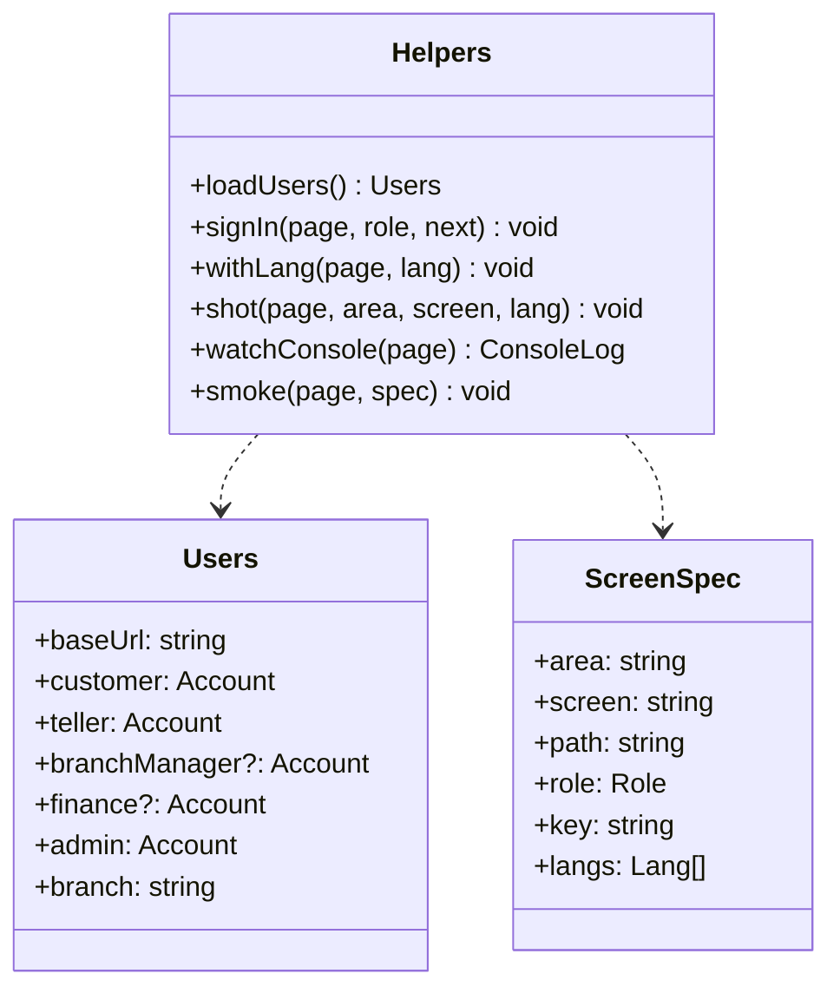

# QA end-to-end: Playwright over every screen (#564)

> designed-by: claude/dell-claude-1 (FE qa-e2e sub-controller), on the FE lane controller claude/5edf7bb5's order ·
> owner, 2026-10-20: *"ใช้ playwright เทส งาน ทั้งหมด"* (use Playwright to test all the work) · measured on `main`
> `9170be76` (every route, file and count below) · builds on PR 3838 (`qa/booking-e2e/`, the #1683 booking check)

## 0. Decided

| # | Rule | Source |
|---|---|---|
| E-1 | The suite is a standalone package outside `web/` (its own `package.json` and lock); the web lockfile is never touched | PR 3838 |
| E-2 | Accounts come from `users.json` (gitignored). **The owner runs the suite.** No agent signs in on the host | owner, 2026-10-20 (*"อ่าน user จาก json file"*); FE lane order |
| E-3 | Workers check their specs with `npx playwright test --list` and `npx tsc --noEmit` only. They never run against a host | FE lane order |
| E-4 | A flow that writes uses only the seeded test branches (`MAIN`, and `TEST2` for F12b only) and test accounts (`deploy/server/seed-test-booking.sh`, PR 3837; `TEST2` added on the owner's order 2026-10-21, *"ใส่สาขาที่สองใน seed ด้วย"*). It never changes shared settings unless it restores them in the same test | FE lane order |
| E-5 | OCR is not automated: *"OCR ยังไม่ต้อง เทส ให้คนเทส"* | owner, 2026-10-20 |

## 1. Package layout

`qa/booking-e2e/` is renamed `qa/e2e/` (a `git mv` in the skeleton). One spec file per area, so the tickets have disjoint files:

```
qa/e2e/
  package.json  package-lock.json  tsconfig.json  playwright.config.ts
  users.example.json            # shape of users.json; users.json is gitignored
  tests/helpers.ts              # skeleton: the only shared file (§2)
  tests/smoke-public.spec.ts         QA-S1
  tests/smoke-app-a.spec.ts          QA-S2
  tests/smoke-app-b.spec.ts          QA-S3
  tests/smoke-admin-money.spec.ts    QA-S4
  tests/smoke-admin-org.spec.ts      QA-S5
  tests/smoke-admin-policy.spec.ts   QA-S6
  tests/smoke-staff.spec.ts          QA-S7
  tests/smoke-desk-ops.spec.ts       QA-S8
  tests/flow-booking.spec.ts         QA-F1 (PR 3838's booking.spec.ts, moved onto the helpers)
  tests/flow-queue.spec.ts           QA-F2
  tests/flow-cash.spec.ts            QA-F3 (PR 3838's shift.spec.ts, moved onto the helpers)
  tests/flow-rates.spec.ts           QA-F4
  tests/flow-approvals.spec.ts       QA-F5
  tests/flow-exchange.spec.ts        QA-F6 (added after #542; not in the skeleton)
  tests/flow-count-difference.spec.ts  QA-F7 (round 2)
  tests/smoke-admin-pricing.spec.ts  QA-F10 (round 2: the `pricing` menu, added after the inventory)
  tests/flow-queue-many.spec.ts      QA-F8 (round 3)
  tests/flow-verification.spec.ts    QA-F9 (round 3)
  tests/smoke-rbac-matrix.spec.ts    QA-F11 (round 3; "F11" is also the name of the api password tests, unrelated)
  tests/flow-transfer-escalation.spec.ts  QA-F12 (round 3)
  tests/flow-transfer-branch.spec.ts  QA-F12b (round 4; needs the seeded second branch)
  tests/flow-xapp-alerts.spec.ts     QA-F14a (round 5)
  tests/flow-xapp-plan.spec.ts       QA-F14b (round 5)
  tests/flow-xapp-profile.spec.ts    QA-F14c (round 5)
  tests/flow-floor.spec.ts           QA-F15 (round 7)
  tests/flow-holds.spec.ts           QA-F16 (round 7)
  tests/flow-desk-bookings.spec.ts   QA-F17 (round 7)
  tests/flow-admin-reads.spec.ts     QA-F18 (round 7)
  tests/flow-kiosk-cancel.spec.ts    QA-F19 (round 8)
  tests/flow-desk-kiosk-cancel.spec.ts  QA-F20 (round 8)
  tests/flow-booking-reschedule.spec.ts  QA-F21 (round 8)
  tests/flow-desk-check-in.spec.ts   QA-F22 (round 8)
```

`playwright.config.ts` keeps PR 3838's settings (one worker, no retries, phone viewport 430×932 for `/app`, desktop
1280×800 for staff and admin through a second project). Outputs: `results/<area>/<screen>-<lang>.png`,
`test-results/`, `playwright-report/`, all gitignored.

## 2. Shared helpers (`tests/helpers.ts`, written by the skeleton, owned by nobody else)



| Function | Contract |
|---|---|
| `loadUsers()` | Reads `users.json`; **if it is missing, reads `users.example.json`**, so `--list` and `tsc` work on a worker's machine with no secrets (a real run with the example file fails at sign-in, by design) |
| `signIn(page, role, next)` | `role`: `customer`, `teller`, `branchManager`, `finance`, `admin`. Goes to `/login?next=…`, fills `input[autocomplete="username"]` / `"current-password"` (`web/src/screens/login/LoginScreen.tsx:114`, `:121`), submits, and waits until the URL has left `/login` and starts with `next` (the PR 3838 fix). A role with no account in `users.json` ⇒ `test.skip` with a reason |
| `withLang(page, lang)` | `page.addInitScript` sets `localStorage['xc.lang']` before the page loads (`web/src/shared/i18n/index.ts:9-17`). Customer pages allow th/en/zh, staff and admin th/en (`web/src/shared/i18n/languages.ts:7-8`); any other choice falls back to th (`index.ts:40-44`) |
| `watchConsole(page)` | Collects `console` errors and `pageerror`s; `smoke` fails the test if any appear |
| `shot(page, area, screen, lang)` | `results/<area>/<screen>-<lang>.png`, full page |
| `smoke(page, spec)` | For each `lang` of `spec.langs`: `withLang`, `goto(spec.path)`, expect `spec.key` visible, no console error, `shot` |

Round 7 adds two helpers (QA-H3, the one round-7 ticket that edits `helpers.ts`):

| Function | Contract |
|---|---|
| `startService(manager)` | On `/staff`, reads `floor-phase`. If `floor-start` shows (the phase is READY), it clicks it, confirms the ConfirmDialog, and waits for `POST /api/branch-day/start` with `posted`. Returns `'started'`. If the day is already OPEN, returns `'alreadyOpen'` and writes nothing. Otherwise it fails with the worded refusal: `floor-error`, or the phase it found. The card sends `rateVersion` itself, from MAIN's current publication (seed 5b); `api/src/presentation/http/v3/commands/branch_day.rs:127-146`. Once #4130 lands, a start outside MAIN's hours (09:00–17:00 branch time) is refused. The helper then calls `test.skip` with the worded reason, so a run outside hours skips instead of failing |
| `cutOff(manager)` | Clicks `floor-cutoff` when it shows (the phase is OPEN) and waits for the POST. Specs call it **only when their own `startService` returned `'started'`**, and always before `closeShift`, so the day reads CLOSED again after the last shift closes (`xc-shift/src/domain/custody/branch_day.rs:58-63`) |

Specs import only from `helpers.ts`. A spec that needs a new helper comments on its ticket; it never edits `helpers.ts`.

## 3. Inventory (measured on `main` `9170be76`)

**Pages:** `web/pages/*.html`, 31 files, each with `xc-path` and `xc-gate`. A route is served from that meta at build time
(`api/build_support/screens.rs:52`). Since #542 (PR 3891, merged 2026-10-20) `/desk` is v3's desk: `web/pages/desk.html:7`
declares `xc-path=/desk`, and the screen table is registered before the old page routes (`api/src/bootstrap/mod.rs:290-291`),
so it wins. `/staff/desk` is v3 too since #546: `web/pages/staff-desk.html:7` declares `xc-path=/staff/desk` (gate `front`),
so v2's `PageKind::DeskVariant` entry (`api/src/presentation/pages.rs:241-243`) is shadowed. Re-measured on `main` `af61661c`,
where `web/pages/` holds 33 files.

| Route | Page | Gate | Role in the suite | Writes | Spec |
|---|---|---|---|---|---|
| `/login` | `login.html` | anyone | anonymous | sign-in | S1 |
| `/app/sign-in` | `app-sign-in.html` | anyone | anonymous | OTP (not run, E-5 note §6) | S1 |
| `/app/sign-up` | `app-sign-up.html` | anyone | anonymous | sign-up (smoke only) | S1 |
| `/rates` | `rates.html` | anyone | anonymous | no | S1 |
| `/app` | `app-home.html` | anyone | customer | plan save | S2 |
| `/app/branches` | `app-branches.html` | anyone | customer | no | S2 |
| `/app/journey` | `app-journey.html` | anyone | customer | plan delete | S2 |
| `/app/assistant` | `app-assistant.html` | anyone | customer | message send | S2 |
| `/app/history` | `app-history.html` | anyone | customer | no | S2 |
| `/app/book` | `app-book.html` | anyone | customer | booking | S2 (smoke), F1 (flow) |
| `/app/bookings` | `app-bookings.html` | anyone | customer | cancel, reschedule | S3, F1 |
| `/app/member` | `app-member.html` | anyone | customer | no | S3 |
| `/app/notifications` | `app-notifications.html` | anyone | customer | mark read | S3 |
| `/app/profile` | `app-profile.html` | anyone | customer | profile, consent | S3 |
| `/app/rate-alerts` | `app-rate-alerts.html` | anyone | customer | alert create | S3 |
| `/app/verification` | `app-verification.html` | anyone | customer | document upload (OCR side: E-5) | S3 |
| `/` (admin, 27 menus at `#<id>`) | `admin.html` | branch | admin | per menu, table below | S4–S6 |
| `/staff` (6 cards) | `staff.html` | signed-in | teller | per card, table below | S7, F3 |
| `/staff/report` | `staff-report.html` | anyone | teller | no | S7 |
| `/staff/documents` | `staff-documents.html` | anyone | teller | no | S7 |
| `/staff-guide`, `/staff-guide.html` | `staff-guide.html`, `staff-guide-html.html` | signed-in | teller | no | S7 |
| `/desk/bookings` | `desk-bookings.html` | branch | teller | check-in, cancel, QR | S8, F1 |
| `/desk/queue` | `desk-queue.html` | branch | teller (open/close: branch manager) | queue commands | S8, F2 |
| `/desk/transactions/{id}` | `desk-transaction.html` | branch | teller | reprint, reversal request | S8 (an unknown id: its not-found state) |
| `/receipt-sample` | `receipt-sample.html` | branch | admin | no | S8 |
| `/devices` | `devices.html` | signed-in | admin | device pairing (smoke only) | S8 |
| `/documents` | `documents.html` | signed-in | admin | no | S8 |
| `/operations/verification` | `operations-verification.html` | signed-in | admin | review decisions (smoke only) | S8 |
| `/kiosk-currencies.html` | `kiosk-currencies.html` | signed-in | admin | currency switches (smoke only) | S8 |
| `/kiosk-queue.html` | `kiosk-queue.html` | signed-in | teller | accept (smoke only) | S8 |

**Admin menus** (`web/src/screens/admin/*/menu.ts`: id · order · `needs` · writes):

| Spec | Menus |
|---|---|
| S4 money | `overview` 1 all · `transactions` 2 all · `cash` 4 all, writes · `rates` 5 all, writes · `payments` 6 all, writes · `reports` 7 all · `slips` 9 all · `reconciliation` 19 FinanceReconcile, writes · `starting-prices` 22 OrgStartingPricesManage, writes · `denomination-groups` 13 RatesDraft, writes |
| S5 org | `customers` 8 all · `approvals` 11 ApprovalsDecide · `consent` 12 ConsentPolicyManage, writes · `branches` 14 BranchesManage, writes · `users` 15 UsersManage, writes · `executive` 17 OverviewRead · `notices` 21 all · `booking-slots` 25 BranchesManage, writes |
| F10 pricing | `pricing` 29 ReferenceRatesRead, writes (every write changes shared prices or policy: smoke and read-only clicks only) |
| S6 policy | `alert-settings` 16 AlertSettingsSave, writes · `cash-policy` 18 CashTransferPolicySet, writes · `rate-alert-settings` 20 RateAlertSettingsSave, writes · `campaigns` 23 MarketingCampaigns, writes · `campaign-performance` 24 MarketingPerformance · `members` 26 MarketingMembers, writes · `loyalty` 27 LoyaltyRulesManage, writes · `cash-limits` 28 CashLimitsManage, writes |

`employees` was removed by #3284 (`cc7f60ac`, 2026-10-19) and `pricing` was added after this inventory, so the count is
still 27 (re-measured on `main` `2e9c8c39`).

**Staff cards** (`web/src/screens/staff/*/card.ts`): `attendance` (AttendanceClock) · `floor` (BranchDayOperate, CashTargetSet; writes) ·
`holds` (CustomerHoldPlace; writes) · `rates` (read) · `shift` (ShiftOperate, ShiftCloseCertify; writes) · `transfers` (CashManage; writes).
Whether `attendance` writes is not measured here; S7 only smokes it.

Totals: 31 pages; 15 customer screens, 27 admin menus, 6 staff cards, 2 v3 desk pages + the transaction detail.
The order's counts (customer 15, desk 29, staff 19, admin 41) are entries per directory, files included; the screen
directories are 15, 8, 7 and 29. Of admin's 29, `parts/` is shared code and `queue/` is the QueueBar that `AdminShell.tsx`
shows on every menu (smoked with S5, not a menu). Of desk's 8, `bookings/` and `queue/` were the only pages when this was
measured; since #542 `/desk` serves the v3 desk steps too (F6).

## 4. Two tiers

**Smoke, on every screen above.** It opens, its key element shows, there is no console error, and a screenshot is taken in
each language the page allows (customer: th, en, zh; staff and admin: th, en). Smoke never clicks a button that writes.
The key element is a `data-testid` or role the screen already renders; a screen with neither gets the heading text from its
`i18n.ts` `title`, cited in the spec.

**Flows, only where a design names a user journey.**

| Flow | Journey (design) | Steps | Writes, and where |
|---|---|---|---|
| F1 booking | `blueprint/booking-slots.md` §4.2–4.4, #1683 | PR 3838's: book from `?ref=`, book again, C03 lists both and cancels one, the desk shows the kept one; admin booking-slots changes a slot's capacity and adds a closure, then restores both (`flow-booking.spec.ts:115-211`) | bookings on MAIN for the test customer |
| F2 queue | `blueprint/queue-tickets.md` §3, §4.3–4.4 | teller: issue a walk-in, call next, start, finish; the board shows each state | queue tickets on MAIN. A counter is a teller with an OPEN shift (Q7), so F2 opens and closes the teller's shift with `helpers.ts` `openShift` / `closeShift` (the same steps as F3, which funds the safe first). Issuing needs an open queue (`queueOpen`, `BranchDayOperate`: the branch manager) |
| F3 cash | `blueprint/cash-shift-transfer.md` §3.1, A5; `ledger-inventory.md` §4.4 | (1) fund the safe: finance records an EXTERNAL_IN on `/staff` › transfers, the branch manager approves it on `/#approvals` (A5: never the creator), finance dispatches and receives it; (2) the teller clocks in and counts the opening, the branch manager verifies it (`person_rules.rs` `verifier_is_not_counter`); (3) the same for the close, with the same figures. Since LG-4 (#929) the opening count leaves the safe, so (1) must come first. Needs #3858 (CASH_TRANSFER in the approval registry) on the host | one EXTERNAL_IN transfer and the teller's own shift on MAIN |
| F4 rates | `blueprint/rates.md` §4.4 | admin: open A02, create a draft, simulate. **Never submit**: a publish changes the shared counter prices (E-4). The test deletes its draft at the end | one draft, removed |
| F5 approvals | `blueprint/rates.md` §5, A06 | admin: the list loads with its filters; if a PENDING request exists, open it (read only) | none |
| F6 desk exchange | `blueprint/quote-transaction.md`; reversal V-2 | teller, inside its own shift (`openShift` … `closeShift`): `/desk?branch=MAIN`, rate step BUY `users.currency` × a small amount, skip customer details (WALK-IN), confirm the booking, pay cash (accept the count `window.confirm`), the receipt shows `XC-YYYYMMDD-NNNNNN`. Cleanup in the same test: the teller requests a reversal on `/desk/transactions/<id>`, finance approves it (admin › `reconciliation`; never the requester), the teller posts it from the desk's refunds task. The reversal must post the same business day (`xc-exchange/src/domain/reversal/window.rs`) and before the close, so the drawer nets back to the opening figures | one COMPLETED exchange, its reversal and receipt revision 2 on MAIN. They stay: a completed exchange is never changed or deleted (V-2), so the test leaves the stock where it found it, not the rows |
| F7 count difference | `ledger-inventory.md` §4.4; `xc-cash/src/application/ledger_approval/count_difference.rs` | inside the teller's own shift: the teller counts the close one THB note short (its own locators + `posted`, since `submitCount` always fills `SHIFT_QTY`); the branch manager's verify answers 200 `AWAITING_FINANCE` and the shift stays open; admin `/#cash` › `counts-waiting` shows the difference; finance approves the `COUNT_DIFFERENCE` request on `/#approvals`; the branch manager verifies again ⇒ `VERIFIED`, the shift closes; the teller clocks out. Approval is reached because the seed writes no `cash_limits` row, so any non-zero difference is over the limit | one decided `COUNT_DIFFERENCE` request, one open cash exception, VARIANCE one note larger; the safe is not touched, so the next opening still works |
| F8 queue, several tickets | `blueprint/queue-tickets.md` §3, §4.3–4.4 | inside the teller's own shift, queue opened if closed (and closed again only if this test opened it): first read `queue_board` and fail listing any WAITING leftovers, because call-next is branch-wide and takes BOOKING before WALK_IN, then the lowest sequence, from any day (`xc-queue/src/infrastructure/repository.rs:355-364`; nothing cancels leftovers at day close, `queue_day_hook.rs:1-3` is not wired); issue walk-ins A, B, C; call-next ⇒ A, skip it (skip **is** no-show: NO_SHOW, it leaves the board); call-next ⇒ B, start, finish; call-next ⇒ C, a second staff page on `/desk/queue` shows it called, then cancel C with a reason. There is **no public board of called numbers** on `main`: `/kiosk-queue.html` is signed-in and lists kiosk requests; called numbers show only to staff (`queue_board` needs `QueueOperate`) | three queue tickets on MAIN (NO_SHOW, COMPLETED, CANCELLED); numbers are per branch-local day and never reused, so never assert a literal like `W001` |
| F9 customer verification | `blueprint/verification.md` | customer on `/app/verification`: start (or `update-and-resubmit` after an earlier run's REJECTED), upload a tiny real PNG as PASSPORT, submit; admin on `/operations/verification`: start-review, request-update (`DOCUMENT_UNREADABLE`); customer sees the reason and resubmits; admin start-review, reject (`OTHER`); customer sees REJECTED with its reason and the resubmit button. **No OCR runs** (the only provider is `STAFF`), so E-5 does not block it. The reviewer is `admin` (EXECUTIVE): the seed creates no VERIFICATION_REVIEWER, and a branch manager cannot see customer-opened cases (`branch_id` NULL). Ending REJECTED keeps the loop repeatable; approving is not part of the flow (once VERIFIED the customer UI offers no new case) | one REJECTED case and its document for the seeded customer |
| F11 RBAC matrix | `xc-auth` role grants; `web/src/screens/admin/*/menu.ts` | read-only. For each staff account: sign in, read `me.permissions` (`mePermissions`), and expect each admin menu link `a[href="#<id>"]` to exist exactly when its `needs` is `all` or in the permissions; a refused `#id` keeps the hash and shows the lowest-order allowed menu (no 403 view); `/staff` cards follow their `visible` rule; `/operations/verification` shows `[data-refused]` without `VerificationReview`. The customer is redirected to `/login` from `/`, `/staff`, `/desk`, `/operations/verification`. The menu → `needs` table is copied into the spec with its `menu.ts` citations; the role → permission matrix is **not** hard-coded, so the spec does not go stale when grants change | none |
| F12 transfer escalation | `blueprint/cash-shift-transfer.md`; `xc-cash/src/application/approval/transfer.rs` | read `cash_transfer_policy`; finance records an EXTERNAL_IN above the limit (with no policy row every amount is above it); the branch manager's approval is refused (`ABOVE_LIMIT`), admin (EXECUTIVE) approves; finance dispatches and receives; then an EXTERNAL_OUT with the same lines, approved by admin, dispatched and received, so the safe ends where it started. A branch-to-branch transfer is F12b | two transfers and their approvals on MAIN; the safe nets to zero |
| F12b branch transfer | `blueprint/cash-shift-transfer.md` §3.1, A5 | needs the seeded second branch `TEST2` and its two accounts (`branchManager2`, `finance2`). Leg 1, MAIN → TEST2, within the limit: finance creates and submits, the MAIN branch manager approves (never the creator), finance dispatches, `branchManager2` receives **from a TEST2 session** (the destination branch receives). Leg 2, TEST2 → MAIN, the same lines: `finance2` creates and submits, `branchManager2` approves, `finance2` dispatches, the MAIN branch manager receives. Both safes end where they started | two BRANCH transfers and their approvals |
| F14a rate alert | customer app, `/app/rate-alerts` | customer: delete its own leftover alerts carrying the spec's marker target; create MAIN / `users.currency` / ABOVE / the marker (a target far above any rate, so it never fires: alerts are checked only after a rate publish); the new `article[data-alert-id]` card shows; delete it; after a reload it is gone. Needs the seed's `rate_alert_settings` (else `alertSettingsMissing`: skip and log) | one soft-deleted alert of the test customer |
| F14b journey plan | customer app, `/app` and `/app/journey` | customer: on `/app` calculate a BUY of `users.currency` with a quantity unique to the run, save (`POST /api/app/planner-drafts`); on `/app/journey` the card with that amount shows; delete it (`[data-action=delete-plan]`); after a reload it is gone. Needs a published rate on MAIN (seed) | none (the delete is a hard delete) |
| F14c profile and consent | customer app, `/app/profile` | customer: read the name and language; save a run-unique name and another seeded language (the save is a `PUT`, so the spec waits on it itself, not with `posted`); the values hold after a reload; restore both in `finally`. Then toggle `data-consent=EMAIL` and toggle it back in `finally` (needs the seed's MARKETING text, else 409 `consentTextMissing`: skip and log). While granted, the test customer is marketing-eligible; nothing is sent outside | two consent history rows; profile back to what it was |
| F15 floor | `blueprint/cash-shift-transfer.md:86-90`, `:250-251`, `:294-295`; `xchange-v3-wave3-staff.md:162-163` (B4, B5), `:168` (B10), `:178-181` | inside the teller's own shift (`openShift` … `closeShift`). (1) The branch manager on `/staff`: `floor-phase` reads READY; `floor-start` → ConfirmDialog → OPEN. Skip and log if the phase was not READY (someone else's day is running). (2) Finance (CashTargetSet) reads the old `floor-target` figures, saves a run-unique USD figure in `floor-target-form` (`input[data-currency]`, `floor-target-save`, `web/src/screens/staff/floor/FloorCard.tsx:295-330`), sees it after a reload, and re-saves the old figures in `finally`. An empty map is accepted (`branch_day.rs:242-264`). (3) Attendance: after `clockIn(teller)` (helpers.ts:377), the teller's clock-in row `[data-attendance-id]` shows "still in" on the attendance card (`web/src/screens/staff/attendance/AttendanceCard.tsx:56-59`). (4) The branch manager presses `floor-cutoff` → CUT_OFF, then `closeShift` → `floor-phase` reads CLOSED. Outside MAIN's hours, skip (as `startService`) | the day's phase moves and comes back to CLOSED; the cash target is back to its old figures, or to an empty target if it had none |
| F16 customer hold | `cash-shift-transfer.md:87-88`, `:296`; `xchange-v3-wave3-staff.md:53` (S11), `:167` (B9), `:188-189` (C10, C11) | first release any OPEN hold of the test customer whose reason carries the spec's marker (an OPEN hold blocks every save for that customer, `xc-shift/src/application/custody/service.rs:162-168`). The customer's id comes from its own `my_profile.customerId`. The teller on `/staff` › holds: `holds-key` = the id, `holds-find`, the row `[data-customer-id]`, `holds-reason` = marker + run id, `holds-place` (POST `/api/customer-holds`); the row `[data-hold-id]` shows OPEN. The branch manager (release needs VerificationReview, `HoldsCard.tsx:150`) presses `holds-release`, gives a reason in `dialog.xc-dialog`, and the hold shows RELEASED. Release again in `finally` if the test failed between place and release | one RELEASED hold of the test customer |
| F17 desk bookings | `blueprint/booking-slots.md:73` (B7), `:89`, `:227`, `:240`, `:583` (BK-3: *"the old token finds nothing"*) | the customer books MAIN for **tomorrow** (as F1; seed step 4 makes slots from tomorrow on) and reads its `[data-qr-token]` on `/app/bookings`. The teller on `/desk/bookings`: `input[name=qrToken]`, `lookup-qr` → exactly that booking; `reissue-qr`; looking up the **old** token finds nothing; `cancel` with a reason (`input[name=reason]`, `confirm-cancel`); the customer's `/app/bookings` shows it CANCELLED. Selectors: `web/src/screens/desk/bookings/DeskBookingsScreen.tsx:622-787` | one CANCELLED booking of the test customer; its place is released |
| F18 admin reads | `blueprint/executive-finance.md:84` (D-8), `:519` (EX-9); `customer-identity-consent.md:35`, `:164` | read-only. (1) Finance on `/#reports`: `#export` → `page.waitForEvent('download')`, a `.csv` with a header row. The same for the employee CSV (`web/src/screens/admin/reports/Reports.tsx:364-372`, `:540-547`). The branch manager sees no export button, or is refused `outOfScope` (`:247`). (2) Admin on `/#customers`: search the test customer's id (`input[type=search]`, `web/src/screens/admin/customers/Customers.tsx:424-430`), one row in `.customers-table`; open its history (`:496-523`) | one EXPORT audit row per download; nothing else |
| F19 kiosk cancel | `blueprint/kiosk-cancel.md` §2, §3.4–3.5 (owner KC-2, KC-2a; *"การยกเลิก ไม่จำกัดจำนวนดิ"*) | **create the request through the kiosk API**, not a page: `POST /api/kiosk` `quote` then `confirm` on MAIN, both Public, with the payload the kiosk app sends (`app/lib/features/kiosk/infrastructure/data_sources/kiosk_api.dart`). A small foreign amount of `users.currency`. Keep the `cancelToken` from the `confirm` answer. (a) **Staff cancel:** the teller on `/kiosk-queue.html` finds the row, presses `[data-action="cancel-request"]` (`web/src/shared/ui/QueuePanel.tsx:456`), picks a reason in `CancelReasonDialog` (`select[name=reason]`, `textarea[name=note]`, `[data-action="confirm-cancel-request"]`; `OTHER` needs a note), and the row leaves the panel; `status` answers `CANCELLED`. (b) **Customer cancel:** a second request, then `customerCancel` with its token answers `CANCELLED`. The same call with a wrong token is refused with the single sentence *"ยกเลิกคิวที่ตู้ไม่ได้ กรุณาติดต่อพนักงาน"*, and the request stays `WAITING` until (a)'s path cancels it. Every request the spec creates ends `CANCELLED` in `finally` | kiosk requests on MAIN, all CANCELLED, and their tickets CANCELLED |
| F20 desk kiosk cancel | `kiosk-cancel.md` §3.5 KC-2b | a request created as in F19. The teller accepts it on `/kiosk-queue.html`, then opens `/desk?branch=MAIN&kiosk=<id>`. The entry bar shows the banner and `[data-action="cancel-kiosk-request"]` (`web/src/screens/desk/entries/kiosk/entry.ts:54`). Confirm a reason; the desk reloads to `/desk?branch=MAIN` with no `kiosk=`, and the request answers `CANCELLED`. Opening the same `?kiosk=<id>` again shows *"คำขอนี้ถูกยกเลิกแล้ว"* | one CANCELLED kiosk request and its ticket |
| F21 booking reschedule | `blueprint/booking-slots.md` Q-B2 (revised 2026-10-21) and #4152 | the customer books MAIN for tomorrow (as F1). On `/app/bookings` the reschedule dialog's date control (`[data-field="serviceDate"] input`, `Bookings.tsx:527-537`) defaults to the booking's date; change it to the day after, pick a slot (`input[name=rescheduleSlot]`, `[data-action=confirm-reschedule]`), and the card shows the new time. Then cancel it, and **cancel shows at any time** (Q-B2 revised). Skip and log if the day after has no OPEN slot | one CANCELLED booking of the test customer |
| F22 desk check-in | `booking-slots.md:74` (B8), `:208-209` | **precondition:** a MAIN slot **today, later than now**. Seed step 4 makes slots from tomorrow on, so read `booking_slots` for today first and skip-and-log when none is later than now. Then the leftover pre-check of F8 (fail on WAITING tickets). Open the queue only if it is closed. The customer books that slot; the teller on `/desk/bookings` presses `[data-action=check-in]` (`DeskBookingsScreen.tsx:697`), and a BOOKING ticket appears on the board. In `finally`: cancel that ticket with a reason (`TicketActions.tsx:113-140`), and close the queue only if this spec opened it | one CHECKED_IN booking; its BOOKING ticket CANCELLED |

## 5. Order and data

- `fullyParallel: false`, one worker; files run in name order, so `flow-cash` (F3) runs before `flow-queue` (F2): the skeleton
  names them so (`flow-cash.spec.ts` < `flow-queue.spec.ts`).
- Every flow uses only branch `MAIN` and the seeded accounts (E-4): `customer`, `teller`, `branchManager` (seed step 6b) and
  `finance` (step 6c, PR 3837). A flow whose account is missing from `users.json` skips and logs why.
- No flow deletes data it did not create.
- F6 (`flow-exchange.spec.ts`) runs after `flow-cash` and before `flow-queue`, and opens and closes its own shift, so it
  starts and ends with the teller's shift closed like the others. F7 (`flow-count-difference.spec.ts`) does the same and
  sorts between `flow-cash` and `flow-exchange`.
- F8 (`flow-queue-many.spec.ts`) sorts **before** `flow-queue`: `-` (0x2d) sorts before `.` (0x2e), so `--list` puts it
  right after `flow-exchange`. Both start by failing on WAITING leftovers rather than calling someone else's ticket, so the
  order does not matter once F2's pre-check (QA-F2 fix) is in.
- F3's branch manager approves an EXTERNAL_IN of 168,875 THB (`FUND_QTY = '100'` of each of the 11 THB notes,
  `flow-cash.spec.ts:23`). That is within the limit because seed step 5c writes a THB 200,000 cash-transfer policy
  (`deploy/server/seed-test-booking.sh:192-200`, #4048). Without that row only EXECUTIVE may decide
  (`xc-cash/src/application/approval/transfer.rs:130-143`).
- 🔴 **The branch day.** A save needs the day OPEN or CUT_OFF (`xc-shift/src/domain/custody/branch_day.rs:99-101`). A
  verified opening count only moves CLOSED to READY (`:68-73`). The stored phase persists, so a run that starts service
  and never cuts off leaves the day OPEN for every later run.
  - Rule: a spec starts service only through `startService`, and calls `cutOff` before `closeShift` only when it
    started the service itself.
  - F6 never started service before round 7 (`git grep floor-start -- qa/e2e` finds nothing on `main` `45fc0b5c`), so on a
    freshly seeded host its save was refused `SaveClosed`. QA-F6c fixes that.
  - Start service is refused outside MAIN's hours once #4130 lands, so F6 and F15 skip outside 09:00–17:00 branch time.

## 6. What the suite cannot do (by hand, with screenshots)

- **The kiosk journey (F13), completing a request at the desk:** cancel is now testable (F19/F20, round 8), but completing still waits on #4113, which drops G7 so a kiosk request is priced at the current rate. As of round 5: a desk cannot finish a kiosk request. The desk saves with its own
  quote, which G7 refuses (`api/src/application/workflows/exchange/create.rs:227-243`) (the owner ruled 2026-10-21 that
  a kiosk request, like a booking, reserves only a queue place and is priced at the current rate; the G7 change is
  #4113). The customer side is a
  Flutter app on another host, and a kiosk request has no cancel, so its rows cannot be cleaned up. F13 is cut once
  those are fixed.
- **Round-7 survey, measured on `main` `45fc0b5c`: what stays out, and why.**
  - Booking reschedule and desk check-in are now F21 and F22 (round 8), since #4152 gave the dialog a date.
  - **Admin notices:** they come only from a rate publish, and mark-read can't be undone.
  - **Consent policy:** a text publish is a permanent new version of shared text, and `retentionSet` arms the purge job.
  - **Members segments:** append-only, with no delete, so every run adds a version.
  - **Loyalty:** the external service answers `loyaltyUnavailable` on the host.
  - **Device pairing:** there is no pairing screen on `main`; the API needs the agent binary.
  - **Drawer↔safe moves and hand-over:** they need a second MAIN branch manager or teller, and the seed has neither.
  - **Slips:** no slip exists on a seeded host. That needs an F6 variant that attaches one; not measured yet.
- **Notification mark-read and the assistant send:** neither can be undone (no mark-unread; a conversation is not
  deleted) and no safe way exists to create a notification for the test customer; both stay smoke-only.

- **OCR** (E-5): the desk's passport reader and the verification document reading.
- **OTP sign-in** at `/app/sign-in`: the test host's Identity sends no OTP (`noop` delivery, PR 3837); customers sign in at
  `/login`.
- **Refusal states the seed cannot make:** `capacityFull`, `slotUnavailable`, `bookingsClosed` (#1683), a stale or
  out-of-bound rate, and a count difference **under** the branch limit (which closes without approval): the seed writes no
  `cash_limits` row (`count_difference_limit_thb`), so every non-zero difference goes to finance approval (F7), and
  setting a limit is a shared-settings change (`PUT /api/cash-limits`).
- **Anything that changes shared settings without a restore:** a rate publish, campaign approval, policy saves.

## 7. Tickets (cut after this document merges)

Base and PR target `feat/qa-e2e` (merged into `main`; a ticket cut after that, such as QA-F6, bases on `main`). Each
ticket owns exactly one spec file. Done = its tests listed by `npx playwright test --list` and `npx tsc --noEmit -p qa/e2e`
clean, with no run against a host (E-3).

| # | Spec | Class | Model |
|---|---|---|---|
| QA-S1 … QA-S8 | the eight `smoke-*.spec.ts` of §1 | mechanical | Flash |
| QA-F1 | `flow-booking.spec.ts` (PR 3838's test, moved onto the helpers) | logic | Argon |
| QA-F2 … QA-F5 | `flow-queue`, `flow-cash`, `flow-rates`, `flow-approvals` | logic | Argon |
| QA-F6 | `flow-exchange.spec.ts` (new file) | logic | Argon |
| QA-F7 | `flow-count-difference.spec.ts` (new file) | logic | Argon |
| QA-F10 | `smoke-admin-pricing.spec.ts` (new file) | mechanical | Flash |
| QA-S5 fix | `smoke-admin-org.spec.ts`: drop `/#employees` | mechanical | Flash |
| QA-F8 | `flow-queue-many.spec.ts` (new file) | logic | Argon |
| QA-F2 fix | `flow-queue.spec.ts`: leftover pre-check + called-is-issued assertions | mechanical | Flash |
| QA-H1 | `helpers.ts` `closeShift`: assert the clock-out (the one ticket that edits `helpers.ts`) | mechanical | Flash |
| QA-F9 | `flow-verification.spec.ts` (new file) | logic | Argon |
| QA-F11 | `smoke-rbac-matrix.spec.ts` (new file) | logic | Argon |
| QA-F12 | `flow-transfer-escalation.spec.ts` (new file) | logic | Argon |
| QA-H2 | `helpers.ts`: `Users`/`Role` gain `branch2`, `branchManager2`, `finance2` (after QA-H1) | mechanical | Flash |
| QA-F12b | `flow-transfer-branch.spec.ts` (new file; after the seed and QA-H2) | logic | Argon |
| QA-F14a … QA-F14c | `flow-xapp-alerts`, `flow-xapp-plan`, `flow-xapp-profile` (new files) | mechanical | Flash |
| QA-H3 | `helpers.ts`: `startService`, `cutOff` (§2, round 7) | logic | Argon |
| QA-F6c | `flow-exchange.spec.ts`, after QA-H3. (1) `startService` after `openShift`, and `cutOff` before `closeShift` when it started (§5). (2) After the receipt and again after the reversal posts: `[data-action=reprint][data-number]` on `/desk/transactions/<id>` (`web/src/screens/desk-transaction/ReceiptsSection.tsx:35-43`) answers a non-null `receipt_document`, for revision 1 and then revision 2 (`blueprint/desk-transaction-detail.md:71`, D5). (3) The branch manager's `/staff/report` for today shows the day totals moving with it: `completed`, `buyVolume` and `reversedVolume`. `staff_daily_report` carries day totals only, not one row per exchange (PR 4190's review); see `web/src/screens/staff-report/StaffReport.tsx:178-183` and `xchange-v3-wave3-staff-report.md:24-35` | logic | Argon |
| QA-F15 | `flow-floor.spec.ts` (new file; it drives the card itself, so it does not wait for QA-H3) | logic | Argon |
| QA-F16 | `flow-holds.spec.ts` (new file) | logic | Argon |
| QA-F17 | `flow-desk-bookings.spec.ts` (new file) | logic | Argon |
| QA-F18 | `flow-admin-reads.spec.ts` (new file) | mechanical | Flash |
| QA-S7 note | `smoke-staff.spec.ts:46-48`: a teller is **refused** `/staff/report`, as the design says (`staff_report.rs:1-4`: ShiftCloseCertify, FinanceReconcile or OverviewRead, which is EXECUTIVE only). Assert the refusal, not just a comment. On `main` `45fc0b5c` a teller still passes, because `RoleGrants::seed` gives TELLER `(Dashboard, V)`, which expands to OverviewRead (`role_grants.rs:167`, `permission_module.rs:84`). That is #4155, so QA-S7 (#4162) is released after #4155 merges | mechanical | Flash |
| QA-F19 | `flow-kiosk-cancel.spec.ts` (new file) | logic | Argon |
| QA-F20 | `flow-desk-kiosk-cancel.spec.ts` (new file) | logic | Argon |
| QA-F21 | `flow-booking-reschedule.spec.ts` (new file) | logic | Argon |
| QA-F22 | `flow-desk-check-in.spec.ts` (new file) | logic | Argon |
| QA-F14c lang | `flow-xapp-profile.spec.ts`: the language select lists exactly `my_profile.offeredLanguages` (#4165, #4216) | mechanical | Flash |

The skeleton (Claude, STEP 2): the `git mv`, `tsconfig.json`, the config's two projects, `helpers.ts` complete, and the
13 spec files as empty `test.describe` blocks with their area named.

## 8. Data migration

None: the suite reads and writes only through the app, on the seeded test branch.

## 9. Round 9: every activity, every form, every validation

**Owner, 2026-10-21 ~15:20Z, relayed by the FE lane controller claude/e92db6:** *"คุณเตรียม ตัวเทส ทุกแง่มุมแล้วหรือไม่"* · *"หน้าจอ ui"* · *"การ validation"* · *"การinput ดาต้า"* · *"การทำกิจกรรม ทุกประเภท"* · *"เริ่มงานได้"*.

Rounds 1–8 open every screen (smoke) and walk about 15 forms end to end. They never systematically try bad input, and most admin configuration forms are only opened. Round 9 closes both gaps. The rounds 1–8 suite measured on `main` `7e9de9ca`: 34 spec files, 126 `test(` calls.

### 9.1 The rule for each activity

Every mutating command reached from a screen gets three checks in its area's spec:
- **(a) Happy path:** submit through the screen's own controls, then **reload the page** and read the change back. The value persisted, or the row's state moved.
- **(b) Invalid input, 3–5 cases**, chosen from what the form accepts:
  - empty required field;
  - negative or zero;
  - too many decimals;
  - over the limit the server enforces;
  - wrong format;
  - duplicate name.

  Each case must be refused, and the server's worded refusal must show on the page. Check the refusal once in **th** and once in **en** (`withLang`). The form must keep what was typed.
- **(c) Permission:** sign in as a role without the permission. Either the action is not offered, or it is refused (`outOfScope` / `roleNotAllowed`). Where `smoke-rbac-matrix.spec.ts` already proves the screen is closed to that role, cite the row and skip (c).

Commands with no screen (the API-level rows) get (a)–(c) through `page.request` with the right role's session, in `flow-api-commands.spec.ts`.

### 9.2 Data

- Writes go to the seeded host, and a re-seed (`scripts/reseed.sh`) resets them.
- Each spec creates its own rows with a unique run marker (`qa-r9-<area>-<Date.now()>`), so specs pass in any order and on re-runs.
- A spec reads back only rows it made. It never edits a seeded row it did not create, except where the row *is* the setting (a branch's cash limit, a policy). Then it records the old value and restores it in `finally` (E-4).
- **Permanent or armed writes are validation-only:** (b) and (c), never (a).
  - `retentionSet` arms the purge job (round 7 survey, §6).
  - `consentTextPublish` publishes a new version of shared legal text.
  - A spec that sees its own save succeed on these has broken E-4.

### 9.3 Exclusions

- No kiosk-device path: F19, F20, `/kiosk-queue.html`, or the customer-kiosk screens in `app/` (owner ruling, PR 4249 issuecomment-6312118645).
- `kioskBookingCheckIn` is out.
- The three v3 *actions* `passport_read`, `profit_summary` and `shift_valuation` write nothing and are out of round 9.

### 9.4 Matrix

Built on `main` `7e9de9ca` by reading every `const NAME` / `const ROUTE` / `const METHOD` under `api/src/presentation/http/v3/commands/` and `actions/`, then searching non-test files under `web/src` for the route's static parts, and `qa/e2e/tests/*.ts` for the route or the name. That gives 123 entries:
- 11 have no caller in `web/src`. One of them, `planner_preview`, is reached by `flow-xapp-plan.spec.ts`.
- 4 more have only a generated type as their caller, so no screen calls them. These go to R9-13 with the 10 no-caller writes.
- 48 with a screen are already reached by a spec.
- 60 with a screen are reached by no spec. "Covered by" means a spec reaches the route at least once. It does not mean (b) or (c) are covered.

| # | Command | Route | Called from (`web/src/`) | Covered by (round ≤8) | Round 9 |
|---|---|---|---|---|---|
| 1 | `passport_read` | (action) | — | — | read-type action, no write: out of round 9 |
| 2 | `planner_preview` | (action) | — | flow-xapp-plan.spec.ts | validation in R9-11 / R9-12 where it has a form |
| 3 | `profit_summary` | (action) | — | — | read-type action, no write: out of round 9 |
| 4 | `shift_valuation` | (action) | — | — | read-type action, no write: out of round 9 |
| 5 | `adminGroupAdd` | `POST /api/admin/groups/add` | screens/admin/users/PermissionMatrix.tsx | — | **R9-1** `flow-admin-users.spec.ts` |
| 6 | `adminGroupSave` | `POST /api/admin/groups/save` | screens/admin/users/PermissionMatrix.tsx | — | **R9-1** `flow-admin-users.spec.ts` |
| 7 | `adminGroupDelete` | `POST /api/admin/groups/delete` | screens/admin/users/PermissionMatrix.tsx | — | **R9-1** `flow-admin-users.spec.ts` |
| 8 | `appSettingsSave` | `PUT /api/app-settings` | shared/api/generated/app_settings_save.ts | — | **R9-13** `flow-api-commands.spec.ts` |
| 9 | `approvalDecide` | `POST /api/approvals/{id}/decide` | screens/admin/parts/decide.ts | flow-approvals.spec.ts<br>flow-exchange.spec.ts<br>flow-transfer-escalation.spec.ts | validation in R9-11 / R9-12 where it has a form |
| 10 | `assistantAsk` | `POST /api/app/assistant/messages` | screens/customer/assistant/AssistantScreen.tsx | — | **R9-10** `flow-customer-extras.spec.ts` |
| 11 | `attachReferral` | `POST /api/transactions/{id}/referral` | screens/desk/referral/ReferralCodeField.tsx<br>shared/api/generated/attach_referral.ts | — | **R9-9** `flow-desk-extras.spec.ts` |
| 12 | `bookingCancel` | `POST /api/bookings/{id}/cancel` | screens/customer/bookings/Bookings.tsx<br>screens/desk/bookings/DeskBookingsScreen.tsx | flow-booking-reschedule.spec.ts<br>flow-desk-bookings.spec.ts<br>flow-desk-check-in.spec.ts | validation in R9-11 / R9-12 where it has a form |
| 13 | `bookingCheckIn` | `POST /api/bookings/{id}/check-in` | screens/desk/bookings/DeskBookingsScreen.tsx | flow-desk-check-in.spec.ts | validation in R9-11 / R9-12 where it has a form |
| 14 | `closureAdd` | `POST /api/branches/{id}/closures` | screens/admin/booking-slots/BookingSlots.tsx | flow-booking.spec.ts | validation in R9-11 / R9-12 where it has a form |
| 15 | `closureRemove` | `POST /api/branches/{id}/closures/{date}/remove` | screens/admin/booking-slots/BookingSlots.tsx | — | **R9-4** `flow-admin-booking-slots.spec.ts` |
| 16 | `bookingConfirm` | `POST /api/bookings/{id}/confirm` | screens/customer/bookings/BookingExtras.tsx | — | **R9-10** `flow-customer-extras.spec.ts` |
| 17 | `bookingCreate` | `POST /api/bookings` | screens/customer/book/Book.tsx<br>screens/customer/bookings/BookingExtras.tsx<br>screens/customer/bookings/Bookings.tsx<br>screens/desk/bookings/DeskBookingsScreen.tsx | flow-booking-reschedule.spec.ts<br>flow-booking.spec.ts<br>flow-desk-bookings.spec.ts<br>flow-desk-check-in.spec.ts | validation in R9-11 / R9-12 where it has a form |
| 18 | `kioskBookingCheckIn` | (action) | — | — | excluded (kiosk path) |
| 19 | `bookingPolicySet` | `PUT /api/booking-policy` | screens/admin/booking-slots/BookingSlots.tsx | — | **R9-4** `flow-admin-booking-slots.spec.ts` |
| 20 | `bookingQrReissue` | `POST /api/bookings/{id}/qr` | screens/customer/bookings/BookingExtras.tsx<br>screens/desk/bookings/DeskBookingsScreen.tsx | flow-desk-bookings.spec.ts | validation in R9-11 / R9-12 where it has a form |
| 21 | `bookingReschedule` | `POST /api/bookings/{id}/reschedule` | screens/customer/bookings/Bookings.tsx<br>screens/desk/bookings/DeskBookingsScreen.tsx | flow-booking-reschedule.spec.ts | validation in R9-11 / R9-12 where it has a form |
| 22 | `slotCapacitySet` | `PUT /api/booking-slots/{id}/capacity` | screens/admin/booking-slots/BookingSlots.tsx | flow-booking.spec.ts | validation in R9-11 / R9-12 where it has a form |
| 23 | `slotClose` | `POST /api/booking-slots/{id}/close` | screens/admin/booking-slots/BookingSlots.tsx | — | **R9-4** `flow-admin-booking-slots.spec.ts` |
| 24 | `slotOpen` | `POST /api/booking-slots/{id}/open` | screens/admin/booking-slots/BookingSlots.tsx | — | **R9-4** `flow-admin-booking-slots.spec.ts` |
| 25 | `slotRuleSet` | `PUT /api/branches/{id}/booking-slot-rule` | screens/admin/booking-slots/BookingSlots.tsx | — | **R9-4** `flow-admin-booking-slots.spec.ts` |
| 26 | `branchAlertSettingsSave` | `POST /api/v3/commands/branch_alert_settings_save` | screens/admin/alert-settings/AlertSettings.tsx | — | **R9-6** `flow-admin-pricing-rates.spec.ts` |
| 27 | `dayStartService` | `POST /api/branch-day/start` | screens/staff/floor/FloorCard.tsx | flow-floor.spec.ts<br>helpers.ts | validation in R9-11 / R9-12 where it has a form |
| 28 | `dayCutoff` | `POST /api/branch-day/cutoff` | screens/staff/floor/FloorCard.tsx | flow-floor.spec.ts<br>helpers.ts | validation in R9-11 / R9-12 where it has a form |
| 29 | `dayTarget` | `POST /api/branch-day/target` | screens/staff/floor/FloorCard.tsx | flow-floor.spec.ts | validation in R9-11 / R9-12 where it has a form |
| 30 | `clock` | `POST /api/attendance` | screens/staff/floor/FloorCard.tsx | flow-count-difference.spec.ts<br>flow-floor.spec.ts<br>helpers.ts | validation in R9-11 / R9-12 where it has a form |
| 31 | `holdCreate` | `POST /api/customer-holds` | screens/staff/holds/HoldsCard.tsx | flow-holds.spec.ts | validation in R9-11 / R9-12 where it has a form |
| 32 | `holdRelease` | `POST /api/customer-holds/{id}/release` | screens/staff/holds/HoldsCard.tsx | flow-holds.spec.ts | validation in R9-11 / R9-12 where it has a form |
| 33 | `draftBegin` | `POST /api/tx-drafts` | screens/desk/steps/customer/step.tsx | — | **R9-9** `flow-desk-extras.spec.ts` |
| 34 | `branchPriceSourceSet` | `POST /api/branches/price-source` | — | — | **R9-13** `flow-api-commands.spec.ts` |
| 35 | `branchSave` | `PUT /api/branches/profile` | screens/admin/branches/BranchesScreen.tsx | — | **R9-7** `flow-admin-org-consent.spec.ts` |
| 36 | `campaignCreate` | `POST /api/campaigns` | screens/admin/campaigns/Campaigns.tsx | — | **R9-2** `flow-admin-campaigns.spec.ts` |
| 37 | `campaignPause` | `POST /api/campaigns/{id}/pause` | screens/admin/campaigns/Campaigns.tsx | — | **R9-2** `flow-admin-campaigns.spec.ts` |
| 38 | `campaignResume` | `POST /api/campaigns/{id}/resume` | screens/admin/campaigns/Campaigns.tsx | — | **R9-2** `flow-admin-campaigns.spec.ts` |
| 39 | `campaignSimulate` | `POST /api/campaigns/{id}/simulate` | screens/admin/campaigns/Campaigns.tsx | — | **R9-2** `flow-admin-campaigns.spec.ts` |
| 40 | `campaignSubmit` | `POST /api/campaigns/{id}/submit` | screens/admin/campaigns/Campaigns.tsx | — | **R9-2** `flow-admin-campaigns.spec.ts` |
| 41 | `campaignVersionNew` | `POST /api/campaigns/{id}/versions` | screens/admin/campaigns/Campaigns.tsx | — | **R9-2** `flow-admin-campaigns.spec.ts` |
| 42 | `campaignVersionSave` | `PUT /api/campaigns/{id}/draft` | screens/admin/campaigns/Campaigns.tsx | — | **R9-2** `flow-admin-campaigns.spec.ts` |
| 43 | `countSubmit` | `POST /api/cash-counts` | screens/admin/cash/CashFlows.tsx<br>screens/staff/shift/ShiftCard.tsx<br>shared/api/generated/cash.ts | helpers.ts | validation in R9-11 / R9-12 where it has a form |
| 44 | `countVerify` | `POST /api/cash-counts/{id}/verify` | screens/admin/cash/CashFlows.tsx<br>screens/staff/shift/ShiftCard.tsx | helpers.ts | validation in R9-11 / R9-12 where it has a form |
| 45 | `transferPolicySave` | `PUT /api/cash-transfer-policy` | screens/admin/cash-policy/CashPolicy.tsx<br>shared/api/generated/cash_transfer_policy.ts | — | **R9-5** `flow-admin-cash-policy.spec.ts` |
| 46 | `handoverStart` | `POST /api/handovers` | screens/staff/shift/ShiftCard.tsx<br>shared/api/generated/cash.ts | — | **R9-8** `flow-staff-handover-verification.spec.ts` |
| 47 | `handoverAccept` | `POST /api/handovers/{id}/accept` | screens/staff/shift/ShiftCard.tsx | — | **R9-8** `flow-staff-handover-verification.spec.ts` |
| 48 | `handoverReject` | `POST /api/handovers/{id}/reject` | screens/staff/shift/ShiftCard.tsx | — | **R9-8** `flow-staff-handover-verification.spec.ts` |
| 49 | `transferCreate` | `POST /api/cash-transfers` | screens/admin/cash/CashFlows.tsx<br>screens/staff/transfers/TransfersCard.tsx<br>shared/api/generated/cash.ts | flow-cash.spec.ts<br>flow-transfer-branch.spec.ts<br>flow-transfer-escalation.spec.ts | validation in R9-11 / R9-12 where it has a form |
| 50 | `transferSubmit` | `POST /api/cash-transfers/{id}/submit` | screens/staff/transfers/TransfersCard.tsx | flow-cash.spec.ts<br>flow-transfer-branch.spec.ts<br>flow-transfer-escalation.spec.ts | validation in R9-11 / R9-12 where it has a form |
| 51 | `transferDispatch` | `POST /api/cash-transfers/{id}/dispatch` | screens/staff/transfers/TransfersCard.tsx | flow-cash.spec.ts<br>flow-transfer-branch.spec.ts<br>flow-transfer-escalation.spec.ts | validation in R9-11 / R9-12 where it has a form |
| 52 | `transferReceive` | `POST /api/cash-transfers/{id}/receive` | screens/admin/cash/CashFlows.tsx<br>screens/staff/transfers/TransfersCard.tsx<br>shared/api/generated/cash.ts | flow-cash.spec.ts<br>flow-transfer-branch.spec.ts<br>flow-transfer-escalation.spec.ts | validation in R9-11 / R9-12 where it has a form |
| 53 | `transferReconcile` | `POST /api/cash-transfers/{id}/reconcile` | screens/admin/cash/CashFlows.tsx<br>screens/staff/transfers/TransfersCard.tsx<br>shared/api/generated/cash.ts | — | **R9-5** `flow-admin-cash-policy.spec.ts` |
| 54 | `cashExceptionRaise` | `POST /api/v3/commands/cash_exception_raise` | — | — | **R9-13** `flow-api-commands.spec.ts` |
| 55 | `cashExceptionReview` | `POST /api/v3/commands/cash_exception_review` | — | — | **R9-13** `flow-api-commands.spec.ts` |
| 56 | `cashLimitsSave` | `PUT /api/cash-limits` | screens/admin/cash-limits/CashLimits.tsx<br>shared/api/generated/cash_limits_save.ts | — | **R9-5** `flow-admin-cash-policy.spec.ts` |
| 57 | `transactionComplete` | `POST /api/transactions/{id}/complete` | screens/desk/save.ts | flow-exchange.spec.ts | validation in R9-11 / R9-12 where it has a form |
| 58 | `consentRecord` | `POST /api/app/consents` | screens/customer/profile/Profile.tsx | flow-xapp-profile.spec.ts | validation in R9-11 / R9-12 where it has a form |
| 59 | `consentTextPublish` | `POST /api/consent-texts` | screens/admin/consent/Consent.tsx | — | **R9-7** `flow-admin-org-consent.spec.ts` |
| 60 | `couponIssue` | `POST /api/campaigns/{id}/coupons` | screens/admin/campaigns/Campaigns.tsx | — | **R9-2** `flow-admin-campaigns.spec.ts` |
| 61 | `customerContactVerify` | `POST /api/v3/commands/customer_contact_verify` | — | — | **R9-13** `flow-api-commands.spec.ts` |
| 62 | `customerPhoneConfirm` | `POST /api/customers/{id}/phone-verifications/{challengeId}/confirm` | screens/desk/loyalty/phone/PhoneVerify.tsx | — | **R9-9** `flow-desk-extras.spec.ts` |
| 63 | `customerPhoneStart` | `POST /api/customers/{id}/phone-verifications` | screens/desk/loyalty/phone/PhoneVerify.tsx | — | **R9-9** `flow-desk-extras.spec.ts` |
| 64 | `denominationGroupCreate` | `POST /api/denomination-groups` | screens/admin/denomination-groups/DenominationGroups.tsx | — | **R9-5** `flow-admin-cash-policy.spec.ts` |
| 65 | `denominationGroupMap` | `POST /api/denomination-groups/map` | screens/admin/denomination-groups/DenominationGroups.tsx | — | **R9-5** `flow-admin-cash-policy.spec.ts` |
| 66 | `denominationGroupRemove` | `POST /api/denomination-groups/remove` | screens/admin/denomination-groups/DenominationGroups.tsx | — | **R9-5** `flow-admin-cash-policy.spec.ts` |
| 67 | `exchangeSettingsSave` | `PUT /api/exchange-settings` | shared/api/generated/exchange_settings.ts | — | **R9-13** `flow-api-commands.spec.ts` |
| 68 | `branchExchangeLimitSave` | `PUT /api/branches/{id}/exchange-limit` | shared/api/generated/exchange_settings.ts | — | **R9-13** `flow-api-commands.spec.ts` |
| 69 | `loyaltyRuleDraft` | `POST /api/v3/commands/loyalty_rule_draft` | screens/admin/loyalty/Loyalty.tsx | — | **R9-3** `flow-admin-loyalty-segments.spec.ts` |
| 70 | `loyaltyRuleSubmit` | `POST /api/v3/commands/loyalty_rule_submit` | screens/admin/loyalty/Loyalty.tsx | — | **R9-3** `flow-admin-loyalty-segments.spec.ts` |
| 71 | `marginGuardSet` | `PUT /api/margin-guard` | — | — | **R9-13** `flow-api-commands.spec.ts` |
| 72 | `notificationRead` | `POST /api/app/notifications/{id}/read` | shared/notifications/notifications.ts | — | **R9-10** `flow-customer-extras.spec.ts` |
| 73 | `notificationReadAll` | `POST /api/app/notifications/read-all` | shared/notifications/notifications.ts | — | **R9-10** `flow-customer-extras.spec.ts` |
| 74 | `orgStartingPriceSave` | `POST /api/v3/commands/org_starting_price_save` | screens/admin/starting-prices/StartingPrices.tsx<br>shared/api/generated/org_starting_price_save.ts | — | **R9-6** `flow-admin-pricing-rates.spec.ts` |
| 75 | `plannerDraftDelete` | `POST /api/app/planner-drafts/{id}/delete` | screens/customer/journey/PlanDelete.tsx<br>shared/api/generated/planner_draft_delete.ts | flow-xapp-plan.spec.ts | validation in R9-11 / R9-12 where it has a form |
| 76 | `plannerDraftSave` | `POST /api/app/planner-drafts` | screens/customer/assistant/AnswerPreview.tsx<br>screens/customer/home/HomeScreen.tsx<br>screens/customer/journey/PlanDelete.tsx<br>shared/api/generated/planner_draft_delete.ts<br>shared/api/generated/planner_draft_save.ts | flow-xapp-plan.spec.ts | validation in R9-11 / R9-12 where it has a form |
| 77 | `plannerDraftSave` | `PUT /api/app/planner-drafts/{id}` | screens/customer/assistant/AnswerPreview.tsx<br>screens/customer/home/HomeScreen.tsx<br>screens/customer/journey/PlanDelete.tsx<br>shared/api/generated/planner_draft_delete.ts<br>shared/api/generated/planner_draft_save.ts | flow-xapp-plan.spec.ts | validation in R9-11 / R9-12 where it has a form |
| 78 | `pricingApprove` | `POST /api/pricing/approve` | screens/admin/pricing/pricing-labels.ts | — | **R9-6** `flow-admin-pricing-rates.spec.ts` |
| 79 | `pricingConfigure` | `POST /api/pricing/configure` | screens/admin/pricing/pricing-labels.ts | — | **R9-6** `flow-admin-pricing-rates.spec.ts` |
| 80 | `profileUpdate` | `PUT /api/app/profile` | screens/customer/profile/Profile.tsx | flow-xapp-profile.spec.ts | validation in R9-11 / R9-12 where it has a form |
| 81 | `ticketIssueWalkIn` | `POST /api/queue/tickets` | screens/desk/queue/queue-commands.ts | flow-desk-check-in.spec.ts<br>flow-queue-many.spec.ts<br>flow-queue.spec.ts | validation in R9-11 / R9-12 where it has a form |
| 82 | `ticketCallNext` | `POST /api/queue/call-next` | screens/desk/queue/queue-commands.ts | flow-queue-many.spec.ts<br>flow-queue.spec.ts | validation in R9-11 / R9-12 where it has a form |
| 83 | `ticketCancel` | `POST /api/queue/tickets/{id}/cancel` | screens/desk/queue/queue-commands.ts | flow-desk-check-in.spec.ts<br>flow-queue-many.spec.ts | validation in R9-11 / R9-12 where it has a form |
| 84 | `counterPause` | `POST /api/queue/counter/pause` | screens/desk/queue/queue-commands.ts | — | **R9-9** `flow-desk-extras.spec.ts` |
| 85 | `counterResume` | `POST /api/queue/counter/resume` | screens/desk/queue/queue-commands.ts | — | **R9-9** `flow-desk-extras.spec.ts` |
| 86 | `queueOpen` | `POST /api/queue/open` | screens/desk/queue/queue-commands.ts | flow-desk-check-in.spec.ts<br>flow-desk-kiosk-cancel.spec.ts<br>flow-queue-many.spec.ts<br>flow-queue.spec.ts | validation in R9-11 / R9-12 where it has a form |
| 87 | `queueClose` | `POST /api/queue/close` | screens/desk/queue/queue-commands.ts | flow-desk-check-in.spec.ts<br>flow-desk-kiosk-cancel.spec.ts<br>flow-queue-many.spec.ts<br>flow-queue.spec.ts | validation in R9-11 / R9-12 where it has a form |
| 88 | `queueTicketTake` | `POST /api/app/queue/tickets` | screens/customer/branches/TakeNumber.tsx | — | **R9-10** `flow-customer-extras.spec.ts` |
| 89 | `quoteCreate` | `POST /api/quotes` | screens/desk/desk-path.ts<br>screens/desk/desk-store.ts | flow-exchange.spec.ts | validation in R9-11 / R9-12 where it has a form |
| 90 | `rateAlertCreate` | `POST /api/app/rate-alerts` | screens/customer/rate-alerts/RateAlerts.tsx | flow-xapp-alerts.spec.ts | validation in R9-11 / R9-12 where it has a form |
| 91 | `rateAlertPause` | `POST /api/app/rate-alerts/{id}/pause` | screens/customer/rate-alerts/RateAlerts.tsx | — | **R9-10** `flow-customer-extras.spec.ts` |
| 92 | `rateAlertResume` | `POST /api/app/rate-alerts/{id}/resume` | screens/customer/rate-alerts/RateAlerts.tsx | — | **R9-10** `flow-customer-extras.spec.ts` |
| 93 | `rateAlertDelete` | `POST /api/app/rate-alerts/{id}/delete` | screens/customer/rate-alerts/RateAlerts.tsx | flow-xapp-alerts.spec.ts | validation in R9-11 / R9-12 where it has a form |
| 94 | `rateAlertSettingsSave` | `PUT /api/rate-alert-settings` | screens/admin/rate-alert-settings/RateAlertSettings.tsx | — | **R9-6** `flow-admin-pricing-rates.spec.ts` |
| 95 | `rateDraftPublish` | `POST /api/rate-drafts/{id}/publish` | screens/admin/rates/RatesDraftCard.tsx | flow-rates.spec.ts | validation in R9-11 / R9-12 where it has a form |
| 96 | `rateDraftCreate` | `POST /api/rate-drafts` | screens/admin/rates/RatesDraftCard.tsx | flow-rates.spec.ts | validation in R9-11 / R9-12 where it has a form |
| 97 | `rateDraftEdit` | `PUT /api/rate-drafts/{id}` | screens/admin/rates/RatesDraftCard.tsx | flow-rates.spec.ts | validation in R9-11 / R9-12 where it has a form |
| 98 | `rateDraftSimulate` | `POST /api/rate-drafts/{id}/simulate` | screens/admin/rates/RatesDraftCard.tsx | flow-rates.spec.ts | validation in R9-11 / R9-12 where it has a form |
| 99 | `rateDraftSubmit` | `POST /api/rate-drafts/{id}/submit` | screens/admin/rates/RatesDraftCard.tsx | flow-rates.spec.ts | validation in R9-11 / R9-12 where it has a form |
| 100 | `ratePolicySave` | `POST /api/rate-policies` | screens/admin/rates/Rates.tsx<br>screens/admin/rates/RatesDraftCard.tsx | flow-rates.spec.ts | validation in R9-11 / R9-12 where it has a form |
| 101 | `rateReferenceFetch` | `POST /api/rate-references/fetch` | screens/admin/pricing/pricing-labels.ts<br>screens/admin/rates/RatesDraftCard.tsx | flow-rates.spec.ts | validation in R9-11 / R9-12 where it has a form |
| 102 | `reconciliationCertify` | `POST /api/v3/commands/reconciliation_certify` | screens/admin/reconciliation/Reconciliation.tsx | — | **R9-5** `flow-admin-cash-policy.spec.ts` |
| 103 | `retentionSet` | `PUT /api/retention-policies/{dataType}` | screens/admin/consent/Consent.tsx | — | **R9-7** `flow-admin-org-consent.spec.ts` |
| 104 | `reversalPost` | `POST /api/reversals/{id}/post` | screens/desk/steps/refunds/post.ts | flow-exchange.spec.ts | validation in R9-11 / R9-12 where it has a form |
| 105 | `reversalRequest` | `POST /api/transactions/{id}/reversal-requests` | screens/desk-transaction/TransactionScreen.tsx | flow-exchange.spec.ts | validation in R9-11 / R9-12 where it has a form |
| 106 | `segmentDefine` | `POST /api/segments` | screens/admin/members/Members.tsx | — | **R9-3** `flow-admin-loyalty-segments.spec.ts` |
| 107 | `segmentSnapshot` | `POST /api/segments/{id}/snapshots` | screens/admin/members/Members.tsx | — | **R9-3** `flow-admin-loyalty-segments.spec.ts` |
| 108 | `supersedeReferral` | `POST /api/referral-attributions/{id}/supersede` | shared/api/generated/supersede_referral.ts | — | **R9-13** `flow-api-commands.spec.ts` |
| 109 | `transactionCreate` | `POST /api/transactions` | screens/desk-transaction/TransactionScreen.tsx<br>screens/desk/desk-path.ts<br>screens/desk/referral/ReferralCodeField.tsx<br>screens/desk/save.ts<br>shared/api/generated/attach_referral.ts | flow-exchange.spec.ts | validation in R9-11 / R9-12 where it has a form |
| 110 | `transactionConfirm` | `POST /api/transactions/{id}/confirm` | screens/desk/save.ts | flow-exchange.spec.ts | validation in R9-11 / R9-12 where it has a form |
| 111 | `transactionCancel` | `POST /api/transactions/{id}/cancel` | — | — | **R9-13** `flow-api-commands.spec.ts` |
| 112 | `userDisable` | `POST /api/users/disable` | screens/admin/users/UsersScreen.tsx | — | **R9-1** `flow-admin-users.spec.ts` |
| 113 | `userEnable` | `POST /api/users/enable` | screens/admin/users/UsersScreen.tsx | — | **R9-1** `flow-admin-users.spec.ts` |
| 114 | `userGrant` | `POST /api/users/grant` | screens/admin/users/UsersScreen.tsx | — | **R9-1** `flow-admin-users.spec.ts` |
| 115 | `userProfileSave` | `POST /api/users/profile` | screens/admin/users/UsersScreen.tsx | — | **R9-1** `flow-admin-users.spec.ts` |
| 116 | `userResume` | `POST /api/users/resume` | screens/admin/users/UsersScreen.tsx | — | **R9-1** `flow-admin-users.spec.ts` |
| 117 | `userRevoke` | `POST /api/users/revoke` | screens/admin/users/UsersScreen.tsx | — | **R9-1** `flow-admin-users.spec.ts` |
| 118 | `userSuspend` | `POST /api/users/suspend` | screens/admin/users/UsersScreen.tsx | — | **R9-1** `flow-admin-users.spec.ts` |
| 119 | `verificationCaseApprove` | `POST /api/operations/verification/cases/{id}/approve` | screens/operations/verification/VerificationScreen.tsx | — | **R9-8** `flow-staff-handover-verification.spec.ts` |
| 120 | `verificationCaseReject` | `POST /api/operations/verification/cases/{id}/reject` | screens/operations/verification/VerificationScreen.tsx | flow-verification.spec.ts | validation in R9-11 / R9-12 where it has a form |
| 121 | `verificationCaseRequestUpdate` | `POST /api/operations/verification/cases/{id}/request-update` | screens/operations/verification/VerificationScreen.tsx | flow-verification.spec.ts | validation in R9-11 / R9-12 where it has a form |
| 122 | `verificationCaseRevoke` | `POST /api/operations/verification/cases/{id}/revoke` | screens/operations/verification/VerificationScreen.tsx | — | **R9-8** `flow-staff-handover-verification.spec.ts` |
| 123 | `verificationCaseStartReview` | `POST /api/operations/verification/cases/{id}/start-review` | screens/operations/verification/VerificationScreen.tsx | flow-verification.spec.ts | validation in R9-11 / R9-12 where it has a form |

### 9.5 Tickets (cut after this section merges)

Each ticket writes **one new spec file**. File scopes are disjoint, so the team runs together.
- **Helpers:** imports come from `./helpers` only. A missing helper is a comment on the ticket, never a change to `helpers.ts`.
- **Done:** `cd qa/e2e && npx playwright test --list` lists the new tests, and `npx tsc --noEmit -p .` is clean. Nobody runs the suite against a host (E-3). The deploy session runs round 9 once it merges.

| Ticket | New file | Commands (matrix) | Plus | Class |
|---|---|---|---|---|
| R9-1 | `flow-admin-users.spec.ts` | `user*` (7), `adminGroup*` (3) | | logic |
| R9-2 | `flow-admin-campaigns.spec.ts` | `campaign*` (7), `couponIssue` | | logic |
| R9-3 | `flow-admin-loyalty-segments.spec.ts` | `loyaltyRuleDraft/Submit`, `segmentDefine/Snapshot` | | logic |
| R9-4 | `flow-admin-booking-slots.spec.ts` | `bookingPolicySet`, `slotRuleSet`, `slotOpen/Close`, `closureRemove` | | logic |
| R9-5 | `flow-admin-cash-policy.spec.ts` | `cashLimitsSave`, `transferPolicySave`, `transferReconcile`, `denominationGroup*` (3), `reconciliationCertify` | | logic |
| R9-6 | `flow-admin-pricing-rates.spec.ts` | `pricingConfigure/Approve`, `orgStartingPriceSave`, `rateAlertSettingsSave`, `branchAlertSettingsSave` | | logic |
| R9-7 | `flow-admin-org-consent.spec.ts` | `branchSave` (a–c); `consentTextPublish`, `retentionSet` (b–c only, §9.2) | | mechanical |
| R9-8 | `flow-staff-handover-verification.spec.ts` | `handoverStart/Accept/Reject`, `verificationCaseApprove/Revoke` | | logic |
| R9-9 | `flow-desk-extras.spec.ts` | `draftBegin`, `attachReferral`, `counterPause/Resume`, `customerPhoneStart/Confirm` | | logic |
| R9-10 | `flow-customer-extras.spec.ts` | `assistantAsk`, `bookingConfirm`, `queueTicketTake`, `rateAlertPause/Resume`, `notificationRead/ReadAll` | | mechanical |
| R9-11 | `flow-validation-customer.spec.ts` | (b) only, for forms the earlier rounds walk: `/app/book`, `/app/profile`, `/app/rate-alerts`, `/app/sign-up` | | mechanical |
| R9-12 | `flow-validation-staff-desk.spec.ts` | (b) only: desk amount/rate step, shift counts, holds, cash transfers, booking cancel/reschedule reason | | logic |
| R9-13 | `flow-api-commands.spec.ts` | the 10 API-level commands with no screen (matrix rows marked R9-13), through `page.request` | | logic |

The round is done when every matrix row is assigned to a merged spec, or is excluded with its reason in §9.3.
