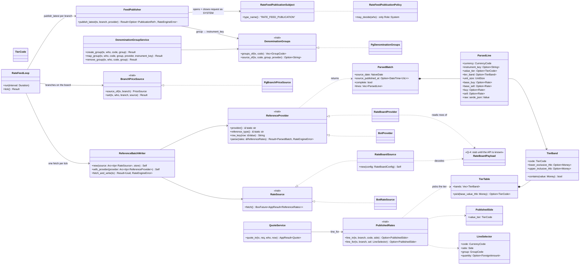
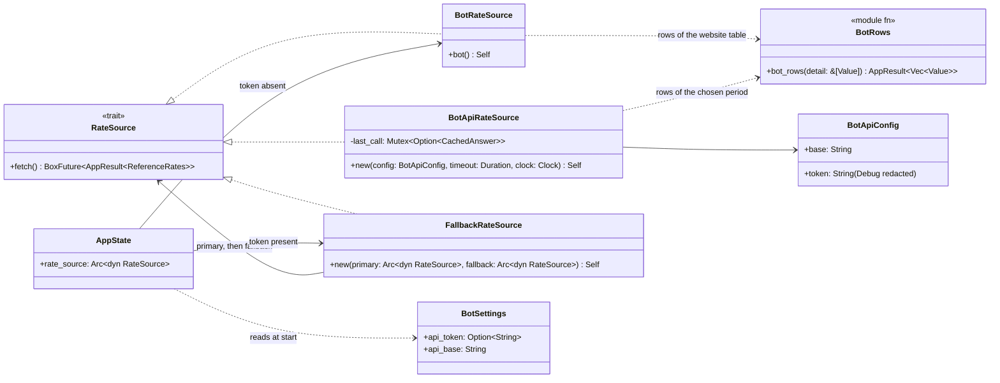

# Rate feed connector: v3 prices from the rate board system

> designed-by: claude/c954feda · 2026-10-10 · owner's order *"ออกแบบ class diagram ตัวเชื่อมระบบเรทเลย"* ·
> measured on `main` at `875f7e8` · `file:line` below is at that sha

## 0. What this is for, and what is decided

v3 takes its counter prices from the other system described in [`xchange-system-blueprint-v3.html`](xchange-system-blueprint-v3.html)
(the "rate board": SCB base → tier margins → Telegram Mini App and branch screen). The mapping of that blueprint
against v3's own rate design is [`blueprint-v3-rates-mapping.md`](blueprint-v3-rates-mapping.md). The owner's
rulings there are this design's inputs:

| # | Ruling (verbatim on #986) | What it fixes here |
|---|---|---|
| R-1 | *"B เดินต่อ #757 ได้"* | The rate board is another system. v3 reads it through an API, and keeps per-`unit_size` storage |
| R-2 | *"bราคาต้องตรงกับจอสาขา เอา B"* | The board's **shop price** is v3's price, used as received. v3 adds no `adjust_pct` to it |
| R-3 | *"…เค้า สร้างได้เองดีกว่า…"* / *"ใช่ เจ้าของร้าน/แอดมินใน v3"* | Banknote groups are created by the owner/admin in v3 and mapped to the board's rows (`instrument_key`). Nothing is fixed in code |
| R-4 | *"ทำตามที่เสนอ"* (Q-2 as proposed) | v3 publishes **every tier's** price in advance. A quote picks the tier from the transaction's value, with no call to the board per quote |
| R-5 | *"ทำตามที่เสนอ"* (Q-5 as proposed) | No second approval in v3. A board price is published automatically and audited |
| R-6 | *"ทำตามที่เสนอ"* (Q-6 as proposed) | While the board is paused, the counter stops selling: board-priced sides are unavailable, and the last published price is **not** kept |
| R-7 | *"Q-7, Q-8 ตามที่เสนอ"* | The board price is switched on **per branch**. A branch not switched on keeps BoT drafts; branches move one at a time and can be switched back |
| R-8 | *"Q-7, Q-8 ตามที่เสนอ"* | v3 pulls on its **own timer, about every minute**, well under the board's 15-minute source check. The interval is a setting, not a constant |
| R-9 | *"Q-9 ตามที่เสนอ"* | An **unreachable** board does not stop the counter at once: the current publication stays, and the branch's stale policy decides when quotes stop. Unlike a **paused** board (R-6) |

**Not known yet; this design does not guess it:**
- **Q-4:** the board's real API — URL, credential, payload. The developer question went to the owner on 2026-10-10.
- §7 lists the other open questions.

Everything that depends on Q-4 is isolated in **one file pair** (§2, `RateBoardSource` + `RateBoardPayload`). Every
other class can be built, and tested against a fake source, before Q-4 is answered.

## 1. What exists today

| Piece | Where | Fact |
|---|---|---|
| `RateSource` port | `api/crates/xc-rate/src/domain/rate/entities/rate_source.rs:14-16` | `fetch() -> ReferenceRates { source, fetched_at, kind, rows: Vec<serde_json::Value> }` |
| BoT source | `api/crates/xc-rate/src/infrastructure/rate/bot_rate_source.rs:95` | the only production `RateSource` |
| Reference writer | `api/crates/xc-rate/src/application/reference/reference_batch_writer.rs:33-184` | **BoT-specific inside a generic-looking service**: `BOT_CURRENCIES` (`:16`, used `:111`), provider/type `"BOT"` (`:74`, `:162`, `:172`), BoT column names `buyingTransfer`/`selling` (`:148`, `:154`) |
| Reference line | `api/crates/xc-rate/src/domain/reference/reference_batch.rs:6-11` | `ReferenceLine { currency, unit_size, buy, sell }` |
| Publish | `api/crates/xc-rate/src/application/publication/publish_service.rs:28` | publishes an **approved draft**; locks `branches` `FOR UPDATE` and checks the expected version |
| Approval subject | `api/crates/xc-rate/src/application/approval/rate_publication.rs:20-118` | `RatePublicationSubject` (`"RATE_PUBLICATION"`) + `RatePublicationPolicy` (OWNER decides) registered in `ApprovalRegistry` |
| Published line reader | `api/crates/xc-rate/src/domain/publication/published_rates.rs:58` (`PublishedRates`), impl `api/crates/xc-rate/src/infrastructure/publication/published_rates.rs:69-82` | `line_in(tx, branch, code, side)` reads **one** line, hard-wired to `denomination_group = 'ALL'` |
| Readers of `line_in` | `api/src/application/workflows/exchange/quote.rs:103`, `api/src/infrastructure/kiosk/kiosk_ports.rs:415`, `api/src/infrastructure/bookings/booking_ports.rs:110` | three callers |
| Quote request | `api/src/application/workflows/exchange/quote.rs:22-27` | `QuoteRequestLine { currency, shop_side, quantity, fee_thb }`: no group. `:183` stores `denomination_group: "ALL"` |
| THB arithmetic | `api/crates/xc-kernel/src/money/exchange_arithmetic.rs:16` | `ExchangeArithmetic::thb(amount, rate, unit) -> Money`, the one place that divides by `unit_size` |
| Tables | `api/migrations/20261010120000_rate_engine.sql:13-22`, `:78-99`, `api/migrations/20261010100000_rate_units.sql:25-33` | `rate_reference_lines UNIQUE (batch_id, currency_code, reference_type)` (`:22`); `rate_publications.approved_request_id NOT NULL` (`:83`), `draft_id NULL` (`:84`); `published_rate_lines UNIQUE (publication_id, currency_code, denomination_group)`; `denominations(currency_code, face_value, group_code DEFAULT 'ALL')`, seeded one `'ALL'` per currency (`rate_units.sql:32-33`) |
| Quote lines | `api/migrations/20261014100000_quotes.sql:23-30` | `quote_lines.published_rate_line_id NOT NULL` + `denomination_group` |
| System actor | `api/crates/xc-auth/src/domain/policy/value_objects/role.rs:13` | `Role::System` exists |

## 2. Class diagram



### Where each class lives

🔴 Two classes that different tickets touch are never in the same file.

| Class | File | Ticket (§6) | Kind |
|---|---|---|---|
| `ReferenceProvider`, `ParsedBatch`, `ParsedLine` | `api/crates/xc-rate/src/domain/reference/reference_provider.rs` (new) | F1 | `[required]` |
| `BotProvider` | `api/crates/xc-rate/src/infrastructure/reference/bot_provider.rs` (new) | F1 | `[required]` |
| `ReferenceBatchWriter` (changed) | `api/crates/xc-rate/src/application/reference/reference_batch_writer.rs` | F1 | `[required]` |
| `TierCode`, `TierBand`, `TierTable` | `api/crates/xc-rate/src/domain/publication/value_tier.rs` (new) | F2 | `[required]` |
| migration | `api/migrations/<next>_rate_feed.sql` (new) | F2 | `[required]` |
| `DenominationGroups`, `GroupCode` | `api/crates/xc-rate/src/domain/currency/denomination_groups.rs` (new) | F3 | `[required]` |
| `PgDenominationGroups` | `api/crates/xc-rate/src/infrastructure/currency/denomination_groups.rs` (new) | F3 | `[required]` |
| `DenominationGroupService` | `api/crates/xc-rate/src/application/currency/denomination_group_service.rs` (new) | F3 | `[required]` |
| admin commands `denominationGroupCreate` / `…Map` / `…Remove` | `api/src/presentation/http/v3/commands/denomination_groups.rs` (new) | F3 | `[proposed]` — the command-seam path is the one `rates.md` §6 uses; take the real directory from where the existing v3 commands live |
| admin screen | `web/src/screens/admin/denomination-groups/` (new directory, whole subtree) | F3w | `[proposed]` |
| `RateBoardSource`, `RateBoardConfig` | `api/crates/xc-rate/src/infrastructure/rate/rate_board_source.rs` (new) | F4 | `[required]` |
| `RateBoardPayload` | `api/crates/xc-rate/src/infrastructure/rate/rate_board_payload.rs` (new) | F4 | **Q-4** |
| `RateBoardProvider` | `api/crates/xc-rate/src/infrastructure/rate/rate_board_provider.rs` (new) | F4 | `[required]` |
| `ReferenceLineRecord` gains the §4 columns; insert writes them | `api/crates/xc-rate/src/infrastructure/reference/pg_reference_batch_store.rs` | F4 | `[required]`: only F4 produces those values. F1 does not touch this file |
| `RateFeedPublicationSubject`, `RateFeedPublicationPolicy` | `api/crates/xc-rate/src/application/approval/rate_feed_publication.rs` (new) | F5 | `[required]` |
| `FeedPublisher` | `api/crates/xc-rate/src/application/publication/feed_publisher.rs` (new) | F5 | `[required]` |
| registering `RATE_FEED_PUBLICATION` | `api/src/presentation/http/v3/commands/mod.rs` (`make_approval_service`, `:17-23`) | F5 | `[required]` |
| registering it in the test engine | `api/crates/xc-rate/tests/rate_engine_common/mod.rs` (`:224-225`) | F5 | `[required]`: a shared test helper. F5 only adds one `register` line; no provided test is edited |
| `LineSelector`, `PublishedSide.value_tier`, `PublishedRates::line_for` | `api/crates/xc-rate/src/domain/publication/published_rates.rs` | F6 | `[required]` |
| `PgPublishedRates::line_for` | `api/crates/xc-rate/src/infrastructure/publication/published_rates.rs` | F6 | `[required]` |
| `QuoteRequestLine.denomination_group`, step 3 of `quote_in` | `api/src/application/workflows/exchange/quote.rs` | F6 | `[required]` |
| `BranchPriceSource`, `PriceSource` | `api/crates/xc-rate/src/domain/branch/price_source.rs` (new) | F9 | `[required]` |
| `PgBranchPriceSource` | `api/crates/xc-rate/src/infrastructure/branch/price_source.rs` (new) | F9 | `[required]` |
| BoT publish refused on a `'RATE_BOARD'` branch | `api/crates/xc-rate/src/application/publication/publish_service.rs` | F9 | `[required]` |
| admin command `branchPriceSourceSet` | `api/src/presentation/http/v3/commands/branch_price_source.rs` (new) | F9 | `[proposed]` — same directory note as F3's commands |
| `RateFeedLoop`, `RateFeedConfig` | `api/src/infrastructure/rate_feed/feed_loop.rs` (new directory, whole subtree) | F10 | `[required]` |
| wiring the loop into server start | the server's start-up file (`api/src/main.rs` or the module that builds `AppState`) | F10 | `[proposed]` — the implementer names the real file in the ticket |

The `mod.rs` files each ticket must edit are its own: F1 `domain/reference/mod.rs` + `infrastructure/reference/mod.rs`;
F2 `domain/publication/mod.rs`; F3 `domain/currency/mod.rs`, `infrastructure/currency/mod.rs`, `application/mod.rs` (+ new
`application/currency/mod.rs`); F4 `infrastructure/rate/mod.rs`; F5 `application/approval/mod.rs` + `api/src/presentation/http/v3/commands/mod.rs` +
`application/publication/mod.rs`; F9 `domain/branch/mod.rs` + `infrastructure/branch/mod.rs`; F10 `api/src/infrastructure/mod.rs`. No two tickets share one.

**New v3 commands need no `mod.rs` edit.** `api/build.rs:238-257` reads every file in `api/src/presentation/http/v3/commands/` and generates the command table, which `api/src/presentation/http/v3/mod.rs:24` `include!`s. So F3's and F9's command files only add their own file. F5 is the only ticket that edits `commands/mod.rs`, and only for the registry.

### Who provides, who uses

| Provider | Used by | Fallback if the provider has not landed |
|---|---|---|
| `ReferenceProvider` + `ParsedBatch` (F1) | F4 `RateBoardProvider`, F5 `FeedPublisher` | F4/F5 start after F1 merges; F1 is a pure move, small |
| `TierTable` / `TierBand` (F2) | F1's `ParsedLine.tier_band`, F6 tier pick | F1 declares `ParsedLine` with `value_tier: Option<String>` and `tier_band: None` until F2 merges, then switches; comment in the file |
| migration (F2) | F3, F4, F5, F6 (columns) | every DB-touching ticket waits for F2 |
| `DenominationGroups` (F3) | F5 | F5 maps every currency's `'ALL'` group to the provider's first row of that currency **only in tests**; production needs F3 |
| `RateBoardSource` (F4) | F5 in production | F5 is tested with a fake `RateSource` + `RateBoardProvider`'s parse of a fixture |
| `FeedPublisher` (F5) | F10 `RateFeedLoop` | F10 waits for F5 |
| `BranchPriceSource` (F9) | F10, and `publish_service.rs` refusing BoT drafts on board branches | F10 waits for F9 |
| `PublishedRates::line_for` (F6) | `QuoteService` (F6); kiosk and bookings later | `line_in` keeps working for untiered publications (§3.4) |

## 3. Behaviour

### 3.1 Reading the board (F1, F4)

- **The ♻️ seam.** `ReferenceBatchWriter` keeps the shared core: checksum, dedupe, batch status, and the store write.
  - What differs per provider moves behind `ReferenceProvider`:
    - `parse`: column names, the currency list that makes a batch `COMPLETE`, and where the source date comes from.
    - `row_key`: the key one row is identified by. The checksum sort (`reference_batch_writer.rs:60-66`) and the one-line-per-key dedupe (`:129`) both use it. Today both use the currency `code` alone, which is right for BoT (one row per currency) and wrong for the board (several rows per currency: bands and tiers).
  - **Constructor kept.** `ReferenceBatchWriter::new(source, store)` keeps its signature and means "BoT provider". The board path adds `.with_provider(provider)`, in the same style as the existing `.with_source` (`:43`).
    - So the three existing callers compile and behave unchanged: `rework_hardening_test.rs:294`, `:388`, and `api/src/presentation/http/v3/commands/rate_reference_fetch.rs:75`.
  - `BotProvider` is today's code, moved: `row_key` = `code` (or `currency_code`) upper-cased, exactly `:60-66` and `:121-131` today. **F1's criterion is that every existing test passes with no test file touched.**
  - `RateBoardProvider::row_key` = `code` + `instrument_key` + `value_tier`. That decision sits in F4, never in the writer.
  - Adding the board = `RateBoardSource` + `RateBoardProvider`, with no copy of the writer.
- **Lines kept as received.** One reference line per board row: `instrument_key` (e.g. `USD`, `USD1`, `USD2`), `value_tier`, the tier's THB band, base and shop rates. The `unit_size` is **1**, because the board sends THB per 1 (BP §08).
  - Nothing is converted on write.
  - The conversion to the currency's `unit_size` happens once, where the line is published (§3.3), with the same formula as `rates.md` §4.2: `ref × currency.unit_size ÷ ref.unit_size`.
- **Two times.** `source_published_at` (SCB's announcement time) is stored apart from `fetched_at`. Freshness and stale policy read the announcement time (BP §08). If the payload has no announcement time, that is a Q-4 answer to record, not a default to invent.
- **Missing is missing.** A side the board does not price, hides (`HIDDEN_CONFLICT`) or has paused arrives as `NULL` with its status in `raw`. It is never 0 (BP §08, `rates.md:281`).

### 3.2 Banknote groups (F3, R-3)

- **Groups.** OWNER/admin creates a currency's groups (`denominations.group_code`), and maps each group to one `instrument_key` of a provider: `denomination_group_sources`, §4.
- **Defaults.** A currency starts with its one `'ALL'` group, as today (`rate_units.sql:32-33`). Mapping `'ALL'` to a row is what makes a currency priceable from the board.
- **Unmapped.** A group with no mapping gets **no line** at publish, so it is unavailable at the counter. *Follows from R-3 + `rates.md:281`, not ruled.*
- **Removing.** Removing a group that a current publication still prices is refused with `validationFailed`. The group stays until a publication without it is current.

### 3.3 Publishing a board batch (F5, R-2, R-4, R-5)

`FeedPublisher::publish_latest(tx, branch, provider)`:

1. **Read and stop early.** Lock `branches` `FOR UPDATE`, as `publish_service.rs` does. Read the provider's newest batch. If its checksum equals the one the current publication was built from (`source_snapshot.batch_checksum`), return `None`: nothing changed, nothing written.
2. **Build the lines.** For every currency, group and mapped `instrument_key`: one `published_rate_lines` row **per tier** the batch carries for that row.
   - **Paused board (R-6).** If the batch says the board is paused, every line is written with both sides `NULL`. Quotes are then `rateUnavailable` until a batch from a resumed board is published. How "paused" appears in the payload is part of Q-4.
   - `buy_rate` / `sell_rate` are the board's shop prices, converted per §3.1, **with no `adjust_pct`** (R-2).
   - `base_buy_rate` / `base_sell_rate` carry the board's SCB base, converted the same way, for the tier pick (§3.4).
   - `tier_lower_exclusive_thb` / `tier_upper_inclusive_thb` carry the band.
3. **Approve as SYSTEM.** The approval core is used, so `rate_publications.approved_request_id` (`NOT NULL`, `rate_engine.sql:83`) is filled through the one core (`rates.md` D-4), not a bypass. R-5: no second approval, still audited.
   - **Calls.** `ApprovalService::request(tx, "RATE_FEED_PUBLICATION", object_id, payload, system_actor, key)` (`api/crates/xc-approval/src/application/approval_service.rs:82`), then `ApprovalService::decide_self(tx, &request.id, system_actor, "rate feed")` (`:339-375`) in the same transaction.
     - **Not `decide`.** `decide` refuses a decider who is the proposer (`:156-164`). `decide_self` requires exactly that, and asks the policy.
   - **The actor.** `system_actor` is an `Actor` with `Role::System` (`role.rs:13`) and id `"SYSTEM:rate-feed:<provider>"`. The same actor proposes and decides.
   - **`RateFeedPublicationPolicy`:**
     - `allows_self_decision(who)` is true only for `Role::System` (the hook is `xc-approval/src/domain/policy.rs:41`);
     - `may_decide` refuses everyone, so no person can decide this type through `approvalDecide`;
     - `policy_version` is `"1"`.
   - **`RateFeedPublicationSubject`:**
     - `object_id` = `"<branch_id>:<batch_id>"`;
     - `key` = `"<branch_id>:<batch raw_checksum>"`, so a retried tick replays the same request (`request`'s idempotency, `:76-100`);
     - `version_hash(object_id)` = the batch's `raw_checksum` read from `rate_reference_batches`, so the request binds to exactly the rows published;
     - `on_decided` does nothing. The publication is written by `FeedPublisher` after `decide_self` returns, in the same transaction, and `Rejected` cannot happen because only `decide_self` can close the request.
   - **Registered** beside `rate_publication::register` in `make_approval_service` (`api/src/presentation/http/v3/commands/mod.rs:17-23`), and in the test engine's registry (`api/crates/xc-rate/tests/rate_engine_common/mod.rs:224-225`). Both are F5's.
   - `draft_id` is `NULL`, which the column allows (`rate_engine.sql:84`).
   - `published_by = "SYSTEM:rate-feed:<provider>"`.
4. **Insert and move the pointer.** Insert the publication at the next version, and move `branches.current_publication_id`.
5. **Record the source.** `source_snapshot` holds `provider`, `batch_id`, `batch_checksum`, the board `revision`, `source_published_at`, `fetched_at`, `instrument_key`, `value_tier` and the received row's `raw` status.
   - That is the audit: who (SYSTEM), when, and from which board revision.

**Applies to:** only the branches whose price source is the board, which is Q-7. A branch on BoT drafts keeps `publish_service.rs` unchanged.

### 3.4 Reading a price at the counter (F6)

`PublishedRates::line_for(tx, branch, LineSelector { code, side, group, quantity })`:

- **Untiered publication** (every line `value_tier = 'ALL'`, i.e. all BoT-draft publications): the line of `(code, group)`. `quantity` is not needed.
- **Tiered publication:**
  - `quantity` is required. Without it → `None` (unavailable), never a guessed tier.
  - The tier is picked on the **base** rate, before the margin (BP §02): `base_value = ExchangeArithmetic::thb(quantity, base_rate_of_side, unit_size)`, then `TierTable::pick(base_value)`. The lines of `(code, group)` with their bands form the table. The result is the line of that tier.
  - One tier for the whole transaction (BP §02). `quote_in` already takes exactly one line (`quote.rs:63-68`).
- **`line_in(tx, branch, code, side)` stays** for its three callers, and means `line_for` with `group = 'ALL'` and `quantity = None`. On a tiered publication it therefore answers `None`, the unavailable path those callers already handle. It does not silently use a wrong tier.
  - Moving the kiosk (`kiosk_ports.rs:415`) and bookings (`booking_ports.rs:110`) onto `line_for` with their quantity is follow-up work. It is listed in §6, not done in F6.
- **`QuoteRequestLine` gains `denomination_group: GroupCode`** (default `'ALL'`). `quote.rs:183` stores the group that was asked for instead of the literal.

### 3.5 Per-branch switch (F9, R-7)

- **The setting.** `branches.price_source` is `'BOT_DRAFT'` (default, today's path) or `'RATE_BOARD'`. OWNER sets it with the `branchPriceSourceSet` command, and the change is audited (who, when, from, to).
- **Switching on:** `RateFeedLoop` includes the branch from its next tick. The first tick publishes the board's prices (§3.3).
- **Switching back to `'BOT_DRAFT'`:** the loop stops publishing for the branch. The current publication stays a board publication until OWNER publishes a BoT draft.
  - `[proposed]`: the switch is refused unless an approved BoT draft is published in the same command. Otherwise board prices would keep being sold after the board stopped feeding them. **This is my proposal, not a ruling**; the reviewer or owner may change it.
- **Reading:** `publish_service.rs` (BoT drafts) refuses to publish on a `'RATE_BOARD'` branch (`validationFailed`). Two price sources never alternate on one branch.

### 3.6 The timer (F10, R-8)

- **One loop.** A single background task in the server runs `tick()` every `RATE_FEED_INTERVAL_SECS` (default 60; a setting, R-8).
- **Each tick:**
  1. **Skip if another tick is running.** It takes a Postgres advisory lock (`pg_try_advisory_lock`) and returns at once if another tick, or another server instance, holds it. No overlapping runs.
     - **Lock scope** (PR 1038 review follow-up): a session lock (`pg_try_advisory_lock`) taken on a pooled connection stays held if the tick errors before unlocking, and every later tick then skips silently. Use `pg_try_advisory_xact_lock` inside an outer transaction, so the lock ends with the transaction on every path. Or use a dedicated connection that unlocks on every path. F10's tests include: a tick that fails does not block the next one.
  2. **Fetch once.** `ReferenceBatchWriter::fetch_and_write` with the board's source and provider. A repeat checksum writes nothing (§3.1).
  3. **Publish per branch.** `FeedPublisher::publish_latest` for every branch whose `price_source = 'RATE_BOARD'`, one transaction per branch, so one branch's failure does not stop the others.
- **Board unreachable.** The fetch fails, nothing is written, and the current publication stays. Its freshness is measured from `source_published_at`, so the branch's stale policy (`rates.md` §4.3, `on_stale`) decides when quotes stop. Each failed tick is logged with the error. An unreachable board does not stop the counter at once (R-9); the stale policy does.
- **Where it runs.** v3 had no scheduler at `875f7e8` (§7 Q-8 sweep), so this is the first background task. It starts with the server and stops with it.

### 3.7 Input / output and errors

| Call | Accepts | Returns | Errors |
|---|---|---|---|
| `ReferenceProvider::parse` | `&ReferenceRates` | `ParsedBatch` | `RateEngineError::RateUnavailable` (payload unreadable); `ValidationFailed` (a rate ≤ 0, buy > sell on a row) |
| `ReferenceBatchWriter::fetch_and_write` | tx | batch id (existing id on a repeat checksum) | as today |
| `DenominationGroupService::map_group` | code, group, provider, instrument_key | `()` | `validationFailed` (unknown currency/group, empty key); `outOfScope` (not OWNER/admin) |
| `FeedPublisher::publish_latest` | tx, branch, provider | `Some(PublicationRef)` or `None` (nothing new) | `RateUnavailable` (no batch); `StaleVersion` (lost the branch lock race) |
| `PublishedRates::line_for` | `LineSelector` | `Option<PublishedSide>` | DB errors only; "no such line / no tier fits / quantity missing on a tiered publication" is `None` |
| `TierTable::pick` | `Money` | `Option<TierCode>` | — (`None` when no band contains the value, or bands overlap) |

### 3.8 Edge cases

| Case | Behaviour | Test |
|---|---|---|
| value exactly on a band edge (10,000.00) | `lower_exclusive < v ≤ upper_inclusive` → 10,000.00 is the lower tier (BP §02 "≤10,000") | F2 unit test |
| bands overlap or leave a gap | `TierTable::pick` → `None`; `FeedPublisher` refuses the batch (`ValidationFailed`) | F2 + F5 |
| board row hidden / paused / missing side | that side `NULL`; quote → `rateUnavailable` | F5 + F6 |
| whole board paused (R-6) | a publication with every side `NULL`; every quote → `rateUnavailable`; the next resumed batch publishes prices again | F5 |
| a group mapped to a key the batch lacks | no line for that group in the publication | F5 |
| same batch fetched twice | writer returns the existing batch id; publisher returns `None` | F1 (existing behaviour kept) + F5 |
| JPY: board 0.2301 per 1, `unit_size` 100 | published 23.01 per 100; quote of 10,000 JPY at base 0.22 → base value 2,200 THB → tier ≤10,000 | F5 + F6 |
| BoT-draft branch | unchanged: untiered `'ALL'` lines, `line_in` as today | F6 regression |
| two server instances tick at once | one holds the advisory lock, the other returns at once | F10 |
| board unreachable for several ticks | nothing written; quotes follow the stale policy from `source_published_at` | F10 |
| BoT draft published on a `'RATE_BOARD'` branch | refused `validationFailed` | F9 |
| kiosk/bookings on a tiered publication before their follow-up | `line_in` → `None` → their existing unavailable path | F6 |

## 4. Data migration (F2)

One migration, `api/migrations/<next>_rate_feed.sql`:

```sql
ALTER TABLE rate_reference_batches ADD COLUMN source_published_at timestamptz NULL;
ALTER TABLE rate_reference_lines
    ADD COLUMN instrument_key text NULL,
    ADD COLUMN value_tier text NULL,
    ADD COLUMN tier_lower_exclusive_thb numeric(20,2) NULL,
    ADD COLUMN tier_upper_inclusive_thb numeric(20,2) NULL,
    ADD COLUMN base_buy numeric(20,8) NULL,
    ADD COLUMN base_sell numeric(20,8) NULL;
-- the line's identity now includes the board row and the tier
ALTER TABLE rate_reference_lines DROP CONSTRAINT <existing unique of (batch_id, currency_code, reference_type)>;
CREATE UNIQUE INDEX rate_reference_lines_identity
    ON rate_reference_lines (batch_id, currency_code, reference_type,
                             COALESCE(instrument_key, ''), COALESCE(value_tier, ''));

ALTER TABLE published_rate_lines
    ADD COLUMN value_tier text NOT NULL DEFAULT 'ALL',
    ADD COLUMN tier_lower_exclusive_thb numeric(20,2) NULL,
    ADD COLUMN tier_upper_inclusive_thb numeric(20,2) NULL,
    ADD COLUMN base_buy_rate numeric(20,8) NULL,
    ADD COLUMN base_sell_rate numeric(20,8) NULL;
ALTER TABLE published_rate_lines DROP CONSTRAINT <existing unique of (publication_id, currency_code, denomination_group)>;
ALTER TABLE published_rate_lines
    ADD CONSTRAINT published_rate_lines_identity UNIQUE (publication_id, currency_code, denomination_group, value_tier);

ALTER TABLE branches
    ADD COLUMN price_source text NOT NULL DEFAULT 'BOT_DRAFT'
        CHECK (price_source IN ('BOT_DRAFT', 'RATE_BOARD'));

CREATE TABLE denomination_group_sources (
    currency_code  char(3) NOT NULL REFERENCES currencies(code),
    group_code     text    NOT NULL,
    provider       text    NOT NULL,
    instrument_key text    NOT NULL,
    updated_by     text    NOT NULL,
    updated_at     timestamptz NOT NULL DEFAULT now(),
    PRIMARY KEY (currency_code, group_code, provider)
);
```

The two existing constraint names are read from the database in F2, not guessed:
`SELECT conname FROM pg_constraint WHERE conrelid = 'published_rate_lines'::regclass AND contype = 'u';` and the same
for `rate_reference_lines`.

1. **Existing rows after it:**
   - `rate_reference_lines` (BoT): the new columns are `NULL`. They keep their identity: `COALESCE` makes `(…, '', '')` unique exactly as before.
   - `rate_reference_batches`: `source_published_at` is `NULL`. Readers keep using `source_date`.
   - `published_rate_lines`: `value_tier = 'ALL'`, bands and base rates `NULL`. Every existing publication reads as untiered (§3.4), exactly as today.
   - `denomination_group_sources` starts empty.
   - `branches.price_source` is `'BOT_DRAFT'` for every branch, which is today's behaviour. No branch is switched on by the migration.
2. **Backfill: none.** The defaults are the old meaning; nothing is computed lazily either. Rows that will carry the new defaults, to look at before deploy:
   `SELECT (SELECT count(*) FROM published_rate_lines) AS lines, (SELECT count(*) FROM rate_reference_lines) AS refs;`
   v2/v3 data is test data (`xchange-v3.md` D6), but the count still goes in the deploy note.
3. **Deploy order:** migration first, then the binary.
   - **Old binary, new schema, no tiered rows:** works. `line_in`'s query (`infrastructure/publication/published_rates.rs:77-82`) filters `denomination_group = 'ALL'`, and while every line is `value_tier = 'ALL'` there is one row. The writer's inserts name their columns, so the new nullable columns take their defaults.
   - 🔴 **Old binary, tiered rows: unsafe.** Once a tiered publication exists, the old query matches four rows, and `fetch_optional` (`:83-86`) silently returns whichever comes first: a **wrong tier's price, with no error**.
   - **The guard:** F6 adds `AND l.value_tier = 'ALL'` to `line_in`'s query. From F6's binary on, `line_in` can never read a tiered row; it answers `None` on a tiered publication (§3.4).
   - **The rule that follows:**
     - No tiered publication may be written before F6's binary is deployed. F10, the only writer, waits for F6 (§6).
     - Once tiered publications exist, **rolling the server back to a binary older than F6 is forbidden**: it would sell at a random tier.
     - The deploy note for F10 must say so, with the check `SELECT count(*) FROM published_rate_lines WHERE value_tier <> 'ALL'` (0 means a rollback is safe).
4. **What `down` loses:**
   - It drops `denomination_group_sources` (the owner's group mappings), `branches.price_source` (which branches were switched on) and the new columns.
   - It must first refuse when `SELECT count(*) FROM published_rate_lines WHERE value_tier <> 'ALL'` is not 0, because restoring the old `UNIQUE (publication_id, currency_code, denomination_group)` would fail on tiered publications. Rolling back after board publications exist means deleting those publications, which is a destructive step the owner orders, not `down`.

## 5. Not in this design

- **The board side.** Its API, credential and payload (Q-4) belong to the board's developers. `RateBoardPayload` is written once those are known.
- **Kiosk and bookings on tiers.** Moving them onto `line_for` with their quantity is a follow-up per reader (§6 F7, F8).
- **Showing tiers on screens.** Desk, staff and kiosk display of four prices per currency is a screen design that has not been started.

## 6. Tickets (one class set each; no shared files)

| # | Outcome | Waits for |
|---|---|---|
| F1 | `ReferenceProvider` extracted; `BotProvider` holds today's BoT parsing; the writer takes a provider. **Pure move: every existing reference test passes unchanged** | this design merged |
| F2 | migration §4 + `TierTable`/`TierBand`/`TierCode` with the band-edge tests | this design |
| F3 | denomination groups: trait, Pg impl, service, admin commands (API) | F2 |
| F3w | `admin_denomination_groups` view + the admin screen for groups and mappings (§10) | F3 |
| F4 | `RateBoardSource` + `RateBoardProvider` + `RateBoardPayload` | F1, F2, **Q-4** |
| F5 | `FeedPublisher` + `RATE_FEED_PUBLICATION` subject/policy | F1, F2, F3 |
| F6 | `PublishedRates::line_for` + `LineSelector` + tier pick; `QuoteRequestLine.denomination_group`; `quote_in` step 3 | F2 |
| F7 | kiosk prices at the tier of the amount; payment check by line id; kiosk lists show the first tier (§9.3, §9.4) | F6, F8 (`line_by_id`) |
| F8 | bookings: `counter_rate_in` through `line_for` with the booked amount; confirm checks the stored line with `PublishedRates::line_by_id` (§9.2) | F6 |
| F9 | per-branch switch: `BranchPriceSource`, Pg impl, `branchPriceSourceSet`, BoT publish refused on board branches | F2 |
| F11 | every list reader outside the kiosk shows the first tier (R-10) + a source guard test (§9.4) | F6 |
| F10 | `RateFeedLoop`: timer, advisory lock, one fetch per tick, publish per switched-on branch | F4, F5, **F6** (the `line_in` guard, §4 item 3), F9 |
| F12 | BoT reference rates from the official BoT API: `BotApiRateSource` + `FallbackRateSource` (the website scraper stays as fallback), config `APP_BOT__API_TOKEN` / `APP_BOT__API_BASE` (§8, decisions B-1…B-4); ticket #1066 | F1 |

Each ticket comes with its behaviour table and the failing tests its author writes first (🧪). None is released before this
design is reviewed and merged (📐).

**🔴 Release gate: switching a branch onto the board.** No branch is set to `'RATE_BOARD'` (F9's command) until **F6, F7, F8 and F11 are merged and deployed**.
- Before F7/F8, the kiosk (`kiosk_ports.rs:415`) and bookings (`booking_ports.rs:110`) read through `line_in`, which answers `None` on a tiered publication (§3.4). On that branch they would show "unavailable" for every currency.
- Before F7/F11, the list readers of §9.4 show several rows per currency on a tiered publication.
- **Enforcement:** the gate is checked by whoever switches a branch, at the time of switching. The code does not know what is deployed. F9's ticket repeats this gate in its done criteria and in the command's description.

## 7. Must ask — not decided here

| # | Question | Why it blocks |
|---|---|---|
| Q-4 | The board API: URL, server credential, payload; whether all four tiers come in one response; how hidden/paused/missing sides look | F4 is written against it. R-4 needs all tiers in one response; if the board sends one tier, the board needs a change first |
| Q-6 | When the board is paused, does the counter stop selling? | **Answered — R-6: it stops** (§3.3 step 2) |
| Q-7 | Which branches take their price from the board? | **Answered — R-7: per branch** (§3.5) |
| Q-8 | What triggers `FeedPublisher`? | **Answered — R-8: v3's own timer, ~1 minute, configurable** (§3.6) |
| Q-9 | Does an unreachable board stop the counter at once, like a paused one (R-6)? | **Answered — R-9: no; the stale policy decides** (§3.6) |

## 8. BoT reference rates from the official BoT API (amendment, 2026-10-10)

> designed-by: claude/5edf7bb5 · 2026-10-10 · measured on `main` at `3c2b56ca` · `file:line` in this section is at that sha
> (F1's files are cited from PR 1060 head `9002aac3`, which had not merged when this was written)

### 8.0 Decided

| # | Decision | Source |
|---|---|---|
| B-1 | BoT reference rates come from the **official BoT API**. The website scraper (`BotRateSource`) stays as the fallback until the API is proven (§8.7) | owner, 2026-10-10, in the xchange controller's session (option "Switch to official API") |
| B-2 | The app is registered on the BoT API portal: name **"Xchange"**, portal **APP ID 5669** (an internal id, not a secret), redirect URL `https://xc-v3.spacing.cloud/`. `xc-v3.spacing.cloud` is the host the owner registered for this app | owner, 2026-10-10 |
| B-3 | Portal product **"Exchange Rates"**, plan **"Exchange Rates Plan"**: quota unlimited, **rate limit 200 calls per hour**. Credential 1: auth method `authToken`, expires never | owner, 2026-10-10 (portal screen; values masked) |
| B-4 | Config names: section `bot`, keys `api_token` and `api_base` ⇒ env vars **`APP_BOT__API_TOKEN`** and **`APP_BOT__API_BASE`** | controller claude/5edf7bb5, 2026-10-10, to fit `APP_<SECTION>__<KEY>` (`deploy/server/env.example:6-7`, `api/src/config/mod.rs:177-183`) |

This answers `docs/design/blueprint/rates.md` §10 **O-1** (which product, usage rights, how often).

### 8.1 The API (owner-supplied OpenAPI 3.0.1, "Average Exchange Rate - THB / Foreign Currency" v2.0.2)

- Server `https://gateway.api.bot.or.th/Stat-ExchangeRate/v2`, call `GET /DAILY_AVG_EXG_RATE/?start_period=YYYY-MM-DD&end_period=YYYY-MM-DD[&currency=XXX]`.
- Auth: `securitySchemes.clientIdHeader` = `apiKey` **in the header named `Authorization`**. The value is sent as is (no `Bearer ` prefix; the spec defines none).
- Response: `result.timestamp`, `result.data.data_header.last_updated`, and `result.data.data_detail[]`, each
  `{ period, currency_id, currency_name_th, currency_name_eng, buying_sight, buying_transfer, selling, mid_rate }`, every rate a **decimal string** (spec example `"43.7425000"`, 7 decimals).
- Released **every business day at 18:00 Bangkok**. It is the daily average of commercial banks, not a live price — the same data the website table shows today (`bot_rate_source.rs:259` already labels it `DAILY_COMMERCIAL_BANK_AVERAGE`).

### 8.2 Why this is a `RateSource`, not a `ReferenceProvider`

The first idea was a `BotApiProvider` beside F1's `BotProvider`. It is the wrong seam:

1. **The row shape is a contract with four readers, not just the writer.** `BotRateSource` emits rows
   `{ code, date, unit, buyingSight, buyingTransfer, selling, original }` (`bot_rate_source.rs:227-235`). They are read by
   - the v3 writer (`reference_batch_writer.rs:102-156`; after F1, `BotProvider::parse`),
   - the rate-save service, which filters on `code` (`api/crates/xc-rate/src/application/rate/service.rs:201-207`),
   - the reference view, which reads `code`/`date`/`unit`/`buyingSight`/`buyingTransfer`/`selling` (`api/src/presentation/http/v3/views/rates_reference.rs:50-86`),
   - `/api/reference-rates` (`api/src/presentation/http/reference_rates.rs:67`).
   A `ReferenceProvider` would serve only the first; the other three would stay on the scraper.
2. **The API's rows have the same field names as the website's table** (`currency_id`, `period`, `buying_sight`, `buying_transfer`, `selling`; compare `bot_rate_source.rs:178-205`). Only the transport differs: URL, `Authorization` header, the `result.data.data_detail` envelope, and a date window.

So the API is a second `RateSource` that emits **exactly the rows `BotRateSource` emits**. `BotProvider` (F1) parses them unchanged, `provider`/`reference_type` stay `"BOT"`, and nothing downstream changes. This work therefore **does not need F1 (#1050)**. ♻️: the row validation and mapping (`bot_rate_source.rs:175-254`) moves into one shared function both sources call; it is not copied.

### 8.3 Class diagram



| Class / item | File | Kind |
|---|---|---|
| `bot_rows` (moved from `bot_rate_source.rs:175-254`, plus `ALLOWED_CURRENCIES`, `parse_rate`, `decimal_to_number`) | `api/crates/xc-rate/src/infrastructure/reference_source/bot_rows.rs` (new) | `[required]` |
| `BotApiRateSource`, `BotApiConfig` | `api/crates/xc-rate/src/infrastructure/reference_source/bot_api_rate_source.rs` (new) | `[required]` |
| `FallbackRateSource` | `api/crates/xc-rate/src/infrastructure/reference_source/fallback_rate_source.rs` (new) | `[required]` |
| module | `api/crates/xc-rate/src/infrastructure/reference_source/mod.rs` (new) + one `pub mod reference_source;` line in `api/crates/xc-rate/src/infrastructure/mod.rs` | `[required]` |
| `BotRateSource` calls `bot_rows` (pure move, behaviour unchanged) | `api/crates/xc-rate/src/infrastructure/rate/bot_rate_source.rs` | `[required]` |
| `BotSettings` in `Settings` | `api/src/config/mod.rs` | `[required]` |
| choosing the source | `api/src/bootstrap/mod.rs:63` | `[required]` |
| one instance for every reader | `api/src/presentation/http/reference_rates.rs:24` registers `state.rate_source.clone()` instead of a new `BotRateSource::bot()` | `[required]` |
| the reference view's cache reads the shared source | `api/src/presentation/http/v3/views/rates_reference.rs:226-233`: `static CACHE` builds its own `BotRateSource::bot()` and `register` ignores `_state`. It becomes a cache built from `state.rate_source` (a `OnceLock` set in `register`, or the cache held by the view) | `[required]` |
| commented `#APP_BOT__API_TOKEN=` / `#APP_BOT__API_BASE=` lines | `deploy/server/env.example`, **added by PR 1064** (`chore/set-bot-token-script`), not by this work | provided |

**Order with #1030 (controller ruling, 2026-10-10).** `rates_reference.rs` is also in the scope of OR-7.7 #1030.
The work in this section (#1066) goes **first**, because it is ready sooner and #1030 waits on #767 and #837. #1030 rebases over
#1066's change to `rates_reference.rs`.

**Constructions left on the scraper on purpose.** `BotRateSource::bot()` is also built at `v3/desk/config.rs:60`,
`views/admin_rates.rs:112`, `views/kiosk_currencies.rs:94`, `views/kiosk_notifications.rs:98`, `views/kiosk_queue.rs:141`
and `rpc.rs:371`. Those paths reach only `RateService::current`/`rate_in` or the kiosk ports, which never call `fetch()`
(review of PR 1065, `git grep -n 'source\.fetch()'` at `3c2b56ca`: the only callers are `service.rs:201`,
`reference_batch_writer.rs:54` and `rates_reference.rs:133`). They stay as they are; this work does not rewire them.

**Why a new directory.** `infrastructure/rate/mod.rs` belongs to F4 (§2) and `infrastructure/reference/mod.rs` to F1. A new
`infrastructure/reference_source/` (whole subtree owned by this work) touches neither; the only shared edit is one line in
`infrastructure/mod.rs`, which no F-ticket edits.

**Who provides, who uses**

| Provider | Used by | Fallback if not landed |
|---|---|---|
| `bot_rows` | `BotRateSource`, `BotApiRateSource` | none needed: same ticket |
| `FallbackRateSource` | `AppState::new` | same ticket; reusable later for the rate board (F4) |
| `AppState.rate_source` | the reference view's cache (`rates_reference.rs:226-233`, rewired here), v3 `rateReferenceFetch` (`commands/rate_reference_fetch.rs:73`), `/api/reference-rates`, v2 rpc (`rpc.rs:210`), kiosk (`kiosk.rs:317-322`) — the last two read the `app_data` that `reference_rates.rs:24` registers | `rpc.rs:212` and `kiosk.rs:322` keep their `BotRateSource::bot()` default for tests that register no source |

### 8.4 Configuration and the token

| Portal value | Goes into | Used for |
|---|---|---|
| **Token** ("unique ID used to identify the application") | **`APP_BOT__API_TOKEN`** in `/etc/xc-v3/env` (the unit's only `EnvironmentFile`, `deploy/server/xc-v3.service:19`; root:xc-v3 640 per `env.example:3`) | sent as the `Authorization` header value on every call |
| **Token Hash** ("unique password … do not share") | **not stored by xchange** | nothing. The spec has one security scheme, `clientIdHeader` (a single header), and no call that takes a second value |
| APP ID 5669 | this document only | the portal's own id; never sent |
| — | `APP_BOT__API_BASE` (optional) | default `https://gateway.api.bot.or.th/Stat-ExchangeRate/v2` |

- **Never in the repo, tickets, logs or errors.** `BotApiConfig`'s `Debug` prints `token: "<redacted>"` (same pattern as `IdentitySettings`, `api/crates/xc-auth/src/infrastructure/identity/identity_settings.rs:11`). Error messages never include the request headers.
- **Setting it on the host** is `deploy/server/set-bot-token.sh`, written by the controller in PR 1064, which also adds the commented names to `deploy/server/env.example`. That file is not part of this work.
- **State on 2026-10-10:** the Token is set on the do-sgp1 server, and the API answered HTTP 200 (controller, on #1066).
- **Rotate / revoke** in the BoT portal. Rotating = put the new Token in `APP_BOT__API_TOKEN` and restart the service. No code change.
- 🔴 **Trap: config values are type-parsed.** `Settings::load_from` uses `.try_parsing(true)` (`api/src/config/mod.rs:181`), and `env.example:32` already warns that an all-digit value "is not text". A Token made only of digits (or with leading zeros) must not become a number. So:
  - `BotSettings.api_token` is `Option<String>`, and `load_from` takes it **raw from `env_map`** (the way `IDENTITY_*` are taken, `config/mod.rs:113-145`) and overwrites what the builder parsed. The value is never type-coerced.
  - An empty or all-whitespace value means "absent".
  - Pinned by a test: `APP_BOT__API_TOKEN=0012345` loads as the string `"0012345"`.

### 8.5 Choosing the source (at start)

- `APP_BOT__API_TOKEN` absent ⇒ `AppState.rate_source = BotRateSource::bot()` (today's behaviour) and one `tracing::warn!` at start: `BoT API token not set (APP_BOT__API_TOKEN); reference rates come from the website scraper`.
- Present ⇒ `FallbackRateSource::new(BotApiRateSource, BotRateSource::bot())`.

### 8.6 `BotApiRateSource::fetch`

1. **Window.** `today` = the date in Asia/Bangkok (UTC+7, no DST) from the injected clock. Request `start_period = today − 14 days`, `end_period = today`, **no `currency`** (one call returns every currency).
2. **Which day.** From `data_detail`, take the **latest `period` that has all six currencies** (`USD EUR GBP JPY CNY AUD`). This one rule covers everything:
   - before 18:00 Bangkok, today is not released yet ⇒ the previous business day;
   - weekends and BoT holidays have no rows ⇒ the last business day before them;
   - 14 days covers the longest Thai holiday run (Songkran + weekend).
   No row set qualifies ⇒ error `BOT_UNAVAILABLE` (same text as today, `bot_rate_source.rs:17`).
3. **Rows.** The six rows of that period go through `bot_rows`, so the result is byte-for-byte the shape `BotRateSource` returns (`code`, `date` = `period`, `unit`, `buyingSight`, `buyingTransfer`, `selling`, `original` with the strings as received). `source` = the API base URL (never the token); `kind` = `"DAILY_COMMERCIAL_BANK_AVERAGE"`; `fetched_at` = now.
4. **Precision.** Rates are parsed from the decimal strings with `xc_kernel::money::plain_decimal` (via `parse_rate`), never through `f64`. They then become JSON numbers through `decimal_to_number` exactly as today (`bot_rate_source.rs:89-93`); BoT's values (≤ 7 decimals, ≤ 11 significant digits) print back unchanged, and `original` keeps the received strings. A rate ≤ 0 or unparsable fails the fetch, as today (`bot_rate_source.rs:207-213`).
5. **Which columns the writer uses** — unchanged: `buy` = `buyingTransfer`, `sell` = `selling` (`reference_batch_writer.rs:147-156`; F1 `bot_provider.rs`, same keys). `buyingSight` is kept in the row and shown by the reference view; `mid_rate` is not used.

**Call budget (B-3: 200 calls/hour).** Several readers call `fetch()`: the reference view every 60 s or on demand (`rates_reference.rs:121-133`), every rate save (`service.rs:201`), `/api/reference-rates`, the kiosk, the v3 command. So `BotApiRateSource` itself limits upstream calls:
- It keeps its last answer (success **or** error) with the time it was obtained, and returns it without a call while it is younger than **15 minutes** (`BOT_API_MIN_INTERVAL`, `[proposed]` constant). The data changes once a day, so this delays a new day's rates by at most 15 minutes.
- One fetch = one HTTP call, plus **at most one retry**, only on timeout / connection error / 5xx (never on 4xx).
- ⇒ at most **4 fetches per hour, ≤ 8 HTTP calls per hour, ≤ 192 calls per day** (96 per day when no retry is needed), whatever the number of readers. That is ≤ 4% of the 200/hour limit.
- The cache is per process. One server runs today (`deploy/server/xc-v3.service`); a second instance would double the numbers, still far under the limit.

### 8.7 Errors and fallback (`FallbackRateSource`)

| Case | API source answer | What the caller gets | Log |
|---|---|---|---|
| Token present, HTTP 200, a complete period | rows | API rows | — |
| HTTP **401 / 403** | error | **scraper rows** (fallback called once) | `tracing::error!` with the fixed message `BOT_API_AUTH_REJECTED` and the status (never the token). This is the alert: there is no alert channel in the server today (searched `api/src` for alert/notify at `3c2b56ca`), so it lands in journald (`deploy/server/journald-xc-v3.conf`) |
| `data_detail` empty, or no period with all six | error | scraper rows | `warn` |
| Timeout / 5xx after the one retry, unreadable body | error | scraper rows | `warn` |
| HTTP 429 (over the limit) | error, no retry | scraper rows | `error` — means §8.6's budget is broken |
| API fails **and** scraper fails | error `BOT_UNAVAILABLE` | error, as today | `warn` |

- **Nothing is ever written from an empty answer.** Every failure is an `Err` from `fetch()`, and `ReferenceBatchWriter::fetch_and_write` returns `RateUnavailable` before it writes (`reference_batch_writer.rs:52-56`). The previous batch and the current publication stay.
- Which source answered is visible in `ReferenceRates.source` (API base URL vs `BOT_SOURCE_PAGE`), which the rate-save service stores (`service.rs:203-207`).
- **"Proven"** (B-1) means: once the Token is set, a live comparison of API vs scraper for the same `period` gives equal `buyingSight`/`buyingTransfer`/`selling` for all six currencies (an `#[ignore]` test that runs only when `APP_BOT__API_TOKEN` is set in the test environment). Removing the scraper fallback after that is a separate decision; it is not part of this work.

### 8.8 Answered

| # | Question | Answer |
|---|---|---|
| QB-1 | **JPY unit in the API.** The website table quotes JPY per 100 yen (fixture `api/crates/xc-rate/tests/fixtures/v2_bot_source_cases.json`: JPY `buying_transfer` `"21.0100"`), which is why `bot_rate_source.rs:215` sets `unit 100`. The spec's header example says "Baht / 1 Unit of Foreign Currency" and shows no JPY row | **Per 100 yen, same as the scraper.** The live API returned JPY as `"JAPAN : YEN (100 YEN)"` at 20.999 / 21.5926 for 2026-10-09 (controller's comment on #1066, 2026-10-10). `bot_rows` keeps `JPY ⇒ 100` for both sources; no per-source unit is needed |

### 8.9 No database change

Nothing here adds or changes a table, column, constraint or value: batches are still `provider = 'BOT'`,
`reference_type = 'BOT'`, rows in the same shape. No data-migration section is needed.

## 9. Screens, the kiosk and bookings on a tiered publication (amendment, 2026-10-10)

> designed-by: claude/c954feda · measured on `main` `9970162` + F6 (PR 1123, head `503ce3d`)

### 9.0 Decided
| # | Ruling | What it fixes |
|---|---|---|
| R-10 | owner, 2026-10-10, on #986: *"แสดงราคาขั้นแรก (แนะนำ)"* | every screen that **lists** prices shows a tiered currency at its **first tier**: the line of `(currency, group)` whose `tier_lower_exclusive_thb` is NULL. The price of a transaction is still picked by `line_for` with its quantity (R-4) |

Why this needed a ruling: §5 left "showing tiers on screens" undesigned, and §6's F7/F8 only moved the three `line_in`
callers. Measured at the sha above, more readers select the `'ALL'` group's lines with **no tier filter** and so get
several rows per currency on a tiered publication (§9.4).

### 9.1 The one rule every list reader uses
- **First tier = `tier_lower_exclusive_thb IS NULL`.** An untiered line (`value_tier = 'ALL'`) also has it NULL, so the
  same predicate selects exactly one line per `(currency, group)` in both cases. F5 refuses a batch whose bands do not
  start open-below (`feed_publisher.rs` band check), so a published tiered `(currency, group)` has exactly one such line.
- A list reader adds `AND l.tier_lower_exclusive_thb IS NULL` next to its `denomination_group = 'ALL'`. No new type.

### 9.2 `PublishedRates::line_by_id` and bookings (F8)
- **New port method** (`domain/publication/published_rates.rs`, impl in `infrastructure/publication/published_rates.rs`):
  `line_by_id(tx, branch, line_id: PublishedRateLineId, side) -> AppResult<Option<PublishedSide>>` — the line **if it
  belongs to the branch's current publication** and that side is priced; otherwise `None`.
- **Why a new method:** a booking (and a kiosk request) already chose its line when it was created. Checking it later must
  not pick the tier again: confirming a booking passes no amount today, and passing one would also switch on the stale
  check that confirm deliberately skips (`rates_re4_bookings_test::a_line_that_goes_stale_between_create_and_confirm_still_confirms`).
- **Bookings:**
  - `PgBookingPorts::counter_rate_in` reads through `line_for` (group `ALL`, quantity = the booked amount). With no amount,
    a tiered line is unavailable; an untiered line answers as before.
  - `BookingPorts` gains `stored_line_in(tx, branch, code, side, line_id: Uuid) -> Option<CounterLine>` with a **default
    body** (ask `counter_rate_in` with no amount and keep the line only if its id matches), so existing fakes compile
    unchanged. `PgBookingPorts` overrides it with `line_by_id`.
  - `change.rs` (confirm) calls `stored_line_in` with the booking's `published_rate_line_id` (none → `None` → `RateMoved`,
    as today).

### 9.3 The kiosk prices at the tier (F7)
- **Today:** `KioskMachine::quote` prices the kiosk request from `CounterFacts.line` (the counter view's line), and the
  application then asks `QuoteService::quote_in` for the exchange quote. On a tiered publication the counter view's line is
  the first tier (R-10) while `quote_in` picks the tier of the amount, so the two would disagree.
- **Rule:** the kiosk request is priced at **the line `line_for` picks for the request's foreign amount** — the same line
  `quote_in` will pick, so the kiosk price and the quote always agree.
- **New port method** `KioskPorts::tier_line_in(tx, branch, currency, side, foreign: ForeignAmount)
  -> AppResult<Option<CounterLine>>` (in `xc-kiosk`'s `kiosk_ports.rs`), with a **default body returning `Ok(None)`**
  ("no tier information: keep the counter line"), so existing fakes compile unchanged. `PgKioskPorts` implements it with
  `line_for`.
- **Algorithm** (in `xc-kiosk/src/application/kiosk/customer.rs`, the quote step):
  1. Price with the counter line, as today → `foreign`.
  2. `tier_line_in(foreign)`. `None` → done (untiered, or a fake). The same line id → done.
  3. A different line → replace `CounterFacts.line` with it and price again → new `foreign`; repeat from 2.
  4. Stop after as many rounds as there are tiers (4); still moving → refuse `AmountOrCurrencyInvalid`.
  - **BUY** (amount in foreign) converges in one round: the foreign amount does not depend on the rate.
  - **SELL** (amount in THB) converges because a higher tier sells cheaper, so the same THB buys more foreign and stays
    in the higher tier. Step 4 is the guard if a board ever publishes non-monotone tiers.
- **Payment check:** `PgKioskPorts::check_stale_in` reads the quoted line with `line_by_id` (§9.2) instead of `line_in`,
  then applies the stale policy as today.

### 9.4 List readers and who fixes them
| Reader (at the sha above) | Ticket |
|---|---|
| `src/infrastructure/kiosk/kiosk_ports.rs:248`, `:297` (`counter`, `counter_in`) | F7 |
| `crates/xc-kiosk/src/infrastructure/kiosk/kiosk_repository.rs:673` (`published_both_sides_in`) | F7 |
| `src/presentation/http/v3/views/kiosk_currencies.rs:166` | F7 |
| `src/presentation/http/v3/views/admin_bookings.rs:101`, `:292` | F11 |
| `src/presentation/http/v3/views/published_rates.rs:95` | F11 |
| `src/presentation/http/v3/views/staff_published_rates.rs:95` | F11 |
| `src/application/compat/snapshot.rs:364` | F11 |
| `src/application/workflows/save_transaction.rs:396` (`line_in`, a price read, not a list) | F11: move onto `line_for` with the line's quantity |

- Three of these (`kiosk_currencies.rs:166`, `published_rates.rs:95`, `staff_published_rates.rs:95`) do not filter the
  group at all and list every group's lines. Listing groups other than `'ALL'` is not decided here; those readers keep
  listing what they list today and only add the first-tier predicate.
- **Guard (F11):** a source test that fails when a SQL string under `api/src` or `api/crates/*/src` reads
  `published_rate_lines` and mentions neither `tier_lower_exclusive_thb` nor `value_tier`, except an allow-list of
  readers that work per line or pick the tier themselves (`xc-rate`'s `infrastructure/publication/published_rates.rs`,
  `feed_publisher.rs`, `denomination_group_service.rs`, `publish_service.rs`, and line-by-id reads). A new list reader
  then cannot forget R-10.

### 9.5 No database change
Nothing here adds or changes a table, column or constraint. No data-migration section is needed.

## 10. The admin screen for banknote groups (F3w, amendment 2026-10-11)

> designed-by: claude/c954feda · measured on `main` `32a8a8b` · owner's order *"เปิดใบ F3w แล้วจ่ายงานเลย"*

### 10.1 What is missing
F3 merged the three commands (`api/src/presentation/http/v3/commands/denomination_groups.rs`:
`denominationGroupCreate` POST `/api/denomination-groups`, `denominationGroupMap` POST
`/api/denomination-groups/map`, `denominationGroupRemove` POST `/api/denomination-groups/remove`), but **no view reads the
groups**, so a screen has nothing to show. §2's F3w row named only the screen; this section adds the view.

### 10.2 The view `admin_denomination_groups`
| Piece | File | Kind |
|---|---|---|
| view `AdminDenominationGroupsView` (`BranchView`, `NAME = "admin_denomination_groups"`, `INHERITS = (EntryPath::Rpc, "rateDraft")` — the same row as the three commands, `VERSIONED = false`, `Filter = NoFilter`) | `api/src/presentation/http/v3/views/admin_denomination_groups.rs` (new) | `[required]` |
| DTOs | `api/src/presentation/dto/v3/admin_denomination_groups.rs` (new; `build.rs` generates the DTO module list, no `mod.rs` edit) | `[required]` |
| generated TS | `web/src/shared/api/generated/admin_denomination_groups.ts` (written by `XC_UPDATE_GENERATED=1 cargo test --test v3_types_test`) | `[required]` |

```text
AdminDenominationGroupsData { provider: String /* "RATE_BOARD" */, currencies: Vec<GroupCurrencyDto> }
GroupCurrencyDto  { currency: String, groups: Vec<GroupDto> }          // currency order: code ascending
GroupDto          { group: String, instrumentKey: Option<String>,      // group order: 'ALL' first, then ascending
                    removable: bool }
```
- **Currencies:** every currency that has a `denominations` row (each seeded currency has its `'ALL'` row).
- **`instrumentKey`:** the `denomination_group_sources` row for provider `RATE_BOARD`, else `null`.
- **`removable`:** the same three refusals `DenominationGroupService::remove_group` applies — not `'ALL'`, no
  `face_value IS NOT NULL` row in the group, and no current publication of any branch prices it — so the screen offers
  "remove" exactly when the command would accept it. The service stays the authority; the flag is for display.
- A new view needs no `mod.rs` edit: `api/build.rs` (`:161`) generates the view table, as it does the command and DTO tables.

### 10.3 The screen `web/src/screens/admin/denomination-groups/`
| File | Kind |
|---|---|
| `menu.ts` — `id: 'denomination-groups'` (the folder name, `menus.ts` `collectMenus`), `roles: ['OWNER']`, `group: 'money'`, `dated: false` | `[required]` |
| `DenominationGroups.tsx`, `i18n.ts` (`th`, `en`, namespace `admin.denomination-groups.*`), `denomination-groups.css` | `[proposed]` names, `[required]` folder |

Behaviour:
- Reads `admin_denomination_groups` for the picked branch; a `<select>` picks one currency; its groups are listed.
- **Add a group:** an input (upper-case letters, digits, `_`, 1–32 — the same rule as `GroupCode::new`; checked before
  sending) and a button → `ApiClient.command('POST', '/api/denomination-groups', { currency, group, branch }, key)`.
- **Map a group:** each group row has an input for the board key and a save button →
  `command('POST', '/api/denomination-groups/map', { currency, group, provider: 'RATE_BOARD', instrumentKey, branch }, key)`.
  An empty or blank key is not sent.
- **Remove a group:** shown only when `removable`; → `command('POST', '/api/denomination-groups/remove', { currency, group, branch }, key)`.
- Each write carries its own non-empty idempotency key, then re-reads the view. A refusal shows the server's `message`.
- Only the owner sees the menu (`roles: ['OWNER']`), matching the commands' OWNER-only service check.

### 10.4 No database change
The view reads existing tables only. No data-migration section is needed.

## 12. Conformance with the Blueprint (amendment, 2026-10-11)

> written-by: claude/c954feda · assigned by the lane controller claude/5edf7bb5 on the owner's item C (2026-10-11) ·
> measured on `main` `50b352a` · sources: `docs/blueprint/XC-Desk-Blueprint-Data-Model-v2.html` §05, §06, §19 and
> `docs/design/xchange-system-blueprint-v3.html` §12

**How to read it.** *Conforms* = this design does what the Blueprint row says. *Differs* = it does something else; the
cell cites the owner's ruling on #986 that allows it (R-1…R-11, all decided — R-4/R-5 confirmed again on 2026-10-11,
https://github.com/108-Plaza/xchange/issues/986#issuecomment-6101147707), or says **no ruling**. *Open* = neither the
Blueprint nor a ruling settles it yet. Rows apply to a branch priced from the board (`price_source = 'RATE_BOARD'`, F9); a
`BOT_DRAFT` branch keeps the existing rate engine unchanged (`rates.md`), which this design does not touch.

### 12.1 Blueprint v2 §05 — Rate Engine and publication
| v2 §05 row | Blueprint says | This design | Verdict |
|---|---|---|---|
| BUY / SELL | BUY = the shop buys foreign currency, SELL = the shop sells | the board's two sides map to `buy_rate` / `sell_rate` unchanged (§3.3) | Conforms |
| Unit | THB per `unit_size`; amount × rate ÷ `unit_size` | board rows arrive per 1 and are converted once at publish, `ref × unit_size ÷ ref.unit_size` (§3.1, §3.3; F5 test `rates_are_converted_to_the_currency_unit_size`) | Conforms |
| Reference base | separate buy/sell reference with source, effective date, fetched_at, source unit; a missing side → unavailable, never guessed | `base_buy` / `base_sell` kept per row; `source_published_at` apart from `fetched_at`; unit 1 recorded; a missing/hidden/paused side is `NULL` → unavailable (§3.1) | Conforms |
| Proposal formula | `auto = base × (1 + adjust_pct/100)` | the board's shop price is used **as received**, no `adjust_pct` (§3.3) | Differs — **R-2** |
| Manual override | per side AUTO/MANUAL, reason, preview | no per-side override on a board branch; to set prices by hand the owner switches the branch back to BoT drafts (F9 `switch_back`, §3.5) | Differs — **R-2** (board price is the price), **R-7** (per-branch switch) |
| Validation | rate > 0; buy ≤ sell after rounding; complete reference; out-of-bound → approval; all or nothing | rate > 0 and buy ≤ sell: provider parse (§3.7) + `published_rate_lines` CHECK; bands checked, overlap/gap refused (§3.8); all or nothing: one transaction per publication (§3.3). **No out-of-bound guard or approval** | rate/sides/atomicity: Conforms · guard→approval: Differs — **R-5** |
| Precision | DECIMAL; rate scale 8; THB 2 places HALF_UP once at the end | `numeric(20,8)` rates; `ExchangeArithmetic::thb` HALF_UP once (§1) | Conforms |
| Version | publications immutable; pointer moved atomically; a quote cites the rate line and snapshot; a new publication never edits an old snapshot | each board batch → a new publication + pointer move in one transaction (§3.3 step 4); quotes store the tier line id (F6) | Conforms |
| Refresh / stale | fetch frequency and cutoff checked against the source; source date and last fetched shown apart; stale → policy limits or stops quotes; never called real time | v3's own timer ~1 min (R-8, §3.6); freshness from the board's announcement time, the branch's stale policy carried on each line (§3.3 step 5, F5) | Conforms — frequency fixed by **R-8**, unreachable board by **R-9** |
| MVP scope | per branch and currency; denomination groups; start with `ALL` | per branch (R-7); groups created by owner/admin (R-3, F3); **value tiers per group** (R-4) — v2 has no value tiers | groups: Conforms (**R-3** replaces v2 §19 A4) · tiers: Differs — **R-4** |

### 12.2 Blueprint v2 §06 — the rate workflow
| v2 §06 | Blueprint says | This design | Verdict |
|---|---|---|---|
| Rate states | DRAFT → PENDING_APPROVAL → APPROVED → PUBLISHED → SUPERSEDED; approval bound to version/hash | a board publication has no draft and no human approval: the approval core opens `RATE_FEED_PUBLICATION` and the SYSTEM actor self-decides in the same transaction, bound to the batch checksum (§3.3 step 3) | Differs — **R-5** (no second approval, still audited) |

### 12.3 Blueprint v2 §19 — the owner's rate decisions of 9 October
| §19 row | Decision | This design | Verdict |
|---|---|---|---|
| A1 unit_size | JPY 100, KRW 1000, others 1; scale 8 | used as is (§3.1) | Conforms |
| A2 who approves a publication | policy in bound; EXECUTIVE out of bound | board publications: SYSTEM self-decision, OWNER cannot decide them (`RateFeedPublicationPolicy`) | Differs — **R-5** |
| A3 guards and reference age are owner data | `RatePolicyVersion` | guards: not applied to board prices (R-2, R-5); reference age: the branch's current policy is carried on every board line (F5, PR 1120 at `97eec04`, `feed_publisher.rs` snapshot) | guards: Differs — **R-2**, **R-5** · age: Conforms |
| A4 banknote group `ALL` only | replaced by R-3 on 10 Oct | owner/admin groups (F3, F3w) | Conforms (**R-3**) |
| A5 owner draft out of bound publishes at once | `decide_self` | unchanged on BoT-draft branches; F9 refuses a BoT publish on a board branch | Conforms |
| A6 BoT base: buy = buying transfer, sell = selling | separate adapter | unchanged; the board is a second, separate source (§2, §8) | Conforms — board source by **R-1** |
| A7 stale: LIMIT with `stale_limit_thb`, or STOP | `StalePolicy` | applies to board lines through the carried policy (F5, PR 1120 at `97eec04`); an unreachable board is left to it | Conforms — **R-9** |

### 12.4 Blueprint v3 §12 — delivery plan and decision points
| v3 §12 | Blueprint says | This design | Verdict |
|---|---|---|---|
| P0 | compare the real schema/API with the Blueprint; rounding/conflict policy; contract, unit scale, precision, meaning of pause | the board's API, credential and payload are **Q-4**, isolated in `RateBoardPayload` (§2, §7); unit scale and precision as §12.1; pause = every board-priced side `NULL` (**R-6**) | API contract: **Open (Q-4)** · pause: Conforms (**R-6**) · rounding/conflict: as v2 §05, **no ruling** specific to the board |
| P1 | move refresh/sheet sync to a server scheduler with lock, retry, run log, failure alert | that is the board system's own refresh; v3's side is F10 (§3.6): lock, one fetch per tick, every failure logged. **Retry:** the next tick is the retry (every `RATE_FEED_INTERVAL_SECS`, ~1 min, R-8); there is no retry inside a tick. **No failure alert** is designed | lock/log: Conforms · retry: by the next tick (**R-8**); in-tick retry **no ruling** · alert: **no ruling** (gap G-2) |
| P2 | UAT Telegram → price → branch screen | the board system's flow; v3's screens show the first tier (**R-10**) | Not v3's part · screens: **R-10** |
| P3 | Rate API adapter + snapshot in the XC quote; auditable; transaction ledger apart from publication | adapter F4 (Q-4); snapshot on every published line (F5, PR 1120 at `97eec04`); quotes cite the tier line (F6); the ledger is untouched | Conforms (adapter waits for **Q-4**) |
| Decision 1 | rate precision/rounding and THB amount | v2 §05 precision and HALF_UP | Conforms to v2 · **no ruling** for the board |
| Decision 2 | threshold for override conflict, buy and sell | no override on a board branch | **R-2** |
| Decision 3 | how long stale is allowed | the branch's stale policy (A7) | **R-9** |
| Decision 4 | which level each branch screen shows; scope of pause | screens show the first tier; pause stops the whole board's prices | **R-10**, **R-6** |
| Decision 5 | multi-currency / THB-input tier | tier picked on the base value of the foreign amount (§3.4); a THB-input kiosk SELL reprices until the tier settles (§9.3) | tiers: **R-4** · THB-input rule: **no ruling** (designer's rule, §9.3) |
| Decision 6 | quote TTL; service auth | quote TTL as v2 §19 T1 (300 s, admin-settable); T1's "expires the moment a new rate is published" also holds on a board branch: every board publication, a pause included, expires that branch's open quotes. No code is needed: `Quote::is_valid` (`api/crates/xc-exchange/src/domain/quote/quote.rs:104-105`) requires the quote's publication to be the current one. An unchanged board publishes nothing (F5's checksum skip), so quotes expire only on a real price change. The credential to the board is **Q-4** | TTL and expiry: Conforms — **R-11** · auth: **Open (Q-4)** |
| Decision 7 | retention of audit/events; how scheduler failures are reported | audit through `audit_events` (existing retention); failed ticks logged only | **no ruling** |

### 12.5 What has no ruling yet
| # | Gap | Where it lands |
|---|---|---|
| G-1 | Q-4: the board's API, credential, payload, how a pause looks | F4, F10 — the owner's question to the board team |
| G-2 | an alert when the feed fails repeatedly (v3 §12 P1, decision 7) | not designed; a log line per failed tick only |
| G-3 | the THB-input tier rule at the kiosk (v3 decision 5) | designer's rule in §9.3; the owner may override |
| G-4 | rounding/conflict policy specific to board prices (v3 P0, decision 1) | v2 §05 applies as is |
| G-5 | do board publications expire open quotes (v2 §19 T1 on a board branch)? | **decided — R-11**, owner 2026-10-11: *"หมดทันทีตาม T1 (แนะนำ)"* (https://github.com/108-Plaza/xchange/issues/986#issuecomment-6101215900); no code change, see Decision 6 |

