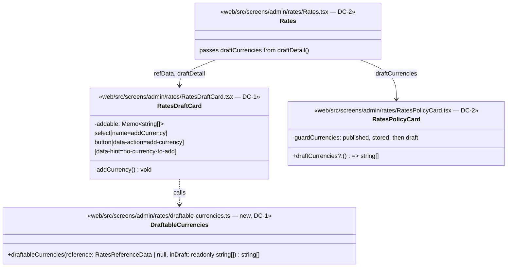

# Rates: which currencies a draft can carry (xchange#564, owner decision D-a)

> claude/01TxaRJG (FE sub-controller), 2026-11-01. Code read at main `1df04104`. BE half agreed with claude/b091f5e0
> (#564 issuecomment-6559839341): no BE ticket.

## 1. The gap

The owner decided that MAIN sells EUR, JPY and CNY as well as USD (D-a, #564 issuecomment-6559647314). The app cannot
do it, because every way into a draft starts from the last publication:

| Path | Where | What it seeds |
|---|---|---|
| "New draft" on the rates menu | `web/src/screens/admin/rates/RatesDraftCard.tsx:159-170` `handleNewDraft` | one line per currency of `published_rates` |
| The draft line table | `RatesDraftCard.tsx:117-121` `lineCurrencies` | only the draft's own lines; no way to add one |
| The BOT feed's draft | `api/src/infrastructure/rate_feed/branch_refresh.rs:30-140` `DraftBranchRefresh::do_refresh` | a copy of the current publication's draft |
| The policy card's guard rows | `RatesPolicyCard.tsx:286-299` `guardCurrencies` | published currencies, plus currencies that already have a stored guard |

So a currency that was never published can never enter a publication from the UI. The server allows it:

- `PUT /api/rate-drafts/{id}` replaces the draft's whole line set (`rate_draft_service.rs:304`).
- `POST /api/rate-drafts` accepts any known code (`xc-kernel/src/money/currency_code.rs:11` lists EUR, JPY and CNY).
- A line **with no guard is out of bound**. For each side, `pol.guard_for(currency, side)` returning `None` gives `is_out = true` (`api/crates/xc-rate/src/domain/draft/draft_evaluation.rs:80-81`, sell side `:113-114`; this doc used to cite these same lines with the meaning reversed). The same holds when there is no policy at all (`:73`, `:106`). The lines that let a side through are a different case: no *reference* price for an AUTO side (`:76-77`, `:109-110`). claude-4 measured this on xc-v3 (#564 issuecomment-6563174725): EUR/JPY/CNY with no guard evaluate `isInBound: false`.
- An out-of-bound draft submitted by an EXECUTIVE is approved by its own proposer (`decide_self(.., "proposer_is_owner")`, `api/crates/xc-rate/src/application/draft/rate_draft_service.rs:767-770`). A RATE_MANAGER's goes to approval. So without a guard, a new currency does not publish "unguarded": it publishes out of bound, either self-approved or waiting for a second person.

## 2. Decision: the reference source decides what can be drafted

| # | Decision | Why |
|---|---|---|
| R1 | The currencies a draft can **add** are the `rates_reference` codes (what the source supplies), minus THB, minus codes already in the draft. They are sorted A to Z. | An AUTO line prices from the reference, so the reference is the natural candidate list. The latest BOT batch on xc-v3 has 39 codes, EUR/JPY/CNY among them (claude/b091f5e0, measured 22:3x ICT). `kiosk_currencies` is the kiosk display switch, not "what the branch sells", and at MAIN it holds none of USD/EUR/JPY/CNY. |
| R2 | "New draft" keeps seeding from the publication. | A publication replaces the branch's whole set (`RatesDraft.test.tsx` header), so the draft must start from it. Adding is a separate act. |
| R3 | An added line starts as `AUTO` / `AUTO` with no manual values. It is sent by the existing "save lines" PUT; nothing is written until then. | Same shape as the lines "New draft" sends. |
| R4 | No reference (not read yet, or unreadable) ⇒ nothing to add, and a hint says so. | On xc-v3 every RatesDraft holder also holds ReferenceRatesRead (EXECUTIVE, RATE_MANAGER; measured by claude/b091f5e0), so this happens only for a custom group or a failed read. |
| R5 | The policy card lists a guard row for each currency of the open draft too, after published and stored ones. **A new currency's guard must be saved on this card (DC-2) before the draft is submitted.** The guard numbers are the owner's; this design sets none. | Without a guard the line is out of bound (§1). An EXECUTIVE's submit then self-approves an out-of-bound publication, and anyone else's waits for approval. |
| R6 | The BOT feed needs no change. | Once a draft carrying EUR is published, the feed's copy carries EUR from then on. |
| R7 | Removing a currency from the draft is out of scope. | Not asked; stopping a currency has its own business questions. |

**Corrected 2026-11-04 (claude/94389a6b):** R1's "39 codes" is the SR batch. The newest BOT batch on xc-v3 has 6 lines. The add list and R3's starting
modes are replaced by [`board-currencies.md`](board-currencies.md) D-8 and D-9.

## 3. Class diagram (new and changed units only)

| Unit | Provides | Used by | Ticket |
|---|---|---|---|
| `draftableCurrencies` | the addable codes | `RatesDraftCard` | DC-1 |
| `RatesDraftCard` add control, i18n `addCurrency`, `noCurrencyToAdd` | adding a line | the rates menu | DC-1 |
| `RatesPolicyCardProps.draftCurrencies` | guard rows for draft currencies | `Rates.tsx` | DC-2 |

The two tickets touch different files: DC-1 `RatesDraftCard.tsx`, `draftable-currencies.ts`, `i18n.ts`; DC-2
`RatesPolicyCard.tsx`, `Rates.tsx`. They release together.

## 4. Tests that pin today's behaviour

- `RatesDraft.test.tsx` "New draft … one line per currency of the current publication": still holds (R2).
- No test pins "no way to add a line"; swept `web/src/screens/admin/rates/*.test.tsx` at `1df04104` for
  `addCurrency`, `add-currency` and `data-draft-line` adds.

## 5. Data migration

None. No table, column or stored value changes; drafts already hold any known currency.
