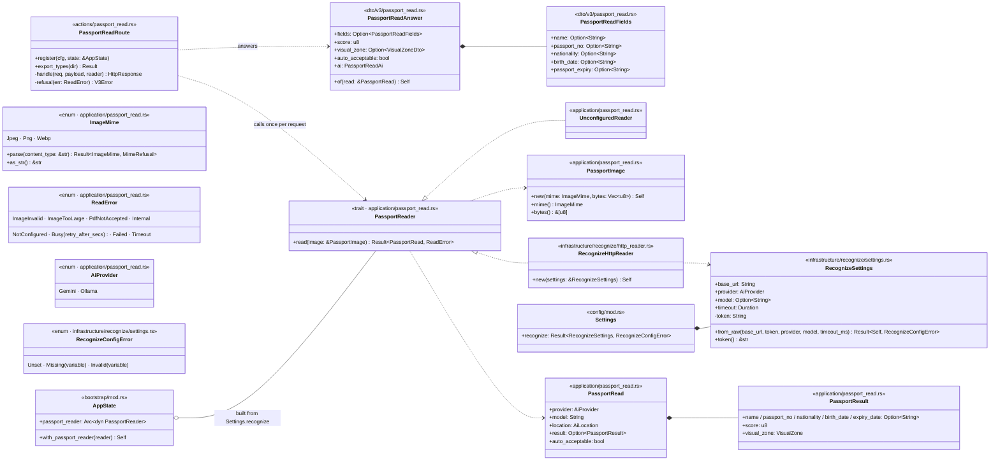

# xchange forwards the desk's passport image to Recognize

> Designed by `claude/xchange-desk`, 2026-10-17, for #542 (the desk's passport OCR, then the `/desk` switch to v3).
> Measured at xchange `origin/main` `f71cd030`, and at Recognize-Platform `origin/main` `e856a37b`.
>
> 🔴 The ticket that builds this cites types, functions and files from this document. If a shape here cannot work,
> comment on the ticket and stop. Do not change the shape yourself.

## 1. Why

The v3 desk (#542, `PassportOcr`) must read a passport photo without loading an OCR engine in the browser.
D-9 of `xchange-v3-wave3-desk.md` (`:54`) decides how. The desk sends the image to **the v3 server**. The v3 server is
**the only caller** of the Recognize service, and the Recognize token never reaches the browser.

No piece of that path exists today. Each gap was measured at `f71cd030`:

| Gap | Evidence |
|---|---|
| xchange calls Recognize nowhere | `git grep -n -i -E "recogni[sz]e\|/v1/read" f71cd030 -- api web/src` finds no route, client or setting. `blueprint/verification.md` §7 (`:360-390`) records the same, and leaves "wiring the desk to Recognize" out of that design's tickets (`:389-390`) |
| No v3 seam takes an image body | the compute seam reads at most 16,384 bytes of JSON (`api/src/presentation/http/v3/action.rs:107`). The command seam reads at most 65,536 bytes and stores the answer in `idempotency_records` (`command.rs:275`, `:449-560`), and the passport values must not be stored |
| The desk's call has no server side | `xchange-v3-wave3-desk.md:686` names "the v3 server's endpoint from #557 (R-2)". #557 closed without one: its V15 keeps the desk unchanged (`blueprint/verification.md:100`) |

This document designs that endpoint, plus the client behind it that calls Recognize.

## 2. Decided

| # | Rule | Source |
|---|---|---|
| R-1 | **The server chooses the AI, and the browser cannot.** One server setting names the provider. It is `gemini` by default. `ollama` (the local AI) is a value the setting already accepts, so a later switch is configuration only, with no code change. **Local OCR is not in this milestone**: it is Recognize-Platform#178 (milestone M2). xchange designs nothing local-specific and sends the configured name as it is | Owner 2026-10-17: *"การ ocr ให้ มีรับ ค่าว่าจะใช้ Gemini หรือ local ai"* · *"ช่วงแรกให้ ใช้ cloude ai ไปก่อน"* · *"เราจะยังไม่ทำ OCR local ในตอนนี้ ให้ เป็น milestone ถัดไป"* |
| R-2 | **One desk read makes one Recognize call**, to the configured provider. There is no retry, no fallback to another provider and no attempt count. A failure goes back to the desk as a mapped error (§4.4) | Owner 2026-10-17: *"การลอง 3 ครั้ง มัน ของ heros"*. The rule "after three failed reads, send to Gemini" is 108heros', not xchange's |
| R-3 | Recognize never switches provider by itself (its D1). Together with R-2, the provider that reads an image is always exactly the configured one. With `gemini` configured, the passport image is sent to Google's cloud. The owner chose that for this phase (R-1, *"cloude ai ไปก่อน"*) | `ai-reader.md` D1 (`:47`) |
| R-4 | **The browser never calls Recognize.** The token and the base URL live only on the server | D-9 (`xchange-v3-wave3-desk.md:54`); `ai-reader.md` §7 (`:326-335`) |
| R-5 | **This endpoint stores nothing.** The image is held in memory for the length of one request. No file, row, idempotency record or log line holds the image bytes or a value read from them. The desk's own PASSPORT scan is still kept by `/api/upload` when the exchange is saved. That is unchanged (V15, `blueprint/verification.md:100`), and it is not this endpoint's job | `ai-reader.md` D4 (`:50`); Blueprint §16 (identity documents are never logged or exported, `deploy/HOST-do-sgp1.md` R-1 row) |
| R-6 | **No PDF.** Recognize accepts only `image/jpeg`, `image/png` and `image/webp` (its D5). The desk renders the chosen PDF page to an image, and applies the rotation, **in the browser** before sending. That is what `readPassport`'s `page` and `angle` mean (`xchange-v3-wave3-desk.md:686`) | `ai-reader.md` D5 (`:51`) |
| R-7 | **No new role, permission or policy row** (W8: nothing under `api/crates/xc-auth/**`). The route reuses the row the desk's quote and transaction commands already use, `(EntryPath::Rpc, "saveTransaction")` (`commands/quotes.rs:70`). Its need is `Permission::ExchangeTransact` (`policy.rs:558-559`), which the teller holds (`role_permissions.rs:86`). Any signed-in user who can save an exchange at the desk can read a passport there, and no other user can. **Measured:** the owner signs in as Executive + Admin (`xc-auth/src/domain/access/v3_roles.rs:13`), and neither role holds `ExchangeTransact`. So the owner is refused here with `400 roleNotAllowedHere`, exactly as `/api/quotes` refuses the owner today (§10 item 5) | W8; desk design §6 |
| R-8 | Recognize's contract is `ai-reader.md` §4 (`POST /v1/read`, `:69-117`) and §6 (the passport `result`, `:279-322`). This round adds the A12 decisions from Recognize-Platform#176: `501 DOCUMENT_NOT_SUPPORTED`, no `504 AI_TIMEOUT` yet, and an error body of `{"error": "<CODE>", "detail"?}` | Recognize-Platform#176 "Decided / open" |

## 3. Class diagram



### 3.1 Files

Every path is under `api/src/` unless it says otherwise. One ticket writes all of them (§7), so no two tickets share a file.

| Class or item | File | New or changed |
|---|---|---|
| `PassportReader`, `UnconfiguredReader`, `PassportImage`, `ImageMime`, `MimeRefusal`, `PassportRead`, `PassportResult`, `VisualZone`, `AiProvider`, `AiLocation`, `ReadError` | `application/passport_read.rs` | new, plus one `pub mod passport_read;` line in `application/mod.rs` |
| `RecognizeHttpReader` | `infrastructure/recognize/http_reader.rs` | new |
| `RecognizeSettings`, `RecognizeConfigError` | `infrastructure/recognize/settings.rs` | new |
| the module | `infrastructure/recognize/mod.rs` | new, plus one `pub mod recognize;` line in `infrastructure/mod.rs` |
| `Settings.recognize` | `config/mod.rs` | adds one field and one `from_raw` call, the same shape as `loyalty` (`:177`, `:243-249`) |
| `AppState.passport_reader`, `with_passport_reader` | `bootstrap/mod.rs` | adds one field, its default in `AppState::new` and one builder, the same shape as `loyalty_summary` (`:86`, `:164`, `:198-201`) |
| `PassportReadRoute` (`register`, `export_types`) | `presentation/http/v3/actions/passport_read.rs` | new. `build.rs` adds it to `ACTIONS` because the file is in `actions/` (`build.rs:205-245`). `v3/mod.rs` needs no edit |
| `PassportReadAnswer`, `PassportReadFields`, `VisualZoneDto`, `PassportReadAi` | `presentation/dto/v3/passport_read.rs` | new. `build.rs` adds the module (`:137-165`) |
| the generated TypeScript | `web/src/shared/api/generated/passport_read.ts` | new, written by `XC_UPDATE_GENERATED=1 cargo test --test v3_types_test` |
| `base64` | `api/Cargo.toml` (`base64 = "0.22"`, already in `Cargo.lock` through `xc-kernel`) and `api/Cargo.lock` | one line in each |

### 3.2 Who provides, who uses

| Provider | User | What |
|---|---|---|
| `PassportReader` (trait) | `PassportReadRoute` | one `read` per request |
| `RecognizeHttpReader` | `AppState::new` | when `Settings.recognize` is `Ok` |
| `UnconfiguredReader` | `AppState::new` | when `Settings.recognize` is `Err`: every read answers `ReadError::NotConfigured` |
| a fake `PassportReader` | the tests | `AppState::with_passport_reader`. No test reaches the network |
| `PassportReadAnswer` (TS) | #542 `web/src/screens/desk/ocr/recognize.ts` | `readPassport` parses this answer |

**♻️ (one core, one trait).** The route depends only on `dyn PassportReader`. Recognize is the one real reader, and the
choice between `gemini` and `ollama` is a value it is given (`AiProvider`). It is not a second implementation, so adding a
provider Recognize supports changes `AiProvider` and `RecognizeSettings::from_raw` and nothing else. A second document type
(for example the Thai ID card) is not planned for xchange. Until it is, the trait stays passport-shaped rather than
generic (the rule's "never abstract a single case").

## 4. The endpoint

### 4.1 Route and access [required]

`POST /api/v3/compute/passport_read`. It is a compute action: it reads, computes and writes nothing. It does **not** go through
`ComputeEndpoint`, because that seam reads at most 16 KB of JSON (`action.rs:107`). It registers its own handler
from the `actions/` file and keeps the seam's order and headers:

1. **Who is calling.** `pages::get_callers(&req)`, then `Policy::authorize(callers.user.as_ref(), EntryPath::Rpc,
   &Action::new("saveTransaction"), named, now)`. `named` is the `?branch=` query parameter when present and not empty,
   read the same way `/api/upload` reads it (`files.rs:179-181`). A refusal is `V3Error::from(PolicyError)`, which gives
   `signIn` 401 when nobody is signed in, and `roleNotAllowedHere` 400 for a role without the permission. **Both desks
   use this one route.** `callers.user` carries the owner on `/desk` and the staff member on `/staff/desk`
   (`pages.rs:45-61`), as it does for `/api/quotes`, and the same row decides for both.
2. **Same origin.** `same_origin(&req)` (`extractors/origin.rs:33`), else `400 originRejected`.
3. **Image type.** The `Content-Type` header, compared on its type and subtype only (lower-cased, before any `;`):
   `image/jpeg`, `image/png` or `image/webp` are accepted. `application/pdf` is refused with `415 pdfNotAccepted`.
   Anything else, or no header, is refused with `415 imageTypeNotAccepted`.
4. **Configured?** If the reader is `UnconfiguredReader`, the answer is `503 passportReaderNotConfigured` **before the
   body is read**. [proposed] `PassportReader` has `fn configured(&self) -> bool { true }`, and only
   `UnconfiguredReader` overrides it.
5. **Body.** `payload.to_bytes_limited(MAX_IMAGE_BYTES)`. More than the limit gives `413 imageTooLarge`. An empty
   body gives `400 imageInvalid`.
6. **Read.** One call to `reader.read(&PassportImage::new(mime, bytes))`. `Ok` gives `200` with `PassportReadAnswer`. `Err`
   is mapped by §4.4.

Every answer, refusal or not, carries `Cache-Control: no-store`. `V3Error::error_response` already sets it
(`error.rs:73-75`).

Steps 1–3 depend only on the headers, so a refusal at any of them comes without reading the body. That is the same rule
`/api/upload` keeps (`tests/upload_body_test.rs`, ticket #124).

### 4.2 Request [required]

The body is **the image bytes themselves**, with `Content-Type` set to the image's type. It is not JSON with base64 and not multipart.
- **Why raw bytes.** The desk already holds a `Blob`, and `fetch(url, { method: 'POST', body: blob, headers })` sends
  it as is. Base64 in the browser would add a third to the size and an extra copy, and the server would have to decode it
  only to encode it again for Recognize. Multipart needs a parser the crate does not have (`actix-multipart` is not in
  `api/Cargo.toml`), and it would read a body part before it knows the type. `/api/upload` already takes raw image bytes
  with the type in `Content-Type` (`files.rs:104-110`), so the desk calls both routes the same way.
- Headers the desk sends: `Content-Type`, `X-Xchange-Request: 1`, and its own `Origin` (the browser adds it).
- `MAX_IMAGE_BYTES = 8 * 1024 * 1024` (8,388,608). [required] **Why 8 MiB.** Recognize refuses a request body over 12 MiB,
  counted after base64 (`ai-reader.md:71`, A12 H14: 12,582,912 bytes). An 8 MiB image is 11,184,812 bytes of base64. With
  the JSON around it, the body is still under 12 MiB, so a request xchange forwards never meets Recognize's `413`. A phone
  photo of a passport page is far smaller than this.

### 4.3 Answer 200 [required]

The field names are the desk's `PassportFields` names (`web/src/screens/desk/desk-store.ts:26-32`). The desk can then
fill each field by name, using `PassportOcr`'s snapshot rule.

```json
{
  "fields": {
    "name": "ANNA MARIA ERIKSSON",
    "passportNo": "L898902C3",
    "nationality": "UTO",
    "birthDate": "1974-08-12",
    "passportExpiry": "2012-04-15"
  },
  "score": 5,
  "visualZone": "same",
  "autoAcceptable": true,
  "ai": { "provider": "gemini", "model": "gemini-3.1-flash-lite", "location": "cloud" }
}
```

| xchange field | From Recognize (`ai-reader.md` §4, §6) |
|---|---|
| `fields` | `result`, or `null` when `result` is `null`. A `null` result is **not** an error: Recognize read the image, but its checks refused what it read (§4 `:100`) |
| `fields.name` · `passportNo` · `nationality` · `birthDate` · `passportExpiry` | `result.name` · `passport_no` · `nationality` · `birth_date` · `expiry_date`. Each is a `string` or `null`, never `""` |
| `score` | `result.score`, or `0` when `result` is `null` |
| `visualZone` | `result.visual_zone` (`same` · `differs` · `unchecked`), or `null` when `result` is `null` |
| `autoAcceptable` | `auto_acceptable` |
| `ai.provider` · `ai.model` · `ai.location` | `ai.provider` · `ai.model` · `ai.location`, as Recognize echoed them. The desk can show where the image was read (cloud or local) |

Not forwarded: `usage` and `cost_baht`. The desk has no use for them, and the server logs the token counts (§5).
Dates stay `YYYY-MM-DD`, which is what the desk's `<input type="date">` holds (`steps/customer/step.tsx:224`).
`nationality` is the MRZ's three-letter code as read. A code that is not in the desk's list (`steps/customer/nationalities.ts`)
is #542's to handle. The server passes it through unchanged.

### 4.4 Errors [required]

The body has the v3 refusal shape: `{"error": {"code", "field"?, "message"}}` (`error.rs:55-70`). For 5xx statuses,
`V3Error` replaces the message with `เซิร์ฟเวอร์ขัดข้อง` (`error.rs:49-54`), so the desk words its message **by `code`**.

**Refused by xchange before any call to Recognize:**

| When | Status | `code` |
|---|---|---|
| nobody signed in / no `ExchangeTransact` | 401 / 400 (from `PolicyError`) | `signIn` / `roleNotAllowedHere` |
| not the same origin | 400 | `originRejected` |
| `Content-Type` is `application/pdf` | 415 | `pdfNotAccepted` |
| `Content-Type` is any other non-image type, or missing | 415 | `imageTypeNotAccepted` |
| the reader is not configured (§6) | 503 | `passportReaderNotConfigured` |
| body over 8 MiB | 413 | `imageTooLarge` |
| empty body | 400 | `imageInvalid` (field `image`) |

**Recognize's answer → `ReadError` → the desk.** The `RecognizeHttpReader` does the first mapping and the route does the second:

| Recognize answered | `ReadError` | Status | `code` |
|---|---|---|---|
| 200, `result` set or `null` | (Ok) | 200 | — |
| 400 `IMAGE_INVALID` | `ImageInvalid` | 400 | `imageInvalid` (field `image`) |
| 413 (any code) | `ImageTooLarge` | 413 | `imageTooLarge` |
| 415 (any code) | `PdfNotAccepted` | 415 | `pdfNotAccepted` |
| 401 `UNAUTHORIZED` (xchange's token is wrong) | `NotConfigured` | 503 | `passportReaderNotConfigured` |
| 400 `AI_UNKNOWN` or `AI_MODEL_NOT_ALLOWED` (our provider or model setting is one Recognize does not take) | `NotConfigured` | 503 | `passportReaderNotConfigured` |
| 503 `AI_NOT_CONFIGURED` (Recognize has no key for the provider) | `NotConfigured` | 503 | `passportReaderNotConfigured` |
| 501 `DOCUMENT_NOT_SUPPORTED` (Recognize has no passport reader deployed) | `NotConfigured` | 503 | `passportReaderNotConfigured` |
| 429 `AI_BUSY` | `Busy { retry_after_secs }`: the `Retry-After` header when it is a whole number 1–60, else 5 | 429, with `Retry-After: <n>` | `passportReaderBusy` |
| 504 (any code; `AI_TIMEOUT` when Recognize adds it) | `Timeout` | 504 | `passportReaderTimeout` |
| no answer within `XC_RECOGNIZE_TIMEOUT_MS` | `Timeout` | 504 | `passportReaderTimeout` |
| 502 `AI_FAILED`, any other 5xx (including a 503 that is not `AI_NOT_CONFIGURED`, such as a proxy whose upstream is down) | `Failed` | 502 | `passportReaderFailed` |
| connection refused, DNS or TLS failure | `Failed` | 502 | `passportReaderFailed` |
| 200 whose body is not the §4 shape | `Failed` | 502 | `passportReaderFailed` |
| 400 `AI_REQUIRED` or `DOCUMENT_UNKNOWN`, or any other 4xx (xchange sent a request it should never send) | `Internal` | 500 | `serverError` |

- **Nothing is retried** (R-2). Each request makes one call, and the desk's user decides whether to press read again.
  The `Retry-After` on `429` is a hint the desk may show. The server does not wait for it.
- **`detail` from Recognize is neither forwarded nor logged.** It is provider text that xchange does not control (R-5).
- A desk that cancels (its `หยุดอ่าน` button aborts the `fetch`) drops the connection. Actix then drops the handler's
  future, and with it the in-flight `reqwest` call. Nothing more is sent to Recognize.

## 5. What is logged

One `tracing::info!` per read: `provider`, `model`, `location`, `outcome` (`ok` or the `code`), `auto_acceptable`, `score`,
`elapsed_ms`, and `input_tokens`/`output_tokens` when Recognize sent them. **Never** the image or its base64. Never a
field value, nor anything derived from one such as a hash or a length per field. Never `detail`, and never the token.
A `NotConfigured` caused by Recognize's 401 or 400 also logs one `error` line naming the Recognize code, so the operator
sees the setting is wrong.

`PassportImage`, `PassportRead`, `PassportResult` and `RecognizeSettings` implement `Debug` by hand.
- `PassportImage` prints the mime type and the byte count.
- `PassportRead` prints the provider, model, location, score and `auto_acceptable`, with no field value.
- `RecognizeSettings` prints neither the token nor the URL's userinfo.

## 6. Configuration

Read in `Settings::load_from` from the environment, the same way as `XC_BROKER_*` and `XC_LOYALTY_*` (`config/mod.rs:228-249`):

| Variable | Meaning | Unset or blank | Malformed |
|---|---|---|---|
| `XC_RECOGNIZE_BASE_URL` | Recognize's base URL. The client posts to `<base>/v1/read`, with one trailing `/` removed from the base | with the token also unset: `Unset` | not starting with `http://` or `https://`: `Invalid` |
| `XC_RECOGNIZE_TOKEN` | the bearer token Recognize issued to `xchange` (`ai-reader.md` §7) | with the URL also unset: `Unset`. One of the two set without the other: `Missing(<the unset one>)` | — |
| `XC_RECOGNIZE_PROVIDER` | `gemini`, or `ollama` once local OCR exists (R-1; Recognize-Platform#178, M2). The value is sent to Recognize as `ai.provider` unchanged | `gemini` | anything else, including `claude` and `Gemini`: `Invalid` |
| `XC_RECOGNIZE_MODEL` | sent as `ai.model`. It must be on Recognize's `RECOG_AI_MODELS` list (`ai-reader.md` D2) | not sent: Recognize uses the provider's default model | — |
| `XC_RECOGNIZE_TIMEOUT_MS` | how long xchange waits for Recognize's answer, per read | `60000` | not a whole number 1–600000: `Invalid` |

**A missing or wrong setting never stops the server from starting** (the desk still works without OCR; people type the
fields). `Settings.recognize` is `Err(RecognizeConfigError)`, and then:
- `AppState::new` installs `UnconfiguredReader`, so every read answers `503 passportReaderNotConfigured`;
- `AppState::new` writes one `tracing::warn!` with the error's `Display`, which names the variable, never its value.
  `Unset` is logged at `info`, because it is the normal state of a server without OCR.

**Switching provider** means setting `XC_RECOGNIZE_PROVIDER` (and `XC_RECOGNIZE_MODEL` if wanted), then restarting. No code
changes. `ollama` only becomes useful when Recognize-Platform#178 (M2) ships local OCR. Until then Recognize answers
`AI_NOT_CONFIGURED` for it, and xchange answers `503`.

The token is a secret. It goes only into the host's environment file, as Identity's settings do (`deploy/HOST-do-sgp1.md`). The owner sets
it. It is never committed and never written into a ticket.

## 7. Tickets

| Ticket | What | Files | Waits for |
|---|---|---|---|
| **RR-1** (server) | everything in §3.1 | §3.1, plus the two test files in §8 | this document merged. Recognize's A12 (Recognize-Platform#176) does **not** block it, because every test uses a fake reader or a fake Recognize server. A real read needs A12 deployed and the owner's settings |
| **#542** (web) | `web/src/screens/desk/ocr/recognize.ts`: `readPassport(bytes, mime, { page, angle, signal, onProgress })` renders the PDF page, rotates, posts the image to §4.1, and maps §4.3 and §4.4 to `PassportOcr` | already in #542's scope (`web/src/screens/desk/ocr/**`) | RR-1 merged |

They share no file. `#542` imports only the generated `passport_read.ts`, which RR-1 writes.
`onProgress` has no server-side events to report: the call is a single request. `recognize.ts` reports its own steps
(rendering, sending, waiting), which is #542's design.

## 8. Behaviour table (RR-1's up-front tests)

Route tests use a fake `PassportReader` and a fake `SessionReader`, and AppState runs on a lazy pool that never connects.
**No database and no network.** File: `api/tests/passport_read_route_test.rs`.

| # | Case | Required result |
|---|---|---|
| P1 | teller, `image/jpeg`, the reader returns a full read | 200. Body exactly `{fields{name,passportNo,nationality,birthDate,passportExpiry}, score, visualZone, autoAcceptable, ai{provider,model,location}}`, with values mapped as in §4.3. `Cache-Control: no-store`. The reader got the exact bytes and `ImageMime::Jpeg` |
| P2 | `result` is `None` | 200: `fields: null`, `score: 0`, `visualZone: null`, `autoAcceptable: false` |
| P3 | a partial result (score 4, no passport number, `differs`) | 200: `passportNo: null`, the others set, `visualZone: "differs"`, `autoAcceptable` as given |
| P4 | nobody signed in | 401 `signIn`; the reader is never called |
| P5 | a staff role without `ExchangeTransact` (`Rates`) | 400 `roleNotAllowedHere`; the reader is never called |
| P6 | the owner on `/desk` (`?branch=MAIN`) | 400 `roleNotAllowedHere`, the same refusal `/api/quotes` gives the owner; the reader is never called |
| P7 | no `X-Xchange-Request`, or a foreign `Origin` | 400 `originRejected`; the reader is never called |
| P8 | `application/pdf` | 415 `pdfNotAccepted`. `image/gif`, `text/plain` or no `Content-Type` give 415 `imageTypeNotAccepted`. `image/PNG; charset=x` is accepted as PNG |
| P9 | body of 8 MiB + 1 byte | 413 `imageTooLarge`, and the reader is never called. Exactly 8 MiB gives 200 |
| P10 | empty body | 400 `imageInvalid`; the reader is never called |
| P11 | every `ReadError` | the status and code of §4.4. `Busy(7)` also gives `Retry-After: 7` |
| P12 | one request where the reader fails | the reader is called **exactly once** (R-2) |
| P13 | `AppState::new` with no `XC_RECOGNIZE_*`, or with `XC_RECOGNIZE_PROVIDER=claude` | 503 `passportReaderNotConfigured` |

Client and settings tests use a fake Recognize: an actix `HttpServer` on `127.0.0.1:0`, the pattern of
`tests/upload_body_test.rs`. File: `api/tests/recognize_reader_test.rs`.

| # | Case | Required result |
|---|---|---|
| C1 | the request | `POST /v1/read`, `Authorization: Bearer <token>`, JSON `{document:"passport", ai:{provider:"gemini"}, image:{mime:"image/jpeg", data:<standard base64 of the bytes>}}`. There is no `model` key when the model is unset. A configured provider and model are sent as they are (`ai:{provider:"ollama", model:"<m>"}`). A base URL with a trailing `/` still posts to `/v1/read` |
| C2 | 200 with a full result | `PassportRead` holds every field, `location` cloud or local as sent |
| C3 | 200 with `result: null` | `result: None`, `auto_acceptable: false` |
| C4 | every row of §4.4's second table | the `ReadError` in that row |
| C5 | 429 with and without `Retry-After` | `Busy(7)` / `Busy(5)` |
| C6 | 200 whose body is not JSON | `Failed` |
| C7 | nothing listening on the port | `Failed` |
| C8 | Recognize answers after the timeout | `Timeout` |
| C9 | one read where Recognize answers 502 | the fake server saw exactly one request |
| S1 | `from_raw` | the §6 table, row by row. `Display` of an error names the variable and never contains the value |
| S2 | `Debug` of `RecognizeSettings`, `PassportImage` and `PassportRead` | contains neither the token nor the image bytes nor any field value |
| S3 | `Settings::load_from` with the five variables | `settings.recognize` is `Ok` with those values. Without them it is `Err(Unset)`. With a wrong value it is `Err(Invalid)`, and the settings still load |
| W1 | `AppState::new` with a usable `Settings.recognize` / without | the reader reaches the fake Recognize / answers `NotConfigured`, and `configured()` says which |

**Not tested, on purpose:** the log lines of §5. The crate has no log-capture harness, and no test file sets a
`tracing` subscriber (`git grep -l tracing_subscriber f71cd030 -- api/tests` finds nothing). The reviewer reads every
`tracing::` call in the ticket's files instead.

## 9. Data migration

None. No table, column, constraint or stored value is added or changed, and the endpoint stores nothing (R-5). No row
exists before or after that this endpoint touches, so there is nothing to backfill, no deploy order, and `down` loses
nothing. The only deploy step is the configuration in §6. It is optional: without it the server starts and the endpoint
answers `503`.

## 10. Open for the owner (listed, not decided)

1. **Is `claude` a provider xchange may choose?** Recognize offers `gemini`, `claude` and `ollama` (`ai-reader.md` R2). The
   owner's words name Gemini and local AI only, so §6 accepts only `gemini` and `ollama`. Adding `claude` later is one
   enum value and one row of `from_raw`.
2. **Which Gemini model.** With `XC_RECOGNIZE_MODEL` unset, Recognize uses its default, `gemini-3.1-flash-lite`
   (`ai-reader.md` D2). Nobody has measured the AI readers on passports yet (`ai-reader.md` §10 Q2, A7's measurement).
   The model may need to change after that measurement, and that is a configuration change only.
3. **The production values** of `XC_RECOGNIZE_BASE_URL` and `XC_RECOGNIZE_TOKEN`. They come from Recognize's deployment on Dell,
   which is the owner's (Recognize-Platform `ai-reader.md` §9, last row).
4. **`visualZone: "differs"`.** The desk design does not yet say what the desk shows when the printed page and the MRZ
   disagree (`ai-reader.md` D8: possibly a different person). The server forwards it as is. The desk's wording belongs to
   #542, and the desk's design must decide it before #542 is dispatched.
5. **May the owner read a passport on `/desk`?** Today the owner cannot save an exchange on the v3 desk at all:
   Executive and Admin lack `ExchangeTransact`, so `/api/quotes` refuses the owner too. This endpoint follows the same row
   (R-7) and refuses the owner. Letting the owner in would be a role-permission change in `xc-auth`, which W8 forbids
   here, and it would apply to the whole desk, not to OCR alone.
