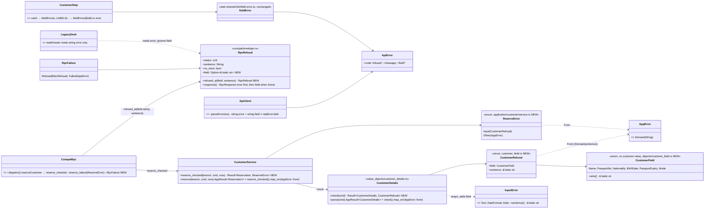

# Design: an RPC refusal names the field at fault (customer create first)

> designed-by: claude/bc8fd29a (draft for the xchange BE lane controller), 2026-10-27 22:56 ICT, read-only at `origin/main` `8fc3507bd`.
> Gap **G2** on #5055 (V.9 site requirements for v3): customer-create refusals are shown at form level only, and the field at fault is never marked.
> **Where this goes:** a new doc, `docs/design/rpc-refusal-field.md`, with a one-line pointer added under `web-input-validation.md` §1 RC-3.
> It is not a § of `web-worded-error.md`, because WE1–WE5 do not change: `wordedError`, `errorText` and `form.ts` stay as they are (`web-input-validation.md:38`).
> RC-3 is the exact root family ("hand-written server refusals … `field: None` … the web cannot put them at a field even with RC-1 fixed", `web-input-validation.md:17`).
> This doc is RC-3 for the compat RPC.

## 0. What was measured

| Fact | Where |
|---|---|
| The desk creates a customer with the compat RPC `reserveCustomer`, on `/api/rpc` (owner) or `/api/staff/rpc` (staff) | `web/src/screens/desk/desk-path.ts:36,47`; `web/src/screens/desk/steps/customer/step.tsx:123-136` |
| The dispatcher turns every `AppError::Domain(sentence)` into a bare sentence. Nothing about a field survives | `api/src/application/compat/rpc.rs:130-137`; `reserveCustomer` arm `:281-291` |
| An RPC refusal is `{status, sentence, no_store}` and prints exactly `{"error":"<sentence>"}` | `api/src/application/compat/envelope.rs:240-257`, `:312-323`; route `api/src/presentation/http/rpc.rs:119,127-134` |
| The web reads a string `error` as `ApiError{code:'refused', message}` and drops every other key | `web/src/shared/api/client.ts:73-78` (an object `error` keeps `field`, `:80-87`) |
| The step shows the refusal once, at form level | `step.tsx:144-147` → `:298-302` |
| The step already has per-field slots, keyed by `PassportFields`, for its own checks. Typing in a field clears its slot. `nationality` (a `<select>`) has no slot | `step.tsx:75`, `:83-90`, `:168-178`, slots `:235-285`, select `:256-262`; keys `web/src/screens/desk/desk-store.ts:28-34` |
| The server knows the field at the moment it refuses, then loses it. Each `parse_text` / `parse_date` call is for one named payload key | `api/crates/xc-customer/src/domain/customer/value_objects/customer_details.rs:28-42` |
| The kernel input helpers return `InputError`, and that error becomes `AppError::Domain(sentence)` | `api/crates/xc-kernel/src/input/input_error.rs:5-12,28-32`; `text.rs:6-18`; `date.rs:14-41` |
| A second field-able refusal comes after parsing: the passport number normalises to empty, or the nationality is not 3 letters | `api/crates/xc-customer/src/application/customer/service.rs:112-122`; `api/crates/xc-kernel/src/pii/normalize.rs:12-24` |
| `CustomerService::reserve` has exactly one production caller (`rpc.rs:281-286`). Its many test callers (e.g. `api/tests/customer_identity_test.rs:211-426`) depend on `AppResult` | `git grep -n '\.reserve(' origin/main -- api/src api/crates` |
| `CustomerDetails::parse` has a second caller, `saveTransaction`'s form | `api/crates/xc-exchange/src/domain/exchange/value_objects/transaction_form.rs:123` |
| `AppError` lives in another repo, pinned by git rev. A typed variant there would be a cross-repo change | `api/Cargo.toml:5` |
| v2's 9 recorded field-able `reserveCustomer` refusals (#68–#76) are held byte-for-byte to `{"error":…}` | `api/tests/fixtures/rpc/engine_actions.json:298-306`; `api/tests/rpc_common/mod.rs:644-658` (`assert_refused`), `:2006-2009` |
| The legacy wrapper of v2's desk page reads only a string `error`. `customerErrorText` and `saveOutcome` require it to be a string | `api/static/xc-desk.js:47-70`, `:72-88`, `:90-98`; served at `api/src/presentation/pages.rs:186` |
| Precedent for a sibling `field` next to a string `error`, on a non-v3 route | `api/src/presentation/http/kiosk.rs:834,844`; typed source `api/crates/xc-kiosk/src/domain/kiosk/entities/kiosk_settings.rs:24-28` |
| Precedent for keys v3 adds to a v2 answer by decision: the parity harness checks their shape, then leaves them out of the comparison | `api/tests/snapshot_common/mod.rs:270-287` (`V3_ADDED_KEYS`), applied at `rpc_common/mod.rs:2018` |
| A non-v3 route refuses "in its own file's existing shape" | `docs/design/blueprint/bounded-inputs.md:23` (B-3) |
| The web already has one field-aware reader. For a code with no shared key (`refused` has none) it keeps the server's sentence and sets `field` when the label exists | `web/src/shared/i18n/field-error.ts:11-34` (rule 5, `:31-33`); `errorText` `web/src/shared/i18n/index.ts:102-118`; no `error.refused` or `input.code.refused` key (`git grep -n "refused" origin/main -- web/src/shared/i18n/th.ts`: 0 hits) |

### 0.1 Is `validationFailed:<field>:` the established seam? No.

- **One reader only.** It is parsed in exactly one place, the v3 transaction commands' `refusal()` (`api/src/presentation/http/v3/commands/transactions.rs:147-171`).
- **A handful of writers.** It is written at 4 sites, all in the exchange workflows: `create.rs:249,297` and `quote.rs:508,660` (`git grep -n 'validationFailed:' origin/main -- api/src`). Every other `validationFailed:` string carries no field (`create.rs:227,271-281`, `quote.rs:47,183-294`).
- **The prefix leaks into what people see.** The parser passes the whole string `m`, prefix included, as the message (`transactions.rs:161,167`).
- **The RPC sentence cannot carry a prefix.** It is v2's byte-for-byte text, held by the parity fixture (`rpc_common/mod.rs:646-652`), and `api/static/xc-desk.js:94-95` shows it as it is. A prefix would change what v2's own desk page prints.

⇒ **The field is typed where it is created**: in `xc-customer`'s own error, at the call that knows which payload key it is checking. It is turned into the bare `AppError::Domain(sentence)` only for callers that do not want the field. This is the kernel's existing pattern: `InputError` → `From<InputError> for AppError` (`input_error.rs:28-32`).

## 1. Root cause

```
symptom   the field at fault is not marked              step.tsx:144-147 → setError (form level)
  ← the client never sees a field                       client.ts:73-78 (string error ⇒ no field)
  ← the RPC answer has no field                         envelope.rs:240-247, :312-323
  ← the dispatcher keeps only the sentence              rpc.rs:130-135
  ← the domain refusal is an untyped string             customer_details.rs:29-37, service.rs:117-122 → AppError::Domain(String)
  ROOT    the field name exists at customer_details.rs:29-33 and is dropped there
```

Fixing the screen alone (for example, mapping sentences back to fields in `step.tsx`) would be a symptom-site fix. Several fields share one sentence: `BAD_TEXT` covers name, passport number, nationality and an over-long date (`customer_details.rs:12`, `:61-63`).

## 2. Decisions

| # | Decision |
|---|---|
| RF-D1 | **Wire shape (both RPC routes): `{"error":"<v2 sentence>","field":"<key>"}`.** `error` stays first and keeps v2's exact sentence. `field` is added only when the refusal names one; every other refusal stays byte-identical `{"error":…}`. Status, `no-store` and content type are unchanged. Backwards compatible: `xc-desk.js` reads `parsed.error` as a string (`:55-56`) and ignores other keys, so `customerErrorText` (`:94-95`) and `saveOutcome` (`:82-85`) still return the sentence. An object-shaped `error` (`{code, field, message}`, v3's) was rejected because `customerErrorText` and `saveOutcome` would no longer see a string: the desk would show `CUSTOMER_UNREACHED` (`:6`, `:97`), and an RPC save would count as "unknown". |
| RF-D2 | **The field is typed at the source.** `CustomerField` is a closed enum in `xc-customer`. `CustomerRefusal { field: CustomerField, sentence: &'static str }` is what `CustomerDetails::check` returns. `CustomerDetails::parse` stays, defined as `check(..).map_err(AppError::from)`, so `saveTransaction` (`transaction_form.rs:123`) does not change. `InputError` and `AppError` do not change. |
| RF-D3 | **`CustomerService::reserve_checked` → `Result<Reservation, ReserveError>`**, with `ReserveError::{Input(CustomerRefusal), Other(AppError)}`. The normalise step (`service.rs:117-122`) gives `Input` too: `InvalidNationality` → `nationality`, `Empty` → `passportNo`. `reserve` keeps its signature and becomes `reserve_checked(..).await.map_err(AppError::from)`, so no existing test changes. `NO_SUCH_BRANCH` and `COUNTER_EXHAUSTED` stay `Other(AppError::Domain)`, with no field. |
| RF-D4 | **The RPC seam is generic, not customer-specific.** `RpcRefusal` gains `field: Option<&'static str>`, and `RpcRefusal::refused_at(field, sentence)` builds one. `response()` prints `field` after `error`. The `reserveCustomer` arm maps `ReserveError::Input` to `refused_at`. Any later action adopts the seam by returning its own typed refusal; nothing parses strings. |
| RF-D5 | **Field names are the payload keys, and so the web form's keys:** `name`, `passportNo`, `nationality`, `birthDate`, `passportExpiry`, `mode`. The server reads them at `rpc.rs:418-427`; the form keys are at `desk-store.ts:28-34` and the `name=` attributes at `step.tsx:234,244,258,265,274`. `mode` has no form input (the step always sends `LIVE`, `step.tsx:134`). It is still named, so the answer tells the truth, and the screen shows it at form level (RF-D7). |
| RF-D6 | **One field per refusal**: the first fault in `CustomerDetails`' existing order (`name`, `passportNo`, `nationality`, `birthDate`, `passportExpiry`, `mode`, then the 3-letter nationality check, `customer_details.rs:29-42`). v2 stops at the first fault too, and the recorded sentences depend on that order (#68 is a blank name with a 2-letter nationality and answers the name's sentence). |
| RF-D7 | **The web uses the existing `fieldError`** (`field-error.ts`) and adds no new key. `ApiClient.parseError` also reads a string `field` sibling of a string `error`. The customer step passes labels for its five keys. A refusal whose field is one of them goes to that field's slot; anything else (no field, `mode`, an unknown key, 5xx, network) goes to the form line as today. The field slot shows the server's sentence, which is W10 (4) unchanged: no `input.code.refused` key exists, so `fieldError` rule 5 keeps it. `nationality` gets a slot under its `<select>`. |
| RF-D8 | **The skip button is unchanged.** A refusal while skipping stays at form level with the `skipFailed` prefix (`step.tsx:199`). The skip fills fixed values (`WALK-IN`, `WALKIN`, `XXX`, `:196-198`) that the person did not type, so marking one of them would point at nothing they can fix. |
| RF-D9 | **The parity harness accepts the appended key by decision.** This mirrors `V3_ADDED_KEYS`. A new `V3_REFUSAL_FIELDS` list in `rpc_common/mod.rs` has one row: (both routes, `reserveCustomer`). On those rows the refusal is held to v2's status and sentence **and** to `field` being a string from RF-D5's list, the one the row's case expects. Every other refusal is still held byte-for-byte. Steps #68–#76 are tallied as decided differences, and the decision gets a row in `xchange-v3-known-differences.md`, which `api/tests/known_differences_listed_test.rs` guards (`known-differences.md:7`). |

**Owner decides:**

**Decided (owner, 2026-10-27 ~23:1x ICT, typed in claude/bc8fd29a's session):** *"Take the recommended default on every owner question in the three designs (RPC refusal field Q1-3, booking estimate OD-1 to OD-3, ledger adjustment OA-1 to OA-7)."* Every recommended default below is the decision.

1. **Accept the wire difference from v2?** 9 recorded refusals (#68–#76) gain a `field` key. *Recommended default: yes.* It is the same kind of difference as `V3_ADDED_KEYS` (`snapshot_common/mod.rs:270-287`). v2's pages ignore the key (`xc-desk.js:55`), and nothing a person sees in v2's desk changes.
2. **Scope now:** `reserveCustomer` only, or also the customer fields inside `saveTransaction` (`transaction_form.rs:123`, same `CustomerDetails`) and `adminCreateBranch`'s `name` (`rpc.rs:256-264`)? *Recommended default: `reserveCustomer` only.* The other two have no field slot on their screens today. The seam (RF-D4) lets each adopt it later in its own ticket.
3. **Wording under EN/ZH:** the field slot shows v2's Thai sentence in every language, as the form line does today (W10 (4)). Should RPC refusals get per-field i18n keys later? *Recommended default: no change now.* The doc only moves where the sentence is shown.

## 3. Class diagram



## 4. Behaviour table (one test per row)

Rows R1–R18 are BE; R19–R21 are the legacy caller; R22–R33 are FE. "#n" is the `engine_actions.json` step.

| # | Given | Then | Test (file :: name) | Ticket |
|---|---|---|---|---|
| R1 | `name` blank (#68) | `Input{Name, BAD_TEXT}` | `xc-customer/tests/customer_refusal_field_test.rs :: blank_name_names_name` | RF-1 |
| R2 | `name` 101 UTF-16 units (#69) | `Input{Name, BAD_TEXT}` | `:: long_name_names_name` | RF-1 |
| R3 | `passportNo` 31 units (#70) or blank | `Input{PassportNo, BAD_TEXT}` | `:: long_or_blank_passport_names_passport_no` | RF-1 |
| R4 | `nationality` missing (#71) or 61 units | `Input{Nationality, BAD_TEXT}` | `:: missing_nationality_names_nationality` | RF-1 |
| R5 | `nationality` `DE` (2 letters) with every other field valid | `Input{Nationality, INVALID_NATIONALITY}` | `:: two_letter_nationality_names_nationality` | RF-1 |
| R6 | `birthDate` `01/02/1990` (#74) | `Input{BirthDate, DateFormat sentence}` | `:: birth_date_format_names_birth_date` | RF-1 |
| R7 | `birthDate` `1990-02-30` (#75), or > 10 units (`customer_details.rs:61-63`) | `Input{BirthDate, Date or BAD_TEXT}` | `:: bad_birth_date_names_birth_date` | RF-1 |
| R8 | `passportExpiry` `2031-13-01` (#76), or before `1920-04-02` | `Input{PassportExpiry, Date}` | `:: bad_expiry_names_passport_expiry` | RF-1 |
| R9 | `mode` `REAL` (#72) or empty (#73) | `Input{Mode, BAD_MODE}` | `:: bad_mode_names_mode` | RF-1 |
| R10 | `passportNo` `---` (passes the text rule, normalises to empty) | `reserve_checked` → `Input{PassportNo, BAD_TEXT}`, nothing written | `:: passport_of_only_dashes_names_passport_no` (DB) | RF-1 |
| R11 | blank `name` **and** a bad `birthDate` | only `Name` (first in order, RF-D6) | `:: first_fault_wins` | RF-1 |
| R12 | unknown branch | `Other(AppError::Domain(NO_SUCH_BRANCH))`, no field | `:: unknown_branch_has_no_field` (DB) | RF-1 |
| R13 | every R1–R11 input through `CustomerDetails::parse` and `CustomerService::reserve` | the same `AppError::Domain(sentence)` as today | `:: parse_and_reserve_answer_the_same_sentence` | RF-1 |
| R14 | `RpcRefusal::refused_at(Some("passportNo"), s).response()` | body exactly `{"error":"s","field":"passportNo"}`, 400, `no-store`, `application/json` | `api/tests/compat_envelope_test.rs :: refusal_with_field_prints_error_then_field` | RF-2 |
| R15 | every existing constructor (`refused`, `invalid_request`, `too_large`, `role_not_allowed`, `not_signed_in`, `first_password_unchanged`, policy) | `field: None`; body unchanged byte-for-byte | `compat_envelope_test.rs :: refusals_without_field_are_unchanged` | RF-2 |
| R16 | HTTP `/api/rpc` owner, each R1–R10 payload | v2's status and sentence, plus `field` = the row's key | `api/tests/rpc_refusal_field_test.rs :: owner_route_names_the_field` | RF-2 (needs RF-1) |
| R17 | HTTP `/api/staff/rpc` FRONT, the R3 and R6 payloads | the same `field` | `rpc_refusal_field_test.rs :: staff_route_names_the_field` | RF-2 (needs RF-1) |
| R18 | the `engine_actions` replay | #68–#76 held to status, sentence and expected `field`, tallied as differences; every other refusal still byte-for-byte; a `field` on an action **not** in `V3_REFUSAL_FIELDS` fails | `api/tests/rpc_test.rs :: engine_actions_json_is_answered_as_v2_answered_it` (its `differences` list grows by #68–#76) + `rpc_refusal_field_test.rs :: field_outside_the_list_fails_the_harness` | RF-2 |
| R19 | `readAnswer(400, '{"error":"s","field":"passportNo"}')` | `{status:400, json:true, error:"s"}` | `api/tests/js/xc_desk_refusal_field.test.mjs :: read_answer_keeps_the_sentence` | RF-2 |
| R20 | `customerErrorText(true, that)` | `"s"`, not `CUSTOMER_UNREACHED` | `:: customer_error_text_is_the_sentence` | RF-2 |
| R21 | `saveOutcome(that)` | `'refused'` | `:: save_outcome_is_refused` | RF-2 |
| R22 | fetch answers 400 `{"error":"s","field":"passportNo"}` | `ApiError{code:'refused', message:'s', field:'passportNo', status:400}` | `web/src/shared/api/client.refusal-field.test.ts :: string_error_with_field` | RF-3 |
| R23 | 400 `{"error":"s"}` | `field` undefined, everything else unchanged | `:: string_error_without_field_is_unchanged` | RF-3 |
| R24 | 400 `{"error":"s","field":7}` or `"field":""` | `field` undefined | `:: non_string_or_empty_field_is_ignored` | RF-3 |
| R25 | 400 `{"error":{"code":"validationFailed","field":"x","message":"m"}}` | unchanged (`field:'x'`) | `:: object_error_is_unchanged` | RF-3 |
| R26 | the step's submit is refused with `field:"passportNo"` | the sentence is under the passport input (`role=alert`), and the form line is empty | `web/src/screens/desk/steps/customer/step.refusal-field.test.tsx :: passport_refusal_marks_passport` | RF-4 |
| R27 | the same with `name`, `birthDate`, `passportExpiry` (one case each) | under that input | `:: each_text_field_is_marked` | RF-4 |
| R28 | `field:"nationality"` | the sentence under the `<select>` (new slot) | `:: nationality_refusal_marks_the_select` | RF-4 |
| R29 | `field:"mode"`, an unknown key, or no field | the form line, as today | `:: unlabelled_field_stays_at_form_level` | RF-4 |
| R30 | after R26, the person types in the passport input | its message clears | `:: typing_clears_the_marked_field` | RF-4 |
| R31 | a skip refused with `field:"passportNo"` | the form line with the `skipFailed` prefix; no field marked | `:: skip_refusal_stays_at_form_level` | RF-4 |
| R32 | a 500, or a network `TypeError` | the form line: `error.serverError` / `error.network` | `:: server_and_network_failures_stay_at_form_level` | RF-4 |
| R33 | `setLang('en')`, refusal R26 | the field shows the server's sentence unchanged (W10 (4)) | `:: field_message_is_the_server_sentence_in_en` | RF-4 |

The existing `web/src/screens/desk/steps/customer/worded.test.tsx` must stay green unchanged: a refusal with no field still reaches the form line.

## 5. Tickets

Order: the sub-controller writes **RF-0** on `feat/rpc-refusal-field`. RF-1 to RF-4 are then released together; their File scopes are disjoint (checked: no path in two scopes). The feature branch lands on main in one PR (lane-controllers playbook).

| Ticket | Lane / side | Class | Does | File scope | Needs merged first |
|---|---|---|---|---|---|
| **RF-0** (sub-controller, not dispatched) | BE+FE | — | Skeleton: `CustomerField`, `CustomerRefusal`, `ReserveError` and their `From`s with real bodies. `CustomerDetails::check` and `CustomerService::reserve_checked` as `todo!()` signatures. `RpcRefusal.field` with `field: None` in every constructor, and `refused_at` as a signature. Re-exports in `value_objects/mod.rs` and `lib.rs`. All up-front failing tests of R1–R33. | everything below, plus `api/crates/xc-customer/src/domain/customer/value_objects/mod.rs`, `api/crates/xc-customer/src/lib.rs`, `api/tests/rpc_action_seam_test.rs` | this doc merged; owner answer 1 |
| **RF-1** | BE | logic → Gemini 4 Argon | `CustomerDetails::check` names each field. `parse` delegates to it. `reserve_checked` maps normalise errors (`InvalidNationality` → nationality, `Empty` → passportNo). `reserve` delegates. R1–R13 | `api/crates/xc-customer/src/domain/customer/value_objects/customer_field.rs`<br>`api/crates/xc-customer/src/domain/customer/value_objects/customer_details.rs`<br>`api/crates/xc-customer/src/application/customer/service.rs`<br>`api/crates/xc-customer/tests/customer_refusal_field_test.rs` | RF-0. ⚠️ PR #5267 (open 2026-10-27 22:56 ICT, `feat/be-gaps-b`) also edits `service.rs`. Release RF-1 after it lands, or rebase onto it. |
| **RF-2** | BE | logic → Gemini 4 Argon | `RpcRefusal::refused_at` and `response()` with `field` after `error`. In `rpc.rs`, `reserveCustomer` → `reserve_checked` and `reserve_failure`. Harness: `V3_REFUSAL_FIELDS`, and the refusal branch of `hold_to_recorded` checks `field` for listed rows. #68–#76 added to `differences`. Known-differences row. Legacy JS tests. R14–R21 | `api/src/application/compat/envelope.rs`<br>`api/src/application/compat/rpc.rs`<br>`api/tests/compat_envelope_test.rs`<br>`api/tests/rpc_common/mod.rs`<br>`api/tests/rpc_test.rs`<br>`api/tests/rpc_refusal_field_test.rs`<br>`api/tests/js/xc_desk_refusal_field.test.mjs`<br>`docs/design/xchange-v3-known-differences.md` | RF-0. R16–R18 go green only once RF-1 is on the feature branch. |
| **RF-3** (FE lane) | FE | mechanical → Gemini 3.8 Flash | `parseError`: when `json.error` is a string, set `field` from a non-empty string `json.field`. R22–R25 | `web/src/shared/api/client.ts`<br>`web/src/shared/api/client.refusal-field.test.ts` | RF-0 (tests only) |
| **RF-4** (FE lane) | FE | logic → Gemini 4 Argon | The customer step's `reserve` catch: `fieldError(e, LABELS)` (labels from `t('name')`, `t('passportNo')`, `t('nationality')`, `t('birthDate')`, `t('passportExpiry')`) → `setFieldErrors({[field]: message})`, else `setError`. The skip keeps form level. A slot under the nationality `<select>`, cleared on change as the other fields are. R26–R33 | `web/src/screens/desk/steps/customer/step.tsx`<br>`web/src/screens/desk/steps/customer/step.refusal-field.test.tsx` | RF-3 (the tests drive a real `ApiClient` over a stub fetch) |

Count: **4 dispatched tickets** (2 BE, 2 FE-lane), plus RF-0, which the sub-controller writes itself.

Notes for the ticket author:
- `compat_envelope_test.rs` builds `RpcRefusal` literals at `:220`, `:498`, `:516` and `:608`, and `api/tests/rpc_action_seam_test.rs:119-123` builds one more. RF-0 adds `field: None` to each so the skeleton compiles (both files are in RF-0's scope). RF-2 may only add rows; it never weakens an existing one.
- `INVALID_NATIONALITY`, `BAD_TEXT`, `BAD_DATE` and `BAD_MODE` are defined twice, in `service.rs:25-29` and `customer_details.rs:10-15`, with identical text. RF-1 keeps both, because merging them is outside this gap. Recorded here as a fact for whoever picks it up.
- `step.tsx` already sits in the WE5 gate's history (`web-worded-error.md:147`). RF-4 adds no `String(err)` and no `errorText(` call, so the gate stays green.

## 6. Data migration

None. No table, column, constraint or stored value changes. Only the refusal body of one RPC action gains a key.
