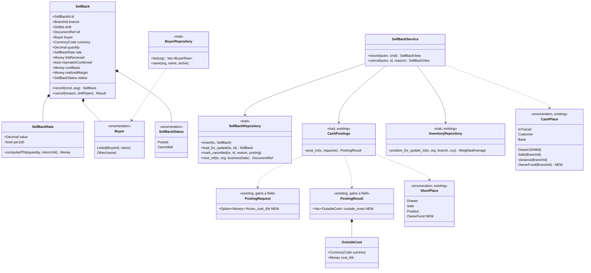

# Sell-back to another shop, and the owner fund

Status: **design, for review**. No code yet. Tickets are cut from §10 only after this file merges with a `Verdict: PASS`.

## 0. Decision, owner's words, reason

**Decision.** Add a sell-back flow. A teller sells foreign notes out of the drawer to another exchange shop (a buyer). The
THB the buyer pays goes into a new per-branch **owner fund**, not into the drawer.

**Owner's words** (2026-11-19, in a Claude session, after the shop's XCHANGE manual was compared with this product).
The owner picked *"ขายคืน + กองเจ้าของ"* from the proposed list. The owner also confirmed that the feature is new:
*"ระบบ ยังไม่มีใช่ไหม ขายคืน + กองเจ้าของ"* · *"เพราะตาม blueprint เราทำไปครบแล้ว"*.

**Reason.**
- The shop already works this way every shift. The manual (Nov 2026 edition, §1.11, §1.14 and §2.3) has these rules:
  - the THB from a sell-back goes to the owner's pile and is not put in the drawer;
  - a sell-back does not count in the shift close;
  - expected cash at close = opening + top-ups + sells to customers − buys from customers.
- v3 has no way to record this today:
  - `AccountKind` has six kinds: Drawer, Safe, InTransit, Customer, Bank and Variance (`api/crates/xc-cash/src/domain/ledger/account.rs:13-20`).
  - `TransferKind` has five (`api/crates/xc-cash/src/domain/transfer/cash_transfer.rs:9-15`).
  - A search of `api/`, `web/src` and `docs/` at `f764777b2` for sell-back, ขายคืน, owner pile and กองเจ้าของ finds nothing.
- Blueprint v2 (`docs/blueprint/XC-Desk-Blueprint-Data-Model-v2.html`) never names a sell-back or an owner fund.
  Every row of its conformance table (`docs/design/blueprint/ledger-inventory.md` §12) is kept. So this design **adds**
  flows and does not change a Blueprint rule (owner, 2026-10-09: *"the Blueprint's logic is fixed"*).

## 1. Today (measured at `f764777b2`)

- **The ledger is double-entry, per currency** (`ledger-inventory.md` §3.1). Accounts are `(org, branch, currency, kind, shift)`, and the CHECK
  `kind IN ('DRAWER','SAFE','IN_TRANSIT','CUSTOMER','BANK','VARIANCE')` is at `api/migrations/20261110120000_ledger.sql:9`.
  Postings carry `source_type IN ('EXCHANGE','TRANSFER','COUNT','OPENING','REVERSAL','ADJUSTMENT')`.
- **Expected cash at close** is the drawer account's ledger balance per currency
  (`xc-cash/src/infrastructure/ledger_postings.rs`, `expected_in`). It is not a formula. Whatever leaves or enters the
  drawer through a posting moves "expected" by the same amount.
- **Cost** is the weighted average per branch and currency (`xc-cash/src/domain/inventory/weighted_average.rs`). A SELL
  disposes at the average, and the margin is `thb − cost` on the line (`ledger-inventory.md` §4.3).
- **The never-negative rule lives in the posting port**: `matches!(key.kind, AccountKind::Drawer | AccountKind::Safe)`
  (`xc-cash/src/infrastructure/ledger_postings.rs:895`, `ledger-inventory.md` §5.1.2), answering with a `ShortPlace`
  (`xc-cash/src/domain/shortfall.rs:30`: `Drawer`, `Safe`, `Position`). The reconcile check `reconcile/checks/places.rs`
  is a different thing: it checks DRAWER + SAFE + IN_TRANSIT against the position and skips THB (`places.rs:13-30`).
- **The port's cost outputs today.** A leg with a transaction line gets a `LineCost` (`domain/posting.rs:101`); a
  reversal leg names `reverses: TransactionLineId` and is valued at that line's frozen cost (`ledger_postings.rs:587-589`,
  `:986-1000`). A leg with no line disposes at the average but returns no cost (`:819-870`), and an inflow with no line
  is valued at the THB it moved (`:746-793`). A sell-back has no transaction line, so §4 adds the two outputs it needs.

## 2. Behaviour (from the manual; the rows the up-front tests pin)

| # | Given | When | Then |
|---|---|---|---|
| 1 | an open shift, a drawer holding USD 1,000 at an average of 33.00 | a teller records a sell-back of USD 500 to buyer "ร้าน A" at 33.40, THB received 16,700.00 | one posting `SELL_BACK`: `DRAWER −500 USD`, `CUSTOMER +500 USD` (valued at cost 16,500.00); `CUSTOMER −16,700.00 THB`, `OWNER_FUND(branch) +16,700.00 THB`; the sell-back row has `cost_basis_thb 16,500.00` and `realized_margin_thb 200.00` |
| 2 | row 1 done | the shift's expected cash is read | THB expected is unchanged by the sell-back; USD expected fell by 500 |
| 3 | the rate is per 100 units (the "rate per 100" box ticked) | USD 500 at 3,340 per 100 | `computed_thb = 500 × 3,340 ÷ 100 = 16,700.00` |
| 4 | THB received ≠ `computed_thb` | first save | refused with `thbMismatch` (both amounts named), nothing written |
| 5 | row 4 | saved again with `confirm_mismatch = true` | written; the row keeps both amounts and `mismatch_confirmed = true` |
| 6 | the drawer holds USD 300 | a sell-back of USD 500 | refused, using the cash-never-negative rule (`ledger-inventory.md` §5.1.2); nothing written |
| 7 | a currency whose minor unit is 0 (JPY) | quantity 1,000.5 | refused `validationFailed` |
| 8 | buyer not on the list | "other shop" with a typed name | written with `buyer_id NULL`, `buyer_name` as typed (1–80 chars, trimmed) |
| 9 | row 1 posted, shift still open | cancel with a reason (1–200 chars) | one `REVERSAL` posting, the exact opposite: `CUSTOMER → DRAWER` 500 USD valued **16,500.00** (the frozen cost, not the 16,700.00 THB moved), `OWNER_FUND → CUSTOMER` 16,700.00 THB; the USD position is back to exactly its quantity and `cost_thb` before row 1; status `CANCELLED`; nothing deleted |
| 10 | the shift is closed | cancel | refused `shiftClosed` |
| 11 | a user without `ShiftOperate` | record or cancel | refused `forbidden` |
| 12 | a receipt number is issued | row 1 | `SB-YYYYMMDD-NNNNNN`, per org per business day, the same scheme as `XC-` (`xc-exchange/.../document_ref.rs:14-22`); in Demo mode `TEST-SB-…`, as `TEST-XC-` (`document_ref.rs:16-19`) |
| 13 | row 1 | the branch's owner fund is read | THB 16,700.00 for that branch |
| 14 | the owner fund holds THB 10,000.00 (after a FINANCE `ADJUSTMENT` withdrawal) | cancel row 1 (16,700.00) | refused `409` by the port's never-negative rule with place `OWNER_FUND`; the message names "กองเจ้าของ"; nothing written |
| 15 | the drawer and position hold exactly USD 500 at `cost_thb` 16,500.01 | a sell-back of USD 500 | `cost_basis_thb` = 16,500.01 (the whole remaining cost, the §4.3 last-unit rule), computed by the port, not by the service |
| 16 | a posting request with `frozen_cost_thb` | its source is not a sell-back cancel | refused by the port `validationFailed`; nothing written |

## 3. Data (one additive migration)

```sql
-- cash_accounts: one more kind. Branch-level (shift_id NULL), one per currency.
ALTER TABLE cash_accounts DROP CONSTRAINT <kind check>;
ALTER TABLE cash_accounts ADD CHECK (kind IN ('DRAWER','SAFE','IN_TRANSIT','CUSTOMER','BANK','VARIANCE','OWNER_FUND'));
-- ledger_postings: one more source.
ALTER TABLE ledger_postings DROP CONSTRAINT <source_type check>;
ALTER TABLE ledger_postings ADD CHECK (source_type IN ('EXCHANGE','TRANSFER','COUNT','OPENING','REVERSAL','ADJUSTMENT','SELL_BACK'));

CREATE TABLE sell_back_buyers (
  id               uuid PRIMARY KEY,
  organization_id  uuid NOT NULL,
  name             text NOT NULL CHECK (char_length(btrim(name)) BETWEEN 1 AND 80),
  active           boolean NOT NULL DEFAULT true,
  created_at       timestamptz NOT NULL,
  UNIQUE (organization_id, name)
);

CREATE TABLE sell_backs (
  id                   uuid PRIMARY KEY,
  organization_id      uuid NOT NULL,
  branch_id            text NOT NULL,
  shift_id             text NOT NULL,              -- the drawer it left
  document_ref         text NOT NULL,              -- SB-YYYYMMDD-NNNNNN
  buyer_id             uuid NULL REFERENCES sell_back_buyers(id),
  buyer_name           text NOT NULL,              -- the list name, or the typed "other shop" name
  currency             char(3) NOT NULL,
  quantity             numeric(20,4) NOT NULL CHECK (quantity > 0),
  rate                 numeric(20,8) NOT NULL CHECK (rate > 0),
  rate_per_100         boolean NOT NULL,
  computed_thb         numeric(20,2) NOT NULL,
  thb_received         numeric(20,2) NOT NULL CHECK (thb_received > 0),
  mismatch_confirmed   boolean NOT NULL,
  cost_basis_thb       numeric(20,2) NOT NULL,
  realized_margin_thb  numeric(20,2) NOT NULL,
  posting_id           uuid NOT NULL REFERENCES ledger_postings(id),
  status               text NOT NULL CHECK (status IN ('POSTED','CANCELLED')),
  cancel_reason        text NULL,
  cancel_posting_id    uuid NULL REFERENCES ledger_postings(id),
  created_by           text NOT NULL,
  created_at           timestamptz NOT NULL,
  cancelled_by         text NULL,
  cancelled_at         timestamptz NULL,
  CHECK ((status = 'CANCELLED') = (cancel_posting_id IS NOT NULL)),
  CHECK (mismatch_confirmed OR thb_received = computed_thb),
  UNIQUE (organization_id, document_ref)
);
```

**Data migration:** none. There are no rows to move. The migration only adds a kind, a source type and two empty
tables, and it runs at boot like every other (`embed` via `sqlx::migrate!`). Both CHECKs are inline and unnamed
(`20261110120000_ledger.sql:9`, `:20`) and no later migration alters them, so the ticket finds their generated names
with `pg_constraint` inside the migration. **Forward-only**, as every migration here: there is no `down`, so nothing
is lost by a rollback because there is none.

## 4. Postings

- **Record.** One posting, `source_type SELL_BACK`, `source_key complete`, inside the same DB transaction as the
  `sell_backs` row and the inventory `DISPOSE`.

  | Leg | From | To | Quantity | Valuation |
  |---|---|---|---|---|
  | foreign | `DRAWER(shift)` | `CUSTOMER` (the clearing account an exchange uses) | `q` | `cost` (the average) |
  | THB | `CUSTOMER` | `OWNER_FUND(branch)` | `thb_received` | face value |

  This is the SELL row of `ledger-inventory.md` §4.3 with one change: the THB lands in `OWNER_FUND` instead of `DRAWER`.
  Because of that change, row 2 holds without touching the close: the drawer's THB never moves.
- **Cost comes from the port (option a of the review).** The port already disposes a line-less outflow at the
  average, with §4.3's rounding and last-unit rule (`ledger_postings.rs:819-870`). For a `SELL_BACK` posting it also
  returns that cost: `PostingResult` (`domain/posting.rs:89`, today `costs` + `reversed`) gains `outside_costs: Vec<OutsideCost { currency, cost_thb }>`, one per foreign
  outflow leg with no line. `SellBackService` stores `cost_basis_thb` from it and computes
  `realized_margin_thb = thb_received − cost_basis_thb`. The rounding stays in one place, and row 15 pins the last unit.
- **Cancel carries the frozen cost into the port.** `PostingRequest` gains `frozen_cost_thb: Option<Money>`. When it is
  set, the port values that leg at it and, for a foreign inflow, re-acquires into the position at exactly that cost,
  instead of the THB moved (`:746-793`). The port accepts it only on a `REVERSAL` posting whose `source_id` is a
  `sell_backs.id` and whose `source_key` is `cancel`; anything else is refused (row 16). The cancel posting is the exact
  mirror of the record: `CUSTOMER → DRAWER(shift)` foreign `q` with `frozen_cost_thb = cost_basis_thb`, and
  `OWNER_FUND → CUSTOMER` THB at face value. It is allowed only while the shift is open (row 10).
- **The owner fund never goes below zero.** The port's never-negative set becomes `Drawer | Safe | OwnerFund`
  (`ledger_postings.rs:895`), with a new `ShortPlace::OwnerFund` (`"OWNER_FUND"`, `domain/shortfall.rs:30`). The
  `[required]` 409 message of `ledger-inventory.md` §5.1.2 gains the word **"กองเจ้าของ"** beside
  `ลิ้นชัก|ตู้เซฟ|สต็อก`. Today only a cancel can take the fund down (row 14); a withdrawal is a FINANCE `ADJUSTMENT`
  (§7), which goes through the same port.

## 5. Reading it

- **The owner fund** is a branch's `OWNER_FUND` balance per currency, shown on the admin Cash screen
  (`web/src/screens/admin/cash/`, menu id `cash`; the Blueprint calls it `/desk/cash`) beside the safe. This design adds no separate screen.
- **The shift's sell-backs** are listed on the close screen as information. They are not in "expected" (row 2).
- **The day's report** counts sell-backs and their margin apart from customer exchanges.

## 6. Permissions

| Action | Permission | Who has it today (`xc-auth/src/domain/access/role_grants.rs`) |
|---|---|---|
| record, cancel | `ShiftOperate` | Teller, BranchManager |
| manage the buyer list | `CashManage` | BranchManager, Finance, Executive (Admin does not hold it: `role_grants.rs:239`, `:267-275`) |
| read the owner fund | `CashManage` | the same |

No new permission is needed.

## 7. Out of scope (later, each needs the owner)

- **Sell-back orders from stock through a LINE group** (manual §2.3): awaiting payment → done, return/swap notes. This
  needs the LINE integration, which v3 does not have at all.
- **Money leaving the owner fund**, for example the owner taking it or banking it. Until that flow exists, the fund
  only grows, and a withdrawal is a FINANCE `ADJUSTMENT` (`ledger-inventory.md` §13).
- **USD note-type codes** (USDL/USDS/USD1) on the sell-back form. That is a separate item in the owner's list. Until
  it lands, the form uses the currency only.
- **Selling back from the SAFE** rather than the drawer. The manual only shows the counter flow.

## 8. Class diagram



New code lives in `api/crates/xc-cash/src/domain/sell_back/` (entity, rate, errors and the repository trait),
`xc-cash/src/application/sell_back/` (the service) and `xc-cash/src/infrastructure/sell_back/` (sqlx). The
existing files that change are `ledger/account.rs` (`AccountKind::OwnerFund`), `posting.rs` (`CashPlace::OwnerFund`),
`ledger/posting.rs` (`SourceType::SellBack`), `domain/posting.rs` (`PostingRequest.frozen_cost_thb`,
`PostingResult.outside_costs`, `OutsideCost`), `domain/shortfall.rs` (`ShortPlace::OwnerFund`), and
`infrastructure/ledger_postings.rs` (the place mapping, the outside cost, the frozen-cost inflow, the never-negative
set). `reconcile/checks/places.rs` does not change: it skips THB, and the fund only ever holds THB.
`ShortPlace::OwnerFund` has three more readers, which change with it in SB-1:
- `StockShortfall::from_refusal` (`domain/shortfall.rs:101`) parses the place with a `_ =>` arm, which would silently drop the whole shortfall;
- `shortfall_message` (`api/src/presentation/http/v3/negative_stock.rs:28`) gives each place its Thai word and stops compiling without the new arm;
- the web's `PLACE_KEY` (`web/src/shared/i18n/worded-error.ts:8`), with a new `error.stockPlaceOwnerFund` key in `th.ts`, `en.ts` and `zh.ts`.

## 9. API and screens

- `POST /api/sell-backs` `{shiftId, buyerId | buyerName, currency, quantity, rate, ratePer100, thbReceived,
  confirmMismatch}` → the view with `documentRef`, `costBasisThb` and `realizedMarginThb`. It is refused with
  `thbMismatch` until it is confirmed (rows 4–5).
- `POST /api/sell-backs/{id}/cancel` `{reason}`.
- `GET /api/sell-backs?shiftId=` lists the shift's sell-backs.
- `GET/POST /api/sell-back-buyers` reads and manages the buyer list.
- Staff web: a "บันทึกขายคืน" card on the staff floor page next to the transfers card. It has these controls:
  - buyer select, with "other shop" opening a name field;
  - currency;
  - quantity and rate, with the "rate per 100" box;
  - THB received, with a "use quantity × rate" button;
  - the mismatch warning, which turns the button into "confirm and save".

  Below the form is the list of this shift's sell-backs, each with a cancel button that asks for a reason. The close
  screen shows the same list read-only, with the line "ขายคืนไม่นับในยอดปิดกะ".
- The owner fund is a row on the admin Cash screen (`web/src/screens/admin/cash/`).

## 10. Tickets (cut after this design merges)

| Ticket | Files (File scope) | Depends on |
|---|---|---|
| SB-1 migration + domain | new migration; `xc-cash/src/domain/sell_back/**`; `ledger/account.rs`; `domain/posting.rs`; `domain/shortfall.rs`; `ledger/posting.rs`; `api/src/presentation/http/v3/negative_stock.rs`; `web/src/shared/i18n/worded-error.ts`; `web/src/shared/i18n/{th,en,zh}.ts` | — |
| SB-2 service + port changes | `xc-cash/src/application/sell_back/**`; `xc-cash/src/infrastructure/sell_back/**`; `infrastructure/ledger_postings.rs` | SB-1 |
| SB-3 HTTP + RBAC | `api/src/presentation/http/v3/commands/cash/sell_backs.rs` (new, beside `transfers.rs`); its route line; `xc-auth/src/domain/policy/areas/cash.rs` | SB-2 |
| SB-4 staff web card + close list | `web/src/screens/staff/sell-back/**` (new); one line in the floor page; the close screen's list | SB-3 |
| SB-5 owner-fund row on the admin Cash screen + buyer list admin | `web/src/screens/admin/cash/**` (owner-fund row); `web/src/screens/admin/sell-back-buyers/**` (new) | SB-3 |

SB-1 and SB-2 handle money and are `class:guarded`. The ticket author writes their up-front failing tests from §2,
rows 1–16, before release.

## 11. Must ask the owner (not decided here)

1. **How money leaves the owner fund** (§7), and whether that flow is needed before go-live.
2. **Sell-back orders through LINE** (manual §2.3): whether they are in scope at all, since they need the LINE work first.
3. **Whether a sell-back can come from the safe** as well as the drawer.
