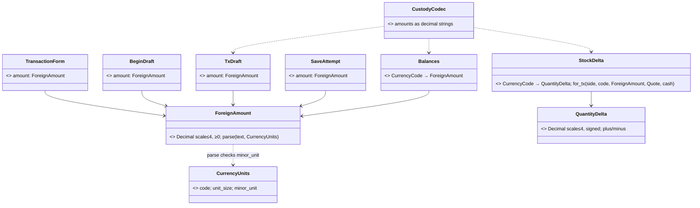

# Three-decimal currencies through the desk, custody and counts

**Status:** proposed, 2026-10-23 · **Author:** claude/7ca80c (xchange BE lane controller)
**Requirement:** the owner, 2026-10-23, option A on the M1 row split out of #4906: *"เปิดใบ KWD 3 ตำแหน่ง"*,
meaning open the ticket so that a KWD amount with three decimals (`1.125`) is accepted end to end.
**Refs:** `blueprint/rates.md` D-2 (foreign amounts follow the currency's minor unit), `web-input-validation.md`
(#4906 rows M2–M4), `blueprint/cash-shift-transfer.md` §4.1 "Amounts".

## 1. Problem

`currencies.minor_unit` is 3 for the seeded BHD, IQD, JOD, KWD, LYD, OMR and TND (`rates.md` D-2). The quote
path and the ledger already hold four places (`ForeignAmount`, `transaction_lines.quantity numeric(20,4)`,
`ledger.sql:34,82,95,109`). The desk exchange, custody and counts still carry the foreign amount as `Money`, which
is fixed at two places (`xc-kernel/src/money/money.rs`, "A non-negative amount of one currency with two decimal
places"). So a teller can't exchange, draft or count `KWD 1.125`. The amount is refused, never rounded.

`rates.md` D-2 already names the gap: *"Custody's JSON amounts are encoded as `Money` minor units (cents) today …
Until it lands, a 3-place currency can be exchanged and held in the till, but not counted through custody."* The
owners it names (#582, #553) are closed, and nothing has picked it up. This document does.

## 2. Where two places are imposed (measured at `main` `e010615c3`)

| # | Writer | What it does |
|---|---|---|
| W1 | `xc-exchange/src/domain/exchange/value_objects/transaction_form.rs:33,130` | `TransactionForm.amount: Money`, parsed with `Money::parse` (2 places) |
| W2 | `api/src/application/workflows/save_transaction.rs:424-427` | rebuilds the quote quantity from `form.amount.minor_i128()` at scale 2 |
| W3 | `xc-shift/src/domain/shift/value_objects/stock_delta.rs:59-73` | `StockDelta::for_tx(amount: Money)`; deltas are `MoneyDelta` (signed hundredths, `money_delta.rs:9`) |
| W4 | `xc-shift/src/domain/shift/value_objects/balances.rs:9` | `Balances` maps currency → `Money` |
| W5 | `xc-shift/src/application/branch_day/service.rs:53-57`, `domain/custody/entities/tx_draft.rs:19`, `domain/custody/value_objects/save_attempt.rs:19` | `BeginDraft.amount`, `TxDraft.amount`, `SaveAttempt.amount` are `Money`; `branch_day.rs:137` compares them |
| W6 | `xc-shift/src/infrastructure/custody/custody_repository.rs:78-100,164,181-183` + `decode.rs:68,85,104` | custody JSON stores amounts as integer hundredths (`minor_to_json`) |
| W7 | `xc-cash/src/application/count/count_service.rs:965`, `handover/handover_service.rs:417` | caps the allowed scale at `min(minor_unit, 2)` |
| W8 | `xc-cash/src/infrastructure/ledger_postings.rs:1281` (`CashPostings::expected_in`) | **skips** a ledger sum whose scale is above 2 (`if sum <= 0 \|\| sum.scale() > 2 { continue; }`), so a drawer holding `KWD 1.125` has no KWD in its expected `Balances` (read by `count_service.rs:132,140`, `transfer_flow.rs:658`) |
| W9 | `ledger_postings.rs:76-90` (`minor`, `money`, `delta`; used by `activity_in`, `:1295-1350`) | **rounds** each sum to hundredths (`MidpointAwayFromZero`): `1.125` → `1.13` |
| W10 | `xc-cash/src/infrastructure/ledger/shift_balances.rs:26-41` (`to_money`, `to_delta`) | **rounds** the same way into `ShiftBalance { opening: Money, expected: MoneyDelta, … }` (`xc-shift/src/domain/shift/repositories/shift_balances.rs:17-31`), which the shift screens show |

Callers that follow the types: `receipt.rs:67`, `custody_save_step.rs:97`, `kiosk_save_step.rs:78`,
`save_transaction.rs:109,480`, `compat/v2_json.rs:669`, `executive/alert_facts.rs`, `commands/cash_exception_raise.rs`,
`shift/entities/{shift,shift_ledger}.rs`, `shift/repositories/shift_repository.rs`,
`infrastructure/shift/shift_repository.rs`, `transfer_flow.rs`. Readers of W8–W10 at scale 2: `compat/snapshot.rs:209`
(`safe_balances`), `v3/actions/shift_valuation.rs:174-198`, `v3/views/admin_cash.rs:339-379`, `v3/views/admin_shifts.rs`, and
`staff_floor/reader.rs:105-133`, which prints the custody target with `format!("{:.2}", …)`. In all, 57 source files name
`StockDelta`, `Balances`, `TxDraft`, `BeginDraft`, `SaveAttempt`, `MoneyDelta` or `ShiftBalance` (§6 Q2 lists them), and 41 test
files touch `StockDelta`, `Balances` or `TxDraft`. Found by rv3 (claude/b873aa20) on PR 4960; I re-checked each line at `main`
`d53a05f5`.

## 3. Decision

A foreign quantity is a `ForeignAmount` everywhere: in the form, the drafts, the stock and the counts. `Money`
stays for THB only, as `rates.md` D-2 already says for the domain. There is one rule: an amount may have as many
places as its currency's `minor_unit` allows, up to 4, and more is refused (`TooManyDecimals`), never rounded.

- **New kernel type `QuantityDelta`**: a signed scale-4 decimal, the signed twin of `ForeignAmount`. It replaces
  `MoneyDelta` inside `StockDelta`. `MoneyDelta` stays for THB differences.
- **`Balances` and `StockDelta`** hold `ForeignAmount` and `QuantityDelta` per currency. THB inside them is a
  `ForeignAmount` with minor unit 2, the same convention as `posting.rs:40`.
- **`TransactionForm.amount: ForeignAmount`**, parsed with `ForeignAmount::parse(text, &CurrencyUnits)`. The form
  gets the units from the existing `CurrencyRegister` port (`rates.md` §3). W2 then passes the quantity through
  unchanged.
- **Custody JSON stores decimal strings** (`"1.125"`, `"-0.5"`), not integer hundredths. A decimal string says its
  own scale, so the next change of scale needs no second migration.
- **W7's caps go**: the scale allowed is `minor_unit` itself.
- **Ledger → domain reads (W8–W10)** read `quantity_signed` straight into `ForeignAmount` / `QuantityDelta` at the stored scale
  (≤ 4). A sum whose scale exceeds the currency's `minor_unit` is **refused** (an internal error naming the currency and the
  place), never skipped and never rounded. That is the same rule as entry. `minor()`-style rounding stays only for THB valuation and
  cost, which are `Money`. Display formats the amount at its currency's `minor_unit`, not `{:.2}`.
- **Not changed:** THB fields (`fee`, `bank_fee`, `thb_amount`, valuations, costs) stay `Money` at two places.



## 4. Behaviour

| Row | Input | Result |
|---|---|---|
| K1 | desk save, BUY `KWD 1.125` | saved; `transaction_lines.quantity = 1.1250`; till stock `+1.125` |
| K2 | `draftBegin` `KWD 1.125`, then the matching save | draft stored as `"1.125"`; the save completes it (`branch_day.rs:137`) |
| K3 | `KWD 1.1255` at the desk save and at `draftBegin` | 400 `validationFailed` / `TooManyDecimals` on `amount`, nothing stored |
| K4 | open count `KWD 301 × 0.005 = 1.505` | accepted (flips `count_service.rs` `kwd_total_with_three_decimal_places_is_refused_at_submit_and_nothing_is_written`) |
| K5 | `USD 10.50`, `JPY 1500`, `JPY 1.5` | as today (accepted, accepted, refused) |
| K6 | custody rows written before the migration | read back with the same values (`1050` → `"10.50"`) |
| K7 | after K1, the drawer holds `KWD 1.125` | `expected_in` lists `KWD 1.125`; the shift balance shows `1.125`; a KWD transfer of `1.125` finds the stock |

## 5. Data migration

Custody rows store integer hundredths today. One forward migration rewrites them as decimal strings:
- `tx_drafts.data->'amount'` (written `custody_repository.rs:164`, read `:387`);
- `cash_exceptions.data`, under `targetDifference`, `cashVariance` and `safeVariance`, each a map of currency to hundredths
  (written `:181-183`, read `decode.rs:328-338`);
- `ops_state.target->'amounts'`, a map of currency to hundredths (written `:104` through `target_to_json`, `:511-523`; read
  `:310`, `decode.rs:127-129`).

These are the only callers of `minor_to_json`, `money_from_json`, `balances_from_json` and `delta_from_json` in
`custody_repository.rs` and `decode.rs`. Missing `ops_state.target` would make the strict reader refuse every branch day with a
target. `ops_events.details` already writes amounts as decimal text (`branch_day/service.rs:306`) and is not touched.

Each value becomes `(n / 100)::text`, keeping two places. A value that is already a string (a figure beyond 64 bits,
`custody_repository.rs:76-83`) is the decimal text of hundredths, so it is converted the same way. Rows whose JSON
has none of these keys are not touched. The migration runs at boot (`sqlx::migrate!`) and takes its slot from
`scripts/migration-slot.sh next` at push time (`migration-slots.md`). The new readers refuse an integer, so a
missed row fails loudly instead of being read at the wrong scale.

🔴 **The migration rewrites stored data, so it needs the owner's approval before its ticket gets `ready`.**

## 6. Tickets (feature branch `feat/three-decimal-currencies`)

Q2 changes types that 59 files use, and they must compile together, so Q2 is one ticket that changes the types and every call
site, with behaviour unchanged for amounts of two places or fewer (all existing suites stay green). Q3–Q6 then add the
three-place behaviour and are disjoint from each other.

| Ticket | Layer | After | Rows |
|---|---|---|---|
| Q1 | kernel: `QuantityDelta`, `ForeignAmount` plus/minus | — | unit tests |
| Q2 | type swap everywhere (compile + today's behaviour) | Q1 | K5, every existing suite |
| Q3 | custody codec + data migration | Q2 | K6 |
| Q4 | desk form | Q2 | K1, K3 |
| Q5 | counts, hand-over, transfer, ledger readers W8–W10, target and valuation display | Q2 | K4, K7 |
| Q6 | `draftBegin` HTTP | Q2 | K2, K3 |

All are `class:logic` (Argon), with up-front failing tests written from §4 before release. The feature branch lands on `main`
in one PR with one full test run.

### File scopes

Q1:
```
api/crates/xc-kernel/src/money/quantity_delta.rs
api/crates/xc-kernel/src/money/mod.rs
api/crates/xc-kernel/src/money/foreign_amount.rs
```

Q2 (every source file that names one of the changed types or reads their values, measured at `main` `d53a05f5`):
```
api/crates/xc-cash/src/application/count/count_service.rs
api/crates/xc-cash/src/application/handover/handover_service.rs
api/crates/xc-cash/src/application/transfer/transfer_flow.rs
api/crates/xc-cash/src/domain/error.rs
api/crates/xc-cash/src/domain/posting.rs
api/crates/xc-cash/src/infrastructure/ledger/ledger_shift_repository.rs
api/crates/xc-cash/src/infrastructure/ledger/shift_balances.rs
api/crates/xc-cash/src/infrastructure/ledger_postings.rs
api/crates/xc-exchange/src/domain/transaction/line.rs
api/crates/xc-exchange/src/domain/transaction/repository.rs
api/crates/xc-exchange/src/infrastructure/transaction/store.rs
api/crates/xc-kiosk/src/application/kiosk/save_hooks.rs
api/crates/xc-kiosk/src/domain/kiosk/entities/kiosk_machine.rs
api/crates/xc-kiosk/src/domain/kiosk/value_objects/save_attempt.rs
api/crates/xc-shift/src/application/branch_day/mod.rs
api/crates/xc-shift/src/application/branch_day/service.rs
api/crates/xc-shift/src/application/branch_day/tests.rs
api/crates/xc-shift/src/application/custody/service.rs
api/crates/xc-shift/src/application/shift/service.rs
api/crates/xc-shift/src/domain/custody/branch_day.rs
api/crates/xc-shift/src/domain/custody/entities/cash_exception.rs
api/crates/xc-shift/src/domain/custody/entities/custody_machine.rs
api/crates/xc-shift/src/domain/custody/entities/tx_draft.rs
api/crates/xc-shift/src/domain/custody/state.rs
api/crates/xc-shift/src/domain/custody/value_objects/cash_target.rs
api/crates/xc-shift/src/domain/custody/value_objects/count_sheet.rs
api/crates/xc-shift/src/domain/custody/value_objects/custody_error.rs
api/crates/xc-shift/src/domain/custody/value_objects/custody_facts.rs
api/crates/xc-shift/src/domain/custody/value_objects/save_attempt.rs
api/crates/xc-shift/src/domain/shift/commands/close_shift.rs
api/crates/xc-shift/src/domain/shift/commands/open_shift.rs
api/crates/xc-shift/src/domain/shift/commands/payload.rs
api/crates/xc-shift/src/domain/shift/entities/shift.rs
api/crates/xc-shift/src/domain/shift/entities/shift_ledger.rs
api/crates/xc-shift/src/domain/shift/repositories/shift_balances.rs
api/crates/xc-shift/src/domain/shift/repositories/shift_repository.rs
api/crates/xc-shift/src/domain/shift/value_objects/balances.rs
api/crates/xc-shift/src/domain/shift/value_objects/stock_delta.rs
api/crates/xc-shift/src/infrastructure/custody/custody_repository.rs
api/crates/xc-shift/src/infrastructure/custody/decode.rs
api/crates/xc-shift/src/infrastructure/shift/shift_repository.rs
api/src/application/compat/snapshot.rs
api/src/application/compat/v2_json.rs
api/src/application/staff_floor/reader.rs
api/src/application/workflows/custody_save_step.rs
api/src/application/workflows/exchange/reversal_post.rs
api/src/application/workflows/kiosk_save_step.rs
api/src/application/workflows/save_transaction.rs
api/src/bootstrap/mod.rs
api/src/infrastructure/executive/alert_facts.rs
api/src/presentation/dto/v3/admin_shifts.rs
api/src/presentation/dto/v3/cash.rs
api/src/presentation/http/v3/actions/shift_valuation.rs
api/src/presentation/http/v3/commands/branch_day.rs
api/src/presentation/http/v3/commands/cash_exception_raise.rs
api/src/presentation/http/v3/views/admin_cash.rs
api/src/presentation/http/v3/views/admin_shifts.rs
api/src/presentation/http/v3/views/devices.rs
api/src/presentation/http/v3/views/my_shift.rs
```

Q3 (`<slot>` from `scripts/migration-slot.sh next` at push time):
```
api/crates/xc-shift/src/infrastructure/custody/custody_repository.rs
api/crates/xc-shift/src/infrastructure/custody/decode.rs
api/migrations/<slot>_custody_amounts_decimal.sql
```

Q4:
```
api/crates/xc-exchange/src/domain/exchange/value_objects/transaction_form.rs
api/crates/xc-exchange/src/domain/exchange/entities/receipt.rs
api/src/application/workflows/save_transaction.rs
api/src/application/workflows/custody_save_step.rs
api/src/application/workflows/kiosk_save_step.rs
api/src/application/compat/v2_json.rs
```

Q5:
```
api/crates/xc-cash/src/application/count/count_service.rs
api/crates/xc-cash/src/application/handover/handover_service.rs
api/crates/xc-cash/src/application/transfer/transfer_flow.rs
api/crates/xc-cash/src/infrastructure/ledger_postings.rs
api/crates/xc-cash/src/infrastructure/ledger/shift_balances.rs
api/src/application/staff_floor/reader.rs
api/src/presentation/http/v3/actions/shift_valuation.rs
```

Q6:
```
api/src/presentation/http/v3/commands/branch_day.rs
```

Q3–Q6 overlap Q2's list only after Q2 has merged into the feature branch, which releases its locks. Each Q3–Q6 ticket also lists
the existing tests that pin today's two-place behaviour in its rows (found with `git grep` on the values, e.g. the
`count_service.rs` KWD test for K4).
