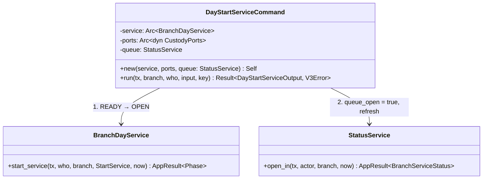

# Desk walk-in enters the queue (XC-WALKIN-QUEUE)

> Design by claude/e2926a49 (sub-controller, xchange BE lane under claude/553782), 2026-10-28 ICT.
> Measured on `origin/main` `a6ad18474`; rework re-checked on `1f364a09`. Brief: #564 issuecomment-6456885111.

## 0. The owner's rule

*"G1 ก็ต้องเข้าคิว เสมือน จองเหมือกกัน"* (recorded by the FE lane on #5055, issuecomment-6456873918): a customer served
straight at the desk enters the queue, the same way a booking does.

Rules already in force that this design keeps:
- A kiosk request or a booking reserves a queue place, never a rate. The desk always prices at the current rate (G7, `create.rs:252-285`).
- A ticket is a place in a line, not an order. A ticket's completion is not a transaction's completion (`queue-tickets.md` Q1).
- Cancels need no approval and no limit.
- Server texts are Thai only in feature work. Language work is separate.

## 1. The gap (measured)

- The desk's booking step only moves on. `web/src/screens/desk/steps/booking/step.tsx:15-26` checks the name, the staff and the value date, then calls `store.go(3)`. It writes nothing.
- The save sends `bookingId` / `kioskRequestId` only when the sale came from an entry (`web/src/screens/desk/save.ts:180-181`, read from `extras`).
- So a sale with neither has no `queue_tickets` row. Nothing in the queue, the estimate or the calling display knows the customer was served.

## 2. Existing entry paths (all through one writer)

Every ticket is written by **`TicketIssuer::issue_in`** (`api/crates/xc-queue/src/application/issue/ticket_issuer.rs:160-308`). It takes an `IssueSource` (`xc-queue/src/domain/ticket/issue_source.rs:9-18`), and in order:
1. returns the ticket already stored under the idempotency key, or refuses `idempotencyConflict` when that key belongs to another source (`:170-180`);
2. returns the source's existing ticket, for a kiosk request or a booking (`:183-206`);
3. refuses `queueClosed` when the queue is closed, using no number (`:209-211`);
4. takes the next number of (branch, local date, line), inserts a WAITING ticket and its `ISSUE` event, and refreshes the estimate (`:213-306`).

| Path | Who | Source | Where it calls the core | Line | Starts as |
|---|---|---|---|---|---|
| Kiosk/web request confirm (customer submits on the tablet or the web) | the kiosk / member | `Kiosk { request_id }`, key `kiosk-confirm:<id>` | `xc-kiosk/src/application/kiosk/customer.rs:281` (`issue_by_token_with_sessions`, `:243`; route `issueByToken`, `api/src/presentation/http/kiosk.rs:769-782`) | WALK_IN (`W`) | WAITING |
| Kiosk request accepted at the desk | TELLER | (existing ticket) | `xc-kiosk/src/application/kiosk/desk.rs:197` → `TicketIssuer::start_for_kiosk_in` (`ticket_issuer.rs:89-128`): `QueueDesk::call_in` then `start_in` | — | → SERVING for that teller |
| Online booking check-in | TELLER (`bookingCheckIn`) / kiosk (`kioskBookingCheckIn`) | `Booking { booking_id }` | `xc-booking/src/application/check_in.rs:188` | BOOKING (`B`), called first (`call_order.rs:13-18`) | WAITING |
| App "take a number" | the signed-in customer (`queueTicketTake`, `POST /api/app/queue/tickets`) | `App { customer_id }`, one active per branch and day (`ticket_issuer.rs:225-241`; index `migrations/20261219140000_queue_one_active_app_ticket.sql`) | `api/src/presentation/http/v3/commands/queue_ticket_take.rs:70-76` | WALK_IN | WAITING |
| Desk board "issue a walk-in number" | TELLER/BRANCH_MANAGER (`ticketIssueWalkIn`, `POST /api/queue/tickets`) | `Desk` | `api/src/presentation/http/v3/commands/queue.rs:240-265` | WALK_IN | WAITING |
| Flutter queue machine (printer) | the queue machine | (prints the ticket `issueByToken` answered) | `app/lib/features/queue_machine/infrastructure/queue_machine_api.dart:35` (`ticketEscpos`) | — | — |

Nothing finishes a ticket when a sale completes. A ticket reaches COMPLETED only through the board's `ticketFinish`
(`QueueDesk::finish_in`, `queue_desk.rs:729`). The day close cancels what is left (`queue_day_hook.rs:110`).

**Conclusion: reuse the core.** A desk walk-in is `IssueSource::Desk`, which already exists for exactly this customer
("a teller at the desk, for a customer without the tablet", `issue_source.rs:15-16`). It is issued through `issue_in`
and started through `QueueDesk::call_in` + `start_in`, the same composition `start_for_kiosk_in` already uses. No new
source, no new line, no second writer of `queue_tickets`.

## 3. Decisions

| # | Decision | Why |
|---|---|---|
| W1 | **One new command, `ticketServeWalkIn`** (`POST /api/queue/tickets/serve`), called by the desk's booking step when the sale has no `bookingId` and no `kioskRequestId`. It answers the ticket the customer at the counter is served under. `ticketIssueWalkIn` (a WAITING number from the board) stays as it is. | The board's command issues a number for someone who will wait. The sale's command is for someone who is already at the counter, so its ticket must start at once (W3). |
| W2 | **The save sends the queue ticket id** in a new field `queueTicketId`, not `bookingId`. | A `bookings` row needs a slot and a booking policy (`booking-slots.md` B11). It would rank in the BOOKING line and be called before people already waiting (`call_order.rs:13-18`). Inventing one would be a second, parallel queue entry. The ticket is the queue entry the owner asked for. |
| W3 | **The ticket is SERVING for the caller when the command answers.** It is issued WAITING, then called and started in the same transaction (`call_in`, `start_in`). | The customer is already being served. It is never WAITING outside the transaction, so **call order for others does not change**: call-next reads WAITING tickets only. It does take the next `W` number, so later walk-ins get the number after it. Earlier numbers keep theirs. |
| W4 | **What the command answers, in order:** (1) the ticket stored under this sale's key (a replay); (2) the caller's held CALLED/SERVING **walk-in** ticket that has no booking and no kiosk request and was not issued by another desk sale: started if CALLED, then returned (the customer at the counter is the one the teller called from the board); (3) the customer's active `App` ticket today in this branch, called and started for the caller; (4) a new `Desk` ticket, called and started. A held **booking or kiosk** ticket, or a held ticket another desk sale issued, refuses `alreadyServing`. | The teller serves one ticket at a time (`queue_desk.rs:95-108`). (2) and (3) avoid two tickets for one person. A held booking or kiosk ticket means the desk should open that entry instead. |
| W5 | **Idempotency: one entry per desk sale.** The FE adds a per-sale serve key to the desk store and keeps it until `reset()` (FE ticket #5352, §7.1). It is not `keyedWrite`, because the body (`{customerId}`) is the same for every sale. `newKey()` (`desk-store.ts:299`) is not that key: it makes a fresh key for each quote call. The ticket stores it as `desk-sale:<key>`. The same key answers the same ticket. The same key on a different source refuses `idempotencyConflict` (`ticket_issuer.rs:175-177`). | The prefix lets W4 (2) tell a ticket issued by a desk sale from one called off the board. |
| W6 | **The 10-minute cutoff applies.** A new ticket (W4 (3) and (4)) needs `ServiceWindow::allows_begin`, i.e. inside `[open, close − 10 min)` (`xc-shift/src/domain/custody/value_objects/service_window.rs:18-27`). It is read through `CustodyFactsPort::service_window_in` (`api/src/infrastructure/custody/custody_ports.rs:245`). A replay (W4 (1)) and an already-held ticket (W4 (2)) are answered at any time. | Issuing the entry begins the service, and beginning a transaction has the same cutoff (`branch_day/service.rs:503-505`). Answering the stored ticket keeps a retry from failing at 22:51. |
| W7 | **A closed queue refuses `queueClosed`**, as booking check-in and the kiosk confirm do (`ticket_issuer.rs:209-211`). | "Like a booking": the check-in of a booking refuses on a closed queue. **This blocks the sale while the queue is closed; the owner kept it (O-2).** |
| W8 | **Completing the sale finishes the ticket** (SERVING → COMPLETED, with its `FINISH` event and the estimate refresh), inside `CompleteExchange`'s transaction, through `WalkInDesk::finish_for_sale_in`. If the ticket is no longer SERVING (finished from the board, or ended at day close), the sale completes and the ticket is left alone. A draft that is never completed leaves the ticket SERVING; the teller finishes it from the board. | Without this, every walk-in ticket would stay SERVING until the day close, and W4's `alreadyServing` would stop the teller's next sale. Q1 still holds: the ticket never blocks the sale. |
| W9 | **The calling display (KS-5)** shows the number while it is CALLED/SERVING, and it enters "last 5 called" through its `CALL` event (`kiosk-shared-phone.md` D10). It shows numbers only. | Nothing new: a walk-in is a `W` number like any other. |

## 4. Class diagram

```mermaid
classDiagram
  class WalkInDesk {
    <<xc-queue application/issue/walk_in_desk.rs  NEW>>
    +new(issuer: TicketIssuer, desk: QueueDesk) WalkInDesk
    +serve_in(tx, actor: &Actor, branch: &BranchId, customer_id: Option~&str~, sale_key: &str, may_issue: bool, now) AppResult~QueueTicket~
    +finish_for_sale_in(tx, branch: &BranchId, ticket_id: &str, now) AppResult~bool~
  }
  class QueueError {
    <<xc-queue domain/ticket/queue_error.rs  CHANGED (skeleton)>>
    +OutsideServiceHours  code "outsideServiceHours"
  }
  class TicketIssuer {
    <<xc-queue application/issue/ticket_issuer.rs  unchanged>>
    +issue_in(tx, branch, source, key, now) AppResult~QueueTicket~
  }
  class QueueDesk {
    <<xc-queue application/desk/queue_desk.rs  unchanged>>
    +call_in(tx, actor, branch, id, now)
    +start_in(tx, actor, branch, id, now)
  }
  class ServeWalkIn {
    <<api presentation/http/v3/commands/queue_walk_in_serve.rs  NEW, CommandAction>>
    NAME = "ticketServeWalkIn"
    ROUTE = "/api/queue/tickets/serve"
    Input = QueueServeWalkInInput
    Output = QueueTicketDto
  }
  class QueueServeWalkInInput {
    <<same file, ts export web/src/shared/api/generated/queue.ts>>
    +customer_id: Option~String~
  }
  class TransactionCreateInput {
    <<api presentation/http/v3/commands/transactions.rs:101  CHANGED>>
    +queue_ticket_id: Option~String~
  }
  class CreateTransaction {
    <<api application/workflows/exchange/create.rs  CHANGED>>
    checks queueTicketId (§5)
  }
  class CompleteExchange {
    <<api application/workflows/exchange/complete.rs  CHANGED>>
    finishes t.queue_ticket_id
  }
  class Transaction {
    <<xc-exchange domain/transaction/transaction.rs:74  CHANGED>>
    +queue_ticket_id: Option~String~
  }
  ServeWalkIn --> WalkInDesk : serve_in
  ServeWalkIn --> CustodyFactsPort : service_window_in (W6)
  WalkInDesk --> TicketIssuer : issue_in(Desk, "desk-sale:key")
  WalkInDesk --> QueueDesk : call_in, start_in
  WalkInDesk --> QueueError : OutsideServiceHours (W6)
  CreateTransaction --> Transaction : queue_ticket_id
  CompleteExchange --> WalkInDesk : finish_for_sale_in (W8)
```

| Provides | Uses it |
|---|---|
| `WalkInDesk::serve_in` | `ServeWalkIn` |
| `WalkInDesk::finish_for_sale_in` | `CompleteExchange` |
| `TransactionCreateInput.queue_ticket_id`, `Transaction.queue_ticket_id`, column `transactions.queue_ticket_id` | `CreateTransaction`, `PgTransactionStore` (`xc-exchange/src/infrastructure/transaction/store.rs:95,122,217,411`), `CompleteExchange` |
| `ticketServeWalkIn` + `QueueTicketDto` | the desk web (booking step) |

`serve_in`'s `may_issue` is the command's W6 answer: `false` lets W4 (1) and (2) answer and refuses (3) and (4) with
`QueueError::OutsideServiceHours`. That variant is new: `QueueError` (`api/crates/xc-queue/src/domain/ticket/queue_error.rs:7-31`)
has no such refusal today. The skeleton adds the variant and its `code()` arm (`"outsideServiceHours"`), so no function ticket edits
that file. `From<QueueError> for AppError` already sends it to `AppError::Validation(code)`; WQ-2 adds the code to `queue.rs::refusal`,
which otherwise maps an unknown code to `unexpected`.
That keeps `xc-queue` free of `xc-shift`.

`finish_for_sale_in` writes the same transition and event as `QueueDesk::finish_in`, using `QueueTicket::apply(Finish)`. It skips the
on-duty and owner checks: the sale's completion is the authority, and the completer may be a manager. It answers `Ok(false)` when the
ticket is not SERVING.

## 5. Refusals

`ticketServeWalkIn` (status as `queue.rs:107-125` maps it; new rows marked):

| Case | Code | HTTP |
|---|---|---|
| no `QueueOperate` in the branch | out of scope (`queue.rs:109`) | 403 |
| same key, another source | `idempotencyConflict` | 409 |
| a new ticket at or after `close − 10 min`, or outside hours, or no hours set | **`outsideServiceHours`** (new `QueueError` variant, new code in `refusal`; text `ปิดรับรายการใหม่แล้ว`, as `CustodyError::OutsideServiceHours`) | 409 |
| the queue is closed | `queueClosed` | 409 |
| the caller has no OPEN shift in the branch | `noOpenShift` | 409 |
| the caller's counter is PAUSED | `counterPaused` | 409 |
| the caller holds a booking or kiosk ticket, or another desk sale's ticket | `alreadyServing` | 409 |
| lost race on the ticket | `staleVersion` | 409 |
| `customerId` is not a customer of the organisation | `validationFailed`, field `customerId` | 400 |

`POST /api/transactions` with `queueTicketId` (new `validationFailed` rows, field `queueTicketId`):

| Case | Answer |
|---|---|
| `queueTicketId` together with `bookingId` or `kioskRequestId` | `validationFailed:queueTicketId` |
| no such ticket in the branch | `validationFailed:queueTicketId` |
| the ticket is not SERVING, or not held by the caller | `validationFailed:queueTicketId` |
| the ticket has a booking or a kiosk request | `validationFailed:queueTicketId` |
| another non-CANCELLED transaction already names it | `staleVersion` (the unique index of §6) |

`queueTicketId` joins `payload_hash` (`create.rs:432-450`), so the same key with another ticket is `idempotencyConflict`, as for every other field.

## 6. Data migration (owner approved 2026-10-28, write and merge only; see §10)

One nullable column and one index. No new status, and nothing in `queue_tickets` changes.

```sql
ALTER TABLE transactions ADD COLUMN queue_ticket_id uuid NULL REFERENCES queue_tickets (id);
CREATE UNIQUE INDEX transactions_one_per_queue_ticket
    ON transactions (queue_ticket_id)
    WHERE queue_ticket_id IS NOT NULL AND status <> 'CANCELLED';
```

1. **Existing rows:** `queue_ticket_id` is NULL on every existing transaction. No sale before this change had a desk ticket, and a booking or kiosk sale keeps finding its ticket through `booking_id` / `kiosk_request_id`. No row breaks the index, because they are all NULL.
2. **Backfill:** none. Nothing links a past sale to a ticket, so there is nothing to copy.
3. **Deploy order:** migration first, then the binary. The old binary never names the column, so it keeps working on the new schema.
4. **Reversal:** `api/migrations/` has no down files. A later migration that drops the index and the column would lose only the sale-to-ticket link. Tickets and transactions stay.
5. The migration slot is taken with `scripts/migration-slot.sh next` right before `pr_open`.

The owner approved writing and merging this migration (O-1). Deploying it is a separate owner order.

## 7. FE contract (for the FE lane's ticket)

1. **Booking step** (`web/src/screens/desk/steps/booking/step.tsx`): on submit, when `store.entry()?.payloadExtras()` has no `bookingId`, `onlineBookingId` or `kioskRequestId`:
   - call `ticketServeWalkIn` (`POST /api/queue/tickets/serve`, body `{ customerId: store.customerId() || null }`) with one Idempotency-Key per desk sale, kept until `reset()`;
   - on success store the ticket (`id`, `displayNumber`), show the number, then `store.go(3)`;
   - on a refusal show the worded refusal and stay on step 2.
   A sale that has an entry calls nothing new.
2. **Save** (`web/src/screens/desk/save.ts:173-196`): `createBody` adds `queueTicketId: <the stored id> | null`. **This part ships only after WQ-3 merges.** Before that the field does not exist on the server.
3. **Types:** `QueueServeWalkInInput` and `QueueTicketDto` come from `web/src/shared/api/generated/queue.ts`. `TransactionCreateInput.queueTicketId` comes from `…/generated/transactions.ts`. Both are generated by ts-rs, and their fixtures by `npm run gen:fixtures`, in the BE ticket that changes the Rust type (§9); never hand-written.
4. **Refusal texts:** `outsideServiceHours`, `queueClosed`, `noOpenShift`, `counterPaused`, `alreadyServing`, in Thai only.

## 8. Up-front tests (written by the sub-controller before release)

| Test file | Rows |
|---|---|
| `api/crates/xc-queue/tests/walk_in_desk_test.rs` (DB) | new Desk ticket is SERVING for the caller, held by them, with `ISSUE`, `CALL`, `START` events; the waiting tickets' call order is unchanged (call-next still takes the earlier `B`, then `W`); the same key twice gives one ticket; the caller's held CALLED walk-in from the board is started and returned, with no new number; the customer's WAITING `App` ticket is served instead of a new one; a held booking ticket, a held kiosk ticket, or a held ticket from another desk sale refuses `alreadyServing`; `may_issue = false` refuses a new ticket with `outsideServiceHours` but answers a replay; closed queue refuses `queueClosed` and uses no number; `finish_for_sale_in` moves SERVING → COMPLETED with a `FINISH` event, and answers `false` and changes nothing on a COMPLETED / CANCELLED ticket |
| `api/tests/walkin_serve_command_test.rs` (DB, through the route) | 200 with `status: "SERVING"` and a `W` number; replay with the same Idempotency-Key gives the same body; at `close − 10 min` → 409 `outsideServiceHours`; queue closed → 409 `queueClosed`; a caller without `QueueOperate` → 403; the policy row `ticketServeWalkIn` exists with `QueueOperate` |
| `api/tests/walkin_sale_link_test.rs` (DB, WQ-3, after the migration is approved) | create with `queueTicketId` stores it; each `validationFailed:queueTicketId` row of §5; a second create naming the same ticket → `staleVersion`; complete moves the ticket to COMPLETED in the same transaction; complete still succeeds when the ticket was finished from the board first; a sale with `bookingId` is unchanged |

## 9. Tickets

| Ticket | Class | Test (provided, §8) | Waits for |
|---|---|---|---|
| Skeleton (sub-controller, not a ticket) | — | writes all three test files | design merged |
| WQ-1 `WalkInDesk` | logic, Argon | `api/crates/xc-queue/tests/walk_in_desk_test.rs` | the skeleton on `feat/walkin-queue` |
| WQ-2 `ticketServeWalkIn` command + policy row + `outsideServiceHours` mapping | logic, Argon | `api/tests/walkin_serve_command_test.rs` | the skeleton |
| WQ-3 sale link + finish on complete | guarded, Argon | `api/tests/walkin_sale_link_test.rs` | the PR that changes `complete.rs` for #5315 on main |
| FE part 1 (booking step) / part 2 (`queueTicketId` in the save) | FE lane | the FE lane's own | WQ-2 / WQ-3 on main |

File scopes, one path per line as the queue reads them:

- **Skeleton** (signatures with `todo!()`, the `walk_in_desk` `mod` line (the command file is picked up by `build.rs`, `v3/mod.rs:31`), the `QueueError` variant, the regenerated TS files for the new input type, and the three test files):
  ```
  api/crates/xc-queue/src/domain/ticket/queue_error.rs
  api/crates/xc-queue/src/application/issue/mod.rs
  api/crates/xc-queue/src/application/issue/walk_in_desk.rs
  api/src/presentation/http/v3/commands/queue_walk_in_serve.rs
  web/src/shared/api/generated/queue.ts
  web/src/shared/testing/fixtures/queue.ts
  api/crates/xc-queue/tests/walk_in_desk_test.rs
  api/tests/walkin_serve_command_test.rs
  api/tests/walkin_sale_link_test.rs
  ```
- **WQ-1:**
  ```
  api/crates/xc-queue/src/application/issue/walk_in_desk.rs
  ```
- **WQ-2** (the generated pair is listed because ts-rs rewrites it whenever the input type's shape changes):
  ```
  api/src/presentation/http/v3/commands/queue_walk_in_serve.rs
  api/src/presentation/http/v3/commands/queue.rs
  api/crates/xc-auth/src/domain/policy/areas/queue.rs
  web/src/shared/api/generated/queue.ts
  web/src/shared/testing/fixtures/queue.ts
  ```
- **WQ-3** (`<slot>` is taken with `scripts/migration-slot.sh next` when the ticket is released, and written into the ticket as a full path):
  ```
  api/migrations/<slot>_transactions_queue_ticket_id.sql
  api/src/presentation/http/v3/commands/transactions.rs
  api/src/application/workflows/exchange/create.rs
  api/src/application/workflows/exchange/complete.rs
  api/crates/xc-exchange/src/domain/transaction/transaction.rs
  api/crates/xc-exchange/src/infrastructure/transaction/store.rs
  web/src/shared/api/generated/transactions.ts
  web/src/shared/testing/fixtures/transactions.ts
  ```
- **FE parts:** `web/src/screens/desk/steps/booking/step.tsx` and `web/src/screens/desk/save.ts`, in the FE lane's tickets.

WQ-1 and WQ-2 have disjoint files and are released together. WQ-3 touches neither's files.

## 10. Owner decisions

Answered by the owner on 2026-10-28 at 11:3x ICT, through the BE lane controller claude/553782 (PR #5326 issuecomment-6460747991).

| # | Question | Decision |
|---|---|---|
| O-1 | Approve the migration of §6 (`transactions.queue_ticket_id` + unique index)? | **Approved: write and merge only.** Deploy is a separate owner order. WQ-3 no longer waits on approval. |
| O-2 | A closed queue refuses the walk-in entry (W7), so the desk cannot sell while the queue is closed and the branch is open. Keep that, or issue the entry anyway? | **Keep the refusal** (`queueClosed`), as booking check-in does. The desk opens the queue (`queueOpen`) at the start of the day. |

Out of scope: finishing a booking's or a kiosk request's ticket when its sale completes. Today the teller finishes it from the board. W8's step could serve them too later, through the same `finish_for_sale_in`.

## 11. Starting the branch day opens the queue (#5540)

> Design delta by claude/2ca5874b (BE lane, under claude/553782), 2026-10-29 ICT. Measured on `origin/main` `6d573093`.
> Owner's decision, 2026-10-29 19:0x ICT, in claude/553782's session (label verbatim): **"เปิดวัน = เปิดคิวด้วย (Recommended)"** (#5540 §2). It answers desk check round 4's P2.

### 11.1 The gap

- O-2 (§10) assumed someone opens the queue at the start of the day. In round 4 nobody did: MAIN's day was OPEN while `branch_service_status.queue_open = false`. The teller's walk-in then stopped at `POST /api/queue/tickets/serve` with 409 `queueClosed`.
- The teller cannot open it: `queueOpen` needs `BranchDayOperate` (`api/crates/xc-auth/src/domain/policy/areas/queue.rs:44`), which only BRANCH_MANAGER holds.
- `queue-tickets.md` Q8 already says "the queue opens with the branch day's start service (PR 590 C9)". No code does it: the day start (`v3/commands/branch_day.rs:158-172` → `BranchDayService::start_service`, `xc-shift/src/application/branch_day/service.rs:168` → `BranchDay::start_service`, `domain/custody/branch_day.rs:24-40`) never touches `branch_service_status`.

### 11.2 Where the two writes meet

**The v3 command, `DayStartServiceCommand::run`** (`api/src/presentation/http/v3/commands/branch_day.rs`). After `start_service` returns, it calls `StatusService::open_in(tx, who, branch, now)` (`xc-queue/src/application/status/status_service.rs:268-299`) in the same transaction.
- `xc-shift` must not depend on `xc-queue`, and the command is the only production path from READY to OPEN. The sweep `git grep -n "start_service(" -- api` at `6d573093` finds one production caller (`branch_day.rs:160`); the other `ops_state` OPEN writer, `shift_balances.rs:355`, is test code. So the root package composes the two writes, the way `cash.rs:247-252` already composes the queue's `StatusService` for the shift hooks.
- The CM-1 seam runs every command inside `BranchTx` on the request's branch (`v3/command.rs:559-578`), so `open_in`'s precondition (the caller holds the branch's lock, `status_service.rs:265-266`) holds.
- `open_in` checks `BranchDayOperate` on `Target::new(org, Some(branch))`. `BranchDay::start_service` already checked the same permission on the same target (`branch_day.rs:32`, `may_operate`), so the queue step adds no new refusal.
- An error from `open_in` rolls the day start back, and it reaches the caller through the command's own `map_service_error` (`branch_day.rs:52`).
- **Ruled out:** a `ShiftLifecycleHook::on_day_started` (the `queue-day-close.md` §3.1 pattern). It needs four files in four crates (`xc-kernel`, `xc-shift`, `xc-queue`, `api`) for a link that has one caller.

### 11.3 Class diagram



| Item | File | Provided by | Used by |
|---|---|---|---|
| `DayStartServiceCommand.queue`, `new(service, ports, queue)`, the `register` wiring | `api/src/presentation/http/v3/commands/branch_day.rs` | skeleton on `test/5540` | `register`; `tests/role_refusal_400_branch_day_test.rs:307` (adapted on `test/5540`) |
| the `open_in` call in `run` | same file | **T1** | — |
| `StatusService::open_in` | `xc-queue/src/application/status/status_service.rs` | exists, unchanged | T1 |

`[required]` `DayStartServiceCommand::new(service, ports, queue: StatusService)`: the skeleton and the adapted test call it. `StatusService` is built in `register` from the same `BranchTx` and a `PgQueueRepository`, as at `cash.rs:247-249`.

### 11.4 Behaviour table

| # | Before the start | Action | After | Up-front test (`api/tests/day_start_opens_queue_test.rs`) |
|---|---|---|---|---|
| D-1 | day READY, `queue_open = false` | BRANCH_MANAGER `dayStartService` | day OPEN, `queue_open = true`, `queue_version` moved; a teller's walk-in `serve` answers 200 SERVING | `starting_the_day_opens_a_closed_queue_and_the_walk_in_is_served` (red today) |
| D-2 | day READY, `queue_open = true` | the same | still open; the upsert is a no-op on `queue_open`, but `refresh_in` still bumps `queue_version` (`status_service.rs:188-197`) and recomputes the estimate | `starting_the_day_on_an_already_open_queue_keeps_it_open_and_still_moves_its_version` (red today) |
| D-3 | day READY, no `branch_service_status` row | the same | a row is created with `queue_open = true` (`open_in`'s upsert, ruling 5 on #879) | `starting_the_day_of_a_branch_with_no_status_row_creates_it_open` (red today) |
| D-4 | day READY, queue closed | `dayStartService` refused (`ratesVerified = false`) | day still READY, queue still closed, version unchanged (one transaction) | `a_refused_day_start_leaves_the_day_ready_and_the_queue_closed` |
| D-5 | day OPEN after the start | BRANCH_MANAGER `queueClose` | the queue closes and a walk-in is refused `queueClosed`; closing stays the manager's choice | `closing_the_queue_after_the_day_started_still_refuses_a_walk_in` |

Kept as they are: who may open or close the queue (`queue.rs:44`); the walk-in refusal on a closed queue (O-2); cut-off and day close (out of scope, §11.7).

### 11.5 Up-front tests and the sweep

Branch **`test/5540`** at `24166e62`, off `origin/main` `6d573093`:
- the skeleton: the `queue` field, the `new` parameter and the `register` wiring in `branch_day.rs`. `run` reads the field with `let _ = &self.queue;` and does not call it yet;
- `tests/role_refusal_400_branch_day_test.rs:307` passes a `StatusService` to the new constructor. That is the only change to an existing test, and it is a compile fix: the asserts are untouched;
- `tests/day_start_opens_queue_test.rs`, 5 tests (harness copied from `walkin_serve_command_test.rs`).

Measured on the Mac Studio, private PG17:
- on `test/5540`: D-1, D-2 and D-3 fail on the result (`queue_open` or `queue_version`), and D-4 and D-5 pass;
- with a throwaway T1 (the `open_in` call): 72/72 across `day_start_opens_queue_test`, `v3_branch_day_commands_test`, `v3_branch_day_rate_version_test`, `role_refusal_400_branch_day_test`, `start_service_window_test`, `service_not_ready_message_test`, `walkin_serve_command_test`, `queue_commands_views_test` and `v3_cash_commands_test`;
- clippy `-p xchange --all-targets -D warnings`, `cargo fmt --all --check` and `bash scripts/fmt-included.sh origin/main` all clean.

**Tests that pin "day open, queue closed":** the sweep found none. `git grep -l "queue_open\|queueClosed\|queue_version\|queueVersion" -- api/tests` at `6d573093`, intersected with files that start the day (`branch-day/start`, `dayStartService`, `rpc_common`, `shift_holder_common`), gives one file, `kiosk_http_common/mod.rs`, which never posts the start route. The shared fixtures write `ops_state` straight to OPEN (`shift_holder_common/mod.rs:130`, `rpc_common/mod.rs:1559`), so they never reach the command. The crate tests (`xc-shift`, `xc-queue`) call `BranchDayService` or `StatusService` directly, below the command, so they are unchanged too.

### 11.6 Function ticket

| Ticket | File scope | Done line (`cd api`, `TEST_DATABASE_URL` set) |
|---|---|---|
| **T1** day start opens the queue | `api/src/presentation/http/v3/commands/branch_day.rs` | `cargo nextest run -p xchange -E 'test(/^(day_start_opens_queue_test\|role_refusal_400_branch_day_test\|v3_branch_day_commands_test\|v3_branch_day_rate_version_test\|start_service_window_test\|walkin_serve_command_test)::/)'` all green; clippy `-p xchange --all-targets -D warnings`; `bash scripts/fmt-included.sh origin/main` rc 0 from the clone root |

`class:logic`, Gemini 4 Argon, base `main`, branched from `test/5540`. The provided test file must not be edited.

### 11.7 Out of scope

- Cut-off or day close closing the queue (not decided; #5540 §5).
- Who may open or close the queue.
- `queue-tickets.md` Q8 already states the rule and needs no edit.

### 11.8 Data migration

None. `branch_service_status` and its columns exist (`20261101100000_queue.sql`). The start writes the row through the existing `open_in` upsert.
