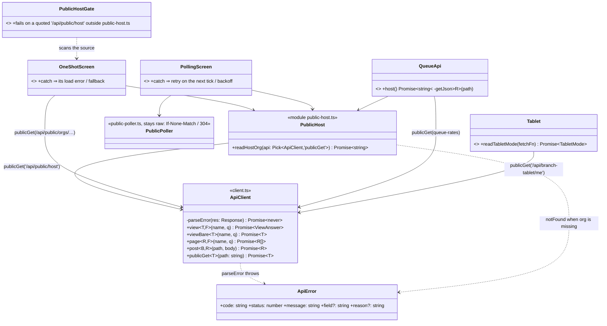

# Web: one shared GET for non-v3 routes, and one reader of the host org (`publicGet`, `readHostOrg`)

> dispatched-by: claude/e8020026 (XC FE lane controller), 2026-10-22 11:39 ICT.
> Extends the `ApiClient` box of `docs/design/xchange-v3-web.md` §5.2 and sits beside `docs/design/web-worded-error.md`.
> It changes no decision in either.
> Skeleton and up-front tests: branch `feat/public-host` (stubs `808b7586`, tests `3f70b6e0`).

## 0. What this was measured from

`main` `01c5ff79`, 2026-10-22 11:30 ICT. Counts exclude tests (`':!*.test.ts' ':!*.test.tsx'`).

| What | Result | Command |
|---|---|---|
| Raw reads of `GET /api/public/host` | **10 call sites in 9 files**: `Book.tsx:146`, `Bookings.tsx:128`, `BranchesScreen.tsx:61`, `HomeScreen.tsx:91` and `:209`, `QueueDisplay.tsx:78`, `RateAlerts.tsx:165`, `RateDisplay.tsx:94`, `TermsText.tsx:26`, `queue-api.ts:188` | `git grep -n "'/api/public/host'" -- web/src <no tests>` |
| Other raw `GET /api/public/*` reads (not the host) | `Book.tsx:165`, `Bookings.tsx:133` and `RateAlerts.tsx:193` (branch list); `TermsText.tsx:31` (consent texts); `QueueDisplay.tsx:46` (queue display); `queue-api.ts:197` (queue rates); `shared/live/public-poller.ts:120` (the `PublicPoller` used by `HomeScreen.tsx:114`, `:155`, `BranchesScreen.tsx:41` and `RateDisplay.tsx:103`, `:104`) | `git grep -n -P "(fetchFn\|doFetch\|props\.fetch\|this\.fetchFn\|this\.fetch)\(" -- web/src <no tests>` |
| Other raw GETs to `/api/` outside v3 | `shared/session/tablet.ts:44` (`GET /api/branch-tablet/me`) | same command |
| Copies of `ApiClient`'s private `parseError` | 2: `queue-api.ts:157-184` (`getJson`, a line-for-line copy) and `RateAlerts.tsx:166-185`, `:194-213` (a partial copy, twice in one function) | read |

## 1. Root cause this removes

`ApiClient` (`web/src/shared/api/client.ts`) has GETs only for `/api/v3/views/*` (`view`, `viewBare`, `page`). A screen
that needs a public route has no shared GET, so it calls `fetch` itself and invents its own failure handling. The
`tablet.ts:17-18` comment states this reason in so many words. The ten copies have drifted:

1. **`Bookings.tsx:128-134` is silent.** A failed host read or branch-list read `return`s. When the customer has
   bookings, a later check (`:170`) happens to show `error.loadFailed`, because no branch has a timezone. When the
   customer has **no** bookings, the screen shows the empty state (`:376`) over a failed load. Measured by
   `Bookings.host-fail.test.tsx` B2–B5 on the skeleton: the error box is `null`.
2. **`QueueDisplay.tsx:76-87` stops for good.** A failed host read `return`s before `poll(true)`. The interval (`:92-93`)
   only calls `poll()`, and `poll()` returns at once while `org` is null (`:42`). One transient failure leaves the
   public calling display blank until someone reloads the wall screen. Measured by `QueueDisplay.host-fail.test.tsx`
   Q1–Q3: one host read in 15 s.
3. **`RateAlerts.tsx:165-189` copies `parseError` twice**, and is silent when the host answers `200` with no org: `org`
   stays `undefined`, no branch is read, and nothing is shown.
4. **`queue-api.ts:157-184` copies `parseError` line for line** in a private `getJson`.
5. **`HomeScreen.tsx` reads the host twice in one file** (`:91` on mount, `:209` on retry), with the same code twice.
6. The other five (`Book`, `BranchesScreen`, `RateDisplay`, `TermsText`, `tablet`) behave correctly today, each with its
   own copy of "read, check `ok`, parse, check `org`".

Fixing a screen at a time cannot end this: the next screen copies whichever version it finds (♻️ rule: several
variants of one job = one shared core).

## 2. Decisions

| # | Decision |
|---|---|
| PH1 | **One GET: `ApiClient.publicGet<T>(path): Promise<T>`.** One `GET` with `credentials: 'same-origin'` and no body. A 2xx answers the parsed JSON. Anything else is refused through the private `parseError`, exactly like `view`, `post` and `command`: an `ApiError` with the server's `code`, `field`, `reason`, `message` and `status`; a string refusal `{"error": "<sentence>"}` is `refused`; a non-JSON body is `httpError`. A network failure rejects with the `fetch` error unchanged. The path guard is `post`'s: a path that does not start with `/api/`, or that starts with `/api/v3/`, rejects with a plain `Error` before any request. `publicGet` is `async`, so a bad path is a rejection, not a synchronous throw. |
| PH2 | **The name stays `publicGet`**, although `/api/branch-tablet/me` is not under `/api/public/`. "Public" here means "outside the v3 views, where `view` cannot go". The guard is by prefix, not by the word `public`, so `tablet.ts` can use it. |
| PH3 | **One reader of the host org: `readHostOrg(api: Pick<ApiClient, 'publicGet'>): Promise<string>`** in a new `web/src/shared/api/public-host.ts`. It makes one `publicGet('/api/public/host')`. A non-empty string `org` answers it. A missing, non-string or empty `org`, or a `null` body, rejects with `ApiError { code: 'notFound', status: 404, message: 'host org not found' }`, the shape `queue-api.ts:189-191` already used. A refusal or a network failure rejects with what `publicGet` rejected with. It never retries and never words the failure: the caller does both (§3). |
| PH4 | **Every raw `/api/public/*` GET in a screen file goes through `api.publicGet`**, not only the host read, in the same ticket as that file's host read. Exception: `PublicPoller` (`shared/live/public-poller.ts`) stays a raw `fetch`, because it sends `If-None-Match` and reads `304` (fleet rule 🔁), which `publicGet` does not do. |
| PH5 | **A screen keeps its own `fetch` prop.** It builds the client from it as it does today (`props.client ?? new ApiClient(fetchFn)`, or `new ApiClient(props.fetch)`), so every existing test that mocks at the fetch level keeps working. `readTabletMode(fetchFn)` keeps its signature (kiosk-shared-phone §7 T-D6). |
| PH6 | **A gate keeps it from coming back** (PH-gate, last). `web/src/shared/api/public-host.gate.test.ts` scans `web/src/**/*.{ts,tsx}` without tests and fails on a quoted `'/api/public/host'` (any of `'`, `"`, `` ` ``) in any file but `shared/api/public-host.ts`. It is written after the last screen ticket merges, so it needs no `KNOWN` list. |

## 3. The behaviour rule per screen on a failed host read

Measured from each screen's code and existing tests on `01c5ff79`. "Kept" = today's behaviour stays, and an existing
test already pins it. "New" = the behaviour changes, and the row says which test pins the new behaviour.

| Screen (file) | Kind | On a host failure (refusal, network, or no org) | Kept / new | Evidence |
|---|---|---|---|---|
| My Bookings (`bookings/Bookings.tsx`) | one-shot, retry button | The load error box `.xc-bookings-error` with `t('error.loadFailed')` and the retry, **whether or not there are bookings**; never the empty state. Same for a failed branch-list read. The retry re-reads the host. | **new** for the no-bookings case | today `:128-134` returns silently; `Bookings.test.tsx:695-712` (#4196) already pins `error.loadFailed` for a failed branch list, so this rule uses the same sentence; new tests `Bookings.host-fail.test.tsx` B1–B6 |
| Calling display (`queue-display/QueueDisplay.tsx`) | polling wall screen, no button | Shows what it shows today (the empty lists). **Every interval tick re-reads the host while the org is unknown**, and on success makes the first display read (no `since`) in the same tick. Once the org is known, the host is never read again. The display read's own failure keeps the last good render (kept). | **new** | today `:76-87` + `:92-93` never retry; new tests `QueueDisplay.host-fail.test.tsx` Q1–Q4 |
| Terms text in sign-up (`sign-in/TermsText.tsx`) | one-shot, inside the form | `loadTerms` answers `null`, and `TermsText` shows the static line `tr('terms')` (`:56-59`). The submit button (`SignUp.tsx:83`) never depends on `TermsText`, and the server checks the consent itself (`consentTextMissing`, `SignUp.tsx:50-51`), so **the customer can still finish signing up.** No error is shown. | kept | `TermsText.test.tsx:70-79` pins the fallback for "the host fails" and four other failures |
| Book (`book/Book.tsx`) | one-shot, retry button | `.xc-book-branches-error` with `t('error.loadFailed')` and the retry; no branch-list read without an org. | kept | `:146-160`; `Book.rework.test.tsx:152` ("host resolution failure shows error state with retry and NEVER calls …/branches") |
| Branches (`branches/BranchesScreen.tsx`) | one-shot host read, retry button; the branch list itself is polled after | `ApiError` with `status === 404` (a 404, or no org) ⇒ `notLinked`; any other failure ⇒ `loadFailed`; both with the retry. The host read is not polled: a person is looking at this screen and has the retry. | kept | `:52-81`, `:137-155` |
| Rate display (`rate-display/RateDisplay.tsx`) | polling wall screen | `ApiError` with `status === 404` ⇒ `notLinked`, no retry; any other failure ⇒ `loadFailed` and `scheduleHostRetry()` with its backoff (from the rates interval, doubling, at most 300 s). | kept | `:77-136` |
| Rate alerts (`rate-alerts/RateAlerts.tsx`) | one-shot, retry button | The branch error shows `wordedError(err)`, for a refusal, a network failure **and an answer with no org** (`readHostOrg`'s `notFound` ⇒ the shared `error.notFound` sentence). | kept for refusals (`RateAlerts.rework.test.tsx:160`); **new** for no org (today silent) | the PH-rate-alerts ticket adds one test for the no-org row |
| Home (`home/HomeScreen.tsx`) | one-shot, retry button | `orgState = 'error'` ⇒ the branches and rates error states with the retry. One local `resolveOrg()` serves both mount and retry. | kept | `:84-104`, `:206-224` |
| Queue page (`queue/queue-api.ts` `host()`) | the caller (`queue-state.ts:114`) handles it | `host()` = `readHostOrg(this.client)`; `getJson` = `this.client.publicGet`. Same rejections as today. | kept | `:157-193`; `queue/*.test.ts*` |
| Branch tablet (`shared/session/tablet.ts` `readTabletMode`) | one read per page load | Fail-open to `{ paired: false }` for every failure, unchanged (T-D6, T12). Only the read moves to `new ApiClient(fetchFn).publicGet('/api/branch-tablet/me')` inside the existing `try`. | kept | `:42-55`; `tablet.test.ts`, `tablet.gaps.test.ts` |

A throwaway implementation of every row of this table (PH-0 and all eleven tickets of §5) kept all 1014 existing
tests of `src/shared/api/`, `src/screens/customer/`, `src/shared/session/` and the five gates green, and turned all the
new tests green (§6).

## 4. Class diagram

| Module | File | Ticket |
|---|---|---|
| `ApiClient.publicGet` | `web/src/shared/api/client.ts` | PH-0 |
| `readHostOrg` | `web/src/shared/api/public-host.ts` (new) | PH-0 |
| their tests | `web/src/shared/api/public-host.test.ts` (new) | written up front, `3f70b6e0` |
| one screen's switch | that screen's file (§5) | one PH-n ticket each |
| the gate | `web/src/shared/api/public-host.gate.test.ts` (new) | PH-gate |

## 5. Ticket split

Every screen ticket needs PH-0 merged into `feat/public-host`. The screen tickets have disjoint File scopes and can all
run at once (10 workers). Each one: replace the file's host read with `readHostOrg(api)` and every other raw
`/api/public/*` GET in that file with `api.publicGet` (PH4), keep the `fetch` prop (PH5), and keep the row of §3. No
ticket edits a test it did not create.

| Ticket | Class | Does | File scope | Needs |
|---|---|---|---|---|
| **PH-0** | logic | `publicGet` and `readHostOrg` bodies (PH1, PH3). Up-front tests given: `public-host.test.ts` (16 tests). | `web/src/shared/api/client.ts` `web/src/shared/api/public-host.ts` | this doc |
| **PH-bookings** | logic | §3 row My Bookings. `loadBranches` catches a failed host or branch-list read and sets `t('error.loadFailed')`. Up-front tests given: `Bookings.host-fail.test.tsx` (6). | `web/src/screens/customer/bookings/Bookings.tsx` | PH-0 |
| **PH-queue-display** | logic | §3 row Calling display; the display read through `api.publicGet` too. Up-front tests given: `QueueDisplay.host-fail.test.tsx` (7). | `web/src/screens/customer/queue-display/QueueDisplay.tsx` | PH-0 |
| **PH-terms** | mechanical | §3 row Terms text. | `web/src/screens/customer/sign-in/TermsText.tsx` | PH-0 |
| **PH-book** | mechanical | §3 row Book; the branch list through `api.publicGet` (the `api` whose fetch wrapper resets `submitting`, `Book.tsx:79-92`). | `web/src/screens/customer/book/Book.tsx` | PH-0 |
| **PH-branches** | mechanical | §3 row Branches: `catch (err)` ⇒ `err instanceof ApiError && err.status === 404 ? 'notFound' : 'error'`. | `web/src/screens/customer/branches/BranchesScreen.tsx` | PH-0 |
| **PH-rate-display** | mechanical | §3 row Rate display, same 404 mapping, `scheduleHostRetry()` otherwise. | `web/src/screens/customer/rate-display/RateDisplay.tsx` | PH-0 |
| **PH-rate-alerts** | mechanical | §3 row Rate alerts; deletes both `parseError` copies. Adds one test: the host answers `200 {}` ⇒ the branch error shows the shared `error.notFound` text in TH and EN (red on revert). | `web/src/screens/customer/rate-alerts/RateAlerts.tsx` `web/src/screens/customer/rate-alerts/RateAlerts.host-org.test.tsx` | PH-0 |
| **PH-home** | mechanical | §3 row Home: one `resolveOrg()` for mount and retry. | `web/src/screens/customer/home/HomeScreen.tsx` | PH-0 |
| **PH-queue-api** | mechanical | §3 row Queue page: `host()` ⇒ `readHostOrg(this.client)`, `getJson` ⇒ `this.client.publicGet` (deletes the `parseError` copy). | `web/src/screens/customer/queue/queue-api.ts` | PH-0 |
| **PH-tablet** | mechanical | §3 row Branch tablet; the `tablet.ts:17-18` comment loses its "no plain GET" reason. | `web/src/shared/session/tablet.ts` | PH-0 |
| **PH-gate** | mechanical | PH6. Its own tests: a fixture file with a quoted host path fails; `public-host.ts` and a comment mention pass. | `web/src/shared/api/public-host.gate.test.ts` | every PH ticket above |

Behaviour tables for the mechanical tickets are the §3 rows they name; the existing tests listed there must stay green
unedited, and the reviewer runs those files by name.

## 6. Tests written before implementation

On `feat/public-host` `3f70b6e0`, run 2026-10-22 11:38 ICT:

| File | Red on the skeleton | Green guards | Red for this reason |
|---|---|---|---|
| `web/src/shared/api/public-host.test.ts` | 16 / 16 | 0 | the stubs reject with `Error('PH-0')` |
| `web/src/screens/customer/bookings/Bookings.host-fail.test.tsx` | 4 / 6 (B2–B5) | B1, B6 | with no bookings the empty state is shown and the error box is `null` |
| `web/src/screens/customer/queue-display/QueueDisplay.host-fail.test.tsx` | 6 / 7 (Q1 ×4, Q2, Q3) | Q4 | one host read in 15 s; the display is never read |

The whole web suite on `3f70b6e0`: 675 files, 5517 tests, 26 failed (exactly the 26 above), 5491 passed.

## 7. Data migration

None. This is web-only and touches no table, column or stored value.
