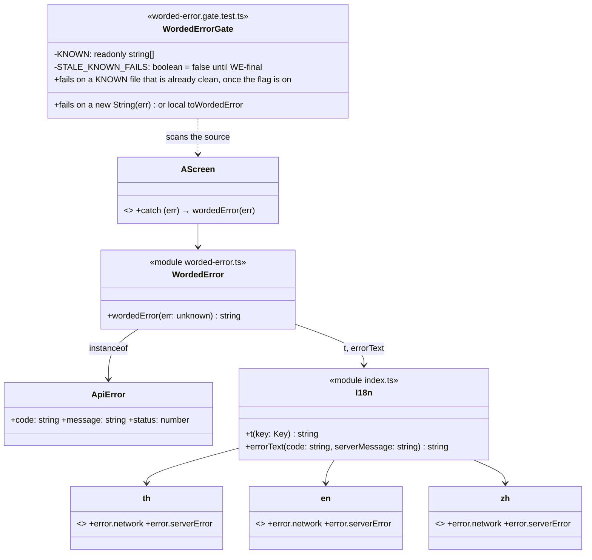

# Web — one shared way to word a failed call (`wordedError`)

> dispatched-by: claude/e92db6 (xchange FE lane controller), 2026-10-14.
> Extends `docs/design/xchange-v3-web.md` §2 W10 point (4) and the §5.2 class diagram. It changes no decision there.

## 0. What this was measured from

`main` `df6e6927`, 2026-10-14. Every count below excludes tests. Each command adds the pathspecs `':!web/src/**/*.test.ts' ':!web/src/**/*.test.tsx'`, written as `<no tests>` here.

| What | Count | Command |
|---|---|---|
| Local helpers that word a failure, by name | **25 files** under the three common names: `toWordedError` ×10, `toErrorText` ×9, `refusalText` ×6. Others exist (`formatError` in `Campaigns.tsx:64` and `RateAlertSettings.tsx:26`, `formatErrorMsg` in `RateAlerts.tsx:76`, `message()` in `CashFlows.tsx:151`), which is why WE5 does not rely on names | `git grep -l -E "(function\|const) (toWordedError\|toErrorText\|refusalText)[ (=<:]" -- web/src <no tests>` |
| `String(err)` (or `e`/`error`) | 55 lines in 29 files. 27 are under `screens/`; 2 are in `shared/`: `shared/notifications/notifications.ts` and `shared/ui/QueuePanel.tsx` | `git grep -n -E "String\((err\|e\|error)\)" -- web/src <no tests>` |
| Any `errorText(` call outside `web/src/shared/i18n/` (WE5 signal 3) | 37 files | `git grep -l "errorText(" -- 'web/src/*.ts' 'web/src/*.tsx' <no tests> ':!web/src/shared/i18n/*'` |
| **Union of the three WE5 signals** | **51 files** in 45 folders. 50 of them get a ticket (§4.1); `shared/ui/form.ts` is excluded (WE5) | the three file lists, `sort -u` |

The 25 helper files:
- `toWordedError` (10): `admin/bookings/BookingsScreen`, `admin/cash/Cash`, `admin/overview/Overview`, `admin/payments/Payments`, `admin/reports/Reports`, `admin/slips/Slips`, `admin/transactions/Transactions`, `desk/referral/ReferralCodeField`, `devices/DevicesScreen` and `staff/StaffPage`.
- `toErrorText` (9): `admin/branches`, `admin/rates`, `admin/users`, and the `staff` cards `attendance`, `floor`, `holds`, `rates`, `shift` and `transfers`.
- `refusalText` (6): `admin/cash-policy`, `admin/cash/calculators/ShiftValuationPanel`, `admin/starting-prices`, `desk-transaction`, `documents/refusal.ts` and `shared/notifications/notifications.ts`.

## 1. Root cause this removes

W10 (4) decided how a server refusal is shown: `t('error.' + code)` when that key exists, otherwise the server's own (Thai) message. `errorText(code, serverMessage)` (`web/src/shared/i18n/index.ts:102`) implements exactly that. **Nothing shared covers the other two cases**, so each screen invents its own handling:

1. **The call never reached the server** (a `TypeError` from `fetch`, a timeout). There is no `ApiError`, so there is no code. Screens show `String(err)`, e.g. `TypeError: Failed to fetch`, or hide the failure. Examples:
   - `AdminShell.tsx:241-243` → `:643`;
   - `admin/bookings/BookingsScreen.tsx:209`, `:267`;
   - `admin/customers/Customers.tsx:451`.
2. **The server failed** (5xx, `serverError`, `httpError`). Its message is not a sentence for a person.

Screens and the 2026-10-14 worded-error tickets (#1687–#1720) fixed these one screen at a time. Each fix added a local helper, and the copies (at least 25, §0) already disagree:
- `admin/overview/Overview.tsx:43` special-cases `outOfScope`;
- `staff/StaffPage.tsx:28` maps 5xx to `serverError`;
- `admin/cash/Cash.tsx:49` and `devices/DevicesScreen.tsx:138` replace **every** unknown code with the generic text. That contradicts W10 (4), because it drops the server's own sentence;
- 8 of the 10 `toWordedError` copies carry the Thai literal `'เซิร์ฟเวอร์ขัดข้อง'` as a default, even under EN.

Some of those PRs merged today with the generic text for an unknown code, so they dropped the server's sentence: 1706 (devices), 1724 (cash policy), 1725 (attendance) and 1707 (rates). The ticket batch's "no raw `err.message`" check asked for that. **That check was too wide and conflicts with W10 (4)**, so the WE-n tickets restore the server's sentence on those screens (§4).

Fixing a screen at a time cannot end this. The next screen copies whichever version it finds (♻️ rule: several variants of one job = one shared core).

## 2. Decisions

| # | Decision |
|---|---|
| WE1 | **One function, `wordedError(err: unknown): string`**, in a new file `web/src/shared/i18n/worded-error.ts`. Every screen shows a failed call through it, and a screen never words a failure itself. |
| WE2 | **Its rule is W10 (4), extended to the two cases it did not cover.** Each case is checked in this order: (a) `ApiError` with `status >= 500`, or code `serverError` / `httpError` → `t('error.serverError')`. This case is checked first on purpose: if the server ever sends a worded code with a 5xx, the user still sees "server error". Today every v3 5xx is `serverError`. (b) Any other `ApiError` → `errorText(code, message)`, which is W10 (4) unchanged: the shared key when it exists, otherwise the server's sentence. If `message` is empty or equals `code`, use `t('error.serverError')` instead. (c) Anything else (no `ApiError`: network, timeout, a thrown non-error) → a new shared key, `t('error.network')`. It never returns `String(err)`, a bare code, or a JS error message. |
| WE3 | **The new shared key is `error.network`.** th: `เชื่อมต่อเซิร์ฟเวอร์ไม่ได้ กรุณาลองใหม่`; en: `Cannot reach the server. Please try again.` zh: `无法连接服务器，请重试。` All three tables get the key: `zh.ts:3` is `Record<Key, string>`, so a key missing from `zh.ts` is a compile error. This is the one shared-table edit; screen tickets never add shared keys (W10 point 1). |
| WE4 | **A screen-specific wording still lives in the screen.** A screen that wants its own sentence for one code (e.g. Overview's `outOfScope`) checks that code first, then falls through to `wordedError(err)`. It does not copy the rest of the rule. |
| WE5 | **A gate keeps it from coming back.** `web/src/shared/i18n/worded-error.gate.test.ts` scans `web/src/**/*.{ts,tsx}`. It excludes tests and `worded-error.ts` itself. A file **offends** when it contains any of these: (1) `String(err)` / `String(e)` / `String(error)`; (2) a local helper named `toWordedError`, `toErrorText` or `refusalText`; (3) **any `errorText(` call** outside `web/src/shared/i18n/`. This one is structural, not name-based, so it catches a helper under any name, e.g. `formatError`, `message()`, or `err().message`. A screen that follows WE1/WE4 never calls `errorText` itself; its own sentences go through its `screenT`. **One exclusion, listed in the gate with its reason:** `web/src/shared/ui/form.ts`. `useForm` receives an `ApiError` refusal already split into `{code, message}`, and shows it through `errorText` by design (`xchange-v3-web.md` §5.2: `useForm --> I18n : errorText(code, message)`). That is W10 (4) itself, not a copy of it. The gate holds a `KNOWN` list, frozen at the files that offend on the day WE-1 merges, and a flag `STALE_KNOWN_FAILS`. **Half 1, always on:** an offending file that is not in `KNOWN` fails. So no new file may add one. **Half 2, `STALE_KNOWN_FAILS = false` until WE-final:** a `KNOWN` file that no longer offends is only **listed** in the test output, not failed. So a WE-n ticket that cleans its file stays green **without editing `KNOWN`**, and the WE-n tickets never collide on the gate file. WE-final removes the clean files from `KNOWN` and sets the flag to `true` in the same commit, so the list cannot rot after that. |

## 3. Class diagram

| Module | File | Ticket |
|---|---|---|
| `wordedError` | `web/src/shared/i18n/worded-error.ts` (new) | WE-1 |
| `error.network` key | `web/src/shared/i18n/th.ts`, `en.ts`, `zh.ts` | WE-1 |
| its unit tests | `web/src/shared/i18n/worded-error.test.ts` (new) | WE-1, written up front by the ticket author |
| the gate and its `KNOWN` list | `web/src/shared/i18n/worded-error.gate.test.ts` (new) | WE-1 creates it; WE-final shrinks `KNOWN` |
| one folder's switch to `wordedError` | the offending files **directly in** that folder (§4.1) + one new `*.worded.test.tsx` there | one WE-n ticket per row of §4.1 |

`worded-error.ts` and the gate are separate files from `index.ts`, so WE-1 does not lock the i18n core that other tickets touch.

## 4. Ticket split

| Ticket | Does | Blocked by |
|---|---|---|
| **WE-1** | `wordedError`, `error.network`, the unit tests, and the gate with `KNOWN` frozen and `STALE_KNOWN_FAILS = false`. The gate's own tests cover each half: a new offender fails; a clean `KNOWN` file is listed but passes while the flag is off, and fails once it is on. Rewrites no screen. | this doc merging |
| **WE-2 … WE-46** (one per row of §4.1: 45 folders) | In one folder: replace every offender (WE5's three signals) with `wordedError(err)`, keeping any WE4 screen-specific code first. For **each** changed catch, three tests, each going red on revert: (1) a network `TypeError` shows `error.network`'s text in TH and EN; (2) a 500 shows `error.serverError`'s text; (3) a refusal with a code that has **no** shared key, plus a server `message`, shows that message. It must go red with a generic fallback; this pins W10 (4). `class:mechanical`, one folder. The ticket does **not** edit the gate's `KNOWN`. | WE-1 |
| **WE-final** | Remove clean files from `KNOWN` and set `STALE_KNOWN_FAILS = true`, in one commit. | all WE-n merged |
| **WE-form** (#1848) | `useForm` (`web/src/shared/ui/form.ts`) shows `wordedError(err)` for a 5xx/`httpError`, the case WE-1 §6 set aside. FE follow-up (owner's choice A, 2026-10-15). | WE-1 |
| **WE-f1** (#1844) | CashPolicy `policyError` and Campaigns `campaignError` check the 5xx case before their local code tables (WE2 (a)). FE follow-up (owner's choice A, 2026-10-15). | WE-8, WE-9 |
| **WE-f2** (#1862) | One exported `isServerFailure(err)` in `worded-error.ts`, used by `wordedError` and the two screens of WE-f1 instead of three copies (♻️). FE follow-up (owner's choice A, 2026-10-15). | WE-f1 |
| **WE-f3** (#1873) | Test-only: pin one `admin_employees` read per branch switch; fix the `Slips.rework.test.tsx:137` title. FE follow-up (owner's choice A, 2026-10-15). | WE-10 … WE-46 |
| **WE-f4** (#1740) | `/staff`: a non-401 `staff_me` failure shows `wordedError(err)` instead of a blank page. FE follow-up (owner's choice A, 2026-10-15). | WE-38 |

### 4.1 Folders and their files

A **folder means only the files directly in it**, never its subfolders. `screens/admin/` holds only `AdminShell.tsx`, and `screens/admin/cash/` does not hold `calculators/`. A WE-n ticket's file scope lists those files one by one, plus its new test, and never reserves a directory. That keeps nested folders from colliding. Measured on `main` `df6e6927`:

| Folder | Offending files |
|---|---|
| `screens/admin/` | `AdminShell.tsx` |
| `screens/admin/alert-settings/` | `AlertSettings.tsx` |
| `screens/admin/approvals/` | `Approvals.tsx` |
| `screens/admin/bookings/` | `BookingsScreen.tsx` |
| `screens/admin/branches/` | `BranchesScreen.tsx` |
| `screens/admin/campaign-performance/` | `CampaignPerformance.tsx` |
| `screens/admin/campaigns/` | `Campaigns.tsx` |
| `screens/admin/cash-policy/` | `CashPolicy.tsx` |
| `screens/admin/cash/` | `Cash.tsx`, `CashFlows.tsx` |
| `screens/admin/cash/calculators/` | `ProfitSummaryPanel.tsx`, `ShiftValuationPanel.tsx` |
| `screens/admin/consent/` | `Consent.tsx` |
| `screens/admin/customers/` | `Customers.tsx` |
| `screens/admin/denomination-groups/` | `DenominationGroups.tsx` |
| `screens/admin/employees/` | `Employees.tsx` |
| `screens/admin/executive/` | `Executive.tsx` |
| `screens/admin/overview/` | `Overview.tsx` |
| `screens/admin/parts/` | `NewTransactionButton.tsx`, `TransactionDetail.tsx`, `pending-write.tsx` |
| `screens/admin/payments/` | `Payments.tsx` |
| `screens/admin/rate-alert-settings/` | `RateAlertSettings.tsx` |
| `screens/admin/rates/` | `Rates.tsx` |
| `screens/admin/reconciliation/` | `Reconciliation.tsx` |
| `screens/admin/reports/` | `Reports.tsx` |
| `screens/admin/slips/` | `Slips.tsx` |
| `screens/admin/starting-prices/` | `StartingPrices.tsx` |
| `screens/admin/transactions/` | `Transactions.tsx` |
| `screens/admin/users/` | `UsersScreen.tsx` |
| `screens/customer/assistant/` | `AssistantScreen.tsx` |
| `screens/customer/rate-alerts/` | `RateAlerts.tsx` |
| `screens/customer/sign-in/` | `SignUp.tsx` |
| `screens/desk-transaction/` | `TransactionScreen.tsx` |
| `screens/desk/referral/` | `ReferralCodeField.tsx` |
| `screens/desk/steps/customer/` | `step.tsx` |
| `screens/devices/` | `DevicesScreen.tsx` |
| `screens/documents/` | `DocumentsScreen.tsx`, `refusal.ts` |
| `screens/kiosk-currencies/` | `KioskCurrenciesScreen.tsx` |
| `screens/staff-report/` | `StaffReport.tsx` |
| `screens/staff/` | `StaffPage.tsx` |
| `screens/staff/attendance/` | `AttendanceCard.tsx` |
| `screens/staff/floor/` | `FloorCard.tsx` |
| `screens/staff/holds/` | `HoldsCard.tsx` |
| `screens/staff/rates/` | `RatesCard.tsx` |
| `screens/staff/shift/` | `ShiftCard.tsx` |
| `screens/staff/transfers/` | `TransfersCard.tsx` |
| `shared/notifications/` | `notifications.ts` |
| `shared/ui/` | `QueuePanel.tsx` |

## 5. Data migration

None. This is web-only and touches no table, column or stored value.
