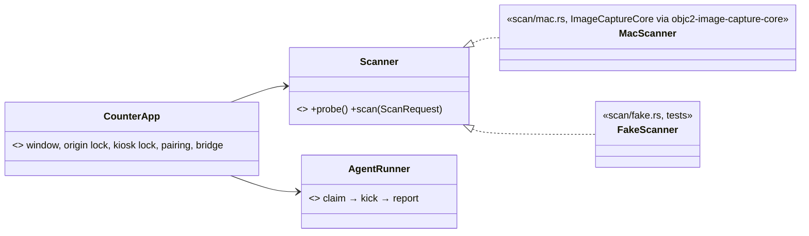
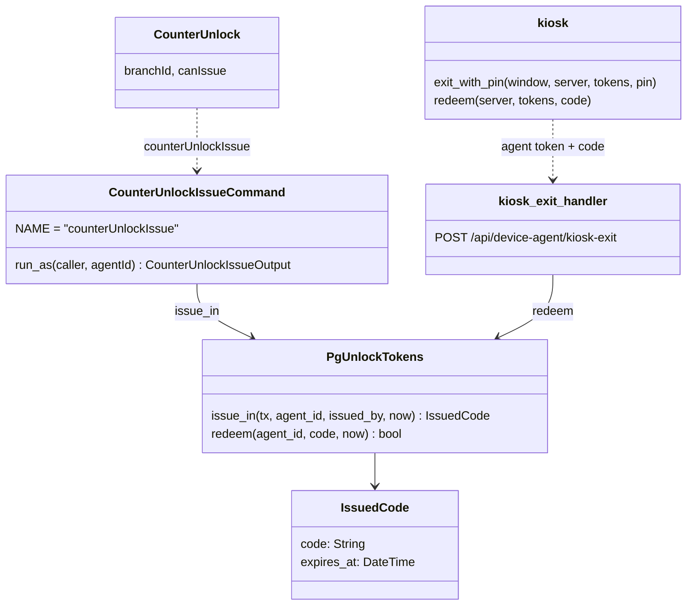

# XC Counter: a Mac app that wraps the staff desk and drives the counter's devices

> designed-by: claude/022a7453 · 2026-11-06 · measured on `main` at `f5a0932`
> Owner, 2026-11-06 (in order):
> - *"รูปพาสปอร์ต เชื่อม เครื่อง สแกนเลยได้ไหม"*, *"ให้เปิดเครื่อง สแกน เลย"*, *"USB"*, *"Mac เปลี่ยน"*;
> - *"kiosk ฝั่งพนัก งาน"*;
> - *"ให้ มี config ว่า รอง รับลิ้นได้"*, *"ใช่ ลิ้นชักเงิน"*;
> - *"มันต้อง ครอบ ด้วย แอป"*, *"มันถึงจะคุมลิ้น ชักได้ หรือ ผ่านเว็บได้"*;
> - then, picking option A over "web + the background agent": *"แอปครอบ"*.
>
> This replaces the first version of this file (a scan job through the server). The owner's approval of that version's migration
> ("อนุมัติ migration", 09:23 ICT) covered §4 of that version. That §4 is withdrawn; §5 below is a new migration and needs its own approval.

## 1. Why an app

- **A browser cannot drive the counter's devices.**
  - The cash drawer opens through the receipt printer it is wired to.
  - The scanner is USB.
  - No web API reaches CUPS, a USB scanner or ImageCaptureCore, and Safari has no WebUSB.
- **Today a background program does the drawer.**
  - `api/crates/xc-device-agent` pairs one machine to its branch and claims `device_jobs(kind='DRAWER_REQUEST')` from the server
    (`client.rs`, `runner.rs`). It kicks the drawer over CUPS or TCP (`cups_transport.rs`, `tcp_transport.rs`).
  - **One agent per branch**: `device_agents_one_active_per_branch_idx` (`20261008120000_device_agents.sql`).
  - So a branch cannot have a scanner-only staff kiosk and a drawer counter side by side.
- **Nothing scans.** The desk only takes an attached file (`web/src/screens/desk/ocr/PassportOcr.tsx:171-184`).

The app is **one install per counter**. It is the counter's identity. It shows the staff desk full-screen, so staff cannot browse away.
It owns the counter's devices: the drawer, and the scanner when the owner says the counter has one.

## 2. What the app is

**A thin shell, never a second UI (owner: *"เราใช้ แอฟ ครอบแล้วมันง่าย"*, *"แต่pos ผมทำ แอป เพียว เลย มันเลยยาก"*).**
`pos108-terminal` rebuilt every screen natively in Slint, and that made it hard. XC Counter draws **no screen of its own** beyond
the pair-code field and the manager-code exit (§8.8). Every desk and kiosk screen stays the web app, so there is one codebase and one look
(`xchange-one-look.md`). The app adds only what a browser cannot do: device access, kiosk lock and counter identity.
From `pos108-terminal` it reuses only the release machinery: signed bundles and self-update.

- **Tauri 2, Rust, macOS first.**
  - Rust matches the fleet. The drawer code is the existing agent crate, used as a library, not rewritten.
  - The webview is WKWebView, the system's own; no Chromium ships.
  - It builds for `aarch64-apple-darwin` and `x86_64-apple-darwin`, the targets `device-agent.yml:59-62` already builds.
- **Stable only (owner: *"เอาที่เสถียร์ นะ"*).**
  - Tauri 2 from its stable release line, with an exact version pinned in `Cargo.toml` and `Cargo.lock` (`=2.x.y`). No beta, RC or nightly.
  - Only official `tauri-plugin-*` crates; no community plugin. ImageCaptureCore comes through the `objc2` framework crates, also pinned.
  - The fleet's pinned Rust toolchain is used.
  - Upgrades happen only in a release commit, never in a feature PR.
- **IPC pinned (review item 4).**
  - The Tauri capability for the bridge commands names **one exact `https` origin** from the app's config, scoped to the paths `/desk*` and `/kiosk-staff*`.
  - Only the app's own commands are exposed (`info`, `scanPassport`, `deskBinding`), and no core or plugin command is reachable from the page.
  - `on_navigation` refuses every other URL, and `new-window` is refused.
  - The agent token and the Keychain stay in Rust; no command returns them.
- It opens the configured server (`https://xc-v3.spacing.cloud` on staging) at `/desk`, and external links open in Safari. The scope is stated once, under "IPC pinned" above.
- **Kiosk lock**, owner-set per counter (§4):
  - full-screen with no window chrome;
  - Cmd+Q, Cmd+W and Cmd+Tab are intercepted while locked;
  - leaving needs a one-time code a manager issues at the desk, checked by the server (§8.8).
- **Pairing reuses the agent's.**
  - On first run the app shows a pair-code field, `POST /api/device-agent/pair`, exactly as today.
  - The token is kept in the macOS Keychain, never in a file.
  - The counter's name, for example "เคาน์เตอร์ 1", is set by the owner when creating the pair code.
- **Updates.** Signed and notarised. It updates itself from the release feed, as `pos108-terminal` does for its bundles.

## 3. The bridge (what the desk can ask the app)

The desk detects the app through `window.xcCounter`, which is present only inside the app.

| Call | Does | Answers |
|---|---|---|
| `xcCounter.info()` | who this counter is | `{ agentId, counterName, branchId, capabilities: { cashDrawer, scanner, kioskLock }, appVersion, build }` |
| `xcCounter.scanPassport()` | scans one page: colour, 300 dpi, JPEG, whole bed, 60 s timeout | `{ ok: true, file: Blob }`, or `{ ok: false, reason: 'noScanner' \| 'busy' \| 'timeout' \| 'coverOpen' \| 'device' }` |
| `xcCounter.openDrawer()` | not offered | the drawer stays server-driven (below) |
| `xcCounter.bindCounter()` | gets a one-time nonce through the app's Rust side and calls `deskBindCounter(nonce)` (§5.4) | `{ ok }` |

- **Scan.** The desk puts the returned file into `store.passport()`, exactly as an attached file. From there the **existing** upload
  and OCR run unchanged. Nothing new crosses the server, so the scan needs no migration of its own.
- **Drawer.** It stays on the existing, audited path: server-created `DRAWER_REQUEST` jobs, claimed by the agent runner that now runs
  **inside the app**. The only change is that a job targets a counter (§5). The drawer opens at the counter that made the sale, not
  at any agent in the branch.
- **Outside the app** (a plain browser): `xcCounter` is absent. The desk hides "สแกนพาสปอร์ต" and keeps the file field. Drawer jobs
  that target a counter with no app running stay QUEUED and expire as today.

## 4. Per-counter config (owner-set, rule #5993)

| Setting | Default ("not set") | Effect |
|---|---|---|
| `cashDrawer` (รองรับลิ้นชักเงิน) | off | On: the desk may make cash sales at this counter, and its drawer jobs target it. Off: the counter can take customers, key, scan and issue queue tickets, but a cash payout is refused here, worded: "เคาน์เตอร์นี้ไม่มีลิ้นชักเงิน — ส่งไปชำระที่เคาน์เตอร์ที่มีลิ้นชัก" |
| `scanner` (มีเครื่องสแกนพาสปอร์ต) | off | On: the desk shows "สแกนพาสปอร์ต" and calls `scanPassport()` |
| `kioskLock` (ล็อกเต็มจอ) | on | Full-screen lock as in §2 |

- Only the Owner saves these. The screen is Admin → สาขา → เคาน์เตอร์. It lists the branch's paired counters and their last-seen time,
  with the three toggles and the counter name.
- The app reads them in `info()` from the server at start and on every claim, so a change applies without reinstalling.
- **Decided (owner, "อนุมัติ + กฎ A", 2026-11-06 09:29 ICT): rule A.** At a counter with `cashDrawer` off, a cash sale is refused with the
  worded message above. The teller sends the customer to a drawer counter, where the sale is keyed. No new transaction state is added.

## 5. Data (owner approved the first version, "อนุมัติ + กฎ A", 2026-11-06 09:29 ICT; §5.4's column was approved separately; deploy is a separate order)

One forward-only migration. It is revised after review (PR 6361, claude/f8fcb767, five must-fixes at `26fda56`); §5.4 asks the owner about the parts that go beyond his 09:29 approval.

### 5.1 Several counters per branch
- Drop `device_agents_one_active_per_branch_idx`, and add `device_agents.counter_name text NOT NULL DEFAULT ''`.
- **Code that ships in the same change (CA-0), because it relies on that index:**
  - `insert_agent`'s `ON CONFLICT (branch_id) WHERE revoked_at IS NULL` (`pg_agent_repository.rs:189-194`) becomes a plain insert. Creating a pair code no longer replaces the branch's active agent; it adds a counter.
  - `has_active_agent_in` (`:147-158`) becomes `active_agents_in`, which lists the counters.
  - `branch_tablet_store_test.rs:335`, which pins the index, is restated by the controller.

### 5.2 Per-counter config, "not set" is safe (rule #5993)
- Add `device_agents.cash_drawer boolean NULL`, `device_agents.scanner boolean NULL` and `device_agents.kiosk_lock boolean NULL`.
- **Each value is the owner's, and nothing is inferred** (owner: *"ว่าจะมี ลื้นช้กหรือไม่ม่ก็ได้"*, a counter may have a drawer or not, as he sets it).
  - NULL means not set, and the not-set value is the safe one:
    - `cash_drawer` NULL = **off**: no cash payout and no drawer jobs at that counter;
    - `scanner` NULL = **off**;
    - `kiosk_lock` NULL = **on**.
  - The Admin screen shows "ค่าเริ่มต้น" while a value is NULL.
- **No backfill, and no derivation from `drawer_transport`.** On xc-v3, the drawer agent paired today stops claiming drawer jobs until the owner turns `cash_drawer` on for it. That takes one click on the new screen (CA-2), and nothing is in production. `drawer_transport` and `drawer_target` stay as the agent's report of *how* it would kick the drawer, not *whether* the counter has one.
- **Wire change, so a counter without a drawer can claim (review round 2, item 1).**
  - `ClaimRequest.drawer` becomes `Option<DrawerTargetDto>`, in both `api/src/presentation/dto/device_agent.rs:26-41` (the server) and
    `api/crates/xc-device-agent/src/client.rs` (the agent).
  - The app sends `None` when the counter has no drawer configured locally.
  - The claim writes `drawer_transport = $8` and `drawer_target = $9` as sent, NULL included (`pg_agent_repository.rs:241`, `:270`; today `COALESCE`).
  - Today's agent always sends a drawer, so its behaviour is unchanged.
  - Ownership: CA-1 owns the server DTO and the claim SQL. CA-3 owns the agent's `client.rs`. The shape is pinned here.

### 5.3 Drawer jobs target a counter
- Add `device_jobs.target_agent_id uuid NULL REFERENCES device_agents (id)`.
- **Claim:** agent X may claim a job when `target_agent_id = X`, or when `target_agent_id IS NULL` and X's `cash_drawer` is on. When several such agents exist, the one claiming wins under the lease, as today; the claim SQL prefers agents whose `last_seen_at` is within the claim window, so a closed app does not stall NULL-target jobs.
- **Revoke** (`pg_agent_repository.rs:452-456`, `:573-577`, review item 2): revoking counter X fails only the QUEUED or LEASED jobs with `target_agent_id = X`. NULL-target jobs are failed only when no other active agent with `cash_drawer` on remains in the branch; otherwise they stay QUEUED for that agent.
- The other claim queries (`:302,321,348`) take the claim rule above.
- Revoke now fails LEASED jobs too; today they are left to lapse. A late report under that lease cannot land, because the report requires `status = 'LEASED'` (`:414-415`). That is accepted.

### 5.4 A counter the server can trust (review item 5): approved by the owner ("อนุมัติ", 2026-11-06 09:59 ICT)
The desk must not name its own counter, since any page could claim to be the drawer counter.
- **Binding.** The app's Rust side, holding the agent token that JS never sees, calls `POST /api/device-agent/desk-binding`.
  - The server answers a nonce: an **HMAC-signed `{agentId, branchId, exp: now+60s}`**, signed with the server's existing secret. It is not stored, so there is no table and it works with several API instances.
  - A replay inside the 60 s only binds the same counter again, which is harmless.
  The app hands the nonce to the desk page once, through the bridge. The desk calls the command `deskBindCounter(nonce)` with its staff session.
  - `deskBindCounter` **refuses** unless the signature and `exp` are valid, the agent is active (not revoked), and the agent's `branch_id` equals the staff session's `branch_id` (the column `api/crates/xc-auth/src/application/session/session_service.rs:402` writes).
  - The app re-binds after every sign-in and on each desk load. `refresh` updates the row in place (`session_service.rs:778`), so the binding survives a refresh; a new sign-in writes a new row.

  The server then records `user_sessions.counter_agent_id = X` on the staff session row that `create_session_for_user` writes (`api/crates/xc-auth/src/application/session/session_service.rs:354`) (a new nullable column, approved). It is cleared on sign-out and on revoke.
- **Server-side use:** drawer jobs from that session get `target_agent_id = counter_agent_id`. Rule A reads the bound counter's `cash_drawer`.
- **A session with no bound counter** (a plain browser) follows **a branch setting the owner sets**, not a rule the system infers.
  Owner: *"ก็ผมมีให้ มี config แล้วไง"*.
  - The setting is `cashFromBrowser` (จ่ายเงินสดจากเบราว์เซอร์ได้), stored in `branch_settings`, which needs no migration. Only the Owner saves it, on Admin → สาขา → เคาน์เตอร์.
  - On: an unbound session may pay out cash, as today. Its drawer jobs get `target_agent_id NULL`.
  - Off: cash payout needs a session bound to a counter whose `cash_drawer` is on; rule A's message is shown otherwise.
  - "Not set" = **on**, today's behaviour. That keeps every current desk working until the owner turns it off, and the screen shows "ค่าเริ่มต้น (เปิด)".

## 6. Shape (♻️ one core, one part per platform)

A later Windows (WIA) or Linux (SANE) counter is one more `Scanner` file, plus a build target.

## 7. Rollout

| Ticket | What | Who |
|---|---|---|
| CA-0 | migration §5 plus the code that relied on the dropped index (§5.1), and the revoke and claim rules (§5.3); approved | Gemini (guarded); up-front migration test by the controller |
| CA-1 | server: counter config view/save (owner-only), `info` answer, claim by target, desk cash-sale refusal at a no-drawer counter (rule A) | Gemini (logic); up-front tests |
| CA-2 | Admin → เคาน์เตอร์ screen: list, rename, three toggles | Gemini (logic); up-front tests |
| CA-3 | app shell: Tauri window, origin lock, kiosk lock, pairing, Keychain token, the `xcCounter.info` bridge, the agent runner inside | Gemini (logic) |
| CA-4 | app: `Scanner` trait, `FakeScanner`, `MacScanner`, `scanPassport` bridge; proven on the real Mac with the real scanner | Gemini (logic) |
| CA-5 | desk: detect `xcCounter`, the "สแกนพาสปอร์ต" button, refusals, hand the file to the existing OCR | Gemini (logic); up-front tests |
| CA-6 | release: signing, notarisation and update feed (needs the Apple developer account the owner already uses for `pos108-terminal`) | controller and owner |

**Still needed from the owner:** the scanner model. The check is to open Image Capture on the counter Mac and see whether the scanner is listed.
§5 and rule A are decided.

## 8. Skeleton contract (sub-controller claude/4beadaaf, `feat/xc-counter`, 2026-11-06)

This section fixes the names and wire shapes that the skeleton commits and the CA tickets share. If a ticket and this section disagree, the ticket says why. It also settles the carried review items (PR 6361, issuecomment-6675718900).

### 8.1 Migration (skeleton, not CA-0)
The skeleton writes the §5 migration, so CA-0 and CA-1 can run their DB tests in parallel instead of in a chain. The DDL is exactly §5.1–§5.4: drop `device_agents_one_active_per_branch_idx`; add `device_agents.counter_name`, `cash_drawer`, `scanner`, `kiosk_lock`, `device_jobs.target_agent_id` and `user_sessions.counter_agent_id`. The skeleton also turns `insert_agent` into a plain insert (§5.1 bullet 1), because an `ON CONFLICT` with no matching index errors. CA-0 keeps the rest of §5.1 and §5.3.

### 8.2 Agent HTTP (agent bearer token, `api/src/presentation/http/device_agent.rs`)
| Route | Body | 200 answer |
|---|---|---|
| `POST /api/device-agent/claim` | as today, `drawer` optional (absent or `null` = this counter has no drawer configured locally) | as today |
| `GET /api/device-agent/info` | — | `{ agentId, counterName, branchId, capabilities: { cashDrawer, scanner, kioskLock } }`, each capability a resolved boolean (NULL → false, false, true) |
| `POST /api/device-agent/desk-binding` | `{}` | `{ nonce, expiresAt }` |

- A revoked or unknown token answers 401, as today.
- **Release gate (review item 3a):** the app runs its agent runner only after `GET /api/device-agent/info` answers 200. On 404 (a server older than CA-1), the app shows "เซิร์ฟเวอร์ยังไม่รองรับเคาน์เตอร์" and claims nothing, so no build can send `drawer: None` to a server that does not take it.

### 8.3 Desk nonce (review item 3b)
- `DeskNonce { agent_id, branch_id, exp }` in `api/src/infrastructure/device_agents/desk_binding.rs`.
- Wire form: `v1.<agentId>.<branchId b64url>.<exp unix seconds>.<mac b64url>`.
- Key: `xc_kernel::pii::derive_subkey(keys, b"xc-desk-binding-v1")`, the same PII key file the OTP seal derives from (`APP_PII__KEY_PATH`). HMAC-SHA256, compared in constant time. TTL 60 s.

### 8.4 v3 view and commands (owner-only = `Permission::BranchSettingsSave`, as `branch_alert_settings_save.rs`)
| Name | File | Body | Answer |
|---|---|---|---|
| view `branch_counters` | `api/src/presentation/http/v3/views/branch_counters.rs` | `?branch=` | `{ counters: [{ agentId, name, pairedAt, lastSeenAt, cashDrawer, scanner, kioskLock }], cashFromBrowser, cashFromBrowserVersion }`. Every setting is `boolean \| null` (null = not set). `cashFromBrowserVersion` is 0 when the setting row does not exist. |
| command `branchCounterSave` | `api/src/presentation/http/v3/commands/branch_counter_save.rs` | `{ branch, agentId, name, cashDrawer, scanner, kioskLock }`, each setting `boolean \| null` | `{ counter }` (one list row) |
| command `branchCashFromBrowserSave` | `api/src/presentation/http/v3/commands/branch_cash_from_browser_save.rs` | `{ branch, expectedVersion, value: boolean \| null }`; stored in `branch_settings` as `cashFromBrowser`, body `{"value": true\|false\|null}` | `{ value, version }` |
| command `deskBindCounter` | `api/src/presentation/http/v3/commands/desk_bind_counter.rs` | `{ nonce }`, staff session cookie | `{ counterAgentId }`; refusals `NONCE_INVALID`, `NONCE_EXPIRED`, `COUNTER_REVOKED`, `COUNTER_OTHER_BRANCH` |

### 8.5 Rule A and drawer targeting
- The server, never the request body, sets `SaveExtras.counter_agent_id` from the session row's `user_sessions.counter_agent_id`.
- The pure decision is `counter_policy::cash_payout(bound, cash_from_browser) -> CashPayout`, in `api/src/infrastructure/device_agents/counter_policy.rs`.
- A refusal is the code `COUNTER_NO_DRAWER` with the §4 message.
- Switching branch (`session_service.rs` `switch_branch`) clears `counter_agent_id`, as do sign-out and revoke. The survey found that `switch_branch` changes `branch_id` in place, so a binding left behind would point at another branch's counter.

### 8.6 The app (`counter-app/`, standalone Cargo workspace, own `Cargo.lock`, toolchain pinned like `api/`)
- **One owner per file (review item 3c).** The skeleton writes `Cargo.toml` with every dependency pinned, `tauri.conf.json`, `capabilities/bridge.json`, the command registration in `lib.rs`, and `src/bridge/init.js`, the script that defines `window.xcCounter`. CA-3 and CA-4 each fill only their own modules.
- `window.xcCounter = { info(), scanPassport(), bindingNonce() }`. The web wrapper `web/src/shared/xc-counter/bridge.ts` adds `bindCounter()`, which gets `bindingNonce()` and calls `deskBindCounter` through the desk's own API client, because the staff cookie belongs to the page and not to Rust.
- Tauri commands: `info`, `scan_passport` (answers JPEG bytes; `init.js` wraps them in a `Blob`) and `desk_binding`.
- **The `MacScanner` run loop (review item 3d), corrected by measurement.** ImageCaptureCore delivered `deviceBrowserDidEnumerateLocalDevices:` on the app's UI thread, never on a private `CFRunLoop` thread (claude/2d01aa4f, #6391). So the UI thread owns every ImageCaptureCore object and the delegate state (`MainThreadMarker`). `scan()` posts the request to that thread's run loop through a `CFRunLoopSource` and awaits a oneshot. Callbacks only record and answer; reading the scanned file runs in `spawn_blocking`, and the 60 s timeout runs on the async side. Each scan carries an id, so a late callback cannot finish the next scan or feed it bytes.

### 8.7 Rulings made while building (sub-controller claude/4beadaaf; each one is on its ticket)
- **The kiosk lock follows the server's answer only** (#6403). "Not set = lock on" is a rule about the owner's setting, so it applies once `GET /api/device-agent/info` has answered. With no answer there is no counter identity, so the app does not lock, and a failed read never unlocks. Debug builds never lock.
- **A 401 is an answer, not a failed read** (#6413). A revoked counter unlocks, stops its runner and shows the pair page.
- **The way out of a locked release build** is a manager's one-time code (§8.8), or the owner turning `kioskLock` off on Admin → เคาน์เตอร์, which the app applies within 60 s.
- **Revoke also fails the job `LEASED` to the revoked counter,** whatever its target (#6373).
- **`branchCounterSave` writes one audit row** with each setting's before and after values (#6414).
- **The navigation allow-list is the measured desk and sign-in pages** (`/desk…`, `/login`, `/staff/desk`). The IPC capability stays `/desk*` and `/kiosk-staff*` (#6377).

### 8.8 Leaving the kiosk lock (xchange#6569)
Option A, approved by the owner on PR 6426's thread: a manager or the owner issues a short-lived code at the desk, and the
counter's app asks the server to accept it. There is no PIN. The owner's decisions on #6569 (2026-11-09 08:09 ICT, "อนุมัติ"):
a `counter_unlock_tokens` table for one-time use, `Permission::CounterUnlock` for manager and owner only, and a 60 s lifetime.

- **The code is a random one-time secret, not a signed token.** The server already holds a row per code, because one-time use
  needs one. So it judges the code by looking it up, and a signature would add nothing. The code has the pairing code's shape
  (`XXXXX-XXXXX`, 50 bits of Crockford base32, `DeviceSecret::new_pairing_code`), so staff type it, dash and case optional.
  Only its hash is stored (`DeviceSecret::code_hash`), never the code.
- **Issue:** `POST /api/v3/commands/counter_unlock_issue {agentId}` → `{code, expiresAt}`. The policy row is
  `areas/counter_unlock.rs` (`EntryPath::Rpc`, `counterUnlockIssue`, `Permission::CounterUnlock`). The counter must be live
  (`COUNTER_REVOKED`) and in the caller's session branch (`COUNTER_OTHER_BRANCH`), the same checks as `deskBindCounter`.
- **Use:** `POST /api/device-agent/kiosk-exit {code}` under the counter's agent token. One `UPDATE … WHERE agent_id = caller
  AND code_hash = … AND redeemed_at IS NULL AND expires_at > now`: 204 when it changed a row, else 403 `UNLOCK_REFUSED`, so
  two requests cannot both use a code. A code issued for counter A does nothing on counter B. 401 as `claim`.
- **The app** (`kiosk::exit_with_pin`, which keeps its name and argument; the value is the code) unlocks only on 204. A 403
  is `ExitError::Refused`; no answer is `ExitError::Server`, and the lock stays on. It never judges a code itself.
- **The desk** (`web/src/screens/desk/CounterUnlock.tsx`): inside the app, a link to the app's `exit.html`; for a holder of
  `counterUnlock`, a panel that lists the branch's counters (`branch_counters`) and shows the issued code with its expiry.
- **Audit:** the row is the record: who issued it (`issued_by`), for which counter, when, and when it was used
  (`redeemed_at`). A refused use is logged with the counter's id and never the code.

