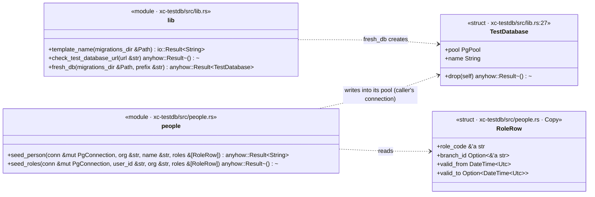

# xc-testdb — the shared test-support crate

**Status:** Design row for the existing crate plus the `people` module (#3261)
**Refs:** #2867 (the crate; merged as `69ba664b`) · #2948 (the person seeder) · #3261 (core ticket) · #3262–#3267 (re-point tickets)
**Lines cited at:** `origin/main` `5cdac176`

`api/crates/xc-testdb` is a dev-dependency crate. It gives every api test harness one place to:
- get a fresh database cloned from a migrated template (#2867);
- seed people with roles whose validity window is always explicit (#2948).

It holds test support only. No production crate depends on it.

## 1. Classes and files

| Item | File | Lines at `5cdac176` | Ticket |
|---|---|---|---|
| `TestDatabase { pool, name }`, `TestDatabase::drop` | `api/crates/xc-testdb/src/lib.rs` | `:27-57` (`drop` `:36`) | #2867, merged |
| `template_name(migrations_dir: &Path) -> std::io::Result<String>` | `api/crates/xc-testdb/src/lib.rs` | `:60` | #2867, merged |
| `check_test_database_url(url: &str) -> anyhow::Result<()>` | `api/crates/xc-testdb/src/lib.rs` | `:89` | #2867, merged |
| `fresh_db(migrations_dir: &Path, prefix: &str) -> anyhow::Result<TestDatabase>` | `api/crates/xc-testdb/src/lib.rs` | `:102` | #2867, merged |
| `RoleRow<'a> { role_code: &'a str, branch_id: Option<&'a str>, valid_from: DateTime<Utc>, valid_to: Option<DateTime<Utc>> }` (`Copy`) | `api/crates/xc-testdb/src/people.rs` (new) | — | #3261 |
| `seed_person(conn: &mut PgConnection, org: &str, name: &str, roles: &[RoleRow<'_>]) -> anyhow::Result<String>` | `api/crates/xc-testdb/src/people.rs` (new) | — | #3261 |
| `seed_roles(conn: &mut PgConnection, user_id: &str, org: &str, roles: &[RoleRow<'_>]) -> anyhow::Result<()>` | `api/crates/xc-testdb/src/people.rs` (new) | — | #3261 |

`people` is registered by one `pub mod people;` line in `lib.rs`. The private helpers `ensure_template` (`:144`) and `unique_copy_name` (`:186`) are not part of the contract.

## 2. What `people` writes

- **`seed_person`:**
  - inserts one `users` row: `organization_id = org`, `name`, `status = 'ACTIVE'`, `created_by = 'test'`;
  - then calls `seed_roles`;
  - returns the new user id as text.
- **`seed_roles`:** inserts one `user_roles` row per `RoleRow`, with `user_id`, `role_code`, `organization_id = org`, `branch_id`, **`valid_from`** and **`valid_to`**.
- **`valid_from` and `valid_to` are always bound, never left to a column default.**
  - `user_roles.valid_from` defaults to `now()` (`api/migrations/20261011110000_users_roles.sql:69`). That is right for real rows and wrong for a test that judges roles at a fixed clock (#2948).
  - The caller passes the same window it puts in its in-memory role, so the database row and the test's `Actor` cannot disagree.
- **A role code not in `roles`, a branch not in the organisation, or an unknown organisation is an `Err`** (the foreign key). A row is never skipped silently.
- **Behaviour is locked by** the up-front tests `api/crates/xc-testdb/tests/people_test.rs` (#3261, branch `tests/2948-seed-person`).

## 3. Who provides, who uses

| Provides | Used by (as a `[dev-dependencies]` entry) | For |
|---|---|---|
| `xc-testdb`: `fresh_db`, `TestDatabase`, `template_name`, `check_test_database_url` | the api test harnesses (#2867) | one migrated template per migrations set, one cloned database per test |
| `xc-testdb::people`: `RoleRow`, `seed_person`, `seed_roles` | `xchange` (`api/Cargo.toml`), `xc-auth`, `xc-cash`, `xc-shift` (their `Cargo.toml`), each added by #3261 | the single writer of `users` + `user_roles` rows in tests (#3262–#3267 re-point the copies onto it) |

The dependency is declared once in `[workspace.dependencies]` of `api/Cargo.toml` (`xc-testdb = { path = "crates/xc-testdb" }`), and each user takes `xc-testdb = { workspace = true }`.

## 4. Rule: xc-testdb takes no domain crate

`xc-testdb` depends on `anyhow`, `sha2`, `sqlx` and (for `people`) `chrono`, and on no `xc-*` crate. `people` therefore takes text ids and role codes (`&str`), not `Role`, `BranchId`, `Actor` or `ScopedRole`.

**Why:** its users are the tests of those same domain crates. If `xc-testdb` depended on, say, `xc-auth`, then `xc-auth`'s own tests would link two copies of `xc-auth`: the crate under test, and the one `xc-testdb` was built against. A `Role` from one copy is not the type the other expects, so the seeder could not be called with the crate's own values. Plain text keeps one shared writer usable from every crate's tests. Each caller maps its domain values with `Role::as_str()` / `BranchId::as_str()`, and builds its own `Actor` from the same window.

## 5. Data migration

Data migration: none. `xc-testdb` adds no table, column or constraint. It writes rows into existing tables of test databases only.
