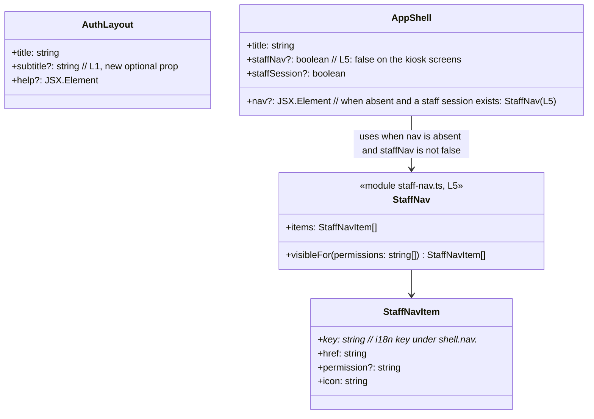

# OL-6: staff layout against the approved mock-up

> designed-by: claude/1cc51615 (one-look sub-controller) · 2026-11-06 · measured on `feat/one-look` at `a6add445`
>
> Owner, 2026-11-06 20:1x ICT, in the lane controller's session: chose **"Ship colours, then layout (Recommended)"**. The layout wave that option described was *"one white header in place of the dark bar plus white bar, nav items in the phone menu, the desk form in cards, and the sign-in subtitle plus version line"* (recorded by claude/d0aad3, #564 issuecomment-6687263603). The lane controller's order (#564 issuecomment-6687288899) is to cut it as a new wave, OL-6.
>
> Reference: the mock-up the owner approved on 2026-11-06 (~09:07 ICT), `docs/design/one-look-mock/index.html` (design `xchange-one-look.md` §2.5).
>
> Branch: `feat/one-look-6`. It starts at `a6add445`, the head of PR 6530. Once PR 6530 merges, main is merged into `feat/one-look-6` (a merge commit, because this design's own merge commit is not on main) before the first function ticket is released.

## 1. What differs today (the v3 shots, #6360 issuecomment-6685662904)

| # | Area | Mock-up (`one-look-mock/index.html`) | `feat/one-look` at `a6add445` |
|---|---|---|---|
| D1 | Staff header | One white `<header class="shell-h">` (`:152-156`): the brand mark with the branch name, inline nav, then `.who` with the language switch, the shift badge, the user, sign-out and the menu button. No `<h1>` in the header. | A dark `.account-bar` **before** `<header>` (`AccountBar.tsx`: the user, the branch switch `:176`, `NoticeBell` `:196`, `QueueCard` `:197`, sign-out). Then a white header with the page title `<h1>` (`AppShell.tsx:131`), the nav and the switch. 204 px tall at 375 px. |
| D2 | Phone menu | `.drop` (`:158-168`): the user and branch with the shift badge, one 48 px row per nav item with an icon, sign-out | The panel holds the user, branch and sign-out only. Only 3 staff screens pass a `nav` (§2 Q2). |
| D3 | Backdated desk form | `.grid2`: a form card (type segment; currency, amount and rate in `grid3`; date and time in `grid2`; note; primary button) and a summary card, then a list card with a table (`:169-206`) | No card, one stacked column, no summary |
| D4 | Sign-in | A subtitle under the title (`:141`); the version line `
` (`:146`) sits 20 px under the card (`margin-top: 20px`, `:52`) | No subtitle. The version line follows the card (`VersionFooter`, `AuthLayout.tsx:25`, same order), but the card's `margin: 8vh auto` (`auth.css:21`) pushes it away |
| D5 | kiosk-currencies | Not in the mock-up | A blue, underlined default back link (`KioskCurrenciesScreen.tsx:466`, no class; a second anchor at `:492`) and v2's kiosk gradient (`kiosk-currencies.css:10`) |

**D6 (2026-11-07, claude/bbe9ce8b's shots of xc-v3 at `5685d8a9`, `/tmp/ol6-l7-before/` on the Mac Studio).** Desk steps 01–05 render the theme's sans font and themed 44 px fields, but the step form and the summary sit straight on the grey page with no card, while the mock-up (`docs/design/one-look-mock/index.html:170-196`) puts the form, the summary and the table each in a `.card`. Root cause: `DeskPage.tsx` never uses the shared card part `web/src/shared/ui/card.css`. The transaction detail's sections (`.xc-dtx-section`) have a border but no surface, radius token or shadow.

## 2. Decided and open

### Decided by this design (no owner question)

- **D4** follows the mock-up. The subtitle is new visible text, so it needs one new key in `web/src/screens/login/i18n.ts`: `subtitle`. Thai is the mock-up's `:141`, "ใช้อีเมล เบอร์โทรศัพท์ หรือชื่อผู้ใช้". English is the mock-up's `:217`, "Use your email, phone number or username". The version line keeps its place and gets the mock-up's 20 px gap.
- **D3** follows the mock-up for layout only. Fields, handlers and data flow stay as they are: no new field, and no summary value the screen does not already compute.
- **D5, the back link only:** it is a bug fix, not a Q4 question. The link at `KioskCurrenciesScreen.tsx:466` gets the brand link colour and no underline. The fix gives that link a class, which is the only markup change, so the anchor at `:492` stays as it is.
- **The shift badge (D1, D2)** stays out of OL-6. No shared shift source exists in `shared/session/`. `admin_shift_state` (`generated/admin_shift_state.ts`, used by `admin/parts/NewTransactionButton.tsx:47`) returns `shiftOpen`/`openShifts` for admin, but who may call it from every staff page is not designed. Adding the badge needs a front-end design first.
- **Customer pages stay as they are** (rulings A/A1). Every new CSS rule sits under staff roots. In markup, `AppShell`'s `!session` output (the customer shell, `staffSession={false}`, `customer/_shell/Shell.tsx:119`) stays byte-for-byte as it is. `StaffNav` and the merged header render only under `session`.

### Answered by the owner, to confirm with the lane controller

- **Q1, one header (D1).** The owner's layout option (issuecomment-6687263603) names "one white header in place of the dark bar plus white bar". This design takes that as the answer: **the mock-up's single header**.
  - **The conflict to confirm.** On 2026-10-10 the owner had moved the account bar out of the header, to v2's place before it (xchange#917 follow-up). Two tests pin that: `AppShell.lock.test.tsx:16-19, 280-285` and `AppShell.phone.test.tsx:294-298`. The lane controller confirms that the later choice supersedes #917 before L4 is released.
  - **What the merged header carries.** The mock-up's `.who` has no slot for three parts that exist today:
    - the branch switch;
    - the notice bell;
    - the queue card (which floats and is not in the header).

    This design keeps all three, because OL-1 ruling 3 requires the branch switch and bell to stay reachable on phones. The queue card stays a floating card, as today.
    - **Above 760 px**, `.who` holds, in order: language switch, branch switch, bell, user, sign-out.
    - **At 760 px or less**, the header row holds only the brand, the language switch and the menu button. The branch switch, bell, user and sign-out move into the phone panel, so they stay reachable there. This follows the mock-up, which hides `.who .btn` on phones (`index.html:109`). `AppShell.phone.test.tsx:265-277`, which pins the wrapping bar, is restated for this.
  - **The page title.** The mock-up has no `<h1>` in the header; it shows the screen name as the active nav item.
    - The `<h1 class="xc-shell-title">` stays visible and keeps its class. It moves out of the header to be the first child of the content root: `.xc-content` when the screen passes `ownsMain`, otherwise `main.xc-shell-main`.
    - `AppShell.order.test.tsx:33-41` pins `header h1`, so it is restated for the new position. `StaffPage.shell.test.tsx:212-217` checks one `<h1>` with that class inside `.xc-shell`, and still passes.
    - **A difference from the mock-up for the lane controller to confirm with Q1:** a visible title on every staff screen. Hiding it visually, as `.xc-devices` and `.xc-kiosk` already do (`shell.css:81-90`), is the alternative.

### Open: the owner decides, no ticket until answered

- **Q2, the phone menu's nav items (D2).** The mock-up shows เคาน์เตอร์ / คีย์ย้อนหลัง / ตู้เซฟ / รายงาน / ตั้งค่า.
  - Today 16 staff `.tsx` files under `web/src/screens/` render `<AppShell`, customer excluded. Only three staff screens pass a `nav`: `AdminShell.tsx`, `DevicesScreen.tsx` and `StaffGuide.tsx` (`git grep -ln "nav={" -- 'web/src/screens/**.tsx'`, tests excluded).
  - The list of items, their routes and the permission that shows each one is a business rule.
  - **Proposed:**
    - one `StaffNav` source in `web/src/shared/ui/staff-nav.ts`: items with an href and a required permission, read from `me.permissions` as RBAC already does;
    - `AppShell` uses it when a staff screen passes no `nav`;
    - **except** the kiosk screens `kiosk-currencies` and `kiosk-queue`, which v2 shows without a header (`kiosk-queue.css:14` hides the title). They pass a new `staffNav={false}`.
  - The owner confirms the item list.
- **Q4, kiosk-currencies' v2 gradient (D5).** The owner's 2026-10-09 order "Carry v2's look as is" (`xchange-v3-look.md:4`) conflicts with "one look". **Proposed: keep the gradient.**

## 3. Map

Each ticket names its exact files. **L4 and L5 both change `AppShell.tsx` and `shell.css`, so L5 starts only after L4 merges**; every other pair is disjoint.

| Ticket | Area | File scope | Starts |
|---|---|---|---|
| **L1** sign-in subtitle and the version-line gap | D4 | `web/src/shared/ui/AuthLayout.tsx` (a `subtitle?: string` prop, rendered under the `<h1>`); `web/src/shared/ui/auth.css` (the subtitle style; the card margin so the version line sits 20 px below it); `web/src/screens/login/LoginScreen.tsx` (passes `t('subtitle')`); `web/src/screens/login/i18n.ts` (`subtitle`, th and en) | when this design merges |
| **L3** kiosk-currencies back link | D5 bug | `web/src/screens/kiosk-currencies/KioskCurrenciesScreen.tsx` (a class on the `:466` link only); `web/src/screens/kiosk-currencies/kiosk-currencies.css` | when this design merges |
| **L2** backdated form cards | D3 | `web/src/screens/desk-backdated/BackdatedScreen.tsx` (wrappers only); `web/src/screens/desk-backdated/backdated.css` (new) | after PR 6507 (backdated lane, claude/3b81c9d5) merges, because it holds `BackdatedScreen.tsx`. The order is to be agreed with claude/3b81c9d5 on #564 |
| **L4** one staff header | D1, Q1 | `web/src/shared/ui/AppShell.tsx`; `web/src/shared/ui/AccountBar.tsx`; `web/src/shared/ui/shell.css`; `web/src/screens/staff-guide/guide.css` (drop the `:51` rule `.xc-shell .xc-shell-header .account-bar { order: -1; … }`, which would start matching once the bar is inside the header; move the `:66` title rule `.xc-shell .xc-shell-header .xc-shell-title` to `.xc-shell .xc-shell-title`, so the staff guide keeps v2's 2em title); `web/src/screens/admin/admin.css` (`:1164-1165` give both `.xc-admin .account-bar` and `.xc-admin .xc-shell-header` `margin-left: 248px`, which would add up to 496 px once the bar is inside the header: keep it on the header only; and give the moved title the same 248 px offset above the breakpoint, because the sidebar is fixed at 248 px, `admin.css:108-110`); `web/src/screens/receipt-sample/print.css` (it hides `.xc-shell .xc-shell-header` on screen, `:1`, and `header:not(.brand)` in print, `:15`; the title is hidden today only because it sits in the header, so add `.xc-shell-title` to both hide rules). Tests restated by the sub-controller on a test branch: `web/src/shared/ui/AppShell.lock.test.tsx`, `web/src/shared/ui/AppShell.phone.test.tsx`, `web/src/shared/ui/AppShell.order.test.tsx` | after the lane controller confirms Q1 |
| **L5** phone menu nav rows | D2, Q2 | `web/src/shared/ui/staff-nav.ts` (new); `web/src/shared/ui/AppShell.tsx` (the fallback and `staffNav?: boolean`); `web/src/shared/ui/shell.css` (48 px icon rows); `web/src/shared/i18n/th.ts`, `en.ts`, `zh.ts` (`shell.nav.*`); `web/src/screens/kiosk-currencies/main.tsx`, `web/src/screens/kiosk-queue/main.tsx` (`staffNav={false}`) | after Q2 and after L4 merges |
| **L7** desk step form and summary as cards | D6 (owner 2026-11-07 ~12:20 ICT on step 04: "มันควรทำเป็นการ์ดนะ"; on step 02: "เหมือน กัน") | `web/src/screens/desk/DeskPage.tsx` (`section.panel` and `aside.desk-aside` get the shared class `card`; import `../../shared/ui/card.css`); `web/src/screens/desk/desk.css` (no card look of its own; inside `@media (max-width: 800px)`, `.desk-body .card { padding: 16px; }`). Up-front test `web/src/screens/desk/DeskPage.card.test.tsx` | now. Disjoint from L2: L2 owns `BackdatedScreen.tsx` and `backdated.css`; `/desk/backdated` also imports `desk.css` but renders no `.desk-body` |
| **L7b** transaction detail sections as cards | D6 | `web/src/screens/desk-transaction/desk-transaction.css` (`.xc-dtx-section` takes the card tokens of `card.css`: `--xc-surface`, `--xc-line`, `--xc-radius-xl`, `--xc-shadow-sm`, 20 px; 16 px at ≤ 800 px). CSS only, because the class sits on sections in six files. Up-front test `web/src/screens/desk-transaction/desk-transaction.card.test.ts` | now |

## 4. Rules for every OL-6 ticket

- **Layout and values.** The layout follows the mock-up. Colours and sizes come from `xc-theme.css` tokens only; no token is added.
- **No handler or data-flow change.** The named exceptions:
  - new visible text gets a new key, named in the ticket (L1 `subtitle`; L5 `shell.nav.*`);
  - L5 adds the `StaffNav` hrefs, with the item list the owner confirms (Q2).
- **Restated tests.** A test that pins today's structure, and that a ticket must change, is restated by the sub-controller on a test branch before release, citing this doc. The ones known now are the three L4 tests named in §3. No other test is edited.
- **Customer pages are unchanged.** In CSS, every new rule sits under staff roots. In markup, `AppShell`'s `!session` output stays as it is.
- **Done means:**
  - the screen's tests are green;
  - the full web suite is green on `feat/one-look-6`;
  - before/after shots against the mock-up, at 1280 and 375 px, go to the owner.

## 5. Data migration

None. No backend change.
