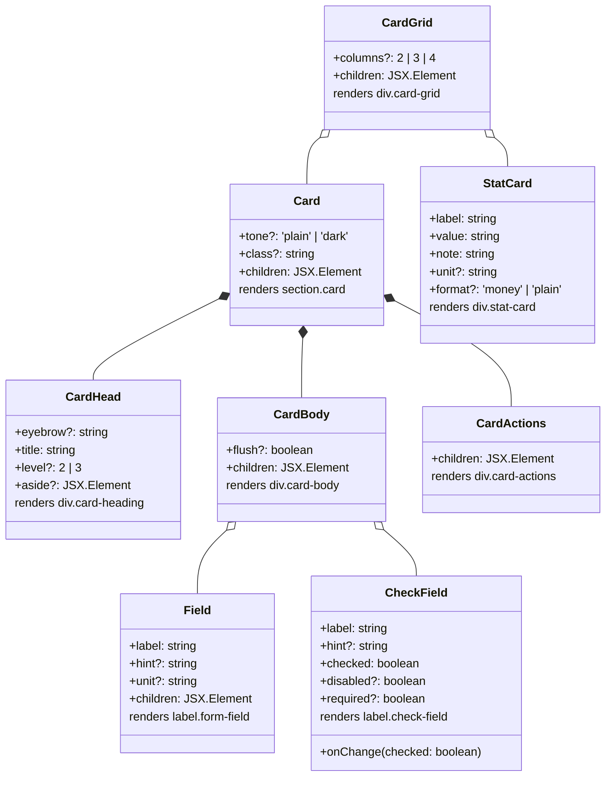

# v3 web: one shared Card, StatCard, Field and CheckField (owner's "การ์ด ต้อง ทำเป็น component reuse")

> designed-by: claude/b060e9 · 2026-10-09 · measured on `main` at `c7a0298`, v2 at `xchange-v2-source@4d0bdbb`
> The owner: *"พวก การ์ด ต้อง ทำเป็น component reuse"* (cards must be a reusable component). They sent a screenshot of
> `/admin` Payments: each channel card runs its label and hint together ("Point of serviceFor staff"), and the checkbox
> sits above its label. Ordered by the lane controller claude/608dff on 2026-10-09. This design sits under
> `docs/design/xchange-v3-look.md` (rules 1–6, rule 3/4 as amended by PR 700) and applies the fleet rule ♻️: one shared
> core, one small file per variant.

## 1. Why (measured)

`web/src/shared/ui/` has no card or form-row component. Every screen hand-writes its own card markup under its own class names, and the LK-S tickets (#713–#716) were styling each copy separately.

| Screen file | Card / field markup it writes today |
|---|---|
| `screens/admin/parts/StatCard.tsx` | `stat-card`, `stat-label`, `stat-value` > `value` + `unit`, `stat-note` (an admin-only component) |
| `screens/admin/overview/Overview.tsx` | `overview-cards` grid of `StatCard` |
| `screens/admin/cash/Cash.tsx` | `stat-cards-grid` of `StatCard`; `stock-card` with `card-eyebrow`, `card-title`, `card-actions` |
| `screens/admin/cash/calculators/ProfitSummaryPanel.tsx` | `profit-cards` > `profit-card` (`h4`, `strong`, `small`) |
| `screens/admin/reports/Reports.tsx` | `stat-cards` (inline grid style) > 4 hand-written `stat-card`; 3 × `card` with `p.eyebrow` + `h2` + `p.unit` |
| `screens/admin/payments/Payments.tsx` | `xc-payment-cards` > `xc-payment-card` > `-card-head` / `-card-body`; checkboxes in bare `label`s; `xc-payment-field-label` with `span` label + `span.xc-unit` + input |
| `screens/admin/customers/Customers.tsx` | `member-card`; `field` > `label` (+ `input` inside or beside); `field checkbox` |
| `screens/admin/rates/Rates.tsx` | `field` > `label` > `span` + `input` (×4) |
| `screens/devices/DevicesScreen.tsx` | `cards-grid` > `card printer-card` / `scan-card` / `counter-card` / `drawer-card` with `span.tag`, `h3`, `p`, `label.check` |

The run-together label has one cause: `Payments.tsx` puts the label and its note as two inline ``s in one `<label>`, and no rule makes them blocks. Each screen solves this differently or not at all, so the fix belongs in one component.

Already components, and out of scope here:
- `shared/ui/TextField.tsx` and `PasswordField.tsx`: form-bound fields (`FieldBinding`, `xc-field`, `auth.css`).
- `shared/ui/QueueCard.tsx`.
- `screens/kiosk-currencies` `CurrencyCard`: the customer kiosk's own v2 element, `kiosk.css`.

## 2. Class diagram

### 2.1 Files [required]

| Class | File | Styles in |
|---|---|---|
| `Card`, `CardHead`, `CardBody`, `CardActions`, `CardGrid` | `web/src/shared/ui/Card.tsx` | `web/src/shared/ui/card.css` |
| `StatCard` | `web/src/shared/ui/StatCard.tsx` (moved from `screens/admin/parts/StatCard.tsx`) | `card.css` |
| `Field`, `CheckField` | `web/src/shared/ui/Field.tsx` | `card.css` |

`Card.tsx`, `StatCard.tsx` and `Field.tsx` each import `./card.css` (look rule 6). `screens/admin/parts/StatCard.tsx` stays as a one-line re-export, `export { StatCard, type StatCardProps } from '../../../shared/ui/StatCard';`, so its importers do not have to move in the components ticket.

### 2.2 Markup contract [required]

The class names below are a contract. Existing tests select them (`Cash.test.tsx:393-397`, `Overview.test.tsx:277-285`, `Reports.test.tsx:486-490`: `.stat-card`, `.stat-label`, `.stat-value .value`, `.stat-value .unit`, `.stat-note`), and `card.css` targets them.

- `Card` → `<section class="card">` (`card dark-card` when `tone="dark"`), plus `props.class` appended for a screen hook.
- `CardHead` → `

…
<h2|h3 class="card-title">…</h2>
{aside}
`. The eyebrow `
` is omitted when there is no eyebrow. It is a `
`, never a `<header>`, so `admin.css`'s header rule (#706 addendum) cannot reach it.
- `CardBody` → `
` (`card-body flush` when `flush`, for a table that runs edge to edge).
- `CardActions` → `
`.
- `CardGrid` → `
`, where N is `columns`, default 4.
- `StatCard` → exactly today's markup in `parts/StatCard.tsx`. `format="plain"` skips `formatMoney`, for counts.
- `Field` → `<label class="form-field">{label}{unit && {unit}}{hint && {hint}}{children}</label>`. The control is inside the label, so it is labelled with no ids. Label, hint and control are each a block on their own line.
- `CheckField` → `<label class="check-field"><input type="checkbox" …/>{label}{hint && {hint}}</label>`. The box sits **beside** its text, never above it.

Who provides and who uses:

| Provider | Used by (after migration) |
|---|---|
| `Card` + parts | Cash (`stock-card`), Reports (3 cards), Payments (channel cards), Customers (`member-card`), Devices (printer/scan/counter/drawer) |
| `CardGrid` | Overview, Cash, Reports, ProfitSummaryPanel, Payments, Devices |
| `StatCard` | Overview, Cash, Reports (replacing its 4 hand-written ones), ProfitSummaryPanel (`profit-card` becomes `StatCard`) |
| `Field` | Payments (account), Customers (phone, member code), Rates (buy/sell ×4) |
| `CheckField` | Payments (enabled, sell, buy), Customers (verified), Devices (`label.check`) |

## 3. Look: `card.css` [required]

One stylesheet. It holds two look blocks, because v2 had two looks for these elements. Each rule's values are copied from v2. Where v2 has a base rule and a later override (the admin page loaded `admin-html.ts`'s inline `<style>` first and then `admin-workspace.css`), the effective value wins, and the media queries come along.

| Element | Admin block `.xc-admin .xc-content …` | Devices block `.xc-devices .xc-shell-main …` |
|---|---|---|
| `.card` | `admin-html.ts:1` `.card{background:white;border:1px solid var(--line);border-radius:10px;margin-bottom:24px;overflow:hidden}`, then `admin-workspace.css:24` `.card{border-radius:8px;margin-bottom:22px;min-width:0}` | `devices.css:1` `.devices article,.panel{background:white;border:1px solid var(--line);border-radius:10px;padding:20px}` and `.devices article{display:flex;flex-direction:column;gap:8px}` |
| `.card-heading` | `admin-html.ts:1` `.card-heading{padding:22px 24px 18px;display:flex;align-items:center;justify-content:space-between;gap:15px}`, `admin-workspace.css:24` `{padding:22px}`, with its narrow-width rules (`:26`, `:28`) | none in v2 (devices cards have no heading row); padding 0 |
| `.eyebrow` (in a card) | `admin-html.ts:1` `.eyebrow{font-size:11px;letter-spacing:1.8px;color:var(--muted);font-weight:600}` and `.card-heading .eyebrow{margin-bottom:3px}`; `admin-workspace.css:22` `{letter-spacing:0;font-size:11px}` | `devices.css:1` `.eyebrow{font-size:11px;font-weight:750;letter-spacing:1.4px;color:var(--brand)}` |
| `.card-title` | `admin-html.ts:1` `h2{font-size:18px;line-height:1.6}` | `devices.css:1` `h2{font-size:19px;margin:8px 0}` (h3 in v2's device cards, same size) |
| `.dark-card` | `admin-html.ts:1` `.dark-card{background:#18191d;color:white;padding:23px 25px;border:0}`; `admin-workspace.css:24` `{background:#2b2329}` | none |
| `.card-grid` | `admin-html.ts:1` `.stats{display:grid;grid-template-columns:repeat(4,minmax(0,1fr));gap:17px;margin-bottom:24px}` and its 2-column breakpoint; `admin-workspace.css:23`, `:32`, `:34` | `devices.css:1` `.devices{display:grid;grid-template-columns:repeat(4,1fr);gap:16px}` and `@media(max-width:1050px){.devices{grid-template-columns:repeat(2,1fr)}}` |
| `.stat-card` | `admin-html.ts:1` `.stat{padding:22px;background:white;border:1px solid var(--line);border-radius:10px;position:relative}`; `admin-workspace.css:23` `{border-radius:8px;padding:20px}`, `:34` `{padding:16px}` | — |
| `.stat-label` / `.stat-value` / `.stat-note` | `.stat-label{font-size:14px;color:var(--muted)}`, `.stat-number{font-size:29px;font-weight:600;line-height:1.4;margin:13px 0 7px;font-variant-numeric:tabular-nums;letter-spacing:-.8px}`, `.stat small{font-size:12px;color:var(--muted)}` (all `admin-html.ts:1`); workspace overrides `admin-workspace.css:23` (`28px`, `-.5px`, `12px 0 6px`), `:31` (`33px` ≥1550px), `:34` (≤600px) | — |
| `.form-field` / `.form-label` | `admin-html.ts:1` `label input,label select{display:block;margin-top:6px}`; `admin-workspace.css:21`, `:28`, `:37` `label{font-size:12px|13px}` | `devices.css:1` `label{display:block;font-size:13px;color:var(--muted)}` and `input:not([type=checkbox]),select{display:block;width:100%;padding:10px;border:1px solid #cdc7d1;border-radius:7px;…}` |
| `.form-hint`, `.form-unit` | `admin-workspace.css:37` `.payment-card-top p{font-size:12px;color:var(--muted)}`, `.payment-card .unit{display:block}`. Each is `display:block` | `devices.css:1` `.devices p{font-size:13px}` |
| `.check-field` | `admin-workspace.css:37` `.payment-card input[type=checkbox]{width:19px;height:19px;min-height:19px;accent-color:var(--brand);margin:0}`, laid out as `devices.css:1` `.check{display:flex;gap:8px;align-items:center}` | `devices.css:1` `.check{display:flex;gap:8px;align-items:center}`; `devices.css:3` coarse pointer `input[type=checkbox]{width:22px;height:22px}` |
| `.card-actions` | `admin-html.ts:1` `.dialog-actions{display:flex;justify-content:flex-end;gap:12px;margin-top:22px}` | `devices.css:1` `.actions{display:flex;gap:10px;flex-wrap:wrap;align-content:center}` |

`admin-html.ts` and most of `devices.css` are minified onto line 1, so `:1` plus the quoted selector is the citation; find it with `grep -F`.

Rules: selectors follow look rules 3–5. Every rule starts with `.xc-admin .xc-content` or `.xc-devices .xc-shell-main`. There is no bare `.card` and no element selector outside the component's own classes. Value sources are cited in a comment above each rule as `/* v2 <file>:<line> <selector> */`. An element whose value v2 does not have is listed in the PR as "no v2 source".

## 4. Migration tickets (no two share a file)

| Ticket | Files it owns | Starts after |
|---|---|---|
| **CD-0 components** | `shared/ui/Card.tsx`, `StatCard.tsx`, `Field.tsx`, `card.css`, their new tests `shared/ui/Card.test.tsx`, `Field.test.tsx`; `screens/admin/parts/StatCard.tsx` (becomes a re-export); `screens/admin/admin.css` (delete the `.card`, `.card-heading`, `.stats`, `.stat*`, `.dark-card` rules that move into `card.css`) | #706 (it holds `admin.css`) |
| **CD-1 overview + cash** (re-scopes #713) | `screens/admin/overview/**`, `screens/admin/cash/**` | CD-0 |
| **CD-2 payments + customers + rates** (re-scopes #714) | `screens/admin/payments/**`, `screens/admin/customers/**`, `screens/admin/rates/**` | CD-0 |
| **CD-3 reports + devices** | `screens/admin/reports/**`, `screens/devices/**` | CD-0 |

Each migration replaces the hand-written markup with the components and deletes that screen's now-dead card/field rules from its own `<screen>.css`, from PRs 718, 721 and the LK-2 port. It changes no text, i18n or logic.

Tests:
- CD-0's tests render each component and assert the §2.2 markup:
  - `CheckField`'s input is the label's first child, followed by the text span;
  - `Field`'s label, hint and control are three separate block children.
- Migrations keep every existing test green unedited. The `.stat-card` selectors are unchanged by design.
- Screenshots at 1280 and 390, next to v2, are each migration's check. Page-only, so there are no up-front tests (owner's rule *"page-only tickets need no prep"*); CD-0's component tests are written by its implementer.

## 5. Data migration

None.
