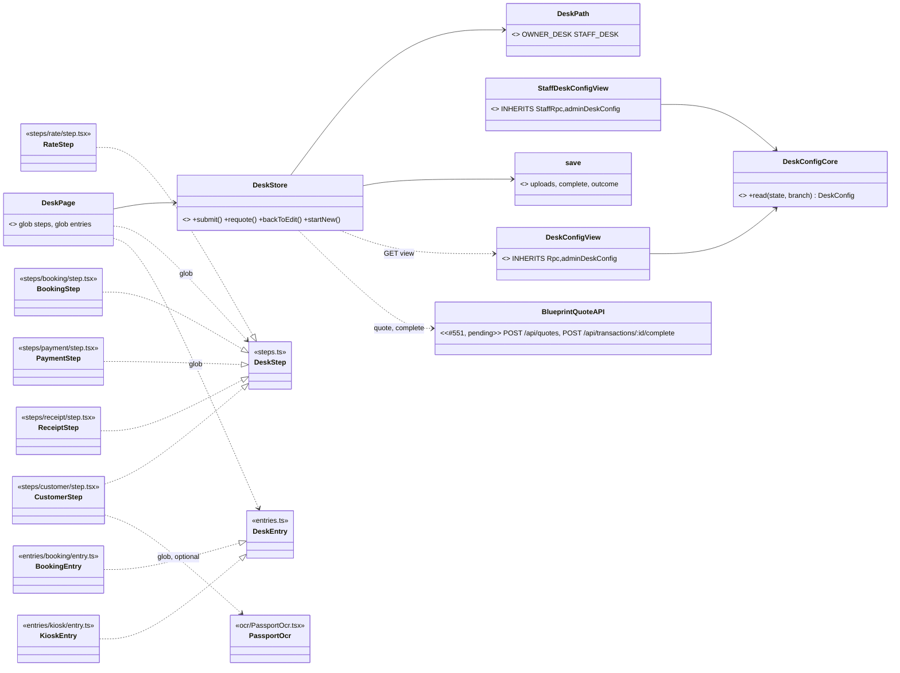

# XCHANGE v3 — Wave 3: the desk (`/desk`, `/staff/desk`)

> Design for the Wave 3 rows `/desk` and `/staff/desk` of `xchange-v3-web.md` §6 (ticket rows V3-desk and V3-staff-desk
> of §8). Written by claude/b060e9 on 2026-10-09, measured at `main` `9f05f83`. Two other documents cover the rest of
> Wave 3: `xchange-v3-wave3-staff.md` (V3-staff) and `xchange-v3-wave3-report-documents.md` (V3-staff-report,
> V3-staff-documents, V4). Everything in `xchange-v3-web.md` §2 (W1–W10), §3.3, §4 and §12 applies here unless this
> document says otherwise.
>
> **Rate model (owner, 2026-10-09):** "follow the Blueprint fully" (PR 527, issuecomment-6073063976). A rate is THB per
> `unit_size` at scale 8, published draft → approve → publish (#547, #548). This design **never writes a rate**, takes the
> server's published rate string unchanged, and computes no amount itself. Every rate type below is named
> "per the Blueprint rate design (pending, #547/#548)" until that design merges. §2 D-12 lists what this changes.

## 0. What this was measured from

| Source | Read |
|---|---|
| v2 source `108-Plaza/xchange-v2-source@4d0bdbb` | `src/online/lib/index-html.ts` (the desk page), `src/online/public/transport.js`, `src/booking/public/staff-transport.js`, `src/online/app/api/staff-bridge/route.ts`, `src/devices-public/desk-*.js`, `account-bar.js` |
| v3 `main` `9f05f83` | `api/src/presentation/pages.rs`, `api/static/xc-desk.js` (DK-1), `api/src/application/compat/{rpc,snapshot}.rs`, `.../compat/actions/{save,custody}.rs`, `api/src/application/workflows/save_transaction.rs`, `api/src/presentation/http/v3/{view,action}.rs`, `api/crates/xc-kernel/src/money/quote.rs`, `api/crates/xc-exchange/src/domain/exchange/value_objects/transaction_form.rs`, `web/src/**` |

`index-html.ts` is **one line**: `export default "<…>";`, a JSON string holding the whole page. `dh:N` below is line N of
the decoded page (194 lines), and `@a..b` is a byte range of the raw file. Decode it in a checkout of
`xchange-v2-source@4d0bdbb`:

```bash
node -e 'const s=require("fs").readFileSync("src/online/lib/index-html.ts","utf8");process.stdout.write(JSON.parse(s.slice(s.indexOf("\""),s.lastIndexOf("\"")+1)))' > /tmp/desk.html
```

Page layout: `dh:1-5` head, CSS and body HTML; `dh:6-8` the inlined `tesseract.min.js`; `dh:10-93` the OCR script;
`dh:95` `receiptTemplate` (an English 80 mm receipt, 149 KB); `dh:96-193` the desk logic; `dh:194` the `cloudOnline`
input lock. The measurement tables of §3 were made by claude/89458e53 (the session writing
`xchange-v3-wave3-staff.md`) and checked against a second, independent read of the same source.

## 1. Root cause this removes

`/desk` and `/staff/desk` are v2's built page served by `pages.rs` (`PAGE_SPECS` `:66-72`, `:143-149`), patched at run time
by five scripts (`DESK_SCRIPTS` `pages.rs:48-54`) and an inline override (`STAFF_DESK_SCRIPT` `pages.rs:56`). Money is
computed in the browser with floats (§3.4 M1–M8) and crosses the wire as JS numbers. v3 has no source for the page, so every
behaviour change is another patch on a file nobody can edit (`xchange-v3-web.md` §1). This document gives the desk its own
TypeScript screen, with every money figure computed by the server.

## 2. Decisions

| # | Decision | Status |
|---|---|---|
| D-1 | **LIVE only.** v2's mode switch has DEMO `hidden disabled` and LIVE forced on connect (`dh:5`, `dh:172-173`), so DEMO cannot be reached; the offline `localStorage` customer counter (`dh:106`) cannot be reached either (v3's `getConnectionStatus` always answers `ready: true`, `rpc.rs:512-518`). Neither is ported. Same rule as the admin (`xchange-v3-web.md` §12.5) | decided (designer; follows §12.5) |
| D-2 | **No receipt before the save.** v2 drew an unsaved receipt in the browser with a `PENDING SAVE` watermark (`dh:118`). v3 shows the **server's receipt** only after the exchange is completed (Blueprint §10 complete: *"response transaction+receipt"*; §14: *"production receipt ออกจาก completed Transaction เท่านั้น"*). Before it, the summary shows the server's quote (D-4) | **decided by the owner 2026-10-09** ("แสดงหลังบันทึกเท่านั้น") |
| D-3 | **Copy that names Google Sheets, Drive or "web app" is rewritten for v3.** W6 (verbatim) is waived for exactly the strings of §3.7; every other string stays v2's verbatim. The new wording is in §3.7 and is reviewed with this document | **decided by the owner 2026-10-09** ("แก้เป็นคำที่ตรงกับ v3") |
| D-4 | **The browser computes no money (W7).** Every figure (units, rate, THB amount, benefits) is the Blueprint quote's (`POST /api/quotes`, §10, B03: *"server คำนวณทั้งหมด"*), shown unchanged (§4.2) | decided (W7; owner's rule #564) |
| D-5 | **A new quote on each change of type, currency, amount or benefits** (Blueprint §05: *"quote ใหม่เมื่อเปลี่ยนจำนวน/สิทธิ"*; B03 lists *สิทธิ* among the desk's inputs), debounced 300 ms. Choosing a benefit at the desk comes with the Blueprint's benefit design (#560, M01–M04). Until it merges the desk has no benefit input, and when it arrives, a change of benefit asks for a new quote like any other change. The summary shows the last quote; while a request is in flight it keeps the previous one with a "recalculating" state; an answer for an older input is dropped. An expired quote (`expires_at`; §10 `QUOTE_EXPIRED`) is asked for again before confirm. The debounce and the stale-answer drop are look, and the quote rule is the Blueprint's | decided (designer, within §05) |
| D-6 | **Writes go to the Blueprint routes where the Blueprint has one:** the quote to `POST /api/quotes` and the confirm to `POST /api/transactions/:id/complete` (§10, per the Blueprint quote design (pending, #551)). Writes the Blueprint does not cover stay on today's routes (`reserveCustomer` until #554, the uploads, `/api/kiosk`). All go through `ApiClient.post` with money as decimal strings | decided (owner's rule #564) |
| D-7 | **`desk-payments.js` is ported** (channel filter, instruction, account prefill, `desk-payments.js:1-24`). v3's `/desk` does not load it today (`pages.rs:48-54`), but it is in the v2 source with AUTH on (`src/server.mjs:129`), which W9 makes the contract | decided (W9) |
| D-8 | **`desk-passport-drawer.js` and `drawerOrderId` are not in these tickets.** The passport drawer is HELD (AG-PD, `xchange-v3.md` §5.5.5) and `save.rs` does not read `drawerOrderId`. The step-1 drawer kick arrives with AG-PD, as a store hook (§5.3) | decided (follows AG-PD) |
| D-9 | **The passport reader is Recognize-Platform's, not the desk's.** Owner, 2026-10-09: *"OCR เรามี reconize platfrom ให้ แยกไปทำในนี้"*. v2 loads Tesseract's worker, core and `ocrb_int` from jsdelivr and an unpinned GitHub path (`dh:67-68`), and pdf.js from jsdelivr (`dh:56-58`). v3 reads the MRZ through Recognize's web entry, pinned and served from this server, with no CDN; the image stays in the browser as in v2. The parser, the engine and the wasm build are designed in 108-Plaza/Recognize-Platform#150, which carries v2's behaviour contract (M1–M15 and the reader rules). The desk keeps only `PassportOcr`: v2's controls, messages and fill rule | decided (owner) |
| D-10 | **The client makes only an idempotency key.** v2's client-made booking reference `BK-<uuid>` (`dh:116`) is not carried over: the Blueprint numbers exchanges and receipts on the server (`transaction_no UQ/org`, `Receipt.number UQ/org`, §07). The idempotency key's name and place are per the Blueprint quote design (pending, #551) | decided (owner's rule #564) |
| D-12 | **Rates are read-only here and opaque.** The desk never saves, drafts or approves a rate (the rate engine's screens are the admin's, #548). It reads the branch's **published** rate for the side, as the server prints it (scale 8, per `unit_size`), together with its `unit_size` and its publication reference, all per the Blueprint rate design (pending, #547/#548). It shows the string unchanged (no rounding, no fixed number of places) and sends it back unchanged. v2's `toFixed(4)` (§3.4 M4) and v3 today's 4-place `Rate` (`dto/v3/common.rs:53`) are **not** carried over | decided (owner's rate model; lane controller's note on PR 536) |
| D-13 | **A booking does not set the rate.** In the Blueprint a booking is a queue place, and the rate is the one in force at completion; a rate lock arrives only in phase 6 (PR 527 Q5, #555). So the quote always uses the published rate, even with `?booking=`. v2's booking rate lock (`dh:178-181`) and v3 today's booking vouch (`save_transaction.rs:304-316`) are **not** designed in here. They follow #555 | decided (owner's Blueprint decision) |
| D-11 | **One screen, two paths.** `/desk` and `/staff/desk` are the same components over a `DeskPath` adapter (§5.2). Each server piece has one core and two thin path files (♻️ rule) | decided |

## 3. The behaviour contract (W9)

v2 is the contract; DK-1 (`api/static/xc-desk.js`) is behaviour v3 already decided and keeps; the owner's decisions of §2
override both. Every row below is ported unless §2 or the "v3" column says otherwise. Each screen ticket's up-front tests
lock its rows.

### 3.1 Load and connection

| # | What v2 does | Calls | Source |
|---|---|---|---|
| L1 | The page loads `transport.js`, which shims `google.script.run.<action>(payload)` into `POST /api/rpc {action,payload}` (`X-Xchange-Request: 1`). Before `saveTransaction` it uploads `passport` and `slip` (base64 → bytes) to `POST /api/upload?branch=` and replaces each with the answer `{uploadKey}`. A non-2xx answer throws `Error(result.error \|\| 'ติดต่อเซิร์ฟเวอร์ไม่ได้')` | `/api/rpc`, `/api/upload` | `src/online/public/transport.js:4-18` |
| L2 | `deskBranch = window.XC_BRANCH \|\| 'MAIN'`. Every `gasCall` gets `branchId: deskBranch` | — | `dh:162-164` @400763..400937 |
| L3 | `connectAccounting`: shows `กำลังเชื่อมบัญชีและตรวจสอบกะ…`, calls `getConnectionStatus` then `adminDeskConfig`, then sets `cloudOnline = ready===true`, `recordMode='LIVE'`, the badge `ข้อมูลจริง · เชื่อมกะและสต็อก`, the bar `เชื่อม เซิร์ฟเวอร์ แล้ว · มีกะเปิดพร้อมทำรายการ` or `… · กรุณาเปิดกะจากหน้าแอดมิน`, the link `เปิดหน้าแอดมิน / เปิดกะ` (to `deskConfig.adminUrl`) and ` · สาขา <branchName>`. On failure: `ยังไม่พร้อม: <msg>`, LIVE stays disabled | `getConnectionStatus`, `adminDeskConfig` | `dh:173` @402160..403295 |
| L4 | `setDeskRates`: in LIVE, `sample[code] = {BUY: buy.toFixed(4), SELL: sell.toFixed(4)}` (`''` when null) from `deskConfig.rates`. In DEMO it uses the hard-coded demo rates (`dh:97`). In step 0, `s.rate = sample[cur][type]` | — | `dh:168` @401093..401371 |
| L5 | While `!cloudOnline`, every input, select and button in `#panel` is disabled after each render | — | `dh:194` @406824..407049 |
| L6 | Mode switch `#recordMode` (DEMO / LIVE), enabled only in step 0. LIVE is refused when offline. A switch drops `s.customerId`. Badge text: `บันทึกรายการจริง · พนักงานตรวจยอดเอง` or `โหมดทดลอง · ไม่มีการโอนเงินจริง` | — | `dh:159` @400330..400640, `dh:172` |
| L7 | `beforeunload` warns while saving or while a payload is pending | — | `dh:160` |

### 3.2 Steps (`step` 0–4; header `ol.steps` = `01 Rate · 02 Passport · 03 Booking · 04 Payment · 05 Receipt`, `dh:5`)

| Step | v2 behaviour | Calls | Guards and refusals shown | Source |
|---|---|---|---|---|
| 0 Rate | Form: `type` (SELL/BUY), `currency` (the keys of `sample`), `amount` (`number`, min 0.01, max 999999999, step 0.01), `rate` (`number`, step 0.0001; **readOnly in LIVE**, label `เรทหน้าร้านที่ตั้งใน เซิร์ฟเวอร์`), `referenceRate` (optional, from `deskReferenceRender`). Live quote `#quote` = `money(total())` and `#direction`. Changing type or currency resets the rate from `sample` | none | LIVE: the notice reads `ยังไม่มีกะเปิด กรุณาเปิดกะจากหน้าแอดมินก่อน` when no shift is open. Submit is refused with `ต้องเปิดกะและตั้งเรทสกุลเงินนี้ในหน้าแอดมินก่อน จากนั้นโหลดหน้านี้ใหม่` when there is no `activeShift` or `!Number(s.rate)`. **This is the client half of the shift/rate guard** | `dh:114` @383735..385429, `dh:170` @401408..402047, `dh:176` @403335..403928 |
| 1 Passport | Attach a scan or a camera photo (JPG/PNG/WebP/PDF, ≤ 15 MB; HEIC refused). OCR starts on attach (§1.3). Fields `passportName`, `passportNo` (upper-cased on save), `nationality`, optional `birthDate` and `passportExpiry`, and the checkbox `identityChecked` (cleared by any field edit). Submit → `allocateCustomerId` → step 2 | `reserveCustomer {name, passportNo, nationality, birthDate, passportExpiry, mode}` (LIVE/online). Offline, a `localStorage` counter `CX-yyyymmdd-NNNNN` under `navigator.locks` | `กรุณาแนบไฟล์สแกนหรือรูปพาสปอร์ตก่อน`; `กรุณากรอกชื่อ เลขพาสปอร์ต และสัญชาติ`; any throw → `สร้างรหัสไม่ได้ เบราว์เซอร์นี้อาจไม่อนุญาตการเก็บตัวนับ …` (DK-1 rewrites this, §2.3). Size/type: `รองรับ JPG, PNG, WebP หรือ PDF กรุณาแปลงไฟล์ HEIC เป็น JPG ก่อน`, `กรุณาใช้ไฟล์ที่มีข้อมูลและขนาดไม่เกิน 15 MB` | `dh:102-110` @374346..382085 |
| 1 skip | `ข้ามข้อมูลลูกค้า →`: draws a PNG reading `ไม่มีเอกสารพาสปอร์ต` on a canvas, sets `WALK-IN`/`WALKIN`/`N/A`, calls `allocateCustomerId`, goes to step 2 | `reserveCustomer` | `ข้ามไม่สำเร็จ: <reason>` | `desk-skip.js:5` |
| 1 drawer (10-06) | On entering step 1, once per order: `POST /api/drawer-passport {branchId, orderId, kiosk, mode}`. The order id is the kiosk id, or a UUID kept in `sessionStorage` `xc.passport.drawer.order.<branch>`. Shows a notice by `state`. `saveTransaction` then carries `drawerOrderId` | `/api/drawer-passport` | labels `SIMULATED`/`DISABLED`/`REQUESTED`/`SUBMITTED_TO_CUPS`/`UNCERTAIN` (`desk-passport-drawer.js:7`); `ตรวจคำสั่งเปิดลิ้นชัก: <err> · ไม่ส่งซ้ำอัตโนมัติ` | `desk-passport-drawer.js:1-19` |
| 2 Booking | `name` (readonly), `staff` (free text in v2; on `/desk` `account-bar.js:40` fills it with the username and makes it readOnly; DK-1 does the same on `/staff/desk`), `valueDate` (date, Bangkok today, `dh:98`). Submit sets `s.booking = 'BK-'\|'BK-DEMO-' + randomUUID()` and `bookedAt` **on the client** | none | `alert('กรุณาระบุชื่อลูกค้าและรหัสพนักงาน')` | `dh:116` @385465..386730 |
| 3 Payment | Settlement shown `money(netSettlement())`. `method` (Credit Card, Alipay, PromptPay, Cash, Bank Transfer, SCB Transfer); `ref` (required unless Cash; disabled for Cash); `account`; `fee` (THB, min 0, step 0.01; edits re-render the total and uncheck the box); `bankFee`; `accountNotes`; slip file (same types, ≤ 15 MB); checkbox `checked` (`ยืนยัน… ยอด <net> THB …`) enables `pay`. Cancel: `confirm('ยกเลิกการจองนี้และกลับไปแก้ไขเรท?')` → step 0. Submit sets `ref='—'` for Cash and `paidAt`, `submissionId = randomUUID()`, `receipt = 'PENDING-'+id[0..8]` → `submitAccounting` | `saveTransaction` (+ uploads) | `ตรวจชื่อบัญชี เลขอ้างอิง สลิป พาสปอร์ต และยอดสุทธิให้ครบ` (no account; non-cash without ref or slip; no passport; net not finite or < 0); slip type/size `สลิปต้องเป็น JPG, PNG, WebP หรือ PDF ไม่เกิน 15 MB`; `อ่านไฟล์แนบไม่สำเร็จ` | `dh:117` @386733..391505, `dh:123-128` |
| 3 payments (10-06) | LIVE only: options are disabled or hidden unless `deskConfig.paymentMethods` row `{id, enabled, buy, sell, account, instruction}` is on for the direction (`SCB Transfer` is read as `Bank Transfer`). The instruction is shown under the select; `account` is prefilled from the rule; `pay` is disabled and submit blocked when the rule is off | reads `adminDeskConfig.paymentMethods` | `ยังโหลดการตั้งค่าวิธีชำระเงินไม่ได้ กรุณาโหลดหน้าทำรายการใหม่`; `ช่องทางนี้ปิดใช้งานสำหรับรายการนี้ กรุณาตรวจสอบกับผู้ดูแล` | `desk-payments.js:1-24` |
| 3 cash count | `saveTransaction` with `method==='Cash'`: `confirm('ยืนยันว่าได้ตรวจสกุล ชนิดราคา และจำนวนธนบัตรก่อนส่งมอบแล้ว?…')`, or throws `ยังไม่ยืนยันการนับเงิน`; sends `countConfirmed: true` | — | as stated | `desk-devices.js:4` |
| 4 Save | `submitAccounting`: builds `cloudPayload` once: `{submissionId, mode, customerId, name, passportNo, nationality, birthDate, passportExpiry, type, currency, amount: Number, rate: Number, referenceRate: Number\|null, fee: Number, bankFee: Number, method, ref, account, staff, booking, notes, valueDate, paidAt, paymentConfirmed: true, identityConfirmed: true, passport, slip}`. Result `{saved, documentRef, receiptNo, passportUrl, slipUrl, folderUrl, sheetUrl}`. Retry resends the same payload | `saveTransaction` | `ยังไม่ได้รับการยืนยันการบันทึก` (2xx without `saved`); `บันทึกไม่สำเร็จ กรุณาลองใหม่`; offline `ยังไม่บันทึกลง เซิร์ฟเวอร์ — รอเปิดใช้เว็บแอป …` | `dh:129-143` @396953..398300 |
| 4 Result box | Saving: `กำลังบันทึก Sheet และไฟล์แนบใน ที่เก็บเอกสาร…`. Saved: links `เปิดแถวรายการ`, `เอกสารคู่กัน`, `พาสปอร์ต`, `สลิป` / `เงินสด — ไม่มีสลิปธนาคาร`. Failed: the error and `ลองบันทึกซ้ำ`. In LIVE, `new` and `print` stay disabled until saved | — | — | `dh:144-151` @398433..399600 |
| 4 Receipt | Fills `receiptTemplate` **on the client**: `Amount = money(amount)`, `Rate = Number(rate).toFixed(4)`, `THB Total = money(total())`, rows `Customer Fee THB` and `Net Received\|Paid THB = money(netSettlement())`, the time in en-GB Bangkok, and the value date reversed. Watermarks `SAMPLE / DEMO — NOT A VALID RECEIPT` or `PENDING SAVE — NOT A VALID RECEIPT`. The iframe is printed with the page height computed (`@page 80mm × <h>mm`). `ทำรายการใหม่` resets and keeps `staff` and `valueDate` (confirms when unsaved) | none | `รายการนี้ยังไม่บันทึกลง เซิร์ฟเวอร์ ต้องการเริ่มรายการใหม่…?` | `dh:118` @391508..395093 |
| 4 after save (`/desk` only) | Link `ดูงานพิมพ์และบันทึกหลังบ้าน →` to `/devices?branch=` | — | — | `desk-devices.js:5` |
| Summary aside | Type; amount `money(amount) cur`; `เรทที่จอง`/`เรทตัวอย่าง` `toFixed(4)`; customer; booking; `ยอดแลกก่อนค่าบริการ` `money(total())`; from step 3, fee and `<direction> สุทธิ` `money(netSettlement())` | — | — | `dh:112` @382093..383266 |

### 3.3 Passport OCR (browser-only)

| Item | Measured | Source |
|---|---|---|
| Engine | `tesseract.min.js` is inlined in the page (64 KB, `dh:6-8`). The worker loads at run time from **cdn.jsdelivr.net**: `tesseract.js@6.0.1/dist/worker.min.js`, `tesseract.js-core@6.0.0`, and the language `ocrb_int` from `gh/Shreeshrii/tessdata_ocrb@f59241ad…`, `cacheMethod:'none'` | `dh:67-68` @221200..221715 |
| PDF | `pdfjs-dist@4.10.38` dynamic `import()` from jsdelivr. The text layer is tried first (a score-5 MRZ skips OCR); otherwise the page is rendered to a canvas | `dh:56-58` |
| Pipeline | Rotate (`ocrAngle` 0/90/180/270); scale ≤ 2600 px. Pass 1 reads the bottom 45% with PSM 6 and the whitelist `A-Z0-9<`; if the score is < 5, pass 2 reads the whole page with PSM 3. 120 s timeout. `cancelOCR` terminates the worker | `dh:54-86` |
| MRZ parse | TD3 two lines, check digits 7-3-1, OCR repair maps (O/Q→0, I/L→1, …), 45-char line repair, a century rule for dates. It fills only fields the user has not edited meanwhile | `dh:15-42` |
| Messages | 14 Thai strings, `dh:60-88` (@220639..223861), e.g. `ยังอ่านแถบรหัส MRZ ไม่ได้ …`, `อ่านเกินเวลาที่กำหนด …`, `ยกเลิกการอ่านแล้ว …` | — |
| Data flow | No upload during OCR. The passport file is uploaded only at save (`transport.js:13`) | `dh:10` comment |

### 3.4 Client-side money computations (all forbidden in v3 by W7)

| # | Computation | Where |
|---|---|---|
| M1 | `total() = Math.round(Number(amount)*Number(rate)*100)/100` (float, half toward +∞) = principal | `dh:99` @374276..374343 |
| M2 | `netSettlement() = Math.round((total() + (SELL?+1:-1)*Number(fee))*100)/100` | `dh:125` @395724..395826 |
| M3 | `money(n) = Number(n).toLocaleString('en-US', {min/maxFractionDigits: 2})`, used for amount, total, fee and net | `dh:96` |
| M4 | `Number(rate).toFixed(4)` for the summary and the receipt; LIVE rates come as `buy.toFixed(4)` from the JSON number | `dh:112`, `dh:118`, `dh:168` |
| M5 | Guard `netSettlement() < 0` or not finite → refuse (the client twin of the server's `ค่าบริการสูงกว่ายอดซื้อ`) | `dh:117` |
| M6 | Payload numbers: `amount`, `rate`, `referenceRate`, `fee`, `bankFee` sent as JS `Number` | `dh:136` @397349..397936 |
| M7 | Staff desk: `opsBeginTransaction {amount: Number(s.amount)}` | `pages.rs:56`, `sb:17` |
| M8 | Kiosk prefill: `amount: String(request.foreign)`, rate from `deskConfig.rates`; `Number(rate) !== request.rate` gives the "rate changed" notice | `desk-kiosk.js:9-18` |
| M9 | File sizes `(size/1024/1024).toFixed(2)+' MB'` (not money) | `dh:104`, `dh:126` |

### 3.5 Server guards behind the save (already in v3, `xchange-v3.md` §3)

| Guard | v3 refusal | v3 source |
|---|---|---|
| Principal and fee (`Quote::compute`, half away from zero) | `ค่าบริการสูงกว่ายอดซื้อ`; `จำนวนเงินหรือเรทไม่ถูกต้อง`; `ยอดเงินสูงเกินขอบเขตระบบ` | `api/crates/xc-kernel/src/money/quote.rs:29-64`; `xc-exchange/.../value_objects/transaction_form.rs:15-20,147-160` |
| Rate guard | `เรทไม่ตรงกับเรทหน้าร้านล่าสุด กรุณาตรวจสอบเรทก่อนยืนยันรายการ` (skipped for a verified booking) | `api/src/application/workflows/save_transaction.rs:38,324-341` |
| Shift | `กรุณาเปิดกะจากหน้าแอดมินก่อน` | `xc-shift/.../shift_error.rs:27` |
| Stock guard | `ยอด {0} ไม่เพียงพอ กรุณาตรวจนับหรือบันทึกรับเงินเข้า…` | `xc-shift/.../shift_error.rs:29` |
| Custody gate (custodian, clocked in, OPEN / CUT_OFF + draft) | e.g. `ต้องเป็น Front ผู้ถือครองเงินในกะที่เปิด`, `ปิดรับรายการใหม่แล้ว…` | `xc-shift/.../custody_error.rs:52,205`; draft match `custody_machine.rs` (`xchange-v3.md:617`) |
| Files and payment ref | `แนบเอกสารไม่ครบ`, `ต้องระบุเลขอ้างอิงการโอน` | `transaction_form.rs:18,21` |
| Payment channel (first LIVE save) | `Payment method unavailable. Please contact staff.` | `payment_save_step.rs:10` |
| Idempotency | `รายการเดิมมีข้อมูลเปลี่ยน ห้ามใช้รหัสส่งซ้ำกับข้อมูลใหม่` | `save_transaction.rs:37` |

### 3.6 Booking-open path (T15-h) and kiosk path

| # | v2 | Source |
|---|---|---|
| B1 | `?booking=<id>`: after connecting, `POST /api/bookings {action:'get', payload:{branchId,id}}` (`/api/staff/bookings` on the staff desk). Refused unless `status==='CONFIRMED'`: `การจองยังไม่ยืนยัน หมดอายุ หรือใช้ไปแล้ว`. Then `type`, `currency`, `amount` and `rate` are copied into `s` and `s.booking = id` | `dh:178-181` @403933..404780 |
| B2 | Banner `กำลังตรวจการจอง…` / the error / `จอง <id> · <name> · เรท <rate> · หมดอายุ <th-TH>`. While loading or on error, all of `#panel` is disabled. In step 0 the four fields are locked. In step 3 the checkbox `ตรวจตัวตนลูกค้าตรงกับผู้จอง <name> แล้ว` is added | `dh:183-189` @404822..406344 |
| B3 | `saveTransaction` is refused on the client unless that box is checked (`กรุณายืนยันตัวตนว่าตรงกับผู้จองก่อนบันทึก`). It adds `onlineBookingId`, `booking`, `onlineBookingCustomerConfirmed: true` | `dh:191` @406384..406745 |
| B4 | Server (v3): `BookingSaveStep` refuses with rows 1–5 of `xchange-v3.md:1843-1854`, e.g. `ข้อมูลรายการไม่ตรงกับการจอง หรือยังไม่ยืนยันลูกค้า`. The rate guard is skipped | `api/src/application/workflows/booking_save_step.rs:13`; `save.rs:171-186` |
| K1 | `?kiosk=<id>`: `/api/kiosk get` → prefill `type`, `currency`, `amount = foreign`, the current desk rate and `method`; the notice `ข้อมูลจากคิว …` (+ rate-changed text). `reserveCustomer` first sends `/api/kiosk identityChecked`. `saveTransaction` adds `kioskRequestId`. After the save it rasterizes the receipt iframe to PNG → `/api/kiosk publishReceipt` | `desk-kiosk.js:1-65` |


### 3.6b Thai strings, by step

There are 202 Thai literals in `index-html.ts` (method: split each decoded line on quotes, backticks, `<>{}` and keep the
pieces that contain Thai). The add-ons carry about 30 more.

| Group | Count | Raw offset range | Verbatim (buttons, headings, refusals) |
|---|---|---|---|
| Shell / header / footnote (`dh:5`) | 13 | @6693..149883 | h1 `ทำรายการแลกเปลี่ยนเงิน`; `สำหรับพนักงานหน้าร้าน`; badge `โหมดทดลอง · ไม่มีการโอนเงินจริง`; `โหมดบันทึก`; options `ทดลอง — แยกจากบัญชีจริง`, `รายการจริง — บันทึกลงบัญชี`; links `ทะเบียนบัญชี`, `โฟลเดอร์เอกสาร`; aside h2 `สรุปรายการ` |
| Summary and status (`dh:100,112,113`) | 20 | @374346..374438, @382093..383732 | status `เลือกเรท` / `ข้อมูลลูกค้า / พาสปอร์ต` / `เตรียมการจอง` / `รอยืนยันการชำระเงิน` / `บันทึกเอกสารแล้ว` / `รอบันทึกเอกสาร`; directions `ร้านรับเงิน THB จากลูกค้า`, `ร้านจ่ายเงิน THB ให้ลูกค้า` |
| Step 0 rate (`dh:114,170,176`) | 16 | @383735..385429, @401408..402047, @403335..403928 | h2 `เลือกเรทและจำนวนเงิน`; submit `ถัดไป · พาสปอร์ต / ลูกค้า →`; refusal `ต้องเปิดกะและตั้งเรทสกุลเงินนี้ในหน้าแอดมินก่อน จากนั้นโหลดหน้านี้ใหม่`; notice `ยังไม่มีกะเปิด กรุณาเปิดกะจากหน้าแอดมินก่อน` |
| OCR (`dh:60-88`) | 14 | @220639..223861 | see §3.3 |
| Step 1 passport (`dh:104-109`) | 41 | @374614..382085 | h2 `พาสปอร์ต / ข้อมูลลูกค้า`; `เลือกไฟล์สแกน / รูปถ่าย`, `ถ่ายรูปด้วยมือถือ`, `ลบเอกสาร`, `อ่านและเติมข้อมูล`, `หยุดอ่าน`, `← กลับไปเลือกเรท`, `สร้างรหัสลูกค้า · ไปจอง →` / `ยืนยันข้อมูล · ไปจอง →`; refusals: the three of §3.2 step 1 |
| Step 2 booking (`dh:116`) | 8 | @385465..386730 | h2 `ข้อมูลการจอง`; `← แก้ไขข้อมูลลูกค้า`, `ยืนยันการจอง →`; `กรุณาระบุชื่อลูกค้าและรหัสพนักงาน` |
| Step 3 payment (`dh:117,126-128`) | 41 | @386733..396950 | h2 `ชำระเงินและเอกสารบัญชี`; `ลบสลิป`, `ยกเลิกการจอง / แก้ไข`, `ยืนยันรายการทดลอง →` / `ยืนยันและบันทึกบัญชี →`; refusals `ตรวจชื่อบัญชี เลขอ้างอิง สลิป พาสปอร์ต และยอดสุทธิให้ครบ`, `สลิปต้องเป็น JPG, PNG, WebP หรือ PDF ไม่เกิน 15 MB`, `อ่านไฟล์แนบไม่สำเร็จ` |
| Step 4 receipt and save (`dh:118,131-148`) | 25 | @391508..399485 | h2 `ใบเสร็จรายการแลกเงิน` / `ใบเสร็จรายการทดลอง`; `ทำรายการใหม่`, `พิมพ์ใบเสร็จ NEOCAL 80 มม.`, `ลองบันทึกซ้ำ`; `ยังไม่ได้รับการยืนยันการบันทึก`, `บันทึกไม่สำเร็จ กรุณาลองใหม่` |
| Connection and mode (`dh:122,154-159,173`) | 16 | @395246..395585, @399803..400640, @402160..403295 | `เปิดหน้าแอดมิน / เปิดกะ`; `ยังไม่พร้อม: `; `ต้องเปิดจากเว็บ เซิร์ฟเวอร์ ที่ติดตั้งแล้วเพื่อใช้ข้อมูลจริง` |
| Booking-open (`dh:181-191`) | 8 | @404146..406745 | the three of §3.6 |
| Add-ons | ~30 | `desk-skip.js:5` (3), `desk-devices.js:4-5` (3), `desk-kiosk.js` (7), `desk-payments.js:14` (2), `desk-passport-drawer.js:7-14` (8), `xc-desk.js:4-7` (4), `account-bar.js:40` (1) | `ข้ามข้อมูลลูกค้า →`; `ยังไม่ยืนยันการนับเงิน`; `ดูงานพิมพ์และบันทึกหลังบ้าน →`; DK-1 `← กลับไปแก้ไขรายการ` |

Total: 202 in the page, about 232 with the add-ons. W6 means all of them go into `screens/desk/i18n.ts` (`th`) verbatim. Each step's table also carries `en` (W10, `xchange-v3-web.md` §2: every table has `th` and `en`, and `collectScreens` refuses a table without both), and `zh` once #576 adds it to the shared i18n (Blueprint §15: TH/EN/ZH on every screen). `th` is v2's copy (or §3.7's rewrite); `en` and `zh` are translations of it, through each folder's own `i18n.ts`, never hard-coded.
v2 has no `en`. Note: some v2 copy describes Google Sheets / Drive (`กำลังบันทึก Sheet และไฟล์แนบใน ที่เก็บเอกสาร…`,
`รายการทดลองอยู่ใน DemoTransactions…`, `ต้องเปิดจากเว็บแอป…`). The owner's D-3 (2026-10-09) decides these: §3.7 lists the v3 wording, and the DEMO/offline ones are not ported.

### 3.7 Copy rewritten for v3 (D-3)

Only these strings change. The new wording is a proposal and is reviewed with this document. Every other string is v2's
Thai verbatim (W6). Strings reachable only in DEMO or offline (D-1) are not ported at all. These are
`รายการทดลองอยู่ใน DemoTransactions และโฟลเดอร์ _TEST`, `ต้องเปิดจากเว็บแอป เซิร์ฟเวอร์ ที่ติดตั้งแล้ว จึงจะบันทึกลง เซิร์ฟเวอร์ ได้`,
`ยังไม่บันทึกลง เซิร์ฟเวอร์ — รอเปิดใช้เว็บแอป เซิร์ฟเวอร์ ตามคู่มือติดตั้ง`, `เซิร์ฟเวอร์: รอเปิดใช้งานเว็บแอป`, the two
`… ที่เก็บเอกสาร` setup notices and the DEMO footnote .

| v2 (verbatim) | v3 | Why |
|---|---|---|
| `กำลังบันทึก Sheet และไฟล์แนบใน ที่เก็บเอกสาร…` | `กำลังบันทึกรายการและไฟล์แนบ…` | v3 has no Sheet. It saves the exchange and its files in one request (`save_transaction.rs:197-416`) |
| `เปิดแถวรายการ` | `เปิดรายการในหน้าแอดมิน` | `sheetUrl` is `/?branch=<b>#transactions` (`save.rs:95`), the admin's transactions menu, not a sheet row |

### 3.8 `/desk` and `/staff/desk` today

| Item | `/desk` | `/staff/desk` | Source |
|---|---|---|---|
| Page spec | `desk.html`, `PageKind::Branch`, `who_signed_in: true` | `desk.html`, `PageKind::DeskVariant`, `who_signed_in: false` | `api/src/presentation/pages.rs:66-72`, `:143-149` |
| Who | anyone signed in. The owner gets `?branch=`; staff get their own branch. Rpc then allows `reserveCustomer`/`saveTransaction` only for the owner and FRONT | **FRONT staff session only**; anything else is redirected to `/staff` (`to_staff`) | `pages.rs:407-414`; policy `xc-auth/.../policy.rs:57-97` |
| Branch | `window.XC_BRANCH` from `page_branch` | the employee's own branch (`""` when none) | `pages.rs:422-428` |
| Rewrites | none | `/api/bookings`→`/api/staff/bookings`, `/documents`→`/staff/documents`, `/files/`→`/api/staff/file/`, `transport.js`→`staff-transport.js` (RPC → `/api/staff/rpc`, upload → `/api/staff/upload`) | `pages.rs:429-432`; `src/booking/public/staff-transport.js:9,14` |
| Extra script | — | `STAFF_DESK_SCRIPT`, inserted before `</body>`: at the first `reserveCustomer` of a page load, calls `opsBeginTransaction {type, currency, amount: Number(s.amount)}` and keeps `staffDraftId`. Every `saveTransaction` gets `staffDraftId` | `pages.rs:56`, `:433-435`; v2 origin `sb:17` |
| Added scripts | `DESK_SCRIPTS` = `desk-skip.js`, `desk-devices.js`, `desk-kiosk.js`, `account-bar.js`, `/_xc/desk.js` | same list | `pages.rs:48-54` |
| Not added (differs from v2) | v2 also adds `desk-payments.js`, `desk-passport-drawer.js`, `desk-referrals.js` when `AUTH` is on. v3 omits all three. Referrals are not ported (W9). The drawer is HELD (§5.5.5, AG-PD). **The payments filter is a gap**: the server still refuses at save (`PaymentSaveStep`), but the desk does not hide channels or show the instruction | `src/server.mjs:129`; `xchange-v3.md:1544` |
| `staff` field | `account-bar.js:40` `fillStaff` (path `/desk` only) | DK-1 `applyStaff` (username from `POST /api/auth {action:"status"}`) | `api/static/xc-desk.js:91-102,247-293` |
| Staff answers | — | `/api/staff/rpc` answers are rewritten by `rewrite_urls` (`deskUrl`→`/staff/desk`, links → staff paths) | `api/src/application/compat/rpc.rs:403-417`; v2 `staff-bridge/route.ts` offset 5284 |
| Policy differences | Rpc: `adminDeskConfig` for the owner and every staff role | StaffRpc: `adminDeskConfig` **FRONT only** (`FrontOnly`); `ops*` allowed | `policy.rs:63-81`, `:100-148` |

### 3.9 DK-1 — kept behaviour

| Patch | What it does | Lines |
|---|---|---|
| fetch observer | Wraps `window.fetch`. For a POST to `/api/rpc` or `/api/staff/rpc` it records each action's last answer `{status, json, error}` or `{failed}` | `xc-desk.js:9-61,156-176` |
| Customer error (case 1–3) | After the passport submit, `#customerError` shows the server's `error` for `opsBeginTransaction`/`reserveCustomer`, or `สร้างรหัสลูกค้าไม่ได้ เชื่อมต่อเซิร์ฟเวอร์ไม่ได้ กรุณาลองใหม่`. Offline keeps v2's sentence | `:81-89,178-245` |
| Staff code (case 5) | `/staff/desk`: `#staff` = signed-in username, readOnly, title `รหัสจากบัญชีที่เข้าสู่ระบบ`; `s.staff` follows | `:91-102,247-293` |
| Save outcome | `refused` = nothing sent, or 4xx with a JSON `error`; `unknown` = network, 5xx, not JSON, or no `saved` | `:63-79,295-318` |
| Buttons after save | refused → adds `← กลับไปแก้ไขรายการ` (drops booking, submission and payload, `step=0`, clears `staffDraftId`), enables New. unknown → note `ยังไม่ทราบผลการบันทึก กด "ลองบันทึกซ้ำ" …`, New and Print disabled. Saved → New and Print enabled | `:104-146,392-505` |
| New clears draft | On New that goes ahead, `staffDraftId = ''` | `:335-390,551-568` |
| Re-apply | `MutationObserver` on `#panel` | `:530-547` |

DK-1 rows are behaviour to keep, not code to port. One correction comes from the second read: DK-1 looks for `#retry`,
but v2's button is `#retrySave` (`dh:148`), so on today's page its back button and unknown-outcome note land at the end
of `#panel`. In v3 they sit beside the retry button.

### 3.10 Further rows from the second read (v2, not yet listed above)

| # | v2 | v3 | Source |
|---|---|---|---|
| X1 | The desk reads `deskConfig.activeShift` only and never `operations`, so it can say "shift open" while the custody gate will refuse the save | v3 keeps this. The custody refusal is the server's sentence at save (§3.5). The staff app (`xchange-v3-wave3-staff.md`) is where custody phase is shown | `dh:173` |
| X2 | On `/staff/desk`, `?booking=` calls `/api/staff/bookings get`, which v3's `StaffBookings` policy allows only for FRONT, BACKEND and MANAGER (`policy.rs:371-385`). `/staff/desk` admits FRONT only, so the call is allowed | ported as is | `pages.rs:429-432` |
| X3 | Skip-customer never ticks the identity box, so a kiosk request's `identityChecked` is never sent and its save is refused | **ported as is.** This is a v2 defect and is recorded as known difference KD-4. A fix needs a business rule (may a kiosk customer be served without a passport?), which is the owner's call | `desk-skip.js:5`, `desk-kiosk.js` |
| X4 | The kiosk receipt push renders on every receipt draw, so a `PENDING SAVE` image can reach the customer screen | **does not occur in v3**: D-2 removes the unsaved receipt, so the push runs only after a save | `desk-kiosk.js` |
| X5 | The staff draft (`opsBeginTransaction`) is created on the first `reserveCustomer` of a page load and never cleared by v2 itself. DK-1 clears it on back-to-edit and on every New | DK-1's rule | `pages.rs:56`, `xc-desk.js:335-390` |
| X6 | Amount is shown with 2 decimals whatever the currency (JPY too); rate with 4 | amount: as the server's decimal string. Foreign amounts by minor unit are the rate design's (#547). Rate: the published string unchanged (D-12), with `per <unit_size> <code>` | `dh:96`, `dh:112` |

## 4. Server

### 4.1 `desk_config` and `staff_desk_config` — the desk's one read

v2 reads `adminDeskConfig` once at load (`dh:173`). It answers rates as JSON numbers plus the branch's whole custody log
(`snapshot.rs:144-167`), and the desk reads no part of that log (X1). v3 replaces it with a view that answers only what the
desk shows:

- [required] `DeskConfigView` in `api/src/presentation/http/v3/views/desk_config.rs`: `BranchView`, `type Filter = NoFilter`,
  `INHERITS = (EntryPath::Rpc, "adminDeskConfig")`.
- [required] `StaffDeskConfigView` in `.../views/staff_desk_config.rs`: same, `INHERITS = (EntryPath::StaffRpc, "adminDeskConfig")`
  (FRONT only, `policy.rs:135`). `view.rs:339-341` already authenticates the staff session for `StaffRpc`.
- [required] Both bodies are one call: `DeskConfigCore::read(state, branch).await` in `api/src/presentation/http/v3/desk/config.rs`
  (♻️: one core, two path files).
- [required] DTO `api/src/presentation/dto/v3/desk_config.rs`, exported to `desk_config.ts`:

```rust
pub struct DeskConfig {
    pub branch_id: String,
    pub branch_name: String,
    pub shift_open: bool,                    // ShiftService::active(branch).is_some(), as `activeShift` (snapshot.rs:147)
    pub admin_url: String,                   // as snapshot.rs:161-162
    pub rates: Vec<DeskRate>,                // the branch's published rates (D-12), THB excluded
    pub payment_methods: Vec<DeskPaymentMethod>, // the rules snapshot.rs:149 reads, as rules_v2_json(…, true) prints them
}
pub struct DeskRate {
    pub code: String,
    pub unit_size: /* per the Blueprint rate design (pending, #547/#548) */,
    pub buy: Option</* published rate string, per the Blueprint rate design (pending, #547/#548) */>,
    pub sell: Option</* same */>,
    pub publication: /* the publication reference, per the Blueprint rate design (pending, #547/#548) */,
}
pub struct DeskPaymentMethod { pub id: String, pub enabled: bool, pub buy: bool, pub sell: bool,
                               pub account: String, pub instruction: String }
```

- Version: the branch version (the `BranchView` default), as every branch view. A publication or a shift change moves it.
- [required] read-only: the view reads the published rates and writes nothing. It does not call today's `RateService::current` (`snapshot.rs:146`) once the rate design replaces direct saves.
- [proposed] `rates` keeps the publication's order. The currency select lists them in that order, as v2 lists
  `Object.keys(sample)` (`dh:114`).

### 4.2 The quote and the exchange — the Blueprint's, not the desk's

**Owner's rule (2026-10-09, #564):** *"พิมพ์ เราจะปรับ ได้ แค่เรื่อง หน้า ตา แค่นั้น ส่วน logic ห้าม แก้ไข"*. Blueprint logic
(entities, states, formulas, validation, §09 atomicity, §10 API behaviour and errors) is fixed. The desk therefore
defines **no quote or exchange logic of its own**. It is a client of the Blueprint's:

| Blueprint (fixed logic) | What the desk does |
|---|---|
| §10 `POST /api/quotes` — *"quote id, type, expiry, units, final amount, benefits; server คำนวณทั้งหมด"* (B03) | asks for a quote when type, currency or amount changes, and shows its figures unchanged (D-4, D-5) |
| §07 `Quote(id, customer_id, branch_id, type, expires_at, status, benefit_snapshot)`, `QuoteLine(id, quote_id, published_rate_line_id, shop_side, currency, quantity DECIMAL(20,4), unit_size, final_rate DECIMAL(20,8), thb_amount DECIMAL(20,2))` | holds the last quote it was given: id, expiry and lines, typed **per the Blueprint quote design (pending, #551)** |
| §05 *"Desk quote อ้าง rate line id และ snapshot"*; *"quote ใหม่เมื่อเปลี่ยนจำนวน/สิทธิ"*; *"indicative สำหรับจองคิว; binding สำหรับล็อกเรทในระยะ 6"* | a change of quantity asks for a new quote; the screen never edits a quote |
| §10 `POST /api/transactions/:id/complete` — *"quote ยังมีผล; inventory/ledger atomic; response transaction+receipt"* (B03) | the confirm step calls it (§5.4); an expired quote is the server's refusal, shown as sent, and the desk asks for a new quote |
| §09 *"validate branch/shift/quote → ตรวจเงินและธนบัตร → consume reservation → post ledger/inventory → redeem benefit → mark COMPLETED → write outbox ใน DB transaction เดียว"* | nothing: atomicity is the server's |
| §06 Transaction *"DRAFT → PENDING_APPROVAL (ถ้าจำเป็น) → CONFIRMED → COMPLETED; CANCELLED ก่อนสำเร็จ"*; B03 *"quote → ตรวจ → ยืนยันรายการ"*; §10 errors include `APPROVAL_REQUIRED`, `QUOTE_EXPIRED`, `STOCK_INSUFFICIENT`, `IDEMPOTENCY_CONFLICT`, `BENEFIT_LIMIT_REACHED` | the store shows the transaction state the server answers, all five, and the server's error code and message (§5.4) |

- [required] The request and answer shapes, the refusals and their sentences, the expiry and the routes are #551's.
  They are named here only as *"per the Blueprint quote design (pending, #551)"*. Nothing in this document defines them.
- [required] Who may ask for a quote and complete an exchange is the Blueprint's role table (§02, TELLER and MANAGER on
  B03), designed in #550. Whether `/staff/desk`'s staff session reaches the same routes, or `DeskPath` needs a staff route,
  is #550/#551's answer. `DeskPath` keeps one slot for it (§5.2).
- **Supersedes** the stateless `desk_quote` compute action and the `exchange_figures` extraction of this document's
  earlier revisions. Both were logic of the desk's own, which the owner's rule forbids. DK-B (#538) is superseded by
  #551's code tickets (O-6).

### 4.3 What does not change on the server

This design adds only the two read views of §4.1. The quote and the exchange are #551's server work (§4.2).
`reserveCustomer`, `opsBeginTransaction`, the uploads and `/api/kiosk` keep their behaviour until their Blueprint
designs (#554, #557, #556) say otherwise. The page routes
change only when the switch ticket (§9, DK-J) adds the page entries (§7).

## 5. Web

### 5.1 Layout

```
web/pages/desk.html, web/pages/staff-desk.html       ← the entries; added last (DK-J), they switch the paths
web/src/screens/desk/
  main.tsx  DeskPage.tsx  Summary.tsx  desk.css  i18n.ts         ← DK-C
  desk-store.ts  desk-path.ts  save.ts  steps.ts  entries.ts     ← DK-C
  steps/rate/      (step 0)                                       ← DK-D
  steps/customer/  (step 1)                                       ← DK-E
  ocr/                                                            ← DK-F
  steps/booking/   (step 2)   steps/payment/ (step 3)            ← DK-G
  steps/receipt/   (step 4)                                       ← DK-H
  entries/booking/  entries/kiosk/                               ← DK-I
```

Each folder holds its own `i18n.ts` (namespace from its path, e.g. `desk.steps.rate.*`, W10), its components and its tests.
`DeskPage` finds the steps through `import.meta.glob('./steps/*/step.tsx', { eager: true })` and the entries through
`import.meta.glob('./entries/*/entry.ts', { eager: true })`, the way `menus.ts` finds admin menus. A step or entry
ticket therefore adds files only in its own folder and never edits `DeskPage.tsx`.

### 5.2 `DeskPath` — the one place `/desk` and `/staff/desk` differ

```ts
// web/src/screens/desk/desk-path.ts  [required]
export interface DeskPath {
  kind: 'owner' | 'staff';
  configView: 'desk_config' | 'staff_desk_config';
  quoteRoutes: unknown;                         // per the Blueprint quote design (pending, #551); one slot per path (§4.2)
  rpc: '/api/rpc' | '/api/staff/rpc';
  upload: '/api/upload' | '/api/staff/upload';
  bookings: '/api/bookings' | '/api/staff/bookings';
  fileUrl(key: string): string;               // '/files/<key>' | '/api/staff/file/<key>' (pages.rs:429-432)
  devicesLink: boolean;                        // `ดูงานพิมพ์และบันทึกหลังบ้าน →` on /desk only (desk-devices.js:5)
  usesDraft: boolean;                          // staff: opsBeginTransaction before the first reserveCustomer (X5)
}
export const OWNER_DESK: DeskPath;
export const STAFF_DESK: DeskPath;
export function deskPathFor(pathname: string): DeskPath;   // '/staff/desk' → STAFF_DESK, else OWNER_DESK
```

### 5.3 `DeskStore` — the state every step shares

Every step reads and writes this one store. No step talks to another. All money is held as **strings** exactly as typed
or as answered, and the store does no arithmetic.

```ts
// web/src/screens/desk/desk-store.ts  [required: every name below]
export type DeskType = 'BUY' | 'SELL';
export type SaveOutcome = 'idle' | 'saving' | 'saved' | 'refused' | 'unknown';
export type TransactionState = 'DRAFT' | 'PENDING_APPROVAL' | 'CONFIRMED' | 'COMPLETED' | 'CANCELLED';   // Blueprint §06, verbatim

export interface PassportFields { name: string; passportNo: string; nationality: string; birthDate: string; passportExpiry: string }

export interface DeskStore {
  path: DeskPath;
  branch: Accessor<string>;
  config: Accessor<DeskConfig | undefined>;           // the desk_config view, read once (§3.1 L3: no polling)
  configError: Accessor<string | undefined>;
  step: Accessor<0 | 1 | 2 | 3 | 4>;
  go(step: 0 | 1 | 2 | 3 | 4): void;

  // step 0
  type: Accessor<DeskType>;            setType(t: DeskType): void;
  currency: Accessor<string>;          setCurrency(c: string): void;
  amount: Accessor<string>;            setAmount(a: string): void;
  referenceRate: Accessor<string>;     setReferenceRate(r: string): void;
  // the Blueprint quote (D-4, D-5), typed per the Blueprint quote design (pending, #551)
  quote: Accessor<BlueprintQuote | undefined>;
  quoteError: Accessor<{ field?: string; message: string } | undefined>;
  quoting: Accessor<boolean>;
  requote(): Promise<BlueprintQuote | undefined>;           // immediate; the debounced call is the store's own
  // step 1
  passport: Accessor<File | undefined>; setPassport(f: File | undefined): void;
  fields: Accessor<PassportFields>;     setField(k: keyof PassportFields, v: string, by: 'user' | 'ocr'): void;
  editedByUser: Accessor<ReadonlySet<keyof PassportFields>>;
  identityChecked: Accessor<boolean>;   setIdentityChecked(v: boolean): void;  // cleared by any setField(…, 'user')
  customerId: Accessor<string>;         setCustomerId(id: string): void;
  staffDraftId: Accessor<string>;       setStaffDraftId(id: string): void;
  // step 2
  staff: Accessor<string>;              // the signed-in username, read-only (§3.9 case 5; account-bar.js:40)
  valueDate: Accessor<string>;          setValueDate(d: string): void;
  booking: Accessor<string>;            setBooking(ref: string): void;   // 'BK-<uuid>' (D-10)
  // step 3
  method: Accessor<string>;             setMethod(m: string): void;
  ref: Accessor<string>;                setRef(r: string): void;
  account: Accessor<string>;            setAccount(a: string): void;
  fee: Accessor<string>;                setFee(f: string): void;          // re-quotes (D-5)
  bankFee: Accessor<string>;            setBankFee(f: string): void;
  notes: Accessor<string>;              setNotes(n: string): void;
  slip: Accessor<File | undefined>;     setSlip(f: File | undefined): void;
  paymentChecked: Accessor<boolean>;    setPaymentChecked(v: boolean): void;  // cleared by any fee edit (dh:117)
  // entries (DK-I fills these; DK-C defines and calls them)
  entry: Accessor<DeskEntryState | undefined>;
  setEntry(e: DeskEntryState | undefined): void;
  // save (§5.4)
  outcome: Accessor<SaveOutcome>;
  transactionState: Accessor<TransactionState | undefined>;   // the server's, as last answered (§5.4)
  saveError: Accessor<string | undefined>;
  saved: Accessor<SaveAnswer | undefined>;
  submit(): Promise<SaveOutcome>;                      // first call builds and caches the payload; later calls resend it
  backToEdit(): void;                                   // DK-1: drop booking, submission, payload, staffDraftId; step 0
  startNew(): boolean;                                  // asks when unsaved (dh:118); keeps staff and valueDate; clears staffDraftId
}

export interface DeskEntryState {
  kind: 'booking' | 'kiosk';
  id: string;
  banner: Accessor<string>;                        // dh:183-189, desk-kiosk.js notice
  locked: boolean;                                 // step-0 fields locked (dh:185)
  identityLabel?: string;                          // the extra checkbox of step 3 (dh:187)
  identityConfirmed: Accessor<boolean>; setIdentityConfirmed(v: boolean): void;
  payloadExtras(): Record<string, string | boolean>;     // onlineBookingId… / kioskRequestId (dh:191, desk-kiosk.js)
  beforeReserve?(store: DeskStore): Promise<void>;        // kiosk identityChecked (desk-kiosk.js)
  afterSave?(store: DeskStore, answer: SaveAnswer): Promise<void>;  // kiosk publishReceipt
  refusal(): string | undefined;                          // dh:191 `กรุณายืนยันตัวตนว่าตรงกับผู้จองก่อนบันทึก`
}

export function createDeskStore(deps: { api: ApiClient; path: DeskPath; me: Accessor<Me | undefined> }): DeskStore;
```

```ts
// web/src/screens/desk/steps.ts, entries.ts  [required]
export interface DeskStep { index: 0 | 1 | 2 | 3 | 4; label: () => string; component: (p: { store: DeskStore }) => JSX.Element }
export interface DeskEntry { param: 'booking' | 'kiosk'; load(store: DeskStore, id: string, api: ApiClient): Promise<DeskEntryState> }
// each steps/<name>/step.tsx:  export const step: DeskStep
// each entries/<name>/entry.ts: export const entry: DeskEntry
```

### 5.4 `save.ts` — the confirm, owned by DK-C (money path)

`DeskStore.submit()` is the one place that writes an exchange. Its order is the Blueprint's (§09, §10), not v2's:

1. Uploads `passport` and `slip` to `path.upload` (today's route; an answer `{uploadKey}` replaces each file).
2. Requires a quote that has not expired (`expires_at`); otherwise asks for a new one first (D-5).
3. **The calls from the quote to COMPLETED are #551's**, per the Blueprint quote design (pending, #551): creating the transaction, confirming
   it (B03 *"quote → ตรวจ → ยืนยันรายการ"*), waiting for approval when the policy requires one (§06 `PENDING_APPROVAL`,
   §10 `APPROVAL_REQUIRED`), and `POST /api/transactions/:id/complete`. `save.ts` makes the calls in the order #551's
   design gives. It does no arithmetic and sends no figure the quote did not give.
4. **What the screen shows is the server's transaction state** (`transactionState`, §06 verbatim), not a state of the desk's:
   - `COMPLETED` with the receipt (§10 *"response transaction+receipt"*) → `saved`;
   - `PENDING_APPROVAL` → shown as waiting for approval, neither saved nor refused; the store re-reads the transaction
     as #551 says (no new submit, no new key);
   - `CANCELLED` → shown as cancelled, with the server's reason; the next submit is a new exchange;
   - `DRAFT` / `CONFIRMED` → shown as in progress.
   A **refusal** is a 4xx carrying a §10 error code (`QUOTE_EXPIRED` → ask for a new quote; the rest shown as sent, with
   the server's message). An **unknown** outcome is a network failure, a 5xx, a body that is not JSON, or a 2xx without a
   transaction state. This is DK-1's rule (`xc-desk.js:63-79`), decided by the status and the error code, never by the
   message text.
5. A retry after `unknown` resends the same request with the same idempotency key (D-10; §10 `IDEMPOTENCY_CONFLICT` if the
   body changed). `backToEdit()` drops the key and the quote, so the next submit is a new exchange.
6. `COMPLETED` → `entry()?.afterSave(...)`.

`admin/parts/pending-write.tsx` is **not** reused. It posts only to `/api/rpc`, treats every failure as "not confirmed"
and inspects through `admin_request_status`, which cannot see exchanges (`abandon_request.rs:155-201`).

## 6. Class diagram



| Provides | File | Ticket | Used by |
|---|---|---|---|
| `DeskConfig`, `DeskConfigCore`, the two views | `dto/v3/desk_config.rs` (`dto/v3/mod.rs` is generated, `v3_dto_modules_test.rs`), `http/v3/desk/{mod,config}.rs`, `views/{desk_config,staff_desk_config}.rs`, `web/src/shared/api/generated/desk_config.ts` | DK-A | DK-C |
| the Blueprint quote and complete routes | #551's code tickets (per the Blueprint quote design (pending, #551)) | #551 | DK-C |
| `DeskPath`, `DeskStore`, `save`, `DeskStep`, `DeskEntry`, `DeskPage`, `Summary` | `web/src/screens/desk/*.ts(x)` (root files only) | DK-C | every step and entry |
| the steps | `web/src/screens/desk/steps/<name>/**` | DK-D, DK-E, DK-G, DK-H | `DeskPage` (glob) |
| `PassportOcr` | `web/src/screens/desk/ocr/**` | DK-F | `CustomerStep` (glob) |
| the entries | `web/src/screens/desk/entries/<name>/**` | DK-I | `DeskPage` (glob) |
| the page entries | `web/pages/desk.html`, `web/pages/staff-desk.html` | DK-J | `ScreenTable` |

[required] `PassportOcr(props: { file: Accessor<File | undefined>; values: Accessor<PassportFields>; fill(k: keyof PassportFields, v: string): void; clearIdentity(): void; onBusy(busy: boolean): void }): JSX.Element`.
It keeps v2's rule exactly (`dh:55-84`): it snapshots `values()` when a read starts, and at the end it fills a field only if
its value still equals the snapshot. A field the user changed **during** the read is kept; a field typed before the read
is overwritten, as in v2. A read starting calls `clearIdentity()` (`dh:61`). `onBusy` mirrors v2's `ocrControls`, which
disables the read, save and back buttons. Removing or replacing the file cancels the read and clears every field it
filled that is still unchanged (`resetPassportOCR`, `dh:16`). It owns its own controls: the PDF page input, the rotation
select, `อ่านและเติมข้อมูล`, `หยุดอ่าน` and the status line. The engine is not the desk's:
the parser and engine are **Recognize-Platform's** (108-Plaza/Recognize-Platform#150), behind one call,
`readPassport(bytes, mime, { page, angle, signal, onProgress })`, shaped by that ticket's design. DK-F wraps it in
`ocr/recognize.ts`, the only file that imports the Recognize package.
`CustomerStep` mounts it through `import.meta.glob('../../ocr/PassportOcr.tsx', { eager: true })` and renders nothing
when the file is absent, so DK-E and DK-F run in parallel.

**Generated types and the two paths.** `v3_types_test.rs:123-132` lets a view (or action) write only `<name>.ts`,
`common.ts` and `transaction_row.ts`. `staff_desk_config` shares its DTO with the owner path,
so it writes `desk_config.ts`. The test first asserts the produced files contain `<name>.ts`
(`v3_types_test.rs:123-129`), so allowing an extra file is not enough. [required] DK-A's author amends that assertion
once, before dispatch: **for an entry named `staff_<x>`, `<x>.ts` is its own file, instead of `staff_<x>.ts`**, for views
and actions alike. This is the same kind of amendment V2-parts
made for `transaction_row.ts`. One rule covers both tickets, and no DTO is copied per path.

**If a provider has not landed:** DK-C is written against DK-A's and DK-B's DTOs. Until they merge, it declares
`DeskConfig` by hand in `desk-store.ts`, exactly as §4.1, and the quote as `unknown` until #551, with a comment that they become
re-exports from `generated/`. A mismatch then fails `typecheck` on the rebase (the same rule as §12.18.11's `wire.ts`).

## 7. Cutover (DK-J)

Adding `web/pages/desk.html` (`xc-path /desk`, `xc-gate branch`) and `web/pages/staff-desk.html` (`xc-path /staff/desk`,
`xc-gate front`) makes `ScreenTable` hold both paths (`xchange-v3-web.md` §3.3). That is why the entries come **last**, and
that ticket also:

- updates the page tests that pin v2's desk: `api/tests/pages_desk_script_test.rs:197`, `:224`, and
  `pages_version_test.rs:196`, which have no `ScreenTable::holds` check. It decides the desk rows of `pages_test.rs:601`,
  `:627`, which skip the desk paths;
- records the header change. v3 screens answer `Cache-Control: no-cache`; v2's desk answered `no-store` with
  `Referrer-Policy` on `/desk` and `private, no-store` on `/staff/desk`. [required] The desk entries keep `no-store`,
  because the page shows passport data. If `UiAssets` cannot set it per page, DK-J comments on its ticket and stops;
- leaves `DESK_SCRIPTS`, `STAFF_DESK_SCRIPT`, `xc-desk.js` and its JS tests in place. V4 deletes them.

`Gate::Front` already redirects anyone but a FRONT employee to `/staff` (`screens.rs:149-151`, pinned by
`ui_assets_test.rs:487-516`).

## 8. Known differences (to `xchange-v3-known-differences.md`, by DK-J)

| # | v2 | v3 |
|---|---|---|
| KD-1 | an unsaved receipt with a `PENDING SAVE` watermark | no receipt until saved; the receipt is the server's stored one (D-2) |
| KD-2 | browser float figures (M1–M8) | the Blueprint quote's figures (D-4) |
| KD-3 | Sheet/Drive wording | §3.7 (D-3) |
| KD-4 | skip-customer cannot complete a kiosk request (X3) | unchanged, recorded |
| KD-5 | OCR assets from jsdelivr and an unpinned GitHub path, re-downloaded every time | Recognize-Platform's reader, pinned and served by this server (D-9). Its size and accuracy are measured in Recognize-Platform#150 |
| KD-6 | `Cache-Control` per v2 | `no-store` kept (§7) |
| KD-7 | v3's `/desk` did not hide switched-off channels (`desk-payments.js` not loaded) | hidden again, as v2 with AUTH (D-7) |

## 9. Tickets and order

| Ticket | Owns | Start dependency | Merge order |
|---|---|---|---|
| **DK-A** (#537) desk views — **held for #547/#548** | `api/src/presentation/http/v3/desk/mod.rs` (new), `desk/config.rs` (new), `views/desk_config.rs`, `views/staff_desk_config.rs`, `dto/v3/desk_config.rs`, `http/v3/mod.rs` (`pub mod desk;` only), `generated/desk_config.ts`, `api/tests/v3_desk_config_view_test.rs`, `api/tests/v3_types_test.rs` (the author's amendment, below) | this document | first among DK-A/DK-B (it creates `desk/mod.rs`) |
| **DK-B** (#538) — **superseded by #551** | nothing: the quote and complete routes are #551's server work (§4.2) | — | — |
| **DK-C** (#539) desk shell | `web/src/screens/desk/` root files (`main.tsx`, `DeskPage.tsx`, `Summary.tsx`, `desk-store.ts`, `desk-path.ts`, `save.ts`, `steps.ts`, `entries.ts`, `i18n.ts`, `desk.css`) and their tests | this document | after DK-A and DK-B (rebases to re-export the generated types, §6) |
| **DK-D** (#540) rate step | `web/src/screens/desk/steps/rate/**` | DK-C | — |
| **DK-E** (#541) customer step | `web/src/screens/desk/steps/customer/**` | DK-C | — |
| **DK-F** (#542) OCR screen — **held for Recognize-Platform#150** | `web/src/screens/desk/ocr/**`, plus `web/package.json` / `web/package-lock.json` only for the pinned Recognize package | Recognize-Platform#150's code tickets (the package exists) | — |
| **DK-G** (#543) booking and payment steps | `web/src/screens/desk/steps/booking/**`, `steps/payment/**` | DK-C | — |
| **DK-H** (#544) receipt step | `web/src/screens/desk/steps/receipt/**` | DK-C | — |
| **DK-I** (#545) entries | `web/src/screens/desk/entries/**` | DK-C | — |
| **DK-J** (#546) switch | `web/pages/desk.html`, `web/pages/staff-desk.html`, the page tests of §7, `docs/design/xchange-v3-known-differences.md` (the KD rows) | DK-C … DK-I | last |

**Held (2026-10-09, lane controller):** a ticket that touches rates waits for this revision **and** for the Blueprint rate
design it names. DK-A waits for #547/#548 (published rates, `unit_size`). DK-B waits for #547/#548 and for #551's quote
decision (O-6). DK-C, DK-D and DK-I read rates only through DK-A's and DK-B's DTOs, so they keep their order behind them.
DK-E, DK-F, DK-G and DK-H do not read a rate.

V4 (`xchange-v3-wave3-report-documents.md`) is blocked by DK-J (#546). Nothing here waits for #472 (V2-switch): the desk files
touch none of #472's.

## 10. Tests written before implementation (🧪)

The ticket author writes them on each ticket's branch (`feat/v3-desk-<part>-<n>`) before dispatch. What they lock:

- **DK-A**: both views answer `DeskConfig` for the branch; each rate is the published string unchanged, with its `unit_size` and publication (D-12),
  THB excluded, `null` for a missing side; `shiftOpen` follows an open and close; no field of the custody log is present;
  `staff_desk_config` refuses every staff role but FRONT, and `desk_config` admits exactly `adminDeskConfig`'s Rpc row
  (compared caller by caller with `Policy::allow`); the version moves on a new publication.
- **DK-B**: none (superseded, §4.2).
- **DK-C**: vitest against a fake `ApiClient`, written once #551's design merges (the quote and complete shapes). `deskPathFor` for both paths. The store reads the config view once.
  `requote` drops a stale answer and debounces to one call per 300 ms. `submit` uploads first, refuses an expired quote, sends
  no figure the quote did not give, and resends the same request with the same key on retry. §5.4 step 4 holds row by row: each of the five §06 states
  answered (a `PENDING_APPROVAL` answer is waiting, not saved and not refused; `CANCELLED` is cancelled), a 4xx with a
  §10 code is refused (`QUOTE_EXPIRED` asks for a new quote), and a 5xx, a non-JSON body, a 2xx without a state or a
  network failure is unknown. `backToEdit`
  makes a new `submissionId` and clears `staffDraftId`. `startNew` keeps `staff` and `valueDate`. No `Number(`,
  `parseFloat` or `*` is applied to money in the folder (a source grep inside the test).
- **DK-D … DK-I**: per step, the rows of §3 that name it, with Thai through each folder's table. Every test runs on both
  `OWNER_DESK` and `STAFF_DESK`.
- **DK-J**: `GET /desk` and `GET /staff/desk` serve the v3 entry with `no-store`; `/staff/desk` still redirects a
  non-FRONT session to `/staff`.

## 11. Data migration

None. No table, column, constraint, default or status value is added or changed. The views and the quote read existing
tables (the published rates of #548, `shifts`, payment settings, `bookings`) through existing service calls, and the quote writes nothing. So
there is nothing to backfill, the deploy order does not matter (the old binary serves v2's desk and never calls the new
routes), and a `down` loses nothing.

## 12. Open items

| # | Item | Who decides | Blocks |
|---|---|---|---|
| O-1 | How the kiosk receipt image is made for `/api/kiosk publishReceipt` now that the receipt is the server's HTML (v2 rasterized its own iframe, `desk-kiosk.js`). Options: rasterize the stored receipt in the browser (a library `web/` does not have today), or let the server publish the receipt it already stores (a server change) | designer, after DK-I's author measures `desk-kiosk.js` | DK-I's kiosk half only |
| O-2 | Printing: the stored receipt in a same-origin iframe and `print()`, with v2's measured `@page 80mm × <h>mm` (`dh:118`), if the stored HTML does not carry its own `@page`. DK-H's author measures the stored HTML first | designer | DK-H |
| O-3 | (moved) The OCR engine and its model licence are Recognize-Platform#150's Q1 | owner / Recognize designer | DK-F |
| O-4 | Skip-customer for a kiosk request (X3, KD-4) | owner (business rule) | nothing (ported as is) |
| O-5 | Whether `UiAssets` serves any file of `web/dist` under `/ui/` (wasm and model files of the Recognize package). DK-F's author checks `api/src/presentation/ui.rs` first. It embeds the whole `dist` (`RustEmbed`) | designer | DK-F |
| O-6 | #551 designs the Blueprint quote and exchange (§07 Quote/QuoteLine/TransactionLine, §06 states, §10 routes). The desk is its client (§4.2). Until it merges: DK-B (#538) is superseded and can be closed `not planned` with a link to #551's code tickets; DK-C (#539) waits for it. #555 (booking), #554 (customer) and #557 (identity) reach `entries/booking`, `steps/customer` and `steps/receipt` in the same way | lane controller | DK-B, DK-C; noted on DK-E, DK-H, DK-I |
