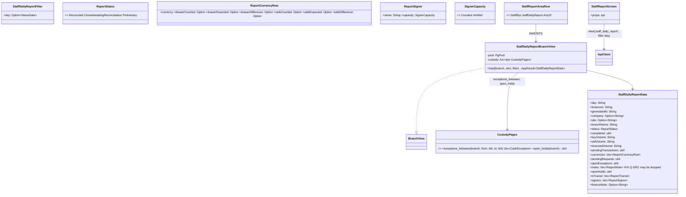

# XCHANGE v3 — Wave 3: the staff report (`/staff/report`)

Part of Phase 2 (`xchange-v3-web.md` §6, Wave 3). This is §B of the Wave 3 split agreed on 2026-10-09:
- the documents pages are §A, in `xchange-v3-wave3-report-documents.md` (PR 530);
- `/staff` and its views are in `xchange-v3-wave3-staff.md` (PR 532).

The staff report has its own file so that PR 530 does not change while it is under review. Once both PRs merge, the §B stub of `xchange-v3-wave3-report-documents.md` points here.

Measured at `origin/main` `9f05f83` and in `xchange-v2-source@4d0bdbb`.
- **R** = `src/booking/app/staff/report/page.tsx`: 5 lines, one 4,240-char body. Refs are `R:4:<col>` (character
  offset), as in `xchange-v3-wave3-staff.md`.
- Cross-checked against claude/89458e53's measurement of the same file.

## B.0 The Blueprint decides the figures (owner, 2026-10-09)

The owner said it twice in session claude/e5ab6c on 2026-10-09: *"พิมพ์ เค้าว่าอย่างไรให้ ยึดตามนั้น"* and *"เพราะ
พิมพ์เขียน ระบุไว้ ก็ยึดตามเอกสาร"* (whatever the Blueprint says, hold to it, because the Blueprint states it). The
owner's rule on #564 says the same: Blueprint logic is fixed, and only the look may change.

So this report takes **v2's page as its look** (B.1: the layout, the Thai words, the print sheet) and **the Blueprint
as its logic**. Every figure on it is the Blueprint's definition, read from the Blueprint's entities
(`docs/blueprint/XC-Desk-Blueprint-Data-Model-v2.html`):

| Figure | Blueprint definition | § | Designed in |
|---|---|---|---|
| the day | the business date in the **branch's timezone** (*"กรอง business date ตาม timezone สาขา"*) | 11, 07 `Branch.timezone` | #550 (org, branches) |
| completed exchanges | Transactions whose status is `COMPLETED` (*"COMPLETED เมื่อ posting เงินและ inventory สำเร็จ atomic"*) | 06, 07 | #551 |
| unfinished exchanges | Transactions of the day in a non-final state: `DRAFT`, `PENDING_APPROVAL` or `CONFIRMED` | 06 | #551 |
| buy and sell volume | the THB equivalent of completed lines **split by `shop_side`**, gross, with reversals shown separately; *"volume รวมไม่ใช่รายได้"* | 11 | #551, #552 |
| the close certification | the shift's closing `CashCount` with its `counted_by` and `verified_by` (B01 *"ปิดและรับรอง"*) | 03, 07 | #582 |
| counted, expected and difference per currency | `CashCountLine` qty, expected and difference; *"cash variance = counted − expected"* | 07, 11 | #582, #553 |
| reconciled | FINANCE's certification on F01 (*"รับรอง; ตั้ง exception"*) | 03 | #553, #562 |
| money in transit | `CashTransfer` in `DISPATCHED` (*"ยอดอยู่ in-transit ระหว่างส่ง"*), shown apart from on-hand money | 06, 11 | #582, #553 |
| who may read the report | the role scopes of §02 (BRANCH_MANAGER: cash and shift close; FINANCE: reconciliation; EXECUTIVE: every branch) | 02 | #550, #582 |
| net profit | never shown as net profit until expenses and accounting policy exist (*"ก่อนครบให้ใช้ชื่อ contribution ไม่ตั้งชื่อ net profit"*). v2's note line *"กำไรสุทธิ: ยังไม่คำนวณ"* already says this | 11 | — |

**What that means for this design.** Those entities do not exist in v3 yet; #550, #551, #552, #553 and #582 design them.
- Where this file names today's v3 columns (`transactions.principal`, custody `CLOSE` requests, `custody_signatures`),
  they describe v3 **as measured** and are **superseded** by the table above.
- The report ticket is cut against the merged designs of those tickets, using the names they give. It never uses the
  names below where those designs say otherwise, and it never invents a name before they merge.
- Rows of B.1 marked **[Blueprint]** take their figure from this table.
- **Revised 2026-10-11 after #1350's name check** (claude/14cc24bd, 13 items, measured on `20cbacff`). The designs of
  B.0 have merged since this file was written. §B.8 lists each item and how it was settled. B.1–B.6 below are
  rewritten to the merged names. Items Q-SR1…Q-SR4 are the owner's to decide (§B.9); until they are answered,
  #1350 gets no up-front tests and no `ready`.

## B.1 What v2 does: the behaviour contract (W9). This is the look; the logic is B.0

v2 reads `adminSnapshot` once on `/api/staff/rpc` (`R:4:185`). It does no writes and no polling. Everything else it
shows, it computes in the browser.

| # | v2 (R col) | v3: who computes, and where it shows |
|---|---|---|
| 1 | RATES/SYSTEM → `บทบาทนี้ไม่มีสิทธิ์อ่านรายงานเงิน`, and a link `กลับเข้าสู่ระบบ` → `/staff` (`:414`). Browser only: the server answered the snapshot anyway | **[Blueprint]** the **server** refuses: the policy row of D-B2 refuses a session holding none of the three permissions with `PolicyError::RoleNotAllowed`, status **400** (`policy.rs:776-792`, `policy_error.rs:108-110`), before load, so no figure is sent. The screen prints v2's sentence and link on that refusal (the look) |
| 2 | any RPC refusal → its `error` sentence, same link (`:300`) | the view's refusal sentence (e.g. no staff session → `PolicyError::SignIn`'s sentence), same link |
| 3 | `กำลังโหลดรายงาน…` while loading | same text (`staffReport.loading`) |
| 4 | the day: `today in Asia/Bangkok` from the **browser clock**; `<input type=date>` changes it (`:130`) | **[Blueprint]** the **server** decides "today" as the business date in the branch's timezone (B.0) when the filter has no `day`, and answers `day`. The input shows `day`; a change re-reads with `day=<YYYY-MM-DD>` |
| 5 | `tx` = transactions with `date === day`; `done` = COMPLETED (`:719`). The snapshot holds LIVE transactions only (`api/src/infrastructure/compat/snapshot_sources.rs:5`) | **[Blueprint]** a COMPLETED exchange is on the day of its `completed_at`; an unfinished one (`DRAFT`, `PENDING_APPROVAL`, `CONFIRMED`) on the day of its `recorded_at`; both in the branch's timezone (`20261111170000_transaction_states.sql:23`, §B.8 item 13). LIVE only (`transactions.mode`); DEMO rows are never counted |
| 6 | `requests` = custody requests with Bangkok `day(at) === day` (`:824`) | **[Blueprint]** custody requests are retired (cash-shift §4.1, CA-10). The day's cash events are `cash_counts` (by `counted_at`), `handovers` and `cash_transfers` (by `created_at`), in the branch's timezone, read by the view's own SQL (§B.8 item 2) |
| 7 | `closed` = the **last** COMPLETED `CLOSE` request of the day (`.at(-1)`, position order) (`:884`) | **[Blueprint]** shifts are per teller (cash-shift C1/A8), so a day has one `CLOSE` count per shift. Which counts the figures come from is **Q-SR1** (§B.9). Recommended: every verified `CLOSE` count of the day |
| 8 | status: `closed.reconciliation === 'CHECKED'` → `กระทบยอดแล้ว`; `closed` → `ปิดกะแล้ว · รอกระทบยอด`; none → `ยอดเบื้องต้น · ยังไม่ปิดกะ` (`:1164`) | **[Blueprint]** `reconciled` when a `reconciliation_certifications` row exists for (branch, day) (#562); else `closedAwaitingReconciliation` when the day had at least one **counted shift** and every counted shift of the day has a verified `CLOSE` count, which is the branch day's `CUT_OFF → CLOSED` rule (cash-shift §4.2); else `preliminary`. A *counted shift of the day* is a `shifts` row of the branch with `opened_at` in the day bounds and `opened_by_count IS NOT NULL` (`20261109100000_shift_per_teller.sql:5`), i.e. opened by the v3 count path. A v2-opened shift (`opened_by_count IS NULL`) gets no `CLOSE` count until CA-10, so it is left out of this rule; a day with only v2-opened shifts stays `preliminary`, which is true until CA-10 makes every shift counted. The screen maps the three to v2's words |
| 9 | `h1` = `entity.company` or `ยังไม่ยืนยันนิติบุคคล`; `h2` = `entity.site` or the branch name, then ` · <day>`; `<status> · สาขา <branch name>` (`:1604`). v2 crashes when the branch is not in the list | server answers `company: Option`, `site: Option`, `branchName`; the screen prints the fallbacks. No crash: the view core already refuses an unknown branch (#500) |
| 10 | `รายการสำเร็จ` = `done.length` (`:1766`) | **[Blueprint]** `completed: u64` = the count of row 5's COMPLETED set |
| 11 | `มูลค่าแลก` = Σ `amount × rate` over `done`, floats, printed with 2 places `THB` (`:1845`) | **[Blueprint]** the executive design's own definitions (`blueprint/executive-finance.md` §3, `buy_volume_thb`/`sell_volume_thb`): `buyVolume` / `sellVolume` = Σ `transaction_lines.thb_amount` of the day's COMPLETED exchanges per `shop_side`, **gross**; `reversedVolume` = Σ `reversals.amount_thb` of `status = 'POSTED'` by the business date of `posted_at` in the branch's timezone. No rate arithmetic in the report. The screen shows *มูลค่าแลก · ร้านซื้อ* and *· ร้านขาย*: **known difference** from v2's one figure, because §11 forbids one mixed volume |
| 12 | `รายการธุรกรรมค้าง` = count of `tx` with status PENDING (`:1953`) | **[Blueprint]** `pendingTransactions` = the day's Transactions in `DRAFT`, `PENDING_APPROVAL` or `CONFIRMED` (§06, #551). This is a real count, not a constant |
| 13 | table of **7 hard-coded currencies** `THB USD EUR GBP JPY CNY AUD`: `closed.counted[c]` and `closed.safeCount[c]` (or `รอนับ` when no `closed`), and Σ `variance[c]` / Σ `safeVariance[c]` over the day's COMPLETED requests (`:1996`–`:2376`) | **[Blueprint]** per currency from `cash_count_totals` (`counted`, `expected`, `difference`), **as stored**: `difference` is written by `CashCountService::verify` (cash-shift §4.1), so the report computes nothing. Drawer columns: the `CLOSE` counts of Q-SR1. Safe columns: the day's last verified count of `kind IN ('SAFE_OPEN','SAFE')` (`shift_id NULL`), last by `verified_at`. `null` when no such count → `รอนับ`. The 7 codes and their order are v2's look |
| 14 | `งานรับ–ส่งรอยืนยัน {n}` = the day's PENDING requests; `เหตุผลต่างที่ยังเปิด {n}` = OPEN exceptions whose Bangkok `day(at) === day` (`:2436`) | **[Blueprint]** `pendingRequests`: handovers and transfers not yet received; which statuses, which side and whether by day is **Q-SR2** (§B.9). `openExceptions` = the kept `cash_exceptions` (`id, branch_id, position, data jsonb`, `custody.sql:61-67`) read through `CustodyPages::exceptions_between(branch, from, to)` (`custody_pages.rs:75`, epoch ms `[from, to)` on `CashException.at`), counting those with `status` OPEN (as v2) |
| 15 | the first 5 day's requests with a note, as `{kind}: {note}`, kind printed as the **code** (`CLOSE`) (`:2577`) | v2's notes were custody requests' notes, a retired model. The source, or dropping the line, is **Q-SR3** (§B.9). Recommended: `cash_counts.note` and `cash_transfers.note` of the day, ≤ 5 in creation order, as `{kind}: {note}` |
| 16 | `ลูกค้ารอ Monitor ตรวจ {n}` = **all** OPEN holds, not by day (`:2693`) | kept as v2: `openHolds: u64` = every OPEN `customer_holds` row of the branch, not by day. #557 maps no staff hold to `VerificationCase`, and cash-shift §4.1 keeps `customer_holds`; read with `CustodyPages::open_holds` (`xc-shift/src/domain/custody/repositories/custody_pages.rs:82`) |
| 17 | `เงินระหว่างนำส่ง:` the day's requests with `stage IN_TRANSIT` as `kind money(amount) currency` joined ` / `, else `ไม่มี` (`:2789`) | **[Blueprint]** `cash_transfers` in `DISPATCHED`, amount per currency = Σ `qty_sent × face_value` of its lines (cash-shift §4.6: in transit is read from the transfers, not a balance), shown apart from on-hand. Which kinds, which side and whether by day is **Q-SR4** (§B.9). Printed `kind amount currency`, else `ไม่มี` |
| 18 | `ผู้รับรองปิดวัน`: `closed.signatures` as `name (role)` joined ` / ` (name from the signature, else the employees list, else the id), else `รอผู้จัดการและผู้ตรวจรับรอง` (`:2910`) | **[Blueprint]** the `CLOSE` counts' `counted_by` and `verified_by`, both `users(id)` (cash-shift §4.1). Printed `name (ผู้นับ)` / `name (ผู้รับรอง)`: the capacity, not an access role (§B.8 item 6). Else v2's fallback words |
| 19 | `Finance: ` `closed.reconciled.note` or `รอกระทบยอดจากหลักฐานอิสระ` (`:3054`) | **[Blueprint]** the `note` of the newest `reconciliation_certifications` row for (branch, day) (#562, `20261031130000_executive_finance.sql:28-39`), else v2's fallback words |
| 20 | the fixed note line, and the footer `… สร้างรายงาน {now, th-TH, Asia/Bangkok} …` from the **browser clock** (`:3263`, `:3475`) | server `generatedAt` (RFC 3339); the screen formats it `th-TH` in the **branch's timezone** (the server answers it with the report), which is Asia/Bangkok for every branch today |
| 21 | print: `พิมพ์ / บันทึก PDF` → `window.print()`; `@page A4 12mm`; the tools hidden on print (`:3629`) | the same, in `staff-report/print.css` |
| 22 | `กลับ` → `/staff` | same |

Money on the wire is decimal strings (W7). The screen does no arithmetic: no sum, no count, no filter by day.

## B.2 Decisions

- **D-B1. One view, no write, no poll.** `staff_daily_report` is a `BranchView`. Its filter is
  `StaffDailyReportFilter { day: Option<NaiveDate> }` (`check`: a malformed day → 400 `invalidRequest`, field `day`).
  The screen reads it on load and on a day change, and never polls. v2 did not poll either (§12.6).
- **D-B2. Who may read: one policy row, by the Blueprint's §02 role scopes.** `INHERITS = (EntryPath::StaffRpc,
  "staffDailyReport")`, a new row in a new area file `api/crates/xc-auth/src/domain/policy/areas/staff_report.rs`
  (picked up by `xc-auth/build.rs:8-39`; no shared file is edited):
  `need: Need::AnyOf(&[Permission::ShiftCloseCertify, Permission::FinanceReconcile, Permission::OverviewRead])`.
  Each permission is the §02 reason a role reads the report, and on `main` `9e5f6f74` each is held by exactly that
  role (`access/role_permissions.rs`): `ShiftCloseCertify` by BRANCH_MANAGER (cash and shift close, `:60`),
  `FinanceReconcile` by FINANCE (reconciliation, `:104`), `OverviewRead` by EXECUTIVE (every branch, `:10`). No new
  permission, no edit to `role_permissions.rs`, and no role check in the view. Only the staff session counts
  (`view.rs:340`), so the owner's cookie alone is refused. `StaffSight` of the earlier text was never built (S-1 #573
  merged without it) and is not used.
- **D-B3. "Today" and "generated at" are the server's.** The server answers `day` (the branch's business date in
  `branches.timezone`, `20261011100000_organizations.sql:16`) and `generatedAt`. A browser with a wrong clock no longer
  shifts the report: a known-differences row.
- **D-B4. Every figure is the server's, by the Blueprint's definitions** (B.0), and where a merged design already
  defines the same figure (volumes: `executive-finance.md` §3), the report uses that definition word for word. The
  screen does no arithmetic. Money is decimal strings.
- **D-B5. Signers are `users`.** `counted_by` and `verified_by` reference `users(id)` (cash-shift §4.1); names are
  joined on the server from `users`. The screen prints the **capacity** (*ผู้นับ*, *ผู้รับรอง*), not an access role: a
  user may hold several roles, and the capacity is what the signature means (§07 `CashCount`).
- **D-B6. Texts** (W10): `web/src/screens/staff-report/i18n.ts`, namespace `staffReport.*`, th = v2 verbatim (the
  full list is in `xchange-v3-wave3-staff.md` §2) plus *ผู้นับ* / *ผู้รับรอง*, en added. Kind codes in `notes` and
  `inTransit` stay codes, as v2 printed them.
- **D-B7. Gate `anyone`**, as v2's `PageKind::Plain`, `who_signed_in: false` (the `/staff/report` `PageSpec`, `api/src/presentation/pages.rs:133-139`).
  The page gate pins listed by the name check (`api/tests/pages_test.rs:255`, `:567`, `:583`;
  `pages_desk_script_test.rs:230`; `pages_forms_test.rs:201`; `fixtures/pages/v2_page_cases.json:65`, `:209`, `:351`;
  `pages.rs:133-139`) stay green and are not edited.
- **D-B8. LK-1: the report keeps the shell.** `staff-report/main.tsx` renders `AppShell`, as every staff page does
  (`web/src/shared/ui/shell-look.test.ts:72-110`), and `print.css` hides the shell's chrome on print. Neither
  `CHILD_MODULE_ENTRIES` nor `SHELL_LESS_PUBLIC_PAGES` is edited. **LK-6:** every class the screen uses has a rule in
  `staff-report/print.css` or `staff-report/staff-report.css`; `look-allowlist.txt` is not edited.

## B.3 Class diagram

| Class / item | File | New? | Provides to | Uses |
|---|---|---|---|---|
| `StaffDailyReportBranchView`, `register`, `export_types` | `api/src/presentation/http/v3/views/staff_daily_report.rs` | new | `ViewEndpoint` | its own read-only SQL on `transactions`, `transaction_lines`, `reversals`, `cash_counts`, `cash_count_totals`, `handovers`, `cash_transfers`, `cash_transfer_lines`, `denominations`, `reconciliation_certifications`, `users`, `branches`, `shifts`, `ops_state.entity` (as `views/admin_reports.rs:177-190` reads `transactions`); `CustodyPages::exceptions_between` and `CustodyPages::open_holds` for the two custody-model tables kept as jsonb |
| `StaffDailyReportFilter`, `StaffDailyReportData`, `ReportStatus`, `ReportCurrencyRow`, `ReportNote`, `ReportTransit`, `ReportSigner`, `SignerCapacity` | `api/src/presentation/dto/v3/staff_daily_report.rs` | new | the view, the generated TS | `V3Error` |
| the policy row (D-B2) | `api/crates/xc-auth/src/domain/policy/areas/staff_report.rs` | new | `AREA_ROWS` | `Need::AnyOf` |
| generated types | `web/src/shared/api/generated/staff_daily_report.ts` | generated | the screen | — |
| `StaffReportScreen` | `web/src/screens/staff-report/StaffReport.tsx` | new | `main.tsx` | `ApiClient.view`, `t()`, `formatMoney` |
| entry, texts, styles | `web/src/screens/staff-report/main.tsx` (renders `AppShell`), `i18n.ts`, `print.css`, `staff-report.css` | new | — | — |
| HTML entry | `web/pages/staff-report.html` (`xc-path /staff/report`, `xc-gate anyone`) | new | `ScreenTable` | — |

**Why the view reads the cash tables with its own SQL** (§B.8 item 2). CA-8's `cash_counts.rs`, `cash_transfers.rs`
and `handovers_pending.rs` are views with their own filters and policy rows, not loaders; calling a view from a view
would tie the report to their permissions. The report's reads are aggregates for one branch and one day, in one file
that nothing else imports. When a second reader needs the same aggregates, they move into a loader then (♻️ fires on
the second variant, not before).

**The day bounds** are `[day 00:00, day+1 00:00)` in `branches.timezone`, converted to UTC once by the view. An event
is on the day of: `completed_at` (COMPLETED exchanges), `recorded_at` (unfinished exchanges), `posted_at` (reversals),
`counted_at` (counts), `created_at` (handovers, transfers, notes), `CashException.at` (exceptions), `shifts.opened_at` (shifts). "Last" means the greatest `verified_at`.

## B.4 Cost

The view is read on load and on a day change, never polled. One read is a fixed number of indexed aggregate queries
over one branch's rows of one day, plus one count of OPEN holds. It is not O(history). An index is added only if a
measurement shows a need.

## B.5 Tickets and order

| Ticket | Owns | Start dependency | Merges after |
|---|---|---|---|
| **V3-staff-report** #1350 | every file in the B.3 table, `api/tests/v3_staff_daily_report_view_test.rs` (new), `web/src/screens/staff-report/*.test.tsx` (new), known-differences rows | this revision merged; the owner's answers to Q-SR1…Q-SR4 written into §B.9; OR-7.7 #1030 merged (the view's `Who` carries `access::Role` only after it). Every other dependency of the earlier text (S-0a #571, S-1 #573, #550, #551, #552, #553, #557, #582, #562) has merged | — |

## B.6 Tests the ticket author writes first (🧪)

On `feat/v3-staff-report-1350`, written after §B.9 is answered and #1030 has merged:

- **View**: one test per row of B.1 1–19, against a branch whose data is written through the merged services
  (`CashCountService`, the transfer flow, the exchange and reversal services). No test writes custody requests. Among them:
  - a session holding none of `ShiftCloseCertify`, `FinanceReconcile`, `OverviewRead` → refused with `RoleNotAllowed`
    (status 400 on `main` `89543a2b`; the test pins the status `main` answers once #1030 has merged), no figure; each of the
    three alone → `200`;
  - the owner's cookie alone → refused;
  - an exchange completed at 23:59:59 and one at 00:00:00 of the next day **in the branch's timezone** land on
    different days, with a branch whose timezone is not `Asia/Bangkok`;
  - `buyVolume` / `sellVolume` = Σ `thb_amount` per `shop_side`; a POSTED reversal is in `reversedVolume` and is not
    subtracted; a DEMO row is in none of them;
  - `pendingTransactions` counts one DRAFT, one PENDING_APPROVAL and one CONFIRMED exchange of the day, and no
    COMPLETED one;
  - the currency rows equal the stored `cash_count_totals` values byte for byte;
  - a v2-opened shift (`opened_by_count IS NULL`) of the day does not count toward the status rule;
  - the status is `preliminary` while one counted shift of the day lacks a verified `CLOSE` count, then
    `closedAwaitingReconciliation`, then `reconciled` after a certification;
  - the signers carry `Counted` / `Verified`, with names from `users`;
  - no `day` → the server's business date in the branch's timezone.
  - Q-SR1…Q-SR4: one test per answered rule.
- **Mutants**, each must turn some test red:
  - a fixed `+07:00` day instead of `branches.timezone`;
  - one mixed volume instead of the `shop_side` split;
  - `settle_thb` instead of `thb_amount`;
  - the `mode = 'LIVE'` filter dropped;
  - the policy row's `AnyOf` missing one of its three permissions.
- The earlier mutant "expected − counted instead of counted − expected" is **dropped**: the sign is written by
  `CashCountService::verify`, whose own tests pin it (cash-shift §4.1), and the report only reads the stored value.
- **Screen** (fake `ApiClient`), mounted through `staff-report/main.tsx` as the entry does:
  - every v2 string of §B.1 in th, plus en;
  - the three status words;
  - `รอนับ` when a drawer or safe value is null;
  - `ไม่มี` for an empty `inTransit`;
  - the signer fallback, and *ผู้นับ* / *ผู้รับรอง*;
  - the `RoleNotAllowed` refusal → v2's sentence with the `/staff` link;
  - a day change re-reads with `day=`; no request after mount without a day change;
  - `window.print` called by the button; the shell is rendered.

## B.7 Data migration

None. The report reads tables that merged migrations created (`20261011100000_organizations.sql`,
`20261111170000_transaction_states.sql`, `20261112110000_reversals.sql`, `20261012100000_cash.sql`,
`20261031130000_executive_finance.sql`), and adds no table, column or index.

## B.8 The name check of #1350, item by item (2026-10-11)

| # | Item (issuecomment by claude/14cc24bd) | Settled | By |
|---|---|---|---|
| 1 | `StaffSight` does not exist | D-B2: `(StaffRpc, "staffDailyReport")` with `AnyOf` of three existing permissions | §02 role scopes + `role_permissions.rs` |
| 2 | custody requests retired | the view's own read-only SQL on the cash tables (B.3) | cash-shift §4.1 |
| 3 | shifts are per teller | **owner, Q-SR1** | — |
| 4 | the safe column | the day's last verified `SAFE_OPEN`/`SAFE` count (`shift_id NULL`), last by `verified_at` | cash-shift §4.1 |
| 5 | expected/difference on `cash_count_totals` | read as stored; the old sign mutant is dropped (B.6) | cash-shift §4.1 |
| 6 | signers are users | D-B5: names from `users`, the capacity printed instead of a role | cash-shift §4.1, §07 |
| 7 | reconciled / `financeNote` | the proposal, as written (B.1 rows 8, 19) | #562 |
| 8 | pending requests and exceptions | requests: **owner, Q-SR2**; exceptions: OPEN of the day, as v2 | — |
| 9 | notes | **owner, Q-SR3** | — |
| 10 | holds | the proposal: `openHolds: u64`, all OPEN, not by day | #557, cash-shift §4.1 |
| 11 | in transit | **owner, Q-SR4** | — |
| 12 | volumes | `thb_amount`; reversals by `posted_at`'s business date | `executive-finance.md` §3 |
| 13 | which timestamp puts an exchange on a day | the proposal: `completed_at` / `recorded_at`, branch timezone | #551 |

Rule (b) pins: the page gate pins stay as they are (D-B7); the `/staff` link tests are unaffected; LK-1 and LK-6 are
met without editing their lists (D-B8).

## B.9 Must ask the owner

Each is a choice of what a manager reads on the sheet; the merged designs do not decide it.

| Q | Question | Recommended | Why |
|---|---|---|---|
| **Q-SR1** | A day has one closing count per teller shift. Do the drawer columns and the signers show **(a)** the last verified `CLOSE` count only, as v2 showed its one count, or **(b)** per currency the sum of every verified `CLOSE` count of the day, with every count's signers? | **(b)** | The branch day closes only when every shift's `CLOSE` is verified (cash-shift §4.2), so the day's cash is all drawers; (a) would show one teller's drawer as the branch's |
| **Q-SR2** | "Handovers and transfers not yet received": which transfer statuses (DRAFT, APPROVED, DISPATCHED, or DISPATCHED only), which side (sent by this branch, received by it, or both), and only those created that day or every one still open? | handovers `PENDING` + transfers `DRAFT`/`APPROVED`/`DISPATCHED`, this branch at either end, **every one still open** (not by day) | an unfinished hand-over from yesterday still needs someone today; v2 counted by day only because its requests were per day |
| **Q-SR3** | v2's notes line came from custody requests, which are retired. Keep it from the new notes (`cash_counts.note`, `cash_transfers.note`, ≤ 5 of the day, `{kind}: {note}`), or drop the line? | keep, from the new notes | keeps v2's look with the Blueprint's records |
| **Q-SR4** | Money in transit: which kinds (`BRANCH` only, or also drawer↔safe and external), which side, and every DISPATCHED transfer now or only those dispatched that day? | every kind, this branch at either end, **every DISPATCHED transfer now** | §11 keeps all in-transit money apart from on-hand money, whatever its route; money dispatched yesterday and not received is still in transit |

Until the owner answers, #1350 stays held: no up-front tests, no `ready`.
