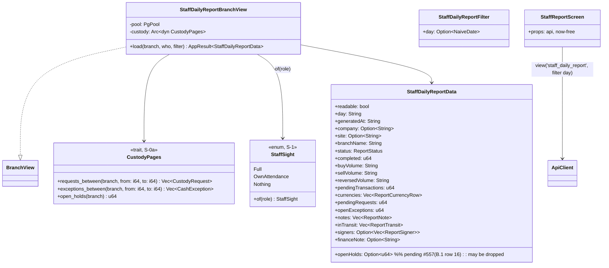

# XCHANGE v3 — Wave 3: the staff report (`/staff/report`)

Part of Phase 2 (`xchange-v3-web.md` §6, Wave 3). This is §B of the Wave 3 split agreed on 2026-10-09:
- the documents pages are §A, in `xchange-v3-wave3-report-documents.md` (PR 530);
- `/staff` and its views are in `xchange-v3-wave3-staff.md` (PR 532).

The staff report has its own file so that PR 530 does not change while it is under review. Once both PRs merge, the §B stub of `xchange-v3-wave3-report-documents.md` points here.

Measured at `origin/main` `9f05f83` and in `xchange-v2-source@4d0bdbb`.
- **R** = `src/booking/app/staff/report/page.tsx`: 5 lines, one 4,240-char body. Refs are `R:4:<col>` (character
  offset), as in `xchange-v3-wave3-staff.md`.
- Cross-checked against claude/89458e53's measurement of the same file.

## B.0 The Blueprint decides the figures (owner, 2026-10-09)

The owner said it twice in session claude/e5ab6c on 2026-10-09: *"พิมพ์ เค้าว่าอย่างไรให้ ยึดตามนั้น"* and *"เพราะ
พิมพ์เขียน ระบุไว้ ก็ยึดตามเอกสาร"* (whatever the Blueprint says, hold to it, because the Blueprint states it). The
owner's rule on #564 says the same: Blueprint logic is fixed, and only the look may change.

So this report takes **v2's page as its look** (B.1: the layout, the Thai words, the print sheet) and **the Blueprint
as its logic**. Every figure on it is the Blueprint's definition, read from the Blueprint's entities
(`docs/blueprint/XC-Desk-Blueprint-Data-Model-v2.html`):

| Figure | Blueprint definition | § | Designed in |
|---|---|---|---|
| the day | the business date in the **branch's timezone** (*"กรอง business date ตาม timezone สาขา"*) | 11, 07 `Branch.timezone` | #550 (org, branches) |
| completed exchanges | Transactions whose status is `COMPLETED` (*"COMPLETED เมื่อ posting เงินและ inventory สำเร็จ atomic"*) | 06, 07 | #551 |
| unfinished exchanges | Transactions of the day in a non-final state: `DRAFT`, `PENDING_APPROVAL` or `CONFIRMED` | 06 | #551 |
| buy and sell volume | the THB equivalent of completed lines **split by `shop_side`**, gross, with reversals shown separately; *"volume รวมไม่ใช่รายได้"* | 11 | #551, #552 |
| the close certification | the shift's closing `CashCount` with its `counted_by` and `verified_by` (B01 *"ปิดและรับรอง"*) | 03, 07 | #582 |
| counted, expected and difference per currency | `CashCountLine` qty, expected and difference; *"cash variance = counted − expected"* | 07, 11 | #582, #553 |
| reconciled | FINANCE's certification on F01 (*"รับรอง; ตั้ง exception"*) | 03 | #553, #562 |
| money in transit | `CashTransfer` in `DISPATCHED` (*"ยอดอยู่ in-transit ระหว่างส่ง"*), shown apart from on-hand money | 06, 11 | #582, #553 |
| who may read the report | the role scopes of §02 (BRANCH_MANAGER: cash and shift close; FINANCE: reconciliation; EXECUTIVE: every branch) | 02 | #550, #582 |
| net profit | never shown as net profit until expenses and accounting policy exist (*"ก่อนครบให้ใช้ชื่อ contribution ไม่ตั้งชื่อ net profit"*). v2's note line *"กำไรสุทธิ: ยังไม่คำนวณ"* already says this | 11 | — |

**What that means for this design.** Those entities do not exist in v3 yet; #550, #551, #552, #553 and #582 design them.
- Where this file names today's v3 columns (`transactions.principal`, custody `CLOSE` requests, `custody_signatures`),
  they describe v3 **as measured** and are **superseded** by the table above.
- The report ticket is cut against the merged designs of those tickets, using the names they give. It never uses the
  names below where those designs say otherwise, and it never invents a name before they merge.
- Rows of B.1 marked **[Blueprint]** take their figure from this table.

## B.1 What v2 does: the behaviour contract (W9). This is the look; the logic is B.0

v2 reads `adminSnapshot` once on `/api/staff/rpc` (`R:4:185`). It does no writes and no polling. Everything else it
shows, it computes in the browser.

| # | v2 (R col) | v3: who computes, and where it shows |
|---|---|---|
| 1 | RATES/SYSTEM → `บทบาทนี้ไม่มีสิทธิ์อ่านรายงานเงิน`, and a link `กลับเข้าสู่ระบบ` → `/staff` (`:414`). Browser only: the server answered the snapshot anyway | **[Blueprint]** the **server** decides from the §02 role scopes (B.0, #550/#582) and answers `readable: false` with no figures to a role outside them. The screen prints v2's sentence and link (the look) |
| 2 | any RPC refusal → its `error` sentence, same link (`:300`) | the view's refusal sentence (e.g. no staff session → `PolicyError::SignIn`'s sentence), same link |
| 3 | `กำลังโหลดรายงาน…` while loading | same text (`staffReport.loading`) |
| 4 | the day: `today in Asia/Bangkok` from the **browser clock**; `<input type=date>` changes it (`:130`) | **[Blueprint]** the **server** decides "today" as the business date in the branch's timezone (B.0) when the filter has no `day`, and answers `day`. The input shows `day`; a change re-reads with `day=<YYYY-MM-DD>` |
| 5 | `tx` = transactions with `date === day`; `done` = COMPLETED (`:719`). The snapshot holds LIVE transactions only (`api/src/infrastructure/compat/snapshot_sources.rs:5`) | **[Blueprint]** the day's Transactions; `done` = status `COMPLETED` (B.0, #551). LIVE only (DEMO rows are v3's own and never counted) |
| 6 | `requests` = custody requests with Bangkok `day(at) === day` (`:824`) | **[Blueprint]** the day's cash events in the branch's timezone: closing counts, handovers and transfers, from the loaders the owning designs give (#582, #553; S-0a #571 for what stays custody) |
| 7 | `closed` = the **last** COMPLETED `CLOSE` request of the day (`.at(-1)`, position order) (`:884`) | **[Blueprint]** the day's last closing `CashCount` that is verified (B.0: `verified_by` set), per #582. When a day has several shifts, the report shows the last closing count, as v2 showed the last CLOSE |
| 8 | status: `closed.reconciliation === 'CHECKED'` → `กระทบยอดแล้ว`; `closed` → `ปิดกะแล้ว · รอกระทบยอด`; none → `ยอดเบื้องต้น · ยังไม่ปิดกะ` (`:1164`) | **[Blueprint]** `reconciled` when FINANCE has certified the close (F01, #553); `closedAwaitingReconciliation` when a verified closing count exists; else `preliminary`. The screen maps the three to v2's words |
| 9 | `h1` = `entity.company` or `ยังไม่ยืนยันนิติบุคคล`; `h2` = `entity.site` or the branch name, then ` · <day>`; `<status> · สาขา <branch name>` (`:1604`). v2 crashes when the branch is not in the list | server answers `company: Option`, `site: Option`, `branchName`; the screen prints the fallbacks. No crash: the view core already refuses an unknown branch (#500) |
| 10 | `รายการสำเร็จ` = `done.length` (`:1766`) | **[Blueprint]** `completed: u64` = the count of row 5's COMPLETED set |
| 11 | `มูลค่าแลก` = Σ `amount × rate` over `done`, floats, printed with 2 places `THB` (`:1845`) | **[Blueprint]** §11 forbids one mixed volume figure: the server answers `buyVolume` and `sellVolume`, each the THB equivalent of the completed lines of that `shop_side`, and `reversedVolume` separately (#551, #552). No rate arithmetic in the report. The screen shows two lines in v2's style, *มูลค่าแลก · ร้านซื้อ* and *· ร้านขาย*: the look changes because the Blueprint logic requires the split. **Known difference** from v2's one figure |
| 12 | `รายการธุรกรรมค้าง` = count of `tx` with status PENDING (`:1953`) | **[Blueprint]** `pendingTransactions` = the day's Transactions in `DRAFT`, `PENDING_APPROVAL` or `CONFIRMED` (§06, #551). This is a real count, not a constant |
| 13 | table of **7 hard-coded currencies** `THB USD EUR GBP JPY CNY AUD`: `closed.counted[c]` and `closed.safeCount[c]` (or `รอนับ` when no `closed`), and Σ `variance[c]` / Σ `safeVariance[c]` over the day's COMPLETED requests (`:1996`–`:2376`) | **[Blueprint]** per currency from the closing count's `CashCountLine`s: counted, expected, and difference = counted − expected (§11), for the drawer and the safe accounts (`CashAccount.kind`, #553). `null` when no verified closing count exists → `รอนับ`. The 7 codes and their order are v2's look |
| 14 | `งานรับ–ส่งรอยืนยัน {n}` = the day's PENDING requests; `เหตุผลต่างที่ยังเปิด {n}` = OPEN exceptions whose Bangkok `day(at) === day` (`:2436`) | **[Blueprint]** handovers and transfers not yet received (`Handover`, `CashTransfer` before `RECEIVED`), and open reconciliation exceptions (F01), per #582/#553 |
| 15 | the first 5 day's requests with a note, as `{kind}: {note}`, kind printed as the **code** (`CLOSE`) (`:2577`) | server `notes: [{kind, note}]` (≤ 5, position order); the screen prints the code verbatim, as v2 |
| 16 | `ลูกค้ารอ Monitor ตรวจ {n}` = **all** OPEN holds, not by day (`:2693`) | **[Blueprint, pending]** the Blueprint has no "hold". The nearest thing is a `VerificationCase` `UNDER_REVIEW` (§16, #557). #557 decides whether this line maps there or goes |
| 17 | `เงินระหว่างนำส่ง:` the day's requests with `stage IN_TRANSIT` as `kind money(amount) currency` joined ` / `, else `ไม่มี` (`:2789`) | **[Blueprint]** `CashTransfer`s of the branch in `DISPATCHED` (§06), shown apart from on-hand (§11), as `amount currency`, else `ไม่มี` (#582/#553) |
| 18 | `ผู้รับรองปิดวัน`: `closed.signatures` as `name (role)` joined ` / ` (name from the signature, else the employees list, else the id), else `รอผู้จัดการและผู้ตรวจรับรอง` (`:2910`) | **[Blueprint]** the closing count's `counted_by` and `verified_by` as `name (role)` (§07 `CashCount`; who may verify is #582's), else v2's fallback words |
| 19 | `Finance: ` `closed.reconciled.note` or `รอกระทบยอดจากหลักฐานอิสระ` (`:3054`) | **[Blueprint]** FINANCE's reconciliation note on F01 (#553), else v2's fallback words |
| 20 | the fixed note line, and the footer `… สร้างรายงาน {now, th-TH, Asia/Bangkok} …` from the **browser clock** (`:3263`, `:3475`) | server `generatedAt` (RFC 3339); the screen formats it `th-TH` in the **branch's timezone** (the server answers it with the report), which is Asia/Bangkok for every branch today |
| 21 | print: `พิมพ์ / บันทึก PDF` → `window.print()`; `@page A4 12mm`; the tools hidden on print (`:3629`) | the same, in `staff-report/print.css` |
| 22 | `กลับ` → `/staff` | same |

Money on the wire is decimal strings (W7). The screen does no arithmetic: no sum, no count, no filter by day.

## B.2 Decisions

- **D-B1. One view, no write, no poll.** `staff_daily_report` is a `BranchView`. Its filter is
  `StaffDailyReportFilter { day: Option<NaiveDate> }` (`check`: a malformed day → 400 `invalidRequest`, field `day`).
  The screen reads it on load and on a day change, and never polls. v2 did not poll either (§12.6).
- **D-B2. Who may read: one place decides, by the Blueprint's role scopes (B.0, #550/#582).** What follows is the
  seam measured today, kept so that the report never writes a role check of its own.
  - `INHERITS = (EntryPath::StaffRpc, "adminSnapshot")`, the action v2's page called. Only the staff session counts
    (`api/src/presentation/http/v3/view.rs:340`), so the owner's cookie is ignored, as v2's `/api/staff/rpc` ignored it (`api/src/presentation/http/rpc.rs:244-268`).
  - What a role may see of custody is decided in **one** place: `StaffSight::of(role) -> StaffSight { Full,
    OwnAttendance, Nothing }` in `api/src/application/staff_floor/sight.rs`. It is ticket S-1 of
    `xchange-v3-wave3-staff.md` (PR 532, §3.2 and §9, settled with claude/89458e53). It mirrors
    `api/src/application/compat/staff_view.rs:94-131`: RATES → `OwnAttendance`, SYSTEM → `Nothing`, every other role → `Full`. The report answers
    `readable: false` and no figures unless the sight is `StaffSight::Full`.
  - This keeps three properties. No role check is written in the report view (§4.4). The policy table is not edited.
    And no hidden coupling to another action's row: `(StaffRpc, "documents")` admits exactly the same roles today
    (`api/crates/xc-auth/src/domain/policy/entities/policy.rs:139-141`), but would tie the money report to the documents permission.
- **D-B3. "Today" and "generated at" are the server's.** v2 took both from the browser clock. The server answers
  `day` (the branch's business date in its timezone, B.0) and `generatedAt`. A browser with a wrong clock no longer shifts the report: a
  known-differences row.
- **D-B4. Every figure is the server's, by the Blueprint's definitions** (B.0). The screen does no arithmetic. Money is
  decimal strings.
- **D-B5. Names in signers** are joined on the server from the employee records, so the report needs no employee
  list. That list is owner-only in v3 (`admin_employees`, `OwnerRoute`).
- **D-B6. Texts** (W10): `web/src/screens/staff-report/i18n.ts`, namespace `staffReport.*`, th = v2 verbatim (the
  full list is in `xchange-v3-wave3-staff.md` §2), en added. The kind codes in `notes` and `inTransit` stay codes,
  as v2 printed them.
- **D-B7. Gate `anyone`**, as v2's `PageKind::Plain`, `who_signed_in: false` (`api/src/presentation/pages.rs:87-93`). A visitor with no
  staff session gets the view's refusal and v2's link back to `/staff`.

## B.3 Class diagram

| Class / item | File | New? | Provides to | Uses |
|---|---|---|---|---|
| `StaffDailyReportBranchView`, `register`, `export_types` | `api/src/presentation/http/v3/views/staff_daily_report.rs` | new | `ViewEndpoint` | `CustodyPages` (`PgCustodyPages`), `StaffSight::of`, its own SQL on `transactions` for rows 5, 10–12 (as `api/src/presentation/http/v3/views/admin_reports.rs` does, `:177-190`, **LIVE only**: the snapshot v2's page read holds LIVE transactions only, `snapshot_sources.rs:5`), `employees` for signer names, `branches` for the name, `ops_state.entity` |
| `StaffDailyReportFilter`, `StaffDailyReportData`, `ReportStatus`, `ReportCurrencyRow`, `ReportNote`, `ReportTransit`, `ReportSigner` | `api/src/presentation/dto/v3/staff_daily_report.rs` | new | the view, the generated TS | `V3Error` |
| generated types | `web/src/shared/api/generated/staff_daily_report.ts` | generated | the screen | — |
| `CustodyPages::requests_between` (epoch ms, `[from, to)`, with signatures), `exceptions_between`, `open_holds` (`HoldStatus::Open`, every day) | `api/crates/xc-shift/src/domain/custody/repositories/custody_pages.rs`, implemented by `PgCustodyPages` in `infrastructure/custody/custody_pages.rs` | **S-0a** (staff design), pinned by its tests T-P7/T-P8 | this view and the staff views | the row decoders S-0a moves to `infrastructure/custody/decode.rs` |
| `StaffSight` | `api/src/application/staff_floor/sight.rs` | **S-1** (staff design) | this view and the staff views | the role |
| `StaffReportScreen` | `web/src/screens/staff-report/StaffReport.tsx` | new | `main.tsx` | `ApiClient.view`, `t()`, `formatMoney` |
| entry, texts, print | `web/src/screens/staff-report/main.tsx`, `i18n.ts`, `print.css` | new | — | — |
| HTML entry | `web/pages/staff-report.html` (`xc-path /staff/report`, `xc-gate anyone`) | new | `ScreenTable` | — |

**The day bounds** are `[day 00:00, day+1 00:00)` in the **branch's timezone** (`Branch.timezone`, Blueprint §07;
*"กรอง business date ตาม timezone สาขา"*, §11), converted to UTC once by the view. The column is #550's
(org, branches). Until it exists, every v3 branch is in Thailand, but the rule is the branch's timezone, never a fixed
offset. The loaders take the bounds as `[from, to)` epoch ms (S-0a #571's `requests_between`) or as `timestamptz`
bounds, whichever the owning design (#551, #582) names. Their order is the entity's own creation order, which v2's
`.at(-1)` and `.slice(0,5)` rely on.

## B.4 Cost

The view is read on load and on a day change, never polled. One read is O(that day's requests) plus one indexed
count of OPEN holds. It is not O(history): that is what the loader in B.3 is for. The `data->>'at'` filter has no
expression index. The scan is over one branch's rows (`UNIQUE (branch_id, position)`,
`migrations/20261007140000_custody.sql:30`). An index is added only if a measurement shows a need.

## B.5 Tickets and order

This design names S-0a and S-1, which exist only in PR 532. **This design merges after PR 532**, and the report ticket does not go `ready` before both are merged.

| Ticket | Owns | Start dependency | Merges after |
|---|---|---|---|
| S-0a (staff design) | `CustodyPages`, `PgCustodyPages`, `decode.rs` | — | — |
| S-1 (staff design) | `StaffSight` | — | — |
| **V3-staff-report** | every other file in the B.3 table, `api/tests/v3_staff_daily_report_view_test.rs` (new), `web/src/screens/staff-report/*.test.tsx` (new), known-differences rows | **Blocked by** S-0a #571, S-1 #573, and the **merged designs** of #550, #551, #552, #553, #557 and #582 (B.0). It is cut only after those merge, using their names. No file of this ticket is in any staff ticket (PR 532 §9) | #472 |

## B.6 Tests the ticket author writes first (🧪)

On `feat/v3-staff-report-<n>`, once every start dependency of B.5 has merged, so that the tests compile:

- **View**: one test per row of B.1 1–19, against a branch whose data is written through the **Blueprint entities'
  own services**, as #551, #582, #553 and #550 name them. No test writes v2 custody requests. In B.0's terms:
  - the day's last **verified closing `CashCount`** is the one shown, and an unverified later count is not;
  - an exchange at 23:59:59 and one at 00:00:00 of the next day **in the branch's timezone** land on different days;
  - a role outside the §02 scopes that #550/#582 give the report → `readable: false` with every figure absent. The
    roles are named by #550, never RATES/SYSTEM;
  - the owner's cookie alone → refused, because the view inherits the staff path;
  - `buyVolume` / `sellVolume` = Σ THB of the completed lines per `shop_side`, a reversal is counted in
    `reversedVolume` and not subtracted silently, and a DEMO row is not in any of them;
  - `pendingTransactions` counts one DRAFT, one PENDING_APPROVAL and one CONFIRMED exchange of the day, and no
    COMPLETED one;
  - the difference per currency = counted − expected;
  - the signers are the closing count's `counted_by` and `verified_by`;
  - no `day` → the server's business date in the branch's timezone.
- **Mutants** each must turn some test red:
  - taking the first verified closing count instead of the last;
  - a fixed `+07:00` day instead of the branch's timezone;
  - one mixed volume instead of the `shop_side` split;
  - expected − counted instead of counted − expected;
  - the `mode = 'LIVE'` filter dropped;
  - the role-scope check bypassed.
- Every name above (entity, service, status) is **per #551/#582/#553/#550 (pending)**. The test author takes them
  from those merged designs.
- **Screen** (fake `ApiClient`):
  - every v2 string of §B.1 in th, plus en;
  - the three status words;
  - `รอนับ` when `drawerCounted` is null;
  - `ไม่มี` for an empty `inTransit`;
  - the signer fallback;
  - the `readable: false` sentence with the `/staff` link;
  - a day change re-reads with `day=`;
  - no request after mount without a day change;
  - `window.print` called by the button.

## B.7 Data migration

None of its own. The report reads the tables that #550, #551, #553 and #582 create, and their migrations carry
their own sections.
