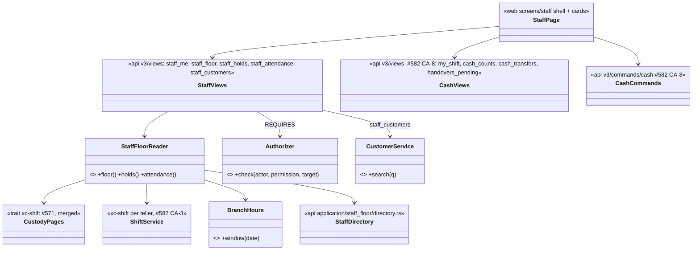

# XCHANGE v3 — Wave 3: the staff floor page `/staff`

> designed-by: claude/89458e53 · 2026-10-09 · **re-cut** on `main` at `77a4315` against the merged Blueprint designs
> #582 (cash: `docs/design/blueprint/cash-shift-transfer.md`), #550 (roles and sign-in:
> `docs/design/blueprint/org-roles-branches.md`) and #554 (customers: `docs/design/blueprint/customer-identity-consent.md`).
> The first version (merged `ec83d41`, PR 532) was cut against v2's custody **request** model, v2's roles, the compat
> `/api/staff/rpc` writes and password sign-in. All four are replaced by those designs, so this version replaces its
> §2–§8. Its measurement of v2's page (`S` = `src/booking/app/staff/page.tsx` @ `4d0bdbb`) still holds and is cited.
> Parent: `docs/design/xchange-v3-web.md` (W1–W10, §4 view contract). Siblings: the desk (claude/b060e9), the staff
> report and documents (claude/e5ab6c).

This document covers **only `/staff`**. `/staff/report` is designed in `xchange-v3-wave3-staff-report.md`; §9 names
the seam, which changes with this re-cut.

## 0. What changed since the first version, and what stays

| First version | Now | Source |
|---|---|---|
| Custody requests (`opsPropose`, signatures, commit) carry counts, hand-overs and moves | Counts, hand-overs and transfers are records with their own commands and views (CA-8) | #582 C2–C5, C8; CA-10 retires the request model |
| v2's roles (FRONT, BACKEND, MANAGER, MONITOR, FINANCE, RATES, SYSTEM…) and `StaffSight` keyed on them | The Blueprint's roles; every read and write checks a `Permission` through `Authorizer` | #550 §3.4, §4.2 |
| Views inherit `(EntryPath::StaffRpc, "adminSnapshot")` | Views declare `REQUIRES: Permission` | #550 §4.1 (OR-4) |
| Sign-in, first password and sign-out on `/api/staff/{login,password,logout,me}` | Identity for everyone: the BFF sign-in of OR-3; no password, no first-password card | #550 B2, §5 |
| Writes on `POST /api/staff/rpc` (13 `ops*` actions) | `CommandAction`s with an `Idempotency-Key` (PR 570 CM-1), declared by CA-8 | #582 §4.4 |
| Customer picked by plain passport number | Search through `xc-customer` by name, customer id, or a passport number matched by its keyed hash | #554 K4 |
| A one-branch shift and a custodian | Shifts per teller; the floor shows **my** shift | #582 C1 |

**Kept from the first version:** S1 path `/staff`; S6 no polling; S8 in-page dialogs in the chosen language; S10 no
rate written here (the RATES card reads the published set only); S11 search key, never a list; S12 the branch's own
hours; W7 money as strings; the card-per-folder layout of §4. **Already merged:** `CustodyPages` (#571, PR 635), which
this version still uses for holds, attendance and the floor row.

## 1. Root cause this removes

Unchanged in substance: `/staff` is v2's built bundle reading the whole branch through `adminSnapshot` after every
click (`S:14`, `S:16`) and sending typed money as JS numbers (`S:20`). What v3 now owns differs: the cash model, the
permissions and the sign-in are designed and partly built, so the page becomes a thin screen over them, with no
custody logic of its own.

## 2. Decisions

| # | Decision | Status |
|---|---|---|
| S1 | `/staff` is one v3 screen at path `/staff`. A visitor with no session is sent to OR-3's sign-in screen (`web/src/screens/login`), and back to `/staff` after it; the page has no login card of its own. | [required] |
| S2 | **No role literal anywhere on the page or in its views.** Each view declares `REQUIRES: Permission`; each card is shown when the signed-in actor holds the permission its writes need (§6.1). The server is the authority: a hidden card is a convenience, a refused command is the rule. `StaffSight` is **not built** (it encoded v2's RATES/SYSTEM rule; RATE_MANAGER and ADMIN simply hold none of the cash permissions, #550 §3.4). | [required] |
| S3 | Reads of cash records are **CA-8's views** (`my_shift`, `cash_counts`, `cash_transfers`, `handovers_pending`); this design adds only the views CA-8 does not have: `staff_me`, `staff_floor`, `staff_holds`, `staff_attendance`, `staff_customers` (§3). | [required] |
| S4 | Lists that grow with history are paged, newest first (holds, attendance; CA-8's lists page per the parent contract). | [required] |
| S5 | **Every write is a `CommandAction`** of #582 §4.4 (counts, hand-over, transfers, branch day, clock, holds), with an `Idempotency-Key` kept until success and resent unchanged on retry. Nothing is written through `/api/staff/rpc`. | [required] |
| S6 | No polling: reads on mount, after every write, and on `โหลดข้อมูลล่าสุด` (`S:14-17`). | [required] (unchanged) |
| S7 | Sign-in and sign-out are OR-3's (`/auth/*` BFF, `access::Actor`). The page reads who is signed in from `staff_me`. | [required] |
| S8 | `window.prompt` / `window.confirm` become `ReasonDialog` / `ConfirmDialog`; every text through `t()`, v2's Thai in `th`, English in `en`, shown in the chosen language (staff screens are TH/EN, #576). | decided (owner 2026-10-09) |
| S9 | A count is entered as **one row per face value** of the currency: the face values come from `denominations` (#582 A7, the current series), the staff types the **quantity** of each (a whole number, sent as a string); the server computes the totals (#582 §4.1). No free-text sheet, no amount typed for a count. | [required] (#582 C2, S9 of the first version) |
| S10 | No rate is written from `/staff`. The RATES card shows the branch's published rate set read only; its view is the rate design's `staff_published_rates` (`rates.md:420`, delivered by RE-3), not invented here. | decided (unchanged) |
| S11 | The hold form finds the customer by a typed key: name, customer id, or a passport number (matched through `xc-customer`'s lookup hash, #554 K4); nothing is listed until a key is typed. | decided (owner 2026-10-09; matching per #554) |
| S12 | The heading's service-hours line shows the branch's own hours from `BranchHours::window(today)` (#550 D-6, OR-1); a branch with no hours set shows the sentence without the time, never an invented one. | decided (owner 2026-10-09) |

## 3. Server

### 3.1 The views this design adds

All are v3 views (parent §4) declaring `REQUIRES: Permission` (#550 §4.1). The branch is the actor's own scoped branch
(`Authorizer` refuses another, `outOfScope`). Files: `api/src/presentation/http/v3/views/<name>.rs`,
`api/src/presentation/dto/v3/<name>.rs`, `web/src/shared/api/generated/<name>.ts`.

| View | REQUIRES | Answers (camelCase, money as strings) | Reads |
|---|---|---|---|
| `staff_me` | `SignedIn` (#550 §3.4, `org-roles-branches.md:232`: anyone signed in; it answers only the actor's own data) | `userId, name, roles[{role, branchId?}], branchId, branchName, permissions[]` (the actor's effective permissions on this branch, so the page decides what to show without a role literal) | `access::Actor`, `Authorizer` |
| `staff_floor` | `AttendanceClock` | `phase, hours{open,close}?, myClockIn?, myShift{id, openedAt}?, cutoff{at, pendingCount}?`; and, **only** for an actor holding `BranchDayOperate`, `CashTargetSet` or `CashManage`: `target{amounts{CUR:str}, at}?, safe{CUR:str}?` | `CustodyPages::floor` (#571), `BranchHours` (OR-1), my open shift (`ShiftService`, CA-3) |
| `staff_holds` | `CustomerHoldPlace` or `VerificationReview` | paged: `id, customerId, customerName?, reason, status, at` | `CustodyPages::holds` |
| `staff_attendance` | `AttendanceClock` | paged: `id, name, in, out?` — **own rows only**, unless the actor holds `BranchDayOperate` (then the branch's) | `CustodyPages::attendance(only = …)` |
| `staff_customers` | `CustomerHoldPlace` | paged, filter `q` (required; empty → empty page): `[{id, displayName}]` | `xc-customer` search (#554 CI-5): name / customer id / passport hash |

### 3.2 `StaffFloorReader`

`api/src/application/staff_floor/reader.rs` [required names; proposed fields]: one application service the five views
call, so the money-visibility rule of `staff_floor` and the own-rows rule of `staff_attendance` are written once.

```rust
pub struct StaffFloorReader { pages: Arc<dyn CustodyPages>, shifts: ShiftService, hours: Arc<dyn BranchHoursPort>, directory: StaffDirectory }
impl StaffFloorReader {
    pub async fn floor(&self, actor: &access::Actor, branch: &BranchId) -> AppResult<StaffFloor>;
    pub async fn holds(&self, actor: &access::Actor, branch: &BranchId, before: Option<&str>, limit: u16) -> AppResult<Vec<StaffHoldRow>>;
    pub async fn attendance(&self, actor: &access::Actor, branch: &BranchId, before: Option<&str>, limit: u16) -> AppResult<Vec<StaffAttendanceRow>>;
}
```

The permission checks go through `Authorizer::check` (never a role literal). `StaffDirectory` joins names by user id
once per call.

### 3.3 Writes

None defined here. The page calls CA-8's commands (#582 §4.4): `clock`, `dayStartService`, `dayCutoff`, `dayTarget`,
`countSubmit`, `countVerify`, `handoverStart`, `transferCreate`, `transferSubmit`, `transferDispatch`,
`transferReceive`, `transferReconcile`, `holdCreate`, `holdRelease`. Approvals of a transfer are decided on PR 570's
approvals screen, not here.

### 3.4 What does not change

`CustodyPages` (#571). The report's reads (§9). `/api/staff/rpc` and `staff_view.rs` stay until CA-10 and V4 retire
them; this page no longer calls them.

## 4. Web

`web/pages/staff.html` (`xc-path` `/staff`) mounts `web/src/screens/staff/main.tsx`. One folder per card, so tickets
never share a file; the shell mounts each card from its folder.

| Folder / file | What | Texts |
|---|---|---|
| `screens/staff/` root: `main.tsx`, `StaffPage.tsx`, `staff.css`, `i18n.ts`, `cards.ts` | frame (header, heading with S12's hours line, notice/error lines, footer), the signed-out redirect (S1), `โหลดข้อมูลล่าสุด`, the report link (shown with `FinanceReconcile` or `BranchDayOperate`), `cards.ts` (`import.meta.glob('./*/card.ts')`, sorted by `order`) | `staff.*` |
| `screens/staff/parts/` | `command.ts` (calls a CA-8 command through `ApiClient` with an `Idempotency-Key` kept until success; refusal as `t('error.'+code)`), `ReasonDialog.tsx`, `ConfirmDialog.tsx`, `CountRows.tsx` (S9: one row per face value, quantities as strings), `can.ts` (`can(me, permission)` from `staff_me.permissions`) | `staff.parts.*` |
| `screens/staff/floor/` | phase, hours, clock in/out (`clock`), start service and cut-off (`dayStartService`, `dayCutoff`; `BranchDayOperate`), target form (`dayTarget`; `CashTargetSet`), safe and target figures | `staff.floor.*` |
| `screens/staff/shift/` | my shift (`my_shift`): open count, close count, hand-over to a teller (`countSubmit`, `handoverStart`); counts waiting for me to verify (`cash_counts`, `countVerify`; `ShiftCloseCertify`, or the hand-over's receiver); hand-overs to me (`handovers_pending`) | `staff.shift.*` |
| `screens/staff/transfers/` | transfers of the branch (`cash_transfers`): create, submit, dispatch, receive (with received quantities), reconcile; drawer↔safe and external moves are the same flow (#582 C5) | `staff.transfers.*` |
| `screens/staff/holds/` | hold form (`staff_customers` search, `holdCreate`; `CustomerHoldPlace`), holds list (`staff_holds`), release (`holdRelease`; `VerificationReview`) | `staff.holds.*` |
| `screens/staff/attendance/` | attendance log (`staff_attendance`) | `staff.attendance.*` |
| `screens/staff/rates/` | the published rate set, read only (S10) | `staff.rates.*` |

Each card exports `{ id, order, visible(ctx), Component }`; `ctx = { me, floor, refresh }`. `visible` reads only
`can(me, …)` and `floor`; no role names in the web code (a grep test, §8.1).

## 5. Class diagram



## 6. Behaviour tables (the contract the up-front tests pin)

### 6.1 Who sees which card

| # | Card / control | Shown when (`can` = the actor's permission on this branch) |
|---|---|---|
| B1 | whole page | signed in; else redirect to sign-in (S1) |
| B2 | report link | `can(FinanceReconcile) \|\| can(BranchDayOperate)` |
| B3 | floor: phase, hours, my clock | `can(AttendanceClock)` |
| B4 | start service / cut-off | `can(BranchDayOperate)`; start when `phase = READY`, cut-off when `phase = OPEN` |
| B5 | target form; safe and target figures | form `can(CashTargetSet)`; figures when `staff_floor` answers them |
| B6 | my shift: open / close count, hand-over | `can(ShiftOperate)` and clocked in; open when I have no OPEN shift, close and hand-over when I do |
| B7 | counts to verify | `can(ShiftCloseCertify)` (open/close) or I am the hand-over's receiver; never my own count |
| B8 | transfers | list `can(CashManage)`; create/dispatch/receive `can(CashManage)`; reconcile `can(FinanceReconcile)` |
| B9 | hold form; holds list; release | form `can(CustomerHoldPlace)`; list `can(CustomerHoldPlace) \|\| can(VerificationReview)`; release `can(VerificationReview)` |
| B10 | attendance log | `can(AttendanceClock)` (own rows; all rows for `BranchDayOperate`, server-decided) |
| B11 | RATES card | the permission `staff_published_rates` requires, so the card is shown exactly to those the view answers: today `can(CompatRead)` (#550 `org-roles-branches.md:219`, the StaffRpc `adminSnapshot` row: T, BM, RM, VR, F, A). `CompatRead` retires with V4; whatever permission V4 gives that view replaces it here in the same change (no narrower audience is wanted) |

### 6.2 Every control → what is sent

Every row sends a CA-8 command (#582 §4.4) with an `Idempotency-Key`; after success: notice `บันทึกแล้ว`, re-read
`staff_floor` and the lists the card shows; on refusal: `t('error.'+code)`, nothing re-read, the form keeps its values.

| # | Control | Command | Body |
|---|---|---|---|
| C1 | `ลงเวลาเข้า` / `ลงเวลาออก` | `clock` | `{direction: IN \| OUT}` |
| C2 | start service (ConfirmDialog, v2's sentence `S:22:2994`) | `dayStartService` | `{equipmentReady, ratesVerified, rateVersion}` per CA-8 |
| C3 | cut-off | `dayCutoff` | `{}` |
| C4 | target | `dayTarget` | `{amounts: {CUR: str}}` |
| C5 | open / close count | `countSubmit` | `{kind: OPEN \| CLOSE, lines: [{currency, denominationId, qty: str}]}` (S9) |
| C6 | hand over to | `handoverStart` | `{receiverId, lines: [...]}` |
| C7 | verify a count | `countVerify` | `{id}` |
| C8 | new transfer / move | `transferCreate` then `transferSubmit` | `{kind, toBranchId?, lines: [...], note}` |
| C9 | dispatch / receive / reconcile | `transferDispatch` / `transferReceive` / `transferReconcile` | `{id}` / `{id, lines: [{…, qtyReceived: str}]}` / `{id, note}` (ReasonDialog) |
| C10 | place a hold | `holdCreate` | `{customerId, reason}` |
| C11 | release a hold | `holdRelease` | `{id, note}` (ReasonDialog `ผลตรวจและเหตุผลปลดพัก`) |

Body field names are CA-8's (its tickets fix them); the cards use CA-8's generated TS, so a renamed field is a compile
error, not a silent mismatch.

## 7. Known differences (to accept in review)

| # | v2 | v3 | Why |
|---|---|---|---|
| K1 | `prompt`/`confirm`, Thai only | in-page dialogs in the chosen language | S8 |
| K2 | one propose form for every kind, signatures, commit by BACKEND | counts, hand-overs and transfers each with their own command and verifier | #582 |
| K3 | the whole history on one page | paged lists | S4 |
| K4 | customer `<select>` of every customer | a search key; passport matched by hash | S11, #554 |
| K5 | the RATES employee saves rates here | read only | S10 |
| K6 | denominations typed as free text | one row per face value, quantities only | S9 |
| K7 | own login and first-password cards | Identity sign-in (OR-3) | S7, #550 B2 |
| K8 | role-named buttons (FRONT, BACKEND…) | permission-gated buttons | S2, #550 |

## 8. Tickets, order, file scope

Replaces the first version's S-1…S-8 (issues #573, #574, #575, #577, #578, #579, #580 are re-cut to these rows; S-0a
#571 is merged, S-0b #572 was closed as superseded by #582).

| Ticket | What | Owns | Start after |
|---|---|---|---|
| **S-1** floor reader + views | §3.1 `staff_me`, `staff_floor`, `staff_holds`, `staff_attendance`; §3.2 | `api/src/application/staff_floor/**`, `api/src/application/mod.rs` (one line), the four views' view/DTO/generated files, `api/tests/v3_staff_views_test.rs` | #550 OR-2 and OR-4 (`Authorizer`, `REQUIRES`), OR-1 (`BranchHours`), #582 CA-3 (shifts per teller) |
| **S-2** customer search view | `staff_customers` | its view/DTO/generated files, `api/tests/v3_staff_customers_view_test.rs` | #554 CI-5, S-1 |
| **S-3** page shell | §4 root + `parts/` | `web/pages/staff.html`, `web/src/screens/staff/{main.tsx,StaffPage.tsx,staff.css,i18n.ts,cards.ts}` and their tests, `web/src/screens/staff/parts/**` | S-1, #550 OR-3 (sign-in screen) |
| **S-4** floor card | B3–B5, C1–C4 | `web/src/screens/staff/floor/**` | S-3, #582 CA-8 |
| **S-5** shift card | B6–B7, C5–C7 | `web/src/screens/staff/shift/**` | S-3, #582 CA-8 |
| **S-6** transfers card | B8, C8–C9 | `web/src/screens/staff/transfers/**` | S-3, #582 CA-8 |
| **S-7** holds + attendance cards | B9–B10, C10–C11 | `web/src/screens/staff/holds/**`, `web/src/screens/staff/attendance/**` | S-2, S-3, #582 CA-8 |
| **S-8** RATES card, read only | B11, S10 | `web/src/screens/staff/rates/**` | S-3 and RE-3 (`staff_published_rates`, `rates.md:950`) |
| **S-9** sign-in returns to `/staff` | S1's "and back to `/staff` after it" | `web/src/screens/login/home.ts`, `web/src/screens/login/LoginScreen.tsx`, `web/src/screens/login/main.tsx` and their tests | — (independent of S-3: no shared file, and the return leg works whether or not `/staff` has merged; #1223 ruling issuecomment-6103493211) |
| **S-10** the server's sign-in redirect carries `next` (api) | S1, with S-9: `pages::to_login` (`api/src/presentation/pages.rs:666` at `a0778bae`) answers `303 Location: /login` with no `next`, so a signed-out visitor to a `signed-in`/`branch`-gated page (`screens.rs:130`/`:138`) never reaches S-9's return leg | `api/src/presentation/pages.rs`, `api/tests/login_redirect_next_test.rs` (new) | — (BE lane, claude/ad05bf8d dispatches) |

S-9 exists because S1 is `[required]` and OR-3's sign-in screen on `main` `08c94225` ignores `next`: `LoginScreen` navigates to `homeOf(user)` (`web/src/screens/login/home.ts`), which answers `/desk` or `/` only. S-3 pins only the redirect to `/login?next=%2Fstaff` (lane controller ruling on #575, 2026-10-11); the return leg is S-9's. `next` must be a same-origin path so the sign-in screen is not an open redirect.

S-10 is the server half of S1: `to_login` puts only the request's own path+query into `next`, URL-encoded, and never a full URL; the sign-in screen still passes it through S-9's `safeNext` (#1223 rulings, SD:229), so the server cannot introduce an open redirect. Every current caller of `to_login` is a sign-in-required path, so no ungated page ever gets a `next`. S-10 is api: the BE lane controller (claude/ad05bf8d) cuts and dispatches it once this row merges.

V4 (claude/e5ab6c) retires `/staff`'s `PAGE_SPECS` row after S-3…S-8; CA-10 retires `/api/staff/rpc`'s `ops*` actions.

### 8.1 Tests written before implementation

| Ticket | Tests (red until implemented) |
|---|---|
| S-1 | each view refuses an actor without its permission; `staff_floor` answers target/safe only to `BranchDayOperate`/`CashTargetSet`/`CashManage` holders; `staff_attendance` own rows vs all; another branch → `outOfScope`; `staff_floor.hours` from `BranchHours` (none set → absent); `myShift` is the actor's own OPEN shift; money as strings; `floor` reads one `ops_state` row and at most one attendance row |
| S-2 | empty `q` → empty page; a name, a customer id and a passport number (any spacing/case) each find the customer; the answer never carries an identity value |
| S-3 | vitest: signed out → redirect; `can()` reads `staff_me.permissions`; a card whose `visible` is false is not rendered; every text through `t()`; **no role name** (`TELLER`, `BRANCH_MANAGER`, `FINANCE`, `FRONT`, `BACKEND`…) appears in `web/src/screens/staff/**` (grep test) |
| S-9 | vitest, for **both** of LoginScreen's exits (after a successful sign-in, and the already-signed-in check on mount): `/login?next=%2Fstaff` → navigates to `/staff`; the rule for `next` (`safeNext`, #1223 ruling issuecomment-6103413078): after exactly one URL-decode it is **accepted only if** (1) it has no control character (U+0000–U+001F, U+007F) and no `\` anywhere, (2) it starts with exactly one `/` and its second character is not `/`, (3) `new URL(value, location.origin).origin` equals `location.origin`, (4) `u = new URL(value, location.origin)` gives `u.pathname + u.search + u.hash` byte-identical to the value — so nothing the browser would rewrite passes (`.`/`..` and `%2e` segments, re-encoded characters; #1223 ruling issuecomment-6103468024) — and (5) `u.pathname` is not `/login` (bare or followed by `?`, `#`, `/`) and not under `/api/`; a malformed `%` gives `null`, never a throw — so `//evil`, `/\evil.com`, `%2F%2Fevil`, `%2F%09%2Fevil.com` (browsers strip the tab and land on `https://evil.com/`), the same with `%0A`/`%0D`, `https://…`, `javascript:…`, a bare `staff`, `/login…`, `/api/…` and dot-segment paths such as `/staff/../login` or `/staff/%2e%2e/login` are each ignored and the user goes to `homeOf`; no `next` → `homeOf` unchanged (existing `home.test.ts` stays green, unedited); **no loop:** the mount exit navigates once and never back to `/login`, and `/staff` sends a visitor to `/login` only when `staff_me` answers `signIn` (S-3's "signed out → redirect"), not on a refusal such as `roleNotAllowedHere` |
| S-10 | `GET /staff` signed out → `303`, `Location: /login?next=%2Fstaff`; `GET /devices?x=1&y=a%20b` signed out → `next` is the request's own path+query, URL-encoded once (`%2Fdevices%3Fx%3D1%26y%3Da%2520b`), never a scheme or host; a signed-in request is unchanged (no redirect); an `anyone` page (`/login`) never redirects; every existing caller of `to_login` (`pages.rs:314`, `:524`, `screens.rs:133`, `:141`) carries `next` |
| S-4…S-8 | vitest per card: each B-row and C-row — shown for each permission set, and the exact command and body sent; a retry resends the same `Idempotency-Key` and byte-equal body; no `Number(` in `web/src/screens/staff/**` (grep test) |

## 9. The seam with the report (`/staff/report`, claude/e5ab6c)

The first version gave the report `StaffSight::of(role)` and `CustodyPages::requests_between`. Both go: `StaffSight`
is not built (S2), and `requests_between` reads `custody_requests`, which CA-10 drops. The report decides who may read
it with its own `REQUIRES` (e.g. `FinanceReconcile`), and reads a day's counts and transfers from #582's records
(`cash_counts`, `cash_transfers`, by `created_at` in the day) and exceptions from `CustodyPages::exceptions_between`
(still merged). That change belongs to the report's design; this document only states that the old seam is gone.

## 10. Data migration

None. No table, column, constraint or index changes: the page reads existing tables through #571's port and the
merged designs' views, and writes only through #582's commands.

## 11. Open items

None of this page's own. Every former open item (O1–O4) was answered by the owner on 2026-10-09 (kept as S10, S9,
S11, S12).

## 12. Checked against the XC Desk Blueprint v2

| Blueprint item | Effect here |
|---|---|
| B01 `/desk/shift` — open/close/hand-over by currency and banknote, counted vs variance, certified | S9, B6–B7, C5–C7 over #582's counts and hand-overs |
| B05 `/desk/cash` — balances, transfers in transit | B8, C8–C9 over #582's transfers |
| §02 roles and §03 scopes | S2: permissions through `Authorizer`, no role literal |
| Identity for everyone | S1, S7 (OR-3) |
| Customer by hash, PII not shown | S11, S-2's tests (#554) |
| Rates draft → approve → publish | S10 |
| Branch hours (A04) | S12 |
