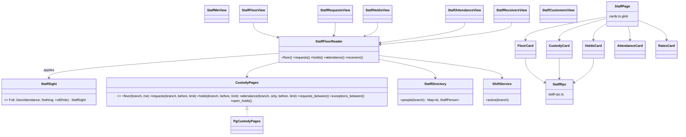

# XCHANGE v3 — Wave 3: the staff floor page `/staff`

> designed-by: claude/89458e53 · 2026-10-09 · measured on `main` at `9f05f83` and in `108-Plaza/xchange-v2-source` at `4d0bdbb`
> Parent: `docs/design/xchange-v3-web.md` (W1–W10, §4 view contract, §4.4 roles, §8 row "V3-staff").
> Siblings, written in parallel so the PRs do not share a file:
> `xchange-v3-wave3-desk.md` (V3-desk, V3-staff-desk — claude/b060e9) and
> `xchange-v3-wave3-report-documents.md` (V3-staff-documents, V4 — claude/e5ab6c, PR 530) and
> `xchange-v3-wave3-staff-report.md` (V3-staff-report — claude/e5ab6c, PR 533).

This document covers **only `/staff`** (v2's `staff.html` + `staff.js`, source `src/booking/app/staff/page.tsx`).
`/staff/report` reads the same custody records but is designed in `xchange-v3-wave3-staff-report.md` (PR 533); §9 names the seam.

## 0. What this was measured from

| Source | Read |
|---|---|
| v2 `S` = `src/booking/app/staff/page.tsx` @ `4d0bdbb` | the whole component. It is minified: 23 lines, line 22 is 16,446 characters, so `S:22:<col>` is a character column |
| v3 `main` @ `9f05f83` | `api/src/presentation/pages.rs:81-92` (`/staff` served from v2's bundle), `http/auth.rs:41-44,199-201` (`/api/staff/{login,logout,password,me}`), `http/files.rs:37,47,191` (upload, file), `http/rpc.rs:95,244-268` (staff RPC), `application/compat/staff_view.rs:65-131` (what RATES and SYSTEM may see), `application/compat/actions/custody.rs:38-52` (the 13 `ops*` actions), `xc-shift/src/domain/custody/**` (state, entities, machine), `xc-shift/src/infrastructure/custody/custody_repository.rs:649,715,902` (loads), `migrations/20261007140000_custody.sql`, `xc-auth/src/domain/policy/policy.rs:97-146,397-497`, `presentation/http/v3/view.rs:29-75,330-352` |
| Full measurement notes | kept out of the repo by the designer; every fact used below is cited here again |

## 1. Root cause this removes

`/staff` is v2's built React bundle (`pages.rs:81-92`). It reads the **whole branch** through `adminSnapshot` after
every click (`S:14`, `S:16`), including every custody request, hold and attendance record the branch ever had —
the loads have no limit (`custody_repository.rs:649`, `:715`, `:902`, `ORDER BY position ASC`). The screen also turns
typed money into JS floats before sending it (`S:20`: `Number(v)` on every count, `Number(amount)`, `Number(d)` on
each denomination).

No v3 view can stand in today:

- every `admin_*` view inherits `(EntryPath::Rpc, "adminSnapshot")`, where the owner cookie wins over the staff
  cookie (`view.rs:340-341`);
- none of them hides from RATES and SYSTEM what `staff_view.rs:94-131` hides;
- nothing answers custody `phase`, `attendance`, `custodian`, `target`, `safe`, `cutoff`, `requests` or `holds`.
  `admin_operations` answers only `{enabled, entity}` (`admin_operations.rs:45-62`).

## 2. Decisions

| # | Decision | Status |
|---|---|---|
| S1 | `/staff` is one v3 screen at path `/staff`, gate **`anyone`**. v2's page shows its own login card to a signed-out visitor (`S:22:617`), so the gate must not redirect. | [required] |
| S2 | Every read of custody data on this page goes through **one** application service, `StaffFloorReader`, which applies **one** visibility rule, `StaffSight` (§3.1). No staff view reads `CustodyService` or the custody tables itself. ♻️: the RATES/SYSTEM rule is safety logic, so it lives in the core and never in a view. | [required] |
| S3 | Staff views inherit `(EntryPath::StaffRpc, "adminSnapshot")`. That reads the **staff** cookie only (`view.rs:339`), so an owner signed in next to a staff member never turns `/staff` into the owner's page. | [required] (§4.4 W8: one v2 action on two paths = two views) |
| S4 | Lists that grow with history are **paged views**, newest first: requests, holds, attendance. Keyset on the existing `UNIQUE (branch_id, position)` (`20261007140000_custody.sql:19,30,50`) — **no migration**. | [required] |
| S5 | Writes stay on the compat route `POST /api/staff/rpc` with the same action names and payloads v2 sends, money as **decimal strings** (the admin precedent: `parts/pending-write.tsx:132`). No new write action. | [required] |
| S6 | No polling, as v2: reads on mount, after every write, and on `โหลดข้อมูลล่าสุด` (`S:14-17`, `S:22:1682`; parent §12.6). | [required] |
| S7 | Sign-in, first password, sign-out keep v2's routes `/api/staff/{login,password,logout,me}` (`auth.rs:41-44`). `POST /api/staff/me` is the only source that sees a first-password employee (`auth.rs:199-201`); the `me` view drops one (`xc-auth/.../account/service.rs:296-301`). | [required] |
| S8 | `window.prompt` / `window.confirm` (`S:22:2994`, `:10117`, `:10488`, `:11533`) become one in-page `ReasonDialog` / `ConfirmDialog`. Every sentence, title and button in them goes through `t()` and **follows the language chosen with the TH/EN switch** (W10): the `th` table holds v2's Thai verbatim (W6), the `en` table its English. Cancel or empty = nothing sent, as v2. | **decided** (owner 2026-10-09: in-page dialogs, v2's Thai kept, *"ให้ แสดง ตาม ภาษา ที่เลือกไว้"*) |
| S9 | Counts by banknote are entered as **rows** (currency, denomination, count), one row per banknote, as the Blueprint's count sheet (B01 `/desk/shift`: *ยอดเปิดตามสกุล/ชนิดธนบัตร ยอดนับจริง variance*; mapping §3.1 `CashCount`/`CashCountLine`). v2's free-text textarea (`S:20`) is not ported. The screen sends `denomination` and `count` as the typed **strings**; the server accepts a string for both (today `denomination` must be a JSON number, `request.rs:108-117`, and `count` a JSON `u64`, `request.rs:122-139`) — ticket S-0b. What counts as a valid value does not change: only the wire form widens. The rows are still stored inside the custody request as today; a count-line table is the Blueprint ledger work, not this page's. | [proposed] — owner order 2026-10-09 "follow the Blueprint fully" (PR 527, issuecomment-6073063976); known difference K6 |
| S10 | **No rate is written from `/staff`.** Under the Blueprint, rates are drafts approved and published by policy (mapping K4; PR 527 issuecomment-6073063976); v2's direct `adminSaveRate` card (`S:22:3385`) is not ported. The RATES card shows the branch's **published** rate set **read only**, each value the server's string unchanged (no `unit_size` arithmetic, no rounding), and links to the rate screen of the Blueprint rate design. Its view and field names are **per the Blueprint rate design (pending)** and are not invented here. | [required] — S-8 waits for that design |
| S11 | The hold form picks the customer by a **search key** the staff types (name, customer id or passport number), not from a list: `staff_customers?q=` answers the matches, newest first, one page; nothing is listed until a key is typed. v2's `<select>` of every customer (`S:22:10818`) is not ported. | **decided** (owner 2026-10-09, *"ให้ ใช้ คีย์ ค้นหา น่าจะ ดีกว่า เป็น list"*) |
| S12 | The heading's service-hours line shows **the branch's own opening hours**, read from the branch's data, not v2's fixed `บริการ 11:00–23:00` (`S:22:277`). `staff_floor` answers `hours` (opening and closing time of today, Bangkok) from the branch profile that #550 designs (Blueprint A04; branches have no hours today, `20261007100000_branches_rates.sql:1-7`). The line keeps v2's wording as a template, `บริการ {open}–{close} · ลงเวลาออกหลังนับเงิน ตรวจสอบ และส่งมอบเสร็จจริง`. A branch with no hours set shows the sentence without the time part — never an invented time. The field's name and type are **per #550's design (pending)**. Source of the rule: the Blueprint's branch profile — A04 `/admin/branches` sets each branch's *เวลาเปิด* (mapping K12); the owner confirmed *"เอาตาม blueprint ที่ผมส่งให้แล้ว"* when asked whether one standard time or per-branch hours. The server's own service window is still hard-coded the same way (`xchange-v3.md` D7: 11:00–22:50 / 23:00); making it per branch is #550's and the Blueprint's (K12), not this page's — this page only shows what the branch data says. | **decided** (owner 2026-10-09, *"ควรแสดง ตามข้อมูล สาขา ที่เปิดจริง"*, then *"เอาตาม blueprint ที่ผมส่งให้แล้ว"*); the field waits for #550 |

## 3. Server

### 3.1 `StaffSight` — what each role may see of the floor

From `staff_view.rs:94-131` (the compat answer v2's page reads today), turned into one value the reader applies:

| Role | `StaffSight` | Floor (`staff_floor`) | Requests, holds | Attendance |
|---|---|---|---|---|
| FRONT, BACKEND, MANAGER, MONITOR, FINANCE, DOCUMENTS, DOCUMENT_REVIEW | `Full` | everything | everything | everyone |
| RATES | `OwnAttendance` | phase/enabled/entity, **no** cutoff, target and safe as today | **empty** | **own records only** |
| SYSTEM | `Nothing` | exactly `{enabled:false, phase:"CLOSED", entity}` | empty | empty |

`StaffSight::of(role)` is the only place this table is written. A parity test pins it against `staff_view` for the
same snapshot until V4 deletes the compat path (§8 test T-S0).

### 3.2 Paged reads — a port in `xc-shift`

`CustodyRepository::load_state` keeps loading the whole state for the custody machine; it is not touched. Reads for
screens get their own port:

```rust
// xc-shift/src/domain/custody/repositories/custody_pages.rs  [required names]
pub trait CustodyPages: Send + Sync + 'static {
    /// newest first: position DESC; `before` = an id from the previous page
    fn requests<'a>(&'a self, branch: &'a BranchId, before: Option<&'a str>, limit: u16)
        -> BoxFuture<'a, AppResult<Vec<CustodyRequest>>>;
    fn holds<'a>(&'a self, branch: &'a BranchId, before: Option<&'a str>, limit: u16)
        -> BoxFuture<'a, AppResult<Vec<CustomerHold>>>;
    /// `only` = Some(employee) for StaffSight::OwnAttendance
    fn attendance<'a>(&'a self, branch: &'a BranchId, only: Option<&'a str>, before: Option<&'a str>, limit: u16)
        -> BoxFuture<'a, AppResult<Vec<Attendance>>>;
    /// the floor without any history: the one `ops_state` row (enabled, phase, custodian, entity, target, safe,
    /// cutoff — `cutoff` carries its own `pending` list) and `me`'s open attendance record, if any
    fn floor<'a>(&'a self, branch: &'a BranchId, me: &'a str) -> BoxFuture<'a, AppResult<FloorFacts>>;
    // for the staff report (claude/e5ab6c, xchange-v3-wave3-staff-report.md, PR 533); `from`/`to` = epoch ms, [from, to)
    fn requests_between<'a>(&'a self, branch: &'a BranchId, from: i64, to: i64)
        -> BoxFuture<'a, AppResult<Vec<CustodyRequest>>>;
    fn exceptions_between<'a>(&'a self, branch: &'a BranchId, from: i64, to: i64)
        -> BoxFuture<'a, AppResult<Vec<CashException>>>;
    fn open_holds<'a>(&'a self, branch: &'a BranchId) -> BoxFuture<'a, AppResult<u64>>;
}
```

`FloorFacts { ops: Option<OpsRow>, my_open_attendance: Option<Attendance> }` is answered by two bounded queries:
the `ops_state` primary-key row (`custody_repository.rs:610-611` reads the same columns) and
`SELECT … FROM attendance WHERE branch_id = $1 AND employee_id = $2 ORDER BY position DESC LIMIT 1`, open when its
`data` has no `clockOut` or a null one (the decoder reads `clockIn`/`clockOut` from `data`, `custody_repository.rs:666-672`). **`staff_floor` never calls
`CustodyService::state`**: that is `load_state` → `fetch_state` (`service.rs:202-203`, `custody_repository.rs:608`),
which loads every attendance, request, hold, draft and exception of the branch with no limit (`:649`, `:715`,
`:902`, `:972`, `:1045`), and the floor is read on mount and after every write.

S-0a owns **every** screen read of the custody tables, the report's three included, so `custody_repository.rs` and
`custody_pages.rs` are edited by one ticket only. The `_between` methods filter on `(data->>'at')::bigint`, the
epoch-ms time every record already stores.

`PgCustodyPages` implements it with one literal query per method (no `status = ANY(...)`), ordered by
`position DESC`, resolving `before` to its position inside the same statement. A request's signatures are read with
one `custody_signatures` query for the page's ids. The row decoders are private functions inside `custody_repository.rs`'s load functions
(`:649`, `:715`, `:902`, `:1045`); S-0a first moves them, unchanged, to `infrastructure/custody/decode.rs`
(`request_from_row`, `exception_from_row`, `hold_from_row`, `attendance_from_row`) as its own commit, then both
the repository and `PgCustodyPages` call them.

### 3.3 `StaffFloorReader`

```rust
// api/src/application/staff_floor/reader.rs  [required: the type and method names; proposed: fields]
pub struct StaffFloorReader { pages: Arc<dyn CustodyPages>, shifts: ShiftService, ports: Arc<dyn CustodyPorts>, directory: StaffDirectory }
impl StaffFloorReader {
    pub async fn floor(&self, branch: &BranchId, me: &StaffMember) -> AppResult<StaffFloor>;
    pub async fn requests(&self, branch: &BranchId, me: &StaffMember, before: Option<&str>, limit: u16) -> AppResult<Vec<StaffRequestRow>>;
    pub async fn holds(&self, branch: &BranchId, me: &StaffMember, before: Option<&str>, limit: u16) -> AppResult<Vec<StaffHoldRow>>;
    pub async fn attendance(&self, branch: &BranchId, me: &StaffMember, before: Option<&str>, limit: u16) -> AppResult<Vec<StaffAttendanceRow>>;
    pub async fn receivers(&self, branch: &BranchId, me: &StaffMember, kind: RequestKind) -> AppResult<Vec<StaffPerson>>;
}
```

- `floor()` reads `CustodyPages::floor` (bounded, §3.2), the open shift id through `ShiftService::active`
  (one OPEN shift per branch, `20261007110000_shifts.sql:16`; the same read `admin_shift_state.rs:49` uses) and `rateUpdated`
  through `CustodyPorts::outside_facts` (`custody_ports.rs:13`). It never loads the custody state.
- `StaffDirectory` (`application/staff_floor/directory.rs`) answers `id → {name, role}` for the branch's employees,
  once per call, so names are joined on the server (v2 joins in the browser, `S:22:9039`).
- `receivers` is v2's rule (`S:22:7255`): HANDOVER → FRONT only; other kinds → FRONT, MANAGER, FINANCE; never me.
- Every method starts with `StaffSight::of(me.role)` and returns the empty/own answer of §3.1 **before** touching
  the store for `Nothing`.
- Money leaves the reader as `Decimal` text — `MoneyText` input, never a number (W7).

### 3.4 The views

All inherit `(EntryPath::StaffRpc, "adminSnapshot")`; the branch is the staff member's own (S-2's tests pin what a
`?branch=` naming another branch answers). Files: `api/src/presentation/http/v3/views/<name>.rs`,
`api/src/presentation/dto/v3/<name>.rs`, `web/src/shared/api/generated/<name>.ts`.

| View | Kind | Answers (camelCase, money as strings) | v2 source |
|---|---|---|---|
| `staff_me` | branch, own version (as `me`, parent §12.19.4) | `id, name, role, branchId, branchName` | `S:17`, `S:22:1682` |
| `staff_floor` | branch, VERSIONED | `enabled, phase, entity{company,site}?, shiftId?, mine, myClockIn?, rateUpdated, hours{open,close}? (S12, per #550), target{amounts{CUR:str},at}?, safe{CUR:str}?, cutoff{at,lastRef?,pendingCount}?` | `S:13`, sections 5b, 7, 8 |
| `staff_requests` | paged ≤100 | `id, kind, status, at, sender{name,role}, senderIsMe, receiver?, stage?, amount?, currency?, counted?, safeCount?, targetDifference?, variance?, safeVariance?` (each `{CUR:str}`), `note, signatures[{name,role,at}], evidence[{n,url}], reconciliation?, reconciledNote?` | section 11 |
| `staff_holds` | paged ≤100 | `id, customerId, customerName?, reason, status, at` | section 12 |
| `staff_attendance` | paged ≤100 | `id, name, role, in, out?` | section 13 |
| `staff_receivers` | branch, filter `kind` | `[{id, name, role}]` | `S:22:7255` |
| `staff_customers` | paged, filter `q` (required; empty `q` → an empty page) | `[{id, name}]` | `S:22:10818` (S11) |

`rateUpdated` is the value the custody machine compares on `opsStartService`
(`OutsideFacts.rates_updated`, `custody_ports.rs:13`; the compat answer prints the same field, `service.rs:99`),
so the screen sends back exactly what the machine checks, as v2 did with the snapshot's value (`S:22:2994`).
The screen treats it as an **opaque string**: it never parses or compares it. When the Blueprint rate engine replaces
direct saves, what it names (a publication version, per the Blueprint rate design, pending) changes inside
`OutsideFacts` and `staff_floor` only; no screen code moves.

### 3.5 What does not change

`/api/staff/rpc` and its 13 `ops*` actions, `CustodyMachine`'s role checks
(`custody_machine.rs:131,165,279,389,466,690,741,778`), upload (`files.rs:191`, FRONT/FINANCE, ≤15 MB), file
(`files.rs:47`), the custody tables. `staff_view.rs` stays for the compat answer until V4. `/staff` no longer calls
`adminSaveRate` (S10); whether that action survives is the Blueprint rate design's call.

## 4. Web

`web/pages/staff.html` (`xc-path` `/staff`, `xc-gate` `anyone`) mounts `web/src/screens/staff/main.tsx`.
The page is cut into folders so tickets never share a file; the shell mounts each card from its folder.

| Folder / file | What | Texts (namespace) |
|---|---|---|
| `screens/staff/` root: `main.tsx`, `StaffPage.tsx`, `staff.css`, `i18n.ts`, `cards.ts` | page frame (header, heading, notice/error lines, footer), the account state machine (loading → login → first password → signed in), `โหลดข้อมูลล่าสุด`, report link (not RATES/SYSTEM), and **`cards.ts`**: `import.meta.glob('./*/card.ts', {eager:true})` sorted by each card's `order` | `staff.*` |
| `screens/staff/floor/` | status card 5a/5b: phase, shift id, clock in/out, desk link (`FRONT && mine && phase==='OPEN'` → `/staff/desk`, new tab), start service (BACKEND, READY, ConfirmDialog), cutoff (BACKEND, open shift, disabled in COUNTING); target + safe card 7; info card 8; Finance target form 9 | `staff.floor.*` |
| `screens/staff/custody/` | propose form 10 (kinds by role, counts, denominations, receiver, note, evidence ≤5, `requestId` kept until success) and requests list 11 with sign / dispatch / commit / reject / reconcile | `staff.custody.*` |
| `screens/staff/holds/` | hold form + list + release (section 12) | `staff.holds.*` |
| `screens/staff/attendance/` | attendance log (section 13) | `staff.attendance.*` |
| `screens/staff/rates/` | the published rate set, read only (S10) | `staff.rates.*` |
| `screens/staff/parts/` | `staff-rpc.ts` (`POST /api/staff/rpc` through `ApiClient`, the refusal shown as `t('error.'+code)` or the server's text; then re-read the views), `ReasonDialog.tsx`, `ConfirmDialog.tsx`, `amounts.tsx` (the 7-currency inputs, strings in and out), `kinds.ts` (kind and status labels) | `staff.parts.*` |

Each card exports `{ id, order, visible(ctx), Component }` from `card.ts`; `ctx` = `{ me, floor, refresh }`.
The shell edits no card file and no card edits the shell (parent §3.3 pattern).

## 5. Class diagram



| Class | File | Ticket |
|---|---|---|
| `StaffSight` | `api/src/application/staff_floor/sight.rs` | S-1 |
| `StaffDirectory` | `api/src/application/staff_floor/directory.rs` | S-1 |
| `StaffFloorReader`, row types | `api/src/application/staff_floor/reader.rs`, `api/src/application/staff_floor/mod.rs` | S-1 |
| `CustodyPages` | `api/crates/xc-shift/src/domain/custody/repositories/custody_pages.rs` (+ one `pub mod` line in that folder's `mod.rs`) | S-0a |
| `PgCustodyPages` | `api/crates/xc-shift/src/infrastructure/custody/custody_pages.rs` (+ one `pub mod` line) | S-0a |
| string denomination rows | `api/crates/xc-shift/src/application/custody/request.rs` | S-0b |
| `staff_me`, `staff_floor`, `staff_receivers` views | their view, DTO, generated files | S-2 |
| `staff_requests`, `staff_holds`, `staff_attendance` views | their view, DTO, generated files | S-3 |
| `staff_customers` view | its view, DTO, generated files | S-6 |
| page shell, `parts/` | `web/pages/staff.html`, `web/src/screens/staff/{main.tsx,StaffPage.tsx,staff.css,i18n.ts,cards.ts}`, `web/src/screens/staff/parts/**` | S-4 |
| `FloorCard` | `web/src/screens/staff/floor/**` | S-5 |
| `CustodyCard` | `web/src/screens/staff/custody/**` | S-7 |
| `HoldsCard`, `AttendanceCard` | `web/src/screens/staff/holds/**`, `web/src/screens/staff/attendance/**` | S-6 |
| `RatesCard` | `web/src/screens/staff/rates/**` | S-8 (after the Blueprint rate design) |

Who provides and who uses:

| Provider | Used by | Fallback if not merged yet |
|---|---|---|
| S-0a `CustodyPages` | S-1 | S-1 declares the trait in its own test file as a stub with this signature and moves to the real one on rebase |
| S-1 `StaffFloorReader` | S-2, S-3, S-6 | none — S-2/S-3 start after S-1 merges |
| S-2 views + generated TS | S-4, S-5 | a hand-written TS type in the card's own folder matching §3.4, deleted on rebase |
| S-3 views | S-6, S-7 | same |
| S-4 shell + `parts/` | S-5, S-6, S-7, S-8 | none — the cards start after S-4 merges |

## 6. Behaviour tables (the contract the up-front tests pin)

Full section-by-section list with every Thai string is in v2 `S` (§0); each card ticket copies its rows into the ticket.

### 6.1 Who sees what

| # | Section | Shown when | Source |
|---|---|---|---|
| B1 | login card | not signed in | `S:22:617` |
| B2 | first password card | `me.mustChange` | `S:22:1059` |
| B3 | not-enabled sentence | `!enabled`; SYSTEM gets `บัญชีฝ่ายระบบ: …`, others `เจ้าของยังไม่เปิดใช้…` | `S:22:2063` |
| B4 | status card | `enabled` | `S:22:2244` |
| B5 | report link | role ∉ {RATES, SYSTEM} | `S:22:1682` |
| B6 | RATES card — **read only** (S10) | role = RATES (not gated by `enabled` or clock-in), as v2 | `S:22:3385` |
| B7 | target/safe, info | `enabled` | `S:22:4612`, `:4992` |
| B8 | Finance target form | `enabled && clockedIn && FINANCE` | `S:22:5497` |
| B9 | propose form | `enabled && clockedIn && role ∈ {FRONT, FINANCE}` | `S:22:5871` |
| B10 | requests list | `enabled` | `S:22:8231` |
| B11 | hold form | `enabled && clockedIn && role ∈ {FRONT, MONITOR}` | `S:22:10644` |
| B12 | holds list, attendance log | `enabled` | `S:22:10644`, `:11642` |

### 6.2 Every control → what is sent

| # | Control | Shown when (beyond the section) | Sends |
|---|---|---|---|
| C1 | `ลงเวลาเข้า` / `ลงเวลาออกหลังส่งมอบเสร็จ` | enabled, any role | `opsClock {direction: IN \| OUT}` |
| C2 | `ทำรายการแลกเงิน ↗` | `FRONT && mine && phase==='OPEN'` | link `/staff/desk`, new tab |
| C3 | `ยืนยันความพร้อมและเปิดบริการ` | `BACKEND && phase==='READY'`; ConfirmDialog `ตรวจอุปกรณ์ ระบบ และเรทบนจอตรงกับชุดอนุมัติล่าสุดแล้ว?` | `opsStartService {equipmentReady:true, ratesVerified:true, rateUpdated}` |
| C4 | `ตัดรายการ / ล็อกก่อนนับเงิน` | `BACKEND && shiftId`; disabled when `COUNTING` | `opsCutoff {}` |
| C5 | `บันทึกเป้าหมาย` | B8 | `opsTarget {amounts: {CUR: str}}` |
| C6 | evidence file | B9, fewer than 5 | `POST /api/staff/upload` raw body |
| C7 | `ลงชื่อและส่งตรวจ` | B9; disabled until ≥1 evidence | `opsPropose` (§6.3) |
| C8 | `ตรวจข้อมูลและลงชื่อยืนยัน` | row PENDING, clocked in, role ∈ {MONITOR, MANAGER, FRONT, FINANCE}, `!senderIsMe` | `opsSign {id}` |
| C9 | `บันทึกส่งเงิน / เข้าระหว่างนำส่ง` | row PENDING, clocked in, BACKEND, kind ∈ {SAFE_IN, SAFE_OUT, EXTERNAL_IN, EXTERNAL_OUT}, no `stage` | `opsDispatch {id}` |
| C10 | `ตรวจและบันทึกงาน` | row PENDING, clocked in, BACKEND | `opsCommit {id}` |
| C11 | `ส่งกลับแก้ไข` | row PENDING, clocked in, role ∈ {BACKEND, MONITOR}; ReasonDialog `เหตุผลส่งกลับแก้ไข` | `opsReject {id, reason}` |
| C12 | `ยืนยันการกระทบยอด` | row COMPLETED, not CHECKED, FINANCE, clocked in; ReasonDialog `ผลตรวจและหลักฐานอ้างอิง` | `opsReconcile {id, note}` |
| C13 | `พักรายการของลูกค้า ส่ง Monitor` | B11 | `opsHold {customerId, reason}` |
| C14 | `บันทึกผลตรวจและปลดพัก` | hold OPEN, MONITOR, clocked in; ReasonDialog `ผลตรวจและเหตุผลปลดพัก` | `opsRelease {id, note}` |
| C15 | `หลักฐาน {n} ↗` | per evidence | link `/api/staff/file/<key>`, new tab |

After every successful write: notice `บันทึกแล้ว` (propose: `ส่งตรวจแล้ว รอผู้รับ/ผู้ตรวจและ Backend ยืนยัน`), then
re-read `staff_floor` and the first page of each list the card shows. A refusal: `t('error.'+code)` or the
server's sentence, nothing re-read, the form keeps its values.

### 6.3 The propose form

| Field | Shown when | Sent |
|---|---|---|
| kind | always; FINANCE sees only `SAFE_OPEN`, the others every kind but `SAFE_OPEN` (`S:5`); changing it clears `requestId` | `kind` |
| counted (7 currencies) | kind ∈ {OPEN, HANDOVER, CLOSE, SAFE_OPEN} | `counted: {CUR: str}` — the typed text, **no `Number()`** |
| count rows (required, ≥1) | same | `denominations: [{currency, denomination: str, count: str}]`, one per row (S9); a row with count `0` stands for "no cash found", as v2's note says |
| safe counted + safe count rows | kind ∈ {HANDOVER, CLOSE} | `safeCount`, `safeDenominations` (rows, as above) |
| currency + amount | kind ∈ {SAFE_IN, SAFE_OUT, EXTERNAL_IN, EXTERNAL_OUT} | `currency`, `amount: str` |
| receiver (required) | kind ∉ {OPEN, CLOSE, SAFE_OPEN}; options from `staff_receivers?kind=` | `receiverId` |
| note ≤500 | always | `note` |
| evidence ≤5 | always | `evidenceKeys` |
| — | — | `requestId` = kept from the last failed attempt, else a new UUID; **a retry resends byte-equal values** — the server hashes the raw payload (`request.rs:83-89`, `:255`) |

On success: evidence, `requestId`, note and denominations are cleared; counts and amount are kept (`S:20`, as v2).

## 7. Known differences (to accept in review)

| # | v2 | v3 | Why |
|---|---|---|---|
| K1 | `prompt`/`confirm`, Thai only | in-page dialogs, v2's Thai in `th`, English in `en`, shown in the chosen language | S8 |
| K2 | counts and amounts sent as JS numbers | sent as the typed strings | W7; the server already parses `counted`/`safeCount`/`amount` from strings (`parse_amount`, `request.rs:24-61`); denomination rows need S-0b (`request.rs:108-139`) |
| K3 | the whole history of requests, holds and attendance on one page | first page of 50, `ดูเพิ่ม` loads the next | S4; v2's lists grow without bound |
| K4 | customer `<select>` of every customer | a search key, then the matches | S11 |
| K5 | the RATES employee saves rates on `/staff` | read only; rates change through the Blueprint's draft → approve → publish | S10 |
| K6 | denominations typed as free text lines | one row per banknote | S9; the Blueprint's count sheet |

## 8. Tickets, order, file scope

Each row is one ticket. Wave 3 screens merge after V2-switch #472 (parent §8); that is a **merge order**, not a start
dependency — none of these files is touched by #472.

| Ticket | What | Owns | Start after | Merges after |
|---|---|---|---|---|
| **S-0a** custody pages | §3.2, the report's three reads included | `xc-shift/src/domain/custody/repositories/custody_pages.rs`, its `mod.rs` line, `xc-shift/src/infrastructure/custody/custody_pages.rs`, `xc-shift/src/infrastructure/custody/decode.rs`, `xc-shift/src/infrastructure/custody/custody_repository.rs` (decoders moved out only), the folder's `mod.rs` lines, `xc-shift/tests/custody_pages_test.rs` | this doc | — |
| **S-0b** string denomination rows (`denomination` and `count`) | S9 | `xc-shift/src/application/custody/request.rs`, `xc-shift/tests/custody_denomination_text_test.rs` | this doc | — |
| **S-1** floor reader | §3.1, §3.3 | `api/src/application/staff_floor/**`, `api/src/application/mod.rs` (one line), `api/tests/staff_floor_reader_test.rs` | S-0a | — |
| **S-2** floor views | `staff_me`, `staff_floor`, `staff_receivers` | their three view/DTO/generated files each, `api/tests/v3_staff_floor_views_test.rs` | S-1 | — |
| **S-3** list views | `staff_requests`, `staff_holds`, `staff_attendance` | their three view/DTO/generated files each, `api/tests/v3_staff_list_views_test.rs` | S-1 | — |
| **S-4** page shell | §4 root + `parts/` | `web/pages/staff.html`, `web/src/screens/staff/{main.tsx,StaffPage.tsx,staff.css,i18n.ts,cards.ts}` and their tests, `web/src/screens/staff/parts/**` | S-2 | #472 |
| **S-5** floor card | B3–B8, C1–C5 | `web/src/screens/staff/floor/**` | S-4 | S-4 |
| **S-6** holds + attendance | B11–B12, C13–C14, `staff_customers` | `web/src/screens/staff/holds/**`, `web/src/screens/staff/attendance/**`, the `staff_customers` view/DTO/generated files | S-3, S-4 | S-4, #466 (`admin_customers`' search, reused) |
| **S-7** custody card | B9–B10, C6–C12, C15, §6.3 | `web/src/screens/staff/custody/**` | S-3, S-4 | S-4, S-0b |
| **S-8** RATES card, read only | B6, S10 | `web/src/screens/staff/rates/**` | S-4 and the Blueprint rate design (its published-rates view) | S-4 |

V4 (claude/e5ab6c) retires `/staff`'s `PAGE_SPECS` row and `staff_view.rs` after S-4…S-8.

### 8.1 Tests written before implementation (on each ticket's `feat/…` branch)

| Ticket | Tests (red until implemented) |
|---|---|
| S-0a | T-P1 newest first by position; T-P2 `before` resumes after the given id; T-P3 limit is honoured; T-P4 another branch's rows never appear; T-P5 `attendance(only=Some(e))` returns e's records only; T-P6 a request's signatures come in order; T-P7 `requests_between`/`exceptions_between` include `from`, exclude `to`; T-P8 `open_holds` counts OPEN holds of every day and no RELEASED one; T-P9 `load_state` answers exactly as before the decoder move (the existing custody tests stay green, untouched); T-P10 `floor` answers the `ops_state` row and `me`'s open attendance only — with 10,000 closed attendance rows and 10,000 requests seeded, it reads one `ops_state` row and at most one `attendance` row (compare rows read with `EXPLAIN (ANALYZE, BUFFERS)` or a row counter, not wall time) |
| S-0b | T-D1 `"1000"` and `1000` give the same denomination, `"12"` and `12` the same count; T-D1b `"1000.5"` and `1000.5` give the same denomination (accepted today: `money.rs:36-37`, `custody_machine.rs:86-99` refuse only zero, > 100,000.00 or a count > 1,000,000 — this ticket does not change that rule); T-D2 `"-1"`, `"x"`, `""` as a denomination and `"-1"`, `"1.5"`, `"x"` as a count are refused with `ชนิดราคาหรือจำนวนไม่ถูกต้อง`; T-D3 the sum check still refuses a mismatch (`custody_machine.rs:109`) |
| S-1 | T-S0 parity: `StaffSight` hides exactly what `staff_view` hides, for RATES and SYSTEM, on one fixture; T-S1 SYSTEM floor = `{enabled:false, phase:CLOSED, entity}`; T-S2 RATES requests/holds empty, attendance own only, cutoff absent; T-S3 names are joined, unknown id → the id; T-S4 receivers per kind, never me |
| S-2 | T-V1 owner cookie alone → `signIn` refusal; owner + staff cookies → the staff member's answer; T-V2 `staff_floor` money as strings; T-V3 `rateUpdated` equals what `opsStartService` accepts (a start-service with it succeeds) |
| S-3 | T-V4 paging contract (parent §4.2) on each list; T-V5 RATES/SYSTEM answers per §3.1; T-V6 money as strings |
| S-4 | vitest: B1, B2, B5; S7 sign-in flow against a fake `ApiClient`; a card's `visible` false → not rendered; refusals through `t()`; every text through `t()` |
| S-5…S-8 | vitest per card: each B-row and C-row of its section — what is shown for each role/condition, and the exact payload sent; S-7 also: a retry resends byte-equal JSON with the same `requestId`; no `Number(` in `web/src/screens/staff/**` (grep test) |

## 9. The seam with the report (`/staff/report`, claude/e5ab6c)

The report reads the same custody records for one Bangkok day and sums them on the server (W7). It does **not** call
these views (a view never composes HTTP views).

| Seam | Provider | Used by the report as |
|---|---|---|
| role sight | `StaffSight::of(role)` in `api/src/application/staff_floor/sight.rs` (S-1) | `staff_daily_report` inherits `(StaffRpc, "adminSnapshot")` and answers `readable: false`, no figures, unless `StaffSight::Full` — the role decision stays in this one core |
| day reads | `CustodyPages::{requests_between, exceptions_between, open_holds}` (S-0a, §3.2) | its loader; the report ticket starts after S-0a merges |

The report's own files (its view, DTO, screen) are in its design; this document's tickets never touch them.

## 10. Data migration

None. No table, column, constraint or index changes: the paged reads use the existing `UNIQUE (branch_id, position)`
on `attendance`, `custody_requests` and `customer_holds` (`20261007140000_custody.sql:19,30,50`). S-0b changes
what the server accepts, not what it stores (a denomination is stored as it is today).

## 11. Open items

| # | Question | Facts | Proposed | Who |
|---|---|---|---|---|
| O1 | ~~Keep the RATES card?~~ **Answered** by the owner's order to follow the Blueprint (2026-10-09): no direct save; the card is read only (S10) | — | — | — |
| O2 | ~~Who parses denominations?~~ **Answered by S9**: count rows, strings on the wire, the server parses (S-0b) | — | — | — |
| O3 | ~~The hold form's customer list~~ **Answered** by the owner (2026-10-09): search by key, not a list (S11) | — | — | — |
| O4 | ~~The fixed `บริการ 11:00–23:00`~~ **Answered** by the owner (2026-10-09): show the branch's **real** opening hours from its branch data, not fixed text (S12) | — | — | — |

## 12. Checked against the XC Desk Blueprint v2

The owner ordered on 2026-10-09 to follow the Blueprint fully (PR 527, issuecomment-6073063976). Mapped in
`docs/design/xc-desk-blueprint-v2-mapping.md` (merged in `62c29da`). What it means for this page:

| Blueprint item | Mapping row | Effect here |
|---|---|---|
| Rates per `unit_size`, scale 8, draft → approve → publish | K2, K3, K4 | S10: no rate write from `/staff`; the RATES card reads the published set only, strings unchanged; S-8 waits for the Blueprint rate design. `rateUpdated` is opaque (§3.4). Nothing on this page computes with a rate |
| B01 `/desk/shift` — open/close/handover by currency **and banknote**, counted vs variance | B01 (exists per currency) | S9: count rows per banknote replace v2's textarea; variance stays server-computed (stored on the request, `CustodyRequest.variance` and `safe_variance`, `custody_request.rs:41,45`) |
| B05 `/desk/cash` — balances per currency/banknote, transfers in transit | B05 (partial) | The custody kinds SAFE_IN/SAFE_OUT/EXTERNAL_* and `stage` (C9) are this page's share; per-banknote stock and inter-branch transfer are new Blueprint work, not this page's |
| Roles TELLER, BRANCH_MANAGER, FINANCE… | §3.2 (nearest v3 roles) | Unchanged: v3's roles. `StaffSight::of` is the one place a Blueprint role set would change what the floor shows |
| Routes `/desk/*` | K1 (v3's naming wins) | `/staff` kept |
| `organization_id` on every row | K13 | No effect yet: every view is keyed by branch; the Blueprint organisation work adds the key below these views |
| Hours per branch | K12 | S12: the heading shows the branch's own hours (#550) |
| Reversal instead of edit | K14 | Not on this page |
