# XCHANGE v3 — its own TypeScript screens (Phase 2 of the TypeScript order)

> designed-by: claude/018b97 · 2026-10-08 · issue #384 · measured on `main` at `b2348fe`

`xchange-v3.md` says *"Rewriting the admin / desk / staff screens is not in either phase and is not designed here."*
On 2026-10-08 the owner ordered it: *"refactor to type script"* → *"ทั้งโปรเจ็ค เลย"* → *"วางแผน ก่อนทำ"*.
Phase 1 (#378, PR 382) converted the one script v3 already owned, the form helper, to TypeScript.
This document is Phase 2: v3 gets its own screens, written in TypeScript, in place of v2's built files.
It covers what the screens are built with, how they are served, the server seam they read through, the class
diagram, the order of the work, and the ticket split. It changes nothing in `xchange-v3.md`.

## 0. What this was measured from

| Source | State |
|---|---|
| `main` at `b2348fe` | Read: `api/src/presentation/pages.rs` (page table), `api/src/presentation/http/mod.rs` (route wiring), `api/src/application/compat/snapshot.rs`, `api/crates/xc-kernel/src/branch_tx.rs`, `api/crates/xc-auth/src/domain/policy/`, `api/migrations/` |
| The 10-06 v2 bundle (`XC-Desk-v2-Passport-Drawer-20261006.zip`, design §0) | Read: the `public/` file list and sizes; the admin menu from the embedded admin HTML in `server.mjs`; the API action names `staff.js` and `staff-report.js` call |
| The v2 screens' **source** | Did not exist anywhere we could reach when this was written. **It has been available since 2026-10-08** in `108-Plaza/xchange-v2-source` at commit `4d0bdbb` (`xchange-v3.md` §0). The staff app is `src/booking/app/staff/page.tsx`, the staff report `staff/report/page.tsx`, the admin and desk pages `src/online/lib/admin-html.ts` / `index-html.ts`, and the add-on screens `src/devices-public/*`. From then on, a screen ticket ports from that source (W9) |

## 1. Root cause this removes

v3 serves v2's built pages unchanged from `web.dir` (`pages.rs` `PAGE_SPECS`, design §5.3). A page whose source does
not exist cannot be fixed inside itself (the source arrived on 2026-10-08, after this was written; see §0). So every screen fix so far has been a script that patches the page from
outside:

| Script | What it patches | Row |
|---|---|---|
| `/_xc/forms.js` | broken `pattern`s, invalid-field marking, refusals pointed at fields, password reveal | FV, FV-TS |
| `/_xc/desk.js` | the kept desk's dead ends | DK-1 |
| `/_xc/staff-password.js` | the staff's own password change | SP-1 |

Each one is a wrapper around code we cannot read, and the byte-compare tests have to strip it again
(`pages_test.rs` `without_version_line`).

The second root cause is the contract the screens poll. `adminSnapshot` answers with the whole branch on every call
(`snapshot.rs:79`), so its size grows with history. The design kept it as debt *"until those screens are rewritten"*
(§5.3, *Known debt, kept on purpose*). This document is that rewrite.

## 2. Decisions

| # | Decision | Status |
|---|---|---|
| W1 | Screens are **SolidJS + Vite + TypeScript** (strict), built to static files. No Node runs on the server. | **decided** (owner 2026-10-08, "SolidJS + Vite") |
| W2 | Each rewritten screen reads through **per-screen endpoints that answer only what changed** (§4). `adminSnapshot` goes away once no screen calls it. | **decided** (owner 2026-10-08, "Per-screen endpoints") |
| W3 | The customer kiosk **stays Flutter** (D8, D9: web build plus Play Store `com.spacing.xchange`). It is not in this phase. | **decided** (owner 2026-10-08) |
| W4 | Order: **login and the small pages first** (the shared skeleton is proven on low-risk pages), then the admin menus, then the desk and the staff app, which carry money. | **decided** (owner 2026-10-08) |
| W5 | The screens are **compiled into the server binary**, as FV's script is, so the screens a server shows are always the ones built with it. | [required] §3.2 |
| W6 | Thai text is carried over from v2 **verbatim**: labels, refusals, sentences. A rewritten screen must not reword what staff already know. | [required] |
| W7 | A screen never does money arithmetic. New endpoints carry money as a **decimal string** (the fleet's wire rule). Totals, quotes and differences are computed by the server; the screen formats and shows them. | [required] |
| W8 | Roles do not change in the rewrite. A view gets the role row of the v2 action it replaces, **on the entry path the replaced screen used** (§4.4). | [required] |
| W9 | **A screen is ported from v2's source**, `xchange-v2-source@4d0bdbb`, not rebuilt from the minified bundle. Its ticket names the source file and the lines it ports. **The source is the behaviour contract.** The 10-06 bundle is only a fallback for anything the source lacks. The owner's decisions override both: brokers/referrals are not ported, because Broker-Platform owns them | [required] (lane controller 2026-10-08: *"Make the source @4d0bdbb the behaviour contract, with the 10-06 bundle only as a fallback for anything the source lacks, and owner decisions overriding both"*) |
| W10 | **Every v3 screen speaks Thai and English** (#427). (1) One shared module, `web/src/shared/i18n/`: `index.ts` holds a `lang: Accessor<'th' \| 'en'>` signal, `setLang(l)` and `t(key, params?)` with named `{name}` placeholders; `th.ts` is the source table, `as const`; `en.ts` is typed `Record<keyof typeof th, string>`, so a missing key is a **compile** error and there is no runtime fallback. Keys are dotted (`field.password.show`). **The shared tables hold only shared-component and refusal keys** (`field.*`, `form.*`, `shell.*`, `error.*`). **Each screen folder owns its own table**, `web/src/screens/<path>/i18n.ts`, which exports `th` (`as const`) and `en: Record<keyof typeof th, string>`. Its keys are local. The core namespaces them by the folder path under `screens/`, with `/` turned into `.`: `screens/login/i18n.ts` → `login.<key>`, `screens/admin/payments/i18n.ts` → `admin.payments.<key>`. The core collects the tables with the **recursive** glob `import.meta.glob('/src/screens/**/i18n.ts', { eager: true })`, so it reaches the admin menus one folder deeper. Each folder owns its own file, like `menus.ts` (§3.3), but the glob is recursive, whereas §3.3 globs `./*/menu.ts` from inside `screens/admin/`. The core checks that each table's `th` and `en` have the same keys and placeholders, that every folder segment matches `[a-z][a-z0-9-]*`, that the first segment is not a shared prefix, and that no namespaced key comes from two tables (e.g. `admin`'s `payments.title` against `admin/payments`'s `title`). Any failure throws. **Adding a screen edits no shared i18n file**, so screen tickets do not queue behind one table. A screen reads its own keys through **`screenT(screen, table)`**, which the core exports: it calls `const t = screenT('login', loginI18n)` once in its folder (a nested folder passes its dotted namespace, `screenT('admin.payments', paymentsI18n)`) and gets `t(key: keyof typeof loginI18n.th, params?)`. An unknown key is a compile error. It resolves `login.<key>` through the same language signal, so it follows `setLang`. The shared `t` is for shared keys only. (2) **Thai is the default.** The choice is kept per browser in `localStorage` under `xc.lang`; every read and write is in `try`/`catch` and falls back to `th`. `document.documentElement.lang` follows the choice. Nothing is detected from `navigator`: v2's staff app was Thai-only, so Thai stays the default. (3) A small TH/EN switch, `LangSwitch.tsx` in the same folder, is rendered by `AppShell`, so every screen has it, login included. (4) A server refusal is shown as `t('error.' + code)` when that key exists, otherwise as the server's own message. The server stays Thai for now. The `th` table carries each existing `V3Error` code's Thai sentence byte for byte, `invalidRequest` and the 401 `signIn` sentence included, so a Thai screen shows what it showed before (W6). **`th` is Thai throughout:** the five refusals the server sends in English (`employeeAuthRequired`, `notFound` and the three kiosk ones) are translated in `th`, and `en` keeps their English. (5) `Intl` follows `lang` for dates (`th-TH` / `en-GB`). `MoneyText` keeps its digits and does no arithmetic (W7); only its labels go through `t()`. (6) The shared components already on `main` (`TextField`, `PasswordField` and its `aria-label`s, `form.ts`'s refusals, `AppShell`) move to `t()` now, while it is cheap. Their tests that assert a Thai literal the component owns may assert through the table instead (`th['field.password.show']`); that is the only edit allowed to those tests. (7) **Every V1/V2/V3 screen ticket** puts all user-visible text, `aria-label`s included, through `t()`, writes its keys in its own `i18n.ts`, and is blocked by #427. W6 still holds: a screen's `th` table is where v2's Thai lives, verbatim. | **decided** (owner 2026-10-08, *"รองรับ 2 ภาษา ไทย/eng"* and *"aria-label … อย่าลืมนะมันต้องmulti lang นะ"*; points 1–7 by the lane controller claude/7ca80c, 2026-10-08) |

## 3. The web side

### 3.1 Layout

A new top-level directory beside `api/` and `app/` (D3):

```
web/
  package.json            private; scripts: dev, typecheck, test, build, check
  package-lock.json
  tsconfig.json           strict, noUnused*, verbatimModuleSyntax, isolatedModules
  vite.config.ts          multi-page build: one HTML entry per screen (§3.3)
  vitest.config.ts
  pages/                  one HTML entry per screen: login.html, staff-guide.html, …
  src/
    shared/               the core every screen uses (§5)
    screens/<screen>/     one folder per screen; the only files a screen ticket owns
  dist/                   build output, git-ignored, compiled into the server
```

`npm` is the package manager, as in `api/web/forms/` (#378) and in `pos/orders` / `pos/store`, the fleet's other
SolidJS + Vite apps.

### 3.2 How the server serves it (W5)

- [required] `api/src/presentation/ui.rs` holds `UiAssets`, the files of `web/dist` compiled into the binary.
  [proposed] It uses the `rust-embed` crate (MIT/Apache-2.0; `cargo deny check` must stay green).
- [required] **A Rust-only build must not need Node.** `api/build.rs` creates an empty `web/dist` when there is
  none, so `cargo build`, `clippy` and `test` work in any worktree. A server built that way answers every v3
  screen with the plain 503 `ui not built`. `/health/ready` gains `ui: "built" | "missing"`, and
  `deploy/server/smoke.sh` refuses `missing`.
- [required] **A release build refuses an empty `dist`.** `build.rs` fails the build when `PROFILE=release` and
  Vite's manifest `web/dist/.vite/manifest.json` is absent. `deploy/server/build.md` gains `npm --prefix web ci && npm --prefix web run build`
  before `cargo build --release`.
- Headers: as FV's script (`Cache-Control: no-cache`, `X-Content-Type-Options: nosniff`). Vite's hashed asset files
  (`/ui/assets/*-<hash>.js`) get `Cache-Control: public, max-age=31536000, immutable`.
- [required] Assets live under `/ui/`, a prefix v2 does not use: its `public/` files and route table
  (`server.mjs:8152-8199` of the 10-06 bundle) have no `/ui`.
- The version line (`add_version_line`, #293) is **not** injected into v3 screens. They show
  `build` / `builtAt` / `channel` from `GET /health/ready` in their own footer (fleet versioning rule). Since the
  screens are compiled in, that is also the screens' own build.

### 3.3 Cutover, one path at a time — with no shared list to edit

A table of paths that every screen ticket edits would be one file in every ticket's scope. The queue locks a file for
one ticket at a time, so the "parallel" screen tickets would really run one after another (📐 rule: one file that
many tickets must touch means the diagram is not finished). So nothing in this phase is a list that tickets edit.

[required] **A screen declares its own path** in its HTML entry, `web/pages/<screen>.html`:

```html
<meta name="xc-path" content="/login">
<meta name="xc-gate" content="anyone">   <!-- anyone | signed-in | branch | front -->
```

- `vite.config.ts` takes every `pages/*.html` as an input by glob, so adding a screen edits no config.
- `api/build.rs` reads the built HTML entries in `web/dist`, and generates the screen table into `OUT_DIR`
  (`v3_screens.rs`). `ScreenTable` in `api/src/presentation/screens.rs` `include!`s it. The build fails on two entries
  with the same `xc-path`, on a missing `xc-gate`, and on a gate other than the four listed above.
- [required] **A v3 screen wins over v2's page for the same path.** `ScreenTable::configure` is registered **before**
  `pages::configure`, and `page_handler` skips a path that `ScreenTable` holds. So switching a path to v3 is
  *adding* the screen. `PAGE_SPECS` is not edited until V4 (§7), and the old and new screens are never served at the
  same time.
- A v3 screen keeps v2's **path** (`/login`, `/`, `/desk`, …), so links, bookmarks and the redirects that point at
  them keep working. It keeps the page-level gate of the path it replaces. [required] The four gates:

  | Gate | Answer before the screen is sent | Replaces |
  |---|---|---|
  | `anyone` | none | `who_signed_in: false` |
  | `signed-in` | 303 to `/login` when nobody is signed in | `who_signed_in: true`, `PageKind::Plain` |
  | `branch` | as `signed-in`, then the branch resolved **exactly** as `PageKind::Branch` does today (`pages.rs:235-270`, `extract_branch_query` `:314-332`): staff get their own branch (`MAIN` when they have none); the owner gets `?branch=`, `MAIN` when absent or empty; an unparsable query or an invalid name is 400 `Invalid branch` (`text/plain`) | `PageKind::Branch` |
  | `front` | as v2's desk variant: anyone but a FRONT employee is redirected (`pages.rs:175-180`), and the branch is the employee's own | `PageKind::DeskVariant` |

  V0-A moves the resolution out of `page_handler` into one function, `page_branch(req, &sessions) -> Result<String,
  HttpResponse>` in `pages.rs`. v2's pages and the `branch` gate both call it, so the two cannot drift. [required] A
  v3 screen gets **no** `window.XC_BRANCH` (`pages.rs:200`, `:289`). It reads its branch from the `me` view, which
  answers `Policy::branch(actor, named)`, and the screen passes its own `?branch=` as `named`. The gate keeps the
  page-load 400 v2 gave, and the view keeps the branch the API uses — two answers from the same rule.
- `/_xc/forms.js` and the other `/_xc/` scripts stay on the v2 pages that are still served. A v3 screen does not
  carry them: it has the components of §5.3 instead.
- The admin page `/` is one v2 file with nine menus (§6). It switches **once**, when every menu has its v3 view.
  Until then the v3 admin is reachable at `/ui/admin/` for review, behind the same sign-in, and each menu is merged as
  its own ticket.
- [required] **The admin menu list is generated too.** `web/src/screens/admin/menus.ts` (V2-shell) builds the list
  with `import.meta.glob('./*/menu.ts', { eager: true })`. Each menu folder exports
  `menu: { id, label, icon, order, Component, roles }`. `order` is the menu's position in v2's nav, and `label` and
  `icon` are v2's text and glyph verbatim (W6). Adding a menu is adding its folder. A vitest test in V2-shell
  refuses duplicate `id`s and duplicate `order`s.

## 4. The server seam: per-screen views that answer only what changed (W2)

### 4.1 The version already exists

`branch_versions.version` rises by 1 with every committed write on a branch, whether or not the write changed
anything. So **an equal version means nothing changed**, and a higher one means something may have
(`branch_tx.rs:6-12`, #231). Nothing reads it today (#231 §2). The views are its reader.

### 4.2 The contract

| | Request | Answer |
|---|---|---|
| Read a view | `GET /api/v3/views/{view}?branch={id}&since={version}` | `200 {"version": n, "changed": false}` when `since` equals the branch's version. This is O(1): one indexed read of `branch_versions`, and the view is not loaded. Otherwise `200 {"version": n, "changed": true, "data": …}` |
| Read without a cursor | the same, with no `since` | always `changed: true` with `data` |
| Act | `POST /api/v3/{area}/{action}`, JSON body | `200 {"version": n, …result}` or a refusal (§4.3) |

- [required] JSON is camelCase. Money and rates are **decimal strings** (`"1234.50"`), never JSON numbers (W7).
- [required] POST keeps v2's request rules (design §5.3): `Origin` must equal the request's own origin, and
  `X-Xchange-Request: 1` must be present. Both are checked by the existing extractor `presentation/extractors/origin.rs`.
  Sign-in is the existing cookies, `__Host-xc_owner` / `__Host-xc_staff` (design §6, D4).
- [required] A view's `data` is **bounded**: each view states its upper bound in its ticket, for example "the
  currencies of one branch" or "the open shift and its balances". A list that grows with history (transactions,
  customers, slips, events) is never one view's `data`. It is a **page**:
  `GET /api/v3/views/{view}?branch=&before={id}&limit=` with keyset paging, newest first, `limit` ≤ 100.
  A screen polls only its first page with `since`. Older pages are read only when someone scrolls to them.
- [required] **Every writer of a view's tables must go through `BranchTx`**, or the version does not move and the
  view never refreshes. Each view ticket lists the writers of the tables it reads and proves this with a test: one
  write per writer, then `since` must report `changed: true`. A writer outside `BranchTx` is the ticket's to fix first,
  not to work around. Measured at `b2348fe`, the candidates to check are the tables written by the public kiosk and
  device paths (`kiosk_requests`, `device_jobs`, `device_events`).

### 4.3 Refusals name their field

v2 answered one sentence for four fields (`xchange-v3.md` §5.3, FV root cause). Since the API is new, the root cause
can be fixed there:

```json
{ "error": { "code": "employeePasswordLength", "field": "password", "message": "รหัสผ่านต้องมี 12–128 ตัวอักษร" } }
```

- [required] `message` is v2's sentence, byte for byte, where one exists (W6). `code` is stable and camelCase.
  `field` is present only when exactly one field is wrong, and is the request body's key for it.
- The HTTP status is the one v2 used for that refusal.
- The screen's form (§5.3 `useForm`) focuses that field and marks it red. No `REFUSALS` table is needed in a v3 screen.

### 4.4 Who may read a view (W8)

[required] **One place decides**, as today, and the policy is not edited at all. A view declares **which v2 action it
replaces, on which entry path**:

```rust
const INHERITS: (EntryPath, &'static str) = (EntryPath::Rpc, "adminSnapshot");
```

`ViewEndpoint` asks `Policy::allow(actor, INHERITS.0, Action(INHERITS.1))` (`xc-auth` `domain/policy/entities/policy.rs`)
before anything else. The answer is therefore the one v2 gave the screen the view replaces, by construction. Each
view carries no role check of its own (♻️: auth lives in the core), and no ticket edits the role table. The admin
page's views inherit from `Rpc`, the staff app's from `StaffRpc`. The disagreement between the two that design §11
leaves open stays open, and nobody gains or loses access through the rewrite. When one v2 action served both
screens, they get two views, one per path.

`Policy::branch(actor, named)` decides the branch, as today: staff are put on their own branch whatever they name.

## 5. Class diagram

### 5.1 Server

```mermaid
classDiagram
  class BranchView {
    <<trait>>
    +NAME: &'static str
    +INHERITS: (EntryPath, &'static str)
    +type Data: Serialize + TS
    +load(&self, branch: &BranchId, who: &Actor) AppResult~Data~
  }
  class PagedView {
    <<trait>>
    +NAME: &'static str
    +INHERITS: (EntryPath, &'static str)
    +type Row: Serialize + TS
    +page(&self, branch: &BranchId, who: &Actor, before: Option~RowId~, limit: u16) AppResult~Vec~Row~~
  }
  class ViewEndpoint {
    +register~V: BranchView~(cfg, view: Arc~V~)
    +register_paged~V: PagedView~(cfg, view: Arc~V~)
    -answer(req, query: ViewQuery) HttpResponse
  }
  class ViewQuery { +branch: Option~String~ +since: Option~i64~ +before: Option~RowId~ +limit: Option~u16~ }
  class ViewAnswer~T~ { +version: i64 +changed: bool +data: Option~T~ }
  class BranchVersions { +current(&self, branch: &BranchId) AppResult~i64~ }
  class V3Error { +code: &'static str +field: Option~&'static str~ +message: String +status: StatusCode }
  class UiAssets { +get(path: &str) Option~EmbeddedFile~ +built() bool }
  class ScreenTable { +entries() [(path, gate, entry)] +holds(path) bool +configure(cfg, state) }
  class Policy { +allow(actor, EntryPath, Action) Result +branch(actor, named) BranchId }

  ViewEndpoint --> Policy : allow(INHERITS) / branch — unchanged
  ViewEndpoint --> BranchVersions : O(1) since check
  ViewEndpoint --> BranchView : load only when changed
  ViewEndpoint --> PagedView
  ViewEndpoint --> ViewAnswer
  ViewEndpoint --> V3Error
  ScreenTable --> UiAssets
  BranchVersions ..> BranchTx : reads the row BranchTx writes
```



| Class | File | Who provides | Who uses |
|---|---|---|---|
| `BranchView`, `PagedView` | `api/src/presentation/http/v3/view.rs` | V0-B | every view ticket |
| `ViewEndpoint`, `ViewQuery`, `ViewAnswer<T>` | `api/src/presentation/http/v3/view.rs` | V0-B | every view ticket (one `register` call each) |
| `BranchVersions` | `api/crates/xc-kernel/src/branch_versions.rs` | V0-B | `ViewEndpoint` |
| `V3Error` | `api/src/presentation/http/v3/error.rs` | V0-B | every v3 action |
| `configure_v3` | `api/src/presentation/http/v3/mod.rs` | V0-B | `include!`s `OUT_DIR/v3_views.rs`, which `api/build.rs` generates from the files in `http/v3/views/`: each file there is a module with `pub fn register(cfg, state)`. No ticket edits this file |
| a view, e.g. `RatesView` | `api/src/presentation/http/v3/views/<view>.rs` | its own ticket | — |
| its DTOs | `api/src/presentation/dto/v3/<view>.rs` | its own ticket | the generated TS (§5.2) |
| `UiAssets` | `api/src/presentation/ui.rs` | V0-A | `ScreenTable` |
| `ScreenTable` | `api/src/presentation/screens.rs` | V0-A | `include!`s `OUT_DIR/v3_screens.rs`, generated from `web/dist` (§3.3). No ticket edits this file |

[required] **No file is edited by more than one screen or view ticket.** A view is one file in `http/v3/views/` and
one in `dto/v3/`. A screen is its folder and its HTML entry. Its generated types are one file per view in
`web/src/shared/api/generated/`. Registration and the policy are derived, not edited (§3.3, §4.4).

**Types shared with the web.** [required] DTOs derive `ts_rs::TS` (crate `ts-rs`, MIT). `cargo test` writes them to
`web/src/shared/api/generated/` (`export_to`), and they are committed. The web `check` script fails when the
committed files differ from what the Rust DTOs produce, the same drift gate as `xc-forms.js` (#378). A field renamed
in Rust therefore fails CI instead of failing silently in a screen.

ts-rs also exports every type a DTO depends on. So a type used by two views would land in both tickets' diffs, and
the queue would lock it twice. [required] The rules that prevent that:

- **Shared types are V0-B's alone**: `ViewAnswer<T>`, `V3Error`, `Page<T>`, ids, the decimal-string `Money` and
  `Rate`, and `Me`. They live in `api/src/presentation/dto/v3/common.rs` and are exported to `generated/common.ts`.
  A later change to them is its own ticket, never part of a screen's.
- **A view's DTOs use only their own types and `common`'s**, and export only to `generated/<view>.ts`. A V0-B test
  exports every view into an empty directory and fails when a view writes any file other than its own and
  `common.ts`.
- **ts-rs is pinned with `=`** in `api/Cargo.toml` (V0-A adds it). V0-A pins a version where several types can share
  one `export_to` file (`common.ts`, and a view's several types in `<view>.ts`). V0-B's test above proves it on that
  version.

### 5.2 Web


| Module | File | Ticket |
|---|---|---|
| `ApiClient`, `ApiError` | `web/src/shared/api/client.ts` | V0-A |
| generated shared types | `web/src/shared/api/generated/common.ts` | V0-B only |
| generated DTO types of one view | `web/src/shared/api/generated/<view>.ts` | that view's ticket |
| `ViewPoller<T>` | `web/src/shared/live/view-poller.ts` | V0-A |
| `SessionStore` | `web/src/shared/session/session.ts` | V0-B (it reads the `me` view V0-B builds) |
| `useForm` | `web/src/shared/ui/form.ts` | V0-A; V1-i18n (#427) shows refusals through `errorText` |
| `TextField` | `web/src/shared/ui/TextField.tsx` | V0-A |
| `PasswordField` | `web/src/shared/ui/PasswordField.tsx` | V0-A — the same component as #378: eye inside on the right, one border, never reads the value outside the form, conceals before submit; V1-i18n (#427) moves its eye's text and `aria-label` to `t()` |
| `MoneyText` | `web/src/shared/ui/MoneyText.tsx` | V0-A — formats a decimal string, no arithmetic (W7) |
| `AppShell` | `web/src/shared/ui/AppShell.tsx` | V0-A; V1-i18n (#427) adds `LangSwitch` to its header |
| `lang`, `setLang`, `locale`, `t` (shared keys only), `fill`, `errorText`, `collectScreens`, `translator`, `screenT` (a screen's typed `t` over its own table) | `web/src/shared/i18n/index.ts` | V1-i18n (#427) |
| the shared `th` table (`field.*`, `form.*`, `shell.*`, `error.*` only) and its `Key` type | `web/src/shared/i18n/th.ts` | V1-i18n (#427); a later shared component's ticket adds its keys, a screen ticket never does |
| the shared `en` table | `web/src/shared/i18n/en.ts` | as `th.ts` |
| a screen's `th` / `en` tables | `web/src/screens/<path>/i18n.ts`, namespace = `<path>` with `/` as `.` | the ticket that owns that folder. A V1 screen owns `screens/<screen>/i18n.ts`; **each V2-<menu> owns `screens/admin/<menu>/i18n.ts`**; V2-shell owns `screens/admin/i18n.ts`, for the admin shell's own texts only. Components call `screenT('<namespace>', table)` once in their folder, never the shared `t` for screen text |
| `LangSwitch` | `web/src/shared/i18n/LangSwitch.tsx` | V1-i18n (#427) |
| a screen | `web/src/screens/<screen>/**` + `web/pages/<screen>.html` | its own ticket |

`Lang` is `'th' | 'en'`, `Locale` is `'th-TH' | 'en-GB'`, `Params` is `Record<string, string | number>`.

[required] `ViewPoller` keeps the **last version it saw** and sends it as `since`. It replaces its data only on
`changed: true`. Its interval is set per screen from how often that screen's data changes (🔁 rule), stated in the
screen's ticket. It stops while the tab is hidden.

## 6. The screens

Measured at `b2348fe` (`pages.rs` `PAGE_SPECS`) and in the 10-06 bundle. "Wave" is W4's order. "Who" is a pointer, not a spec: each screen's ticket measures its roles per W8. "by role" means the `adminSnapshot` row of the path the screen uses.

| Wave | Path | v2 file | Who | What it calls in v2 |
|---|---|---|---|---|
| 1 | `/login` | `login.html` (2,936 B) | anyone | `/api/auth` |
| 1 | `/staff-guide`, `/staff-guide.html` | `staff-guide.html` (4,980 B) | signed in | none (static text) |
| 1 | `/receipt-sample` | embedded | signed in | none |
| 1 | `/kiosk-currencies.html` | `kiosk-currencies.html` (4,302 B) | OWNER, RATES (§5.3 `/api/kiosk` row) | `/api/kiosk` `manage`, `configure` |
| 1 | `/kiosk-queue.html` | `kiosk-queue.html` (3,661 B) + `queue-panel.js` (10-06) | signed in | `/api/kiosk` `list`, `accept`, … (§5.5.3; **waits for Q1, PR 373, and K-HTTP `canAccept`, #329**) |
| 1 | `/devices` | `devices.html` + `devices.js` | signed in | `/api/devices`, `/api/device-setup` |
| 2 | `/` menu ภาพรวมหน้าร้าน (`overview`) | `admin.html` (embedded) | owner, staff by role | `adminSnapshot` |
| 2 | `/` menu พนักงาน / ขั้นตอนกะ (`employees`) | `employees.js`, `employee-summary*.js` | per `EntryPath::OwnerRoute` (`policy.rs:30`) | `/api/employees` |
| 2 | `/` menu การจองออนไลน์ (`bookings`) | `bookings.js`, `registrations.js` | per #377 | `/api/bookings` — **waits for #377** (bookings port, D5 answered "พอร์ตมา v3") |
| 2 | `/` menu รายการแลกเงิน (`transactions`) | embedded | by role | `adminSnapshot` (transactions) — a paged view |
| 2 | `/` menu สลิป (`slips`) | `slips.js` | by role | files — a paged view |
| 2 | `/` menu ลูกค้า (`customers`) | `customers.js`, `customer-core.js` | by role | `adminSnapshot` (customers) — a paged view |
| 2 | `/` menu เงินสดและเปิด–ปิดกะ (`cash`) | embedded, `shift-valuation*.js` | owner; BACKEND, MANAGER (open/close), FINANCE (move stock) on `Rpc` (design §6) | `adminOpenShift`, `adminCloseShift`, `adminMoveStock` |
| 2 | `/` menu อัตราแลกเปลี่ยน (`rates`) | embedded, `rates-reference.js`, `kbank-reference.js` | owner; RATES (`policy.rs:81`, `:114`) | `adminSaveRate`, `/api/reference-rates` |
| 2 | `/` menu สรุปยอด (`reports`) | embedded, `profit-summary*.js` | by role | `adminSnapshot` |
| 2 | `/` 10-06 add-ons: payments, queue | `admin-payments.js`, `admin-queue.js`, `admin-workspace.*` | §5.5.2, §5.5.3 | `/api/payment-methods` (**waits for PR 372**), `/api/kiosk` |
| 3 | `/desk` | `desk.html` (embedded) + `desk-*.js` | signed in | `adminDeskConfig`, `reserveCustomer`, `saveTransaction`, `getConnectionStatus`, uploads |
| 3 | `/staff/desk` | the desk variant | FRONT | as `/desk`, plus `opsBeginTransaction` (`pages.rs` `STAFF_DESK_SCRIPT`) |
| 3 | `/staff` | `staff.html` + `staff.js` (React, 224,719 B) | staff | `adminSnapshot`, `adminSaveRate`, `opsPropose`, `opsClock`, `opsStartService`, `opsCutoff`, `opsTarget`, `opsSign`, `opsDispatch`, `opsCommit`, `opsReject`, `opsReconcile`, `opsHold`, `opsRelease` |
| 3 | `/staff/report` | `staff-report.js` (React, 202,423 B) | staff | `adminSnapshot` |
| 3 | `/documents`, `/staff/documents` | not a v2 file: HTML that v3 writes itself (`http/documents.rs:40-45`, `owners_page` `:134`) | owner; staff per the `StaffRpc` `documents` row (all but RATES and SYSTEM, design §6) | the documents lookup — the HTML moves into a screen, the lookup becomes a view |
| — | `/kiosk` | Flutter (`app/`) | public | **not in this phase (W3)** |

Wave 3 handles money and custody. Its behaviour tables are the heaviest and come from `xchange-v3.md` §3 (amount,
principal, BUY/SELL, stock guard, rate guard, custody gate). Each of those rows is already a server test. The screen
ticket's tests prove that the screen sends what the server expects and shows what it answers.

## 7. Retiring v2's files (V4)

Once every path in §6 is `ScreenSource::V3`:

- `PAGE_SPECS`, `add_scripts`, `add_version_line`'s page injection, `STAFF_DESK_SCRIPT`, and the `/_xc/` scripts
  (`xc-forms.js`, `xc-desk.js`, `xc-staff-password.js`) with their JS tests are deleted.
- `web.dir` remains only for what the Flutter kiosk serves from it, if anything. V4 measures that first.
- The compat RPC actions that no screen calls any more (`adminSnapshot` first) are deleted, with the
  `application/compat/` code that only they used. V4 lists them by grepping `web/src` for each action name.
- `api/tools/extract-v2-pages.mjs` and the deploy step that runs it are deleted, if V4 finds no remaining reader.

## 8. Ticket split

The xchange lane controller (claude/7ca80c) cuts these after this document merges. One ticket per row. V0-A comes
first and V0-B second, because both need the crate list and V0-B writes into `web/`. After that, the rows of a wave
run in parallel: each owns only its own files (§5.1).

| Ticket | What | Owns | Blocked by |
|---|---|---|---|
| **V0-A** web skeleton | `web/` with Vite multi-page, strict TS, vitest, `ApiClient`, `ViewPoller`, `useForm`, `TextField`, `PasswordField`, `MoneyText`, `AppShell`; `UiAssets`, `ScreenTable` and its `build.rs` generation (no screen yet, so no path switched), `build.rs` empty-`dist` rule, `page_handler` skipping a path `ScreenTable` holds, `/health/ready` `ui`; CI job `web` (typecheck, test, build) and the `api` job builds `web` before the release check; `deploy/server/build.md` | `web/` (new, whole subtree), `api/src/presentation/ui.rs`, `api/src/presentation/screens.rs`, `api/src/presentation/mod.rs`, `api/src/presentation/pages.rs`, `api/build.rs`, `api/build_support/screens.rs` (new), `api/src/presentation/http/health.rs`, `.github/workflows/web.yml` (new), `.github/workflows/api.yml`, `api/Cargo.toml` and `api/Cargo.lock` (adds **both** `rust-embed` and `ts-rs`, so V0-B touches neither), `deploy/server/build.md`, `deploy/server/smoke.sh` | this doc. It also shares `pages.rs` with PR 360 (DK-1) and `api.yml` with PR 382 (#378) — if either is still open, V0-A waits for it |
| **V0-B** view core | `BranchView`, `PagedView`, `ViewEndpoint`, `ViewAnswer`, `ViewQuery`, `V3Error`, `BranchVersions`, `configure_v3` and its `build.rs` generation, the `ts-rs` export and its drift check, and one view as the worked example: `GET /api/v3/views/me` (who is signed in, role, branch), with `SessionStore` on the web side | `api/src/presentation/http/v3/` (new), `api/src/presentation/dto/v3/` (new), `api/src/presentation/http/mod.rs`, `api/crates/xc-kernel/src/branch_versions.rs`, `api/crates/xc-kernel/src/lib.rs`, `api/build.rs` (adds the views generation after V0-A's), `api/build_support/views.rs` (new), `web/src/shared/api/generated/common.ts`, `web/src/shared/api/generated/me.ts`, `web/src/shared/session/session.ts` (inside V0-A's `web/`, so V0-B waits for it) | V0-A |
| **V1-i18n** (#427) | the shared th/en module, the TH/EN switch in `AppShell`, and the retrofit of `TextField`, `PasswordField`, `form.ts` and `AppShell` (W10) | `web/src/shared/i18n/` (new, whole subtree), `web/src/shared/ui/AppShell.tsx`, `TextField.tsx`, `PasswordField.tsx`, `form.ts`, and the four existing tests that assert a Thai literal the component owns | this doc's W10, and V0-B (#393, PR 418) for the `serverError` code it carries |
| V1-login … V1-devices | one per Wave 1 row of §6 | `web/src/screens/<screen>/`, `web/pages/<screen>.html`, its files `http/v3/views/<view>.rs`, `dto/v3/<view>.rs`, `web/src/shared/api/generated/<view>.ts`, its text table `web/src/screens/<screen>/i18n.ts` (namespace `<screen>.*`, W10 point 1), and its tests | V0-A, V0-B, V1-i18n (#427). V1-kiosk-queue also waits for PR 373 and #329 |
| V2-shell | the v3 admin page at `/ui/admin/`: entry `web/pages/admin.html`, `web/src/screens/admin/menus.ts` and its test, the admin layout | `web/pages/admin.html`, `web/src/screens/admin/menus.ts`, `web/src/screens/admin/menus.test.ts`, `web/src/screens/admin/AdminShell.tsx`, `web/src/screens/admin/i18n.ts` (the admin shell's own texts only, namespace `admin.*`; a menu's text never goes here, W10) | V1-login (which proves the skeleton) |
| V2-<menu> | one per admin menu of §6 | `web/src/screens/admin/<menu>/**`, including its own text table `web/src/screens/admin/<menu>/i18n.ts` (namespace `admin.<menu>.*`, W10), and its view files, as above | V2-shell. V2-bookings waits for #377, V2-payments for PR 372 |
| V2-switch | moves the admin entry's `xc-path` from `/ui/admin/` to `/` once every V2-<menu> has merged | `web/pages/admin.html` | every V2-<menu> |
| V3-desk, V3-staff-desk, V3-staff, V3-staff-report, V3-staff-documents | Wave 3 | as above | V2-switch |
| V4 | retire v2's files (§7) | `api/src/presentation/pages.rs`, `api/static/`, `api/tests/js/`, `api/tests/pages_*`, `api/src/application/compat/`, `api/tools/`, `deploy/server/` | every V3 |

[required] Before any screen ticket goes `ready`, its author writes:

- the **behaviour table** for that screen: what v2 shows and allows, measured on the local v2 copy (`.dev/v2`) for
  every role the screen admits;
- the **failing tests** on the ticket's branch: the view's Rust tests, and the screen's vitest tests against a fake
  `ApiClient`.

Per the fleet rule 🧪, this document fixes only the classes and the files.

## 9. Tests written before implementation

**V0-A**, on its branch before the code:

- `web/src/shared/live/view-poller.test.ts`:
  - The second request carries the first answer's `version` as `since`.
  - `changed: false` keeps the old data object, by identity.
  - No request is made while `document.hidden`.
  - Each error doubles the interval, up to a cap.
- `web/src/shared/ui/PasswordField.test.tsx`: the eye is inside the wrapper; the type flips; the field is concealed
  on submit; the value is never read through `.value` (a getter that throws).
- `web/src/shared/ui/form.test.ts`: an `ApiError` with `field` focuses and marks that field; one without `field` shows
  the message at the form level.
- `api/tests/ui_assets_test.rs`:
  - With an empty `dist`, every `V3` path answers 503 `ui not built`, and `/health/ready` reports `ui: "missing"`.
  - A hashed asset is served immutable, and a screen's HTML entry is served `no-cache`.
  - A path in neither `ScreenTable` nor `PAGE_SPECS` is the plain 404.
  - The `branch` gate gives the same status and body as v2's `PageKind::Branch` page for each of: staff with a
    branch, staff without one, the owner with `?branch=X`, `?branch=`, no query, an unparsable query, and an invalid
    name. The test sends each request to a v2 page and to a v3 fixture, and compares the answers.
  - A test screen fixture declaring `xc-path="/staff-guide"` is served instead of v2's page at that path. `page_handler`
    does not answer it, and the gate `signed-in` redirects a caller who is not signed in, as v2's page did.
  - The generator refuses two entries with the same `xc-path`, a missing `xc-gate` and an unknown gate. Each is a
    unit test of the pure function `build.rs` calls (`api/build_support/screens.rs`).

**V0-B**:

- `api/tests/v3_view_test.rs`:
  - With `since` equal to the current version, the answer is `changed: false`, and the view's `load` is **not
    called** (a counting fake).
  - After one write through `BranchTx`, the same `since` gives `changed: true` with data.
  - With no `since`, the answer always has data.
  - A staff caller naming another branch is answered for their own branch.
  - A role outside the view's row gets the policy's refusal.
- `api/tests/v3_error_test.rs`: a refusal with a field serialises as `{error:{code, field, message}}`, with the status
  beside it.
- The `ts-rs` drift check fails when a DTO field is renamed and the generated file is not.
- A view file dropped into `http/v3/views/` is served with no other edit. The generator's pure function
  (`api/build_support/views.rs`) lists it, and refuses a file without `pub fn register`.
- A view whose `INHERITS` is `(Rpc, "adminSaveRate")` refuses exactly the callers that `Policy::allow` refuses for that
  pair. The test compares the two answers for every caller kind.

## 10. Data migration

V0-A and V0-B add **no** table, column or constraint: the views read `branch_versions`, which exists
(`20261006120000_branch_versions.sql`).

[required] Any view ticket that later needs a schema change must carry its own data-migration section, with the
fleet's four items. That includes the case §4.2 points at: a writer of the view's tables that does not go through
`BranchTx` today, if the fix needs a column. v3 starts on an empty database (D6), and v3 migrations are approved
until the first install (owner 2026-10-06). That does not remove the four items.

## 11. Open items

| Item | Blocks | Who |
|---|---|---|
| The kiosk queue screen's data (`canAccept`) is not sent by v3 yet | V1-kiosk-queue | K-HTTP #329, Q1 PR 373 |
| Bookings are not ported yet (D5: "พอร์ตมา v3"). #377 also asks who creates bookings and whether v2's bookings data moves | V2-bookings | owner, then the lane controller |
| Payment settings route | V2-payments | PR 372 |
| `Rpc` vs `StaffRpc` disagreement (design §11) | nothing: W8 keeps each screen on its own path's row | owner, when wanted |
