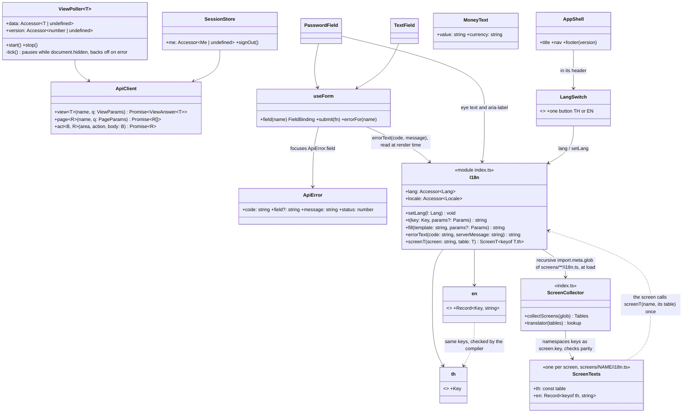

# XCHANGE v3 — its own TypeScript screens (Phase 2 of the TypeScript order)

> designed-by: claude/018b97 · 2026-10-08 · issue #384 · measured on `main` at `b2348fe`

`xchange-v3.md` says *"Rewriting the admin / desk / staff screens is not in either phase and is not designed here."*
On 2026-10-08 the owner ordered it: *"refactor to type script"* → *"ทั้งโปรเจ็ค เลย"* → *"วางแผน ก่อนทำ"*.
Phase 1 (#378, PR 382) converted the one script v3 already owned, the form helper, to TypeScript.
This document is Phase 2: v3 gets its own screens, written in TypeScript, in place of v2's built files.
It covers what the screens are built with, how they are served, the server seam they read through, the class
diagram, the order of the work, and the ticket split. It changes nothing in `xchange-v3.md`.

## 0. What this was measured from

| Source | State |
|---|---|
| `main` at `b2348fe` | Read: `api/src/presentation/pages.rs` (page table), `api/src/presentation/http/mod.rs` (route wiring), `api/src/application/compat/snapshot.rs`, `api/crates/xc-kernel/src/branch_tx.rs`, `api/crates/xc-auth/src/domain/policy/`, `api/migrations/` |
| The 10-06 v2 bundle (`XC-Desk-v2-Passport-Drawer-20261006.zip`, design §0) | Read: the `public/` file list and sizes; the admin menu from the embedded admin HTML in `server.mjs`; the API action names `staff.js` and `staff-report.js` call |
| The v2 screens' **source** | Did not exist anywhere we could reach when this was written. **It has been available since 2026-10-08** in `108-Plaza/xchange-v2-source` at commit `4d0bdbb` (`xchange-v3.md` §0). The staff app is `src/booking/app/staff/page.tsx`, the staff report `staff/report/page.tsx`, the admin and desk pages `src/online/lib/admin-html.ts` / `index-html.ts`, and the add-on screens `src/devices-public/*`. From then on, a screen ticket ports from that source (W9) |

## 1. Root cause this removes

v3 serves v2's built pages unchanged from `web.dir` (`pages.rs` `PAGE_SPECS`, design §5.3). A page whose source does
not exist cannot be fixed inside itself (the source arrived on 2026-10-08, after this was written; see §0). So every screen fix so far has been a script that patches the page from
outside:

| Script | What it patches | Row |
|---|---|---|
| `/_xc/forms.js` | broken `pattern`s, invalid-field marking, refusals pointed at fields, password reveal | FV, FV-TS |
| `/_xc/desk.js` | the kept desk's dead ends | DK-1 |
| `/_xc/staff-password.js` | the staff's own password change | SP-1 |

Each one is a wrapper around code we cannot read, and the byte-compare tests have to strip it again
(`pages_test.rs` `without_version_line`).

The second root cause is the contract the screens poll. `adminSnapshot` answers with the whole branch on every call
(`snapshot.rs:79`), so its size grows with history. The design kept it as debt *"until those screens are rewritten"*
(§5.3, *Known debt, kept on purpose*). This document is that rewrite.

## 2. Decisions

| # | Decision | Status |
|---|---|---|
| W1 | Screens are **SolidJS + Vite + TypeScript** (strict), built to static files. No Node runs on the server. | **decided** (owner 2026-10-08, "SolidJS + Vite") |
| W2 | Each rewritten screen reads through **per-screen endpoints that answer only what changed** (§4). `adminSnapshot` goes away once no screen calls it. | **decided** (owner 2026-10-08, "Per-screen endpoints") |
| W3 | The customer kiosk **stays Flutter** (D8, D9: web build plus Play Store `com.spacing.xchange`). It is not in this phase. | **decided** (owner 2026-10-08) |
| W4 | Order: **login and the small pages first** (the shared skeleton is proven on low-risk pages), then the admin menus, then the desk and the staff app, which carry money. | **decided** (owner 2026-10-08) |
| W5 | The screens are **compiled into the server binary**, as FV's script is, so the screens a server shows are always the ones built with it. | [required] §3.2 |
| W6 | Thai text is carried over from v2 **verbatim**: labels, refusals, sentences. A rewritten screen must not reword what staff already know. | [required] |
| W7 | A screen never does money arithmetic. New endpoints carry money as a **decimal string** (the fleet's wire rule). Totals, quotes and differences are computed by the server; the screen formats and shows them. | [required] |
| W8 | Roles do not change in the rewrite. A view gets the role row of the v2 action it replaces, **on the entry path the replaced screen used** (§4.4). | [required] |
| W9 | **A screen is ported from v2's source**, `xchange-v2-source@4d0bdbb`, not rebuilt from the minified bundle. Its ticket names the source file and the lines it ports. **The source is the behaviour contract.** The 10-06 bundle is only a fallback for anything the source lacks. The owner's decisions override both: brokers/referrals are not ported, because Broker-Platform owns them | [required] (lane controller 2026-10-08: *"Make the source @4d0bdbb the behaviour contract, with the 10-06 bundle only as a fallback for anything the source lacks, and owner decisions overriding both"*) |
| W10 | **Every v3 screen speaks Thai and English** (#427). (1) One shared module, `web/src/shared/i18n/`: `index.ts` holds a `lang: Accessor<'th' \| 'en'>` signal, `setLang(l)` and `t(key, params?)` with named `{name}` placeholders; `th.ts` is the source table, `as const`; `en.ts` is typed `Record<keyof typeof th, string>`, so a missing key is a **compile** error and there is no runtime fallback. Keys are dotted (`field.password.show`). **The shared tables hold only shared-component and refusal keys** (`field.*`, `form.*`, `shell.*`, `error.*`). **Each screen folder owns its own table**, `web/src/screens/<path>/i18n.ts`, which exports `th` (`as const`) and `en: Record<keyof typeof th, string>`. Its keys are local. The core namespaces them by the folder path under `screens/`, with `/` turned into `.`: `screens/login/i18n.ts` → `login.<key>`, `screens/admin/payments/i18n.ts` → `admin.payments.<key>`. The core collects the tables with the **recursive** glob `import.meta.glob('/src/screens/**/i18n.ts', { eager: true })`, so it reaches the admin menus one folder deeper. Each folder owns its own file, like `menus.ts` (§3.3), but the glob is recursive, whereas §3.3 globs `./*/menu.ts` from inside `screens/admin/`. The core checks that each table's `th` and `en` have the same keys and placeholders, that every folder segment matches `[a-z][a-z0-9-]*`, that the first segment is not a shared prefix, and that no namespaced key comes from two tables (e.g. `admin`'s `payments.title` against `admin/payments`'s `title`). Any failure throws. **Adding a screen edits no shared i18n file**, so screen tickets do not queue behind one table. A screen reads its own keys through **`screenT(screen, table)`**, which the core exports: it calls `const t = screenT('login', loginI18n)` once in its folder (a nested folder passes its dotted namespace, `screenT('admin.payments', paymentsI18n)`) and gets `t(key: keyof typeof loginI18n.th, params?)`. An unknown key is a compile error. It resolves `login.<key>` through the same language signal, so it follows `setLang`. The shared `t` is for shared keys only. (2) **Thai is the default.** The choice is kept per browser in `localStorage` under `xc.lang`; every read and write is in `try`/`catch` and falls back to `th`. `document.documentElement.lang` follows the choice. Nothing is detected from `navigator`: v2's staff app was Thai-only, so Thai stays the default. (3) A small TH/EN switch, `LangSwitch.tsx` in the same folder, is rendered by `AppShell`, so every screen has it, login included. (4) A server refusal is shown as `t('error.' + code)` when that key exists, otherwise as the server's own message. The server stays Thai for now. The `th` table carries each existing `V3Error` code's Thai sentence byte for byte, `invalidRequest` and the 401 `signIn` sentence included, so a Thai screen shows what it showed before (W6). **`th` is Thai throughout:** the five refusals the server sends in English (`employeeAuthRequired`, `notFound` and the three kiosk ones) are translated in `th`, and `en` keeps their English. (5) `Intl` follows `lang` for dates (`th-TH` / `en-GB`). `MoneyText` keeps its digits and does no arithmetic (W7); only its labels go through `t()`. (6) The shared components already on `main` (`TextField`, `PasswordField` and its `aria-label`s, `form.ts`'s refusals, `AppShell`) move to `t()` now, while it is cheap. Their tests that assert a Thai literal the component owns may assert through the table instead (`th['field.password.show']`); that is the only edit allowed to those tests. (7) **Every V1/V2/V3 screen ticket** puts all user-visible text, `aria-label`s included, through `t()`, writes its keys in its own `i18n.ts`, and is blocked by #427. W6 still holds: a screen's `th` table is where v2's Thai lives, verbatim. | **decided** (owner 2026-10-08, *"รองรับ 2 ภาษา ไทย/eng"* and *"aria-label … อย่าลืมนะมันต้องmulti lang นะ"*; points 1–7 by the lane controller claude/7ca80c, 2026-10-08) |

## 3. The web side

### 3.1 Layout

A new top-level directory beside `api/` and `app/` (D3):

```
web/
  package.json            private; scripts: dev, typecheck, test, build, check
  package-lock.json
  tsconfig.json           strict, noUnused*, verbatimModuleSyntax, isolatedModules
  vite.config.ts          multi-page build: one HTML entry per screen (§3.3)
  vitest.config.ts
  pages/                  one HTML entry per screen: login.html, staff-guide.html, …
  src/
    shared/               the core every screen uses (§5)
    screens/<screen>/     one folder per screen; the only files a screen ticket owns
  dist/                   build output, git-ignored, compiled into the server
```

`npm` is the package manager, as in `api/web/forms/` (#378) and in `pos/orders` / `pos/store`, the fleet's other
SolidJS + Vite apps.

### 3.2 How the server serves it (W5)

- [required] `api/src/presentation/ui.rs` holds `UiAssets`, the files of `web/dist` compiled into the binary.
  [proposed] It uses the `rust-embed` crate (MIT/Apache-2.0; `cargo deny check` must stay green).
- [required] **A Rust-only build must not need Node.** `api/build.rs` creates an empty `web/dist` when there is
  none, so `cargo build`, `clippy` and `test` work in any worktree. A server built that way answers every v3
  screen with the plain 503 `ui not built`. `/health/ready` gains `ui: "built" | "missing"`, and
  `deploy/server/smoke.sh` refuses `missing`.
- [required] **A release build refuses an empty `dist`.** `build.rs` fails the build when `PROFILE=release` and
  Vite's manifest `web/dist/.vite/manifest.json` is absent. `deploy/server/build.md` gains `npm --prefix web ci && npm --prefix web run build`
  before `cargo build --release`.
- Headers: as FV's script (`Cache-Control: no-cache`, `X-Content-Type-Options: nosniff`). Vite's hashed asset files
  (`/ui/assets/*-<hash>.js`) get `Cache-Control: public, max-age=31536000, immutable`.
- [required] Assets live under `/ui/`, a prefix v2 does not use: its `public/` files and route table
  (`server.mjs:8152-8199` of the 10-06 bundle) have no `/ui`.
- The version line (`add_version_line`, #293) is **not** injected into v3 screens. They show
  `build` / `builtAt` / `channel` from `GET /health/ready` in their own footer (fleet versioning rule). Since the
  screens are compiled in, that is also the screens' own build.

### 3.3 Cutover, one path at a time — with no shared list to edit

A table of paths that every screen ticket edits would be one file in every ticket's scope. The queue locks a file for
one ticket at a time, so the "parallel" screen tickets would really run one after another (📐 rule: one file that
many tickets must touch means the diagram is not finished). So nothing in this phase is a list that tickets edit.

[required] **A screen declares its own path** in its HTML entry, `web/pages/<screen>.html`:

```html
<meta name="xc-path" content="/login">
<meta name="xc-gate" content="anyone">   <!-- anyone | signed-in | branch | front -->
```

- `vite.config.ts` takes every `pages/*.html` as an input by glob, so adding a screen edits no config.
- `api/build.rs` reads the built HTML entries in `web/dist`, and generates the screen table into `OUT_DIR`
  (`v3_screens.rs`). `ScreenTable` in `api/src/presentation/screens.rs` `include!`s it. The build fails on two entries
  with the same `xc-path`, on a missing `xc-gate`, and on a gate other than the four listed above.
- [required] **A v3 screen wins over v2's page for the same path.** `ScreenTable::configure` is registered **before**
  `pages::configure`, and `page_handler` skips a path that `ScreenTable` holds. So switching a path to v3 is
  *adding* the screen. `PAGE_SPECS` is not edited until V4 (§7), and the old and new screens are never served at the
  same time.
- A v3 screen keeps v2's **path** (`/login`, `/`, `/desk`, …), so links, bookmarks and the redirects that point at
  them keep working. It keeps the page-level gate of the path it replaces. [required] The four gates:

  | Gate | Answer before the screen is sent | Replaces |
  |---|---|---|
  | `anyone` | none | `who_signed_in: false` |
  | `signed-in` | 303 to `/login` when nobody is signed in | `who_signed_in: true`, `PageKind::Plain` |
  | `branch` | as `signed-in`, then the branch resolved **exactly** as `PageKind::Branch` does today (`pages.rs:235-270`, `extract_branch_query` `:314-332`): staff get their own branch (`MAIN` when they have none); the owner gets `?branch=`, `MAIN` when absent or empty; an unparsable query or an invalid name is 400 `Invalid branch` (`text/plain`) | `PageKind::Branch` |
  | `front` | as v2's desk variant: anyone but a FRONT employee is redirected (`pages.rs:175-180`), and the branch is the employee's own | `PageKind::DeskVariant` |

  V0-A moves the resolution out of `page_handler` into one function, `page_branch(req, &sessions) -> Result<String,
  HttpResponse>` in `pages.rs`. v2's pages and the `branch` gate both call it, so the two cannot drift. [required] A
  v3 screen gets **no** `window.XC_BRANCH` (`pages.rs:200`, `:289`). It reads its branch from the `me` view, which
  answers `Policy::branch(actor, named)`, and the screen passes its own `?branch=` as `named`. The gate keeps the
  page-load 400 v2 gave, and the view keeps the branch the API uses — two answers from the same rule.
- `/_xc/forms.js` and the other `/_xc/` scripts stay on the v2 pages that are still served. A v3 screen does not
  carry them: it has the components of §5.3 instead.
- The admin page `/` is one v2 file with nine menus (§6). It switches **once**, when every menu has its v3 view.
  Until then the v3 admin is reachable at `/ui/admin/` for review, behind the same sign-in, and each menu is merged as
  its own ticket.
- [required] **The admin menu list is generated too.** `web/src/screens/admin/menus.ts` (V2-shell) builds the list
  with `import.meta.glob('./*/menu.ts', { eager: true })`. Each menu folder exports
  `menu: { id, label, icon, order, Component, roles }`. `order` is the menu's position in v2's nav, and `label` and
  `icon` are v2's text and glyph verbatim (W6). Adding a menu is adding its folder. A vitest test in V2-shell
  refuses duplicate `id`s and duplicate `order`s. The full record, with `group`, `heading` and `dated`, the props a
  menu receives, and the served nav it follows are §12.3.

## 4. The server seam: per-screen views that answer only what changed (W2)

### 4.1 The version already exists

`branch_versions.version` rises by 1 with every committed write on a branch, whether or not the write changed
anything. So **an equal version means nothing changed**, and a higher one means something may have
(`branch_tx.rs:6-12`, #231). Nothing reads it today (#231 §2). The views are its reader.

### 4.2 The contract

| | Request | Answer |
|---|---|---|
| Read a view | `GET /api/v3/views/{view}?branch={id}&since={version}` | `200 {"version": n, "changed": false}` when `since` equals the branch's version. This is O(1): one indexed read of `branch_versions`, and the view is not loaded. Otherwise `200 {"version": n, "changed": true, "data": …}` |
| Read without a cursor | the same, with no `since` | always `changed: true` with `data` |
| Act | `POST /api/v3/{area}/{action}`, JSON body | `200 {"version": n, …result}` or a refusal (§4.3) |

- [required] JSON is camelCase. Money and rates are **decimal strings** (`"1234.50"`), never JSON numbers (W7).
- [required] POST keeps v2's request rules (design §5.3): `Origin` must equal the request's own origin, and
  `X-Xchange-Request: 1` must be present. Both are checked by the existing extractor `presentation/extractors/origin.rs`.
  Sign-in is the existing cookies, `__Host-xc_owner` / `__Host-xc_staff` (design §6, D4).
- [required] A view's `data` is **bounded**: each view states its upper bound in its ticket, for example "the
  currencies of one branch" or "the open shift and its balances". A list that grows with history (transactions,
  customers, slips, events) is never one view's `data`. It is a **page**:
  `GET /api/v3/views/{view}?branch=&before={id}&limit=` with keyset paging, newest first, `limit` ≤ 100.
  A screen polls only its first page with `since`. Older pages are read only when someone scrolls to them.
- [required] **Every writer of a view's tables must go through `BranchTx`**, or the version does not move and the
  view never refreshes. Each view ticket lists the writers of the tables it reads and proves this with a test: one
  write per writer, then `since` must report `changed: true`. A writer outside `BranchTx` is the ticket's to fix first,
  not to work around. Measured at `b2348fe`, the candidates to check are the tables written by the public kiosk and
  device paths (`kiosk_requests`, `device_jobs`, `device_events`).

### 4.3 Refusals name their field

v2 answered one sentence for four fields (`xchange-v3.md` §5.3, FV root cause). Since the API is new, the root cause
can be fixed there:

```json
{ "error": { "code": "employeePasswordLength", "field": "password", "message": "รหัสผ่านต้องมี 12–128 ตัวอักษร" } }
```

- [required] `message` is v2's sentence, byte for byte, where one exists (W6). `code` is stable and camelCase.
  `field` is present only when exactly one field is wrong, and is the request body's key for it.
- The HTTP status is the one v2 used for that refusal.
- The screen's form (§5.3 `useForm`) focuses that field and marks it red. No `REFUSALS` table is needed in a v3 screen.

### 4.4 Who may read a view (W8)

[required] **One place decides**, as today, and the policy is not edited at all. A view declares **which v2 action it
replaces, on which entry path**:

```rust
const INHERITS: (EntryPath, &'static str) = (EntryPath::Rpc, "adminSnapshot");
```

`ViewEndpoint` asks `Policy::allow(actor, INHERITS.0, Action(INHERITS.1))` (`xc-auth` `domain/policy/entities/policy.rs`)
before anything else. The answer is therefore the one v2 gave the screen the view replaces, by construction. Each
view carries no role check of its own (♻️: auth lives in the core), and no ticket edits the role table. The admin
page's views inherit from `Rpc`, the staff app's from `StaffRpc`. The disagreement between the two that design §11
leaves open stays open, and nobody gains or loses access through the rewrite. When one v2 action served both
screens, they get two views, one per path.

`Policy::branch(actor, named)` decides the branch, as today: staff are put on their own branch whatever they name.

## 5. Class diagram

### 5.1 Server

```mermaid
classDiagram
  class BranchView {
    <<trait>>
    +NAME: &'static str
    +INHERITS: (EntryPath, &'static str)
    +VERSIONED: bool = true
    +own_version(&self) Future of Option i64, default None
    +type Data: Serialize + TS
    +type Filter: ViewFilter
    +load(&self, branch: &BranchId, who: &Actor, filter: &Filter) AppResult~Data~
  }
  class PagedView {
    <<trait>>
    +NAME: &'static str
    +INHERITS: (EntryPath, &'static str)
    +type Row: Serialize + TS
    +type Filter: ViewFilter
    +page(&self, branch: &BranchId, who: &Actor, filter: &Filter, before: Option~RowId~, limit: u16) AppResult~Vec~Row~~
  }
  class ViewFilter {
    <<trait: DeserializeOwned + TS + Default>>
    +check(&self) Result~(), V3Error~
  }
  class NoFilter { <<empty braced struct>> }
  class Period { +from: String +to: String +check() Result~(), V3Error~ }
  class TransactionRow { <<dto/v3/transaction_row.rs>> +id +date +created +type +currency +amount +rate +principal +settlement +status +slipUrl }
  class ViewEndpoint {
    +register~V: BranchView~(cfg, view: Arc~V~)
    +register_paged~V: PagedView~(cfg, view: Arc~V~)
    -answer(req, query: ViewQuery) HttpResponse
  }
  class ViewQuery { <<paging only — §12.1>> +branch: Option~String~ +since: Option~i64~ +before: Option~RowId~ +limit: Option~u16~ }
  class ViewAnswer~T~ { +version: i64 +changed: bool +data: Option~T~ }
  class BranchVersions { +current(&self, branch: &BranchId) AppResult~i64~ }
  class V3Error { +code: &'static str +field: Option~&'static str~ +message: String +status: StatusCode }
  class UiAssets { +get(path: &str) Option~EmbeddedFile~ +built() bool }
  class ScreenTable { +entries() [(path, gate, entry)] +holds(path) bool +configure(cfg, state) }
  class Policy { +allow(actor, EntryPath, Action) Result +branch(actor, named) BranchId }

  ViewEndpoint --> Policy : allow(INHERITS) / branch — unchanged
  ViewEndpoint --> BranchVersions : O(1) since check
  ViewEndpoint --> BranchView : load only when changed
  ViewEndpoint --> PagedView
  ViewEndpoint --> ViewAnswer
  ViewEndpoint --> V3Error
  ViewEndpoint --> ViewFilter : deserializes the non-paging keys, then check()
  BranchView --> ViewFilter : type Filter
  PagedView --> ViewFilter : type Filter
  NoFilter ..|> ViewFilter
  Period ..> V3Error : periodOrder
  ScreenTable --> UiAssets
  BranchVersions ..> BranchTx : reads the row BranchTx writes
```



| Class | File | Who provides | Who uses |
|---|---|---|---|
| `BranchView`, `PagedView` | `api/src/presentation/http/v3/view.rs` | V0-B; V0-C adds `type Filter`, the `filter` argument, `BranchView::VERSIONED` and `BranchView::own_version` (§12.1) | every view ticket |
| `ViewFilter` | `api/src/presentation/http/v3/view.rs` | V0-C | every view's filter type |
| `ViewEndpoint`, `ViewQuery`, `ViewAnswer<T>` | `api/src/presentation/http/v3/view.rs` | V0-B; V0-C parses the filter (§12.1) | every view ticket (one `register` call each) |
| `NoFilter`, `Period` | `api/src/presentation/dto/v3/common.rs` → `generated/common.ts` | V0-C | every view without a filter (`NoFilter`); the dated views (`Period`) |
| `TransactionRow` | `api/src/presentation/dto/v3/transaction_row.rs` → `web/src/shared/api/generated/transaction_row.ts` (its own file, so no other ticket shares it) | V2-parts (§12.2) | `admin_overview`, `admin_transactions`, `admin_slips`, `admin_customer_history`; `TransactionTable`, `TransactionDetail`, the CSV |
| a view's filter type, e.g. `AdminTransactionsFilter` | that view's `api/src/presentation/dto/v3/<view>.rs` → `generated/<view>.ts` | that view's ticket (§12.1 table) | its view and its menu |
| `BranchVersions` | `api/crates/xc-kernel/src/branch_versions.rs` | V0-B | `ViewEndpoint` |
| `V3Error` | `api/src/presentation/http/v3/error.rs` | V0-B | every v3 action |
| `configure_v3` | `api/src/presentation/http/v3/mod.rs` | V0-B | `include!`s `OUT_DIR/v3_views.rs`, which `api/build.rs` generates from the files in `http/v3/views/`: each file there is a module with `pub fn register(cfg, state)`. No ticket edits this file |
| a view, e.g. `RatesView` | `api/src/presentation/http/v3/views/<view>.rs` | its own ticket | — |
| its DTOs | `api/src/presentation/dto/v3/<view>.rs` | its own ticket | the generated TS (§5.2) |
| `UiAssets` | `api/src/presentation/ui.rs` | V0-A | `ScreenTable` |
| `ScreenTable` | `api/src/presentation/screens.rs` | V0-A | `include!`s `OUT_DIR/v3_screens.rs`, generated from `web/dist` (§3.3). No ticket edits this file |

[required] **No file is edited by more than one screen or view ticket.** A view is one file in `http/v3/views/` and
one in `dto/v3/`. A screen is its folder and its HTML entry. Its generated types are one file per view in
`web/src/shared/api/generated/`. Registration and the policy are derived, not edited (§3.3, §4.4).

**Types shared with the web.** [required] DTOs derive `ts_rs::TS` (crate `ts-rs`, MIT). `cargo test` writes them to
`web/src/shared/api/generated/` (`export_to`), and they are committed. The web `check` script fails when the
committed files differ from what the Rust DTOs produce, the same drift gate as `xc-forms.js` (#378). A field renamed
in Rust therefore fails CI instead of failing silently in a screen.

ts-rs also exports every type a DTO depends on. So a type used by two views would land in both tickets' diffs, and
the queue would lock it twice. [required] The rules that prevent that:

- **Shared types are V0-B's alone**: `ViewAnswer<T>`, `V3Error`, `Page<T>`, ids, the decimal-string `Money` and
  `Rate`, and `Me`. They live in `api/src/presentation/dto/v3/common.rs` and are exported to `generated/common.ts`.
  A later change to them is its own ticket, never part of a screen's: V0-C adds `NoFilter` and `Period` (§12.1).
- **A row shape several views answer** lives in its own file, never in `common.rs`, so the ticket that owns it shares
  no file with the core: `TransactionRow` is `dto/v3/transaction_row.rs` → `generated/transaction_row.ts`, V2-parts'
  alone (§12.2).
- **A view's DTOs use only their own types, `common`'s and the shared row files above**, and export only to
  `generated/<view>.ts`. A V0-B test (`api/tests/v3_types_test.rs` `each_view_writes_only_its_own_file_and_common`)
  exports every view into an empty directory and fails when a view writes any file other than its own and
  `common.ts`; V2-parts adds `transaction_row.ts` to the files that test accepts (one name, nothing else loosened).
- **ts-rs is pinned with `=`** in `api/Cargo.toml` (V0-A adds it). V0-A pins a version where several types can share
  one `export_to` file (`common.ts`, and a view's several types in `<view>.ts`). V0-B's test above proves it on that
  version.

### 5.2 Web



| Module | File | Ticket |
|---|---|---|
| `ApiClient`, `ApiError` | `web/src/shared/api/client.ts` | V0-A |
| generated shared types | `web/src/shared/api/generated/common.ts` | V0-B; V0-C (#475) adds `NoFilter`, `Period` — no other ticket |
| the shared exchange row | `web/src/shared/api/generated/transaction_row.ts` | V2-parts (#476) only |
| generated DTO types of one view | `web/src/shared/api/generated/<view>.ts` | that view's ticket |
| `ViewPoller<T>` | `web/src/shared/live/view-poller.ts` | V0-A |
| `SessionStore` | `web/src/shared/session/session.ts` | V0-B (it reads the `me` view V0-B builds) |
| `useForm` | `web/src/shared/ui/form.ts` | V0-A; V1-i18n (#427) shows refusals through `errorText` |
| `TextField` | `web/src/shared/ui/TextField.tsx` | V0-A |
| `PasswordField` | `web/src/shared/ui/PasswordField.tsx` | V0-A — the same component as #378: eye inside on the right, one border, never reads the value outside the form, conceals before submit; V1-i18n (#427) moves its eye's text and `aria-label` to `t()` |
| `MoneyText` | `web/src/shared/ui/MoneyText.tsx` | V0-A — formats a decimal string, no arithmetic (W7) |
| `AppShell` | `web/src/shared/ui/AppShell.tsx` | V0-A; V1-i18n (#427) adds `LangSwitch` to its header |
| `lang`, `setLang`, `locale`, `t` (shared keys only), `fill`, `errorText`, `collectScreens`, `translator`, `screenT` (a screen's typed `t` over its own table) | `web/src/shared/i18n/index.ts` | V1-i18n (#427) |
| the shared `th` table (`field.*`, `form.*`, `shell.*`, `error.*` only) and its `Key` type | `web/src/shared/i18n/th.ts` | V1-i18n (#427); a later shared component's ticket adds its keys, a screen ticket never does |
| the shared `en` table | `web/src/shared/i18n/en.ts` | as `th.ts` |
| a screen's `th` / `en` tables | `web/src/screens/<path>/i18n.ts`, namespace = `<path>` with `/` as `.` | the ticket that owns that folder. A V1 screen owns `screens/<screen>/i18n.ts`; **each V2-<menu> owns `screens/admin/<menu>/i18n.ts`**; V2-shell owns `screens/admin/i18n.ts`, for the admin shell's own texts only. Components call `screenT('<namespace>', table)` once in their folder, never the shared `t` for screen text |
| `LangSwitch` | `web/src/shared/i18n/LangSwitch.tsx` | V1-i18n (#427) |
| a screen | `web/src/screens/<screen>/**` + `web/pages/<screen>.html` | its own ticket |

`Lang` is `'th' | 'en'`, `Locale` is `'th-TH' | 'en-GB'`, `Params` is `Record<string, string | number>`.

[required] `ViewPoller` keeps the **last version it saw** and sends it as `since`. It replaces its data only on
`changed: true`. Its interval is set per screen from how often that screen's data changes (🔁 rule), stated in the
screen's ticket. It stops while the tab is hidden. **The admin menus do not use it**: v2's admin never polls, so they
read on show, on a branch or period change and on `รีเฟรช` (§12.6).

**Admin page** (§12.2, §12.3):


| Module | File | Ticket | Used by |
|---|---|---|---|
| `AdminMenu`, `AdminMenuProps`, `AdminGroup`, `collectMenus`, `menus` | `web/src/screens/admin/menus.ts` | V2-shell (#460) | every V2-&lt;menu&gt; |
| `AdminShell` | `web/src/screens/admin/AdminShell.tsx` | V2-shell | `main.tsx` |
| the shell's texts | `web/src/screens/admin/i18n.ts` (`admin.*`) | V2-shell | the shell |
| `admin_branches` view, DTO, generated TS | `http/v3/views/admin_branches.rs`, `dto/v3/admin_branches.rs`, `generated/admin_branches.ts` | V2-shell | the branch picker |
| `StatCard`, `DataTable`, `TransactionTable`, `TransactionDetail`, `typeName`/`methodName`/`statusName`, `csvCell`/`walkPages`/`downloadCsv`, `pendingWrite`, `refreshTick`/`requestRefresh`, `Dialog`/`toast`/`Toast`, `hashParams`/`openMenu`, `NewTransactionButton` | `web/src/screens/admin/parts/` (one file each, §12.2) | V2-parts | the shell and the menus |
| the parts' texts | `web/src/screens/admin/parts/i18n.ts` (`admin.parts.*`) | V2-parts | the parts |
| `transaction_documents`, `admin_request_status`, `admin_shift_state` views, DTOs, generated TS | `http/v3/views/<view>.rs`, `dto/v3/<view>.rs`, `generated/<view>.ts` | V2-parts | `TransactionDetail`, `pendingWrite`, `NewTransactionButton` |
| a menu | `web/src/screens/admin/<id>/**` (`menu.ts`, its `Component`, `i18n.ts` as `admin.<id>.*`) + its views | that V2-&lt;menu&gt; | `menus.ts`'s glob |

## 6. The screens

Measured at `b2348fe` (`pages.rs` `PAGE_SPECS`) and in the 10-06 bundle. "Wave" is W4's order. "Who" is a pointer, not a spec: each screen's ticket measures its roles per W8. "by role" means the `adminSnapshot` row of the path the screen uses.

| Wave | Path | v2 file | Who | What it calls in v2 |
|---|---|---|---|---|
| 1 | `/login` | `login.html` (2,936 B) | anyone | `/api/auth` |
| 1 | `/staff-guide`, `/staff-guide.html` | `staff-guide.html` (4,980 B) | signed in | none (static text) |
| 1 | `/receipt-sample` | embedded | signed in | none |
| 1 | `/kiosk-currencies.html` | `kiosk-currencies.html` (4,302 B) | OWNER, RATES (§5.3 `/api/kiosk` row) | `/api/kiosk` `manage`, `configure` |
| 1 | `/kiosk-queue.html` | `kiosk-queue.html` (3,661 B) + `queue-panel.js` (10-06) | signed in | `/api/kiosk` `list`, `accept`, … (§5.5.3; **waits for Q1, PR 373, and K-HTTP `canAccept`, #329**) |
| 1 | `/devices` | `devices.html` + `devices.js` | signed in | `/api/devices`, `/api/device-setup` |
| 2 | `/` menu ภาพรวมหน้าร้าน (`overview`) | `admin.html` (embedded) | owner, staff by role | `adminSnapshot` |
| 2 | `/` menu พนักงาน / ขั้นตอนกะ (`employees`) | `employees.js`, `employee-summary*.js` | per `EntryPath::OwnerRoute` (`policy.rs:30`) | `/api/employees` |
| 2 | `/` menu การจองออนไลน์ (`bookings`) | `bookings.js` (`registrations.js` is a customers tab, §12.10) | per #377 | `/api/bookings` — **waits for #377** (bookings port, D5 answered "พอร์ตมา v3") |
| 2 | `/` menu รายการแลกเงิน (`transactions`) | embedded | by role | `adminSnapshot` (transactions) — a paged view |
| 2 | `/` menu สลิป (`slips`) | `slips.js` | by role | files — a paged view |
| 2 | `/` menu ลูกค้า (`customers`) | `customers.js`, `customer-core.js`, `registrations.js` (tab, §12.10) | by role | `adminSnapshot` (customers) — a paged view |
| 2 | `/` menu เงินสดและเปิด–ปิดกะ (`cash`) | embedded, `shift-valuation*.js`, `profit-summary*.js` (§12.9) | owner; BACKEND, MANAGER (open/close), FINANCE (move stock) on `Rpc` (design §6) | `adminOpenShift`, `adminCloseShift`, `adminMoveStock` |
| 2 | `/` menu อัตราแลกเปลี่ยน (`rates`) | embedded, `rates-reference.js`, `kbank-reference.js` | owner; RATES (`policy.rs:81`, `:114`) | `adminSaveRate`, `/api/reference-rates` |
| 2 | `/` menu สรุปยอด (`reports`) | embedded, `employee-summary*.js` | by role | `adminSnapshot` |
| 2 | `/` 10-06 add-ons: payments, queue | `admin-payments.js`, `admin-queue.js`, `admin-workspace.*` | §5.5.2, §5.5.3 | `/api/payment-methods` (**waits for PR 372**), `/api/kiosk` |
| 3 | `/desk` | `desk.html` (embedded) + `desk-*.js` | signed in | `adminDeskConfig`, `reserveCustomer`, `saveTransaction`, `getConnectionStatus`, uploads |
| 3 | `/staff/desk` | the desk variant | FRONT | as `/desk`, plus `opsBeginTransaction` (`pages.rs` `STAFF_DESK_SCRIPT`) |
| 3 | `/staff` | `staff.html` + `staff.js` (React, 224,719 B) | staff | `adminSnapshot`, `adminSaveRate`, `opsPropose`, `opsClock`, `opsStartService`, `opsCutoff`, `opsTarget`, `opsSign`, `opsDispatch`, `opsCommit`, `opsReject`, `opsReconcile`, `opsHold`, `opsRelease` |
| 3 | `/staff/report` | `staff-report.js` (React, 202,423 B) | staff | `adminSnapshot` |
| 3 | `/documents`, `/staff/documents` | not a v2 file: HTML that v3 writes itself (`http/documents.rs:40-45`, `owners_page` `:134`) | owner; staff per the `StaffRpc` `documents` row (all but RATES and SYSTEM, design §6) | the documents lookup — the HTML moves into a screen, the lookup becomes a view |
| — | `/kiosk` | Flutter (`app/`) | public | **not in this phase (W3)** |

Wave 3 handles money and custody. Its behaviour tables are the heaviest and come from `xchange-v3.md` §3 (amount,
principal, BUY/SELL, stock guard, rate guard, custody gate). Each of those rows is already a server test. The screen
ticket's tests prove that the screen sends what the server expects and shows what it answers.

## 7. Retiring v2's files (V4)

Once every path in §6 is `ScreenSource::V3`:

- `PAGE_SPECS`, `add_scripts`, `add_version_line`'s page injection, `STAFF_DESK_SCRIPT`, and the `/_xc/` scripts
  (`xc-forms.js`, `xc-desk.js`, `xc-staff-password.js`) with their JS tests are deleted.
- `web.dir` remains only for what the Flutter kiosk serves from it, if anything. V4 measures that first.
- The compat RPC actions that no screen calls any more (`adminSnapshot` first) are deleted, with the
  `application/compat/` code that only they used. V4 lists them by grepping `web/src` for each action name.
- `api/tools/extract-v2-pages.mjs` and the deploy step that runs it are deleted, if V4 finds no remaining reader.

## 8. Ticket split

The xchange lane controller (claude/7ca80c) cuts these after this document merges. One ticket per row. V0-A comes
first and V0-B second, because both need the crate list and V0-B writes into `web/`. After that, the rows of a wave
run in parallel: each owns only its own files (§5.1).

| Ticket | What | Owns | Blocked by |
|---|---|---|---|
| **V0-A** web skeleton | `web/` with Vite multi-page, strict TS, vitest, `ApiClient`, `ViewPoller`, `useForm`, `TextField`, `PasswordField`, `MoneyText`, `AppShell`; `UiAssets`, `ScreenTable` and its `build.rs` generation (no screen yet, so no path switched), `build.rs` empty-`dist` rule, `page_handler` skipping a path `ScreenTable` holds, `/health/ready` `ui`; CI job `web` (typecheck, test, build) and the `api` job builds `web` before the release check; `deploy/server/build.md` | `web/` (new, whole subtree), `api/src/presentation/ui.rs`, `api/src/presentation/screens.rs`, `api/src/presentation/mod.rs`, `api/src/presentation/pages.rs`, `api/build.rs`, `api/build_support/screens.rs` (new), `api/src/presentation/http/health.rs`, `.github/workflows/web.yml` (new), `.github/workflows/api.yml`, `api/Cargo.toml` and `api/Cargo.lock` (adds **both** `rust-embed` and `ts-rs`, so V0-B touches neither), `deploy/server/build.md`, `deploy/server/smoke.sh` | this doc. It also shares `pages.rs` with PR 360 (DK-1) and `api.yml` with PR 382 (#378) — if either is still open, V0-A waits for it |
| **V0-B** view core | `BranchView`, `PagedView`, `ViewEndpoint`, `ViewAnswer`, `ViewQuery`, `V3Error`, `BranchVersions`, `configure_v3` and its `build.rs` generation, the `ts-rs` export and its drift check, and one view as the worked example: `GET /api/v3/views/me` (who is signed in, role, branch), with `SessionStore` on the web side | `api/src/presentation/http/v3/` (new), `api/src/presentation/dto/v3/` (new), `api/src/presentation/http/mod.rs`, `api/crates/xc-kernel/src/branch_versions.rs`, `api/crates/xc-kernel/src/lib.rs`, `api/build.rs` (adds the views generation after V0-A's), `api/build_support/views.rs` (new), `web/src/shared/api/generated/common.ts`, `web/src/shared/api/generated/me.ts`, `web/src/shared/session/session.ts` (inside V0-A's `web/`, so V0-B waits for it) | V0-A |
| **V1-i18n** (#427) | the shared th/en module, the TH/EN switch in `AppShell`, and the retrofit of `TextField`, `PasswordField`, `form.ts` and `AppShell` (W10) | `web/src/shared/i18n/` (new, whole subtree), `web/src/shared/ui/AppShell.tsx`, `TextField.tsx`, `PasswordField.tsx`, `form.ts`, and the four existing tests that assert a Thai literal the component owns | this doc's W10, and V0-B (#393, PR 418) for the `serverError` code it carries |
| V1-login … V1-devices | one per Wave 1 row of §6 | `web/src/screens/<screen>/`, `web/pages/<screen>.html`, its files `http/v3/views/<view>.rs`, `dto/v3/<view>.rs`, `web/src/shared/api/generated/<view>.ts`, its text table `web/src/screens/<screen>/i18n.ts` (namespace `<screen>.*`, W10 point 1), and its tests | V0-A, V0-B, V1-i18n (#427). V1-kiosk-queue also waits for PR 373 and #329 |
| **V0-C** (#475) filtered views (§12.1) | `ViewFilter`, `type Filter` and the `filter` argument on `BranchView` / `PagedView`, `NoFilter`, `Period`, `BranchView::VERSIONED`, `BranchView::own_version`, the filter parsing in `ViewEndpoint`, `ApiClient`'s `filter` param; `type Filter = NoFilter` on every existing view | `api/src/presentation/http/v3/view.rs`, `api/src/presentation/dto/v3/common.rs`, `web/src/shared/api/generated/common.ts`, every view file on `main` and the test views that implement the traits (§12.1), `web/src/shared/api/client.ts`, its new tests | this doc's §12 |
| V2-shell (#460) | the v3 admin page at `/ui/admin/`: entry `web/pages/admin.html`, `web/src/screens/admin/menus.ts` and its test, the admin layout, the `admin_branches` view (§12.3, §12.4) | `web/pages/admin.html`, the root files of `web/src/screens/admin/` (`menus.ts`, `menus.test.ts`, `AdminShell.tsx`, `main.tsx`, `admin.css`, `i18n.ts` — the shell's own texts only, namespace `admin.*`; a menu's text never goes here, W10), `admin_branches`' view, DTO, generated TS and test | V0-C (the view's trait shape); merges after V1-login and V2-parts |
| **V2-parts** (#476, §12.2) | the admin parts several menus share, `TransactionRow`, and the views `transaction_documents`, `admin_request_status`, `admin_shift_state` | `web/src/screens/admin/parts/` (whole subtree), `api/src/presentation/dto/v3/transaction_row.rs` and `web/src/shared/api/generated/transaction_row.ts` (`TransactionRow`), the three views' files, `api/src/application/compat/abandon_request.rs` (`is_applied` visibility), `api/tests/v3_types_test.rs` (one allowed file name) | V0-C |
| V2-<menu> | one per admin menu of §6 | `web/src/screens/admin/<menu>/**`, including its own text table `web/src/screens/admin/<menu>/i18n.ts` (namespace `admin.<menu>.*`, W10), and its view files, as above | V2-shell; V2-parts for a menu that uses a part; V0-C for a menu with a filtered view. V2-bookings waits for #413; V2-cash's calculators for §12.15 item 3 |
| V2-switch (#472) | moves the admin entry's `xc-path` from `/ui/admin/` to `/` once every served admin feature exists; `/ui/admin/` then answers 308 to `/` (§12.13) | `web/pages/admin.html`, `api/src/presentation/screens.rs` (the redirect only), its test | every V2-<menu>, V2-parts and the queue bar (#471) |
| V3-desk, V3-staff-desk, V3-staff, V3-staff-report, V3-staff-documents | Wave 3 | as above | V2-switch |
| V4 | retire v2's files (§7) | `api/src/presentation/pages.rs`, `api/static/`, `api/tests/js/`, `api/tests/pages_*`, `api/src/application/compat/`, `api/tools/`, `deploy/server/` | every V3 |

[required] Before any screen ticket goes `ready`, its author writes:

- the **behaviour table** for that screen: what v2 shows and allows, measured on the local v2 copy (`.dev/v2`) for
  every role the screen admits;
- the **failing tests** on the ticket's branch: the view's Rust tests, and the screen's vitest tests against a fake
  `ApiClient`.

Per the fleet rule 🧪, this document fixes only the classes and the files.

## 9. Tests written before implementation

**V0-A**, on its branch before the code:

- `web/src/shared/live/view-poller.test.ts`:
  - The second request carries the first answer's `version` as `since`.
  - `changed: false` keeps the old data object, by identity.
  - No request is made while `document.hidden`.
  - Each error doubles the interval, up to a cap.
- `web/src/shared/ui/PasswordField.test.tsx`: the eye is inside the wrapper; the type flips; the field is concealed
  on submit; the value is never read through `.value` (a getter that throws).
- `web/src/shared/ui/form.test.ts`: an `ApiError` with `field` focuses and marks that field; one without `field` shows
  the message at the form level.
- `api/tests/ui_assets_test.rs`:
  - With an empty `dist`, every `V3` path answers 503 `ui not built`, and `/health/ready` reports `ui: "missing"`.
  - A hashed asset is served immutable, and a screen's HTML entry is served `no-cache`.
  - A path in neither `ScreenTable` nor `PAGE_SPECS` is the plain 404.
  - The `branch` gate gives the same status and body as v2's `PageKind::Branch` page for each of: staff with a
    branch, staff without one, the owner with `?branch=X`, `?branch=`, no query, an unparsable query, and an invalid
    name. The test sends each request to a v2 page and to a v3 fixture, and compares the answers.
  - A test screen fixture declaring `xc-path="/staff-guide"` is served instead of v2's page at that path. `page_handler`
    does not answer it, and the gate `signed-in` redirects a caller who is not signed in, as v2's page did.
  - The generator refuses two entries with the same `xc-path`, a missing `xc-gate` and an unknown gate. Each is a
    unit test of the pure function `build.rs` calls (`api/build_support/screens.rs`).

**V0-B**:

- `api/tests/v3_view_test.rs`:
  - With `since` equal to the current version, the answer is `changed: false`, and the view's `load` is **not
    called** (a counting fake).
  - After one write through `BranchTx`, the same `since` gives `changed: true` with data.
  - With no `since`, the answer always has data.
  - A staff caller naming another branch is answered for their own branch.
  - A role outside the view's row gets the policy's refusal.
- `api/tests/v3_error_test.rs`: a refusal with a field serialises as `{error:{code, field, message}}`, with the status
  beside it.
- The `ts-rs` drift check fails when a DTO field is renamed and the generated file is not.
- A view file dropped into `http/v3/views/` is served with no other edit. The generator's pure function
  (`api/build_support/views.rs`) lists it, and refuses a file without `pub fn register`.
- A view whose `INHERITS` is `(Rpc, "adminSaveRate")` refuses exactly the callers that `Policy::allow` refuses for that
  pair. The test compares the two answers for every caller kind.

## 10. Data migration

V0-A and V0-B add **no** table, column or constraint: the views read `branch_versions`, which exists
(`20261006120000_branch_versions.sql`).

[required] Any view ticket that later needs a schema change must carry its own data-migration section, with the
fleet's four items. That includes the case §4.2 points at: a writer of the view's tables that does not go through
`BranchTx` today, if the fix needs a column. v3 starts on an empty database (D6), and v3 migrations are approved
until the first install (owner 2026-10-06). That does not remove the four items.

## 11. Open items

| Item | Blocks | Who |
|---|---|---|
| The kiosk queue screen's data (`canAccept`) is not sent by v3 yet | V1-kiosk-queue | K-HTTP #329, Q1 PR 373 |
| Bookings are not ported yet (D5: "พอร์ตมา v3"). #377 also asks who creates bookings and whether v2's bookings data moves | V2-bookings | owner, then the lane controller |
| The shift valuation and profit calculators (§12.15 item 3) | V2-cash (those panels only) | lane controller |
| The kiosk queue panel's file and owner (§12.12) | V2-queue (#471), so V2-switch | a V1-kiosk-queue design row |
| Payment settings route | V2-payments | PR 372 |
| `Rpc` vs `StaffRpc` disagreement (design §11) | nothing: W8 keeps each screen on its own path's row | owner, when wanted |

## 12. V2 admin decisions (2026-10-08)

> decided-by: claude/7ca80c (xchange lane controller) · 2026-10-08 · answers the open items of the V2 tickets #460–#472 ·
> measured on `main` at `89c511a` and in `xchange-v2-source@4d0bdbb`

The thirteen V2 tickets (#460 V2-shell, #461–#470 one per menu, #471 the queue bar, #472 V2-switch) were cut with open
items: O1–O7 on V2-shell, which every menu inherits, and items of their own (`O-ov1`, `O-em1`, `O-bk1`…`O-bk3`, `O-tx1`,
`O-sl1`, `O-sl2`, `O-cu1`, `O-cu2`, `O-ca1`, `O-ca2`, `O-ra1`, `O-ra2`, `O-re1`, `O-qu1`, `O-qu2`, and #472's two). This
section records the answers and the files they give. Two answers add tickets: **V0-C** (#475, filtered views, §12.1)
and **V2-parts** (#476, the admin parts several menus share, §12.2). §12.15 lists what was left to the controller and what is still open; §12.16 and §12.17 record two of its answers.

Line references into the v2 source: `admin-html:N` is line N of the decoded admin page (the one-line JSON string
`src/online/lib/admin-html.ts`, decoded by the command in #460 §2, 175 lines); `admin-workspace.js`, `admin-queue.js`,
`admin-devices.js`, `admin-payments.js`, `account-bar.js`, `shift-valuation*.js`, `profit-summary*.js` and
`employee-summary*.js` are in `src/devices-public/`; `slips.js`, `customers.js`, `customer-core.js`, `bookings.js`,
`employees.js`, `registrations.js` and `rates-reference.js` are in `src/online/public/`. **The served page is the
contract** (W9): the admin page plus `ADMIN_SCRIPTS` (`src/server.mjs:130`) plus the scripts `admin-html:175` loads.

### 12.1 Filtered views — a core change of its own, V0-C (O1)

**Root cause.** v2 filters in the browser over the whole snapshot: by period (`admin-html:57`), by text, type and status
(`admin-html:58`, `slips.js:4`, `customer-core.js:6`, `customers.js:17`, `bookings.js:7`), by employee
(`employee-summary.js:8`). A paged view holds one page, so the same filter in the browser would filter only what was
read. The server has to filter, and the core cannot carry a filter today: the parsed query holds only paging
(`api/src/presentation/http/v3/view.rs:49-55` `ViewQuery`, `:83-88` `ParsedQuery`, `:90-173` `parse_query`), and
`BranchView::load` / `PagedView::page` take no filter (`view.rs:25-47`). A change to the core's shared types is its own
ticket (§5.1), so this is **V0-C** (#475), not part of any menu.

[required] **The contract** (class diagram §5.1):

- `ViewQuery` and the parsed query keep **paging only**: `branch`, `since`, `before`, `limit`. These four keys are
  reserved; no filter may use them.
- One shared core, one filter type per view (♻️ rule). A new trait in `view.rs`:
  ```rust
  pub trait ViewFilter: serde::de::DeserializeOwned + ts_rs::TS + Default + Send + Sync + 'static {
      /// Refuses a filter whose fields parse but do not fit together (e.g. from > to).
      fn check(&self) -> Result<(), V3Error> { Ok(()) }
  }
  ```
  `BranchView` and `PagedView` each gain `type Filter: ViewFilter;`, and the filter is passed in:
  `load(&self, branch, who, filter: &Self::Filter)` and `page(&self, branch, who, filter: &Self::Filter, before, limit)`.
- **`NoFilter`** is the filter of every view that has none: `#[derive(Deserialize, TS, Default)] pub struct NoFilter {}`
  (a braced empty struct, so it deserializes from any query map; a unit struct does not), `impl ViewFilter for NoFilter {}`.
  Stable Rust has no defaults for associated types (feature `associated_type_defaults` is unstable), so "default
  `NoFilter`" means **every view without a filter writes `type Filter = NoFilter;`** and takes the extra argument.
  V0-C adds that line to every view and every test view on `main` when it rebases: at `89c511a` these are
  `views/me.rs:22` (`:29` on later `main`), `views/devices.rs:41`, `views/device_events.rs:41`, `views/device_jobs.rs:40`,
  `views/device_transactions.rs:38`, the four test views of `api/tests/v3_view_test.rs:242-334` and the two of
  `api/tests/v3_view_no_session_test.rs:32-60`, plus `views/kiosk_currencies.rs` if #399 merges first.
- **Parsing.** The endpoint takes the query pairs (first occurrence of a key counts, as `view.rs:110-113` does today),
  removes the four paging keys, and deserializes the rest into `V::Filter`. An unknown key is ignored, as today. A
  value that does not parse is `400 {"error": {"code": "invalidRequest", "field": "<key>", "message": "คำขอไม่ถูกต้อง"}}`
  (§4.3; the sentence is `view.rs:105`'s). Then `filter.check()`. Both run **before** the `since` shortcut, so a bad
  filter is refused even when nothing changed. Order: sign-in and policy (`INHERITS`, unchanged) → paging → filter →
  `check` → branch → version → `since` → `load` / `page`.
- **`Period`** is the one shared period type (♻️): `{ from: String, to: String }`, ISO `YYYY-MM-DD` calendar days in
  Asia/Bangkok, both **inclusive**, `''` or absent = open on that side — v2's rule
  `(!from||t.date>=from)&&(!to||t.date<=to)` (`admin-html:57`). `Period::check` refuses a malformed date with the field
  named, and `from > to` with `400 {"code": "periodOrder", "field": "to", "message": "วันที่เริ่มต้นต้องไม่เกินวันที่สิ้นสุด"}`
  (the sentence is `admin-html:57`'s; the code name is [proposed]). A filter embeds it with `#[serde(flatten)]`
  [proposed]; if flatten does not deserialize from the query on the pinned serde, the filter carries `from` / `to`
  itself and calls `Period::check`. The wire keys `from`, `to` are [required].
- **Filtering happens in SQL** [required]. The view passes its filter to the query that reads the rows; it never loads
  a wider set and filters it in Rust, and the screen never filters a view's answer (except the bounded name filter of
  §12.14 row *employee summary*, which is v2's and touches no money). Text search `q` is a literal substring, case
  folded with `lower()`, with `%`, `_` and `\` escaped (v2 uses `includes`); NFKC normalisation (`normalize(…, NFKC)` on
  both sides) only where v2 normalises (`slips.js:4`, `customer-core.js:6`). `q` longer than 100 characters is
  `400 invalidRequest` with `field: "q"` (the v2 inputs carry `maxlength="100"`, `admin-html:19`).
- **The cursor does not depend on the filter.** `since` compares the branch's version (§4.1), which every committed
  write moves whatever it touched, so `changed: false` stays true for any filter. [required] A screen sends `since` only
  with the filter its version was read with; when the filter changes, it reads without `since`.
- **Views that a branch version cannot describe** (§12.4, §12.7): `BranchView` gains `const VERSIONED: bool = true;`
  (associated constants may have defaults on stable). With `false` the endpoint ignores `since` and always answers
  `changed: true` with data; `version` is still the branch's. `PagedView` does not need it now.
- **A view with a version of its own** (§12.16): `BranchView` also gains
  `fn own_version(&self) -> impl Future<Output = AppResult<Option<i64>>> + Send` with a default body answering
  `Ok(None)` (return-position `impl Trait` in traits may have a default body on stable). When it answers `Some(v)`, the
  endpoint uses `v` instead of `branch_versions` for the `version` field and the `since` shortcut; `VERSIONED` must be
  `true` for it to be asked. It exists for data that is not a branch's rows — today only the BOT reference.
- **Web.** `ApiClient.view` / `ApiClient.page` (`web/src/shared/api/client.ts:71`, `:99`) take `filter?: F` in their
  params, `F` being the view's generated filter type; each value that is neither `undefined` nor `''` is sent as
  `key=value`. A view's filter type is exported to that view's own `generated/<view>.ts` (§5.1's rule, unchanged);
  `NoFilter` and `Period` go to `generated/common.ts`.

**The filters, per view.** Each row's ticket writes its filter type in its own DTO file. Fields are [required] (they are
v2's filters); type names are [proposed].

| View (ticket) | Kind | Filter (query keys) | v2 source |
|---|---|---|---|
| `admin_overview` (#461) | `BranchView` | `from`, `to` | `admin-html:57`, `:64-67` |
| `admin_transactions` (#464) | `PagedView` | `from`, `to`; `q` over id, customer name, currency (`lower()`, no NFKC); `type` = `BUY` \| `SELL`; `status` = `COMPLETED` \| `CANCELLED` \| `PENDING`; `staff` (exact) and `staffQ` (substring) of the employee name | `admin-html:18`, `:58`; `admin-workspace.js:84`; `employee-summary.js:8-9`, `:16` |
| `admin_slips` (#465) | `PagedView` | `from`, `to`; `q` over id, customer, customer id, currency, payment reference (NFKC + `lower()`); `status` = `COMPLETED` \| `PENDING` \| `CANCELLED` | `slips.js:4`, `:7`; `admin-html:19` (`slip-status` options) |
| `admin_customers` (#466) | `PagedView` | `q` over id, name, nationality (NFKC + `lower()`); no period | `customer-core.js:6`; `customers.js:8`, `:9`, `:20` |
| `admin_customer_history` (#466) | `PagedView` | `customer` (required; absent → `400 invalidRequest`, `field: "customer"`); `q` over id, currency, date (`lower()`) | `customers.js:16-17` |
| `admin_reports` (#469) | `BranchView` | `from`, `to`; `staff` (exact) and `staffQ` (substring) for the employee tab | `admin-html:69-71`; `employee-summary.js:8-10`, `:19-20` |
| `admin_bookings` (#463) | `PagedView` | `q` over id, name, phone (`lower()`); no period | `bookings.js:7`, `:20` |
| `transaction_documents` (V2-parts) | `BranchView` | `ref` (required) | `slips.js:33` |
| `admin_request_status` (V2-parts) | `BranchView`, `VERSIONED = false` | `requestId` (required, the shape `read_request_id` accepts, `abandon_request.rs:78-86`) | `admin-html:123` |
| every other admin view | — | `NoFilter` | — |

### 12.2 Shared admin parts — V2-parts (O2)

Several menus show the same pieces, and v2 writes each once (`admin-html:61-63`, `:75-77`, `:84`, `:118-124`, `:142`).
Copied per menu they would be a ♻️ FAIL; inside V2-shell they would put every menu behind the shell's PR. So they are
**V2-parts** (#476), which owns `web/src/screens/admin/parts/` entirely and runs **in parallel with V2-shell**: neither imports
the other's files until V2-shell's merge (V2-shell imports `pendingWrite`, `toast` and `refresh` from parts, so V2-shell
merges after V2-parts; it is written against the signatures below).

`parts` is not a menu: it has no `menu.ts`, so `menus.ts`'s glob (`./*/menu.ts`) does not list it, and **`parts` may never
be a menu id**. Its text table is `parts/i18n.ts`, namespace `admin.parts.*` (W10 point 1).

[required] files and their contracts (the class diagram is §5.2, *Admin page*):

| File | Exports | Contract | v2 source | Used by |
|---|---|---|---|---|
| `parts/StatCard.tsx` | `StatCard` | props `{ label: string; value: string; note: string; unit?: string }` — `value` is a decimal string shown through `MoneyText`; `unit` defaults to `THB` | `admin-html:61` | overview, reports, cash |
| `parts/DataTable.tsx` | `DataTable` | props `{ headers: { text: string; numeric?: boolean }[]; children: JSX.Element; empty?: string; emptyNote?: string; rowCount: number }` — the empty state is `ไม่พบรายการในช่วงที่เลือก` / `เปลี่ยนช่วงวันที่หรือตัวกรอง แล้วลองอีกครั้ง` unless given | `admin-html:62` | every menu with a table |
| `parts/TransactionTable.tsx` | `TransactionTable` | props `{ rows: TransactionRow[]; onOpen: (id: string) => void }` — columns, pills and status words of v2 | `admin-html:63` | overview, transactions, reports (employee tab) |
| `parts/TransactionDetail.tsx` | `TransactionDetail` | props `{ api: ApiClient; branch: string; row: TransactionRow; onClose: () => void }` — the LIVE detail: fields of `admin-html:77` with the LIVE note and `ลูกค้า` label of `:133`, cancel shown disabled with `รายการจริง: ตรวจสอบการคืนเงินกับผู้ดูแล` (`:133`), the slip section (`slips.js:18`) and the receipt section read through `transaction_documents` (`slips.js:23-55`, §12.14) | `admin-html:77`, `:133`; `slips.js:17-55` | overview, transactions, slips, customers (history), reports (employee tab) |
| `parts/transaction.ts` | `typeName`, `methodName`, `statusName` | the label maps of `admin-html:56`, `:63` (Thai through `parts/i18n.ts`) | `admin-html:56`, `:63` | the parts above, slips |
| `parts/csv.ts` | `csvCell`, `walkPages`, `downloadCsv` | `csvCell(v)` = v2's guard (prefix `'` before `= + @ -` after leading space, quote doubling); `walkPages<R, F>(api, view, { branch, filter })` reads the paged view with `limit=100`, `before` = the last row's id, until a page shorter than 100 (§12.8); `downloadCsv(name, headers, rows)` writes a BOM, CRLF lines, `text/csv;charset=utf-8` | `admin-html:84`, `:170`; `employee-summary.js:24-25` | transactions, overview, reports, rates (history) |
| `parts/pending-write.ts` | `pendingWrite` | one store per page: `run(action, payload, onSaved)` adds `branchId` and a new `requestId` (`crypto.randomUUID()`), posts `/api/rpc` `{action, payload}` through `ApiClient.post`, disables the dialog's inputs and its close while running, on success toasts `เซิร์ฟเวอร์ ยืนยันการบันทึกแล้ว`, closes the dialog and calls `onSaved` (the answer's snapshot is ignored; the menu re-reads its views); on failure keeps the request and shows `ยังไม่ได้รับการยืนยัน` with retry (same `requestId`) and inspect; inspect reads `admin_request_status` — applied → `ตรวจพบรายการบันทึกแล้ว`, not applied → retry or `ยกเลิกคำขอที่ยังไม่บันทึก` through `adminAbandonRequest`, toasting by `requestResolution`; `busy: Accessor<boolean>`; a `beforeunload` guard while a request is pending | `admin-html:118-124`, `:142` | shell (add branch, branch picker lock `:158`, `:160`), cash, rates |
| `parts/refresh.ts` | `refreshTick`, `requestRefresh` | a page-wide counter; the shell's `รีเฟรช` and `pendingWrite`'s `onSaved` bump it; every menu's read depends on it (§12.6) | `admin-html:136` | shell, every menu |
| `parts/Dialog.tsx`, `parts/toast.ts` | `Dialog`, `toast`, `Toast` | the page's one modal (`ปิดหน้าต่าง` close, `admin-html:22`, `:75`) and one toast (5 s, `admin-html:53`); the shell renders `<Toast/>` once | `admin-html:22`, `:53`, `:75` | shell, every menu |
| `parts/hash.ts` | `hashParams`, `openMenu` | `openMenu(id, params)` sets `location.hash = id + '?' + params`; `hashParams()` reads the query part of the hash (§12.14 *PENDING hand-off*) | `admin-workspace.js:157` | overview, transactions |
| `parts/NewTransactionButton.tsx` | `NewTransactionButton` | props `{ api: ApiClient; branch: string }` — LIVE text `＋ ทำรายการแลกเงิน` (`admin-html:100`), disabled while `pendingWrite.busy()`; reads `admin_shift_state`: no open shift → toast `เปิดกะก่อนทำรายการแลกเงิน` and `location.hash = 'cash'`; else v2's dialog `ทำรายการแลกเงินจริง` linking to the answer's `deskUrl` | `admin-html:14`, `:131`; shown on overview and transactions (`admin-workspace.js:149`) | overview, transactions |
| `parts/i18n.ts` | `th`, `en` | the parts' texts, namespace `admin.parts.*` | — | the parts |

Server side, also V2-parts (each view one file, design §5.1):

- **`TransactionRow`** [required] in its own file `api/src/presentation/dto/v3/transaction_row.rs`, exported to
  `web/src/shared/api/generated/transaction_row.ts` (not `common.rs`, which V0-C edits — no file is shared): the one
  row shape `TransactionTable`, `TransactionDetail` and the CSV read, so the four views that list exchanges
  (`admin_overview`'s latest five, `admin_transactions`, `admin_slips`, `admin_customer_history`) answer the same rows
  and no view copies the mapping. Fields: `id, date, created, type, currency, amount, rate, principal, fee, bankFee,
  settlement, method, customer, customerId, staff, status, notes, cancelReason, shiftId, referenceRate, referenceValue,
  referenceSpread, referencePercent, paymentRef, slipUrl`. Money and rates are decimal strings; `principal`,
  `settlement` (`admin-html:55`) and the reference figures (`admin-html:36`) are computed by the server (W7). One
  constructor builds it from the exchange record [proposed: `TransactionRow::from_record`, same file].
- **`transaction_documents`** — `BranchView`, `INHERITS = (EntryPath::UserRoute, "documents")` (the row `/documents`
  checks, `api/src/presentation/http/documents.rs:165-168`), filter `{ref}`, data = the files `owners_page`
  (`documents.rs:134`) lists for that exchange under `ใบเสร็จ —` and `ภาพรายละเอียดใบเสร็จ —`, each `{kind, path, download}`.
  Bounded by one exchange's documents. Reads through the same `DocumentsLookup` (`documents.rs:29-36`).
- **`admin_request_status`** — `BranchView`, `INHERITS = (EntryPath::Rpc, "adminSnapshot")` (the read v2's inspect made,
  `admin-html:123`), `VERSIONED = false`, filter `{requestId}`, data `{applied: bool}` from the same check
  `adminAbandonRequest` makes (`api/src/application/compat/abandon_request.rs:146-189` `is_applied`, made
  `pub(crate)` [proposed]), run read-only.
- **`admin_shift_state`** — `BranchView`, `INHERITS = (EntryPath::Rpc, "adminSnapshot")`, `NoFilter`, data
  `{shiftOpen: bool, deskUrl: string}` (`deskUrl` as the snapshot answers it, `snapshot.rs:82`) for
  `NewTransactionButton`. Bounded.

### 12.3 The shell's menu contract (O3, O4, O7)

[required] §3.3's menu record becomes (V2-shell, `web/src/screens/admin/menus.ts`):

```ts
export type AdminGroup = 'desk' | 'money' | 'data' | 'tools';
export interface AdminMenuProps {
  branch: Accessor<string>;                        // the branch picked in the header (staff: their own)
  period: Accessor<{ from: string; to: string }>;  // the shell's period toolbar: ISO dates, Asia/Bangkok, '' = open
  shown: Accessor<boolean>;                        // true while this menu is the visible one
}
export interface AdminMenu {
  id: string;                    // folder name = v2's data-page key = hash, [a-z][a-z0-9-]*, never 'parts'
  label: Accessor<string>;       // through the menu's own screenT (W10)
  icon: string;                  // v2's glyph, rendered aria-hidden
  order: number;                 // position in the served nav (table below)
  group: AdminGroup;
  heading: { eyebrow: Accessor<string>; title: Accessor<string>; subtitle: Accessor<string> };
  dated: boolean;                // shows the period toolbar
  roles: 'all' | readonly string[];  // values of the `me` view's `role`
  Component: (props: AdminMenuProps) => JSX.Element;
}
```

- **Groups, labels, icons and order follow the served 10-06 regrouping** (`admin-workspace.js:11-20`), not the base page's
  flat list (`admin-html:12`), because the served page is the contract (W9). The shell renders the four groups in this
  order with their headings (`:12-15`), each group's menus by `order`, and its own links after them (below). `order` is
  the position in the served nav, so the lowest is `overview`, the menu for an unknown or empty hash (`admin-html:74`).

  | id | group | order | label | icon | `dated` | heading title / subtitle |
  |---|---|---|---|---|---|---|
  | `overview` | `desk` งานหน้าร้าน | 1 | ภาพรวม | ▦ | true | `admin-workspace.js:88` |
  | `transactions` | `desk` | 2 | รายการแลกเงิน | ⇄ | true | `:89` |
  | `bookings` | `desk` | 3 | การจอง | ▤ | false | `:96` |
  | `cash` | `money` เงินและรายงาน | 4 | เงินสดและกะ | ▣ | false | `:90` |
  | `rates` | `money` | 5 | เรทและสกุลเงิน | ◎ | false | `:91` |
  | `payments` | `money` | 6 | วิธีชำระเงิน | ▣ | false | `:87` |
  | `reports` | `money` | 7 | รายงาน | ▥ | true | `:92` |
  | `customers` | `data` ข้อมูลและทีม | 8 | ลูกค้าและสมาชิก | ♙ | false | `:93` |
  | `slips` | `data` | 9 | สลิปและหลักฐาน | ▧ | false | `:95` |
  | `employees` | `data` | 10 | พนักงานและสิทธิ์ | ♙ | false | `:94` |

  `referrals` (`:14`, `:17`, `:86`) is not ported (owner: Broker-Platform). The eyebrow stays v2's `pages` entry of that
  menu (`admin-html:73`, `:112`, and each script's `pages.<id>`); the shell appends ` · <branch name>` to the subtitle
  (`admin-workspace.js:145`). `dated` is `admin-workspace.js:146`'s list.
- **The shell's own links** (not menus, no folder): `คิวลูกค้า` `≡` → `/kiosk-queue.html` at the end of `desk`
  (`admin-workspace.js:32`); in `tools` (`เครื่องมือ`), `เปิดหน้าลูกค้า ↗` `↗` → `/kiosk` in a new tab (`:33-34`) and
  `งานอุปกรณ์` `⎙` → `/devices` (the link `admin-devices.js:3`, placed in the group by `admin-workspace.js:35`); `คู่มือพนักงาน ↗` `?` → `/staff-guide.html` at the
  sidebar's bottom (`:55`). Each carries `?branch=<picked>` (`:150`).
- **`roles`** [required]: every v2 menu is `'all'`. v2 shows every menu to every signed-in caller and the server refuses
  what a role may not do (W8); the shell shows a menu when `roles` is `'all'` or contains `me.role`, so the field exists
  for a later menu without changing what anyone sees now.
- **The period** defaults to today–today (`admin-html:87`), with `วันนี้` and `ทั้งหมด` (`:16`, `:87`), and is one
  page-wide value: v2's two inputs are shared by every menu. An invalid range shows the `date-error` sentence
  (`admin-html:57`) and menus do not read (V0-C would refuse it anyway).

### 12.4 The branch list — `admin_branches` in V2-shell (O5)

The picker needs the branches (`admin-html:155`, `:158`), and the `me` view has only `{kind, id, role, branch}`
(`dto/v3/common.rs:55-60`). [required] V2-shell adds `admin_branches`: `BranchView`, `INHERITS = (EntryPath::Rpc,
"adminSnapshot")`, `NoFilter`, data `{branches: [{id, name}]}` = the `branches` the snapshot answers the same caller
(`api/src/application/compat/snapshot.rs:81`). Bounded by the number of branches. **`VERSIONED = false`**: a new branch
is written under its own branch (`adminCreateBranch`, `api/src/application/compat/rpc.rs:277`), so the version of the branch being viewed does not
move when the list changes. Read when the shell loads, on `รีเฟรช`, and after add branch. The picker is locked while
`pendingWrite.busy()` (`admin-html:158`, `:160`); a switch whose first read fails returns to the previous branch
(`:163`).

### 12.5 LIVE only (O6)

DEMO is not ported. The served page hides the mode switch and the demo badge (`admin-workspace.js:80-81`: *"This
deployed build has exactly one data source"*), so DEMO is not served behaviour. Not ported: the localStorage seed
(`admin-html:48-55`), `เพิ่มรายการทดลอง`, the demo branches (`:149-154`), `คืนค่าข้อมูลทดลอง` (`:21`, `:172`). The notice
shows the LIVE connection state (`:100` `syncNotice`, `role="status"` `admin-workspace.js:82`).

### 12.6 No polling in the admin menus

v2's admin never re-reads its data on a timer: it reads the snapshot on `รีเฟรช`, on a branch switch and after a write
(`admin-html:115`, `:120`, `:136`, `:163`). [required] So no admin menu runs a `ViewPoller` (§5.2). A menu reads its
views when it becomes shown (`shown()` turns true), when `branch()` or `period()` changes while it is shown, and when
`refreshTick()` moves (the shell's `รีเฟรช`, or a saved write, §12.2). A re-read sends the `since` it holds (§12.1), so a
menu whose branch did not change gets `changed: false` at O(1). Menus keep v2's own refresh controls
(`employees-refresh` `admin-html:19`, `โหลดการจองล่าสุด` `admin-html:19`, wired `bookings.js:17`, `โหลดล่าสุด` `registrations.js:3`).

[required] A later change that makes any admin screen poll must follow the fleet rule *polled endpoints send only what
changed*: a `ViewPoller` on the view's `since` cursor, with the interval written in that ticket.

**The one exception is the BOT reference panel of `rates`** (lane controller, 2026-10-08): v2 re-reads it every 60 s
while `rates` is shown and the tab is visible (`rates-reference.js:12`), which is served behaviour, so V2-rates (#468)
ports that timer — on a version cursor, so an unchanged poll costs O(1) and carries no rows (§12.16). It is the only
admin timer; the menus' views stay unpolled. The other timer of the served page, the queue state every 5 s
(`account-bar.js:46`, `queue-panel.js:36`), belongs to the parked queue bar (§12.12).

### 12.7 Employees — one plain read of the whole list (O-em1)

[required] `admin_employees` (#462) is `VERSIONED = false`, `NoFilter`: it always answers the whole list, `changed:
true`. Why a branch cursor cannot describe it: the list is **cross-branch** (v2 sends no `branchId`, `employees.js:5`,
and shows each account's branch, `employees.js:6`); its writers (`create`, `reset`, `disable`, `entity`, `enable`) do not
run under the viewed branch's `BranchTx`, and routing them through the employee's own branch would still not move the
version of the branch on screen; and it is **small**, bounded by the number of accounts, which v2 already reads whole on
every load (`employees.js:5`). It is read when the menu is shown, on `รีเฟรช` (`employees.js:8`) and after each write
(`employees.js:10`). `admin_operations` (the branch's own custody state) stays versioned.

### 12.8 CSV export — walk the paged view in the browser (O-tx1, O-re1)

[required] No export endpoint. `csv.ts`'s `walkPages` reads the menu's paged view **with the active filter** until it is
exhausted (§12.2), and the CSV is built in the browser from the server's strings — the figures are the server's, so
W7 holds. The LIVE format is v2's: headers, column order, the branch columns, the cell guard and the file name
`XCHANGE-LIVE-<branch name>-<today>.csv` (`admin-html:84`, `:170`); no rows → `ไม่มีรายการให้ส่งออก` (`:170`). What
each menu exports is v2's choice (`:170`: `view==='transactions'?filtered():period()`): transactions its filtered rows,
overview and reports the period's rows — both through `admin_transactions` with only `from`/`to`, so V2-overview and
V2-reports merge after V2-transactions (#464). The export button is hidden on slips (`slips.js:16`) and on the reports
employee tab (`admin-workspace.js:112`); the employee CSV is its own (`employee-summary.js:22-25`) and walks
`admin_transactions` with `staff` / `staffQ`. The button's text is `ส่งออกรายการ CSV` (`admin-workspace.js:147`).

### 12.9 Money (O-ca1, O-ca2)

W7 (§2): *"A screen never does money arithmetic. New endpoints carry money as a **decimal string** (the fleet's wire
rule). Totals, quotes and differences are computed by the server; the screen formats and shows them."*

[required] Every figure the server can compute from stored data is computed by the server: totals, splits, flows,
per-customer volume, per-employee sums, spreads, expected stock, cash flow, the reference comparison, a booking's
principal at the counter rate. The screen does no arithmetic on what the user types beyond echoing it back. So in the
close-shift dialog (`admin-html:129`) the screen shows the server's expected figures and the counts as typed; the
difference is shown from the server's answer after the close (`admin_shifts`), not while typing. That is a known
difference from `admin-html:129` (`XCStock.difference`, `:35`), and V2-cash records it.

`profit-summary*.js` goes with **V2-cash** (#467): it extends the shift detail dialog (`profit-summary.js:2-4`), not the
reports menu (§6 is corrected). So does `shift-valuation*.js` (`shift-valuation.js:3-4`). Both compute only from values
the user types — §12.15 item 3.

### 12.10 Registrations — a customers tab with its empty state (O-bk3, O-cu1)

The served page shows `registrations.js` as the second tab of customers, `คำขอลงทะเบียน` (`admin-workspace.js:159-160`;
the panel is mounted into `customers-view`, `registrations.js:3`). [required] **V2-customers** (#466) ports the tab: the
panel, its search, `ค้นหา`, `โหลดล่าสุด` and paging (`registrations.js:3-4`), calling `/api/bookings` `registrations`
`{page, query}` through `ApiClient.post`. v3 answers it with no items (member registrations are not ported,
`docs/design/xchange-v3.md:1789`), so the tab shows `ไม่พบการลงทะเบียนในสาขานี้` (`registrations.js:4`). V2-bookings
(#463) has no registrations. The route is #413's, so V2-customers merges after #413 (it already did for the member
button, `bookings.js:13-15`, which also stays in customers' dialog).

### 12.11 Rates and V1-kiosk-currencies (O-ra1)

The admin rates menu is not the kiosk currency page: the served rates menu shows the rate table, the BOT reference and
the history (`admin-html:68`, `rates-reference.js:7-8`), and links to the currency page (`admin-workspace.js:136-138`).
They read through two views on two paths (W8: `admin_rates` on `Rpc`, `kiosk_currencies` on `Kiosk`). #399 (tests on
`feat/v3-kiosk-currencies-399` at `14194d4`) keeps its components in its own folder. [required] **If #399 builds a
rate table component, it lives at `web/src/shared/ui/RateTable.tsx`** (props: rows of decimal-string rates, the
columns to show, `onEdit?`), with its text keys in the shared `th.ts` / `en.ts` (a shared component's keys, W10), and
V2-rates (#468) imports it instead of writing its own; #399's scope then gains those three files. V2-rates merges after
#399, so it can see whether the file exists.

### 12.12 The queue bar is parked (O-qu1, O-qu2)

The admin queue bar (`admin-queue.js:6-24`) mounts the panel `queue-panel.js` also uses on `/kiosk-queue.html`. That
page's screen, V1-kiosk-queue (§6, §8), has no ticket and no design row yet, and the panel's file and owner depend on
it. [required] **#471 waits for a V1-kiosk-queue design row** that names the panel's file and owner; nothing about the
panel or the bar's mount point is decided here.

### 12.13 The switch (#472)

[required] Every feature of the served admin page exists in v3 before the switch, **the queue bar included** (it is in
`ADMIN_SCRIPTS`, `src/server.mjs:130`): V2-switch is blocked by every V2-&lt;menu&gt;, V2-parts and #471. After the switch,
`GET /ui/admin/` and `GET /ui/admin` answer **`308`** to `/`, keeping the query string, so a bookmark of the review path
lands on the admin page. The redirect is the one route V2-switch adds to `ScreenTable::configure`
(`api/src/presentation/screens.rs:199`); it is the only ticket that edits that file after V0-A, and it runs alone.

### 12.14 Per-ticket items, resolved by the served page

| Item (ticket) | Decision | v2 source |
|---|---|---|
| PENDING hand-off (O-ov1, #461 → #464) | The status strip's button opens `#transactions?status=PENDING&from=&to=` through `parts/hash.ts`. The shell applies `from` / `to` found in a hash query to its period (here: all dates); V2-transactions reads `status`, `q`, `type` from the hash query when shown (here: PENDING, search and type empty). The shell names no menu. | `admin-workspace.js:157` |
| Connection dialog (#460 S8) | Ported: the sidebar button `ข้อมูลและการเชื่อมต่อ ↗` stays on the served page (the workspace removes only the `p` and the desk label, `admin-workspace.js:54`) and opens `บัญชีออนไลน์` with its two sentences. | `admin-html:12`, `:135-136` |
| Bookings' public link (O-bk2, #463) | Ported as the rule: the link is shown only when `publicUrl` is not empty. v3 always answers `publicUrl: ""` (`xchange-v3.md:1832`), so nothing renders. | `bookings.js:8` |
| Bookings' confirm figures (#463) | The rate to lock and the principal (`b.amount*rate`) come from the server: `admin_bookings` rows that are PENDING carry the counter rate and the principal at it [proposed names `counterRate`, `counterPrincipal`]; the screen sends that rate back as `expectedRate`. | `bookings.js:12` |
| Bookings' create form (O-bk1, #463) | Decided by the controller as a v3 addition — §12.17. | `bookings.js:1-21` has none |
| Slips' period (O-sl2, #465) | `dated: false` — the served page hides the toolbar on slips (`admin-workspace.js:146`) — **and** the rows still follow the shell's period, as `slipRows` filters by `period()` (the hidden inputs keep their values) and the summary says so. | `slips.js:4`, `:7`, `:10` |
| Slips' detail additions (O-sl1, #465) | The slip section and the receipt section belong to `TransactionDetail` (V2-parts). The receipt section is ported, not scraped: `transaction_documents` answers the files, and the dialog shows `ใบเสร็จ`, the loading line, `เอกสารที่บันทึกไว้ · <id>`, the `เปิดดู …` / download links and the sandboxed receipt frame; the failure sentences `โหลดใบเสร็จไม่ได้ กรุณาเข้าสู่ระบบแล้วลองใหม่` / `ยังไม่มีใบเสร็จที่บันทึกไว้สำหรับรายการนี้` stay. | `slips.js:18`, `:23-55` |
| Rate history bound (O-ra2, #468) | A paged view `admin_rate_history` (#468, newest first); the history dialog walks it to the end with `walkPages`, so it shows the whole history as v2 does. | `rates-reference.js:8` |
| Employee summary (#469) | The aggregates per employee and the selected employees' totals come from `admin_reports` with `staff` / `staffQ`; each employee's list of exchanges is `admin_transactions` with `staff` and the period, shown with `TransactionTable`. The name list in the select is the bounded `byEmployee` answer. | `employee-summary.js:7-21` |
| Customers' member button (O-cu2, #466) | Stays in the customer dialog, as served; V2-customers merges after #413. | `bookings.js:13-15` |
| Customers' history (#466) | `admin_customer_history` with `customer` and `q`; a row opens `TransactionDetail`. | `customers.js:15-17`, `:22` |
| Reports' tabs and footnote (#469) | As served: three tabs, the rewritten footnote, export hidden on the employee tab. | `admin-workspace.js:112-120` |

### 12.15 Left to the controller

Items 1 and 2 were answered on 2026-10-08 (§12.17, §12.16); item 3 is still open.

1. **Bookings' create form (O-bk1) — answered, §12.17.** The served page has no create form (`bookings.js:1-21`); v3's `create` is new
   (owner 2026-10-08, `xchange-v3.md:1734-1748`), and its payload is fixed by `xchange-v3.md` §5.6.3 (`requestId`, `name`,
   `phone`, `type`, `currency`, `amount`, `expectedRate`, optional `customerId`). Its labels, sentences and place on the
   screen exist in no v2 source, so W6 (Thai verbatim) cannot be met by porting.
2. **The BOT reference timer — answered, §12.16.** `rates-reference.js:12` re-reads `/api/reference-rates` every 60 s while `rates` is
   shown and the tab is visible, and the panel says so (`rates-reference.js:7`, *ตรวจข้อมูลทุก 60 วินาที*). This is served
   behaviour (W9) and a poll (§12.6).
3. **The two calculators in the shift detail — open.** The valuation panel (`shift-valuation.js:9-15`,
   `shift-valuation-core.js:2-7`) and the profit panel (`profit-summary.js:7-13`, `profit-summary-core.js:2-8`) compute
   only from figures the user types; they write nothing. W7 forbids that arithmetic in the screen, and no v3 endpoint
   computes from typed input: v3 has no compute-only action seam (`api/src/presentation/http/v3/mod.rs` registers views
   only). Porting them needs a server action that computes without writing (a core change); otherwise they are a known
   difference. V2-cash (#467) cannot port them until this is answered.

### 12.16 The BOT reference panel — the one admin poll (#468)

> decided-by: claude/7ca80c (lane controller) · 2026-10-08 · *port it*

[required] V2-rates ports the 60 s refresh of the BOT reference panel (`rates-reference.js:12`: every 60 s while `rates`
is the shown menu and the tab is visible), on a version cursor, so an unchanged poll costs O(1) and answers no rows
(fleet rule *polled endpoints send only what changed*).

**Why it cannot use a branch version, and what it needs.** The reference is not a branch's rows. `POST
/api/reference-rates` asks the Bank of Thailand on **every** call (`api/src/presentation/http/reference_rates.rs:67`,
`BotRateSource::fetch`, `api/crates/xc-rate/src/infrastructure/rate/bot_rate_source.rs:96`), stores nothing, and stamps
`fetchedAt` with the time of the call (`bot_rate_source.rs:259`), so no write moves `branch_versions` when the BOT
publishes, and two answers always differ. As a `VERSIONED = false` view it would refetch the BOT and resend every row
on every poll of every open browser. What makes it versioned is a **version of its own**: one server-wide holder of the
last answer, whose version rises only when the answer's content changes.

- **`ReferenceCache`** [required] (in the view's file, `api/src/presentation/http/v3/views/rates_reference.rs`):
  one per server, holding `{version: i64, rows, fetchedAt, error: Option<String>, checkedAt}`. `version` rises by 1 only
  when `rows` or `error` differ from the held ones (`fetchedAt` and `checkedAt` alone do not move it).
- **Freshness** [required]: the cache asks the BOT only when its `checkedAt` is older than **60 s** (v2's interval), so
  every open browser together causes at most one BOT call a minute; concurrent stale reads share one fetch [proposed: a
  `tokio::sync::Mutex` around the refresh]. A failed fetch keeps the last good `rows` and sets `error` to the sentence
  the route answers today (`reference_rates.rs:80`), which moves the version once; the next good fetch clears it.
- **The view `rates_reference`** [required]: `BranchView`, `INHERITS = (EntryPath::OwnerRoute, "/api/reference-rates")`
  (the row the route checks, `reference_rates.rs:52-53`), filter `{fresh}` (`fresh=1` refetches now whatever the age —
  the button `โหลดเรท ธปท. ล่าสุด`, `rates-reference.js:7`), `own_version` = refresh-if-stale then the cache's `version`
  (§12.1). With `since` equal to it the answer is `{version, changed: false}`, O(1) once the cache is fresh; otherwise
  `{version, changed: true, data: {rows, fetchedAt, error}}`. Bounded by the BOT's currency list.
- **The screen** [required]: when `rates` becomes shown it reads without `since` (v2 `rates-reference.js:11`); then a
  timer every 60 s while `shown()` and `!document.hidden` reads with the `since` it holds (v2 `:12`) — a `ViewPoller`
  at 60 s (§5.2) fits exactly. The button reads with `fresh=1` and no `since`.
- **Known difference:** v2's line *ดึงข้อมูลล่าสุด <time>* (`rates-reference.js:7`) moved every minute even when the rates
  had not; v3 shows the `fetchedAt` of the answer that produced the rows on screen, which moves only when they change.
- `POST /api/reference-rates` stays as it is: `adminSaveRate` and the kept v2 pages use it until V4.

### 12.17 Bookings' create form — a v3 addition (#463)

> decided-by: claude/7ca80c (lane controller) · 2026-10-08

[required] **There is no v2 source for this form.** v2's admin had no create (`bookings.js:1-21`; the public site made
bookings, and v3 has none), and the owner decided staff and the owner create bookings (`xchange-v3.md` §5.6, D5), so the
form is a **v3 addition**, not a port; W6 (Thai verbatim) applies to its words only where v2 already has them.

- **Where:** a button in the bookings list header, beside `โหลดการจองล่าสุด` (`admin-html:19`, wired `bookings.js:17`), opens a dialog
  `Dialog` (V2-parts #476) titled with the button's text.
- **Fields — exactly the `create` payload of `xchange-v3.md` §5.6.3, in its order:** `requestId` (not typed: made with
  `crypto.randomUUID()` when the dialog opens and kept for every retry of that dialog, so a resend is idempotent —
  refusal 7), `name` (text ≤ 100), `phone` (≤ 30), `type` (`BUY` \| `SELL`), `currency` (the branch's stock currencies other
  than THB), `amount`, `expectedRate`, `customerId` (optional — a member's customer). `expectedRate` is the counter rate
  for the chosen currency and side as the server answers it (`admin_bookings` carries the branch's counter rates
  [proposed: `counterRates`]), shown and sent back unchanged; the screen computes nothing (W7). `branchId` is added as
  every bookings call adds it (`bookings.js:5`).
- **Words** [required]: all labels and sentences live in the bookings screen's own table
  `web/src/screens/admin/bookings/i18n.ts` (`th` and `en`). Where v2 already has the word, `th` reuses it: `ชื่อ`,
  `รหัสลูกค้า` (`customers.js:16`), `เบอร์ติดต่อ` (`bookings.js:13`), `ประเภท`, `ร้านรับซื้อ` / `ร้านขาย`, `จำนวนเงิน`,
  `เรท` (`admin-html:56`, `:77`), `สกุลเงิน` (`admin-html:71`), `กลับ` (`bookings.js:12`). The button and dialog title, the
  submit text and any hint are new words [proposed: `＋ สร้างการจอง`, `สร้างการจอง`]. A refusal is the server's sentence
  from §5.6.3 as answered (`{"error": <sentence>}`), shown at the form's level; the client-side checks before submit use
  the same §5.6.3 sentences where one fits (`กรอกข้อมูลให้ครบและไม่เกินกำหนด` for an empty or too-long name,
  `เบอร์ติดต่อไม่ถูกต้อง` for a phone that fails the rule, `จำนวนเงินหรือเรทไม่ถูกต้อง` for an empty or zero amount), so the
  screen never shows a sentence the server would not.
- **After success** (`{saved: true, booking}`): the dialog closes and the list re-reads (`refreshTick`, §12.6).
