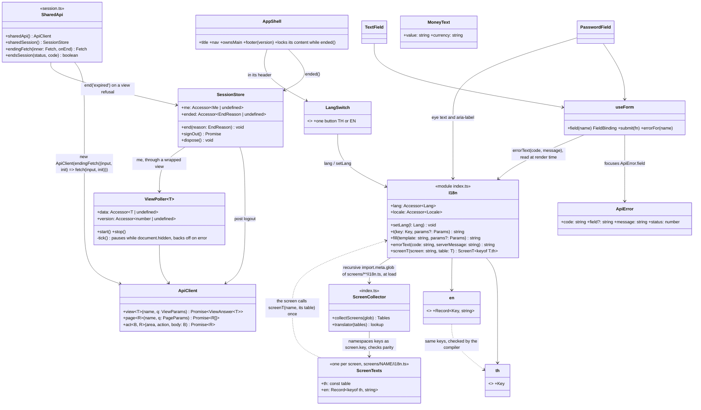
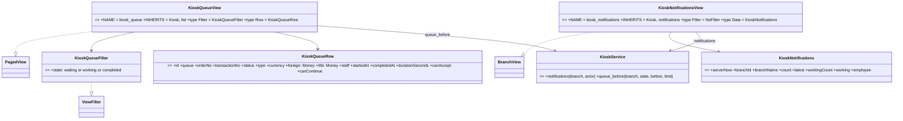
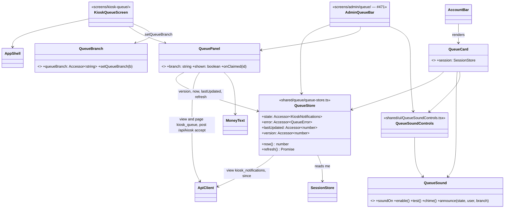
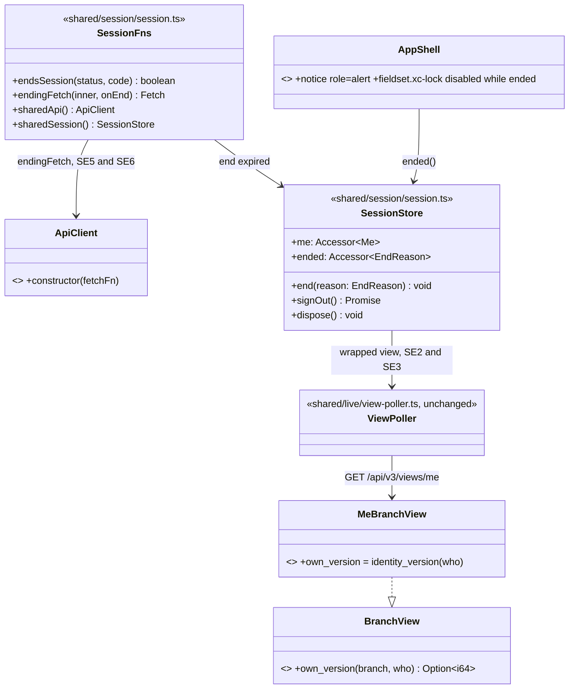
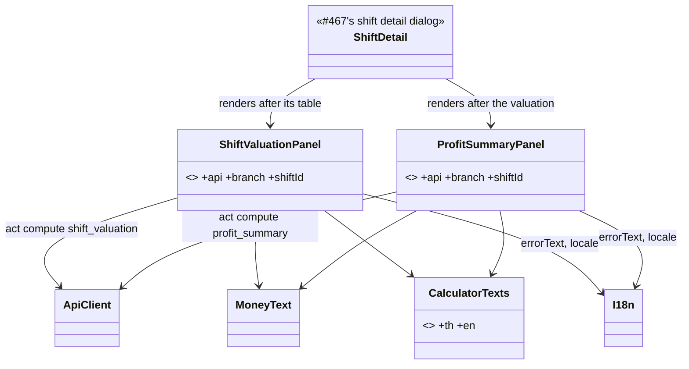

# XCHANGE v3 — its own TypeScript screens (Phase 2 of the TypeScript order)

> designed-by: claude/018b97 · 2026-10-08 · issue #384 · measured on `main` at `b2348fe`

`xchange-v3.md` says *"Rewriting the admin / desk / staff screens is not in either phase and is not designed here."*
On 2026-10-08 the owner ordered it: *"refactor to type script"* → *"ทั้งโปรเจ็ค เลย"* → *"วางแผน ก่อนทำ"*.
Phase 1 (#378, PR 382) converted the one script v3 already owned, the form helper, to TypeScript.
This document is Phase 2: v3 gets its own screens, written in TypeScript, in place of v2's built files.
It covers what the screens are built with, how they are served, the server seam they read through, the class
diagram, the order of the work, and the ticket split. It changes nothing in `xchange-v3.md`.

## 0. What this was measured from

| Source | State |
|---|---|
| `main` at `b2348fe` | Read: `api/src/presentation/pages.rs` (page table), `api/src/presentation/http/mod.rs` (route wiring), `api/src/application/compat/snapshot.rs`, `api/crates/xc-kernel/src/branch_tx.rs`, `api/crates/xc-auth/src/domain/policy/`, `api/migrations/` |
| The 10-06 v2 bundle (`XC-Desk-v2-Passport-Drawer-20261006.zip`, design §0) | Read: the `public/` file list and sizes; the admin menu from the embedded admin HTML in `server.mjs`; the API action names `staff.js` and `staff-report.js` call |
| The v2 screens' **source** | Did not exist anywhere we could reach when this was written. **It has been available since 2026-10-08** in `108-Plaza/xchange-v2-source` at commit `4d0bdbb` (`xchange-v3.md` §0). The staff app is `src/booking/app/staff/page.tsx`, the staff report `staff/report/page.tsx`, the admin and desk pages `src/online/lib/admin-html.ts` / `index-html.ts`, and the add-on screens `src/devices-public/*`. From then on, a screen ticket ports from that source (W9) |

## 1. Root cause this removes

v3 serves v2's built pages unchanged from `web.dir` (`pages.rs` `PAGE_SPECS`, design §5.3). A page whose source does
not exist cannot be fixed inside itself (the source arrived on 2026-10-08, after this was written; see §0). So every screen fix so far has been a script that patches the page from
outside:

| Script | What it patches | Row |
|---|---|---|
| `/_xc/forms.js` | broken `pattern`s, invalid-field marking, refusals pointed at fields, password reveal | FV, FV-TS |
| `/_xc/desk.js` | the kept desk's dead ends | DK-1 |
| `/_xc/staff-password.js` | the staff's own password change | SP-1 |

Each one is a wrapper around code we cannot read, and the byte-compare tests have to strip it again
(`pages_test.rs` `without_version_line`).

The second root cause is the contract the screens poll. `adminSnapshot` answers with the whole branch on every call
(`snapshot.rs:79`), so its size grows with history. The design kept it as debt *"until those screens are rewritten"*
(§5.3, *Known debt, kept on purpose*). This document is that rewrite.

## 2. Decisions

| # | Decision | Status |
|---|---|---|
| W1 | Screens are **SolidJS + Vite + TypeScript** (strict), built to static files. No Node runs on the server. | **decided** (owner 2026-10-08, "SolidJS + Vite") |
| W2 | Each rewritten screen reads through **per-screen endpoints that answer only what changed** (§4). `adminSnapshot` goes away once no screen calls it. | **decided** (owner 2026-10-08, "Per-screen endpoints") |
| W3 | The customer kiosk **stays Flutter** (D8, D9: web build plus Play Store `com.spacing.xchange`). It is not in this phase. | **decided** (owner 2026-10-08) |
| W4 | Order: **login and the small pages first** (the shared skeleton is proven on low-risk pages), then the admin menus, then the desk and the staff app, which carry money. | **decided** (owner 2026-10-08) |
| W5 | The screens are **compiled into the server binary**, as FV's script is, so the screens a server shows are always the ones built with it. | [required] §3.2 |
| W6 | Thai text is carried over from v2 **verbatim**: labels, refusals, sentences. A rewritten screen must not reword what staff already know. | [required] |
| W7 | A screen never does money arithmetic. New endpoints carry money as a **decimal string** (the fleet's wire rule). Totals, quotes and differences are computed by the server; the screen formats and shows them. | [required] |
| W8 | Roles do not change in the rewrite. A view gets the role row of the v2 action it replaces, **on the entry path the replaced screen used** (§4.4). | [required] |
| W9 | **A screen is ported from v2's source**, `xchange-v2-source@4d0bdbb`, not rebuilt from the minified bundle. Its ticket names the source file and the lines it ports. **The source is the behaviour contract.** The 10-06 bundle is only a fallback for anything the source lacks. The owner's decisions override both: brokers/referrals are not ported, because Broker-Platform owns them | [required] (lane controller 2026-10-08: *"Make the source @4d0bdbb the behaviour contract, with the 10-06 bundle only as a fallback for anything the source lacks, and owner decisions overriding both"*) |
| W10 | **Every v3 screen speaks Thai and English** (#427). (1) One shared module, `web/src/shared/i18n/`: `index.ts` holds a `lang: Accessor<'th' \| 'en'>` signal, `setLang(l)` and `t(key, params?)` with named `{name}` placeholders; `th.ts` is the source table, `as const`; `en.ts` is typed `Record<keyof typeof th, string>`, so a missing key is a **compile** error and there is no runtime fallback. Keys are dotted (`field.password.show`). **The shared tables hold only shared-component and refusal keys** (`field.*`, `form.*`, `shell.*`, `error.*`, and `queue.*` for the shared queue panel and card, §12.18.7). **Each screen folder owns its own table**, `web/src/screens/<path>/i18n.ts`, which exports `th` (`as const`) and `en: Record<keyof typeof th, string>`. Its keys are local. The core namespaces them by the folder path under `screens/`, with `/` turned into `.`: `screens/login/i18n.ts` → `login.<key>`, `screens/admin/payments/i18n.ts` → `admin.payments.<key>`. The core collects the tables with the **recursive** glob `import.meta.glob('/src/screens/**/i18n.ts', { eager: true })`, so it reaches the admin menus one folder deeper. Each folder owns its own file, like `menus.ts` (§3.3), but the glob is recursive, whereas §3.3 globs `./*/menu.ts` from inside `screens/admin/`. The core checks that each table's `th` and `en` have the same keys and placeholders, that every folder segment matches `[a-z][a-z0-9-]*`, that the first segment is not a shared prefix, and that no namespaced key comes from two tables (e.g. `admin`'s `payments.title` against `admin/payments`'s `title`). Any failure throws. **Adding a screen edits no shared i18n file**, so screen tickets do not queue behind one table. A screen reads its own keys through **`screenT(screen, table)`**, which the core exports: it calls `const t = screenT('login', loginI18n)` once in its folder (a nested folder passes its dotted namespace, `screenT('admin.payments', paymentsI18n)`) and gets `t(key: keyof typeof loginI18n.th, params?)`. An unknown key is a compile error. It resolves `login.<key>` through the same language signal, so it follows `setLang`. The shared `t` is for shared keys only. (2) **Thai is the default.** The choice is kept per browser in `localStorage` under `xc.lang`; every read and write is in `try`/`catch` and falls back to `th`. `document.documentElement.lang` follows the choice. Nothing is detected from `navigator`: v2's staff app was Thai-only, so Thai stays the default. (3) A small TH/EN switch, `LangSwitch.tsx` in the same folder, is rendered by `AppShell`, so every screen has it, login included. (4) A server refusal is shown as `t('error.' + code)` when that key exists, otherwise as the server's own message. The server stays Thai for now. The `th` table carries each existing `V3Error` code's Thai sentence byte for byte, `invalidRequest` and the 401 `signIn` sentence included, so a Thai screen shows what it showed before (W6). **`th` is Thai throughout:** the five refusals the server sends in English (`employeeAuthRequired`, `notFound` and the three kiosk ones) are translated in `th`, and `en` keeps their English. (5) `Intl` follows `lang` for dates (`th-TH` / `en-GB`). `MoneyText` keeps its digits and does no arithmetic (W7); only its labels go through `t()`. (6) The shared components already on `main` (`TextField`, `PasswordField` and its `aria-label`s, `form.ts`'s refusals, `AppShell`) move to `t()` now, while it is cheap. Their tests that assert a Thai literal the component owns may assert through the table instead (`th['field.password.show']`); that is the only edit allowed to those tests. (7) **Every V1/V2/V3 screen ticket** puts all user-visible text, `aria-label`s included, through `t()`, writes its keys in its own `i18n.ts`, and is blocked by #427. W6 still holds: a screen's `th` table is where v2's Thai lives, verbatim. | **decided** (owner 2026-10-08, *"รองรับ 2 ภาษา ไทย/eng"* and *"aria-label … อย่าลืมนะมันต้องmulti lang นะ"*; points 1–7 by the lane controller claude/7ca80c, 2026-10-08) |

## 3. The web side

### 3.1 Layout

A new top-level directory beside `api/` and `app/` (D3):

```
web/
  package.json            private; scripts: dev, typecheck, test, build, check
  package-lock.json
  tsconfig.json           strict, noUnused*, verbatimModuleSyntax, isolatedModules
  vite.config.ts          multi-page build: one HTML entry per screen (§3.3)
  vitest.config.ts
  pages/                  one HTML entry per screen: login.html, staff-guide.html, …
  src/
    shared/               the core every screen uses (§5)
    screens/<screen>/     one folder per screen; the only files a screen ticket owns
  dist/                   build output, git-ignored, compiled into the server
```

`npm` is the package manager, as in `api/web/forms/` (#378) and in `pos/orders` / `pos/store`, the fleet's other
SolidJS + Vite apps.

### 3.2 How the server serves it (W5)

- [required] `api/src/presentation/ui.rs` holds `UiAssets`, the files of `web/dist` compiled into the binary.
  [proposed] It uses the `rust-embed` crate (MIT/Apache-2.0; `cargo deny check` must stay green).
- [required] **A Rust-only build must not need Node.** `api/build.rs` creates an empty `web/dist` when there is
  none, so `cargo build`, `clippy` and `test` work in any worktree. A server built that way answers every v3
  screen with the plain 503 `ui not built`. `/health/ready` gains `ui: "built" | "missing"`, and
  `deploy/server/smoke.sh` refuses `missing`.
- [required] **A release build refuses an empty `dist`.** `build.rs` fails the build when `PROFILE=release` and
  Vite's manifest `web/dist/.vite/manifest.json` is absent. `deploy/server/build.md` gains `npm --prefix web ci && npm --prefix web run build`
  before `cargo build --release`.
- Headers: as FV's script (`Cache-Control: no-cache`, `X-Content-Type-Options: nosniff`). Vite's hashed asset files
  (`/ui/assets/*-<hash>.js`) get `Cache-Control: public, max-age=31536000, immutable`.
- [required] Assets live under `/ui/`, a prefix v2 does not use: its `public/` files and route table
  (`server.mjs:8152-8199` of the 10-06 bundle) have no `/ui`.
- The version line (`add_version_line`, #293) is **not** injected into v3 screens. They show
  `build` / `builtAt` / `channel` from `GET /health/ready` in their own footer (fleet versioning rule). Since the
  screens are compiled in, that is also the screens' own build.

### 3.3 Cutover, one path at a time — with no shared list to edit

A table of paths that every screen ticket edits would be one file in every ticket's scope. The queue locks a file for
one ticket at a time, so the "parallel" screen tickets would really run one after another (📐 rule: one file that
many tickets must touch means the diagram is not finished). So nothing in this phase is a list that tickets edit.

[required] **A screen declares its own path** in its HTML entry, `web/pages/<screen>.html`:

```html
<meta name="xc-path" content="/login">
<meta name="xc-gate" content="anyone">   <!-- anyone | signed-in | branch | front -->
```

- `vite.config.ts` takes every `pages/*.html` as an input by glob, so adding a screen edits no config.
- `api/build.rs` reads the built HTML entries in `web/dist`, and generates the screen table into `OUT_DIR`
  (`v3_screens.rs`). `ScreenTable` in `api/src/presentation/screens.rs` `include!`s it. The build fails on two entries
  with the same `xc-path`, on a missing `xc-gate`, and on a gate other than the four listed above.
- [required] **A v3 screen wins over v2's page for the same path.** `ScreenTable::configure` is registered **before**
  `pages::configure`, and `page_handler` skips a path that `ScreenTable` holds. So switching a path to v3 is
  *adding* the screen. `PAGE_SPECS` is not edited until V4 (§7), and the old and new screens are never served at the
  same time.
- A v3 screen keeps v2's **path** (`/login`, `/`, `/desk`, …), so links, bookmarks and the redirects that point at
  them keep working. It keeps the page-level gate of the path it replaces. [required] The four gates:

  | Gate | Answer before the screen is sent | Replaces |
  |---|---|---|
  | `anyone` | none | `who_signed_in: false` |
  | `signed-in` | 303 to `/login` when nobody is signed in | `who_signed_in: true`, `PageKind::Plain` |
  | `branch` | as `signed-in`, then the branch resolved **exactly** as `PageKind::Branch` does today (`pages.rs:235-270`, `extract_branch_query` `:314-332`): staff get their own branch (`MAIN` when they have none); the owner gets `?branch=`, `MAIN` when absent or empty; an unparsable query or an invalid name is 400 `Invalid branch` (`text/plain`) | `PageKind::Branch` |
  | `front` | as v2's desk variant: anyone but a FRONT employee is redirected (`pages.rs:175-180`), and the branch is the employee's own | `PageKind::DeskVariant` |

  V0-A moves the resolution out of `page_handler` into one function, `page_branch(req, &sessions) -> Result<String,
  HttpResponse>` in `pages.rs`. v2's pages and the `branch` gate both call it, so the two cannot drift. [required] A
  v3 screen gets **no** `window.XC_BRANCH` (`pages.rs:200`, `:289`). It reads its branch from the `me` view, which
  answers `Policy::branch(actor, named)`, and the screen passes its own `?branch=` as `named`. The gate keeps the
  page-load 400 v2 gave, and the view keeps the branch the API uses — two answers from the same rule.
- `/_xc/forms.js` and the other `/_xc/` scripts stay on the v2 pages that are still served. A v3 screen does not
  carry them: it has the components of §5.3 instead.
- The admin page `/` is one v2 file with nine menus (§6). It switches **once**, when every menu has its v3 view.
  Until then the v3 admin is reachable at `/ui/admin/` for review, behind the same sign-in, and each menu is merged as
  its own ticket.
- [required] **The admin menu list is generated too.** `web/src/screens/admin/menus.ts` (V2-shell) builds the list
  with `import.meta.glob('./*/menu.ts', { eager: true })`. Each menu folder exports
  `menu: { id, label, icon, order, Component, roles }`. `order` is the menu's position in v2's nav, and `label` and
  `icon` are v2's text and glyph verbatim (W6). Adding a menu is adding its folder. A vitest test in V2-shell
  refuses duplicate `id`s and duplicate `order`s. The full record, with `group`, `heading` and `dated`, the props a
  menu receives, and the served nav it follows are §12.3.

## 4. The server seam: per-screen views that answer only what changed (W2)

### 4.1 The version already exists

`branch_versions.version` rises by 1 with every committed write on a branch, whether or not the write changed
anything. So **an equal version means nothing changed**, and a higher one means something may have
(`branch_tx.rs:6-12`, #231). Nothing reads it today (#231 §2). The views are its reader.

### 4.2 The contract

| | Request | Answer |
|---|---|---|
| Read a view | `GET /api/v3/views/{view}?branch={id}&since={version}` | `200 {"version": n, "changed": false}` when `since` equals the branch's version. This is O(1): one indexed read of `branch_versions`, and the view is not loaded. Otherwise `200 {"version": n, "changed": true, "data": …}` |
| Read without a cursor | the same, with no `since` | always `changed: true` with `data` |
| Act | `POST /api/v3/{area}/{action}`, JSON body | `200 {"version": n, …result}` or a refusal (§4.3) |
| Compute (writes nothing) | `POST /api/v3/compute/{name}`, JSON body | `200` with the action's answer, no `version`, or a refusal (§4.3); §12.20 |

- [required] JSON is camelCase. Money and rates are **decimal strings** (`"1234.50"`), never JSON numbers (W7).
- [required] POST keeps v2's request rules (design §5.3): `Origin` must equal the request's own origin, and
  `X-Xchange-Request: 1` must be present. Both are checked by the existing extractor `presentation/extractors/origin.rs`.
  Sign-in is the existing cookies, `__Host-xc_owner` / `__Host-xc_staff` (design §6, D4).
- [required] A view's `data` is **bounded**: each view states its upper bound in its ticket, for example "the
  currencies of one branch" or "the open shift and its balances". A list that grows with history (transactions,
  customers, slips, events) is never one view's `data`. It is a **page**:
  `GET /api/v3/views/{view}?branch=&before={id}&limit=` with keyset paging, newest first, `limit` ≤ 100.
  A screen polls only its first page with `since`. Older pages are read only when someone scrolls to them.
- [required] **Every writer of a view's tables must go through `BranchTx`**, or the version does not move and the
  view never refreshes. Each view ticket lists the writers of the tables it reads and proves this with a test: one
  write per writer, then `since` must report `changed: true`. A writer outside `BranchTx` is the ticket's to fix first,
  not to work around. Measured at `b2348fe`, the candidates to check are the tables written by the public kiosk and
  device paths (`kiosk_requests`, `device_jobs`, `device_events`).

### 4.3 Refusals name their field

v2 answered one sentence for four fields (`xchange-v3.md` §5.3, FV root cause). Since the API is new, the root cause
can be fixed there:

```json
{ "error": { "code": "employeePasswordLength", "field": "password", "message": "รหัสผ่านต้องมี 12–128 ตัวอักษร" } }
```

- [required] `message` is v2's sentence, byte for byte, where one exists (W6). `code` is stable and camelCase.
  `field` is present only when exactly one field is wrong, and is the request body's key for it.
- The HTTP status is the one v2 used for that refusal.
- The screen's form (§5.3 `useForm`) focuses that field and marks it red. No `REFUSALS` table is needed in a v3 screen.

### 4.4 Who may read a view (W8)

[required] **One place decides**, as today, and the policy is not edited at all. A view declares **which v2 action it
replaces, on which entry path**:

```rust
const INHERITS: (EntryPath, &'static str) = (EntryPath::Rpc, "adminSnapshot");
```

`ViewEndpoint` asks `Policy::allow(actor, INHERITS.0, Action(INHERITS.1))` (`xc-auth` `domain/policy/entities/policy.rs`)
before anything else. The answer is therefore the one v2 gave the screen the view replaces, by construction. Each
view carries no role check of its own (♻️: auth lives in the core), and no ticket edits the role table. The admin
page's views inherit from `Rpc`, the staff app's from `StaffRpc`. The disagreement between the two that design §11
leaves open stays open, and nobody gains or loses access through the rewrite. When one v2 action served both
screens, they get two views, one per path.

`Policy::branch(actor, named)` decides the branch, as today: staff are put on their own branch whatever they name.

## 5. Class diagram

### 5.1 Server

```mermaid
classDiagram
  class BranchView {
    <<trait>>
    +NAME: &'static str
    +INHERITS: (EntryPath, &'static str)
    +VERSIONED: bool = true
    +own_version(&self, branch: &BranchId, who: &Actor) Future of Option i64, default None
    +type Data: Serialize + TS
    +type Filter: ViewFilter
    +load(&self, branch: &BranchId, who: &Actor, filter: &Filter) AppResult~Data~
  }
  class PagedView {
    <<trait>>
    +NAME: &'static str
    +INHERITS: (EntryPath, &'static str)
    +type Row: Serialize + TS
    +type Filter: ViewFilter
    +page(&self, branch: &BranchId, who: &Actor, filter: &Filter, before: Option~RowId~, limit: u16) AppResult~Vec~Row~~
  }
  class ViewFilter {
    <<trait: DeserializeOwned + TS + Default>>
    +check(&self) Result~(), V3Error~
  }
  class NoFilter { <<empty braced struct>> }
  class Period { +from: String +to: String +check() Result~(), V3Error~ }
  class TransactionRow { <<dto/v3/transaction_row.rs>> +id +date +created +type +currency +amount +rate +principal +settlement +status +slipUrl }
  class ViewEndpoint {
    +register~V: BranchView~(cfg, view: Arc~V~)
    +register_paged~V: PagedView~(cfg, view: Arc~V~)
    -answer(req, query: ViewQuery) HttpResponse
  }
  class ViewQuery { <<paging only — §12.1>> +branch: Option~String~ +since: Option~i64~ +before: Option~RowId~ +limit: Option~u16~ }
  class ViewAnswer~T~ { +version: i64 +changed: bool +data: Option~T~ }
  class BranchVersions { +current(&self, branch: &BranchId) AppResult~i64~ }
  class V3Error { +code: &'static str +field: Option~&'static str~ +message: String +status: StatusCode }
  class UiAssets { +get(path: &str) Option~EmbeddedFile~ +built() bool }
  class ScreenTable { +entries() [(path, gate, entry)] +holds(path) bool +configure(cfg, state) }
  class Policy { +allow(actor, EntryPath, Action) Result +branch(actor, named) BranchId }

  ViewEndpoint --> Policy : allow(INHERITS) / branch — unchanged
  ViewEndpoint --> BranchVersions : O(1) since check
  ViewEndpoint --> BranchView : load only when changed
  ViewEndpoint --> PagedView
  ViewEndpoint --> ViewAnswer
  ViewEndpoint --> V3Error
  ViewEndpoint --> ViewFilter : deserializes the non-paging keys, then check()
  BranchView --> ViewFilter : type Filter
  PagedView --> ViewFilter : type Filter
  NoFilter ..|> ViewFilter
  Period ..> V3Error : periodOrder
  ScreenTable --> UiAssets
  BranchVersions ..> BranchTx : reads the row BranchTx writes
```



| Class | File | Who provides | Who uses |
|---|---|---|---|
| `BranchView`, `PagedView` | `api/src/presentation/http/v3/view.rs` | V0-B; V0-C adds `type Filter`, the `filter` argument, `BranchView::VERSIONED` and `BranchView::own_version` (§12.1); V0-B-session-end passes `own_version` the branch and the caller (§12.19.4) | every view ticket |
| `MeBranchView` (the `me` view) and its `own_version`, the caller's identity version | `api/src/presentation/http/v3/views/me.rs` | V0-B; V0-B-session-end adds `own_version` (§12.19.4) | `SessionStore` |
| `ViewFilter` | `api/src/presentation/http/v3/view.rs` | V0-C | every view's filter type |
| `ViewEndpoint`, `ViewQuery`, `ViewAnswer<T>` | `api/src/presentation/http/v3/view.rs` | V0-B; V0-C parses the filter (§12.1) | every view ticket (one `register` call each) |
| `NoFilter`, `Period` | `api/src/presentation/dto/v3/common.rs` → `generated/common.ts` | V0-C | every view without a filter (`NoFilter`); the dated views (`Period`) |
| `TransactionRow` | `api/src/presentation/dto/v3/transaction_row.rs` → `web/src/shared/api/generated/transaction_row.ts` (its own file, so no other ticket shares it) | V2-parts (§12.2) | `admin_overview`, `admin_transactions`, `admin_slips`, `admin_customer_history`; `TransactionTable`, `TransactionDetail`, the CSV |
| a view's filter type, e.g. `AdminTransactionsFilter` | that view's `api/src/presentation/dto/v3/<view>.rs` → `generated/<view>.ts` | that view's ticket (§12.1 table) | its view and its menu |
| `BranchVersions` | `api/crates/xc-kernel/src/branch_versions.rs` | V0-B | `ViewEndpoint` |
| `V3Error` | `api/src/presentation/http/v3/error.rs` | V0-B | every v3 action |
| `configure_v3` | `api/src/presentation/http/v3/mod.rs` | V0-B | `include!`s `OUT_DIR/v3_views.rs`, which `api/build.rs` generates from the files in `http/v3/views/`: each file there is a module with `pub fn register(cfg, state)`. No ticket edits this file |
| a view, e.g. `RatesView` | `api/src/presentation/http/v3/views/<view>.rs` | its own ticket | — |
| its DTOs | `api/src/presentation/dto/v3/<view>.rs` | its own ticket | the generated TS (§5.2) |
| `UiAssets` | `api/src/presentation/ui.rs` | V0-A | `ScreenTable` |
| `ScreenTable` | `api/src/presentation/screens.rs` | V0-A | `include!`s `OUT_DIR/v3_screens.rs`, generated from `web/dist` (§3.3). No ticket edits this file |
| `KioskQueueView`, `KioskNotificationsView` and their DTOs | `http/v3/views/kiosk_queue.rs`, `kiosk_notifications.rs`; `dto/v3/kiosk_queue.rs`, `kiosk_notifications.rs` | V1-kiosk-queue-views (§12.18.2, diagram §12.18.10) | the queue store and the queue panel |
| `ComputeAction`, `ComputeEndpoint`, the generated `ACTIONS` table; a compute action and its DTOs | `api/src/presentation/http/v3/action.rs`; `http/v3/actions/<name>.rs`, `dto/v3/<name>.rs` | V0-D; each action its own ticket (§12.20, diagram §12.20.8) | the cash menu's calculators |

[required] **No file is edited by more than one screen or view ticket.** A view is one file in `http/v3/views/` and
one in `dto/v3/`. A screen is its folder and its HTML entry. Its generated types are one file per view in
`web/src/shared/api/generated/`. Registration and the policy are derived, not edited (§3.3, §4.4).

**Types shared with the web.** [required] DTOs derive `ts_rs::TS` (crate `ts-rs`, MIT). `cargo test` writes them to
`web/src/shared/api/generated/` (`export_to`), and they are committed. The web `check` script fails when the
committed files differ from what the Rust DTOs produce, the same drift gate as `xc-forms.js` (#378). A field renamed
in Rust therefore fails CI instead of failing silently in a screen.

ts-rs also exports every type a DTO depends on. So a type used by two views would land in both tickets' diffs, and
the queue would lock it twice. [required] The rules that prevent that:

- **Shared types are V0-B's alone**: `ViewAnswer<T>`, `V3Error`, `Page<T>`, ids, the decimal-string `Money` and
  `Rate`, and `Me`. They live in `api/src/presentation/dto/v3/common.rs` and are exported to `generated/common.ts`.
  A later change to them is its own ticket, never part of a screen's: V0-C adds `NoFilter` and `Period` (§12.1).
- **A row shape several views answer** lives in its own file, never in `common.rs`, so the ticket that owns it shares
  no file with the core: `TransactionRow` is `dto/v3/transaction_row.rs` → `generated/transaction_row.ts`, V2-parts'
  alone (§12.2).
- **A view's DTOs use only their own types, `common`'s and the shared row files above**, and export only to
  `generated/<view>.ts`. A V0-B test (`api/tests/v3_types_test.rs` `each_view_writes_only_its_own_file_and_common`)
  exports every view into an empty directory and fails when a view writes any file other than its own and
  `common.ts`; V2-parts adds `transaction_row.ts` to the files that test accepts (one name, nothing else loosened).
- **ts-rs is pinned with `=`** in `api/Cargo.toml` (V0-A adds it). V0-A pins a version where several types can share
  one `export_to` file (`common.ts`, and a view's several types in `<view>.ts`). V0-B's test above proves it on that
  version.

### 5.2 Web



| Module | File | Ticket |
|---|---|---|
| `ApiClient`, `ApiError` | `web/src/shared/api/client.ts` | V0-A |
| generated shared types | `web/src/shared/api/generated/common.ts` | V0-B; V0-C (#475) adds `NoFilter`, `Period` — no other ticket |
| the shared exchange row | `web/src/shared/api/generated/transaction_row.ts` | V2-parts (#476) only |
| generated DTO types of one view | `web/src/shared/api/generated/<view>.ts` | that view's ticket |
| `ViewPoller<T>` | `web/src/shared/live/view-poller.ts` | V0-A |
| `SessionStore` | `web/src/shared/session/session.ts` | V0-B (it reads the `me` view V0-B builds); V0-B-session-end adds `ended`, `end` and the switch check (§12.19.3) |
| `EndReason`, `endsSession`, `endingFetch`, `sharedApi` (the page's one observed `ApiClient`) | `web/src/shared/session/session.ts` | V0-B-session-end (§12.19.3) |
| `useForm` | `web/src/shared/ui/form.ts` | V0-A; V1-i18n (#427) shows refusals through `errorText` |
| `TextField` | `web/src/shared/ui/TextField.tsx` | V0-A |
| `PasswordField` | `web/src/shared/ui/PasswordField.tsx` | V0-A — the same component as #378: eye inside on the right, one border, never reads the value outside the form, conceals before submit; V1-i18n (#427) moves its eye's text and `aria-label` to `t()` |
| `MoneyText` | `web/src/shared/ui/MoneyText.tsx` | V0-A — formats a decimal string, no arithmetic (W7) |
| `AppShell` | `web/src/shared/ui/AppShell.tsx` | V0-A; V1-i18n (#427) adds `LangSwitch` to its header; #459 adds `ownsMain`; V0-B-session-end adds the ended-session notice and the content lock (§12.19.5) |
| `AuthLayout`, `VersionFooter`, `auth.css` (the frame for signed-out pages and its styles) | `web/src/shared/ui/AuthLayout.tsx`, `web/src/shared/ui/VersionFooter.tsx`, `web/src/shared/ui/auth.css` | V1-auth-layout (§12.21); `AppShell` renders `VersionFooter` from then on |
| `lang`, `setLang`, `locale`, `t` (shared keys only), `fill`, `errorText`, `collectScreens`, `translator`, `screenT` (a screen's typed `t` over its own table) | `web/src/shared/i18n/index.ts` | V1-i18n (#427) |
| the shared `th` table (`field.*`, `form.*`, `shell.*`, `error.*` only) and its `Key` type | `web/src/shared/i18n/th.ts` | V1-i18n (#427); a later shared component's ticket adds its keys, a screen ticket never does |
| the shared `en` table | `web/src/shared/i18n/en.ts` | as `th.ts` |
| a screen's `th` / `en` tables | `web/src/screens/<path>/i18n.ts`, namespace = `<path>` with `/` as `.` | the ticket that owns that folder. A V1 screen owns `screens/<screen>/i18n.ts`; **each V2-<menu> owns `screens/admin/<menu>/i18n.ts`**; V2-shell owns `screens/admin/i18n.ts`, for the admin shell's own texts only. Components call `screenT('<namespace>', table)` once in their folder, never the shared `t` for screen text |
| `LangSwitch` | `web/src/shared/i18n/LangSwitch.tsx` | V1-i18n (#427) |
| a screen | `web/src/screens/<screen>/**` + `web/pages/<screen>.html` | its own ticket |
| `QueueStore` and the queue branch; `QueuePanel`; the `queue.*` keys | `web/src/shared/queue/queue-store.ts`, `web/src/shared/queue/wire.ts`; `web/src/shared/ui/QueuePanel.tsx`; `web/src/shared/i18n/th.ts`, `en.ts` | V1-kiosk-queue-panel (§12.18.3, §12.18.4, §12.18.7, diagram §12.18.10) |
| `QueueCard`, `QueueSound`, `QueueSoundControls`; the card's render line in `AccountBar` | `web/src/shared/ui/QueueCard.tsx`, `web/src/shared/queue/queue-sound.ts`, `web/src/shared/ui/QueueSoundControls.tsx`; `web/src/shared/ui/AccountBar.tsx` | V1-queue-card (§12.18.6, §12.18.8) |

`Lang` is `'th' | 'en'`, `Locale` is `'th-TH' | 'en-GB'`, `Params` is `Record<string, string | number>`.

[required] `ViewPoller` keeps the **last version it saw** and sends it as `since`. It replaces its data only on
`changed: true`. Its interval is set per screen from how often that screen's data changes (🔁 rule), stated in the
screen's ticket. It stops while the tab is hidden. **The admin menus do not use it**: v2's admin never polls, so they
read on show, on a branch or period change and on `รีเฟรช` (§12.6).

**Admin page** (§12.2, §12.3):

```mermaid
classDiagram
  class AdminMenu {
    <<menus.ts>>
    +id: string
    +label: Accessor~string~
    +icon: string
    +order: number
    +group: AdminGroup
    +heading: eyebrow, title, subtitle
    +dated: boolean
    +roles: all or Role[]
    +Component(props: AdminMenuProps) JSX
  }
  class AdminMenuProps { <<menus.ts>> +branch: Accessor~string~ +period: Accessor~Period~ +shown: Accessor~boolean~ }
  class collectMenus { <<menus.ts>> +collectMenus(glob) AdminMenu[] }
  class AdminShell { <<AdminShell.tsx>> +groups, links, search, header, branch picker, period toolbar, heading, hash routing }
  class MenuFolder { <<screens/admin/ID/menu.ts + Component + i18n.ts>> }
  class StatCard { <<parts/StatCard.tsx>> }
  class DataTable { <<parts/DataTable.tsx>> }
  class TransactionTable { <<parts/TransactionTable.tsx>> +rows: TransactionRow[] +onOpen(id) }
  class TransactionDetail { <<parts/TransactionDetail.tsx>> +api +branch +row +onClose }
  class Csv { <<parts/csv.ts>> +csvCell(v) +walkPages(api, view, q) +downloadCsv(name, headers, rows) }
  class PendingWrite { <<parts/pending-write.ts>> +run(action, payload, onSaved) +busy: Accessor~boolean~ }
  class Refresh { <<parts/refresh.ts>> +refreshTick: Accessor~number~ +requestRefresh() }
  class DialogToast { <<parts/Dialog.tsx, parts/toast.ts>> +Dialog +toast(text) +Toast }
  class Hash { <<parts/hash.ts>> +hashParams() +openMenu(id, params) }
  class NewTransactionButton { <<parts/NewTransactionButton.tsx>> +api +branch }

  AdminShell --> collectMenus : menus
  AdminShell --> AdminMenu : renders Component(props)
  AdminShell --> PendingWrite : add branch, picker lock
  AdminShell --> Refresh : รีเฟรช
  AdminShell --> DialogToast
  MenuFolder ..|> AdminMenu : exports menu
  MenuFolder --> AdminMenuProps
  MenuFolder --> StatCard
  MenuFolder --> DataTable
  MenuFolder --> TransactionTable
  MenuFolder --> TransactionDetail
  MenuFolder --> Csv
  MenuFolder --> PendingWrite
  MenuFolder --> Refresh
  MenuFolder --> NewTransactionButton
  TransactionDetail --> ApiClient : view transaction_documents
  PendingWrite --> ApiClient : post /api/rpc, view admin_request_status
  NewTransactionButton --> ApiClient : view admin_shift_state
  Csv --> ApiClient : page, with the filter
```



| Module | File | Ticket | Used by |
|---|---|---|---|
| `AdminMenu`, `AdminMenuProps`, `AdminGroup`, `collectMenus`, `menus` | `web/src/screens/admin/menus.ts` | V2-shell (#460) | every V2-&lt;menu&gt; |
| `AdminShell` | `web/src/screens/admin/AdminShell.tsx` | V2-shell | `main.tsx` |
| the shell's texts | `web/src/screens/admin/i18n.ts` (`admin.*`) | V2-shell | the shell |
| `admin_branches` view, DTO, generated TS | `http/v3/views/admin_branches.rs`, `dto/v3/admin_branches.rs`, `generated/admin_branches.ts` | V2-shell | the branch picker |
| `StatCard`, `DataTable`, `TransactionTable`, `TransactionDetail`, `typeName`/`methodName`/`statusName`, `csvCell`/`walkPages`/`downloadCsv`, `pendingWrite`, `refreshTick`/`requestRefresh`, `Dialog`/`toast`/`Toast`, `hashParams`/`openMenu`, `NewTransactionButton` | `web/src/screens/admin/parts/` (one file each, §12.2) | V2-parts | the shell and the menus |
| the parts' texts | `web/src/screens/admin/parts/i18n.ts` (`admin.parts.*`) | V2-parts | the parts |
| `transaction_documents`, `admin_request_status`, `admin_shift_state` views, DTOs, generated TS | `http/v3/views/<view>.rs`, `dto/v3/<view>.rs`, `generated/<view>.ts` | V2-parts | `TransactionDetail`, `pendingWrite`, `NewTransactionButton` |
| a menu | `web/src/screens/admin/<id>/**` (`menu.ts`, its `Component`, `i18n.ts` as `admin.<id>.*`) + its views | that V2-&lt;menu&gt; | `menus.ts`'s glob |

## 6. The screens

Measured at `b2348fe` (`pages.rs` `PAGE_SPECS`) and in the 10-06 bundle. "Wave" is W4's order. "Who" is a pointer, not a spec: each screen's ticket measures its roles per W8. "by role" means the `adminSnapshot` row of the path the screen uses.

| Wave | Path | v2 file | Who | What it calls in v2 |
|---|---|---|---|---|
| 1 | `/login` | `login.html` (2,936 B) | anyone | `/api/auth` |
| 1 | `/staff-guide`, `/staff-guide.html` | `staff-guide.html` (4,980 B) | signed in | none (static text) |
| 1 | `/receipt-sample` | embedded | signed in | none |
| 1 | `/kiosk-currencies.html` | `kiosk-currencies.html` (4,302 B) | OWNER, RATES (§5.3 `/api/kiosk` row) | `/api/kiosk` `manage`, `configure` |
| 1 | `/kiosk-queue.html` | `kiosk-queue.html` (3,661 B) + `queue-panel.js` (10-06) | signed in | `/api/kiosk` `list`, `accept`, … (§5.5.3). v3 answers them since Q1 (PR 373, merged 2026-10-07) and K-HTTP (#329, closed 2026-10-08); the v3 screen reads the views `kiosk_queue` and `kiosk_notifications` and keeps `accept` (§12.18) |
| 1 | `/devices` | `devices.html` + `devices.js` | signed in | `/api/devices`, `/api/device-setup` |
| 2 | `/` menu ภาพรวมหน้าร้าน (`overview`) | `admin.html` (embedded) | owner, staff by role | `adminSnapshot` |
| 2 | `/` menu พนักงาน / ขั้นตอนกะ (`employees`) | `employees.js`, `employee-summary*.js` | per `EntryPath::OwnerRoute` (`policy.rs:30`) | `/api/employees` |
| 2 | `/` menu การจองออนไลน์ (`bookings`) | `bookings.js` (`registrations.js` is a customers tab, §12.10) | per #377 | `/api/bookings` — **waits for #377** (bookings port, D5 answered "พอร์ตมา v3") |
| 2 | `/` menu รายการแลกเงิน (`transactions`) | embedded | by role | `adminSnapshot` (transactions) — a paged view |
| 2 | `/` menu สลิป (`slips`) | `slips.js` | by role | files — a paged view |
| 2 | `/` menu ลูกค้า (`customers`) | `customers.js`, `customer-core.js`, `registrations.js` (tab, §12.10) | by role | `adminSnapshot` (customers) — a paged view |
| 2 | `/` menu เงินสดและเปิด–ปิดกะ (`cash`) | embedded, `shift-valuation*.js`, `profit-summary*.js` (§12.9) | owner; BACKEND, MANAGER (open/close), FINANCE (move stock) on `Rpc` (design §6) | `adminOpenShift`, `adminCloseShift`, `adminMoveStock` |
| 2 | `/` menu อัตราแลกเปลี่ยน (`rates`) | embedded, `rates-reference.js`, `kbank-reference.js` | owner; RATES (`policy.rs:81`, `:114`) | `adminSaveRate`, `/api/reference-rates` |
| 2 | `/` menu สรุปยอด (`reports`) | embedded, `employee-summary*.js` | by role | `adminSnapshot` |
| 2 | `/` 10-06 add-ons: payments, queue | `admin-payments.js`, `admin-queue.js`, `admin-workspace.*` | §5.5.2, §5.5.3 | `/api/payment-methods` (**waits for PR 372**), `/api/kiosk` |
| 3 | `/desk` | `desk.html` (embedded) + `desk-*.js` | signed in | `adminDeskConfig`, `reserveCustomer`, `saveTransaction`, `getConnectionStatus`, uploads |
| 3 | `/staff/desk` | the desk variant | FRONT | as `/desk`, plus `opsBeginTransaction` (`pages.rs` `STAFF_DESK_SCRIPT`) |
| 3 | `/staff` | `staff.html` + `staff.js` (React, 224,719 B) | staff | `adminSnapshot`, `adminSaveRate`, `opsPropose`, `opsClock`, `opsStartService`, `opsCutoff`, `opsTarget`, `opsSign`, `opsDispatch`, `opsCommit`, `opsReject`, `opsReconcile`, `opsHold`, `opsRelease` |
| 3 | `/staff/report` | `staff-report.js` (React, 202,423 B) | staff | `adminSnapshot` |
| 3 | `/documents`, `/staff/documents` | not a v2 file: HTML that v3 writes itself (`http/documents.rs:40-45`, `owners_page` `:134`) | owner; staff per the `StaffRpc` `documents` row (all but RATES and SYSTEM, design §6) | the documents lookup — the HTML moves into a screen, the lookup becomes a view |
| — | `/kiosk` | Flutter (`app/`) | public | **not in this phase (W3)** |

Wave 3 handles money and custody. Its behaviour tables are the heaviest and come from `xchange-v3.md` §3 (amount,
principal, BUY/SELL, stock guard, rate guard, custody gate). Each of those rows is already a server test. The screen
ticket's tests prove that the screen sends what the server expects and shows what it answers.

## 7. Retiring v2's files (V4)

Once every path in §6 is `ScreenSource::V3`:

- `PAGE_SPECS`, `add_scripts`, `add_version_line`'s page injection, `STAFF_DESK_SCRIPT`, and the `/_xc/` scripts
  (`xc-forms.js`, `xc-desk.js`, `xc-staff-password.js`) with their JS tests are deleted.
- `web.dir` remains only for what the Flutter kiosk serves from it, if anything. V4 measures that first.
- The compat RPC actions that no screen calls any more (`adminSnapshot` first) are deleted, with the
  `application/compat/` code that only they used. V4 lists them by grepping `web/src` for each action name.
- `api/tools/extract-v2-pages.mjs` and the deploy step that runs it are deleted, if V4 finds no remaining reader.

## 8. Ticket split

The xchange lane controller (claude/7ca80c) cuts these after this document merges. One ticket per row. V0-A comes
first and V0-B second, because both need the crate list and V0-B writes into `web/`. After that, the rows of a wave
run in parallel: each owns only its own files (§5.1).

| Ticket | What | Owns | Blocked by |
|---|---|---|---|
| **V0-A** web skeleton | `web/` with Vite multi-page, strict TS, vitest, `ApiClient`, `ViewPoller`, `useForm`, `TextField`, `PasswordField`, `MoneyText`, `AppShell`; `UiAssets`, `ScreenTable` and its `build.rs` generation (no screen yet, so no path switched), `build.rs` empty-`dist` rule, `page_handler` skipping a path `ScreenTable` holds, `/health/ready` `ui`; CI job `web` (typecheck, test, build) and the `api` job builds `web` before the release check; `deploy/server/build.md` | `web/` (new, whole subtree), `api/src/presentation/ui.rs`, `api/src/presentation/screens.rs`, `api/src/presentation/mod.rs`, `api/src/presentation/pages.rs`, `api/build.rs`, `api/build_support/screens.rs` (new), `api/src/presentation/http/health.rs`, `.github/workflows/web.yml` (new), `.github/workflows/api.yml`, `api/Cargo.toml` and `api/Cargo.lock` (adds **both** `rust-embed` and `ts-rs`, so V0-B touches neither), `deploy/server/build.md`, `deploy/server/smoke.sh` | this doc. It also shares `pages.rs` with PR 360 (DK-1) and `api.yml` with PR 382 (#378) — if either is still open, V0-A waits for it |
| **V0-B** view core | `BranchView`, `PagedView`, `ViewEndpoint`, `ViewAnswer`, `ViewQuery`, `V3Error`, `BranchVersions`, `configure_v3` and its `build.rs` generation, the `ts-rs` export and its drift check, and one view as the worked example: `GET /api/v3/views/me` (who is signed in, role, branch), with `SessionStore` on the web side | `api/src/presentation/http/v3/` (new), `api/src/presentation/dto/v3/` (new), `api/src/presentation/http/mod.rs`, `api/crates/xc-kernel/src/branch_versions.rs`, `api/crates/xc-kernel/src/lib.rs`, `api/build.rs` (adds the views generation after V0-A's), `api/build_support/views.rs` (new), `web/src/shared/api/generated/common.ts`, `web/src/shared/api/generated/me.ts`, `web/src/shared/session/session.ts` (inside V0-A's `web/`, so V0-B waits for it) | V0-A |
| **V1-i18n** (#427) | the shared th/en module, the TH/EN switch in `AppShell`, and the retrofit of `TextField`, `PasswordField`, `form.ts` and `AppShell` (W10) | `web/src/shared/i18n/` (new, whole subtree), `web/src/shared/ui/AppShell.tsx`, `TextField.tsx`, `PasswordField.tsx`, `form.ts`, and the four existing tests that assert a Thai literal the component owns | this doc's W10, and V0-B (#393, PR 418) for the `serverError` code it carries |
| V1-login … V1-devices | one per Wave 1 row of §6 | `web/src/screens/<screen>/`, `web/pages/<screen>.html`, its files `http/v3/views/<view>.rs`, `dto/v3/<view>.rs`, `web/src/shared/api/generated/<view>.ts`, its text table `web/src/screens/<screen>/i18n.ts` (namespace `<screen>.*`, W10 point 1), and its tests | V0-A, V0-B, V1-i18n (#427). V1-kiosk-queue is the three tickets below |
| V1-kiosk-queue-views (#485) | the views `kiosk_queue` (paged, filter `state`) and `kiosk_notifications` (§12.18.2) | the files of §12.18.10's server rows | V0-C (#475) |
| V1-kiosk-queue-panel (#486) | the queue store, `QueuePanel`, the page `/kiosk-queue.html`, every `queue.*` key (§12.18.3–§12.18.5, §12.18.7) | the files of §12.18.10's panel rows | V0-C (#475); merges after V1-kiosk-queue-views (§12.18.11) |
| V1-queue-card (#487) | the account bar's queue card, its sound and its session lock (§12.18.6, §12.18.8) | the files of §12.18.10's card rows | V1-kiosk-queue-panel (#486) |
| **V0-C** (#475) filtered views (§12.1) | `ViewFilter`, `type Filter` and the `filter` argument on `BranchView` / `PagedView`, `NoFilter`, `Period`, `BranchView::VERSIONED`, `BranchView::own_version`, the filter parsing in `ViewEndpoint`, `ApiClient`'s `filter` param; `type Filter = NoFilter` on every existing view | `api/src/presentation/http/v3/view.rs`, `api/src/presentation/dto/v3/common.rs`, `web/src/shared/api/generated/common.ts`, every view file on `main` and the test views that implement the traits (§12.1), `web/src/shared/api/client.ts`, its new tests | this doc's §12 |
| **V0-B-session-end** (#492, §12.19) | `SessionStore.ended` / `end`, the end on a view refusal (`endingFetch`, `sharedApi`), the switch check, the `me` view's own version and the caller-aware `own_version`, AppShell's notice and content lock, the two `shell.session.*` keys | the files of §12.19.8 | this section's design PR. Shares `th.ts` / `en.ts` with V1-kiosk-queue-panel (#486), added keys only on both sides (§12.19.8) |
| V2-shell (#460) | the v3 admin page at `/ui/admin/`: entry `web/pages/admin.html`, `web/src/screens/admin/menus.ts` and its test, the admin layout, the `admin_branches` view (§12.3, §12.4) | `web/pages/admin.html`, the root files of `web/src/screens/admin/` (`menus.ts`, `menus.test.ts`, `AdminShell.tsx`, `main.tsx`, `admin.css`, `i18n.ts` — the shell's own texts only, namespace `admin.*`; a menu's text never goes here, W10), `admin_branches`' view, DTO, generated TS and test | V0-C (the view's trait shape); merges after V1-login and V2-parts |
| **V2-parts** (#476, §12.2) | the admin parts several menus share, `TransactionRow`, and the views `transaction_documents`, `admin_request_status`, `admin_shift_state` | `web/src/screens/admin/parts/` (whole subtree), `api/src/presentation/dto/v3/transaction_row.rs` and `web/src/shared/api/generated/transaction_row.ts` (`TransactionRow`), the three views' files, `api/src/application/compat/abandon_request.rs` (`is_applied` visibility), `api/tests/v3_types_test.rs` (one allowed file name) | V0-C |
| V2-<menu> | one per admin menu of §6 | `web/src/screens/admin/<menu>/**`, including its own text table `web/src/screens/admin/<menu>/i18n.ts` (namespace `admin.<menu>.*`, W10), and its view files, as above | V2-shell; V2-parts for a menu that uses a part; V0-C for a menu with a filtered view. V2-bookings waits for #413; V2-cash's calculators are their own tickets (§12.20.9) |
| **V0-D** compute seam, V2-cash-valuation, V2-cash-profit, V2-cash-calculators (§12.20) | a `POST` that computes and writes nothing; the shift valuation and the profit summary on it; the two panels of the shift detail | the files of §12.20.9 | this doc's §12.20; V2-cash-calculators also #467 and the two action tickets |
| V2-switch (#472) | moves the admin entry's `xc-path` from `/ui/admin/` to `/` once every served admin feature exists; `/ui/admin/` then answers 308 to `/` (§12.13) | `web/pages/admin.html`, `api/src/presentation/screens.rs` (the redirect only), its test | every V2-<menu>, V2-parts and the queue bar (#471) |
| V3-desk, V3-staff-desk, V3-staff, V3-staff-report, V3-staff-documents | Wave 3 | as above | V2-switch |
| V4 | retire v2's files (§7) | `api/src/presentation/pages.rs`, `api/static/`, `api/tests/js/`, `api/tests/pages_*`, `api/src/application/compat/`, `api/tools/`, `deploy/server/` | every V3 |

[required] Before any screen ticket goes `ready`, its author writes:

- the **behaviour table** for that screen: what v2 shows and allows, measured on the local v2 copy (`.dev/v2`) for
  every role the screen admits;
- the **failing tests** on the ticket's branch: the view's Rust tests, and the screen's vitest tests against a fake
  `ApiClient`.

Per the fleet rule 🧪, this document fixes only the classes and the files.

## 9. Tests written before implementation

**V0-A**, on its branch before the code:

- `web/src/shared/live/view-poller.test.ts`:
  - The second request carries the first answer's `version` as `since`.
  - `changed: false` keeps the old data object, by identity.
  - No request is made while `document.hidden`.
  - Each error doubles the interval, up to a cap.
- `web/src/shared/ui/PasswordField.test.tsx`: the eye is inside the wrapper; the type flips; the field is concealed
  on submit; the value is never read through `.value` (a getter that throws).
- `web/src/shared/ui/form.test.ts`: an `ApiError` with `field` focuses and marks that field; one without `field` shows
  the message at the form level.
- `api/tests/ui_assets_test.rs`:
  - With an empty `dist`, every `V3` path answers 503 `ui not built`, and `/health/ready` reports `ui: "missing"`.
  - A hashed asset is served immutable, and a screen's HTML entry is served `no-cache`.
  - A path in neither `ScreenTable` nor `PAGE_SPECS` is the plain 404.
  - The `branch` gate gives the same status and body as v2's `PageKind::Branch` page for each of: staff with a
    branch, staff without one, the owner with `?branch=X`, `?branch=`, no query, an unparsable query, and an invalid
    name. The test sends each request to a v2 page and to a v3 fixture, and compares the answers.
  - A test screen fixture declaring `xc-path="/staff-guide"` is served instead of v2's page at that path. `page_handler`
    does not answer it, and the gate `signed-in` redirects a caller who is not signed in, as v2's page did.
  - The generator refuses two entries with the same `xc-path`, a missing `xc-gate` and an unknown gate. Each is a
    unit test of the pure function `build.rs` calls (`api/build_support/screens.rs`).

**V0-B**:

- `api/tests/v3_view_test.rs`:
  - With `since` equal to the current version, the answer is `changed: false`, and the view's `load` is **not
    called** (a counting fake).
  - After one write through `BranchTx`, the same `since` gives `changed: true` with data.
  - With no `since`, the answer always has data.
  - A staff caller naming another branch is answered for their own branch.
  - A role outside the view's row gets the policy's refusal.
- `api/tests/v3_error_test.rs`: a refusal with a field serialises as `{error:{code, field, message}}`, with the status
  beside it.
- The `ts-rs` drift check fails when a DTO field is renamed and the generated file is not.
- A view file dropped into `http/v3/views/` is served with no other edit. The generator's pure function
  (`api/build_support/views.rs`) lists it, and refuses a file without `pub fn register`.
- A view whose `INHERITS` is `(Rpc, "adminSaveRate")` refuses exactly the callers that `Policy::allow` refuses for that
  pair. The test compares the two answers for every caller kind.

## 10. Data migration

V0-A and V0-B add **no** table, column or constraint: the views read `branch_versions`, which exists
(`20261006120000_branch_versions.sql`).

[required] Any view ticket that later needs a schema change must carry its own data-migration section, with the
fleet's four items. That includes the case §4.2 points at: a writer of the view's tables that does not go through
`BranchTx` today, if the fix needs a column. v3 starts on an empty database (D6), and v3 migrations are approved
until the first install (owner 2026-10-06). That does not remove the four items.

## 11. Open items

| Item | Blocks | Who |
|---|---|---|
| Bookings are not ported yet (D5: "พอร์ตมา v3"). #377 also asks who creates bookings and whether v2's bookings data moves | V2-bookings | owner, then the lane controller |
| The shift valuation and profit calculators (§12.15 item 3) | V2-cash (those panels only) | **designed in §12.20** (V0-D and three tickets) |
| Payment settings route | V2-payments | PR 372 |
| `Rpc` vs `StaffRpc` disagreement (design §11) | nothing: W8 keeps each screen on its own path's row | owner, when wanted |
| `SessionStore` cannot end a session without signing out, nor see an account switch through the branch cursor (§12.18.9) | the page-wide form lock and the switch warning | **designed in §12.19** (V0-B-session-end) |
| The `me` poll interval: 60 s, pinned by `web/src/shared/session/session.test.ts:90-112`; v2 checked every 5 s (`account-bar.js:46`). After §12.19 a switch is seen within 60 s on a visible tab, and at once when a hidden tab is shown again (§12.19.6) | the 5 s switch warning (a known difference until decided) | lane controller |

Answered since this table was written: v3 sends `canAccept` (K-HTTP #329, Q1 PR 373), and the queue panel's file and owner are §12.18.

## 12. V2 admin decisions (2026-10-08)

> decided-by: claude/7ca80c (xchange lane controller) · 2026-10-08 · answers the open items of the V2 tickets #460–#472 ·
> measured on `main` at `89c511a` and in `xchange-v2-source@4d0bdbb`

The thirteen V2 tickets (#460 V2-shell, #461–#470 one per menu, #471 the queue bar, #472 V2-switch) were cut with open
items: O1–O7 on V2-shell, which every menu inherits, and items of their own (`O-ov1`, `O-em1`, `O-bk1`…`O-bk3`, `O-tx1`,
`O-sl1`, `O-sl2`, `O-cu1`, `O-cu2`, `O-ca1`, `O-ca2`, `O-ra1`, `O-ra2`, `O-re1`, `O-qu1`, `O-qu2`, and #472's two). This
section records the answers and the files they give. Two answers add tickets: **V0-C** (#475, filtered views, §12.1)
and **V2-parts** (#476, the admin parts several menus share, §12.2). §12.15 lists what was left to the controller; §12.16, §12.17 and §12.20 record its answers; §12.18 designs V1-kiosk-queue, which answers §12.12.

Line references into the v2 source: `admin-html:N` is line N of the decoded admin page (the one-line JSON string
`src/online/lib/admin-html.ts`, decoded by the command in #460 §2, 175 lines); `admin-workspace.js`, `admin-queue.js`,
`admin-devices.js`, `admin-payments.js`, `account-bar.js`, `shift-valuation*.js`, `profit-summary*.js` and
`employee-summary*.js` are in `src/devices-public/`; `slips.js`, `customers.js`, `customer-core.js`, `bookings.js`,
`employees.js`, `registrations.js` and `rates-reference.js` are in `src/online/public/`. **The served page is the
contract** (W9): the admin page plus `ADMIN_SCRIPTS` (`src/server.mjs:130`) plus the scripts `admin-html:175` loads.

### 12.1 Filtered views — a core change of its own, V0-C (O1)

**Root cause.** v2 filters in the browser over the whole snapshot: by period (`admin-html:57`), by text, type and status
(`admin-html:58`, `slips.js:4`, `customer-core.js:6`, `customers.js:17`, `bookings.js:7`), by employee
(`employee-summary.js:8`). A paged view holds one page, so the same filter in the browser would filter only what was
read. The server has to filter, and the core cannot carry a filter today: the parsed query holds only paging
(`api/src/presentation/http/v3/view.rs:49-55` `ViewQuery`, `:83-88` `ParsedQuery`, `:90-173` `parse_query`), and
`BranchView::load` / `PagedView::page` take no filter (`view.rs:25-47`). A change to the core's shared types is its own
ticket (§5.1), so this is **V0-C** (#475), not part of any menu.

[required] **The contract** (class diagram §5.1):

- `ViewQuery` and the parsed query keep **paging only**: `branch`, `since`, `before`, `limit`. These four keys are
  reserved; no filter may use them.
- One shared core, one filter type per view (♻️ rule). A new trait in `view.rs`:
  ```rust
  pub trait ViewFilter: serde::de::DeserializeOwned + ts_rs::TS + Default + Send + Sync + 'static {
      /// Refuses a filter whose fields parse but do not fit together (e.g. from > to).
      fn check(&self) -> Result<(), V3Error> { Ok(()) }
  }
  ```
  `BranchView` and `PagedView` each gain `type Filter: ViewFilter;`, and the filter is passed in:
  `load(&self, branch, who, filter: &Self::Filter)` and `page(&self, branch, who, filter: &Self::Filter, before, limit)`.
- **`NoFilter`** is the filter of every view that has none: `#[derive(Deserialize, TS, Default)] pub struct NoFilter {}`
  (a braced empty struct, so it deserializes from any query map; a unit struct does not), `impl ViewFilter for NoFilter {}`.
  Stable Rust has no defaults for associated types (feature `associated_type_defaults` is unstable), so "default
  `NoFilter`" means **every view without a filter writes `type Filter = NoFilter;`** and takes the extra argument.
  V0-C adds that line to every view and every test view on `main` when it rebases: at `89c511a` these are
  `views/me.rs:22` (`:29` on later `main`), `views/devices.rs:41`, `views/device_events.rs:41`, `views/device_jobs.rs:40`,
  `views/device_transactions.rs:38`, the four test views of `api/tests/v3_view_test.rs:242-334` and the two of
  `api/tests/v3_view_no_session_test.rs:32-60`, plus `views/kiosk_currencies.rs` if #399 merges first.
- **Parsing.** The endpoint takes the query pairs (first occurrence of a key counts, as `view.rs:110-113` does today),
  removes the four paging keys, and deserializes the rest into `V::Filter`. An unknown key is ignored, as today. A
  value that does not parse is `400 {"error": {"code": "invalidRequest", "field": "<key>", "message": "คำขอไม่ถูกต้อง"}}`
  (§4.3; the sentence is `view.rs:105`'s). Then `filter.check()`. Both run **before** the `since` shortcut, so a bad
  filter is refused even when nothing changed. Order: sign-in and policy (`INHERITS`, unchanged) → `parse_query` (paging, ill-formed branch) → `Policy::branch` → `require_branch` → `parse_filter` (+ `check`) → version (`own_version` / `BranchVersions::current`) → `since` shortcut → `load` / `page`.
- **`Period`** is the one shared period type (♻️): `{ from: String, to: String }`, ISO `YYYY-MM-DD` calendar days in
  Asia/Bangkok, both **inclusive**, `''` or absent = open on that side — v2's rule
  `(!from||t.date>=from)&&(!to||t.date<=to)` (`admin-html:57`). `Period::check` refuses a malformed date with the field
  named, and `from > to` with `400 {"code": "periodOrder", "field": "to", "message": "วันที่เริ่มต้นต้องไม่เกินวันที่สิ้นสุด"}`
  (the sentence is `admin-html:57`'s; the code name is [proposed]). A filter embeds it with `#[serde(flatten)]`
  [proposed]; if flatten does not deserialize from the query on the pinned serde, the filter carries `from` / `to`
  itself and calls `Period::check`. The wire keys `from`, `to` are [required].
- **Filtering happens in SQL** [required]. The view passes its filter to the query that reads the rows; it never loads
  a wider set and filters it in Rust, and the screen never filters a view's answer (except the bounded name filter of
  §12.14 row *employee summary*, which is v2's and touches no money). Text search `q` is a literal substring, case
  folded with `lower()`, with `%`, `_` and `\` escaped (v2 uses `includes`); NFKC normalisation (`normalize(…, NFKC)` on
  both sides) only where v2 normalises (`slips.js:4`, `customer-core.js:6`). `q` longer than 100 characters is
  `400 invalidRequest` with `field: "q"` (the v2 inputs carry `maxlength="100"`, `admin-html:19`).
- **The cursor does not depend on the filter.** `since` compares the branch's version (§4.1), which every committed
  write moves whatever it touched, so `changed: false` stays true for any filter. [required] A screen sends `since` only
  with the filter its version was read with; when the filter changes, it reads without `since`.
- **Views that a branch version cannot describe** (§12.4, §12.7): `BranchView` gains `const VERSIONED: bool = true;`
  (associated constants may have defaults on stable). With `false` the endpoint ignores `since` and always answers
  `changed: true` with data; `version` is still the branch's. `PagedView` does not need it now.
- **A view with a version of its own** (§12.16): `BranchView` also gains
  `fn own_version(&self) -> impl Future<Output = AppResult<Option<i64>>> + Send` with a default body answering
  `Ok(None)` (return-position `impl Trait` in traits may have a default body on stable). When it answers `Some(v)`, the
  endpoint uses `v` instead of `branch_versions` for the `version` field and the `since` shortcut; `VERSIONED` must be
  `true` for it to be asked. It exists for data that is not a branch's rows — today only the BOT reference.
  **Amended by §12.19.4:** the method becomes `own_version(&self, branch: &BranchId, who: &Actor)`, so a version can
  depend on the caller, and the `me` view is its second user (its version is the caller's identity).
- **Web.** `ApiClient.view` / `ApiClient.page` (`web/src/shared/api/client.ts:71`, `:99`) take `filter?: F` in their
  params, `F` being the view's generated filter type; each value that is neither `undefined` nor `''` is sent as
  `key=value`. A view's filter type is exported to that view's own `generated/<view>.ts` (§5.1's rule, unchanged);
  `NoFilter` and `Period` go to `generated/common.ts`.

**The filters, per view.** Each row's ticket writes its filter type in its own DTO file. Fields are [required] (they are
v2's filters); type names are [proposed].

| View (ticket) | Kind | Filter (query keys) | v2 source |
|---|---|---|---|
| `admin_overview` (#461) | `BranchView` | `from`, `to` | `admin-html:57`, `:64-67` |
| `admin_transactions` (#464) | `PagedView` | `from`, `to`; `q` over id, customer name, currency (`lower()`, no NFKC); `type` = `BUY` \| `SELL`; `status` = `COMPLETED` \| `CANCELLED` \| `PENDING`; `staff` (exact) and `staffQ` (substring) of the employee name | `admin-html:18`, `:58`; `admin-workspace.js:84`; `employee-summary.js:8-9`, `:16` |
| `admin_slips` (#465) | `PagedView` | `from`, `to`; `q` over id, customer, customer id, currency, payment reference (NFKC + `lower()`); `status` = `COMPLETED` \| `PENDING` \| `CANCELLED` | `slips.js:4`, `:7`; `admin-html:19` (`slip-status` options) |
| `admin_customers` (#466) | `PagedView` | `q` over id, name, nationality (NFKC + `lower()`); no period | `customer-core.js:6`; `customers.js:8`, `:9`, `:20` |
| `admin_customer_history` (#466) | `PagedView` | `customer` (required; absent → `400 invalidRequest`, `field: "customer"`); `q` over id, currency, date (`lower()`) | `customers.js:16-17` |
| `admin_reports` (#469) | `BranchView` | `from`, `to`; `staff` (exact) and `staffQ` (substring) for the employee tab | `admin-html:69-71`; `employee-summary.js:8-10`, `:19-20` |
| `admin_bookings` (#463) | `PagedView` | `q` over id, name, phone (`lower()`); no period | `bookings.js:7`, `:20` |
| `transaction_documents` (V2-parts) | `BranchView` | `ref` (required) | `slips.js:33` |
| `admin_request_status` (V2-parts) | `BranchView`, `VERSIONED = false` | `requestId` (required, the shape `read_request_id` accepts, `abandon_request.rs:78-86`) | `admin-html:123` |
| every other admin view | — | `NoFilter` | — |

### 12.2 Shared admin parts — V2-parts (O2)

Several menus show the same pieces, and v2 writes each once (`admin-html:61-63`, `:75-77`, `:84`, `:118-124`, `:142`).
Copied per menu they would be a ♻️ FAIL; inside V2-shell they would put every menu behind the shell's PR. So they are
**V2-parts** (#476), which owns `web/src/screens/admin/parts/` entirely and runs **in parallel with V2-shell**: neither imports
the other's files until V2-shell's merge (V2-shell imports `pendingWrite`, `toast` and `refresh` from parts, so V2-shell
merges after V2-parts; it is written against the signatures below).

`parts` is not a menu: it has no `menu.ts`, so `menus.ts`'s glob (`./*/menu.ts`) does not list it, and **`parts` may never
be a menu id**. Its text table is `parts/i18n.ts`, namespace `admin.parts.*` (W10 point 1).

[required] files and their contracts (the class diagram is §5.2, *Admin page*):

| File | Exports | Contract | v2 source | Used by |
|---|---|---|---|---|
| `parts/StatCard.tsx` | `StatCard` | props `{ label: string; value: string; note: string; unit?: string }` — `value` is a decimal string shown through `MoneyText`; `unit` defaults to `THB` | `admin-html:61` | overview, reports, cash |
| `parts/DataTable.tsx` | `DataTable` | props `{ headers: { text: string; numeric?: boolean }[]; children: JSX.Element; empty?: string; emptyNote?: string; rowCount: number }` — the empty state is `ไม่พบรายการในช่วงที่เลือก` / `เปลี่ยนช่วงวันที่หรือตัวกรอง แล้วลองอีกครั้ง` unless given | `admin-html:62` | every menu with a table |
| `parts/TransactionTable.tsx` | `TransactionTable` | props `{ rows: TransactionRow[]; onOpen: (id: string) => void }` — columns, pills and status words of v2 | `admin-html:63` | overview, transactions, reports (employee tab) |
| `parts/TransactionDetail.tsx` | `TransactionDetail` | props `{ api: ApiClient; branch: string; row: TransactionRow; onClose: () => void }` — the LIVE detail: fields of `admin-html:77` with the LIVE note and `ลูกค้า` label of `:133`, cancel shown disabled with `รายการจริง: ตรวจสอบการคืนเงินกับผู้ดูแล` (`:133`), the slip section (`slips.js:18`) and the receipt section read through `transaction_documents` (`slips.js:23-55`, §12.14) | `admin-html:77`, `:133`; `slips.js:17-55` | overview, transactions, slips, customers (history), reports (employee tab) |
| `parts/transaction.ts` | `typeName`, `methodName`, `statusName` | the label maps of `admin-html:56`, `:63` (Thai through `parts/i18n.ts`) | `admin-html:56`, `:63` | the parts above, slips |
| `parts/csv.ts` | `csvCell`, `walkPages`, `downloadCsv` | `csvCell(v)` = v2's guard (prefix `'` before `= + @ -` after leading space, quote doubling); `walkPages<R, F>(api, view, { branch, filter })` reads the paged view with `limit=100`, `before` = the last row's id, until a page shorter than 100 (§12.8); `downloadCsv(name, headers, rows)` writes a BOM, CRLF lines, `text/csv;charset=utf-8` | `admin-html:84`, `:170`; `employee-summary.js:24-25` | transactions, overview, reports, rates (history) |
| `parts/pending-write.ts` | `pendingWrite` | one store per page: `run(action, payload, onSaved)` adds `branchId` and a new `requestId` (`crypto.randomUUID()`), posts `/api/rpc` `{action, payload}` through `ApiClient.post`, disables the dialog's inputs and its close while running, on success toasts `เซิร์ฟเวอร์ ยืนยันการบันทึกแล้ว`, closes the dialog and calls `onSaved` (the answer's snapshot is ignored; the menu re-reads its views); on failure keeps the request and shows `ยังไม่ได้รับการยืนยัน` with retry (same `requestId`) and inspect; inspect reads `admin_request_status` — applied → `ตรวจพบรายการบันทึกแล้ว`, not applied → retry or `ยกเลิกคำขอที่ยังไม่บันทึก` through `adminAbandonRequest`, toasting by `requestResolution`; `busy: Accessor<boolean>`; a `beforeunload` guard while a request is pending | `admin-html:118-124`, `:142` | shell (add branch, branch picker lock `:158`, `:160`), cash, rates |
| `parts/refresh.ts` | `refreshTick`, `requestRefresh` | a page-wide counter; the shell's `รีเฟรช` and `pendingWrite`'s `onSaved` bump it; every menu's read depends on it (§12.6) | `admin-html:136` | shell, every menu |
| `parts/Dialog.tsx`, `parts/toast.ts` | `Dialog`, `toast`, `Toast` | the page's one modal (`ปิดหน้าต่าง` close, `admin-html:22`, `:75`) and one toast (5 s, `admin-html:53`); the shell renders `<Toast/>` once | `admin-html:22`, `:53`, `:75` | shell, every menu |
| `parts/hash.ts` | `hashParams`, `openMenu` | `openMenu(id, params)` sets `location.hash = id + '?' + params`; `hashParams()` reads the query part of the hash (§12.14 *PENDING hand-off*) | `admin-workspace.js:157` | overview, transactions |
| `parts/NewTransactionButton.tsx` | `NewTransactionButton` | props `{ api: ApiClient; branch: string }` — LIVE text `＋ ทำรายการแลกเงิน` (`admin-html:100`), disabled while `pendingWrite.busy()`; reads `admin_shift_state`: no open shift → toast `เปิดกะก่อนทำรายการแลกเงิน` and `location.hash = 'cash'`; else v2's dialog `ทำรายการแลกเงินจริง` linking to the answer's `deskUrl` | `admin-html:14`, `:131`; shown on overview and transactions (`admin-workspace.js:149`) | overview, transactions |
| `parts/i18n.ts` | `th`, `en` | the parts' texts, namespace `admin.parts.*` | — | the parts |

Server side, also V2-parts (each view one file, design §5.1):

- **`TransactionRow`** [required] in its own file `api/src/presentation/dto/v3/transaction_row.rs`, exported to
  `web/src/shared/api/generated/transaction_row.ts` (not `common.rs`, which V0-C edits — no file is shared): the one
  row shape `TransactionTable`, `TransactionDetail` and the CSV read, so the four views that list exchanges
  (`admin_overview`'s latest five, `admin_transactions`, `admin_slips`, `admin_customer_history`) answer the same rows
  and no view copies the mapping. Fields: `id, date, created, type, currency, amount, rate, principal, fee, bankFee,
  settlement, method, customer, customerId, staff, status, notes, cancelReason, shiftId, referenceRate, referenceValue,
  referenceSpread, referencePercent, paymentRef, slipUrl`. Money and rates are decimal strings; `principal`,
  `settlement` (`admin-html:55`) and the reference figures (`admin-html:36`) are computed by the server (W7). One
  constructor builds it from the exchange record [proposed: `TransactionRow::from_record`, same file].
- **`transaction_documents`** — `BranchView`, `INHERITS = (EntryPath::UserRoute, "documents")` (the row `/documents`
  checks, `api/src/presentation/http/documents.rs:165-168`), filter `{ref}`, data = the files `owners_page`
  (`documents.rs:134`) lists for that exchange under `ใบเสร็จ —` and `ภาพรายละเอียดใบเสร็จ —`, each `{kind, path, download}`.
  Bounded by one exchange's documents. Reads through the same `DocumentsLookup` (`documents.rs:29-36`).
- **`admin_request_status`** — `BranchView`, `INHERITS = (EntryPath::Rpc, "adminSnapshot")` (the read v2's inspect made,
  `admin-html:123`), `VERSIONED = false`, filter `{requestId}`, data `{applied: bool}` from the same check
  `adminAbandonRequest` makes (`api/src/application/compat/abandon_request.rs:146-189` `is_applied`, made
  `pub(crate)` [proposed]), run read-only.
- **`admin_shift_state`** — `BranchView`, `INHERITS = (EntryPath::Rpc, "adminSnapshot")`, `NoFilter`, data
  `{shiftOpen: bool, deskUrl: string}` (`deskUrl` as the snapshot answers it, `snapshot.rs:82`) for
  `NewTransactionButton`. Bounded.

### 12.3 The shell's menu contract (O3, O4, O7)

[required] §3.3's menu record becomes (V2-shell, `web/src/screens/admin/menus.ts`):

```ts
export type AdminGroup = 'desk' | 'money' | 'data' | 'tools';
export interface AdminMenuProps {
  branch: Accessor<string>;                        // the branch picked in the header (staff: their own)
  period: Accessor<{ from: string; to: string }>;  // the shell's period toolbar: ISO dates, Asia/Bangkok, '' = open
  shown: Accessor<boolean>;                        // true while this menu is the visible one
}
export interface AdminMenu {
  id: string;                    // folder name = v2's data-page key = hash, [a-z][a-z0-9-]*, never 'parts'
  label: Accessor<string>;       // through the menu's own screenT (W10)
  icon: string;                  // v2's glyph, rendered aria-hidden
  order: number;                 // position in the served nav (table below)
  group: AdminGroup;
  heading: { eyebrow: Accessor<string>; title: Accessor<string>; subtitle: Accessor<string> };
  dated: boolean;                // shows the period toolbar
  roles: 'all' | readonly string[];  // values of the `me` view's `role`
  Component: (props: AdminMenuProps) => JSX.Element;
}
```

- **Groups, labels, icons and order follow the served 10-06 regrouping** (`admin-workspace.js:11-20`), not the base page's
  flat list (`admin-html:12`), because the served page is the contract (W9). The shell renders the four groups in this
  order with their headings (`:12-15`), each group's menus by `order`, and its own links after them (below). `order` is
  the position in the served nav, so the lowest is `overview`, the menu for an unknown or empty hash (`admin-html:74`).

  | id | group | order | label | icon | `dated` | heading title / subtitle |
  |---|---|---|---|---|---|---|
  | `overview` | `desk` งานหน้าร้าน | 1 | ภาพรวม | ▦ | true | `admin-workspace.js:88` |
  | `transactions` | `desk` | 2 | รายการแลกเงิน | ⇄ | true | `:89` |
  | `bookings` | `desk` | 3 | การจอง | ▤ | false | `:96` |
  | `cash` | `money` เงินและรายงาน | 4 | เงินสดและกะ | ▣ | false | `:90` |
  | `rates` | `money` | 5 | เรทและสกุลเงิน | ◎ | false | `:91` |
  | `payments` | `money` | 6 | วิธีชำระเงิน | ▣ | false | `:87` |
  | `reports` | `money` | 7 | รายงาน | ▥ | true | `:92` |
  | `customers` | `data` ข้อมูลและทีม | 8 | ลูกค้าและสมาชิก | ♙ | false | `:93` |
  | `slips` | `data` | 9 | สลิปและหลักฐาน | ▧ | false | `:95` |
  | `employees` | `data` | 10 | พนักงานและสิทธิ์ | ♙ | false | `:94` |

  `referrals` (`:14`, `:17`, `:86`) is not ported (owner: Broker-Platform). The eyebrow stays v2's `pages` entry of that
  menu (`admin-html:73`, `:112`, and each script's `pages.<id>`); the shell appends ` · <branch name>` to the subtitle
  (`admin-workspace.js:145`). `dated` is `admin-workspace.js:146`'s list.
- **The shell's own links** (not menus, no folder): `คิวลูกค้า` `≡` → `/kiosk-queue.html` at the end of `desk`
  (`admin-workspace.js:32`); in `tools` (`เครื่องมือ`), `เปิดหน้าลูกค้า ↗` `↗` → `/kiosk` in a new tab (`:33-34`) and
  `งานอุปกรณ์` `⎙` → `/devices` (the link `admin-devices.js:3`, placed in the group by `admin-workspace.js:35`); `คู่มือพนักงาน ↗` `?` → `/staff-guide.html` at the
  sidebar's bottom (`:55`). Each carries `?branch=<picked>` (`:150`).
- **`roles`** [required]: every v2 menu is `'all'`. v2 shows every menu to every signed-in caller and the server refuses
  what a role may not do (W8); the shell shows a menu when `roles` is `'all'` or contains `me.role`, so the field exists
  for a later menu without changing what anyone sees now.
- **The period** defaults to today–today (`admin-html:87`), with `วันนี้` and `ทั้งหมด` (`:16`, `:87`), and is one
  page-wide value: v2's two inputs are shared by every menu. An invalid range shows the `date-error` sentence
  (`admin-html:57`) and menus do not read (V0-C would refuse it anyway).

### 12.4 The branch list — `admin_branches` in V2-shell (O5)

The picker needs the branches (`admin-html:155`, `:158`), and the `me` view has only `{kind, id, role, branch}`
(`dto/v3/common.rs:55-60`). [required] V2-shell adds `admin_branches`: `BranchView`, `INHERITS = (EntryPath::Rpc,
"adminSnapshot")`, `NoFilter`, data `{branches: [{id, name}]}` = the `branches` the snapshot answers the same caller
(`api/src/application/compat/snapshot.rs:81`). Bounded by the number of branches. **`VERSIONED = false`**: a new branch
is written under its own branch (`adminCreateBranch`, `api/src/application/compat/rpc.rs:277`), so the version of the branch being viewed does not
move when the list changes. Read when the shell loads, on `รีเฟรช`, and after add branch. The picker is locked while
`pendingWrite.busy()` (`admin-html:158`, `:160`); a switch whose first read fails returns to the previous branch
(`:163`).

### 12.5 LIVE only (O6)

DEMO is not ported. The served page hides the mode switch and the demo badge (`admin-workspace.js:80-81`: *"This
deployed build has exactly one data source"*), so DEMO is not served behaviour. Not ported: the localStorage seed
(`admin-html:48-55`), `เพิ่มรายการทดลอง`, the demo branches (`:149-154`), `คืนค่าข้อมูลทดลอง` (`:21`, `:172`). The notice
shows the LIVE connection state (`:100` `syncNotice`, `role="status"` `admin-workspace.js:82`).

### 12.6 No polling in the admin menus

v2's admin never re-reads its data on a timer: it reads the snapshot on `รีเฟรช`, on a branch switch and after a write
(`admin-html:115`, `:120`, `:136`, `:163`). [required] So no admin menu runs a `ViewPoller` (§5.2). A menu reads its
views when it becomes shown (`shown()` turns true), when `branch()` or `period()` changes while it is shown, and when
`refreshTick()` moves (the shell's `รีเฟรช`, or a saved write, §12.2). A re-read sends the `since` it holds (§12.1), so a
menu whose branch did not change gets `changed: false` at O(1). Menus keep v2's own refresh controls
(`employees-refresh` `admin-html:19`, `โหลดการจองล่าสุด` `admin-html:19`, wired `bookings.js:17`, `โหลดล่าสุด` `registrations.js:3`).

[required] A later change that makes any admin screen poll must follow the fleet rule *polled endpoints send only what
changed*: a `ViewPoller` on the view's `since` cursor, with the interval written in that ticket.

**The one exception is the BOT reference panel of `rates`** (lane controller, 2026-10-08): v2 re-reads it every 60 s
while `rates` is shown and the tab is visible (`rates-reference.js:12`), which is served behaviour, so V2-rates (#468)
ports that timer — on a version cursor, so an unchanged poll costs O(1) and carries no rows (§12.16). It is the only
admin timer; the menus' views stay unpolled. The other timer of the served page, the queue state every 5 s
(`account-bar.js:46`, `queue-panel.js:36`), belongs to the queue store (§12.18.3), which the account bar's card, the
queue page and #471's bar share.

### 12.7 Employees — one plain read of the whole list (O-em1)

[required] `admin_employees` (#462) is `VERSIONED = false`, `NoFilter`: it always answers the whole list, `changed:
true`. Why a branch cursor cannot describe it: the list is **cross-branch** (v2 sends no `branchId`, `employees.js:5`,
and shows each account's branch, `employees.js:6`); its writers (`create`, `reset`, `disable`, `entity`, `enable`) do not
run under the viewed branch's `BranchTx`, and routing them through the employee's own branch would still not move the
version of the branch on screen; and it is **small**, bounded by the number of accounts, which v2 already reads whole on
every load (`employees.js:5`). It is read when the menu is shown, on `รีเฟรช` (`employees.js:8`) and after each write
(`employees.js:10`). `admin_operations` (the branch's own custody state) stays versioned.

### 12.8 CSV export — walk the paged view in the browser (O-tx1, O-re1)

[required] No export endpoint. `csv.ts`'s `walkPages` reads the menu's paged view **with the active filter** until it is
exhausted (§12.2), and the CSV is built in the browser from the server's strings — the figures are the server's, so
W7 holds. The LIVE format is v2's: headers, column order, the branch columns, the cell guard and the file name
`XCHANGE-LIVE-<branch name>-<today>.csv` (`admin-html:84`, `:170`); no rows → `ไม่มีรายการให้ส่งออก` (`:170`). What
each menu exports is v2's choice (`:170`: `view==='transactions'?filtered():period()`): transactions its filtered rows,
overview and reports the period's rows — both through `admin_transactions` with only `from`/`to`, so V2-overview and
V2-reports merge after V2-transactions (#464). The export button is hidden on slips (`slips.js:16`) and on the reports
employee tab (`admin-workspace.js:112`); the employee CSV is its own (`employee-summary.js:22-25`) and walks
`admin_transactions` with `staff` / `staffQ`. The button's text is `ส่งออกรายการ CSV` (`admin-workspace.js:147`).

### 12.9 Money (O-ca1, O-ca2)

W7 (§2): *"A screen never does money arithmetic. New endpoints carry money as a **decimal string** (the fleet's wire
rule). Totals, quotes and differences are computed by the server; the screen formats and shows them."*

[required] Every figure the server can compute from stored data is computed by the server: totals, splits, flows,
per-customer volume, per-employee sums, spreads, expected stock, cash flow, the reference comparison, a booking's
principal at the counter rate. The screen does no arithmetic on what the user types beyond echoing it back. So in the
close-shift dialog (`admin-html:129`) the screen shows the server's expected figures and the counts as typed; the
difference is shown from the server's answer after the close (`admin_shifts`), not while typing. That is a known
difference from `admin-html:129` (`XCStock.difference`, `:35`), and V2-cash records it.

`profit-summary*.js` goes with **V2-cash** (#467): it extends the shift detail dialog (`profit-summary.js:2-4`), not the
reports menu (§6 is corrected). So does `shift-valuation*.js` (`shift-valuation.js:3-4`). Both compute only from values
the user types — §12.15 item 3.

### 12.10 Registrations — a customers tab with its empty state (O-bk3, O-cu1)

The served page shows `registrations.js` as the second tab of customers, `คำขอลงทะเบียน` (`admin-workspace.js:159-160`;
the panel is mounted into `customers-view`, `registrations.js:3`). [required] **V2-customers** (#466) ports the tab: the
panel, its search, `ค้นหา`, `โหลดล่าสุด` and paging (`registrations.js:3-4`), calling `/api/bookings` `registrations`
`{page, query}` through `ApiClient.post`. v3 answers it with no items (member registrations are not ported,
`docs/design/xchange-v3.md:1789`), so the tab shows `ไม่พบการลงทะเบียนในสาขานี้` (`registrations.js:4`). V2-bookings
(#463) has no registrations. The route is #413's, so V2-customers merges after #413 (it already did for the member
button, `bookings.js:13-15`, which also stays in customers' dialog).

### 12.11 Rates and V1-kiosk-currencies (O-ra1)

The admin rates menu is not the kiosk currency page: the served rates menu shows the rate table, the BOT reference and
the history (`admin-html:68`, `rates-reference.js:7-8`), and links to the currency page (`admin-workspace.js:136-138`).
They read through two views on two paths (W8: `admin_rates` on `Rpc`, `kiosk_currencies` on `Kiosk`). #399 (tests on
`feat/v3-kiosk-currencies-399` at `14194d4`) keeps its components in its own folder. [required] **If #399 builds a
rate table component, it lives at `web/src/shared/ui/RateTable.tsx`** (props: rows of decimal-string rates, the
columns to show, `onEdit?`), with its text keys in the shared `th.ts` / `en.ts` (a shared component's keys, W10), and
V2-rates (#468) imports it instead of writing its own; #399's scope then gains those three files. V2-rates merges after
#399, so it can see whether the file exists.

### 12.12 The queue bar (O-qu1, O-qu2)

The admin queue bar (`admin-queue.js:6-24`) mounts the panel `queue-panel.js` also uses on `/kiosk-queue.html`. The
panel, the shared queue state and the account bar's queue card are V1-kiosk-queue's (§12.18): the panel is
`web/src/shared/ui/QueuePanel.tsx`, the state `web/src/shared/queue/queue-store.ts`. [required] #471 owns only
`web/src/screens/admin/queue/`: it reads the queue store, renders `QueuePanel` in its dialog, docks the card and renders
the sound controls (§12.18.8), and starts after V1-kiosk-queue-panel and V1-queue-card (§12.18.11).

### 12.13 The switch (#472)

[required] Every feature of the served admin page exists in v3 before the switch, **the queue bar included** (it is in
`ADMIN_SCRIPTS`, `src/server.mjs:130`): V2-switch is blocked by every V2-&lt;menu&gt;, V2-parts and #471. After the switch,
`GET /ui/admin/` and `GET /ui/admin` answer **`308`** to `/`, keeping the query string, so a bookmark of the review path
lands on the admin page. The redirect is the one route V2-switch adds to `ScreenTable::configure`
(`api/src/presentation/screens.rs:199`); it is the only ticket that edits that file after V0-A, and it runs alone.

### 12.14 Per-ticket items, resolved by the served page

| Item (ticket) | Decision | v2 source |
|---|---|---|
| PENDING hand-off (O-ov1, #461 → #464) | The status strip's button opens `#transactions?status=PENDING&from=&to=` through `parts/hash.ts`. The shell applies `from` / `to` found in a hash query to its period (here: all dates); V2-transactions reads `status`, `q`, `type` from the hash query when shown (here: PENDING, search and type empty). The shell names no menu. | `admin-workspace.js:157` |
| Connection dialog (#460 S8) | Ported: the sidebar button `ข้อมูลและการเชื่อมต่อ ↗` stays on the served page (the workspace removes only the `p` and the desk label, `admin-workspace.js:54`) and opens `บัญชีออนไลน์` with its two sentences. | `admin-html:12`, `:135-136` |
| Bookings' public link (O-bk2, #463) | Ported as the rule: the link is shown only when `publicUrl` is not empty. v3 always answers `publicUrl: ""` (`xchange-v3.md:1832`), so nothing renders. | `bookings.js:8` |
| Bookings' confirm figures (#463) | The rate to lock and the principal (`b.amount*rate`) come from the server: `admin_bookings` rows that are PENDING carry the counter rate and the principal at it [proposed names `counterRate`, `counterPrincipal`]; the screen sends that rate back as `expectedRate`. | `bookings.js:12` |
| Bookings' create form (O-bk1, #463) | Decided by the controller as a v3 addition — §12.17. | `bookings.js:1-21` has none |
| Slips' period (O-sl2, #465) | `dated: false` — the served page hides the toolbar on slips (`admin-workspace.js:146`) — **and** the rows still follow the shell's period, as `slipRows` filters by `period()` (the hidden inputs keep their values) and the summary says so. | `slips.js:4`, `:7`, `:10` |
| Slips' detail additions (O-sl1, #465) | The slip section and the receipt section belong to `TransactionDetail` (V2-parts). The receipt section is ported, not scraped: `transaction_documents` answers the files, and the dialog shows `ใบเสร็จ`, the loading line, `เอกสารที่บันทึกไว้ · <id>`, the `เปิดดู …` / download links and the sandboxed receipt frame; the failure sentences `โหลดใบเสร็จไม่ได้ กรุณาเข้าสู่ระบบแล้วลองใหม่` / `ยังไม่มีใบเสร็จที่บันทึกไว้สำหรับรายการนี้` stay. | `slips.js:18`, `:23-55` |
| Rate history bound (O-ra2, #468) | A paged view `admin_rate_history` (#468, newest first); the history dialog walks it to the end with `walkPages`, so it shows the whole history as v2 does. | `rates-reference.js:8` |
| Employee summary (#469) | The aggregates per employee and the selected employees' totals come from `admin_reports` with `staff` / `staffQ`; each employee's list of exchanges is `admin_transactions` with `staff` and the period, shown with `TransactionTable`. The name list in the select is the bounded `byEmployee` answer. | `employee-summary.js:7-21` |
| Customers' member button (O-cu2, #466) | Stays in the customer dialog, as served; V2-customers merges after #413. | `bookings.js:13-15` |
| Customers' history (#466) | `admin_customer_history` with `customer` and `q`; a row opens `TransactionDetail`. | `customers.js:15-17`, `:22` |
| Reports' tabs and footnote (#469) | As served: three tabs, the rewritten footnote, export hidden on the employee tab. | `admin-workspace.js:112-120` |

### 12.15 Left to the controller

Items 1 and 2 were answered on 2026-10-08 (§12.17, §12.16); item 3 on 2026-10-09 (§12.20).

1. **Bookings' create form (O-bk1) — answered, §12.17.** The served page has no create form (`bookings.js:1-21`); v3's `create` is new
   (owner 2026-10-08, `xchange-v3.md:1734-1748`), and its payload is fixed by `xchange-v3.md` §5.6.3 (`requestId`, `name`,
   `phone`, `type`, `currency`, `amount`, `expectedRate`, optional `customerId`). Its labels, sentences and place on the
   screen exist in no v2 source, so W6 (Thai verbatim) cannot be met by porting.
2. **The BOT reference timer — answered, §12.16.** `rates-reference.js:12` re-reads `/api/reference-rates` every 60 s while `rates` is
   shown and the tab is visible, and the panel says so (`rates-reference.js:7`, *ตรวจข้อมูลทุก 60 วินาที*). This is served
   behaviour (W9) and a poll (§12.6).
3. **The two calculators in the shift detail — answered, §12.20** (a compute-only action seam, V0-D, then one
   action each and the panels; issuecomment-6066362902 on #467). The valuation panel (`shift-valuation.js:9-15`,
   `shift-valuation-core.js:2-7`) and the profit panel (`profit-summary.js:7-13`, `profit-summary-core.js:2-8`) compute
   from figures the user types (the valuation also from the stored shift, §12.20.1 V2); they write nothing. W7 forbids that arithmetic in the screen, and no v3 endpoint
   computes from typed input: v3 has no compute-only action seam (`api/src/presentation/http/v3/mod.rs` registers views
   only). Porting them needs a server action that computes without writing (a core change); otherwise they are a known
   difference. V2-cash (#467) ships without them; they are ported by the tickets of §12.20.9.

### 12.16 The BOT reference panel — the one admin poll (#468)

> decided-by: claude/7ca80c (lane controller) · 2026-10-08 · *port it*

[required] V2-rates ports the 60 s refresh of the BOT reference panel (`rates-reference.js:12`: every 60 s while `rates`
is the shown menu and the tab is visible), on a version cursor, so an unchanged poll costs O(1) and answers no rows
(fleet rule *polled endpoints send only what changed*).

**Why it cannot use a branch version, and what it needs.** The reference is not a branch's rows. `POST
/api/reference-rates` asks the Bank of Thailand on **every** call (`api/src/presentation/http/reference_rates.rs:67`,
`BotRateSource::fetch`, `api/crates/xc-rate/src/infrastructure/rate/bot_rate_source.rs:96`), stores nothing, and stamps
`fetchedAt` with the time of the call (`bot_rate_source.rs:259`), so no write moves `branch_versions` when the BOT
publishes, and two answers always differ. As a `VERSIONED = false` view it would refetch the BOT and resend every row
on every poll of every open browser. What makes it versioned is a **version of its own**: one server-wide holder of the
last answer, whose version rises only when the answer's content changes.

- **`ReferenceCache`** [required] (in the view's file, `api/src/presentation/http/v3/views/rates_reference.rs`):
  one per server, holding `{version: i64, rows, fetchedAt, error: Option<String>, checkedAt}`. `version` rises by 1 only
  when `rows` or `error` differ from the held ones (`fetchedAt` and `checkedAt` alone do not move it).
- **Freshness** [required]: the cache asks the BOT only when its `checkedAt` is older than **60 s** (v2's interval), so
  every open browser together causes at most one BOT call a minute; concurrent stale reads share one fetch [proposed: a
  `tokio::sync::Mutex` around the refresh]. A failed fetch keeps the last good `rows` and sets `error` to the sentence
  the route answers today (`reference_rates.rs:80`), which moves the version once; the next good fetch clears it.
- **The view `rates_reference`** [required]: `BranchView`, `INHERITS = (EntryPath::OwnerRoute, "/api/reference-rates")`
  (the row the route checks, `reference_rates.rs:52-53`), filter `{fresh}` (`fresh=1` refetches now whatever the age —
  the button `โหลดเรท ธปท. ล่าสุด`, `rates-reference.js:7`), `own_version` = refresh-if-stale then the cache's `version`
  (§12.1). With `since` equal to it the answer is `{version, changed: false}`, O(1) once the cache is fresh; otherwise
  `{version, changed: true, data: {rows, fetchedAt, error}}`. Bounded by the BOT's currency list.
- **The screen** [required]: when `rates` becomes shown it reads without `since` (v2 `rates-reference.js:11`); then a
  timer every 60 s while `shown()` and `!document.hidden` reads with the `since` it holds (v2 `:12`) — a `ViewPoller`
  at 60 s (§5.2) fits exactly. The button reads with `fresh=1` and no `since`.
- **Known difference:** v2's line *ดึงข้อมูลล่าสุด <time>* (`rates-reference.js:7`) moved every minute even when the rates
  had not; v3 shows the `fetchedAt` of the answer that produced the rows on screen, which moves only when they change.
- `POST /api/reference-rates` stays as it is: `adminSaveRate` and the kept v2 pages use it until V4.

### 12.17 Bookings' create form — a v3 addition (#463)

> decided-by: claude/7ca80c (lane controller) · 2026-10-08

[required] **There is no v2 source for this form.** v2's admin had no create (`bookings.js:1-21`; the public site made
bookings, and v3 has none), and the owner decided staff and the owner create bookings (`xchange-v3.md` §5.6, D5), so the
form is a **v3 addition**, not a port; W6 (Thai verbatim) applies to its words only where v2 already has them.

- **Where:** a button in the bookings list header, beside `โหลดการจองล่าสุด` (`admin-html:19`, wired `bookings.js:17`), opens a dialog
  `Dialog` (V2-parts #476) titled with the button's text.
- **Fields — exactly the `create` payload of `xchange-v3.md` §5.6.3, in its order:** `requestId` (not typed: made with
  `crypto.randomUUID()` when the dialog opens and kept for every retry of that dialog, so a resend is idempotent —
  refusal 7), `name` (text ≤ 100), `phone` (≤ 30), `type` (`BUY` \| `SELL`), `currency` (the branch's stock currencies other
  than THB), `amount`, `expectedRate`, `customerId` (optional — a member's customer). `expectedRate` is the counter rate
  for the chosen currency and side as the server answers it (`admin_bookings` carries the branch's counter rates
  [proposed: `counterRates`]), shown and sent back unchanged; the screen computes nothing (W7). `branchId` is added as
  every bookings call adds it (`bookings.js:5`).
- **Words** [required]: all labels and sentences live in the bookings screen's own table
  `web/src/screens/admin/bookings/i18n.ts` (`th` and `en`). Where v2 already has the word, `th` reuses it: `ชื่อ`,
  `รหัสลูกค้า` (`customers.js:16`), `เบอร์ติดต่อ` (`bookings.js:13`), `ประเภท`, `ร้านรับซื้อ` / `ร้านขาย`, `จำนวนเงิน`,
  `เรท` (`admin-html:56`, `:77`), `สกุลเงิน` (`admin-html:71`), `กลับ` (`bookings.js:12`). The button and dialog title, the
  submit text and any hint are new words [proposed: `＋ สร้างการจอง`, `สร้างการจอง`]. A refusal is the server's sentence
  from §5.6.3 as answered (`{"error": <sentence>}`), shown at the form's level; the client-side checks before submit use
  the same §5.6.3 sentences where one fits (`กรอกข้อมูลให้ครบและไม่เกินกำหนด` for an empty or too-long name,
  `เบอร์ติดต่อไม่ถูกต้อง` for a phone that fails the rule, `จำนวนเงินหรือเรทไม่ถูกต้อง` for an empty or zero amount), so the
  screen never shows a sentence the server would not.
- **After success** (`{saved: true, booking}`): the dialog closes and the list re-reads (`refreshTick`, §12.6).

### 12.18 V1-kiosk-queue — the queue page, the shared panel, the queue store and the queue card

> decided-by: claude/7ca80c (lane controller) · 2026-10-08 · measured on `main` at `fcc0cbf` and in
> `xchange-v2-source@4d0bdbb` · answers §11's two V1-kiosk-queue rows and §12.12

Line references: `queue-panel.js`, `account-bar.js`, `admin-queue.js` and `kiosk-queue.html` are in
`src/devices-public/` of the v2 source; `server.mjs` is `src/server.mjs`.

**Root cause.** In v2 the queue is one feature split over three scripts that talk through DOM events: the account bar
polls `notifications` every 5 s and broadcasts the answer (`account-bar.js:44` `xc:queue-state`, `:42` and `:45`
`xc:queue-error`, `:31` `xc:queue-ready`) and polls again on `xc:queue-refresh` (`:46`); the panel fires
`xc:queue-refresh` after a claim (`queue-panel.js:23`); the admin bar listens to all of it (`admin-queue.js:12-21`).
v3 has no global script bus, and none of the three has a v3 owner: §12.12 parked the panel, and #402 sent the
account bar's queue card to V1-kiosk-queue (its rows A9 and V3), so `AccountBar.tsx` (rendered by `AppShell.tsx:50`)
shows no queue card on any v3 screen today. This section gives the three pieces one owner each and replaces the
events with one shared store.

#### 12.18.1 Decisions

| # | Decision | Status |
|---|---|---|
| KQ1 | **One shared panel**, `QueuePanel` in `web/src/shared/ui/QueuePanel.tsx`, owned by V1-kiosk-queue. Props `{ branch: string; shown: boolean; onClaimed?: (id: string) => void }` [proposed]. The page `/kiosk-queue.html` and #471's admin dialog both render it (v2: one `XCQueuePanel.mount`, `queue-panel.js:6`, used by `kiosk-queue.html:1` and `admin-queue.js:8`). Refresh is the queue store's `refresh()`, not a handle the panel returns | decided |
| KQ2 | **One shared queue state** replaces v2's DOM events: `web/src/shared/queue/queue-store.ts`, one store per branch, created lazily like `sharedSession()` (`web/src/shared/session/session.ts:40`). The page, the card and #471's bar read it; #471 reads it and does not own it | decided |
| KQ3 | **The queue card** `QueueCard` in `web/src/shared/ui/QueueCard.tsx`, owned by V1-kiosk-queue and rendered by `AccountBar.tsx`, so it is on every v3 screen that shows the account bar, as v2's card was on every page with `BAR` (`server.mjs:97`, `:106-108`, `:128-130`). `AccountBar.tsx` belongs to closed #402 and no open ticket holds it | decided |
| KQ4 | **Two views**, both on the `Kiosk` entry path (W8): `kiosk_queue`, a `PagedView` with a filter, and `kiosk_notifications`, a versioned `BranchView`. Money as decimal strings (W7). Claiming stays `POST /api/kiosk {action: 'accept'}` with §5.5.3's refusals | decided |
| KQ5 | **The page** `/kiosk-queue.html` as v2's (`kiosk-queue.html:1`), through `AppShell` like the other V1 screens, gate `signed-in` (`pages.rs:115-121`: `PageKind::Plain`, `who_signed_in: true`) | decided |
| KQ6 | **Admin-side uses** (the bar under the branch picker, the dialog, the toast, the link interception, the sidebar link `คิวลูกค้า`) stay with #471 and V2-shell (#460) — not here. §12.18.8 lists the seams #471 uses | decided |
| KQ7 | **Texts**: the panel's and the card's strings are shared-component keys under a new shared prefix **`queue.*`** (W10 point 1 amended). The page's own strings are its folder's table `web/src/screens/kiosk-queue/i18n.ts` (`kiosk-queue.*`) | decided |

#### 12.18.2 Server: the two views (KQ4)

[required] Both views are new files only (§5.1): `api/src/presentation/http/v3/views/<view>.rs` and
`api/src/presentation/dto/v3/<view>.rs`, exported to `web/src/shared/api/generated/<view>.ts`. Registration and the
DTO module list are generated (§5.1). Neither view adds a role row: `INHERITS` is the v2 action the screen called.

| | `kiosk_notifications` | `kiosk_queue` |
|---|---|---|
| Kind | `BranchView`, `VERSIONED = true` (the default) | `PagedView` |
| `INHERITS` | `(EntryPath::Kiosk, "notifications")` | `(EntryPath::Kiosk, "list")` |
| Who | anyone signed in (`policy.rs:303-309`); nobody → `400 kioskStaff` (`api/crates/xc-auth/src/domain/policy/value_objects/policy_error.rs:114`) | the same |
| Filter | `NoFilter` | `KioskQueueFilter { state }` [name proposed], wire key `state` [required] = `waiting` \| `working` \| `completed` (the panel's three tabs, `queue-panel.js:9`); absent = `waiting`, the panel's first tab (`:7`) — **a v3 change**: v2's `list` defaults to `all`
(`src/queue-work.mjs:16-17` `groups[p.filter||'all']`), but no caller relies on it, because the only one, `queue-panel.js:33`,
always sends a filter, and v3 offers no `all`; any other value → `400 invalidRequest`, `field: "state"` (§12.1 parsing). v2's `all` is not offered: no v3 screen asks for it |
| Data | `KioskNotifications` [name proposed]: `serverNow` (ISO), `branchId`, `branchName`, `count`, `latest` (`string \| null`), `workingCount`, `working` (≤ 10 `{id, queue, staff, startedAt, status}`), `employee` `{id, role}` | rows `KioskQueueRow` [name proposed]: `id`, `queue`, `orderNo`, `transactionNo` (`string \| null`), `status`, `type` (`BUY` \| `SELL`), `currency`, `foreign` (Money), `thb` (Money), `staff` (username, `''` when none), `startedAt`, `completedAt` (ISO or `null`), `durationSeconds` (`number \| null`), `canAccept`, `canContinue` |
| Same answer as | `notifications_json` (`api/src/presentation/dto/kiosk.rs:196-237`) minus the order of keys; `employee` is **the identity the `me` view answers** (`views/me.rs`: `who.id()`, `who.role().as_str()`), not `EmployeeInfo`'s `"owner"` id (`http/kiosk.rs`, `Notifications` arm), so the card compares like with like | one row of `list_json` (`dto/kiosk.rs:246-319`), the fields the panel reads (`queue-panel.js:17-25`) and no others (W2) |
| Order, paging | — | `created_at DESC, id DESC`, as `queue_page` (`api/crates/xc-kiosk/src/infrastructure/kiosk/kiosk_repository.rs:370-415`); keyset: `before` = a row's `id`, the next page starts strictly after that row in this order; QUOTED never listed; filter **in SQL** (§12.1). The panel asks `limit=51` and shows 50, so "next" is known exactly, as v2's 51-read (`kiosk_repository.rs:383`, `desk.rs:46-75`) |
| Bounded by | one branch's waiting count, its latest id and ≤ 10 working rows | `limit` ≤ 100 (§4.2) |

- [required] **W7.** `foreign` and `thb` are decimal strings. v3's compat `list` sends them as JSON numbers
  (`dto/kiosk.rs:279-280`, `money_json`, `api/src/application/compat/v2_json.rs:232`); the view does not reuse that
  mapping. The panel shows them with `MoneyText` and does no arithmetic.
- [required] **`serverNow` lives in the DTO, not the envelope**, and only in `KioskNotifications`. The client keeps the
  offset `serverNow − Date.now()` from the last `changed: true` answer and ticks locally; a `changed: false` answer
  carries nothing new and leaves the offset as it is. `kiosk_queue` rows carry no clock: the panel's running timers use
  the store's clock (§12.18.3), which runs whenever the panel is mounted.
- [required] **Every writer of `kiosk_requests` is under the branch's `BranchTx`** (§4.2), so the branch version is the
  queue's cursor. The five writers measured at `fcc0cbf`, each proved by the views ticket with one write then `since` →
  `changed: true`: the customer's `quote` and `confirm` (`api/crates/xc-kiosk/src/application/kiosk/customer.rs:49`,
  `:97`), the desk's `accept` and `identity_checked` (`desk.rs:78`, `:153`), and the save's `complete_in`
  (`save_hooks.rs:34`, called from `api/src/application/workflows/kiosk_save_step.rs:108`). `publish_receipt`
  (`desk.rs:222`) runs under `BranchTx` too, but writes only `kiosk_receipts` (`put_receipt_in`,
  `api/crates/xc-kiosk/src/infrastructure/kiosk/kiosk_repository.rs:570-588`), not `kiosk_requests`. Nothing in a
  queue row depends on the clock: the only time-driven status, QUOTED → EXPIRED (`kiosk_machine.rs:249-254`), is a
  status the queue never lists.
- [proposed] The keyset read is a new `KioskRepository::queue_before(branch, state, before, limit)` beside
  `queue_page` (domain trait `api/crates/xc-kiosk/src/domain/kiosk/repositories/kiosk_repository.rs`, its one
  implementation, and `KioskService::queue_before` in `desk.rs`); usernames come from the helper `usernames` /
  `username_or_id` of `api/src/presentation/http/kiosk.rs:102`, `:132`, made `pub(crate)` (visibility only).
  The compat route `POST /api/kiosk` `list` is unchanged until V4.

#### 12.18.3 The queue store (KQ2)

[proposed] names, [required] behaviour:

```ts
export interface QueueStore {
  state: Accessor<KioskNotifications | undefined>;   // the last data answer
  error: Accessor<QueueError | undefined>;           // { kind: 'offline' } | { kind: 'ended'; reason: 'expired' | 'switched' }
  lastUpdated: Accessor<number | undefined>;         // server-clock ms of the last successful answer, changed or not
  version: Accessor<number | undefined>;             // the branch version of the last answer
  now(): number;                                     // Date.now() + the offset from the last changed answer's serverNow
  refresh(): Promise<void>;
}
export function queueStore(branch: string, deps?: QueueStoreDeps): QueueStore;  // one per branch, lazy
export function useQueueStore(branch: Accessor<string>): Accessor<QueueStore>;  // retains while the caller is mounted
export const queueBranch: Accessor<string>;                                    // the branch the card follows
export function setQueueBranch(branch: string): void;
```

| # | Rule | v2 |
|---|---|---|
| S1 | Polls `kiosk_notifications` every **5 s** while at least one component retains it, sending the last `version` as `since`; an unchanged poll is O(1) (§4.2) | `account-bar.js:46` |
| S2 | **Keeps polling while the tab is hidden** — the chime is for a tab in the background. So it does **not** use `ViewPoller`, which stops while hidden (`view-poller.ts:52-56`, `:91`); it runs its own timer over `ApiClient.view` | `account-bar.js:46` (a plain `setInterval`) |
| S3 | Also polls at once on `window` `focus`, on `visibilitychange` to visible, 100 ms after any `change` event on the document, and on `refresh()` | `:46` |
| S4 | One request in flight per store; a tick while one runs is skipped | `:43` `busy` |
| S5 | An error other than S6/S7 sets `error = {kind: 'offline'}` and the 5 s timer keeps trying; the next success clears it | `:45` |
| S6 | A `401`, or a refusal with code `kioskStaff` (nobody signed in, `policy.rs:303-309`), sets `error = {kind: 'ended', reason: 'expired'}` and **stops** the store | `:44` (`401` or `/Staff access/`) |
| S7 | A data answer whose `employee` `{id, role}` differs from `SessionStore.me()`'s `{id, role}` sets `error = {kind: 'ended', reason: 'switched'}` and **stops** the store. When `SessionStore.me()`'s `id` or `role` changes, the store drops its `since`, so the next poll carries `employee` | `:44` |
| S8 | `queueBranch()` follows v2's order: (1) the branch set with `setQueueBranch` — v2's global `selectedBranch`, i.e. the admin picker, set on v3 by whoever owns it (#471 / V2-shell), and by the page from its `?branch=`; else (2) `?branch=` of the location; else (3) `me().branch`; else (4) `MAIN`. `me().branch` is v3's replacement for v2's `window.XC_BRANCH`: the same source, the signed-in user's branch as the server resolved it (v3 still injects it into v2 pages, `api/src/presentation/pages.rs:423-429`, `:481-486`), and a v3 screen has no such global (§3.3) | `:5` `currentBranch()` |

Reads of `SessionStore` (`web/src/shared/session/session.ts:6-10`): **`me` only** — `me().id` and `me().role` for S7
and the card's role gate and sound key, `me().branch` for S8. The store never calls `signOut()`: it posts
`/api/auth logout` and clears `me` (`session.ts:27-31`), which would remove the whole account bar, the card and its
lock message with it. See §12.18.9 for what `SessionStore` lacks.

#### 12.18.4 The panel (KQ1)

[required] Ported from `queue-panel.js`, Thai verbatim through `queue.*` (KQ7):

| # | Behaviour | v2 |
|---|---|---|
| P1 | Tabs `รอรับเรื่อง` / `กำลังทำรายการ` / `เสร็จสิ้น` (`aria-pressed` on the active one) and `โหลดล่าสุด`; a tab resets to page 1 | `:9-10`, `:32` |
| P2 | `role="status"` message: `กำลังโหลดคิว…` while a forced read runs; after a read `อัปเดต <time> · เวลานับตั้งแต่รับเรื่องจนบันทึกสำเร็จ`, the time being the store's `lastUpdated` | `:8`, `:32-33` |
| P3 | Empty list: `ไม่มีรายการในหมวดนี้` | `:15` |
| P4 | A card per row: `queue` as heading, the state word (`WAITING` → `รอรับเรื่อง`, `COMPLETED` → `เสร็จสิ้น`, else `กำลังทำรายการ`) | `:17` |
| P5 | `ร้านรับซื้อ` / `ร้านขาย` `· <foreign> <currency> → <thb> THB`, both amounts through `MoneyText` (W7) | `:18` |
| P6 | `ออเดอร์ <orderNo> · Transaction <transactionNo>`, `ยังไม่บันทึก` when none | `:19` |
| P7 | `ผู้รับผิดชอบ` (`ยังไม่มีผู้รับเรื่อง`), `เริ่มทำรายการ` (time or `ยังไม่มีข้อมูล`), `เสร็จสิ้น` (time; `ไม่มีเวลาย้อนหลัง` for a COMPLETED row without one; else `—`) | `:4`, `:20` |
| P8 | `ระยะเวลาดำเนินการ`: `durationSeconds` as `<h> ชม. <m> นาที <s> วินาที`; a started row without it ticks every 1 s from `startedAt` on the store's clock, suffixed `(กำลังดำเนินการ)`; otherwise `ยังไม่มีข้อมูล` | `:5`, `:13`, `:21`, `:36` |
| P9 | `รับเรื่องนี้` when `canAccept`: one claim at a time, posts `/api/kiosk` `{action: 'accept', payload: {id, branchId}}` through `ApiClient.post`; on success, if the branch did not change, switches to `กำลังทำรายการ` page 1, then calls the store's `refresh()` and `onClaimed?.(id)`; on a refusal shows the server's sentence (§5.5.3), re-reads, and keeps the sentence | `:23` |
| P10 | `ทำรายการต่อ →` when `canContinue`, a link to `/desk?branch=<branch>&kiosk=<id>`; otherwise, for ACCEPTED / ID_CHECKED, `<staff> กำลังทำรายการนี้` | `:24-25` |
| P11 | Pager `← ก่อนหน้า` / `หน้า <n>` / `ถัดไป →`; back disabled on page 1, next disabled when the 51st row is absent | `:11`, `:28` |
| P12 | A failed read: `โหลดคิวไม่ได้: <message>`, every button in the list disabled and every link's `href` removed | `:34` |
| P13 | Reads: when it becomes `shown`, on a tab / page / branch change, on `โหลดล่าสุด`, and **whenever the store's `version` moves** while shown — so the panel has no timer of its own and an unchanged branch costs nothing beyond the store's O(1) poll. The first page is read with `since`; a later page with `before` and no `since` (§4.2). A branch change resets to page 1 and clears the list | `:30-31`, `:36` |
| P14 | Times are shown with `toLocaleString(locale(), {timeZone: 'Asia/Bangkok'})` (W10 point 5; v2 is `th-TH` only) | `:4` |

Known differences: v2 re-read the open page every 5 s and redrew only when the JSON changed (`:33`); v3 re-reads only
when the branch version moved (P13), which is the same set of changes. v2 paged by number with offsets
(`kiosk_repository.rs:376`); v3 pages by keyset, so a row arriving while page 3 is open no longer shifts page 3 by one.

#### 12.18.5 The page (KQ5)

[required] `web/pages/kiosk-queue.html` (`xc-path` `/kiosk-queue.html`, `xc-gate` `signed-in`) and
`web/src/screens/kiosk-queue/`: `AppShell` titled `XC · คิวลูกค้าและเวลาทำรายการ`, a link `← แอดมินหน้าร้าน` to `/`,
the heading `คิวลูกค้าและเวลาทำรายการ`, the line `รับเรื่องด้วยบัญชีของตนเอง เวลาเริ่มนับเมื่อรับเรื่อง และสิ้นสุดเมื่อบันทึกรายการสำเร็จ`,
and `<QueuePanel branch=… shown />` with the branch `?branch=`, else `MAIN` (`kiosk-queue.html:1`). The page calls
`setQueueBranch` with that branch. These four strings are the page's own table, `kiosk-queue.*`.

#### 12.18.6 The card (KQ3)

[required] Ported from `account-bar.js:18-46`; only the card, not the bar (A1–A8, A10–A11 are #402's):

| # | Behaviour | v2 |
|---|---|---|
| C1 | `<aside>` labelled `แจ้งเตือนคิวลูกค้า`: badge (`—` at first), title `XC · คิวหน้าร้าน` then `XC · <branchName>`, `role="status"` `aria-live="polite"` line `กำลังตรวจคิว…`, a fold button `−` / `+` (`aria-label` `ย่อการแจ้งเตือน`, `aria-expanded`) | `:18-23` |
| C2 | Folded at first on a phone (`max-width: 700px`); folded hides the link, the sound buttons and the hint | `:16`, `:24-25` |
| C3 | Link `เปิดคิว / รับเรื่อง →` to `/kiosk-queue.html?branch=<branch>` in a new tab, shown only to `me().role` ∈ `OWNER`, `FRONT`, `BACKEND`, `MANAGER` (the claiming roles, `policy.rs:311-327`) | `:26`, `:43` |
| C4 | On each answer: badge = `count`; class `waiting` when `count > 0`; line `มีคิวลูกค้ารอ <count> รายการ · <branchName>` or `ไม่มีคิวลูกค้ารอ · <branchName>`; when the line changes and `count > 0`, the card unfolds. On a branch change the line is `กำลังตรวจคิวของสาขา…` until the first answer | `:43-44` |
| C5 | `error.kind === 'offline'`: badge `!`, class `waiting` off, line `เชื่อมต่อไม่ได้ · กำลังลองใหม่` | `:45` |
| C6 | `error.kind === 'ended'`: line `เซสชันสิ้นสุด กรุณาเข้าสู่ระบบใหม่` (`expired`) or `บัญชีเปลี่ยนในหน้าต่างอื่น กรุณาเข้าสู่ระบบใหม่ก่อนทำรายการ` (`switched`); the link is shown to everyone, to `/login`, text `เข้าสู่ระบบอีกครั้ง →`; polling has stopped (S6, S7) | `:42`, `:44` |
| C7 | Sound buttons `เปิดเสียงแจ้งเตือน` (`aria-pressed`) and `ทดสอบเสียง`, hint `กดเปิดเสียงครั้งแรกเพื่อให้เบราว์เซอร์อนุญาต`; turning sound on resumes an `AudioContext` and chimes; the hint and button texts of `:35-36` for on, off and each failure | `:28-30`, `:33`, `:35-36` |
| C8 | The chime: 660 Hz then 880 Hz, 0.19 s apart, gain 0 → 0.12 in 20 ms then down to 0.001 at 0.3 s, each stopped at 0.31 s | `:34` |
| C9 | **One chime per new request across tabs**: when sound is on, `count > 0` and `latest` is set, under `navigator.locks.request('xc.queue.sound.<branch>')` (when present) chime only if `localStorage['xc.queue.sound.<me().id>.<branch>'] !== latest`, then store `latest`; when `localStorage` throws, a per-page variable does the same | `:37-38` |

[required] The card mounts on every screen where `AccountBar` shows a signed-in user, and runs C4–C9 even when it is
docked (§12.18.8), so the chime does not depend on which page is open. The style follows `account-bar.js:16`
[proposed], not test-locked.

Known differences: v2's lock also disabled every `form button, form input, form select` on the page (`:42`). A card
cannot reach another screen's forms, so that waits for `SessionStore` (§12.18.9); AppShell does it once §12.19 lands (§12.19.5). The account bar's branch line stays
the branch id (#402 row V7); the card's title carries the branch name.

#### 12.18.7 Texts (KQ7)

W10 point 1's allowed shared prefixes become `field.*`, `form.*`, `shell.*`, `error.*`, **`queue.*`**. The list is
enforced in two places, both of which change in the panel ticket: `SHARED_PREFIXES` in
`web/src/shared/i18n/index.ts:10` (a screen folder may not be named like a shared prefix, `:111-112`) and the test's
copy in `web/src/shared/i18n/i18n.test.ts:70` (checked at `:269`). The static gate
`web/src/shared/i18n/namespace.test.ts` checks `screenT` calls under `screens/` and does not change.

[required] The panel ticket adds **every** `queue.*` key, the card's included, to `web/src/shared/i18n/th.ts` and
`en.ts` — the Thai of P1–P12 and C1–C9 verbatim, and `เชื่อมต่อคิวไม่ได้ · กำลังลองใหม่` (`account-bar.js:45`, the
store-error sentence #471's bar shows) — so the card ticket edits no i18n file. Key names are [proposed]; values with a
number or a name use `{placeholders}`.

#### 12.18.8 What #471 uses

#471 (V2-queue) builds the admin bar, dialog and toast in `web/src/screens/admin/queue/`, and uses, without editing:

- `useQueueStore` / `queueStore` for the counts, `working`, `branchName`, `latest`, `error` (v2's `xc:queue-state` and
  `xc:queue-error`, `admin-queue.js:13-21`), and `setQueueBranch` on a picker change (`admin-queue.js:22`);
- `QueuePanel` inside its dialog (`admin-queue.js:8`), with `onClaimed` where it needs it;
- `QueueSoundControls` [proposed], `web/src/shared/ui/QueueSoundControls.tsx`: the sound buttons and hint of C7, which
  #471 renders in its bar (`admin-queue.js:12` moved v2's controls there). The card renders the same component.

#### 12.18.9 `SessionStore` — what it lacks (a V0-B follow-up, not this work)

> **Designed in §12.19** (V0-B-session-end): `ended` / `end` (D-S1), the end on a view refusal (D-S2), the `me` view's
> own version (D-S3) and AppShell's lock (D-S4). The text below is the gap as it was measured.

`SessionStore` is `{me, signOut, dispose}` (`session.ts:6-10`). The card needs two things it does not have:

1. **Ending a session without signing out.** On `expired` / `switched` the card stops its own store (S6, S7), but
   nothing tells the other screens: `signOut()` posts a logout and removes the account bar. The follow-up adds
   `ended: Accessor<'expired' | 'switched' | undefined>` and `end(reason)` [proposed] that stop the `me` poller, post
   nothing and keep `me()`, so a screen can lock its forms as v2 did (`account-bar.js:42`).
2. **Seeing an account switch.** The `me` view is a versioned `BranchView` (`views/me.rs`) polled with the branch
   cursor (`session.ts:14-17`, `view-poller.ts:96-98`). When another window signs in as someone else, the next `me`
   poll sends the same `since` and gets `changed: false`, so `me()` keeps the old account until the branch is written.
   The same holds for `kiosk_notifications`, so S7 catches a switch only on the next write to the branch. v2 caught it
   within 5 s (`account-bar.js:44`). The server still checks every write against the real session, so this is about
   the warning, not about access. The follow-up makes `me` answer the caller's identity on every poll.

Until the follow-up lands, KQ3 ships with S6, S7 and C6 as above, and these two gaps are known differences.

Known difference, not a `SessionStore` gap: a queue row's `staff` and a `working` entry's `staff` are usernames looked up
from the employee accounts when the view loads. Renaming an employee writes no `kiosk_requests` row and does not move
the branch version (§12.7), so an open panel or card shows the old username until the branch's next write. v2 re-read
the list every 5 s (`queue-panel.js:36`) and showed the new name on the next poll.

#### 12.18.10 Class diagram additions

Server (adds to §5.1):



Web (adds to §5.2):



| Class / module | File | Ticket | Used by |
|---|---|---|---|
| `KioskQueueView`, `KioskNotificationsView` | `api/src/presentation/http/v3/views/kiosk_queue.rs`, `views/kiosk_notifications.rs` | V1-kiosk-queue-views (#485) | — (generated registration) |
| `KioskQueueFilter`, `KioskQueueRow`; `KioskNotifications` | `api/src/presentation/dto/v3/kiosk_queue.rs`; `dto/v3/kiosk_notifications.rs` → `web/src/shared/api/generated/kiosk_queue.ts`, `kiosk_notifications.ts` | V1-kiosk-queue-views (#485) | `QueuePanel`, `QueueStore` |
| `KioskService::queue_before`, `KioskRepository::queue_before` | `api/crates/xc-kiosk/src/application/kiosk/desk.rs`, `.../domain/kiosk/repositories/kiosk_repository.rs`, `.../infrastructure/kiosk/kiosk_repository.rs` | V1-kiosk-queue-views (#485) | `KioskQueueView` |
| `usernames`, `username_or_id` (visibility only) | `api/src/presentation/http/kiosk.rs` | V1-kiosk-queue-views (#485) | both views |
| `QueueStore`, `queueStore`, `useQueueStore`, `queueBranch`, `setQueueBranch`, `QueueError` | `web/src/shared/queue/queue-store.ts` | V1-kiosk-queue-panel (#486) | `QueuePanel`, `QueueCard`, the page, #471 |
| the views' types until the generated files exist | `web/src/shared/queue/wire.ts` (§12.18.11) | V1-kiosk-queue-panel (#486) | `queue-store.ts`, `QueuePanel` |
| `QueuePanel` | `web/src/shared/ui/QueuePanel.tsx` | V1-kiosk-queue-panel (#486) | the page, #471 |
| the page | `web/pages/kiosk-queue.html`, `web/src/screens/kiosk-queue/**` (its `i18n.ts`: `kiosk-queue.*`) | V1-kiosk-queue-panel (#486) | — |
| every `queue.*` key; `SHARED_PREFIXES` | `web/src/shared/i18n/th.ts`, `en.ts`, `index.ts` (the one constant) | V1-kiosk-queue-panel (#486) | panel, card, #471 |
| `QueueCard` | `web/src/shared/ui/QueueCard.tsx` | V1-queue-card (#487) | `AccountBar` |
| `QueueSound` | `web/src/shared/queue/queue-sound.ts` | V1-queue-card (#487) | `QueueCard`, `QueueSoundControls` |
| `QueueSoundControls` | `web/src/shared/ui/QueueSoundControls.tsx` | V1-queue-card (#487) | `QueueCard`, #471 |
| the render line | `web/src/shared/ui/AccountBar.tsx` | V1-queue-card (#487) | — |

No file is in two tickets. #471 owns only `web/src/screens/admin/queue/` and edits none of the files above.

#### 12.18.11 Tickets and order

| Ticket | Owns | Start dependency | Merge order (not a start dependency) |
|---|---|---|---|
| V1-kiosk-queue-views (#485) | the server rows of the table above, their generated TS, `api/tests/v3_kiosk_queue_views_test.rs` | **#475** (V0-C: `ViewFilter`, `type Filter`) | — |
| V1-kiosk-queue-panel (#486) | the store, `wire.ts`, the panel, the page, the `queue.*` keys, `SHARED_PREFIXES` | **#475** (`ApiClient`'s `filter` parameter) | after V1-kiosk-queue-views. Until then `wire.ts` declares `KioskQueueRow`, `KioskQueueFilter` and `KioskNotifications` by hand, exactly as §12.18.2, with a comment that it will become re-exports; on the rebase over the views ticket it becomes `export type { … } from '../api/generated/…'`, and a mismatch fails `typecheck` |
| V1-queue-card (#487) | `QueueCard`, `QueueSound`, `QueueSoundControls`, the `AccountBar` render line | **V1-kiosk-queue-panel** (it reads `queue-store.ts` and the `queue.*` keys, which only that ticket writes) | — |
| #471 V2-queue | `web/src/screens/admin/queue/` | #460 (V2-shell), V1-kiosk-queue-panel, V1-queue-card | — |

The up-front tests of each ticket are written by the controller on that ticket's branch before dispatch (🧪 rule).

#### 12.18.12 Admin: the card floats, the in-page bar goes (#786)

> decided-by: claude/608dff (lane controller), ruling **B** on #786, 2026-10-10. Written by claude/b060e9. Measured on `main`
> `73474959e1ffcba66843b5affa7ed1d9086e6552` and `xchange-v2-source@4d0bdbb`. The owner: *"มัน ต้อง ลอย ไปมา"* ("it should float around"),
> then on build `23a9e5e` *"ยังไม่ ลอย"* ("it still doesn't float").

v3 has two copies of v2's queue notice: `QueueCard` (the floating `aside.xc-queue` of `account-bar.js`, rows C1–C9) and #471's in-page
bar (`aside.admin-queue-bar`, v2's `section.queue-hub` of `admin-queue.js:6`). On admin the bar docks the card
(`QueueBar.tsx:41`). This mirrors `admin-queue.js` @2123 (`e.detail.notice.hidden=true`). So admin shows a static card and nothing
floats. There is one floating widget, the card, on every screen admin included, styled once.

| # | Decision | Status |
|---|---|---|
| QF1 | **Admin stops docking.** `QueueBar` no longer docks the card, so `AccountBar`'s `QueueCard` (portalled to `body`) shows on admin as everywhere. The unused docking export and its tests were retired by #833 | decided |
| QF2 | **Admin drops only the in-page card**: `QueueBar` renders no `aside.admin-queue-bar` (title, status, open button, sound controls, workers list). It keeps the store subscription (`setQueueBranch`), the `/kiosk-queue.html` link interception, the toast and the dialog | decided |
| QF3 | **The card's action opens the same dialog on admin.** The card's link `เปิดคิว / รับเรื่อง →` (`/kiosk-queue.html?branch=…`, C3) is caught by `QueueBar`'s capture-phase interception (Q9), which opens the queue dialog. Offline, a session end or a branch awaiting its answer: the click is prevented and opens nothing (the old button's `disabled`). Closing the dialog returns focus to the link that opened it. Elsewhere the link still opens the page in a new tab | decided |
| QF4 | **Titles.** The dialog keeps `คิวลูกค้า · <branch label>` (Q7, Q19). The card keeps its own `XC · <branchName>` (C4, `account-bar.js` @10677). The bar's in-page title `คิวลูกค้า · <branchName>` (Q2) goes with the bar | decided by this row; the controller may override |
| QF5 | **One CSS file for the card**, `web/src/shared/ui/queue-card.css`, imported by `QueueCard.tsx` (look rule 6). It holds v2 `account-bar.js`'s `.xc-queue*` rules (base @2212, `≤600` @3685, `≤700` @4526) on the card's own classes, plus `admin-workspace.css:29` / `:34`'s `.xc-workspace .xc-queue*` overrides (≤600 included). No `body{padding-bottom:84px}` (@4739) | decided |
| QF6 | **Scoping.** The card is portalled to `body`, outside `.xc-shell`, so look rule 3's `.xc-<look> …` cannot reach it. Base rules use the card's classes alone (`.queue-card`, `.queue-card-*`). Admin overrides use `body:has(.xc-admin) .queue-card…`, v3's equivalent of v2's `.xc-workspace` ancestor. This is the second rule outside `.xc-shell`, after `shell.css`'s `body:has(.xc-shell)`. It is not `.xc-admin` followed by a class, so it keeps gate rule 3. Specificity matches v2: `body:has(.xc-admin) .queue-card` (0,2,1) beats the base `.queue-card` (0,1,0) in every media query, as `.xc-workspace .xc-queue` beat `.xc-queue` | decided |
| QF7 | **Classes on the card** [required: the two the CSS keys on]: `queue-card` on the `aside`, and `minimized` on it while folded (v2 sizes the folded card by that class: 280px, 260px at ≤600). [proposed]: `queue-card-badge`, `queue-card-title`, `queue-card-toggle`, `queue-card-status`, `queue-card-body` (the part `hidden` when folded), `queue-card-action` (the link). The existing `queue-card-top` stays. `QueueSoundControls` keeps `.queue-sound-controls` and is styled as `.queue-card .queue-sound-controls` (v2 `.xc-queue-tools` + `small`) | decided |
| QF8 | **The workers list moves into the card**: the lines `<staff> กำลังทำรายการ <queue> · เริ่ม <time>` (v2 hub `admin-queue.js:16`; v2's floating notice had none) render in `QueueCard`'s expanded part as `.queue-card-workers` > `.queue-card-worker`. They are hidden while minimized, absent when the list is empty or the screen is offline, and shown on every screen that shows the card. The keys are shared `queue.card.workerLine` / `queue.card.noData` | **decided by the owner 2026-10-10: "ก"** (in session claude/b060e9). Pinned by #786's `QueueCard.workers.test.tsx` |

Files: `web/src/shared/ui/QueueCard.tsx` (the classes), `web/src/shared/ui/queue-card.css` (new), `web/src/screens/admin/queue/QueueBar.tsx`
(QF1–QF3), `web/src/screens/admin/queue/queue.css` (drop the bar's rules). `AdminShell.tsx`, `AccountBar.tsx` and `queue-panel.css` do not change.

### 12.19 Session end — `SessionStore.ended`, the `me` view's own version and AppShell's lock (V0-B-session-end)

> decided-by: claude/7ca80c (lane controller) · 2026-10-08 · measured on `main` at `4e54eef` and in
> `xchange-v2-source@4d0bdbb` · answers §12.18.9 and the `SessionStore` row of §11

Line references `:N` without a file are `src/devices-public/account-bar.js` of the v2 source.

**Root cause.** v2's account bar was the one place that noticed a session ending: it locked the page itself (`:42`).
v3 has no such place. Two links of the chain are missing:

1. `SessionStore` is `{me, signOut, dispose}` (`web/src/shared/session/session.ts:6-10`). The only way out is
   `signOut()`, which posts a logout and clears `me` (`session.ts:27-31`), so the account bar disappears with it.
   Nothing can say "this session is over" and keep showing whose it was.
2. The `me` view is versioned by the branch cursor: it has no version of its own (`api/src/presentation/http/v3/views/me.rs:29-34`),
   so the endpoint reads `branch_versions` (`api/src/presentation/http/v3/view.rs:359-397`) and answers `changed: false`
   whenever `since` equals it (`view.rs:400`), whoever is signed in. `BranchView::own_version` cannot help as it stands:
   it takes `&self` only (`view.rs:38`), so a view cannot make its version depend on the caller.

#### 12.19.1 What v2 does (the behaviour contract, W9)

| # | v2 | Source | v3 after this section |
|---|---|---|---|
| E1 | Reads the signed-in user once, on load; no user → `/login` | `:4` | the `me` poller (`session.ts:14-18`), unchanged |
| E2 | Polls every 5 s, on `focus`, on becoming visible, and 100 ms after any `change` | `:46` | the `me` poll stays every 60 s (§12.19.6, §11) and runs at once when a hidden tab is shown (`web/src/shared/live/view-poller.ts:57-60`) |
| E3 | A `401`, or an error matching `/Staff access/` → `lock('เซสชันสิ้นสุด กรุณาเข้าสู่ระบบใหม่')` | `:44` | D-S2: `401`, or `400` with code `kioskStaff` (v3's code for that refusal: `api/src/presentation/http/v3/error.rs:88`, status `400` at `api/crates/xc-auth/src/domain/policy/value_objects/policy_error.rs:114`) |
| E4 | The answer's `employee.id` or `employee.role` differs from the user read at load → `lock('บัญชีเปลี่ยนในหน้าต่างอื่น กรุณาเข้าสู่ระบบใหม่ก่อนทำรายการ')` | `:44` | D-S3 |
| E5 | `lock(message)`: stops polling; writes the message in the card's line; shows `เข้าสู่ระบบอีกครั้ง →` to `/login`; disables every `form button, form input, form select` on the page; fires `xc:queue-error` with `locked: true` | `:42` | stop: D-S1. Page lock and message: D-S4. The card's line and link: #487's C6 (§12.18.6). The event: no v3 bus (§12.18); a v3 reader reads `ended()` |
| E6 | The sign-out button is not inside a form, so it stays usable after the lock | `:12`, `:42` | `AccountBar` sits in AppShell's `<header>`, outside the locked content (§12.19.5) |
| E7 | The user's name and username are never re-read after load | `:4`, `:8` | the `me` view's version follows id and role only (§12.19.4), so a rename shows on the next page load, as in v2 |

#### 12.19.2 Decisions

| # | Decision | Status |
|---|---|---|
| D-S1 | `SessionStore` gains `ended: Accessor<EndReason \| undefined>` and `end(reason: EndReason): void`, `EndReason = 'expired' \| 'switched'` [proposed names]. `end` stops the `me` poller, keeps `me()` as it was (so the bar still shows whose session it was), and posts **no** logout. `signOut()` is unchanged | decided (lane controller 2026-10-08) |
| D-S2 | The session ends itself with `'expired'` when a view read made through the shared `ApiClient` answers `401`, or the `kioskStaff` refusal (`400`). Where the hook sits: §12.19.3 rules SE3–SE6, all in `session.ts` (V0-B's file) | decided (lane controller 2026-10-08) |
| D-S3 | The `me` view gets an `own_version` (V0-C, PR 483, `05a8851`) derived from the caller's id and role, so an account switch changes the version and the next poll answers `changed: true`. The store compares the new `me` with the one it holds and ends with `'switched'` when the id or the role differ. No session id is available: `Actor` holds `id`, `kind`, `role` and `branch_id` only (`api/crates/xc-auth/src/domain/policy/value_objects/actor.rs:10-15`) | decided (lane controller 2026-10-08) |
| D-S4 | The page-wide form lock (`:42`) belongs to `AppShell`: while `ended()` is set, it disables the page's form controls and shows the message. Mechanism: §12.19.5 | decided (lane controller 2026-10-08) |

#### 12.19.3 `SessionStore` (D-S1, D-S2, D-S3)

[proposed] names, [required] behaviour:

```ts
export type EndReason = 'expired' | 'switched';
export interface SessionStore {
  me: Accessor<Me | undefined>;
  ended: Accessor<EndReason | undefined>;
  end(reason: EndReason): void;
  signOut(): Promise<void>;
  dispose(): void;
}
export function createSessionStore(api: Pick<ApiClient, 'view' | 'post'>): SessionStore; // signature unchanged
export function endsSession(status: number, code: string | undefined): boolean;
export function endingFetch(inner: Fetch, onEnd: () => void): Fetch;
export function sharedApi(): ApiClient;      // one per page, lazy
export function sharedSession(): SessionStore; // built on sharedApi()
```

| # | Rule | Why |
|---|---|---|
| SE1 | `end(reason)` sets `ended()` once: the first reason wins and later calls change nothing. It stops the `me` poller, keeps `me()`, and makes no request. After `end`, `signOut()` still works as today (`session.ts:27-31`) | D-S1; v2 kept its bar and its sign-out (`:12`, `:42`) |
| SE2 | The store hands the poller a **wrapped `view`** (the poller takes any `Pick<ApiClient, 'view'>`, `view-poller.ts:11`, `:25`). On a `changed: true` answer whose `id` or `role` differs from the `me()` it holds, the wrapper calls `end('switched')` **before** returning the answer. The poller then drops that answer, because it is no longer running (`view-poller.ts:101-102`), so `me()` keeps the account that was shown. A changed answer with the same `id` and `role` replaces `me()`, as today | D-S3, E4 |
| SE3 | The same wrapper, on an `ApiError` for which `endsSession(err.status, err.code)` holds, calls `end('expired')`, **only when `me()` is defined**, i.e. on a session this page has seen. Before the first answer a `401` leaves `me()` undefined and the poller keeps retrying, as today (`session.test.ts:139-150`). This is what keeps `/login` usable: the login screen renders `AppShell` (`web/src/screens/login/LoginScreen.tsx:3`), whose `AccountBar` creates the shared session, and that session's first `me` read answers `401` there | D-S2 |
| SE4 | `endsSession(status, code)` is `status === 401 \|\| (status === 400 && code === 'kioskStaff')`. `401` is `signIn` / `employeeAuthRequired` (`policy_error.rs:101`). On a view, `kioskStaff` means nobody is signed in (the `notifications` and `list` rows, `api/crates/xc-auth/src/domain/policy/entities/policy.rs:304-308`) | D-S2, E3 |
| SE5 | `endingFetch(inner, onEnd)` passes every request to `inner` unchanged and returns its response unchanged. For a `GET` whose path starts with `/api/v3/views/` and whose response satisfies `endsSession` (the code is read from `res.clone()`), it calls `onEnd()`. It looks at **view reads only**, because on `POST /api/kiosk` `kioskStaff` also refuses a signed-in role that may not claim (`policy.rs:311-322`), which is not an ended session | D-S2 |
| SE6 | `sharedApi()` is `new ApiClient(endingFetch((input, init) => fetch(input, init), onEnd))`. `ApiClient` already takes its fetch in the constructor (`web/src/shared/api/client.ts:40-41`). The global `fetch` is looked up at each call, not captured when the singleton is built, as `new ApiClient()` does today (`client.ts:41`): the web tests replace `fetch` per test with `vi.stubGlobal` (`web/src/shared/ui/AppShell.test.tsx:50`, `:64`, `:71`; `web/src/screens/login/LoginScreen.test.tsx:45`; `web/src/screens/staff-guide/StaffGuide.test.tsx:91`), and a captured `fetch` would send every later test's requests to the first test's stub. `onEnd` ends the shared session with `'expired'` only if it exists and its `me()` is defined. It never creates the session. `sharedSession()` builds its store on `sharedApi()`. Importing `session.ts` still starts no timer and no fetch (`session.lazy.test.ts:14`) | D-S2 |
| SE7 | **Which reads count.** Only reads made through `sharedApi()`. At `4e54eef` the screens build their own client (`web/src/screens/login/main.tsx:8`, `screens/devices/main.tsx:20`, `screens/kiosk-currencies/main.tsx:12`), and #486's queue store defaults to `new ApiClient()` (#486 §7). Their refusals reach the session through its own `me` poll instead, within one `me` interval | fact, not a change to those files |
| SE8 | **Where the hook sits.** Neither `ApiClient` nor `ViewPoller` is edited. `ViewPoller` swallows every error (`view-poller.ts:111-115`) and `ApiClient` has no observer. So the hook is the fetch given to `ApiClient` (SE5, SE6) and the `view` wrapper given to `ViewPoller` (SE2, SE3), both in `session.ts` | D-S2: V0-B's file only |

#### 12.19.4 The `me` view's own version (D-S3)

- [required] **`own_version` gets the caller.** In `view.rs` the trait method becomes
  `fn own_version(&self, branch: &BranchId, who: &Actor) -> impl Future<Output = AppResult<Option<i64>>> + Send`, with the
  default body still `Ok(None)`. The endpoint already holds both when it asks: `who` at `view.rs:342`, `branch` at `:357`,
  the call at `:359`. The other implementor on `main` is the test view `OwnVersion`
  (`api/tests/v3_view_filter_test.rs:424`), which ignores both. #468's `rates_reference` (§12.16) does not exist yet
  (no branch on `origin` at measure time). It implements the new signature and ignores both.
- [required] **`MeBranchView::own_version`** answers `Some(identity_version(who))`. `identity_version` is a pure function of
  `who.id()` and `who.role()`, and its value is in `0 ..= 2^53 − 1`:
  - `since` must be `≥ 0` (`view.rs:151`);
  - the browser reads `version` as a JavaScript number (`client.ts:96`), which is exact only up to `2^53 − 1`. A larger
    value would come back as a different `since` and never answer `changed: false`.

  [proposed] FNV-1a 64 over `id`, a `\0` byte and `role`, masked to 53 bits, in `views/me.rs`.
- **Consequences:**
  - The same caller gets the same version, so an unchanged poll is `changed: false` without `load`, as today.
  - A different id or role answers `changed: true` with the new `Me`.
  - A branch write no longer moves the `me` version, and nothing in `Me` is a branch's row. `kind`, `id`, `role` and
    `branch` come from the session; `name` and `username` come from the account row, which E7 does not re-read.
  - Signing in again as the same account gives the same version, as in v2, which compared id and role only (`:44`).
- **A fingerprint, not a counter.** It does not rise. The endpoint compares a version only for equality (`view.rs:400`),
  and the poller only echoes it (`view-poller.ts:96-98`, `:105`). `SessionStore` exposes no version.
- **Pinned asserts this changes** (the controller amends them in the up-front test commit; the implementer edits no test):
  - `api/tests/v3_view_test.rs:780` and `:796` assert the `me` version is `0`, the branch version;
  - `api/tests/v3_view_filter_test.rs:736` asserts the same;
  - `web/src/shared/session/session.test.ts:128-137` expects an owner → RATES answer to replace `me()`, which SE2 turns
    into `end('switched')`.

#### 12.19.5 AppShell's lock (D-S4)

[required] `AppShell` reads `sharedSession().ended()`; it already calls `sharedSession()` (`web/src/shared/ui/AppShell.tsx:51`).

- **The notice.** While `ended()` is set, a `<p role="alert">` between `</header>` and the content shows
  `t('shell.session.expired')` or `t('shell.session.switched')`. These are new shared keys under the existing `shell.*`
  prefix (W10). Their Thai is v2's, verbatim (`:44`). The English is [proposed]:
  `Session ended. Please sign in again.` and `The account changed in another window. Please sign in again before making a transaction.`
- **The lock.** The content wrapper sits inside `<fieldset class="xc-lock" disabled={ended() !== undefined}>`. It works for
  both of #459's wrappers (`AppShell.tsx:53-57`): `<main>` without `ownsMain`, and `<div class="xc-content">` with it.
  The fieldset is always rendered, so the landmark tests (`AppShell.landmark.test.tsx:15`, `:33`) still find one
  `<main>`. It is styled to draw no box (`border: 0; padding: 0; margin: 0; min-width: 0`) [proposed].
- **Why a disabled `<fieldset>`, not `inert`.** A disabled fieldset disables every `button`, `input`, `select` and
  `textarea` inside it, whether or not they are in a form, and the browser delivers no click or submit to them. Measured
  on jsdom 29.1.1, the web tests' DOM (`web/package.json:16`, `web/vitest.config.ts:7`):
  - `matches(':disabled')` was true for all four kinds of control;
  - a click on the submit button fired neither `click` nor `submit`;
  - both fired again after `disabled = false`.

  jsdom 29.1.1 does not implement `inert`: there is no `inert` property, and a click on an inert descendant still fired.
  So a test of `inert` could not go red. `inert` would also block links, which v2 left alone.
- **Outside the lock.** The `<header>` stays outside: `LangSwitch`, `AccountBar`'s sign-out, and #487's card with its
  `เข้าสู่ระบบอีกครั้ง →` link (E6).
- **Stricter than v2.** v2 disabled only controls inside a `<form>` (`:42`). v3 disables every control of the content.
  With `ownsMain`, #460's admin shell renders its sidebar inside `.xc-content`, so its menu search is locked too.

#### 12.19.6 Known differences

- **Switch warning delay.** On a visible tab the switch shows within the `me` interval, 60 s. v2 took up to 5 s (E2).
  The interval is pinned by `session.test.ts:90-112` (V0-B) and is not changed here (§11).
- **Hidden tab.** A hidden tab does not poll (`view-poller.ts:91`); v2 kept polling. The check runs at once when the tab
  is shown (`view-poller.ts:57-60`), before anyone can type in it.
- **The message twice.** Once #487 lands, an ended session shows the sentence twice: in AppShell's notice and in the
  card's line (C6). v2 had only the card's line.
- **No event.** v2 fired `xc:queue-error` with `locked: true` (`:42`). v3 readers read `ended()`.

#### 12.19.7 Class diagram additions



#### 12.19.8 Ticket and order

| Ticket | Owns | Start dependency | Merge order |
|---|---|---|---|
| V0-B-session-end (#492) | `web/src/shared/session/session.ts` and its tests; `web/src/shared/ui/AppShell.tsx` and a new lock test; the two `shell.session.*` keys in `web/src/shared/i18n/th.ts`, `en.ts`; `api/src/presentation/http/v3/view.rs` (the `own_version` signature and its call only); `api/src/presentation/http/v3/views/me.rs`; the me-view tests | this section's design PR | **#486** also adds keys to `th.ts` / `en.ts`, added keys only on both sides. The queue's file lock keeps the two from running together, and whichever merges second rebases. **#487:** no shared file (#487's done criterion 2 keeps `web/src/shared/session` untouched, and `AccountBar.tsx` is #487's, not here), so either order works. **#468:** written against the new `own_version` signature; it waits for #460 anyway |

The up-front tests are written by the controller on the ticket's branch before dispatch (🧪 rule). They include the
amended asserts of §12.19.4.

### 12.20 Compute-only actions — the seam, the shift valuation and the profit summary (panel A5)

> decided-by: claude/7ca80c (lane controller) · 2026-10-09 · the direction is the controller's answer on #467
> (issuecomment-6066362902); this section is its design · measured on `main` at `a9a5cfe` and in
> `xchange-v2-source@4d0bdbb` · answers §12.15 item 3 · the PR's open questions answered by the controller on PR 507
> (issuecomment-6066639842) and folded in below

Line references: `shift-valuation.js`, `shift-valuation-core.js`, `profit-summary.js` and `profit-summary-core.js` are in
`src/devices-public/` of the v2 source; `admin-html:N` is line N of the decoded admin page (§12).

**Root cause.** The shift detail dialog of the cash menu carries two calculators that compute in the browser, with
floats, from the stored shift and from figures the user types, and write nothing (`shift-valuation.js:1`, *"no ledger
mutations"*; `profit-summary.js:13`, *"ไม่ได้บันทึกหรือถอนเงิน"*). W7 forbids that arithmetic in a screen, and v3 has no
endpoint that computes without writing. The chain:

1. `configure_v3` registers the generated view table and nothing else (`api/src/presentation/http/v3/mod.rs:16-22`).
2. Every view is a `GET` that reads (`api/src/presentation/http/v3/view.rs:85-105`). A view takes its input from the
   query (`view.rs:115-198`, `:250-322`), so typed rates and money figures would travel in URLs and logs, and a view has
   no refusal of its own beyond its filter's `check` (`view.rs:29-35`).
3. The one action path is `/api/rpc`, and every write there runs through `BranchTx::run`, which raises the branch
   version on every run, *"whether or not the closure wrote"* (`api/crates/xc-kernel/src/branch_tx.rs:7-12`, `:56`).
   A calculation sent as a write would move every view's cursor and make every open screen re-read for nothing.

So the calculators need a third kind of endpoint: a `POST` that reads what it must, computes, answers, and moves nothing.
That is a core change, so it is its own ticket (♻️: one seam, one small file per action).

#### 12.20.1 What v2 does (the behaviour contract, W9)

Both scripts wrap v2's `shiftDetail` (`admin-html:130`). The page loads `shift-valuation*.js` before `profit-summary*.js`
(`admin-html:175`), so the dialog shows the shift table, then the valuation panel, then the profit panel. Both panels
appear for every shift, open or closed, that the snapshot holds (`shift-valuation.js:5`, `profit-summary.js:4`).

| # | v2 | Source |
|---|---|---|
| V1 | Valuation panel: heading `กำไรส่วนต่างจากการตีราคา (ประมาณการ)`, the explanation, the note on hand-typed BOT rates, and the link `เปิดอัตราแลกเปลี่ยน ธปท. ↗` to `https://www.bot.or.th/th/statistics/exchange-rate.html` (new tab, `noopener noreferrer`) | `shift-valuation.js:9` |
| V2 | The currencies it asks about: every register currency whose current balance is non-zero, **or** whose opening is non-zero, **or** that has a movement in this shift. The current balance is `shift.expected`, or computed from the snapshot when absent | `:6-7`; `admin-html:98` (`balanceOf`) |
| V3 | Form: `วันที่เรทที่ ธปท. เผยแพร่` (`type=date`, required), `ประเภทเรท` (`ซื้อเงินโอน` / `ซื้อตั๋วเงิน` / `ขาย`), the footnote on per-1-unit rates, one rate input per currency of V2 except THB, labelled `<c> → THB ต่อ 1 <c>` (`type=number min=0.000001 max=1000000 step=any required`, placeholder `กรอกเรทอ้างอิง ธปท.`), button `คำนวณส่วนต่าง`, and a result area with `aria-live="polite"` | `:9` |
| V4 | Submit: `rates = {THB: 1}` plus each input's `Number(value)`, then `XCShiftValuation.calculate(shift.opening, balance, moves, rates)` | `:11-12` |
| V5 | `calculate`: `value(n, c) = Math.round(n × r_c × 100) / 100`, `r_THB = 1`; refuses with `กรอกเรทให้ครบทุกสกุลที่มียอด` when `n` or `r_c` is not finite or `r_c ≤ 0`. `opening` and `current` sum `value` over the currencies whose balance is non-zero; `movements` sums `±value(amount, currency)` over **every** movement of the shift (IN `+`, OUT `−`), refusing a direction other than IN/OUT with `ทิศทางรับ–จ่ายไม่ถูกต้อง`; answers `opening`, `current`, `movements`, `difference = current − opening`, `adjusted = current − opening − movements`, each passed through `Math.round(x × 100) / 100` | `shift-valuation-core.js:2-7` |
| V6 | Result: the line `เรทวันที่ <date> · <kind> · ผู้ใช้กรอกเอง` / `คำนวณเมื่อ <now, th-TH>`; a table `สกุล`, `~ตั้งต้น`, `~คงเหลือตามระบบ`, `~เรท THB` (the rate `toFixed(6)`), `~มูลค่าคงเหลือ THB` (`current × rate`) with one row per currency of V2, THB included; then `เงินคงเหลือรวมเป็นบาท`, `เงินตั้งต้นรวมเป็นบาท (เรทเดียวกัน)`, `ส่วนต่างก่อนปรับรับ–จ่ายอื่น`, `รับ–จ่ายเงินอื่นสุทธิ (รับเข้า − จ่ายออก)`, `ส่วนต่างหลังตัดผลรับ–จ่ายอื่น` (bold), each `<money> THB`, and the closing note `ค่าบวก = มูลค่าเพิ่ม / …` | `shift-valuation.js:13-14` |
| V7 | A refusal replaces the result area's text with the sentence. The result is not cleared when an input changes | `:15` |
| P1 | Profit panel: heading `กำไรและยอดถอนได้`, the note `แบบคำนวณทดลอง…`, three cards `กำไรที่เกิดขึ้นแล้ว` / `ส่วนต่างตีราคา` / `ยอดถอนได้` with their notes, each showing `รอข้อมูล` until a result | `profit-summary.js:7`, `:12` |
| P2 | `<details>` `ข้อมูลที่ใช้คำนวณ` with eight inputs in this order: `realized`, `foreignValue`, `foreignCost`, `netAssets`, `capital`, `reserve`, `cash`, `cashMinimum`, each with its label and its hint as both placeholder and `<small>`; `type=number step=0.01 required`, and `min=0` on all but `realized` and `netAssets`; the paragraph `มูลค่าขายสุทธิให้ใช้เรท…`; a required checkbox `ตรวจข้อมูล ต้นทุน และยอดที่ถอนก่อนหน้านี้แล้ว`; button `คำนวณกำไรและยอดถอนได้`; a `role="alert"` line; the footnote `ส่วนต่างตีราคา = …` | `:7-10` |
| P3 | Any input: the cards go back to `รอข้อมูล` and the alert says `ข้อมูลเปลี่ยน กรุณาคำนวณใหม่` | `:13` |
| P4 | Submit: `XCProfitSummary.summarize(FormData)`; the cards show `<money> THB` and the alert `คำนวณเมื่อ <now, th-TH> · ไม่ได้บันทึกหรือถอนเงิน`; a refusal resets the cards and puts the sentence in the alert | `:13` |
| P5 | `summarize`: (1) any of the eight absent, `null`, `''` or not a finite `Number` → `กรอกข้อมูลกำไรและเงินสำรองให้ครบก่อนคำนวณ`; (2) then any of `foreignValue`, `foreignCost`, `capital`, `reserve`, `cash`, `cashMinimum` below zero → `ต้นทุน ทุน และเงินสำรองต้องไม่ติดลบ`; (3) `c(k) = Math.round(Number(p[k]) × 100)`; answers `realized = c(realized)/100`, `unrealized = (c(foreignValue) − c(foreignCost))/100`, `withdrawable = max(0, min(c(realized), c(netAssets) − c(capital) − c(reserve), c(cash) − c(cashMinimum)))/100` | `profit-summary-core.js:2-8` |
| P6 | The profit panel reads nothing from the shift: `shift` and `balance` are computed and never used | `profit-summary.js:4-5` |
| M | `<money>` is `toLocaleString('en-US', {minimumFractionDigits: 2, maximumFractionDigits: 2})` | `admin-html:45` |

#### 12.20.2 Decisions

| # | Decision | Status |
|---|---|---|
| CA1 | **One seam, its own ticket (V0-D).** A trait `ComputeAction` and its endpoint `ComputeEndpoint` in a new file `api/src/presentation/http/v3/action.rs`; each action is one file in a new directory `api/src/presentation/http/v3/actions/`, found by the build exactly as views are (§12.20.3) | decided (lane controller, issuecomment-6066362902) |
| CA2 | **Route** `POST /api/v3/compute/{name}`, a JSON body, and the answer is the action's DTO itself: no `version`, no `changed`. The area `compute` is reserved for actions that write nothing, so the URL says so. `ApiClient.act('compute', name, body)` already sends this request (`web/src/shared/api/client.ts:136-153`) and is not edited | [required] |
| CA3 | **Writes nothing.** A compute action never calls `BranchTx::run` or `BranchTx::lock_also`, never builds a `BranchTx`, never issues `INSERT`/`UPDATE`/`DELETE`, and so never moves `branch_versions`. It may read through a repository, as a view does | [required] |
| CA4 | **Who may call it** is §4.4's rule, unchanged: each action declares `INHERITS`, and the endpoint asks `Policy::allow` before anything else. Both calculators inherit `(EntryPath::Rpc, "adminSnapshot")`, the row of the cash menu's views (#467 §7, `admin_shift_state` `views/admin_shift_state.rs:36`), so whoever sees the shift detail can use them: the owner and every staff role (`api/crates/xc-auth/src/domain/policy/entities/policy.rs:64`, `:80`). No role row is added (W8) | [required] |
| CA5 | **The valuation reads the shift; only the rates are typed.** v2 took the opening, the balance and the movements from the snapshot (V2, V4) and only the rates from the user. v3 stores all three (`Shift.opening`, `Shift.expected`, `stock_movements`: `api/crates/xc-shift/src/domain/shift/entities/shift.rs:16-31`, `.../entities/stock_movement.rs:9-19`), so the action reads them by `shiftId` and the screen sends `{shiftId, rates}`. §12.9: *every figure the server can compute from stored data is computed by the server* | [required] |
| CA6 | **The profit summary computes only from its eight typed figures** (P5, P6). It reads nothing | [required] |
| CA7 | **One rounding rule, v2's, on exact decimals**, in one shared helper owned by the seam ticket (§12.20.3) | [required] |
| CA8 | **The panels live in their own folder** `web/src/screens/admin/cash/calculators/`, with their own text table, and are mounted in #467's shift detail dialog (§12.20.6) | [required] |
| CA9 | **Four tickets**: the seam, one per action, and the panels (§12.20.9) | decided (lane controller, issuecomment-6066639842) |

#### 12.20.3 The seam (V0-D)

[proposed] names, [required] behaviour:

```rust
// api/src/presentation/http/v3/action.rs
pub trait ComputeAction: Send + Sync + 'static {
    /// The route segment and the generated file name: /api/v3/compute/{NAME}, generated/{NAME}.ts.
    const NAME: &'static str;
    /// §4.4: the v2 action whose row decides who may call this one.
    const INHERITS: (EntryPath, &'static str);
    type Request: serde::de::DeserializeOwned + ts_rs::TS + Send;
    type Answer: serde::Serialize + ts_rs::TS + Send;
    /// Computes, reading only. A refusal is the action's own V3Error (code, field, v2's sentence).
    fn compute(
        &self,
        branch: &BranchId,
        who: &Actor,
        request: Self::Request,
    ) -> impl Future<Output = Result<Self::Answer, V3Error>> + Send;
}

pub struct ComputeEndpoint;
impl ComputeEndpoint {
    pub fn register<A: ComputeAction>(cfg: &mut web::ServiceConfig, action: Arc<A>);
}
```

**The endpoint, in order** [required]. Only `POST` is routed. Each refusal is §4.3's body.

| Step | What | Refusal |
|---|---|---|
| 1 | Sign-in and `Policy::allow(actor, INHERITS)`, through the same function views use (`view.rs:324-347` `authenticate_and_authorize`) | as a view: `401 signIn`, `400 roleNotAllowedHere`, … (`api/src/presentation/http/v3/error.rs:71-105`) |
| 2 | `same_origin(req)` (`api/src/presentation/extractors/origin.rs:41-63`), the check §4.2 requires of every v3 `POST`; after step 1, as `/api/rpc` orders them (`api/src/presentation/http/rpc.rs:156-161`) | `400 {code: "originRejected", message: "ORIGIN_REJECTED"}` — v2's body for the same check, byte for byte (`api/src/presentation/http/bookings.rs:128-129`); the code name is decided (lane controller, issuecomment-6066639842); the screen's text is `error.originRejected` (§12.20.6) |
| 3 | The body: at most **16,384 bytes** (decided (lane controller, issuecomment-6066639842)), and a JSON object | `400 invalidRequest` `คำขอไม่ถูกต้อง`, no field |
| 4 | The reserved key **`branch`** of that object: absent, `null` or `''` → none; a string `BranchId::is_well_formed` accepts → named; anything else refused. The rule is the view query's (`view.rs:140-154`), moved into one function `parse_branch(raw: Option<&str>)` in `view.rs` that `parse_query` and the endpoint both call [proposed]. **No action's `Request` may have a field named `branch`** [required] | `400 invalidRequest`, `field: "branch"` |
| 5 | `Policy::branch(who, named)`, then `require_branch` (`view.rs:350-379`): staff are put on their own branch whatever they name, as for views (§4.4) | `400 noSuchBranch`, `field: "branch"`; `500 serverError` |
| 6 | The same object deserialized into `A::Request` (unknown keys, `branch` included, are ignored) | `400 invalidRequest`, no field |
| 7 | `A::compute(branch, who, request)` | the action's `V3Error` as returned; an internal failure is the action's `500 serverError` `เซิร์ฟเวอร์ขัดข้อง` |
| ok | | `200`, the `Answer` as the whole body, `Content-Type: application/json`, `Cache-Control: no-store` |

`view.rs` changes by visibility and by that one extraction only: `authenticate_and_authorize`, `require_branch` and the
new `parse_branch` become `pub(super)`. No view's behaviour changes.

**Discovery** [required] — actions are found the way views are, with no list to edit (§3.3, §5.1):

- `api/build.rs` reads `src/presentation/http/v3/actions/` (absent → an empty table, as `build.rs:158` does for views),
  runs the **same** pure function `views_table` (`api/build_support/views.rs:89-118`; it already requires
  `pub fn register(` and `pub fn export_types(`), and writes `OUT_DIR/v3_actions.rs`: one `#[path] pub mod <action>;` per
  file and `pub const ACTIONS: &[ViewEntry]`. `ViewEntry` (`mod.rs:10-14`) is reused as it is; its three fields fit.
- A view and an action with the same module name would write the same `generated/<name>.ts` and the same Rust module.
  A new pure function in `build_support/views.rs`, `disjoint(views, actions) -> Result<(), ViewTableError>`, refuses it
  with a new variant `ViewTableError::NameInBoth { module }`, and the build fails.
- `mod.rs` gains `pub mod action;`, `include!(concat!(env!("OUT_DIR"), "/v3_actions.rs"));`, and `configure_v3` loops
  `ACTIONS` after `VIEWS`.
- DTO discovery does not change: `dto_modules` (`build_support/views.rs:121-137`) already lists every file of `dto/v3/`, so
  an action's DTO file is compiled by adding it. `api/tests/v3_dto_modules_test.rs` and
  `api/tests/v3_views_generator_test.rs` are not edited.
- **Types.** An action's DTOs follow §5.1's rules: `#[ts(export_to = "<name>.ts")]`, never `#[ts(export)]`
  (`api/tests/no_ts_export_test.rs`), only their own types and `common`'s. `api/tests/v3_types_test.rs` exports `VIEWS`
  only (`:65-70`, `:109-130`), so an action's committed `.ts` file would fail its drift check as an extra file. The
  controller amends that test in the seam's up-front test commit, as §12.19.4 did for pinned asserts:
  `export_everything` also exports `ACTIONS`, and `each_view_writes_only_its_own_file_and_common` also runs over `ACTIONS`
  with the same allowed files. `ACTIONS` may be empty until the first action merges.

**Arithmetic shared by every compute action** [required] (♻️: money rounding lives in the core, never in a variant).
A new file `api/crates/xc-kernel/src/money/typed.rs` [proposed name], re-exported from `money/mod.rs`:

| Function | Rule |
|---|---|
| `typed_decimal(text) -> Option<Decimal>` | What a browser `type=number` input sends, without the exponent form: an optional `-`, then digits with an optional `.digits`, or `.digits`. No space, no `+`, no exponent, no grouping. Built on `plain_decimal`'s rule (`api/crates/xc-kernel/src/money/plain_decimal.rs:9-26`), which has no sign and no leading-dot form. `None` when the text does not fit the 96-bit decimal |
| `round_cents(x) -> Option<i128>` | **v2's `Math.round(x × 100)`, applied to the exact decimal**: `floor(x × 100 + ½)`, so a half goes toward +∞ (`0.005 → 1`, `−0.005 → 0`, `−0.015 → −1`). `None` on overflow |
| `fixed2(cents) -> String` | `"-"` only when below zero, integer digits without grouping, `.`, two digits: `"1234.50"`, `"-0.10"`, `"0.00"` (never `"-0.00"`) — §4.2's decimal string |
| `fixed6(x) -> String` | `x` rounded to six places by the same rule, six digits after the point (`toFixed(6)`, V6) |

The kernel's `Rate` (`api/crates/xc-kernel/src/money/rate.rs:9-21`: four places, at most 100,000,000) is not reused: the
valuation's rate input allows any number of places (`step=any`, V3).

#### 12.20.4 `shift_valuation`

`api/src/presentation/http/v3/actions/shift_valuation.rs`, DTOs in `api/src/presentation/dto/v3/shift_valuation.rs` →
`web/src/shared/api/generated/shift_valuation.ts`. `INHERITS = (EntryPath::Rpc, "adminSnapshot")`. Field names on the wire
are [required]; type names are [proposed].

```rust
#[derive(Debug, Clone, Default, Deserialize, TS)]
#[serde(default, rename_all = "camelCase")]
#[ts(export_to = "shift_valuation.ts")]
pub struct ShiftValuationRequest {
    pub shift_id: String,
    #[ts(optional)]
    pub rates: Option<BTreeMap<String, String>>, // absent or null: list the currencies only
}

#[derive(Debug, Clone, Serialize, TS)]
#[serde(rename_all = "camelCase")]
#[ts(export_to = "shift_valuation.ts")]
pub struct ShiftValuation {
    pub currencies: Vec<ShiftValuationCurrency>,
    #[serde(skip_serializing_if = "Option::is_none")]
    #[ts(optional)]
    pub result: Option<ShiftValuationResult>,
}
pub struct ShiftValuationCurrency { pub currency: String, pub opening: Money, pub current: Money, pub needs_rate: bool }
pub struct ShiftValuationResult {
    pub rows: Vec<ShiftValuationRow>, // one per entry of `currencies`, same order
    pub opening: Money, pub current: Money, pub movements: Money, pub difference: Money, pub adjusted: Money,
}
pub struct ShiftValuationRow { pub currency: String, pub rate: Rate, pub value: Money }
```

`Money` and `Rate` are `common`'s decimal-string types (`api/src/presentation/dto/v3/common.rs:45-53`); every
`Serialize` struct above carries the same `rename_all` and `export_to` attributes.

**Reads** [required]: the shift `shiftId` **of the resolved branch**, and that shift's movements. Neither exists as one
read today: `ShiftRepository` answers a branch's whole shift list and whole movement list
(`api/crates/xc-shift/src/domain/shift/repositories/shift_repository.rs:23-31`; the queries
`api/crates/xc-shift/src/infrastructure/shift/shift_repository.rs:259`, `:293-296`). [proposed] The trait and its one
implementation (`shift_repository.rs:216`) gain `shift(branch, id) -> AppResult<Option<Shift>>` and
`shift_movements(branch, shift_id) -> AppResult<Vec<StockMovement>>`. Both are indexed reads: `shifts.id` is the primary
key and `stock_movements_shift` indexes `shift_id` (`api/migrations/20261007110000_shifts.sql:2`, `:42`). The action
holds the repository itself (`PgShiftRepository::new(state.db.clone())`), not a `ShiftService`, whose constructor takes a
`BranchTx` (CA3).

**What it answers** [required]. Let `o_c` be the shift's opening and `e_c` its stored expected balance of currency `c`
(v3 keeps `expected` up to date for an open shift and freezes it at close, so it is v2's `shift.expected || balanceOf(shift)`).

1. `currencies`: every register currency with `o_c ≠ 0`, or `e_c ≠ 0`, or at least one movement of the shift in `c`
   (V2), **THB first, then the others A–Z by code** — v2's order (`admin-html:26`, W9; lane controller,
   issuecomment-6066639842). The action sorts them itself; it does not use the order of `CurrencyCode::all()`
   (`api/crates/xc-kernel/src/money/currency_code.rs:10-23`, `:59-61`: THB, USD, EUR, GBP, JPY, CNY, AUD, then A–Z). Each
   comes with `opening = fixed2(o_c)`, `current = fixed2(e_c)`, `needsRate = (c ≠ THB)`.
2. `rates` absent or `null` → the answer is `currencies` only. This is the call the panel makes when the dialog opens,
   to know which rate inputs to render (V3).
3. `rates` present: for each `c` with `needsRate`, `r_c = typed_decimal(rates[c])` and `0.000001 ≤ r_c ≤ 1,000,000`
   (the input's `min` and `max`, V3, which bound every product), else the refusal below. `r_THB = 1`. A key for THB, for
   a currency without `needsRate`, or that is no currency code is ignored, as v2 ignored any rate it had not asked for
   (V4).
4. `value(n, c) = round_cents(n × r_c)`. `opening = Σ_{o_c ≠ 0} value(o_c, c)`, `current = Σ_{e_c ≠ 0} value(e_c, c)`,
   `movements = Σ_m (IN ? +1 : −1) × value(amount_m, c_m)` over **every** movement of the shift — each movement is
   rounded on its own, as v2 does, so a per-currency net would not give the same cents. `difference = current − opening`,
   `adjusted = current − opening − movements`. All are cents; each is answered as `fixed2`. v2's final
   `Math.round(x × 100)/100` is a no-op on exact cents.
5. `rows[i]` = `{currency, rate: fixed6(r_c), value: fixed2(round_cents(e_c × r_c))}` (V6's last two columns).

| Case | Answer |
|---|---|
| a needed rate absent, `''`, not a typed decimal (`"abc"`, `"1e3"`, `" 34"`), `≤ 0`, below `0.000001` or above `1,000,000` | `400 {code: "valuationRate", field: "rates", message: "กรอกเรทให้ครบทุกสกุลที่มียอด"}` (`shift-valuation-core.js:3`; code name [proposed]) |
| `rates: {}` on a shift that needs none (all zero, no movement) | `currencies: []`, `result` with `rows: []` and every figure `"0.00"` |
| a currency moved in and out back to zero (`o_c = e_c = 0`, movements in `c`) | listed, its rate needed, its row value `"0.00"`, its movements counted (V2, V5) |
| `shiftId` absent or `''` | `400 invalidRequest`, `field: "shiftId"` |
| `shiftId` unknown, or a shift of another branch | `404 {code: "notFound", field: "shiftId", message: "Not found"}` (the existing code, `api/crates/xc-auth/src/domain/policy/value_objects/policy_error.rs:53-54`, `:103`; the screen shows `error.notFound`, `web/src/shared/i18n/th.ts:28`). v2 showed no panel (`shift-valuation.js:5`); the v3 screen only sends ids an `admin_shifts` row gave it |
| an open shift | computed on its expected balance at the time of the call |
| a rate with many places, `"32.123456789"` | used exactly; its row shows `"32.123457"` |
| a movement direction other than IN/OUT | cannot happen: `Direction` is `In \| Out` (`api/crates/xc-shift/src/domain/shift/value_objects/stock_delta.rs:9-12`); v2's `ทิศทางรับ–จ่ายไม่ถูกต้อง` is not ported |

Worked example for the up-front tests: opening THB 10,000.00 and USD 100.00; expected THB 6,600.00 and USD 200.00; one
movement IN THB 500.00; `rates {"USD": "34.5"}` → rows THB `1.000000` / `6600.00`, USD `34.500000` / `6900.00`;
`opening "13450.00"`, `current "13500.00"`, `movements "500.00"`, `difference "50.00"`, `adjusted "-450.00"`.

#### 12.20.5 `profit_summary`

`api/src/presentation/http/v3/actions/profit_summary.rs`, DTOs in `api/src/presentation/dto/v3/profit_summary.rs` →
`web/src/shared/api/generated/profit_summary.ts`. `INHERITS = (EntryPath::Rpc, "adminSnapshot")`. Reads nothing (CA6).

```rust
#[derive(Debug, Clone, Default, Deserialize, TS)]
#[serde(default, rename_all = "camelCase")]
#[ts(export_to = "profit_summary.ts")]
pub struct ProfitSummaryRequest { // each #[ts(optional)]: absent or null is "not filled in"
    pub realized: Option<String>, pub foreign_value: Option<String>, pub foreign_cost: Option<String>,
    pub net_assets: Option<String>, pub capital: Option<String>, pub reserve: Option<String>,
    pub cash: Option<String>, pub cash_minimum: Option<String>,
}
#[derive(Debug, Clone, Serialize, TS)]
#[serde(rename_all = "camelCase")]
#[ts(export_to = "profit_summary.ts")]
pub struct ProfitSummary { pub realized: Money, pub unrealized: Money, pub withdrawable: Money }
```

The eight wire keys are v2's (`profit-summary-core.js:3`) [required]. A JSON number instead of a string is not a
decimal string (W7) and fails step 6 of the seam (`400 invalidRequest`).

**What it answers** [required], in v2's order (P5):

1. Each of the eight must be present, not `null`, not `''`, a `typed_decimal`, and `round_cents` must not overflow;
   otherwise `400 {code: "profitIncomplete", message: "กรอกข้อมูลกำไรและเงินสำรองให้ครบก่อนคำนวณ"}`.
2. Then each of `foreignValue`, `foreignCost`, `capital`, `reserve`, `cash`, `cashMinimum` must not be below zero;
   otherwise `400 {code: "profitNegative", message: "ต้นทุน ทุน และเงินสำรองต้องไม่ติดลบ"}`. `realized` and `netAssets`
   may be negative (`profit-summary.js:10`).
3. `c(k) = round_cents(value_k)`; `realized = fixed2(c(realized))`, `unrealized = fixed2(c(foreignValue) − c(foreignCost))`,
   `withdrawable = fixed2(max(0, min(c(realized), c(netAssets) − c(capital) − c(reserve), c(cash) − c(cashMinimum))))`.

`field` follows §4.3: it is the failing key when exactly one key fails that step, and absent when several do. Code names
are decided (lane controller, issuecomment-6066639842).

| Case | Answer |
|---|---|
| `"-0"` or `"-0.00"` in one of the six | allowed: v2's `Number("-0") < 0` is false |
| a field both empty and another negative | `profitIncomplete`: step 1 runs over all eight before step 2 (`profit-summary-core.js:4-5`) |
| `"1.005"` (more than two places) | rounded to `1.01`. v2's page blocks it before the core with `step=0.01` (P2), and the v3 panel keeps that attribute |
| `realized "-0.004"` | `"0.00"` |
| `withdrawable` formula below zero | `"0.00"` |
| a figure too large for `× 100` in the 96-bit decimal | `profitIncomplete` |

Worked examples for the up-front tests: `realized 1000`, `foreignValue 5000`, `foreignCost 4200`, `netAssets 20000`,
`capital 15000`, `reserve 2000`, `cash 8000`, `cashMinimum 5000` → `realized "1000.00"`, `unrealized "800.00"`,
`withdrawable "1000.00"`; the same with `netAssets 16000` → `withdrawable "0.00"`; `foreignCost 5200` →
`unrealized "-200.00"`.

#### 12.20.6 The panels (V2-cash-calculators)

[required] `web/src/screens/admin/cash/calculators/` is a new folder: `ShiftValuationPanel.tsx`, `ProfitSummaryPanel.tsx`,
their tests, and their text table `i18n.ts`, namespace `admin.cash.calculators.*` (W10 point 1; the folder has no
`menu.ts`, so `menus.ts`'s glob `./*/menu.ts` does not list it, §3.3). Each panel takes `{ api: ApiClient; branch: string;
shiftId: string }` [proposed]. The only edit outside the folder is #467's shift detail dialog, which renders the two
panels after its table, valuation first (`admin-html:175`); the controller names that file in the ticket once #467 has
merged.

| # | Behaviour | v2 |
|---|---|---|
| W1 | Every text of V1, V3, V6, P1–P4 through the folder's table, Thai verbatim (W6) | as listed |
| W2 | When the valuation panel is shown it calls `api.act('compute', 'shift_valuation', {branch, shiftId})` and renders one rate input per `currencies` entry with `needsRate`, keeping V3's attributes (`min`, `max`, `step=any`, `required`) and the required date and kind inputs. A refusal of that call is shown in the result area | `shift-valuation.js:7`, `:9` |
| W3 | Submit sends `{branch, shiftId, rates}` with each rate **as typed** (a string) and renders `result`: the date and kind as typed, `ผู้ใช้กรอกเอง`, `คำนวณเมื่อ` with the browser's clock through `locale()` (W10 point 5), the table from `currencies` and `rows`, the five figures through `MoneyText` with `THB` | `:11-14` |
| W4 | A `valuationRate` refusal re-reads `currencies` (step W2) and keeps what was typed, since the shift may have gained a currency since the dialog opened; then the sentence is shown | — (v2 read the snapshot once) |
| W5 | The profit panel sends the eight values as typed strings (`{branch, realized, …}`); the cards, `รอข้อมูล`, the alert texts and the reset on input are P1–P4 | `profit-summary.js:12-13` |
| W6 | **A stale answer is dropped.** An answer to a request sent before the latest input change, or before another submit, is ignored (a request counter per panel). v2 computed synchronously and had no such race | — |
| W7 | Refusals are shown with `errorText(code, message)` (`web/src/shared/i18n/index.ts`) where v2 showed the sentence: the valuation's result area (`shift-valuation.js:15`), the profit alert (`profit-summary.js:13`) | as listed |
| W8 | No arithmetic and no parsing of numbers in the folder: #467's done criterion 3 (`grep -rnE "Number\(\|parseFloat\|parseInt\|Math\.round\|toFixed\|\* *100" web/src/screens/admin/cash`) covers the subfolder and must stay empty. The input attributes are the browser's own checks, not arithmetic | W7 |

[required] The four new refusal codes get shared keys in `web/src/shared/i18n/th.ts` and `en.ts`, added keys only
(the English is decided, lane controller, issuecomment-6066639842):

| Key | `th` | `en` |
|---|---|---|
| `error.valuationRate` | `กรอกเรทให้ครบทุกสกุลที่มียอด` (the server's sentence, byte for byte) | `Enter a rate for every currency with a balance.` |
| `error.profitIncomplete` | `กรอกข้อมูลกำไรและเงินสำรองให้ครบก่อนคำนวณ` (byte for byte) | `Fill in the profit and reserve figures before calculating.` |
| `error.profitNegative` | `ต้นทุน ทุน และเงินสำรองต้องไม่ติดลบ` (byte for byte) | `Cost, capital and reserves must not be negative.` |
| `error.originRejected` | a Thai translation, [proposed] `คำขอถูกปฏิเสธ เพราะไม่ได้ส่งมาจากหน้าของระบบ` — W10 point 4's rule for a refusal the server sends in English | `ORIGIN_REJECTED`, the server's English kept |

`originRejected` is not folded into `invalidRequest` (lane controller, issuecomment-6066639842). A v3 screen should not
meet it, because `ApiClient.act` always sends `x-xchange-request: 1` (`client.ts:141-144`) and a browser's same-origin
`POST` carries `Origin`; the key exists so that the shared table covers every code the seam answers.

#### 12.20.7 Known differences

- **Exact decimals, not floats.** v2 rounded binary floats: `Math.round(1.005 × 100)` is `100`, so v2 showed `1.00`;
  v3 shows `1.01`. The same holds for `toFixed(6)` of a rate. Every other figure is the same to the cent.
- **No negative zero.** v2 showed `-0.00 THB` for a `realized` between `-0.005` and `0` (`Math.round` gives `-0`, and
  `toLocaleString` keeps the sign); v3 answers `"0.00"`.
- **No exponent form.** A browser number input accepts `1e3` and v2's `Number()` read it; v3 refuses it with the
  calculator's sentence (`typed_decimal`).
- **Huge figures.** v2 accepted any finite float and lost precision past about 9 × 10¹³ THB; v3 refuses what does not fit
  the 96-bit decimal.
- **Fresh figures.** v2 valued the snapshot loaded with the page; v3 reads the shift when the panel opens and again on
  each submit.
- **Out-of-range rates.** v2's bounds were the input's own (`min`, `max`), checked by the browser; v3 keeps them on the
  input and also enforces them on the server, with the core's sentence.

#### 12.20.8 Class diagram additions

Server (adds to §5.1):



```mermaid
classDiagram
  class ComputeAction {
    <<trait, http/v3/action.rs>>
    +NAME: &'static str
    +INHERITS: (EntryPath, &'static str)
    +type Request: DeserializeOwned + TS
    +type Answer: Serialize + TS
    +compute(&self, branch: &BranchId, who: &Actor, request: Request) Result~Answer, V3Error~
  }
  class ComputeEndpoint { <<http/v3/action.rs>> +register~A: ComputeAction~(cfg, action: Arc~A~) -answer(req, body) HttpResponse }
  class ViewCoreHelpers { <<http/v3/view.rs, pub(super)>> +authenticate_and_authorize(req, inherits) +parse_branch(raw) +require_branch(req, branch) }
  class ActionsTable { <<http/v3/mod.rs + OUT_DIR/v3_actions.rs>> +ACTIONS: &[ViewEntry] +configure_v3() }
  class ViewsGen { <<build_support/views.rs>> +views_table(files) +dto_modules(files) +disjoint(views, actions) }
  class TypedMoney { <<xc-kernel money/typed.rs>> +typed_decimal(text) Option~Decimal~ +round_cents(x) Option~i128~ +fixed2(cents) String +fixed6(x) String }
  class ShiftValuationAction { <<http/v3/actions/shift_valuation.rs>> +NAME = shift_valuation +INHERITS = Rpc, adminSnapshot }
  class ShiftValuationDtos { <<dto/v3/shift_valuation.rs>> +ShiftValuationRequest +ShiftValuation +ShiftValuationCurrency +ShiftValuationResult +ShiftValuationRow }
  class ProfitSummaryAction { <<http/v3/actions/profit_summary.rs>> +NAME = profit_summary +INHERITS = Rpc, adminSnapshot }
  class ProfitSummaryDtos { <<dto/v3/profit_summary.rs>> +ProfitSummaryRequest +ProfitSummary }
  class ShiftRepository { <<xc-shift repositories/shift_repository.rs>> +shift(branch, id) Option~Shift~ +shift_movements(branch, shift_id) Vec~StockMovement~ }
  class Policy { +allow(actor, EntryPath, Action) +branch(actor, named) }

  ComputeEndpoint --> ComputeAction : compute once per request
  ComputeEndpoint --> ViewCoreHelpers : sign-in, policy, branch
  ComputeEndpoint --> V3Error
  ViewCoreHelpers --> Policy : allow(INHERITS) / branch — unchanged
  ActionsTable --> ComputeEndpoint : each action's register
  ViewsGen ..> ActionsTable : generates
  ShiftValuationAction ..|> ComputeAction
  ProfitSummaryAction ..|> ComputeAction
  ShiftValuationAction --> ShiftValuationDtos
  ProfitSummaryAction --> ProfitSummaryDtos
  ShiftValuationAction --> ShiftRepository : reads only, no BranchTx
  ShiftValuationAction --> TypedMoney
  ProfitSummaryAction --> TypedMoney
```

Web (adds to §5.2, *Admin page*):



| Class / module | File | Ticket | Used by |
|---|---|---|---|
| `ComputeAction`, `ComputeEndpoint` | `api/src/presentation/http/v3/action.rs` (new) | V0-D | every compute action |
| `authenticate_and_authorize`, `require_branch` (visibility), `parse_branch` (extracted) | `api/src/presentation/http/v3/view.rs` | V0-D | `ViewEndpoint`, `ComputeEndpoint` |
| `ACTIONS`, `configure_v3` | `api/src/presentation/http/v3/mod.rs`; `OUT_DIR/v3_actions.rs` generated by `api/build.rs` | V0-D | the route table |
| `disjoint`, `ViewTableError::NameInBoth` | `api/build_support/views.rs` | V0-D | `api/build.rs` |
| `typed_decimal`, `round_cents`, `fixed2`, `fixed6` | `api/crates/xc-kernel/src/money/typed.rs` (new), one line in `money/mod.rs` | V0-D | both actions |
| `ShiftValuationAction` | `api/src/presentation/http/v3/actions/shift_valuation.rs` | V2-cash-valuation | — (generated registration) |
| `ShiftValuationRequest`, `ShiftValuation`, `ShiftValuationCurrency`, `ShiftValuationResult`, `ShiftValuationRow` | `api/src/presentation/dto/v3/shift_valuation.rs` → `web/src/shared/api/generated/shift_valuation.ts` | V2-cash-valuation | `ShiftValuationPanel` |
| `ShiftRepository::shift`, `::shift_movements` | `api/crates/xc-shift/src/domain/shift/repositories/shift_repository.rs`, `api/crates/xc-shift/src/infrastructure/shift/shift_repository.rs` | V2-cash-valuation | `ShiftValuationAction` |
| `ProfitSummaryAction` | `api/src/presentation/http/v3/actions/profit_summary.rs` | V2-cash-profit | — |
| `ProfitSummaryRequest`, `ProfitSummary` | `api/src/presentation/dto/v3/profit_summary.rs` → `web/src/shared/api/generated/profit_summary.ts` | V2-cash-profit | `ProfitSummaryPanel` |
| `ShiftValuationPanel`, `ProfitSummaryPanel`, their texts | `web/src/screens/admin/cash/calculators/**` (new) | V2-cash-calculators | #467's shift detail |
| `error.valuationRate`, `error.profitIncomplete`, `error.profitNegative`, `error.originRejected` | `web/src/shared/i18n/th.ts`, `en.ts` | V2-cash-calculators | `errorText` |

No file is in two of these tickets.

#### 12.20.9 Tickets and order

| Ticket | Owns | Start dependency | Merge order (not a start dependency) |
|---|---|---|---|
| **V0-D** compute seam | `api/src/presentation/http/v3/action.rs` (new), `mod.rs`, `view.rs` (visibility and `parse_branch` only), `api/build.rs` (the actions table after the views table), `api/build_support/views.rs` (`disjoint` and its variant), `api/crates/xc-kernel/src/money/typed.rs` (new), `api/crates/xc-kernel/src/money/mod.rs`, `api/tests/v3_compute_action_test.rs` (new), `api/tests/v3_actions_generator_test.rs` (new); the controller's amendment of `api/tests/v3_types_test.rs` | this section's design PR | — |
| **V2-cash-valuation** | `api/src/presentation/http/v3/actions/shift_valuation.rs`, `api/src/presentation/dto/v3/shift_valuation.rs`, `web/src/shared/api/generated/shift_valuation.ts`, the two `ShiftRepository` files, `api/tests/v3_shift_valuation_test.rs` | V0-D | — |
| **V2-cash-profit** | `api/src/presentation/http/v3/actions/profit_summary.rs`, `api/src/presentation/dto/v3/profit_summary.rs`, `web/src/shared/api/generated/profit_summary.ts`, `api/tests/v3_profit_summary_test.rs` | V0-D | — (runs in parallel with V2-cash-valuation: no shared file) |
| **V2-cash-calculators** | `web/src/screens/admin/cash/calculators/` (new, whole subtree), the render lines in #467's shift detail file, the four `error.*` keys in `web/src/shared/i18n/th.ts` / `en.ts` | **#467** (its dialog file exists and its scope's lock on `web/src/screens/admin/cash/` is released), V2-cash-valuation and V2-cash-profit (the generated types it imports) | Shares `th.ts` / `en.ts` with any open ticket that adds keys there, added keys only on both sides; the queue's lock runs them one after the other and the second rebases |

The up-front tests are written by the controller on each ticket's branch before dispatch (🧪 rule). What they lock:

- **V0-D** — test actions registered directly through `ComputeEndpoint::register`, as `api/tests/v3_view_test.rs`
  registers test views: `200` with the DTO and no `version`; `branch_versions` read before and after a call is equal;
  callers refused exactly as `Policy::allow` refuses `INHERITS`, compared for every caller kind; no `X-Xchange-Request`
  or a foreign `Origin` → `400 originRejected`; a body that is not JSON, not an object or over 16,384 bytes →
  `400 invalidRequest`; `branch` ill-formed → `field: "branch"`; staff naming another branch compute on their own;
  an unknown branch → `noSuchBranch`; an action's `V3Error` passes through with its status and field. The generator's
  `disjoint` refuses a name in both directories. `typed_decimal`, `round_cents`, `fixed2` and `fixed6` over a table that
  includes `"-0"`, `".5"`, `"5."`, `"+1"`, `"1e3"`, `" 1"`, `0.005`, `-0.005`, `-0.015` and the overflow edge.
- **V2-cash-valuation** — §12.20.4's cases and worked example, each against a database seeded through the shift
  service; `branch_versions` unchanged after a call; `currencies` and `rows` in THB-then-A–Z order (a shift holding
  USD, AUD and EUR answers THB, AUD, EUR, USD, where `CurrencyCode::all()` would give THB, USD, EUR, AUD).
- **V2-cash-profit** — §12.20.5's cases and worked examples; one test per refusal asserting `field` present for one bad
  key and absent for two.
- **V2-cash-calculators** — vitest against a fake `ApiClient`: W2–W7, the texts through the table, and the stale-answer
  drop of W6.

#### 12.20.10 Data migration

None. No table, column, constraint, default or status value is added or changed. The valuation reads `shifts`,
`shift_balances` and `stock_movements` through two new `SELECT`s on existing indexes (§12.20.4); nothing is written, so
there is nothing to backfill, the deploy order does not matter (the old binary never calls the new route), and a `down`
loses nothing. The profit summary touches no table.

### 12.21 Signed-out pages — `AuthLayout`, `VersionFooter` and the field look (V1-auth-layout)

> decided-by: claude/608dff (lane controller) · 2026-10-09 · the owner's order of 2026-10-09: *"ปรับ ดีไชน์ ให้ เหมือน
> หน้าlogin อื่น ทำเป็น component reuse"* · measured on `main` at `9f05f83` and in `xchange-v2-source@4d0bdbb`

**Symptom.** v3's `/login` on staging shows a bare `<h1>` and an `EN` button at the top left, outside any card; inside a
white card the labels sit inline beside small inputs, the show-password control is a separate text button, and the
version line under it is in the browser's default serif.

**Root cause.** The screen has no layout of its own to sit in, so it borrows the signed-in one and repaints a card by hand:

1. `LoginScreen` renders inside `AppShell` (`web/src/screens/login/LoginScreen.tsx:84`) and copies the card's look as
   inline styles (`LoginScreen.tsx:85-150`).
2. `AppShell` is the signed-in frame: an unstyled `<header>` with the nav, the `<h1>`, `LangSwitch` and `AccountBar`
   outside the content, the session lock, and an unstyled version `<footer>` (`web/src/shared/ui/AppShell.tsx:48-80`).
   Nothing in it is meant for a page whose reader is not signed in.
3. `TextField` and `PasswordField` carry no class and no style (`web/src/shared/ui/TextField.tsx:19-43`,
   `web/src/shared/ui/PasswordField.tsx:42-75`), so the browser puts each label inline and draws the eye as a button
   with its text beside the field.

Every later signed-out page would repeat (1). The fix is one layout for signed-out pages, so the look lives in one file.

**The look** is v2's login page, `xchange-v2-source@4d0bdbb:src/devices-public/login.html:1` (its `<style>` block):
`body{font:16px/1.6 Tahoma,sans-serif;background:#eef2f5;color:#183044;margin:0}`,
`main{max-width:420px;margin:8vh auto;background:white;padding:32px;border-radius:16px}`, `label{display:block;margin:16px 0}`,
`input,button{box-sizing:border-box;width:100%;padding:12px;font:inherit}`,
`button{background:#183044;color:white;border:0;border-radius:8px}`, `#message{color:#a5003c}`. Its order inside the card:
the brand line `XCHANGE × T.K.`, the `<h1>`, the help line, the form, the `role="alert"` message. The password eye is the
served pages' component (#378, `api/web/forms/src/password-field.ts` and `style.ts`): one border, an eye icon inside the
field's right edge (`.xc-password` relative, `.xc-reveal` absolute, 44px wide, `#6b6b66`, brand colour when pressed).

#### 12.21.1 Decisions

- [required] `AuthLayout` is a frame for **signed-out** pages only. It has no `AccountBar`, no session notice and no
  `fieldset.xc-lock`: nobody is signed in, so there is nothing to end. A signed-in screen keeps `AppShell`.
- [required] Its DOM: one `<main class="xc-auth-card">` (the card, and the page's one `main` landmark). Inside it, first a
  `<header>` holding the brand line, the `<h1>` title and `LangSwitch`; then the help line when given; then the children.
  `VersionFooter` comes after the card, outside it. The `<h1>` is inside a `<header>` on purpose: the existing
  `LoginScreen.test.tsx` finds the title as `header h1` and is not edited.
- [required] `VersionFooter` is `AppShell`'s footer moved into its own file, with the same output byte for byte: a
  `<footer>` holding, once `/health/ready` answers with all four of `version`, `build`, `channel`, `builtAt`,
  `<div><span>v{version} · {build, first 7} · {channel}</span> <span>{builtAt}</span></div>`; nothing inside the footer
  otherwise. `AppShell` renders `<VersionFooter />` where its footer was, so its tests do not change.
- [required] The CSS is one file, `web/src/shared/ui/auth.css`, imported by `AuthLayout.tsx` (`import './auth.css'`).
  That is the pattern screens already use (`screens/admin/main.tsx:7` imports `admin.css`, `StaffGuide.tsx:5`,
  `ReceiptSample.tsx:7-8`): Vite puts a CSS import into the bundle of the entries that reach it and links it from their
  built HTML, which the server serves as built (`api/src/presentation/screens.rs`). Only pages that use `AuthLayout` load
  it. Every rule in it is scoped under `.xc-auth` (the layout's outer element), except `body:has(.xc-auth)` for the page
  background and margin, so a screen that does not use the layout is unaffected even if the file were loaded.
  Measured: `web/src/screens/admin/admin.css` styles no `.xc-*` class and no bare `label`, `input` or `button`.
- [required] `TextField`'s wrapper gets `class="xc-field"`; `PasswordField`'s inner wrapper gets `class="xc-password"`
  and its eye `class="xc-reveal"`, the input's next sibling as today. The eye keeps its text and `aria-label`
  (`field.password.show` / `.hide`, pinned by `shared/i18n/retrofit.test.tsx:52-60`), with the text in a
  `<span class="xc-reveal-text">`; under `.xc-auth` that span is visually hidden and the eye is drawn as an icon by CSS.
  Outside `.xc-auth` (the admin employees form) nothing is restyled, and the eye looks as it does today.
- [proposed] The card's look is the v2 rules above, translated under `.xc-auth`; the submit button is the form's
  `button[type=submit]`. The brand line is `12px`, letter-spacing `1px`, `#6b8090` (what `LoginScreen.tsx:96-103` uses today).
  The version footer is `13px`, centred under the card, in the page's text colour (#311's readable version line).
  `LangSwitch` sits at the card's top-right corner. At 375px the card fills the width less a 16px gutter, and nothing
  scrolls sideways.
- [required] No new i18n keys. The brand line is a name, not translated (v2 shows it the same in both languages).
  If a key is needed after all, it goes in the shared table under `shell.*` for the layout, or in the screen's own table, per W10.

#### 12.21.2 Class diagram

```mermaid
classDiagram
  class AuthLayout {
    <<shared/ui/AuthLayout.tsx>>
    +title: string
    +help?: JSX.Element
    +children?: JSX.Element
    renders div.xc-auth, main.xc-auth-card, header, brand, h1, LangSwitch, VersionFooter
  }
  class VersionFooter {
    <<shared/ui/VersionFooter.tsx>>
    reads GET /health/ready once on mount
    renders footer with v version, build 7, channel and builtAt
  }
  class AuthCss { <<shared/ui/auth.css>> .xc-auth scoped rules, body:has(.xc-auth) }
  class AppShell { <<shared/ui/AppShell.tsx>> renders VersionFooter in place of its footer }
  class LangSwitch { <<shared/i18n/LangSwitch.tsx, unchanged>> }
  class TextField { <<shared/ui/TextField.tsx>> +wrapper class xc-field }
  class PasswordField { <<shared/ui/PasswordField.tsx>> +wrapper class xc-password +eye class xc-reveal +span.xc-reveal-text }
  class LoginScreen { <<screens/login/LoginScreen.tsx>> renders AuthLayout, no inline style }
  AuthLayout --> VersionFooter
  AuthLayout --> LangSwitch
  AuthLayout ..> AuthCss : import
  AppShell --> VersionFooter
  LoginScreen --> AuthLayout
  LoginScreen --> TextField
  LoginScreen --> PasswordField
  AuthCss ..> TextField : styles .xc-field under .xc-auth
  AuthCss ..> PasswordField : styles .xc-password, .xc-reveal under .xc-auth
```



#### 12.21.3 Files, providers and users

| Module | File | Provided by | Used by |
|---|---|---|---|
| `AuthLayout` | `web/src/shared/ui/AuthLayout.tsx` | V1-auth-layout | `LoginScreen` now. May be used later by other signed-out screens as they are cut over (the staff password change at `/staff`, kiosk sign-in, the first owner's setup); each of those is its own ticket |
| `VersionFooter` | `web/src/shared/ui/VersionFooter.tsx` | V1-auth-layout (moved out of `AppShell`) | `AppShell`, `AuthLayout` |
| the layout's and the fields' styles | `web/src/shared/ui/auth.css` | V1-auth-layout | imported by `AuthLayout.tsx` only |
| `TextField` (class only) | `web/src/shared/ui/TextField.tsx` | V0-A; V1-auth-layout adds `class="xc-field"` | every form |
| `PasswordField` (classes and text span only) | `web/src/shared/ui/PasswordField.tsx` | V0-A; V1-auth-layout adds the classes and `span.xc-reveal-text` | every form |
| `AppShell` (footer only) | `web/src/shared/ui/AppShell.tsx` | V0-A; V1-auth-layout swaps its footer for `<VersionFooter />` | signed-in screens |
| `LoginScreen` (layout only) | `web/src/screens/login/LoginScreen.tsx` | V1-login (#396); V1-auth-layout moves it onto `AuthLayout` | `main.tsx` |

Fallback: none needed. All of it is one ticket, because the four shared files each change by a line or two and
`LoginScreen` is the only user.

#### 12.21.4 Tests written before implementation

On the ticket's branch, by the controller: `AuthLayout.test.tsx` (the card holds the header, the brand line before
the `<h1>`, `LangSwitch` and the children; the footer is outside the card; no `AccountBar`, no `me` read, no lock),
`VersionFooter.test.tsx` (its `<footer>` is byte-identical to `AppShell`'s for the same `/health/ready` answer, a 503
with identity and an unreadable answer), `LoginScreen.layout.test.tsx` (the screen is inside `main.xc-auth-card`, no
header outside it, no inline `style`, labels are blocks above their inputs once `auth.css` is applied) and
`PasswordField.eye.test.tsx` (the eye is the input's next sibling inside `.xc-password`, keeps its text and labels, and is
positioned inside the field under `.xc-auth` only). The CSS is read from disk and applied in jsdom, as
`screens/staff-guide/print.test.tsx` does, because vitest returns CSS imports empty.

#### 12.21.5 Data migration

None. No table, column, constraint, default or status value is added or changed; the change is web-only, and the
server serves the new bundle as it serves the old one.
