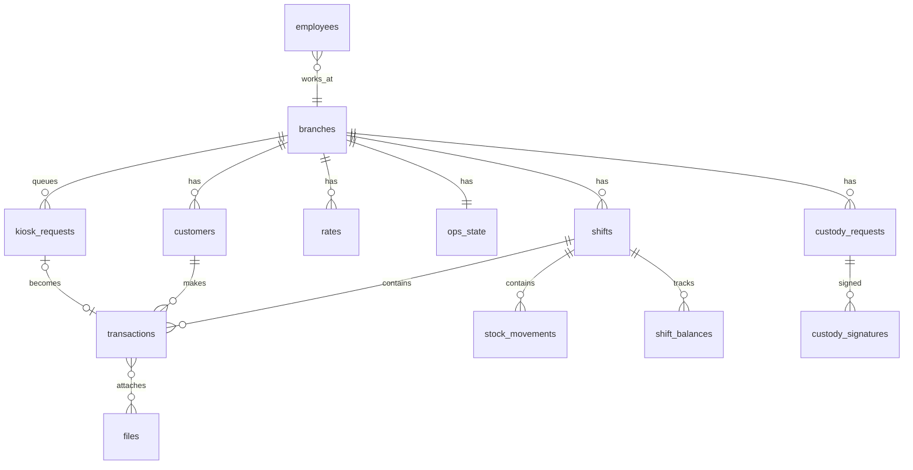
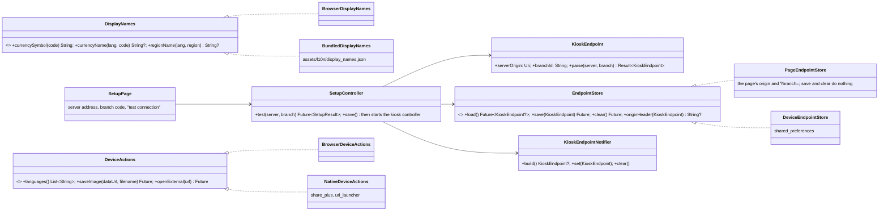

# XCHANGE — Flutter customer kiosk (phase 1), Rust + PostgreSQL server (phase 2)

> designed-by: claude/96f9c3ef · 2026-10-06 · reviewed on 108-Plaza/xchange PR 1 · what still blocks dispatching tickets is listed in §11

Design for the two phases the owner set on 2026-10-06:

| Phase | What changes | What stays |
|---|---|---|
| **1** | The customer-facing kiosk is rewritten in Flutter (§8) | The v2 Node server, its database, and the admin / desk / staff screens — untouched |
| **2** | The server becomes Rust + PostgreSQL, speaking the same HTTP contract (§3–§7) | The admin / desk / staff screens, and the phase 1 kiosk |

Rewriting the admin / desk / staff screens is not in either phase and is not designed here.

Phase 1 needs only §5.3's `/api/kiosk` row and §8. Everything else in this document is phase 2 and
can be reviewed later without holding phase 1 up.

## 0. What this was measured from, and what it was not

| Source | State |
|---|---|
| `xc-desk-v2-deployed-20261005-1758.zip` — built bundle, `SOURCE-VERSIONS.json` = `xchange-online@3ffc5a5`, `xchange-booking@206345c` | Read: all app code in `server.mjs` lines 5349–8301 (engine, operations, ledger, auth, kiosk, devices, routes), `schema.sql`, `cutover.sh`, `migrate-v1.mjs`, nginx configs |
| Source repos `xchange-online`, `xchange-booking` | **Not available** — not found under `108-Plaza`, `yuthstyle88`, or on this machine |
| Minified React (`public/staff.js`, `staff-report.js`), `kiosk.html`, embedded admin/desk HTML | **Not read** — screens in §8 are derived from the API they call, not from the UI code |
| Live database `xc_desk_v2` | **Not read** — row counts and real data shapes are unmeasured |

Line references below are `server.mjs:<line>` in that archive.

## 1. Root cause this design removes

The v2 code is a Google Apps Script program run inside two emulation layers
(Apps Script → Cloudflare D1/R2 → Node + PostgreSQL), never rewritten:

- Every business row is a JSON array in `ledger_rows(table_name,row_number,payload)`; branches are a table-name prefix (`server.mjs:6789`).
- Every request, reads included, loads the whole branch ledger, runs the engine in memory, diffs all rows (`server.mjs:7010-7068`).
- All writes in all branches serialise on one row, `ledger_control.id=1`, with 4 optimistic retries.
- Money is IEEE double (`cents_`, `server.mjs:6341`).
- A transaction belongs to a shift by spreadsheet row range (`startRow`/`endRow`, `server.mjs:6621`).
- Authorisation is decided in three places with different allow-lists (`server.mjs:7434`, `8080`, `5971`).
- Post-save work (print job, kiosk completion) runs outside the save, so "saved but post-save failed" exists (`server.mjs:7756`).

v3 stores typed rows, locks per branch, computes money in decimal, links by foreign key,
authorises in one module, and does post-save work in the same DB transaction.

## 2. Decisions

| # | Decision | Status |
|---|---|---|
| D1 | Phase 1: customer kiosk = Flutter, everything else as is. Phase 2: server = Rust + PostgreSQL behind the unchanged admin / desk / staff screens | **decided** (owner 2026-10-06) |
| D2 | sqlx 0.9, `rust_decimal`, actix-web 4, edition 2024, toolchain 1.98.1 — and **the workspace is laid out like `pos108-core`** (owner, 2026-10-06: "rust ให้ ดู โครง สร้างจาก 108pos"); see §5.2 | [required] |
| D3 | One repo `108-Plaza/xchange` with `api/` and `app/` | **decided** — repo created 2026-10-06 |
| D4 | Sign-in = v3's own owner/employee accounts in `xc-auth`, with v2's contract and cookies: the kept `login.html` and `account-bar.js` post to `/api/auth` and rely on `__Host-xc_owner` / `__Host-xc_staff` (§6) | **decided** (owner 2026-10-06, in the Identity session, relayed by claude/21bc39ab: "ให้ xc-auth เก็บบัญชีพนักงานเอง"). The same day the owner first asked whether Identity could be plugged in; measured at `108-platform-services` `46be83f`, it cannot create an account with a username only (`crates/auth/src/application/register.rs:101-116`; 400 `missing_identifier` on a running copy) nor let an administrator set another person's password (no such route), and the owner decided to add nothing to Identity because other systems share it ("เพราะ identity platfrom มันทำหน้าที่ แค่ authen"; its ticket 395 closed not planned) |
| D5 | Bookings/members API: the kept admin screen has a "การจองออนไลน์" menu that calls `/api/bookings` | **open — owner**: port it (screen keeps working) or leave it returning an error. No public booking site is deployed (`server.mjs:5922`) |
| D6 | v2 holds **test data only**; no real shop uses it (owner, 2026-10-06: "ตอนนี้ v2 ยังเป็นข้อมูลทดสอบ ยังไม่มีร้านจริง") | **decided**. v3 starts on an empty database; nothing is imported (§7). If a real shop starts on v2 before the cutover, this row and §7 must be reopened |
| D7 | Service hours 11:00–22:50 / 23:00 stay hard-coded as in v2 (`server.mjs:6037`, `6876`) | [required] for parity; a setting would need a screen that does not exist |
| D8 | Kiosk delivery = Flutter **web** served on the customer host | **decided** (owner 2026-10-06) and **extended by D9**. The reason first given here — "an installed app sends no `Origin`" — was wrong: measured 2026-10-06 on a local v2 copy, `POST /api/kiosk` answers 200 when the client itself sends `Origin: <the server's own origin>`, 400 with no `Origin`, 400 with another one. The check is a cross-site guard for browsers, not something an app cannot satisfy |
| D9 | The same kiosk is also an **Android app distributed through the Play Store** (owner 2026-10-06: "ต้องให้ ลูกค้า ทำผ่าน ทาง pay store", "ลูกค้าใช้ android"). Application id **`com.spacing.xchange`**, store name **`XC.Xchange`** (both typed by the owner). The web build stays; one code base, two targets (§8.1) | **decided** — store identity: never changed without the owner |

## 3. Domain rules carried over (behaviour table)

These are the behaviours the Rust code must keep. Each row becomes an up-front failing test (§9).

| Area | Rule | v2 evidence |
|---|---|---|
| Amount | 0 ≤ n ≤ 100,000,000, at most 2 decimals; rate at most 4 decimals, > 0 | `6334`, `6515` |
| Principal | `principal = round_half_up(amount × rate, 2)` | `6448` |
| BUY (shop buys FX) | `paid = principal − fee`; fee ≤ principal; `received = 0` | `6450` (fee check), `6452` (paid) |
| SELL (shop sells FX) | `received = principal + fee`; `paid = 0` | `6451` |
| Stock delta | BUY: `+amount` FX; SELL: `−amount` FX. THB moves only when method is `Cash`: SELL `+(principal+fee)`, BUY `−(principal−fee)` | `6531-6540` |
| Stock guard | No currency balance may go below zero after the delta | `6554` |
| Rate guard | Submitted rate must equal the current counter rate for that side, unless the save is for a verified booking | `6742` |
| Shift | At most one OPEN shift per branch; a LIVE save needs one | `6526`, `6739` |
| Close shift | Client sends the expected balances it counted against; mismatch with server-computed ⇒ refuse. Non-zero difference needs a note | `6694-6696` |
| Save rate | `sell ≥ buy`; optimistic check on previous `updatedAt`; partner name and partner cost both or neither; BoT reference captured at save | `6705-6719`, `7017-7023` |
| Customer identity | Unique on (passportNo, nationality, mode) within a branch; ID `CX-%08d` from a counter (`TEST-` prefix in DEMO) | `6375-6378` |
| Document ref | `XC-yyyymmdd-%06d`, counter per (mode, Bangkok date), **global across branches** | `6476` |
| Idempotency | Same `submissionId` + same payload hash ⇒ return the saved result; different hash ⇒ refuse. Admin actions do the same on `requestId`; an abandoned `requestId` can never be applied | `6465-6473`, `6747-6762` |
| Payment | Methods: Cash, Bank Transfer, Credit Card, Alipay, PromptPay (`SCB Transfer` is read as Bank Transfer). Non-cash needs a payment ref and a slip file; passport file always | `6446-6453`, `6624` |
| Custody (when enabled) | Phases CLOSED → READY → OPEN → CUT_OFF → COUNTING; request kinds OPEN, HANDOVER, CLOSE, SAFE_OPEN, SAFE_IN/OUT, EXTERNAL_IN/OUT; one PENDING request at a time; signature rules per kind; Backend commits and must not be sender/receiver | `5969-6250` |
| Custody gate on save | Only the FRONT custodian, clocked in, in phase OPEN (or CUT_OFF with an open draft); customer must not be on hold | `6868-6877` |
| Kiosk | QUOTED → WAITING → ACCEPTED → ID_CHECKED → COMPLETED; no way back, nothing cancels a request. `EXPIRED` is never stored: it is computed at read time, and is what a QUOTED row reads as from 300,001 ms after it was made (`7913`); only a quote expires. A quote can be confirmed from 3,000 ms (`7981`, enforced by the server) to 300,000 ms (`7980`), both inclusive. A QUOTED row is deleted only when a later quote arrives and its age then exceeds 600,000 ms (`7971`); from then on the answer is "not found". `confirm` on a row already past QUOTED returns its identity instead of failing (`7978`), so a retry is safe. Rate re-checked at confirm (`7983-7984`); only the accepting employee may continue. The kiosk's own amount cap is 10,000,000 (not the 100,000,000 of the Amount row). SELL takes an amount of **baht** and floors the foreign figure to two decimals; BUY takes the foreign amount; in both, baht = foreign × rate rounded half up. A published receipt is readable for strictly less than 600,000 ms. Kiosk refusal sentences are English, except the four of the save hook, which are Thai. Measured in the preparation of #67 | `7957-8045`, `8060-8075` |

Known differences v3 introduces on purpose:

- Decimal arithmetic can differ from v2's float at exact half-cent midpoints. §7 keeps stored v2 values and reports rows where recomputation differs.
- Transaction statuses `PENDING_FILES` / `ERROR` are never produced by v3: files are uploaded first and the save is one DB transaction. The screens already handle their absence (they are the error path).
- The receipt HTML is still generated and stored at save, byte-compatible in structure with v2, because the kept screens open it by URL and `receipt-image` parses its `<dt>/<dd>` rows (`server.mjs:7545`).
- Kiosk SELL quotes use the exact figure where v2's floating point gave one hundredth less: when the baht named buy an exact number of hundredths, v2's division landed just below (14.67 baht at 32.60: v2 hands over 0.44 for 14.34 baht, v3 0.45 for 14.67). Together with the half-hundredth case of the first item, 12 of the 219 quotes recorded from v2 differ (#67).
- `complete` on a kiosk request that was never passport-checked (QUOTED, WAITING, ACCEPTED) is refused; v2 silently stored the link to the saved document and left the status as it was (#67).
- Kiosk amounts must be plain decimals with at most two places; anything else (more places, exponent notation, spaces, a negative figure) is refused instead of being coerced the way JavaScript coerces it (#67).
- Custody: a request that cannot be read is refused before every other check. v2 read each field at the moment it used it, so with custody disabled it answered "custody is not enabled" even for a malformed request. The sentences are v2's; their precedence is not (#72).
- Custody: the payload hash of a proposal ignores key order (it is taken over the payload with its keys sorted), so two payloads that differ only in key order are the same request; v2 hashed the keys in the order the screen sent them (#72).
- Custody: a transfer note that would make the stock movement's reason exceed 200 characters is refused at propose time, with the shift's own sentence. v2 accepts it and refuses only at commit or reject, after the request is already in transit, which leaves it in transit for ever (#68).

## 4. Data model

Types: money `NUMERIC(20,2)` (an entered amount is capped at 100,000,000, but a computed baht figure is not — v2 stores 3,209,999,999.68 for 99,999,999.99 × 32.1), rate `NUMERIC(14,4)`, time `timestamptz`, ids `uuid` unless a human-facing code is noted.



| Table | Key columns | Replaces |
|---|---|---|
| `branches` | `id text` (keeps `MAIN`, `B<uuid>`), `name` unique (case-insensitive), `service_open`, `service_last_new`, `service_close` | `AdminBranches` |
| `currencies` | `code char(3)` PK, `name_th`, `name_en`, `symbol` | arrays at `6512`, `6626`, `src/currencies.mjs` |
| `rates` | append-only: `branch_id`, `code`, `buy`, `sell`, `partner_name`, `partner_cost`, `reference jsonb`, `updated_at`, `updated_by`, `request_id`, unique on (`branch_id`, `request_id`) — v2 keeps requests per branch | `AdminRates` |
| `customers` | `id text` (`CX-…`), `branch_id`, `name`, `passport_no`, `nationality`, `birth_date`, `passport_expiry`, `mode`, unique (`branch_id`,`passport_no`,`nationality`,`mode`) | `Customers` |
| `shifts` | `id`, `branch_id`, `status`, `opened_at/by`, `closed_at/by`, `close_note`, `open_request_id`, `close_request_id`; partial unique index on (`branch_id`) where `status='OPEN'` | `AdminShifts` |
| `shift_balances` | (`shift_id`,`code`) PK, `opening`, `expected` (a running total: set at open, added to by every movement and saved transaction, frozen at close — `xc-shift` may not read another context's tables to recompute it), `counted`, `difference` | Opening/Expected/Counted/Difference JSON |
| `stock_movements` | `id`, `shift_id`, `code`, `direction`, `amount`, `reason`, `branch_id`, `request_id`, unique on (`branch_id`, `request_id`) | `AdminMovements` |
| `transactions` | `id`, `document_ref` unique, `branch_id`, `shift_id` FK (null in DEMO), `mode`, `status`, `type`, `code`, `amount`, `rate`, `reference_rate`, `principal`, `fee`, `bank_fee`, `received`, `paid`, `method`, `payment_ref`, `account`, `customer_id`, `staff_id`, `booking_no`, `notes`, `value_date`, `paid_at`, `recorded_at`, `submission_id` unique, `payload_hash`, `kiosk_request_id` | `Transactions`, `DemoTransactions` |
| `transaction_files` | (`transaction_id`,`kind`) PK → `files.key`; kind PASSPORT / SLIP / RECEIPT | columns 25–27 |
| `files` | `key`, `branch_id`, `owner_id`, `mime`, `sha256`, `created_at` | `file_records` |
| `counters` | `key` PK, `value bigint` | `ledger_control.properties` |
| `abandoned_requests` | (`branch_id`, `request_id`) PK, `at`, `actor` — a request abandoned in one branch can be used in another, as in v2 | `AdminRequests` |
| `ops_state` | `branch_id` PK, `enabled`, `phase`, `custodian_id`, `entity jsonb`, `target jsonb`, `safe jsonb`, `cutoff jsonb` | `OpsState` JSON blob |
| `attendance`, `custody_requests`, `custody_signatures`, `ops_events`, `cash_exceptions`, `customer_holds`, `tx_drafts` | one row per array element of the blob | arrays inside `OpsState` |
| `kiosk_requests`, `kiosk_currencies`, `kiosk_receipts` | as v2, `data` split into typed columns, `transaction_id` FK replaces `kiosk_transactions` | same names |
| `device_jobs`, `device_events`, `device_settings` | as v2 | same names |
| `employees`, `employee_audit`, `employee_sessions`, `owners`, `owner_sessions`, `auth_attempts` | as v2 | same names; `auth_attempts` replaces the reuse of `booking_limits` |
| `branch_versions` | `branch_id` PK, `version bigint` — the per-branch lock row, incremented inside every write transaction | new |

None of these tables exists in any v3 database yet (the first migrations are in tickets #54 and #48), so a change to this section before they merge migrates nothing; after that, a change here needs its own data-migration section.

Concurrency: every write handler opens one transaction and takes `SELECT … FOR UPDATE` on that
branch's `branch_versions` row first. That gives per-branch serialisation (v2 serialised the whole system)
and makes "one PENDING custody request", "one OPEN shift" and the stock guard race-free without retries.

[required] That lock is `BranchTx` (§5.1, §5.2: crate `xc-kernel`). `pos_infra::transactions::Transactor` gives a transaction but
nothing branch-scoped and no `FOR UPDATE` (`108-platform-services` `crates/pos-infra/src/transactions.rs`: `new`, `pool`, `run`).
A use case that writes **must** go through `BranchTx::run`, never through `Transactor::run` directly; calling the bare
transactor compiles, passes every single-threaded test of §9, and silently loses all three guarantees. The concurrency
tests named in §9 exist to catch exactly that.

## 5. API (Rust)

### 5.1 Class diagram

```mermaid
classDiagram
  direction LR
  class Money { +parse(str) Result~Money~; +minor() i64; +from_minor(i64) Result~Money~; +is_zero() bool; +ZERO }
  class Rate { +Decimal value; +parse(str) Result~Rate~ }
  class PlainDecimal { <<fn, xc-kernel::money>> +plain_decimal(text) Option~Decimal~ }
  class Quote { +principal: Money; +received: Money; +paid: Money; +compute(side, amount, rate, fee) Result~Quote~ }
  class CurrencyCode { +parse(str) Result~CurrencyCode~; +THB; +as_str() str }
  class MoneyDelta { +minor: i128; +plus(Money) MoneyDelta; +minus(Money) MoneyDelta; +is_negative() bool }
  class Balances { +get(CurrencyCode) Money; +apply(StockDelta) Result~Balances~ }
  class StockDelta { +fx: (CurrencyCode, MoneyDelta); +thb: MoneyDelta; +for_tx(side, code, amount, quote, cash) StockDelta; +for_movement(code, direction, amount) StockDelta }
  class ShiftLedger { +expected(opening, txs, moves) Balances; +ensure_non_negative(bal, delta) Result; +difference(expected, counted) Balances }
  class CustodyMachine { +apply(state, cmd, actor, facts, now) Result~Transition~ }
  class KioskMachine { +authorize(action, actor) Result; +quote(input, facts, new_id, now) Result~KioskRequest~; +next(request, command, actor, facts, now) Result~Transition~; +identity(request, now) Result~RequestIdentity~; +check_get(request, actor) Result; +check_publish(request, actor) Result; +check_save(request, save, actor) Result; +complete(request, submission_id, document_ref) Result~Transition~; +is_purgeable(request, now) bool; +receipt_readable(published, now) bool }
  class Policy { +allow(actor: Option~Actor~, path: EntryPath, action: Action) Result; +branch(actor: Option~Actor~, named: Option~BranchId~) BranchId }
  class Actor { -id; -kind: ActorKind; -role: Role; -branch_id: Option~BranchId~; +owner(id) Actor; +staff(id, role, branch) Option~Actor~; +id() str; +kind() ActorKind; +role() Role; +branch_id() Option~BranchId~ }
  class ActorKind { <<enum>> Owner; Staff }
  class EntryPath { <<enum>> Rpc; StaffRpc; Upload; StaffUpload; File; StaffFile; StaffDesk; Devices; Kiosk; OwnerRoute; UserRoute; Custody }
  class Action { +new(name) Action; +as_str() str }
  class PolicyError { +status() u16 }
  class AccountService { +login(); +logout(); +status(); +change_password(); +employees(action); +disable_employee_in(tx, id, now, actor) }
  class EmployeeCustody { <<trait, presentation::http::employees>> +holds_cash_or_pending(branch, employee_id) bool; +holds_cash_or_pending_in(tx, branch, employee_id) bool }
  class DisableEmployee { <<application::workflows>> +run(custody, branch, employee_id, actor, now) DisableOutcome }
  class PasswordHasher { +hash(password) Result~String~; +verify(password, stored) bool }
  AccountService --> PasswordHasher
  DisableEmployee --> BranchTx : one run on the employee's branch
  DisableEmployee --> EmployeeCustody : asks again under the lock
  DisableEmployee --> AccountService : closes the account under the lock
  KioskService --> PlainDecimal : configure
  ShiftService --> PlainDecimal : the expected count of a close
  BotRateSource --> PlainDecimal : the bank's rate

  class TxService { +reserve_customer(); +save_transaction(); +documents() }
  class ShiftService { +open(); +close(); +move_stock() }
  class RateService { +save_rate(); +current(); +history() }
  class CustodyService { +command(); +state() }
  class KioskService { +public_rates(); +quote(); +confirm(); +staff_action() }
  class DeviceService { +queue(); +process(); +retry() }
  class FileService { +upload(); +open() }
  class BranchTx { +run(branch, f) Result — locks the branch row, runs f, bumps the version, commits }
  class CompatRpc { +dispatch(action, payload, actor) Result~Json~ }
  class SnapshotBuilder { +admin_snapshot(branch, actor) Json; +desk_config(branch) Json }
  class PageServer { +page(name, actor) Html; +static_file(path) }
  class RateSource { <<trait>> +fetch() Result~ReferenceRates~ }
  class DeviceDriver { <<trait>> +run(job) Result~JobOutcome~ }
  class BotRateSource
  class SimulatedDriver

  CompatRpc --> TxService
  CompatRpc --> ShiftService
  CompatRpc --> RateService
  CompatRpc --> CustodyService
  CompatRpc --> SnapshotBuilder
  SnapshotBuilder --> BranchTx : reads the version
  Quote --> Money
  Quote --> Rate
  StockDelta --> Quote
  StockDelta --> MoneyDelta
  StockDelta --> CurrencyCode
  Balances --> CurrencyCode
  ShiftLedger --> Balances
  ShiftLedger --> StockDelta
  TxService --> Quote
  TxService --> ShiftLedger
  TxService --> CustodyMachine : gate on save
  TxService --> KioskMachine : complete on save
  TxService --> DeviceService : queue receipt in same tx
  ShiftService --> ShiftLedger
  CustodyService --> CustodyMachine
  CustodyService --> ShiftService : open/close/move via commit
  RateService --> RateSource
  DeviceService --> DeviceDriver
  RateSource <|.. BotRateSource
  DeviceDriver <|.. SimulatedDriver
  TxService --> BranchTx
  ShiftService --> BranchTx
  CustodyService --> BranchTx
  RateService --> BranchTx
  KioskService --> BranchTx
  Policy --> Actor
  Policy --> EntryPath
  Policy --> Action
  Policy ..> PolicyError : refuses with
  Actor --> ActorKind
```



[required] `Policy` and `KioskMachine` are drawn as their tickets pin them (#65, #67); the diagram shortens the Rust, which is:

```rust
Policy::allow(actor: Option<&Actor>, path: EntryPath, action: &Action) -> Result<(), PolicyError>
Policy::branch(actor: Option<&Actor>, named: Option<&BranchId>) -> BranchId
KioskMachine::next(request: Option<&KioskRequest>, command: &KioskCommand, actor: &KioskActor,
                   facts: &CounterFacts, now: KioskTime) -> Result<Transition, KioskError>
```

`KioskMachine::next` takes the whole request and returns the whole request, not a status: the rules need when the quote was made, who holds the request and the rate it was quoted at. The machine is pure — the counter facts (shift open, the counter rate now), the new id and the time are handed in. `xc-kiosk` has its own `KioskActor` and `KioskRole` because a context crate does not import `xc-auth` (dependency rule, §5.2).

`RateSource` and `DeviceDriver` are traits because a second variant is already known
(KBank reference rates in `public/kbank-reference.json`; a real ESC/POS driver). `FileService` and
`BranchTx` stay concrete — one variant, none planned.

### 5.2 Where each class lives — the `pos108-core` layout

Measured from `108-Plaza/pos108-core` at `405605de` and reproduced here so nothing has to be re-shaped later:

| `pos108-core` | here |
|---|---|
| The root manifest is both the workspace and the `pos108` binary package; its `src/` holds `application/ bootstrap/ config/ infrastructure/ presentation/{dto,extractors,http,middleware,responses} shared/ telemetry/` | `api/Cargo.toml` is both the workspace and the `xchange` binary package, with the same `src/` tree |
| One crate per bounded context, `crates/pos-<context>/`, each `src/{application,domain,infrastructure}/<context>/` | `api/crates/xc-<context>/`, same three layers |
| `domain/<context>/{entities,value_objects,repositories,commands}/` — repositories are **traits** | same |
| `application/<context>/<use_case>.rs` — one file per use case, `pub async fn execute(cmd, repo: &Arc<R>, transactor: &Transactor) -> AppResult<…>`, plus `service.rs` | same |
| `infrastructure/<context>/<x>_repository.rs` — the sqlx implementation of the trait | same |
| Each crate's `lib.rs` re-exports the kernel as `crate::shared::{…}` and `crate::shared::error::{AppError, AppResult}` | same |
| `pos-kernel`, `pos-error`, `pos-infra` come from `108-platform-services` as git dependencies pinned to one `rev` in `[workspace.dependencies]` | **reused, not copied**: `pos-error` (`AppError`/`AppResult`), `pos-infra` (`Transactor`, config, telemetry), `pos-kernel` (`pagination`, `time`) — same pinning rule |
| `migrations/`, `configuration/`, `tests/`, `deny.toml`, `rust-toolchain.toml` at the workspace root | under `api/` |
| edition 2024, `rust-version = "1.85"`, toolchain `1.98.1` | same |

Two things are **not** taken from `pos-kernel`, with the reason:
- `pos_kernel::money::Money::new` rounds with `round_dp(2)` (banker's rounding) and has no input cap. An exchange principal must round **half up** and an entered amount is capped at 100,000,000 (§3). This server therefore has its own `Money`, `Rate`, `Side` and `Quote`, and they live in **`xc-kernel`** (`src/money/`), not in a context crate: the quote is needed by the exchange (save), the kiosk (quote action) and the shift (stock delta), and context crates do not depend on one another (rule below). [required] No file of this server imports `pos_kernel::money`; each crate's `shared` module re-exports it only because the `pos108-core` `lib.rs` shape is copied line for line, and a `Money` taken from there would round a principal differently without any test noticing a type error.
- `pos_kernel::ids` are UUID newtypes. A branch id here is text (`MAIN`, `B<request id>`) because the kept screens create and send it; ids are newtypes local to each crate.

**How much of it fits.** `pos108-core` is 42 crates for a multi-tenant product with sync, outbox and
back-office; this server is the Rust form of about 2,950 lines of v2 logic for one shop. The layering,
the file-per-use-case rule, the repository traits and the shared error/transaction crates fit as they are.
The crate count does not: a crate per small context would be mostly manifests. So the same shape is
used with **five** context crates and one small kernel crate, a context crate holding more than one sub-context directory where the contexts are
small and change together (`pos108-core` crates already nest `domain/<context>/`):

| Crate | Sub-contexts (`domain/<x>/`, `application/<x>/`, `infrastructure/<x>/`) | Classes of §5.1 |
|---|---|---|
| `xc-kernel` | no layers — the few things every context crate needs and `pos-kernel` cannot supply: `ids.rs` (`BranchId` and the other text ids), `branch_tx.rs` (`BranchTx`, a wrapper over `pos_infra`'s `Transactor` that takes `SELECT … FOR UPDATE` on the branch's `branch_versions` row, runs the closure, increments the version, commits), and `money/` — one file per type: `money.rs` (`Money`, `NumberError`), `rate.rs`, `side.rs`, `quote.rs`, `money_delta.rs` (`MoneyDelta`, a signed amount in hundredths for stock changes and count differences), `currency_code.rs` (`CurrencyCode`, the stock register of v2 `server.mjs:6512`, `THB` first) | `BranchTx`, `Money`, `Rate`, `Quote`, `MoneyDelta`, `CurrencyCode` |
| `xc-exchange` | `exchange` (transactions, document numbers), `customer`, `booking` | `TxService` |
| `xc-shift` | `shift` (shifts, balances, stock movements), `custody` (the custody state machine and its records) | `Balances`, `StockDelta`, `ShiftLedger`, `ShiftService`, `CustodyMachine`, `CustodyService` |
| `xc-rate` | `branch`, `rate` (currencies, counter rates, reference-rate sources) | `RateService`, `RateSource`, `BotRateSource` |
| `xc-kiosk` | `kiosk` (requests, kiosk currencies, published receipts) | `KioskMachine`, `KioskService` |
| `xc-auth` | `account` (owners, employees, sessions), `policy` | `Actor`, `ActorKind`, `EntryPath`, `Action`, `PolicyError`, `Policy`, `AccountService`, `PasswordHasher` |
| root package `xchange` | `presentation/http` (routes of §5.3), `presentation/dto`, `application/compat/` (`CompatRpc`, `SnapshotBuilder`), `application/workflows/` (a save that crosses exchange, shift, custody, kiosk and devices in one transaction), `infrastructure/{files,devices}/` (`FileService`, `DeviceService`, drivers), page serving, bootstrap | `CompatRpc`, `SnapshotBuilder`, `PageServer`, `FileService`, `DeviceService`, `DeviceDriver` |

Files and devices stay in the root package's `infrastructure/` until they grow: one local file store and
one simulated driver do not earn a crate. They move out the day a second variant is written.

[required] **Dependency rule.** A context crate depends on `xc-kernel` and the three `pos-*` crates, never on another context crate (measured on `main` `4d515d7`: no `xc-*` manifest names another context crate). What two contexts must share is either a pure value that belongs in `xc-kernel`, or is composed in the root package's `application/workflows/`. This is what moved the money types: `StockDelta` in `xc-shift` needs the quote that `xc-exchange` first held.

File rule that keeps tickets from colliding, as in `pos108-core`: one value object, entity or use case per file; a `mod.rs` only re-exports. Two tickets never share a file other than a `mod.rs`, and every `mod.rs` a later ticket would need is created — with all its `pub mod` lines — by the restructuring ticket below, so later tickets do not edit them.

[required] **Route rule.** Routes are registered in exactly one place, and no feature ticket edits it. Ticket T1b gives every handler file under `api/src/presentation/http/` except `health.rs` a `pub fn configure(cfg: &mut web::ServiceConfig, state: &AppState)` (empty until its ticket fills it; `health.rs` keeps its `configure(cfg)`, which T1a's tests pin), makes `presentation::http::configure` in `http/mod.rs` call each of them, and makes `bootstrap::configure` call that one function before the default service. The default service itself moves into `api/src/presentation/pages.rs` as `pages::fallback` — in T1b it answers 404 `Not found` exactly as today; T1c fills it (v2 serves a static file as the last step before its 404, `server.mjs:8286-8289`) and adds the page routes in `pages::configure(cfg, state)`, which T1b also creates empty and calls. So neither T1c nor any other ticket edits `bootstrap/mod.rs` after T1b. A handler module builds its own service from `state.db` and registers it as `web::Data` inside its `configure`; `AppState` gains no field per feature. `configure` runs once per worker, so a service registered there holds no state of its own beyond the pool: state that must be shared (the kiosk's per-IP limit of §6 is the first case) lives in the database, or is built once before `HttpServer::new` and passed through `AppState`. T1b also splits `bootstrap::connect(settings) -> Result<PgPool>` (pool, eager `SELECT 1`, migrations) out of `Application::build`, so a command-line sub-command can use the database without binding a port. After T1b a ticket with HTTP routes edits only its own `http/<name>.rs`. (The state before T1b, measured on `main` `2a998ef`: `api/src/bootstrap/mod.rs:71-74` registers `health::configure` only, and `Application::build` at `:87-107` opens the pool, migrates and binds in one function.) After T1b, at `main` `e2790ac`: `presentation::http::configure` in `api/src/presentation/http/mod.rs` is the one route table (`health::configure(cfg)`, then the ten `configure(cfg, state)`); `bootstrap::configure` (`api/src/bootstrap/mod.rs:71-75`) calls it, then `pages::configure`, then sets `pages::fallback` as the default service — the pages seam, both still empty of pages; and `bootstrap::connect` (`:79`) is a function of its own that `Application::build` calls (`:105`).

**State of the code against this layout.** T2 (PR 14) wrote `Money`, `Rate` and `Quote` in a flat crate; T2b (PR 22, `c04f346`) moved them unchanged to `api/crates/xc-exchange/src/domain/exchange/value_objects/{money,rate,side}.rs` and `…/entities/quote.rs` and created every crate, layer and `mod.rs`. That placement was this document's and it is wrong by the dependency rule above. **T2c** moves the four types, their two test files and the fixture to `api/crates/xc-kernel/src/money/` and `api/crates/xc-kernel/tests/`, unchanged apart from `use` lines and the visibility the new neighbours need, and adds `MoneyDelta` and `CurrencyCode`. `BranchTx` is still a comment-only stub (`api/crates/xc-kernel/src/branch_tx.rs` on `main` `4d515d7`: five `//!` lines); it is its own ticket, **T2d**, with the concurrency test.

Fallback when a provider has not landed: the consuming ticket declares a stub with the diagram's
signature in its own file, marked `// moves to <file> with ticket <id>`. It does not wait and does not touch the provider's file.

### 5.3 HTTP contract [required] — identical to v2

The kept screens are the contract. Every route below answers with the same JSON shape, status codes,
error strings (Thai, except the kiosk's — §3) and cookies as v2. Money stays a JSON **number** on the wire here, because the
screens do arithmetic on it; decimals exist only inside the server and the database.

| Route | Body | v2 handler |
|---|---|---|
| `GET /healthz` | — | `8262` |
| `GET /health/ready` → `version`, `build`, `builtAt`, `channel` | — | new (fleet versioning rule) |
| `POST /api/auth` | `{action: status\|login\|logout, payload}` | `7855` |
| `POST /api/rpc` | `{action, payload}` — `adminSnapshot`, `adminDeskConfig`, `adminOpenShift`, `adminCloseShift`, `adminMoveStock`, `adminSaveRate`, `adminCreateBranch`, `adminAbandonRequest`, `getConnectionStatus`, `reserveCustomer`, `saveTransaction` | `7108`, `8090`, hook `7728` |
| `POST /api/staff/{login,logout,password,me,rpc,upload}` · `GET /api/staff/file/{key}` | as v2; `rpc` also carries every `ops*` action | `7486-7519`, `7397` |
| `POST /api/upload?branch=` · `GET /files/{key}` · `GET /documents?branch=&ref=` | raw file body | `7154`, `7095`, `7769` |
| `POST /api/employees` | `{action: list\|create\|reset\|disable\|entity\|enable}` | `7371` |
| `POST /api/reference-rates` | — | `7275` |
| `POST /api/bookings` | `{action, payload}` | `7263` — subject to D5 |
| `POST /api/devices` · `GET /devices/receipt` | `{action: snapshot\|queue\|process\|retry\|printerOnline\|drawerObservation}` | `7665`, `7794` |
| `POST /api/kiosk` | `{action, payload}` — public: `rates`, `quote`, `confirm`, `status`, `customerReceipt`; any signed-in role: `notifications`; OWNER, FRONT, BACKEND, MANAGER: `list`, `accept`, `get`, `identityChecked`, `publishReceipt`; OWNER and RATES: `manage`, `configure` | `8048` |
| Pages: `/`, `/desk`, `/staff`, `/staff/report`, `/staff/desk`, `/staff/documents`, `/login`, `/devices`, `/kiosk-queue.html`, `/kiosk-currencies.html`, `/staff-guide`, `/receipt-sample`, static assets | — | route table `8143-8188` |

Request rules carried over unchanged: `Origin` must equal the request origin and `X-Xchange-Request: 1`
on every POST (`5542`); body size limits per route; host split — the customer host serves only the
kiosk and `/api/kiosk` (`8263-8267`); staff are forced onto their own branch (`8280`).

Page serving carries over v2's rewriting, which the screens depend on: `window.XC_BRANCH` injection (`5549`),
per-role script injection (`8196-8207`), and the `/staff/desk` variant of the desk page with rewritten
URLs and the `opsBeginTransaction` draft hook (`7416-7418`). The admin and desk HTML are embedded in
the v2 bundle (`5357`, `5558`). [required] v3 serves these pages and v2's `public/` files from a directory named by the
setting `web.dir`, read at run time; **no v2 file is committed to this repository** (the owner's rule for the deployed
bundle). A script in the repository, `api/tools/extract-v2-pages.mjs`, writes that directory from a v2 bundle on the
server at deploy time (the embedded pages byte-for-byte, `public/` copied). `PageServer`'s tests use small pages of their own.

**Known debt, kept on purpose.** `adminSnapshot` returns the whole branch on every call and the screens
poll it. v3 builds it with SQL instead of replaying the ledger, and keeps v2's 10,000-row cap (`6600`),
but the response is still O(history). The root cause is the screens' contract, which this phase does not
change; it goes away when those screens are rewritten. The Flutter kiosk does not use `adminSnapshot`.

## 6. Authorisation

Two pure functions of `Policy` in `xc-auth` (`domain/policy/entities/policy.rs`; signatures in §5.1), which every route and service asks:
`allow(actor, path, action)` — may this caller do this on this entry path — and `branch(actor, named)` — the branch the call runs on.
Both were measured in the preparation of #65 by sending every caller × action through v2's own request handler and custody module
(1,370 recorded answers over 12 paths and 11 callers, 225 branch probes, 20 distinct refusals).

[required] The types, one per file under `domain/policy/value_objects/`:

| Type | Shape |
|---|---|
| `EntryPath` | the twelve places where v2 checks: `Rpc`, `StaffRpc`, `Upload`, `StaffUpload`, `File`, `StaffFile`, `StaffDesk`, `Devices`, `Kiosk`, `OwnerRoute`, `UserRoute`, `Custody` |
| `Actor` | fields private; built only by `Actor::owner(id)` (kind and role Owner, no branch) and `Actor::staff(id, role, branch) -> Option<Actor>` (`None` for the owner's role), so an owner with a branch or an employee without one cannot exist. `None` in place of an actor = nobody is signed in |
| `ActorKind` | `Owner`, `Staff` |
| `Action` | a newtype over the name the screens send, kept as text — not an enum: one path lets through every name that starts with `ops`, known or not, and each path refuses an unknown name in its own sentence |
| `PolicyError` | `Display` is v2's sentence byte for byte, `status()` the HTTP status beside it |

**Branch.** v2 never refuses on branch. A staff caller's named branch is overwritten with their own, whatever they name; the owner, and a caller who is not signed in, work on the branch named, and on `MAIN` when none is.
That is why the branch is a second function and `allow` takes the entry path instead: the branch never changes `allow`'s answer.

**Role table.** It reproduces v2's entry paths as they are — in particular its two RPC paths, `Rpc` (`staff-routes`, `8080-8086`) and `StaffRpc` (`staff-bridge`, `7434`), each with its own list. It is **not** a union of them (§11 keeps the owner's option to say which is right). For an employee the two disagree in these cells:

| Action | `Rpc` | `StaffRpc` (the staff bridge) |
|---|---|---|
| `adminOpenShift`, `adminCloseShift` | BACKEND, MANAGER | nobody |
| `adminMoveStock` | FINANCE | nobody |
| `adminDeskConfig` | all staff | FRONT only |
| `documents` | nobody | all but RATES and SYSTEM |
| names starting with `ops` | nobody — they are reachable only through the staff bridge | all staff, except `opsEnable` and `opsSetEntity` |
| refusal sentence for a role | `บทบาทนี้ไม่มีสิทธิ์ทำรายการนี้` | `บทบาทนี้ไม่มีสิทธิ์ทำรายการ` |

The full table of every path is the one recorded in #65's fixture (`api/crates/xc-auth/tests/fixtures/v2_policy_cases.json`).

**Custody.** The `Custody` path answers only what the caller alone decides for the `ops*` actions. The role checks made inside a custody transition stay in `CustodyMachine` (`xc-shift`), because for twelve of the fifteen custody actions v2 checks "enabled" (`server.mjs:6015`) and "clocked in" (`:6032`) before the role (from `:6034` on), and the machine keeps that order. The other three differ: `opsSetEntity` and `opsEnable` check the owner role first (`:5999`, `:6008`, before the enabled check), and `opsClock` comes before the clocked-in check. (Order of checks measured in the review of PR 74.)

Sessions: opaque 32-byte token, SHA-256 at rest, 12 h, `version` column invalidates on
password change — as v2 (`7347`, `7354`).

Accounts (D4) are v3's own, with v2's behaviour: usernames lower-cased and trimmed (`7865` at the shared login, `7314` at creation, `7337` at the staff login), a username
longer than 40 characters refused as wrong credentials (`7338`), passwords of 12–128 characters (`7293`), an employee's
initial password that must be changed at first sign-in (`mustChange`, employees only), an owner resetting or disabling
an employee through `/api/employees` (`7371`), and every such action written to `employee_audit`. The Thai sentences
are v2's, pinned by a fixture recorded from v2.

Attempt limit, as v2 (`7340`, `7845`; v2 keeps the rows in `booking_limits` under an `AUTH:` key, v3 in `auth_attempts`):
every sign-in attempt is recorded **before** the password is checked, right or wrong; within a 15-minute window more than
30 attempts from one IP address, or more than 10 for one username, are refused with v2's sentence.

Password hashing: [required] one type, `PasswordHasher`, in
`api/crates/xc-auth/src/domain/account/value_objects/password_hasher.rs`, is the only code that hashes or verifies.
[required] Argon2id (version 0x13) through the `argon2` crate, stored as a PHC string — the same algorithm and crate the
fleet's Identity uses (`108-platform-services` `crates/auth/Cargo.toml:23`, `argon2_hasher.rs:81-83` at `46be83f`);
`xc-auth` depends on the `argon2` crate itself, never on Identity's crate. [proposed] the cost parameters. v2's scrypt format (N=16384, r=8, p=5,
`salt_hex:key_hex`, the salt fed as the ASCII hex string, `7292-7296`) is **not** ported: v3 starts empty (D6), so
no v2 hash is ever loaded.

First owner: v2 always answers `setupRequired: false` and has its owner in the database from installation.
v2 has no way for an owner to change the password: every statement on `owners` is a `SELECT` (`7825`, `7866`), the owner's
login answer carries no `mustChange` (`7870`), and the kept `login.html` sends a must-change user to `/staff`, whose
password route needs a staff session (`7356`). [required] v3 therefore has a one-shot command
`xchange create-owner --username <u>` that reads the password from standard input and creates the `owners` row with
that password as the real one — no must-change for owners — and refuses when an owner exists. It is not an HTTP route;
it uses `bootstrap::connect` (route rule, §5.2). Changing an owner's password later is not designed here.

Kiosk quote creation gets a per-IP limit; v2 has none in the kiosk module (`7897-8076`) or in `nginx/xc-customer.spacing.cloud.conf`.

## 7. Data migration

**Decision D6 applies: nothing is migrated.** v2 holds test data only, so v3 starts on an empty
database, the owner account and employees are created fresh, and rates are entered again. The importer
(ticket T14) is **not built**. The mapping below is kept as the record of what an import would have to do,
for the day D6 changes; it is not work to schedule.

What still matters at cutover without an import:
- Deploy order is unchanged: v3 on a new database and port, v2 untouched, switch by repointing nginx, roll back by pointing it back.
- Nothing is lost by rolling back, because nothing real was entered — again only while D6 holds.
- The document-number and customer-number counters start from 1.

Source, had there been one: `ledger_rows` JSON arrays + side tables of `xc_desk_v2`. Target: §4.

**(1) What each existing row becomes**

| v2 rows | v3 | Notes |
|---|---|---|
| `[<B>_]Transactions` / `DemoTransactions`, status `SAVED` | `transactions` (`COMPLETED`) + `transaction_files` | `shift_id` resolved from the shift whose `startRow..endRow` contains the row number |
| same, status `PENDING_FILES` or `ERROR` | **refused** — importer stops and lists them | v2 itself blocks shift open/close while one exists (`6640`); they must be finished or cancelled in v2 first |
| same, status `CANCELLED` | `transactions` (`CANCELLED`) | no v2 code path writes this status in the code read; expected count 0 |
| `Customers` | `customers` | leading `'` (spreadsheet-injection guard, `6344`) stripped |
| `AdminRates` | `rates` | `{$date}` → `timestamptz` |
| `AdminShifts` + JSON columns | `shifts` + `shift_balances` | |
| `AdminMovements`, `AdminRequests`, `AdminBranches` | `stock_movements`, `abandoned_requests`, `branches` | |
| `OpsState` row 2 | `ops_state` + child tables | arrays split one element per row |
| `ledger_control.properties` | `counters` | so `XC-…` and `CX-…` numbering continues |
| `file_records` + upload dir | `files` + same directory | bytes not rewritten; `sha256` re-verified |
| `employees`, `employee_audit`, `owners` | not migrated — v3 starts empty (D6) | accounts are created again through `create-owner` and the employee screen; no v2 password hash is loaded |
| `kiosk_*`, `device_*`, `receipt_images` | same names | in-flight `QUOTED` kiosk rows dropped |
| `bookings`, `members`, `member_registrations`, `booking_rules` | migrated as-is if D5 = port; otherwise left in the v2 database | `adminSnapshot` reads `members` to flag customers (`7038`) — if not ported, that flag is always false |

**(2) Backfill** — none after import; the importer writes final values. Measure before cutover:

```sql
SELECT table_name, count(*) - 1 AS data_rows FROM ledger_rows GROUP BY 1 ORDER BY 1;
SELECT count(*) FROM ledger_rows WHERE table_name LIKE '%Transactions' AND payload::jsonb->>1 IN ('PENDING_FILES','ERROR');
```

Verification the importer must pass before it commits (`verify.rs`):
- row counts per table equal;
- for every CLOSED shift, `ShiftLedger::expected` recomputed in decimal equals the stored `Expected JSON`;
- for every transaction, recomputed `principal/received/paid` equals stored — differences are reported per row and stored values kept;
- every `transaction_files` key exists on disk with matching hash.

**(3) Deploy order** — v3 uses a new database (`xc_v3`) and a new port; v2 keeps running untouched.
Cutover = stop v2 writes → import → verify → repoint nginx (same shape as `cutover.sh`) → fingerprint v2 again to prove nothing wrote during the switch.
The v2 binary never sees the v3 schema, so there is no old-binary/new-schema window.

**(4) What `down` loses** — rollback is repointing nginx to v2. Everything written to v3 after cutover is lost
unless re-entered; there is no v3→v2 exporter. This is the reason D6 needs an answer.

## 8. Flutter — customer kiosk only

[required] Scope is exactly four screens (owner, 2026-10-06), delivered as Flutter **web**:

1. choose buy/sell and currency, see the rates
2. the quote, with its countdown
3. waiting in the queue after confirming
4. the receipt the staff member publishes to the screen

Nothing else is built in Flutter. The staff queue page and the kiosk-currency page are staff screens and stay as they are.

Replaces `public/kiosk.html`, `kiosk.js`, `kiosk.css`, `kiosk-i18n.js`, `kiosk-language-extras.js`, `kiosk-fonts.css`.
It talks to the same `POST /api/kiosk` actions, so the staff side of the queue (`kiosk-queue.html`, `desk-kiosk.js`) is untouched.

The app follows the layout and stack of `108heros-flutter` (owner, 2026-10-06), so nothing has to be
re-shaped later: `app/` · `core/` · `features/<name>/{app,domain,infrastructure,presentation}` · `shared/` · `l10n/`,
with Riverpod 3, dio and go_router.


| Piece | Location (under `app/lib/`) |
|---|---|
| App shell, router | `app/app.dart`, `app/router/app_router.dart` |
| dio (base URL = the endpoint's server origin — the page's own origin on the web, §8.1; `X-Xchange-Request` header), `BaseApiService` | `core/network/` |
| Browser seam (device languages, `?branch=`, `Intl` names and symbols, save image) with a VM stub for tests | `core/platform/` |
| Providers | `features/kiosk/app/kiosk_providers.dart` |
| `QuoteModel`, `RequestIdentity`, `KioskStatus`, rates models; `KioskFailure`; `KioskRepository` | `features/kiosk/domain/entities/kiosk_models.dart`, `features/kiosk/domain/kiosk_failure.dart`, `features/kiosk/domain/repository/` |
| `KioskApi`; `KioskRepositoryImpl` | `features/kiosk/infrastructure/data_sources/`, `features/kiosk/infrastructure/repositories/` |
| `KioskController` + `KioskState`, `StatusPoller`, `IdleTimer` | `features/kiosk/presentation/controllers/` |
| The frame and the four screens | `features/kiosk/presentation/pages/{kiosk,select,quote,waiting,receipt}_page.dart` |
| Shared kiosk widgets | `features/kiosk/presentation/widgets/` |
| Colours, theme | `shared/theme/` |
| `KioskL10n`, `KioskTexts`; texts moved 1:1 from `kiosk-i18n.js` and `kiosk-language-extras.js` | `l10n/kiosk_l10n.dart`, `assets/l10n/kiosk.json` |

Two places where this app differs from `108heros-flutter`, on purpose:
- Models are hand-written immutable classes, not freezed — six small read-only types. They sit where the freezed ones would, so switching is local to those files.
- Texts are a runtime JSON table, not `.arb` files: the customer picks among 16 languages on the screen itself, independent of the device locale, and the table is the v2 kiosk's own.

Fonts: Flutter web fetches the Noto fallback fonts for Thai, CJK, Arabic, Myanmar, Lao and Devanagari on demand.
Bundling them for a kiosk with a poor connection is not done yet.

**How it is served in phase 1** (no change to the v2 server): nginx on the customer host serves the
Flutter web build from a directory and proxies only `POST /api/kiosk` to `127.0.0.1:8093`. Today
`nginx/xc-customer.spacing.cloud.conf` proxies an allow-list of v2 kiosk files; that list is replaced by
a static `root` for the build plus the one proxied path. The page keeps the same URL and the same
`?branch=` parameter. Rollback is restoring the previous nginx file — the v2 kiosk files stay on disk.

Behaviour to keep (from `public/kiosk.js` and the server side at `7957-7998`): language starts from the
device language and returns to it on reset; quote must be shown at least 3 s before confirm and expires at 5 min;
server error messages are mapped to localised text; the status is polled every 5 s and the receipt every 3 s;
the screen restarts **30 seconds** after it sees the request completed (`public/kiosk.js:105`) — the 10-minute figure
in the server (`RECEIPT_TTL`, `server.mjs:7903`) is how long a published receipt image stays retrievable, not how long
it is displayed; before confirming, two minutes without a touch restart the screen, and the counter screens never idle out. The client shows amounts the server returned and never submits a rate or a THB figure of its own.

### 8.1 Android app (D9)

[required] One code base. The four screens, the controller, the repository and the texts are not copied or forked for Android; the only code that differs per target is behind the two seams below. The app keeps the same `POST /api/kiosk` contract and needs no server change (D8, measured).

**What the web build takes from the page, and an installed app has to be given.** Read at `main` `2e79ace`:

| Need | Web today | Android |
|---|---|---|
| Where the server is | `browser.pageOrigin()` → `apiBaseUrlProvider` (`app/lib/core/network/dio_provider.dart:8`) | the endpoint stored on the device |
| Which branch | `browser.branchFromUrl()` → `kioskBranchProvider` (`app/lib/features/kiosk/app/kiosk_providers.dart:12`) | the endpoint stored on the device |
| `Origin` header | sent by the browser; a script may not set it, so the web build must not try | set by the app **in the device build only**: `Origin: <server origin>`, beside `X-Xchange-Request: 1` (it is `DeviceEndpointStore`'s side that adds it — `EndpointStore.originHeader()` returns `null` on the web) |
| Device languages | `browser.deviceLanguages()` (`kiosk_providers.dart:16`); the stub answers `['en']` (`browser_stub.dart:1`) | `DeviceActions.languages()` → `PlatformDispatcher.instance.locales` |
| Currency symbol and name, region name | `Intl.NumberFormat` / `Intl.DisplayNames` (`browser_web.dart`) | a bundled table (below) |
| Save the receipt image (`receipt_page.dart:75`), open the Telegram link (`waiting_page.dart:92`) | `saveDataUrl`, `openExternal` (`browser_web.dart`); the stub does nothing | `DeviceActions.saveImage` → the system share sheet (`share_plus`), `DeviceActions.openExternal` → the system browser (`url_launcher`) |



| Class | File | Provided by | Used by |
|---|---|---|---|
| `KioskEndpoint` | `app/lib/core/endpoint/kiosk_endpoint.dart` | ticket A1 | dio provider, branch provider, `SetupController` |
| `EndpointStore`, `endpointStoreProvider`; `KioskEndpointNotifier` with `kioskEndpointProvider` (a `NotifierProvider<KioskEndpointNotifier, KioskEndpoint?>` — a notifier, not a value, so that setup can change it) | `app/lib/core/endpoint/endpoint_store.dart` | A1 | everything that needs the server or the branch; `SetupController` calls `set(endpoint)` |
| `PageEndpointStore` | `app/lib/core/endpoint/endpoint_store_web.dart` | A1 | web build |
| `DeviceEndpointStore` | `app/lib/core/endpoint/endpoint_store_io.dart` | A1 | Android build |
| `DisplayNames`, `displayNamesProvider` | `app/lib/core/platform/display_names.dart` | A2 | `currencyName` in `kiosk_widgets.dart`; `regionDisplayName` and `currencySymbol` in `select_page.dart` (`:51`, `:168`) |
| `BrowserDisplayNames` | `app/lib/core/platform/display_names_web.dart` | A2 | web build |
| `BundledDisplayNames` + `app/assets/l10n/display_names.json` | `app/lib/core/platform/display_names_io.dart` | A2 | Android build |
| start-up: load the endpoint before the first frame, start the kiosk controller only when one is stored | `app/lib/main.dart` | A1 | — |
| `DeviceActions`, `deviceActionsProvider`; `BrowserDeviceActions`; `NativeDeviceActions` | `app/lib/core/platform/{device_actions,device_actions_web,device_actions_io}.dart` | A2 | language detection (`kiosk_providers.dart`), `receipt_page.dart`, `waiting_page.dart` |
| `KioskController.reportError(String textKey)` — new public method: sets `state.error` to that text in the current language, exactly as the controller's own failures do (`kiosk_controller.dart:231`, `:315`, `:353`, `:378`); pages have no other way to show an error | `app/lib/features/kiosk/presentation/controllers/kiosk_controller.dart` | A2 | `receipt_page.dart`, `waiting_page.dart` when a device action fails |
| `SetupPage`, `SetupController` | `app/lib/features/setup/presentation/{pages/setup_page.dart,controllers/setup_controller.dart}` | A3 | the router, when no endpoint is stored |
| Android platform folder, manifest, icons, signing config read from a properties file | `app/android/` | A4 | the build |
| Release workflow (signed app bundle as an artifact) | `.github/workflows/app-android.yml` | A5 | the owner, who uploads to the Play Console |

After A2 the conditional-import file `app/lib/core/platform/browser.dart` and its two halves are gone: every function they held has moved behind `EndpointStore`, `DisplayNames` or `DeviceActions`.

**Start-up, because a router guard alone is not enough.** Today `main.dart:22` starts the controller unconditionally (it requests the rates at once) and `app.dart:13` watches the controller before any route. So: `main()` awaits `EndpointStore.load()` before `runApp`, the same way it already awaits the texts, and seeds `kioskEndpointProvider` with the result (the notifier is created with the loaded value through an override of its initial-value provider, so tests can still override it as `kiosk_api_test.dart:50-51` does today); it calls `start()` on the kiosk controller only when an endpoint is present. `apiBaseUrlProvider` and `kioskBranchProvider` read that provider and stay synchronous. Without an endpoint the controller is never started, so nothing calls the network; `app.dart` may go on watching it for the language. When setup succeeds, `SetupController.save()` stores the endpoint, calls `set(endpoint)` on the notifier and starts the controller. `usePathUrlStrategy()` in `main.dart` is a no-op off the web and stays.

[required] **Behaviour**

| Case | Result |
|---|---|
| Web build | exactly as today: endpoint from the page, no setup screen, no route to it |
| Android, nothing stored | the app opens `SetupPage`; the kiosk screens are unreachable |
| Setup: server address without a scheme | `https://` is assumed |
| Setup: an `http://` address | refused in a **release** build with a sentence saying the server must use https; accepted in a **debug** build only, for testing against a local copy. Decided by the controller as a security choice (the owner delegates those): Android blocks cleartext traffic by default and cannot allow it for a host typed at run time, only globally — a store build that talks plain http to any host is not something to ship. The release manifest therefore does **not** set `usesCleartextTraffic`; `android/app/src/debug/AndroidManifest.xml` does |
| Setup: "test connection" | calls `rates` for that branch with the `Origin` header set; shows the branch name the server answered with, or the server's own error sentence; nothing is saved until it has succeeded once |
| Android, endpoint stored | starts on the select screen as the web build does |
| Changing the endpoint later | a long press of ten seconds on the logo opens `SetupPage` again (a kiosk has no menu, and a customer must not reach it by accident) |
| Android, endpoint stored, server does not answer at start-up | the kiosk page shows its existing error state with retry (`kiosk_page.dart:87-101`); the logo is still on screen (`:155`), so the long press still reaches setup; the stored endpoint is kept |
| Server unreachable while in use | the existing offline message of the kiosk; the stored endpoint is kept |
| Currency or region name the bundled table lacks | the code is shown, as the web build does when the browser has no name |
| Android, device language is none of the 16 | the kiosk starts in English — `KioskL10n.detect` already returns `en` when nothing matches (`app/lib/l10n/kiosk_l10n.dart:83-91`); `NativeDeviceActions.languages()` only supplies the list |
| Android, "save receipt" pressed (`receipt_page.dart:75`) | the system share sheet opens with the receipt image as a PNG file named as the web build names it; choosing a target or dismissing the sheet returns to the receipt screen unchanged, and the 30-second restart timer keeps running as on the web |
| Android, saving fails (no space, the plugin throws) | the page calls `KioskController.reportError('errGeneric')`; the sentence appears in the kiosk's one error line (`kiosk_page.dart:87-101`, fed by `state.error`), as every other failure does; the receipt stays |
| Android, Telegram button pressed (`waiting_page.dart:92`) | the link opens in the system's handler for it (the Telegram app, or the browser) through `launchUrl`; `NativeDeviceActions` does **not** ask `canLaunchUrl` first |
| Android, nothing can open the link (`launchUrl` answers false or throws) | the page calls `KioskController.reportError('errGeneric')` (same error line); the QR code of the same link is already on that page (`assets/img/telegram_qr.png`) and stays the way to reach it |

`display_names.json` is recorded from Chrome for the 16 languages, the same way and with the same tool as `app/tool/cjk_currency_names.json` (ticket #6), so both targets show the same names; the CJK subset fonts already cover those names.

**Who installs it — assumed, to be confirmed by the owner at review:** the shop installs the app from the Play Store on its own Android tablet and types the server address and branch code once. A QR code issued by the admin screen would be friendlier but needs a change to the admin screen, which this phase does not touch (D1); `EndpointStore` does not care how the endpoint arrived, so a QR scan can be added later without reshaping anything.

**Not decided, and not blocking A1–A3:** which Play Console account publishes the app (it decides who holds the upload key). A4 reads the signing config from a properties file that is never committed, so the code does not depend on the answer; A5 produces a signed bundle and stops there — uploading to the store is the owner's act.

**Data:** nothing on the server changes. On the device, two strings in `shared_preferences`; uninstalling removes them.


## 9. Tests written before implementation

`runEngine(action, input, tables, props, actor, files, booking)` and `runOperations(...)` in v2 are pure
functions (`server.mjs:6255`, `5969`). A small Node harness around the v2 bundle produces fixture files
`(input) → (result | error, table diff)` for every rule in §3; the Rust tests in each crate's `tests/` and
in `api/tests/` assert the same outcomes. The ticket author commits fixtures and failing tests first;
implementers may add tests but not edit those.

Not covered by fixtures, written by hand: per-branch locking under concurrency, `304` behaviour, importer verification. (The policy table is recorded from v2 like the rest: `v2_policy_cases.json`, #65.)

## 10. Ticket split (after this document is reviewed and merged)

### Phase 1 — Flutter kiosk on the existing server

| # | Ticket | Files owned | Depends on |
|---|---|---|---|
| F1 | The kiosk app: network core, kiosk feature (domain, infrastructure, controllers, pages), texts, tests | `app/` | — |
| F5 | Flutter CI (#4) | `.github/workflows/app.yml` | F1 |
| F6 | nginx file for the customer host + deploy notes | `deploy/nginx/xc-customer.conf`, `deploy/README.md` | F1; applying it on the server is the owner's call |
| F7 | Bundle the fallback fonts so the kiosk does not depend on fetching them | `app/assets/fonts/`, `app/pubspec.yaml`, `app/lib/shared/theme/theme.dart` | F1 |

F1 was written in one piece by the session the owner gave it to; F5–F7 are independent of each other.
 All of phase 1 is developed and tested against the running v2 server.

### Phase 1b — the kiosk as an Android app (D9, §8.1)

| # | Ticket | Files owned | Depends on |
|---|---|---|---|
| A1 | `KioskEndpoint`, `EndpointStore` and its two implementations; `main.dart` loads the endpoint and starts the controller only when one is stored; dio and the branch provider read the endpoint, the device build sends `Origin`; `pageOrigin` / `branchFromUrl` leave the browser seam | `app/lib/core/endpoint/`, `app/lib/main.dart`, `app/lib/core/network/dio_provider.dart`, `app/lib/features/kiosk/app/kiosk_providers.dart`, `app/lib/core/platform/{browser_stub,browser_web}.dart`, `app/pubspec.yaml`, `app/pubspec.lock`, `app/test/core/endpoint/` | — |
| A2 | The rest of the browser seam: `DisplayNames` (two implementations, `display_names.json`, its recorder) and `DeviceActions` (two implementations: languages, save image, open link); the seam files are deleted | `app/lib/core/platform/`, `app/assets/l10n/display_names.json`, `app/tool/record_display_names.mjs`, `app/lib/features/kiosk/app/kiosk_providers.dart`, `app/lib/features/kiosk/presentation/widgets/kiosk_widgets.dart`, `app/lib/features/kiosk/presentation/controllers/kiosk_controller.dart` (one new method, `reportError`), `app/lib/features/kiosk/presentation/pages/{select_page,receipt_page,waiting_page}.dart`, `app/pubspec.yaml`, `app/pubspec.lock`, `app/test/core/platform/` | A1 (shared: the seam files, `kiosk_providers.dart`, `pubspec.yaml`) |
| A3 | `SetupPage`, `SetupController`, the route and its guard, the long-press entry | `app/lib/features/setup/`, `app/lib/app/router/app_router.dart`, `app/lib/features/kiosk/presentation/pages/kiosk_page.dart`, `app/assets/l10n/setup.json`, `app/pubspec.yaml` (the asset line), `app/test/features/setup/` | A2 (shared: `pubspec.yaml`), and through it A1 |
| A4 | Android platform: application id `com.spacing.xchange`, label `XC.Xchange`, icons, internet permission, landscape and portrait, cleartext allowed in the debug manifest only, a `<queries>` entry for the `https` `VIEW` intent (Android 11+ package visibility, for `url_launcher`; declared although A2 does not call `canLaunchUrl`, so a later check cannot fail silently), release signing from `android/key.properties` (not committed, example file committed) | `app/android/`, `app/.gitignore`, `app/.metadata` | A1 |
| A5 | CI: build the Android app on every PR that touches `app/`; a manually started workflow builds the signed bundle and keeps it as an artifact | `.github/workflows/app-android.yml`, `.github/workflows/app.yml` | A4 |

A1 → A2 → A3 are in sequence: each row's Depends-on says which files it shares with the one before. A4 shares no file with A2 or A3 (`flutter create` writes `app/android/` and `app/.metadata` only) and can run beside them once A1 has landed. Uploading a bundle to the Play Console is not a ticket: it is the owner's act.


### Phase 2 — Rust + PostgreSQL server

| # | Ticket | Files owned | Depends on |
|---|---|---|---|
| T1 | (cut into T1a, T1b and T1c below; kept as the name other rows' Depends-on cells use) | — | T2b |
| T1a | Bootstrap, configuration, `/healthz`, `/health/ready` — **merged** (PR 44) | `api/src/{main.rs,bootstrap/mod.rs,config/mod.rs,presentation/http/health.rs}`, `api/build.rs`, `api/configuration/` | T2b |
| T1c | `PageServer`: the pages of §5.3 and static files from `web.dir`, with v2's rewriting (branch injection, per-role scripts, the `/staff/desk` variant); `extract-v2-pages.mjs` | `api/src/presentation/pages.rs`, `api/tools/extract-v2-pages.mjs`, `api/tests/pages_test.rs`, `api/tests/fixtures/pages/`, `api/src/config/mod.rs`, `api/configuration/base.yaml` (the `web.dir` key) | T1b (which gives `pages.rs` its `configure` and `fallback`; `bootstrap/mod.rs` is not touched here); the per-role part needs `Actor` (T4a) |
| T2 | `Money`, `Rate`, `Quote` — **merged** (PR 14) in the flat crate `xc-domain` | `api/crates/xc-domain/src/{money,quote}.rs` | — |
| T1b | The route table and `bootstrap::connect` (route rule, §5.2): a `configure(cfg, state)` in every `http/*.rs`, `presentation::http::configure`, one call from `bootstrap::configure` — **merged** (PR 64, `main` `e2790ac`) | `api/src/bootstrap/mod.rs`, `api/src/presentation/http/mod.rs`, `api/src/presentation/http/{auth,bookings,customers,devices,documents,employees,files,kiosk,reference_rates,rpc}.rs` (one empty function each), `api/src/presentation/pages.rs` (`configure` empty, `fallback` = today's 404), `api/tests/routes_test.rs` | T1a |
| T2b | Restructure to the `pos108-core` layout (§5.2) — **merged** (PR 22, `c04f346`): root package, `xc-kernel` and the five context crates with their three layers and every `mod.rs`, kernel git dependencies, T2's code and tests moved unchanged, `xc-domain` deleted. `BranchTx` was left a stub and is T2d | `api/Cargo.toml`, `api/src/`, `api/crates/`, `api/deny.toml` | T2 |
| T2c | Money types to the kernel: move `Money`, `NumberError`, `Rate`, `Side`, `Quote` with their tests and fixture, unchanged; add `MoneyDelta` and `CurrencyCode` | `api/crates/xc-kernel/Cargo.toml`, `api/crates/xc-kernel/src/lib.rs`, `api/crates/xc-kernel/src/money/`, `api/crates/xc-kernel/tests/`, `api/crates/xc-exchange/src/domain/exchange/{value_objects,entities}/` (the four files leave, their `mod` lines with them), `api/crates/xc-exchange/tests/`, `api/Cargo.lock`, `api/tools/v2-fixtures/README.md` | T2b |
| T2d | `BranchTx` with its concurrency test (two tasks on one branch serialise; two branches do not wait) | `api/crates/xc-kernel/src/branch_tx.rs`, `api/crates/xc-kernel/tests/branch_tx_test.rs`, `api/crates/xc-kernel/Cargo.toml`, `api/Cargo.lock`, `api/migrations/*_branch_versions.sql` | T2c (both change `xc-kernel/Cargo.toml` and `Cargo.lock`) |
| T3 | `Balances`, `StockDelta`, `ShiftLedger` | `api/crates/xc-shift/src/domain/shift/value_objects/{stock_delta,balances}.rs`, `…/domain/shift/entities/shift_ledger.rs`, `api/crates/xc-shift/tests/{stock_delta_test.rs,shift_ledger_test.rs}`, `api/crates/xc-shift/tests/fixtures/v2_stock_cases.json` | T2c |
| T4a | `Actor`, `Policy` (pure) — **merged** (PR 70, `main` `2314003`) | `api/crates/xc-auth/src/domain/policy/`, `api/crates/xc-auth/tests/policy_test.rs` | T2c |
| T4b | `AccountService`, `PasswordHasher`, sessions, `auth_attempts`, `create-owner` (§6) | `api/crates/xc-auth/src/{domain,application,infrastructure}/account/`, `api/crates/xc-auth/tests/account_test.rs`, `api/crates/xc-auth/tests/fixtures/`, `api/crates/xc-auth/Cargo.toml`, `api/Cargo.lock`, `api/migrations/*_accounts.sql`, `api/src/main.rs` (the `create-owner` sub-command, through `bootstrap::connect`) | T1b, T2d, T4a. Holds `api/Cargo.lock`, as T5a (#54), T6a (#55), T7 (#48) and T10 (#72) do: the queue hands these out one at a time, in the order given under this table |
| T4c | `/api/auth`, `/api/staff/{login,logout,password,me}`, `/api/employees` | `api/src/presentation/{extractors/actor.rs,http/auth.rs,http/employees.rs}` — routes are registered inside these files' `configure` (route rule, §5.2); `bootstrap/mod.rs` is not touched | T1b, T4b |
| T5a | Branches, currencies, rates: `RateService` through `BranchTx` (ticket #54) | `api/crates/xc-rate/src/` except `infrastructure/rate/bot_rate_source.rs`, `api/crates/xc-rate/Cargo.toml`, `api/Cargo.lock`, `api/migrations/20261007100000_branches_rates.sql` | T2c, T2d |
| T5b | `BotRateSource` (the reference-rate fetch) and `/api/reference-rates` | `api/crates/xc-rate/src/infrastructure/rate/bot_rate_source.rs`, `api/crates/xc-rate/Cargo.toml` (the HTTP client, after T5a), `api/src/presentation/http/reference_rates.rs`, `api/Cargo.toml`, `api/Cargo.lock` | T1b, T5a |
| T6a | Customers: reserve, confirm, number (ticket #55) | `api/crates/xc-exchange/src/{domain,application,infrastructure}/customer/`, `api/crates/xc-exchange/Cargo.toml`, `api/Cargo.lock`, `api/migrations/20261007120000_customers.sql` | T5a (foreign key to `branches`) |
| T6b | Files: `FileService`, `/api/upload`, `/files/{key}` | `api/src/infrastructure/files/`, `api/src/presentation/http/{customers,files}.rs`, `api/src/presentation/dto/{customer,file}.rs`, `api/Cargo.toml`, `api/Cargo.lock`, `api/migrations/*_files.sql`, `api/src/config/mod.rs` and `api/configuration/base.yaml` (the upload directory setting, after T1c) | T1b, T1c, T6a |
| T7 | Shifts + movements: `ShiftService` through `BranchTx`, and the `*_in(tx, …)` forms T8 and T10 call inside their own transaction (ticket #48) | `api/crates/xc-shift/src/{application,infrastructure}/shift/`, `api/crates/xc-shift/src/domain/shift/{commands/,repositories/,entities/shift.rs,entities/stock_movement.rs,value_objects/shift_error.rs,value_objects/mod.rs}`, `api/crates/xc-shift/Cargo.toml`, `api/Cargo.lock`, `api/migrations/20261007110000_shifts.sql` (no dto file: the commands read the RPC payload themselves) | T2d, T3, T5a (foreign key to `branches`) |
| T8 | Transactions: save, receipt HTML, documents (`/documents` reads transactions, so it is here, not in T6) | `api/crates/xc-exchange/src/{application,infrastructure}/exchange/`, `api/crates/xc-exchange/src/domain/exchange/{entities/transaction.rs,repositories/,commands/}`, `api/src/application/workflows/save_transaction.rs`, `api/src/presentation/dto/transaction.rs`, `api/src/presentation/http/documents.rs`, `api/migrations/*_transactions.sql` | T2c, T2d, T3, T5a, T6a, T7; the HTTP part T1b |
| T9 | `CustodyMachine` | `api/crates/xc-shift/src/domain/custody/`, `api/crates/xc-shift/tests/custody_machine_test.rs` | T2c |
| T10 | Custody service (`ops*`): `CustodyService`, its repository, the stored event, and the trait `CustodyPorts` through which custody asks the other contexts (ticket #72). T10 defines the trait and tests with a fake; the real implementation is ticket T10b | `api/crates/xc-shift/src/{application,infrastructure}/custody/`, `api/crates/xc-shift/src/domain/custody/repositories/`, `api/crates/xc-shift/src/domain/custody/entities/stored_event.rs` (and its line in `entities/mod.rs`), `api/crates/xc-shift/Cargo.toml`, `api/Cargo.lock`, `api/migrations/20261007140000_custody.sql`; the provided tests: `api/crates/xc-shift/tests/{custody_service_test.rs,custody_service_common/mod.rs,fixtures/v2_custody_service_cases.json}`, `api/tools/v2-fixtures/gen_custody_service.mjs` | T7, T9 |
| T10b | The real `CustodyPorts` (`outside_facts`, `customer_known`, `evidence_owned`, `employee_role`) in the root package. It sits in the root package because it reads what four other contexts own (rates, transactions, customers and files, employees) and a context crate may not depend on another (dependency rule, §5.2); and under `infrastructure/` because it is the implementation of a trait declared in a `domain/<context>/repositories/` directory, which §5.2's layout puts in `infrastructure/<context>/` — `application/workflows/` holds use cases that cross contexts, not trait implementations | `api/src/infrastructure/custody/custody_ports.rs` (new, with `api/src/infrastructure/custody/mod.rs` and one `pub mod custody;` line in `api/src/infrastructure/mod.rs`, which today declares `devices` and `files` only), `api/tests/custody_ports_test.rs` | T10, T4b, T5a, T6a, T8 (the tables it reads) |
| T11a | `CompatRpc`: `/api/rpc` and `/api/staff/rpc` dispatch v2's twelve engine actions (`documents`, handled outside the action map at `server.mjs:6884` and served by T8's documents use case, and the eleven of the map: `adminSnapshot`, `adminDeskConfig`, `adminOpenShift`, `adminCloseShift`, `adminMoveStock`, `adminSaveRate`, `adminCreateBranch`, `adminAbandonRequest`, `getConnectionStatus`, `reserveCustomer`, `saveTransaction`; `server.mjs:6861`) and the fifteen `ops*` actions to their services, with v2's envelope, error sentences and `Policy` (the staff bridge's own lists, `7433-7438`). `adminSnapshot` and `adminDeskConfig` answer v2's generic error here; T11b and T11c add those two arms. v2 restores every sheet when an `ops*` action fails (`6863`): in v3 that is the single `BranchTx` transaction of T10, nothing to build here | `api/src/application/compat/rpc.rs`, `api/src/presentation/http/rpc.rs`, `api/tests/rpc_test.rs` | T1b, T4a, T4b (the staff bridge reads `employees` to check the receiver of `opsPropose`, `7439-7441`), T4c (the actor comes from the session through `extractors/actor.rs`), T5a, T6a, T7, T8, T10, T10b (the `CustodyService` it dispatches to is built with the real `CustodyPorts`) |
| T11b | `SnapshotBuilder::admin_snapshot` — the one read the admin and desk screens poll | `api/src/application/compat/snapshot.rs`, `api/src/application/compat/rpc.rs` (the two dispatch arms, after T11a), `api/tests/snapshot_test.rs`, `api/tests/fixtures/snapshot/` | T11a, T4b (the snapshot carries the employee list, `7444-7446`), T5a, T6a, T7, T8, T10 |
| T11c | `SnapshotBuilder::desk_config` and the `/staff/desk` variant | `api/src/application/compat/snapshot.rs` and `api/src/application/compat/rpc.rs` (after T11b), `api/src/presentation/pages.rs` (after T1c) | T11b, T1c |
| PD (#147) | `plain_decimal`: the one rule for "a plain decimal" — ASCII digits with at most one dot that has a digit on each side; no trimming, sign, underscore or exponent — and the three request/bank sites on it | `api/crates/xc-kernel/src/money/{plain_decimal.rs,mod.rs,money.rs}`, `api/crates/xc-kernel/tests/plain_decimal_test.rs`, `api/crates/xc-rate/src/infrastructure/rate/bot_rate_source.rs`, `api/crates/xc-kiosk/src/application/kiosk/service.rs`, `api/crates/xc-kiosk/tests/kiosk_plain_decimal_test.rs`, `api/crates/xc-shift/src/application/shift/service.rs`, `api/crates/xc-shift/tests/expected_plain_decimal_test.rs` | T2c, T5b, T7, T12b (all merged) |
| DE (#157) | `DisableEmployee`: the owner's `disable` asks custody again and closes the account in one `BranchTx::run` of the employee's branch. `EmployeeCustody` gains the provided `holds_cash_or_pending_in`; `AccountService`/`AccountRepository` gain `disable_employee_in` | `api/src/application/workflows/{disable_employee.rs,mod.rs}`, `api/src/presentation/http/employees.rs`, `api/src/infrastructure/custody/employee_custody.rs`, `api/crates/xc-auth/src/{application/account/service.rs,domain/account/repositories/account_repository.rs,infrastructure/account/account_repository.rs}`, `api/crates/xc-auth/tests/disable_employee_in_test.rs`, `api/tests/disable_lock_test.rs` (provided) | T4c, T10b, T11a-E (#149), #84, T8c-1 (#138) |
| T12 | (cut into T12a and T12b below) | — | — |
| T12a | `KioskMachine`: the kiosk's rules as a pure domain layer — no database, no clock, no HTTP (ticket #67) | `api/crates/xc-kiosk/src/domain/kiosk/{commands,entities,value_objects}/`; the provided tests: `api/crates/xc-kiosk/tests/{kiosk_machine_test.rs,kiosk_common/mod.rs,fixtures/v2_kiosk_cases.json}`, `api/tools/v2-fixtures/gen_kiosk.mjs` — no `Cargo.toml`, no `api/Cargo.lock` | T2c |
| T12b | Kiosk service, repository, migration and HTTP `/api/kiosk` | `api/crates/xc-kiosk/src/{application,infrastructure}/kiosk/`, `api/crates/xc-kiosk/src/domain/kiosk/repositories/`, `api/src/presentation/http/kiosk.rs`, `api/src/presentation/dto/kiosk.rs`, `api/migrations/*_kiosk.sql`, `api/crates/xc-kiosk/Cargo.toml` and `api/Cargo.lock` (the crate's manifest has no `sqlx`: on `main` `f4c4678` its dependencies are the three `pos-*` crates, `xc-kernel`, `rust_decimal`, `serde`, `serde_json`, `thiserror`, so the repository cannot be written without adding it) | T12a, T5a, T8, T1b. Holds `api/Cargo.lock`: last in the order given under this table |
| T13 | Devices (`/api/devices`, receipt image) | `api/src/infrastructure/devices/`, `api/src/presentation/http/devices.rs`, `api/src/presentation/dto/device.rs`, `api/migrations/*_devices.sql` | T8 |
| T14 | `xc-import` — **not built** while D6 holds (v2 has test data only) | `api/crates/xc-import/` | reopens only if D6 changes |
| T15 | Bookings/members (`/api/bookings`) | `api/crates/xc-exchange/src/{domain,application,infrastructure}/booking/`, `api/src/presentation/http/bookings.rs`, `api/src/presentation/dto/booking.rs`, `api/migrations/*_bookings.sql` | D5 |

[required] Every row that owns a file under `api/src/presentation/http/` depends on T1b, whether or not its cell says so (T4c, T5b, T6b, T8, T11a, T12b, T13, T15); and "T1" in a Depends-on cell means T1a **and** T1b are merged. The T1 row is the name of the original undivided ticket; T1a, T1b and T1c are its parts.

Tickets that hold `api/Cargo.lock` are handed out one at a time: T5a (merged, PR 60), T6a, T7, T10, T4b, T5b, T6b, T12b, in that order unless one is not ready when its turn comes.

**For whoever watches the queue:** T2c's file scope takes four files out of `xc-exchange` and changes `xc-kernel`'s manifest and `lib.rs`; T2d changes the same manifest and so follows it. Everything that uses `Money`, `Rate` or `BranchTx` waits for them: after T2c only T3 and T9 can start, and T5a and T7 need T2d as well. That narrow start is intended.

Parity check before the phase 2 cutover: the kept screens and the phase 1 kiosk are driven against v3
and v2 side by side with the same inputs (§9 fixtures cover the RPC layer; a browser pass covers the page rewriting in T1c/T11c).

## 11. Open items that block specific tickets

| Item | Phase | Blocks | Who |
|---|---|---|---|
| Branch protection on `main` | 1, 2 | nothing — set 2026-10-06 on the owner's decision: required checks `app` and `api`, `strict` (`gh api repos/108-Plaza/xchange/branches/main/protection`); `enforce_admins` is off and no review is required by GitHub, so the reviewer's verdict remains a process rule (#20) | — |
| Rust CI | 2 | nothing — `.github/workflows/api.yml` is on `main` (PR 21, then PR 24 for the shared build decision); `api` reported `success` on `main` `4d515d7` | — |
| Lane for this repo in the fleet's lane table | 1, 2 | workers on other machines cannot verify who controls it | owner |
| Source repos `xchange-online`, `xchange-booking` | 1, 2 | phase 1 works from the readable `public/kiosk.js`; the phase 2 test harness is simpler with source | owner |
| D5 port bookings/members or not | 2 | T15, and the member flag in T11b | owner |
| Role table in §6 (v2's two allow-lists disagree) | 2 | nothing — the decision in force is that both paths are reproduced as recorded from v2, and `Policy` is on `main` that way (PR 70, `2314003`); T11a is not blocked by it. The owner may still rule which path is right for the cells listed in §6; that ruling would change the merged table and T11a's behaviour | owner, if and when |
