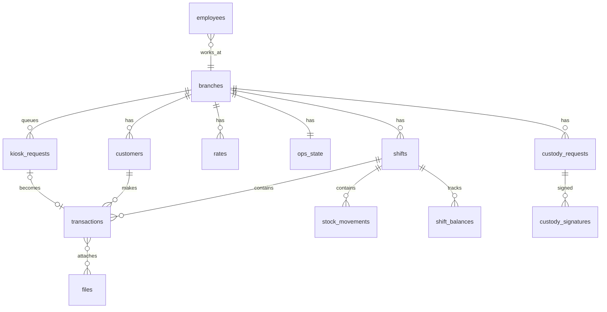
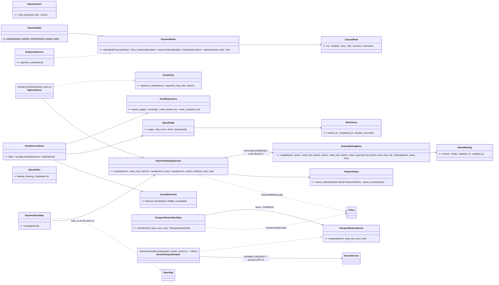

# XCHANGE — Flutter customer kiosk (phase 1), Rust + PostgreSQL server (phase 2)

> designed-by: claude/96f9c3ef · 2026-10-06 · reviewed on 108-Plaza/xchange PR 1 · what still blocks dispatching tickets is listed in §11

Design for the two phases the owner set on 2026-10-06:

| Phase | What changes | What stays |
|---|---|---|
| **1** | The customer-facing kiosk is rewritten in Flutter (§8) | The v2 Node server, its database, and the admin / desk / staff screens — untouched |
| **2** | The server becomes Rust + PostgreSQL, speaking the same HTTP contract (§3–§7) | The admin / desk / staff screens, and the phase 1 kiosk |

Rewriting the admin / desk / staff screens is not in either phase and is not designed here.

Phase 1 needs only §5.3's `/api/kiosk` row and §8. Everything else in this document is phase 2 and
can be reviewed later without holding phase 1 up.

## 0. What this was measured from, and what it was not

| Source | State |
|---|---|
| `xc-desk-v2-deployed-20261005-1758.zip` — built bundle, `SOURCE-VERSIONS.json` = `xchange-online@3ffc5a5`, `xchange-booking@206345c` | Read: all app code in `server.mjs` lines 5349–8301 (engine, operations, ledger, auth, kiosk, devices, routes), `schema.sql`, `cutover.sh`, `migrate-v1.mjs`, nginx configs |
| `XC-Desk-v2-Passport-Drawer-20261006.zip` — the **10-06 bundle**, sha256 `6514b4c8…`, manifest `passport-drawer-20261006`, `"deployed": false`; its `SOURCE-VERSIONS.json` is the same `xchange-online@3ffc5a5` as above, so it is told apart by its own hashes (§5.5) | Read for §5.5 only: the diff against the 10-05 bundle, its three server modules and `.sql`, its four notes files, and every changed or new `public/` file |
| Source repos `xchange-online`, `xchange-booking` | **Not available** — not found under `108-Plaza`, `yuthstyle88`, or on this machine |
| Minified React (`public/staff.js`, `staff-report.js`), `kiosk.html`, embedded admin/desk HTML | **Not read** — screens in §8 are derived from the API they call, not from the UI code |
| Live database `xc_desk_v2` | **Not read** — row counts and real data shapes are unmeasured |

Line references below are `server.mjs:<line>` in that archive.

## 1. Root cause this design removes

The v2 code is a Google Apps Script program run inside two emulation layers
(Apps Script → Cloudflare D1/R2 → Node + PostgreSQL), never rewritten:

- Every business row is a JSON array in `ledger_rows(table_name,row_number,payload)`; branches are a table-name prefix (`server.mjs:6789`).
- Every request, reads included, loads the whole branch ledger, runs the engine in memory, diffs all rows (`server.mjs:7010-7068`).
- All writes in all branches serialise on one row, `ledger_control.id=1`, with 4 optimistic retries.
- Money is IEEE double (`cents_`, `server.mjs:6341`).
- A transaction belongs to a shift by spreadsheet row range (`startRow`/`endRow`, `server.mjs:6621`).
- Authorisation is decided in three places with different allow-lists (`server.mjs:7434`, `8080`, `5971`).
- Post-save work (print job, kiosk completion) runs outside the save, so "saved but post-save failed" exists (`server.mjs:7756`).

v3 stores typed rows, locks per branch, computes money in decimal, links by foreign key,
authorises in one module, and does post-save work in the same DB transaction.

## 2. Decisions

| # | Decision | Status |
|---|---|---|
| D1 | Phase 1: customer kiosk = Flutter, everything else as is. Phase 2: server = Rust + PostgreSQL behind the unchanged admin / desk / staff screens | **decided** (owner 2026-10-06) |
| D2 | sqlx 0.9, `rust_decimal`, actix-web 4, edition 2024, toolchain 1.98.1 — and **the workspace is laid out like `pos108-core`** (owner, 2026-10-06: "rust ให้ ดู โครง สร้างจาก 108pos"); see §5.2 | [required] |
| D3 | One repo `108-Plaza/xchange` with `api/` and `app/` | **decided** — repo created 2026-10-06 |
| D4 | Sign-in = v3's own owner/employee accounts in `xc-auth`, with v2's contract and cookies: the kept `login.html` and `account-bar.js` post to `/api/auth` and rely on `__Host-xc_owner` / `__Host-xc_staff` (§6) | **decided** (owner 2026-10-06, in the Identity session, relayed by claude/21bc39ab: "ให้ xc-auth เก็บบัญชีพนักงานเอง"). The same day the owner first asked whether Identity could be plugged in; measured at `108-platform-services` `46be83f`, it cannot create an account with a username only (`crates/auth/src/application/register.rs:101-116`; 400 `missing_identifier` on a running copy) nor let an administrator set another person's password (no such route), and the owner decided to add nothing to Identity because other systems share it ("เพราะ identity platfrom มันทำหน้าที่ แค่ authen"; its ticket 395 closed not planned) |
| D5 | Bookings/members API: the kept admin screen has a "การจองออนไลน์" menu that calls `/api/bookings` | **open — owner**: port it (screen keeps working) or leave it returning an error. No public booking site is deployed (`server.mjs:5922`) |
| D6 | v2 holds **test data only**; no real shop uses it (owner, 2026-10-06: "ตอนนี้ v2 ยังเป็นข้อมูลทดสอบ ยังไม่มีร้านจริง") | **decided**. v3 starts on an empty database; nothing is imported (§7). If a real shop starts on v2 before the cutover, this row and §7 must be reopened |
| D7 | Service hours 11:00–22:50 / 23:00 stay hard-coded as in v2 (`server.mjs:6037`, `6876`) | [required] for parity; a setting would need a screen that does not exist |
| D8 | Kiosk delivery = Flutter **web** served on the customer host | **decided** (owner 2026-10-06) and **extended by D9**. The reason first given here — "an installed app sends no `Origin`" — was wrong: measured 2026-10-06 on a local v2 copy, `POST /api/kiosk` answers 200 when the client itself sends `Origin: <the server's own origin>`, 400 with no `Origin`, 400 with another one. The check is a cross-site guard for browsers, not something an app cannot satisfy |
| D9 | The same kiosk is also an **Android app distributed through the Play Store** (owner 2026-10-06: "ต้องให้ ลูกค้า ทำผ่าน ทาง pay store", "ลูกค้าใช้ android"). Application id **`com.spacing.xchange`**, store name **`XC.Xchange`** (both typed by the owner). The web build stays; one code base, two targets (§8.1) | **decided** — store identity: never changed without the owner |
| D10 | v3 targets the kept screens of the **10-06 bundle**: payment settings per branch, queue work and the admin refresh are designed to be cut into tickets; the passport-step drawer is designed and **held** (§5.5) | **decided** (owner 2026-10-07, relayed by the lane controller claude/7ca80c: "B ทำเลย"; the drawer half stays under "ยังไม่integrate ตอนนี้", #274) |

## 3. Domain rules carried over (behaviour table)

These are the behaviours the Rust code must keep. Each row becomes an up-front failing test (§9).

| Area | Rule | v2 evidence |
|---|---|---|
| Amount | 0 ≤ n ≤ 100,000,000, at most 2 decimals; rate at most 4 decimals, > 0 | `6334`, `6515` |
| Principal | `principal = round_half_up(amount × rate, 2)` | `6448` |
| BUY (shop buys FX) | `paid = principal − fee`; fee ≤ principal; `received = 0` | `6450` (fee check), `6452` (paid) |
| SELL (shop sells FX) | `received = principal + fee`; `paid = 0` | `6451` |
| Stock delta | BUY: `+amount` FX; SELL: `−amount` FX. THB moves only when method is `Cash`: SELL `+(principal+fee)`, BUY `−(principal−fee)` | `6531-6540` |
| Stock guard | No currency balance may go below zero after the delta | `6554` |
| Rate guard | Submitted rate must equal the current counter rate for that side, unless the save is for a verified booking | `6742` |
| Shift | At most one OPEN shift per branch; a LIVE save needs one | `6526`, `6739` |
| Close shift | Client sends the expected balances it counted against; mismatch with server-computed ⇒ refuse. Non-zero difference needs a note | `6694-6696` |
| Save rate | `sell ≥ buy`; optimistic check on previous `updatedAt`; partner name and partner cost both or neither; BoT reference captured at save | `6705-6719`, `7017-7023` |
| Customer identity | Unique on (passportNo, nationality, mode) within a branch; ID `CX-%08d` from a counter (`TEST-` prefix in DEMO) | `6375-6378` |
| Document ref | `XC-yyyymmdd-%06d`, counter per (mode, Bangkok date), **global across branches** | `6476` |
| Idempotency | Same `submissionId` + same payload hash ⇒ return the saved result; different hash ⇒ refuse. Admin actions do the same on `requestId`; an abandoned `requestId` can never be applied | `6465-6473`, `6747-6762` |
| Payment | Methods: Cash, Bank Transfer, Credit Card, Alipay, PromptPay (`SCB Transfer` is read as Bank Transfer). Non-cash needs a payment ref and a slip file; passport file always | `6446-6453`, `6624` |
| Custody (when enabled) | Phases CLOSED → READY → OPEN → CUT_OFF → COUNTING; request kinds OPEN, HANDOVER, CLOSE, SAFE_OPEN, SAFE_IN/OUT, EXTERNAL_IN/OUT; one PENDING request at a time; signature rules per kind; Backend commits and must not be sender/receiver | `5969-6250` |
| Custody gate on save | Only the FRONT custodian, clocked in, in phase OPEN (or CUT_OFF with an open draft); customer must not be on hold | `6868-6877` |
| Kiosk | QUOTED → WAITING → ACCEPTED → ID_CHECKED → COMPLETED; no way back, nothing cancels a request. `EXPIRED` is never stored: it is computed at read time, and is what a QUOTED row reads as from 300,001 ms after it was made (`7913`); only a quote expires. A quote can be confirmed from 3,000 ms (`7981`, enforced by the server) to 300,000 ms (`7980`), both inclusive. A QUOTED row is deleted only when a later quote arrives and its age then exceeds 600,000 ms (`7971`); from then on the answer is "not found". `confirm` on a row already past QUOTED returns its identity instead of failing (`7978`), so a retry is safe. Rate re-checked at confirm (`7983-7984`); only the accepting employee may continue. The kiosk's own amount cap is 10,000,000 (not the 100,000,000 of the Amount row). SELL takes an amount of **baht** and floors the foreign figure to two decimals; BUY takes the foreign amount; in both, baht = foreign × rate rounded half up. A published receipt is readable for strictly less than 600,000 ms. Kiosk refusal sentences are English, except the four of the save hook, which are Thai. Measured in the preparation of #67 | `7957-8045`, `8060-8075` |

Known differences v3 introduces on purpose:

- Decimal arithmetic can differ from v2's float at exact half-cent midpoints. §7 keeps stored v2 values and reports rows where recomputation differs.
- Transaction statuses `PENDING_FILES` / `ERROR` are never produced by v3: files are uploaded first and the save is one DB transaction. The screens already handle their absence (they are the error path).
- The receipt HTML is still generated and stored at save, byte-compatible in structure with v2, because the kept screens open it by URL and `receipt-image` parses its `<dt>/<dd>` rows (`server.mjs:7545`).
- Kiosk SELL quotes use the exact figure where v2's floating point gave one hundredth less: when the baht named buy an exact number of hundredths, v2's division landed just below (14.67 baht at 32.60: v2 hands over 0.44 for 14.34 baht, v3 0.45 for 14.67). Together with the half-hundredth case of the first item, 12 of the 219 quotes recorded from v2 differ (#67).
- `complete` on a kiosk request that was never passport-checked (QUOTED, WAITING, ACCEPTED) is refused; v2 silently stored the link to the saved document and left the status as it was (#67).
- Kiosk amounts must be plain decimals with at most two places; anything else (more places, exponent notation, spaces, a negative figure) is refused instead of being coerced the way JavaScript coerces it (#67).
- Custody: a request that cannot be read is refused before every other check. v2 read each field at the moment it used it, so with custody disabled it answered "custody is not enabled" even for a malformed request. The sentences are v2's; their precedence is not (#72).
- Custody: the payload hash of a proposal ignores key order (it is taken over the payload with its keys sorted), so two payloads that differ only in key order are the same request; v2 hashed the keys in the order the screen sent them (#72).
- Custody: a transfer note that would make the stock movement's reason exceed 200 characters is refused at propose time, with the shift's own sentence. v2 accepts it and refuses only at commit or reject, after the request is already in transit, which leaves it in transit for ever (#68).

## 4. Data model

Types: money `NUMERIC(20,2)` (an entered amount is capped at 100,000,000, but a computed baht figure is not — v2 stores 3,209,999,999.68 for 99,999,999.99 × 32.1), rate `NUMERIC(14,4)`, time `timestamptz`, ids `uuid` unless a human-facing code is noted.



| Table | Key columns | Replaces |
|---|---|---|
| `branches` | `id text` (keeps `MAIN`, `B<uuid>`), `name` unique (case-insensitive), `service_open`, `service_last_new`, `service_close` | `AdminBranches` |
| `currencies` | `code char(3)` PK, `name_th`, `name_en`, `symbol` | arrays at `6512`, `6626`, `src/currencies.mjs` |
| `rates` | append-only: `branch_id`, `code`, `buy`, `sell`, `partner_name`, `partner_cost`, `reference jsonb`, `updated_at`, `updated_by`, `request_id`, unique on (`branch_id`, `request_id`) — v2 keeps requests per branch | `AdminRates` |
| `customers` | `id text` (`CX-…`), `branch_id`, `name`, `passport_no`, `nationality`, `birth_date`, `passport_expiry`, `mode`, unique (`branch_id`,`passport_no`,`nationality`,`mode`) | `Customers` |
| `shifts` | `id`, `branch_id`, `status`, `opened_at/by`, `closed_at/by`, `close_note`, `open_request_id`, `close_request_id`; partial unique index on (`branch_id`) where `status='OPEN'` | `AdminShifts` |
| `shift_balances` | (`shift_id`,`code`) PK, `opening`, `expected` (a running total: set at open, added to by every movement and saved transaction, frozen at close — `xc-shift` may not read another context's tables to recompute it), `counted`, `difference` | Opening/Expected/Counted/Difference JSON |
| `stock_movements` | `id`, `shift_id`, `code`, `direction`, `amount`, `reason`, `branch_id`, `request_id`, unique on (`branch_id`, `request_id`) | `AdminMovements` |
| `transactions` | `id`, `document_ref` unique, `branch_id`, `shift_id` FK (null in DEMO), `mode`, `status`, `type`, `code`, `amount`, `rate`, `reference_rate`, `principal`, `fee`, `bank_fee`, `received`, `paid`, `method`, `payment_ref`, `account`, `customer_id`, `staff_id`, `booking_no`, `notes`, `value_date`, `paid_at`, `recorded_at`, `submission_id` unique, `payload_hash`, `kiosk_request_id` | `Transactions`, `DemoTransactions` |
| `transaction_files` | (`transaction_id`,`kind`) PK → `files.key`; kind PASSPORT / SLIP / RECEIPT | columns 25–27 |
| `files` | `key`, `branch_id`, `owner_id`, `mime`, `sha256`, `created_at` | `file_records` |
| `counters` | `key` PK, `value bigint` | `ledger_control.properties` |
| `abandoned_requests` | (`branch_id`, `request_id`) PK, `at`, `actor` — a request abandoned in one branch can be used in another, as in v2 | `AdminRequests` |
| `ops_state` | `branch_id` PK, `enabled`, `phase`, `custodian_id`, `entity jsonb`, `target jsonb`, `safe jsonb`, `cutoff jsonb` | `OpsState` JSON blob |
| `attendance`, `custody_requests`, `custody_signatures`, `ops_events`, `cash_exceptions`, `customer_holds`, `tx_drafts` | one row per array element of the blob | arrays inside `OpsState` |
| `kiosk_requests`, `kiosk_currencies`, `kiosk_receipts` | as v2, `data` split into typed columns, `transaction_id` FK replaces `kiosk_transactions` | same names |
| `device_jobs`, `device_events`, `device_settings` | as v2 | same names |
| `receipt_images` | [proposed] `branch_id`, `document_ref` → `transactions.document_ref`, `file_key` → `files.key`, `created_at`; PK (`branch_id`, `document_ref`) — columns not yet read from v2, §5.4 | same name |
| `employees`, `employee_audit`, `employee_sessions`, `owners`, `owner_sessions`, `auth_attempts` | as v2 | same names; `auth_attempts` replaces the reuse of `booking_limits` |
| `branch_versions` | `branch_id` PK, `version bigint` — the per-branch lock row, incremented inside every committed `BranchTx::run`, and, for the second branch, every `BranchTx::lock_also` inside one, whether or not it wrote anything (a repeated request counts): the version never misses a change but may rise when nothing changed — an equal version reads as "unchanged", a higher one as "may have changed" (#231) | new |

None of these tables exists in any v3 database yet (the first migrations are in tickets #54 and #48), so a change to this section before they merge migrates nothing; after that, a change here needs its own data-migration section.

Concurrency: a write handler opens a transaction and takes `SELECT … FOR UPDATE` on `branch_versions`. Most writes operate on a single branch (a write on `MAIN` alone, or on one other branch alone, takes one lock as before). That gives per-branch serialisation (v2 serialised the whole system) and makes "one PENDING custody request", "one OPEN shift" and the stock guard race-free without retries.

A write that depends on what two branches hold takes two locks. Lock order: `MAIN` first through `BranchTx::run`, then the other branch through `BranchTx::lock_also` — never the reverse. A transaction run on a branch other than `MAIN` never calls `lock_also` for `MAIN`. With one global lock order there is no cycle to deadlock in. `BranchService::create` (#117) is the one such write today. The doc comment of `BranchTx::lock_also` in `api/crates/xc-kernel/src/branch_tx.rs` records this rule in code.

[required] That lock is `BranchTx` (§5.1, §5.2: crate `xc-kernel`). `pos_infra::transactions::Transactor` gives a transaction but
nothing branch-scoped and no `FOR UPDATE` (`108-platform-services` `crates/pos-infra/src/transactions.rs`: `new`, `pool`, `run`).
A use case that writes **must** go through `BranchTx::run`, never through `Transactor::run` directly; calling the bare
transactor compiles, passes every single-threaded test of §9, and silently loses all three guarantees. The concurrency
tests named in §9 exist to catch exactly that.

## 5. API (Rust)

### 5.1 Class diagram

```mermaid
classDiagram
  direction LR
  class Money { +parse(str) Result~Money~; +minor() i64; +minor_i128() i128; +from_minor(i64) Result~Money~; +try_from_minor_i128(i128) Result~Money~; +is_zero() bool; +ZERO }
  class Rate { <<xc_kernel::money::rate>> +parse(str) Result~Rate~; +value() Decimal }
  class PlainDecimal { <<fn, xc-kernel::money>> +plain_decimal(text) Option~Decimal~ }
  class InputRules { <<fn, xc-kernel::input>> +text(raw, max_utf16, required) Result~str~; +calendar_date(text) Result~NaiveDate~; +number_error(NumberError) InputError; +DATE_FLOOR }
  class InputError { <<enum, xc-kernel::input>> Text; DateFormat; Date; Number; TooManyDecimals; +sentence() str }
  class Bangkok { <<fn, xc-kernel::time>> +bangkok() FixedOffset; +BANGKOK_OFFSET_SECONDS }
  class BranchId { <<xc-kernel::ids>> +new(text) BranchId; +as_str() str; +is_well_formed(text) bool }
  class Quote { +principal: Money; +received: Money; +paid: Money; +compute(side, amount, rate, fee) Result~Quote~ }
  class CurrencyCode { +parse(str) Result~CurrencyCode~; +THB; +as_str() str }
  class MoneyDelta { +minor: i128; +plus(Money) MoneyDelta; +minus(Money) MoneyDelta; +add(MoneyDelta) MoneyDelta; +checked_plus(Money) Result~MoneyDelta~; +checked_minus(Money) Result~MoneyDelta~; +checked_add(MoneyDelta) Result~MoneyDelta~; +to_money() Result~Money~; +is_negative() bool }
  class Balances { +get(CurrencyCode) Money; +apply(StockDelta) Result~Balances~ }
  class StockDelta { +fx: (CurrencyCode, MoneyDelta); +thb: MoneyDelta; +for_tx(side, code, amount, quote, cash) StockDelta; +for_movement(code, direction, amount) StockDelta }
  class ShiftLedger { +expected(opening, deltas) Result~Balances~; +ensure_non_negative(bal, delta) Result; +difference(expected, counted) StockDelta }
  class StockError { <<enum, xc-shift::domain::shift::value_objects::stock_delta>> NotAStockCurrency; Insufficient(CurrencyCode); OutOfRange }
  class CustodyMachine { +apply(state, cmd, actor, facts, now) Result~Transition~ }
  class KioskMachine { +authorize(action, actor) Result; +quote(input, facts, new_id, now) Result~KioskRequest~; +next(request, command, actor, facts, now) Result~Transition~; +identity(request, now) Result~RequestIdentity~; +check_get(request, actor) Result; +check_publish(request, actor) Result; +check_save(request, save, actor) Result; +complete(request, submission_id, document_ref) Result~Transition~; +is_purgeable(request, now) bool; +receipt_readable(published, now) bool }
  class Policy { +allow(actor: Option~Actor~, path: EntryPath, action: Action) Result; +branch(actor: Option~Actor~, named: Option~BranchId~) BranchId }
  class Actor { -id; -kind: ActorKind; -role: Role; -branch_id: Option~BranchId~; +owner(id) Actor; +staff(id, role, branch) Option~Actor~; +id() str; +kind() ActorKind; +role() Role; +branch_id() Option~BranchId~ }
  class ActorKind { <<enum>> Owner; Staff }
  class EntryPath { <<enum>> Rpc; StaffRpc; Upload; StaffUpload; File; StaffFile; StaffDesk; Devices; Kiosk; OwnerRoute; UserRoute; Custody }
  class Action { +new(name) Action; +as_str() str }
  class PolicyError { +status() u16 }
  class AccountService { +login(); +logout(); +status(); +change_password(); +employees(action); +disable_employee_in(tx, id, now, actor) }
  class EmployeeCustody { <<trait, application::custody>> +holds_cash_or_pending(branch, employee_id) bool; +holds_cash_or_pending_in(tx, branch, employee_id) bool }
  class DisableEmployee { <<application::workflows>> +run(custody, branch, employee_id, actor, now) DisableOutcome }
  class PasswordHasher { +hash(password) Result~String~; +verify(password, stored) bool }
  AccountService --> PasswordHasher
  DisableEmployee --> BranchTx : one run on the employee's branch
  DisableEmployee --> EmployeeCustody : asks again under the lock
  PgEmployeeCustody ..|> EmployeeCustody
  PgEmployeeCustody --> CustodyService : built by pg_custody_service
  CompatRpc --> CustodyService : built by pg_custody_service
  DisableEmployee --> AccountService : closes the account under the lock
  KioskService --> PlainDecimal : configure
  ShiftService --> PlainDecimal : the expected count of a close
  InputRules --> InputError : every refusal, with its sentence
  TxService ..> InputRules : the customer's details and the save form
  RateService ..> InputRules : texts and numbers of rates and branches
  ShiftService ..> InputRules : texts of a shift command
  TxService ..> Bangkok : the receipt's time and the document number's day
  CustodyService ..> Bangkok : the minute of the day
  BotRateSource --> PlainDecimal : the bank's rate

  class TxService { +reserve_customer(); +save_transaction(); +documents() }
  class ShiftService { +open(); +close(); +move_stock() }
  class RateService { +save_rate(); +current(); +history() }
  class CustodyService { +command(); +state() }
  class KioskService { +public_rates(); +quote(); +confirm(); +staff_action() }
  class KioskPorts { <<trait, xc-kiosk>> +branch_name(); +counter(); +counter_in(tx); +save_rate(); +record_in(tx, branch, line, at) }
  class PgKioskPorts { <<infrastructure::kiosk::kiosk_ports>> }
  class KioskAuditLog { <<trait, infrastructure::kiosk::kiosk_ports>> +record_in(tx, branch, line, at) }
  class KioskIds { <<trait, presentation::http::kiosk>> +new_id() String }
  KioskPorts <|.. PgKioskPorts
  PgKioskPorts --> KioskAuditLog : record_in on the step's transaction
  class DeviceRepository { <<trait, infrastructure::devices::device_repository>> +insert_event(tx, branch, event) bool }
  class ClientAddress { <<fn, presentation::http::client_address>> +client_address(req) str }
  KioskAuditLog --> DeviceRepository : insert_event into device_events (v2's place)
  KioskService --> ClientAddress : the route takes the quote's client address from client_address only (X-Real-IP)
  class DeviceService { +queue(); +process(); +retry(); +set_printer_online(); +drawer_observation(); +scan_imported(); +overview(); +require_count_confirmed(cash, confirmed)$; +after_save_in(tx, branch, saved, actor, now); +set_printer(); +set_drawer(); +drawer_settings(branch) DrawerSettings; +with_printer_models(models) }
  class SaveStep { <<trait, application::workflows::save_step>> +before_in(tx, ctx); +after_in(tx, ctx, saved) }
  class DeviceSaveStep { <<application::workflows::device_save_step>> +new(DeviceService) }
  class SavedExchanges { <<trait, infrastructure::devices::saved_exchanges>> +find(branch, ref) Option~ExchangeState~ }
  class PgSavedExchanges { <<infrastructure::devices::pg_saved_exchanges>> +new(TransactionService) }
  class ReceiptImageService { <<infrastructure::devices::receipt_image_service>> +image(branch, ref, actor, now) Result~ReceiptImage~ }
  SaveStep <|.. DeviceSaveStep
  SaveStep <|.. KioskSaveStep
  SaveStep <|.. CustodySaveStep
  DeviceSaveStep --> DeviceService : require_count_confirmed before, after_save_in after, on the save's tx
  DeviceService --> SavedExchanges : queue, drawerObservation
  SavedExchanges <|.. PgSavedExchanges
  PgSavedExchanges --> TxService : find(branch, ref), live only
  ReceiptImageService --> TxService : the exchange and its receipt key
  ReceiptImageService --> FileService : reads the receipt, stores the image
  class FileService { +upload(); +open(); +mime_in_branch(key, branch) Option~String~ }
  class DocumentsLookup { <<application::workflows>> +find(branch, ref) Result~Documents~ }
  class SameOrigin { <<fn, presentation::extractors::origin>> +same_origin(req) bool }
  class BranchTx { +run(branch, f) Result — locks the branch row, runs f, bumps the version, commits; the bump happens whether or not f wrote: higher = may have changed; +lock_also(tx, branch) }
  class CompatRpc { +dispatch(action, payload, actor) Result~Json~ }
  class SnapshotBuilder { +admin_snapshot(branch, actor) Json; +desk_config(branch) Json }
  class PageServer { +page(name, actor) Html; +static_file(path); +forms_script() JS — /_xc/forms.js, compiled in (FV) }
  class RateSource { <<trait>> +fetch() Result~ReferenceRates~ }
  class DeviceDriver { <<trait, async>> +mode() str; +run(kind, printer: PrinterSettings) JobStatus; +run_with(kind, printer, drawer: DrawerSettings) JobStatus }
  class PrinterSettings { <<infrastructure::devices::printer_settings>> +online: bool; +kind: PrinterKind; +read_in(tx, repo, branch) PrinterSettings }
  class PrinterKind { <<enum>> Simulated; Network(host, port) }
  class PrinterModel { <<infrastructure::devices::printer_models>> +id: String; +name: String; +paper_mm: u16; +drawer_pulse: Option~DrawerPulse~ }
  class DrawerSettings { <<infrastructure::devices::printer_models>> +model: String; +has_drawer: Option~bool~; +read_in(tx, repo, branch, models: PrinterModels) DrawerSettings }
  class DrawerPulse { +pin: u8; +on: u8; +off: u8; +kick_bytes() Vec~u8~ }
  class PrinterModels { <<registry, from Settings.devices.printer_models>> +new(models) Result~PrinterModels~; +get(id) Option~&PrinterModel~; +default_id() str }
  class EscposDriver { <<infrastructure::devices::escpos_driver>> +new(transport: Arc~dyn PrinterTransport~) }
  class PrinterTransport { <<trait>> +send(host, port, bytes) Result }
  class DeviceWorker { <<infrastructure::devices::device_worker>> +spawn(devices, every) JoinHandle }
  class BotRateSource
  class SimulatedDriver

  CompatRpc --> TxService
  CompatRpc --> ShiftService
  CompatRpc --> RateService
  CompatRpc --> CustodyService
  CompatRpc --> SnapshotBuilder
  DocumentsLookup --> FileService : the type of each file, from its record, no bytes
  CompatRpc ..> SameOrigin : both RPC routes
  SnapshotBuilder --> BranchTx : reads the version (higher = may have changed; equal = unchanged)
  Quote --> Money
  Quote --> Rate
  StockDelta --> Quote
  StockDelta --> MoneyDelta
  StockDelta --> CurrencyCode
  Balances --> CurrencyCode
  ShiftLedger --> Balances
  ShiftLedger --> StockDelta
  TxService --> Quote
  TxService --> ShiftLedger
  TxService --> CustodyMachine : gate on save
  TxService --> KioskMachine : complete on save
  TxService --> DeviceService : queue receipt in same tx (through DeviceSaveStep, §5.4)
  ShiftService --> ShiftLedger
  CustodyService --> CustodyMachine
  CustodyService --> ShiftService : open/close/move via commit
  RateService --> RateSource
  DeviceService --> DeviceDriver
  RateSource <|.. BotRateSource
  DeviceDriver <|.. SimulatedDriver
  DeviceDriver <|.. EscposDriver
  EscposDriver --> PrinterTransport : Network kind only; Simulated kind answers as SimulatedDriver
  DeviceWorker --> DeviceService : process(auto drawer jobs) outside the save tx
  DeviceService --> PrinterSettings : read on the claim tx
  DrawerSettings --> PrinterModels : printerModel names one printer model
  EscposDriver --> DrawerPulse : the kick bytes of the branch model
  TxService --> BranchTx
  ShiftService --> BranchTx
  CustodyService --> BranchTx
  RateService --> BranchTx
  KioskService --> BranchTx
  class SaveAction { <<application::compat::actions::save>> +new(workflow, devices, kiosk, custody) SaveAction; +handles(route, action) bool; +run(call) V2Json }
  SaveAction --> SaveTransactionWorkflow : save_as, with the three steps registered
  SaveAction ..> DeviceSaveStep : registers first
  SaveAction ..> KioskSaveStep : registers second
  SaveAction ..> CustodySaveStep : registers third
  Policy --> Actor
  Policy --> EntryPath
  Policy --> Action
  Policy ..> PolicyError : refuses with
  Actor --> ActorKind
```

[required] `Policy` and `KioskMachine` are drawn as their tickets pin them (#65, #67); the diagram shortens the Rust, which is:

```rust
Policy::allow(actor: Option<&Actor>, path: EntryPath, action: &Action) -> Result<(), PolicyError>
Policy::branch(actor: Option<&Actor>, named: Option<&BranchId>) -> BranchId
KioskMachine::next(request: Option<&KioskRequest>, command: &KioskCommand, actor: &KioskActor,
                   facts: &CounterFacts, now: KioskTime) -> Result<Transition, KioskError>
```

`KioskMachine::next` takes the whole request and returns the whole request, not a status: the rules need when the quote was made, who holds the request and the rate it was quoted at. The machine is pure — the counter facts (shift open, the counter rate now), the new id and the time are handed in. `xc-kiosk` has its own `KioskActor` and `KioskRole` because a context crate does not import `xc-auth` (dependency rule, §5.2).

**Money arithmetic is checked in the core** (#37; owner's decision 2026-10-07, option A, recorded on #37 issuecomment-6030840634). An amount nobody can reach in a shop must still never become a silently wrong total: it becomes a refusal.

| Piece | Rule |
|---|---|
| `MoneyDelta::checked_plus(Money)`, `checked_minus(Money)`, `checked_add(MoneyDelta)` **[required]** (`xc-kernel/src/money/money_delta.rs`) | `i128` `checked_add` / `checked_sub`; `None` ⇒ `Err(NumberError::Invalid)`. Same result as `plus` / `minus` / `add` whenever those do not overflow |
| `Money::try_from_minor_i128(i128)` **[required]**, public (`xc-kernel/src/money/money.rs`) | negative, or above what `Decimal` holds at scale 2 (2^96 − 1 hundredths) ⇒ `Err(NumberError::Invalid)`; otherwise the exact amount, `minor_i128()` returning the same `i128`. Replaces the crate-private `from_minor_i128`; `MoneyDelta::to_money` uses it |
| `ShiftLedger::expected` and `ensure_non_negative` **[required]** (`xc-shift/.../entities/shift_ledger.rs`) | sum with `checked_add`; an overflow, or an end balance `to_money` refuses, is `Err(StockError::OutOfRange)` — never left out of the result. `Insufficient` keeps its place: a negative end balance is still that |
| `StockError::OutOfRange` **[required]** (`xc-shift/.../value_objects/stock_delta.rs`) | mapped by `ShiftService` to `ShiftError::AmountInvalid` (`จำนวนเงินต้องไม่ติดลบ ไม่เกิน 100,000,000 และมีทศนิยมไม่เกิน 2 ตำแหน่ง`) at every place it maps `StockError` today (`application/shift/service.rs`) |
| the safe in `CustodyMachine` (`SafeOut` at dispatch, `SafeIn` at commit) **[required]** (`xc-shift/.../custody/entities/custody_machine.rs`) | `MoneyDelta::from(current).checked_minus(amount)` / `checked_plus(amount)`, then `to_money()`; any `Err` ⇒ `CustodyError::AmountInvalid`, the state unchanged. No `Money::minor()` (an `i64` that cuts above 2^63 hundredths) on this path |

What stays unchecked, and why: `MoneyDelta::{plus, minus, add}` remain for building a `StockDelta` (`StockDelta::of`, `for_tx`, `for_movement`) and for `ShiftLedger::difference` — each operand there is one `Money` (below 2^96 hundredths) and at most two are combined, so the result cannot leave `i128`. `Money::minor()` stays `i64` for its callers that hold input-sized amounts; no new caller on a computed balance. No `Balances` method changes.

`RateSource` and `DeviceDriver` are traits because a second variant is already known
(KBank reference rates in `public/kbank-reference.json`; a real ESC/POS driver). `FileService` and
`BranchTx` stay concrete — one variant, none planned.

### 5.2 Where each class lives — the `pos108-core` layout

Measured from `108-Plaza/pos108-core` at `405605de` and reproduced here so nothing has to be re-shaped later:

| `pos108-core` | here |
|---|---|
| The root manifest is both the workspace and the `pos108` binary package; its `src/` holds `application/ bootstrap/ config/ infrastructure/ presentation/{dto,extractors,http,middleware,responses} shared/ telemetry/` | `api/Cargo.toml` is both the workspace and the `xchange` binary package, with the same `src/` tree |
| One crate per bounded context, `crates/pos-<context>/`, each `src/{application,domain,infrastructure}/<context>/` | `api/crates/xc-<context>/`, same three layers |
| `domain/<context>/{entities,value_objects,repositories,commands}/` — repositories are **traits** | same |
| `application/<context>/<use_case>.rs` — one file per use case, `pub async fn execute(cmd, repo: &Arc<R>, transactor: &Transactor) -> AppResult<…>`, plus `service.rs` | same |
| `infrastructure/<context>/<x>_repository.rs` — the sqlx implementation of the trait | same |
| Each crate's `lib.rs` re-exports `crate::shared::error::{AppError, AppResult}` | same |
| `pos-kernel`, `pos-error`, `pos-infra` come from `108-platform-services` as git dependencies pinned to one `rev` in `[workspace.dependencies]` | **reused, not copied**: `pos-error` (`AppError`/`AppResult`), `pos-infra` (`Transactor`, config, telemetry) — same pinning rule |
| `migrations/`, `configuration/`, `tests/`, `deny.toml`, `rust-toolchain.toml` at the workspace root | under `api/` |
| edition 2024, `rust-version = "1.85"`, toolchain `1.98.1` | same |

Two things are **not** taken from `pos-kernel`, with the reason:
- `pos_kernel::money::Money::new` rounds with `round_dp(2)` (banker's rounding) and has no input cap. An exchange principal must round **half up** and an entered amount is capped at 100,000,000 (§3). This server therefore has its own `Money`, `Rate`, `Side` and `Quote`, and they live in **`xc-kernel`** (`src/money/`), not in a context crate: the quote is needed by the exchange (save), the kiosk (quote action) and the shift (stock delta), and context crates do not depend on one another (rule below). [required] No file of this server imports `pos_kernel::money`; the direct dependency and the re-export were removed so the wrong `Money` cannot be imported, as a `Money` taken from there would round a principal differently without any test noticing a type error.
- `pos_kernel::ids` are UUID newtypes. A branch id here is text (`MAIN`, `B<request id>`) because the kept screens create and send it; ids are newtypes local to each crate.

**How much of it fits.** `pos108-core` is 42 crates for a multi-tenant product with sync, outbox and
back-office; this server is the Rust form of about 2,950 lines of v2 logic for one shop. The layering,
the file-per-use-case rule, the repository traits and the shared error/transaction crates fit as they are.
The crate count does not: a crate per small context would be mostly manifests. So the same shape is
used with **five** context crates and one small kernel crate, a context crate holding more than one sub-context directory where the contexts are
small and change together (`pos108-core` crates already nest `domain/<context>/`):

| Crate | Sub-contexts (`domain/<x>/`, `application/<x>/`, `infrastructure/<x>/`) | Classes of §5.1 |
|---|---|---|
| `xc-kernel` | no layers — the few things every context crate needs and `pos-kernel` cannot supply: `ids.rs` (`BranchId` and the other text ids; `BranchId::is_well_formed(text: &str) -> bool` is the one rule for the shape of a branch name — 1 to 70 characters of `A-Za-z0-9-`, v2 `server.mjs:6999` — and `BranchId::new` stays a plain wrapper that checks nothing), `branch_tx.rs` (`BranchTx`, a wrapper over `pos_infra`'s `Transactor` that takes `SELECT … FOR UPDATE` on the branch's `branch_versions` row, runs the closure, increments the version — whether or not the closure wrote, so a higher version means "may have changed" and never misses a change — commits), and `money/` — one file per type: `money.rs` (`Money`, `NumberError`), `rate.rs`, `side.rs`, `quote.rs`, `money_delta.rs` (`MoneyDelta`, a signed amount in hundredths for stock changes and count differences), `currency_code.rs` (`CurrencyCode`, the stock register of v2 `server.mjs:6512`, `THB` first) | `BranchTx`, `Money`, `Rate`, `Quote`, `MoneyDelta`, `CurrencyCode` |
| `xc-exchange` | `exchange` (transactions, document numbers), `customer`, `booking` | `TxService` |
| `xc-shift` | `shift` (shifts, balances, stock movements), `custody` (the custody state machine and its records) | `Balances`, `StockDelta`, `ShiftLedger`, `ShiftService`, `CustodyMachine`, `CustodyService` |
| `xc-rate` | `branch`, `rate` (currencies, counter rates, reference-rate sources) | `RateService`, `RateSource`, `BotRateSource` |
| `xc-kiosk` | `kiosk` (requests, kiosk currencies, published receipts) | `KioskMachine`, `KioskService` |
| `xc-auth` | `account` (owners, employees, sessions), `policy` | `Actor`, `ActorKind`, `EntryPath`, `Action`, `PolicyError`, `Policy`, `AccountService`, `PasswordHasher` |
| root package `xchange` | `presentation/http` (routes of §5.3), `presentation/dto`, `application/compat/` (`CompatRpc`, `SnapshotBuilder`), `application/workflows/` (a save that crosses exchange, shift, custody, kiosk and devices in one transaction), `infrastructure/{files,devices}/` (`FileService`, `DeviceService`, drivers), page serving, bootstrap | `CompatRpc`, `SnapshotBuilder`, `PageServer`, `FileService`, `DeviceService`, `DeviceDriver` |
| root package `xchange`, `application/custody_role.rs` (#233) | the one mapping from a person's role to its part in custody, used by every caller (RPC actor, the saver of an exchange, an employee row): `pub fn custody_role_of(role: Role) -> CustodyRole` — one exhaustive `match`, no `_` arm (`Owner`, `Front`, `Finance`, `Monitor`, `Manager`, `Backend` to their namesakes; `Rates`, `System`, `Documents`, `DocumentReview` to `Other`); `pub fn employee_custody_role(stored: &str) -> CustodyRole` — `Role::parse(stored)`, `None` → `Other`, `Some(Role::Owner)` → `Other` (an employee is never the owner), any other role through `custody_role_of`. It sits in the root package because it needs both `Role` (`xc-auth`) and `CustodyRole` (`xc-shift`), and a context crate may not depend on another (dependency rule below) | `CustodyRole` (`xc-shift`), `Role` (`xc-auth`); no class — two free functions |

Files and devices stay in the root package's `infrastructure/` until they grow: one local file store and
one simulated driver do not earn a crate. They move out the day a second variant is written.

[required] **Dependency rule.** A context crate depends on `xc-kernel` and the three `pos-*` crates, never on another context crate (measured on `main` `4d515d7`: no `xc-*` manifest names another context crate). What two contexts must share is either a pure value that belongs in `xc-kernel`, or is composed in the root package's `application/workflows/`. This is what moved the money types: `StockDelta` in `xc-shift` needs the quote that `xc-exchange` first held.

File rule that keeps tickets from colliding, as in `pos108-core`: one value object, entity or use case per file; a `mod.rs` only re-exports. Two tickets never share a file other than a `mod.rs`, and every `mod.rs` a later ticket would need is created — with all its `pub mod` lines — by the restructuring ticket below, so later tickets do not edit them.

[required] **Route rule.** Routes are registered in exactly one place, and no feature ticket edits it. Ticket T1b gives every handler file under `api/src/presentation/http/` except `health.rs` a `pub fn configure(cfg: &mut web::ServiceConfig, state: &AppState)` (empty until its ticket fills it; `health.rs` keeps its `configure(cfg)`, which T1a's tests pin), makes `presentation::http::configure` in `http/mod.rs` call each of them, and makes `bootstrap::configure` call that one function before the default service. The default service itself moves into `api/src/presentation/pages.rs` as `pages::fallback` — in T1b it answers 404 `Not found` exactly as today; T1c fills it (v2 serves a static file as the last step before its 404, `server.mjs:8286-8289`) and adds the page routes in `pages::configure(cfg, state)`, which T1b also creates empty and calls. So neither T1c nor any other ticket edits `bootstrap/mod.rs` after T1b. A handler module builds its own service from `state.db` and registers it as `web::Data` inside its `configure`; `AppState` gains no field per feature. `configure` runs once per worker, so a service registered there holds no state of its own beyond the pool: state that must be shared (the kiosk's per-IP limit of §6 is the first case) lives in the database, or is built once before `HttpServer::new` and passed through `AppState`. T1b also splits `bootstrap::connect(settings) -> Result<PgPool>` (pool, eager `SELECT 1`, migrations) out of `Application::build`, so a command-line sub-command can use the database without binding a port. After T1b a ticket with HTTP routes edits only its own `http/<name>.rs`. (The state before T1b, measured on `main` `2a998ef`: `api/src/bootstrap/mod.rs:71-74` registers `health::configure` only, and `Application::build` at `:87-107` opens the pool, migrates and binds in one function.) After T1b, at `main` `e2790ac`: `presentation::http::configure` in `api/src/presentation/http/mod.rs` is the one route table (`health::configure(cfg)`, then the ten `configure(cfg, state)`); `bootstrap::configure` (`api/src/bootstrap/mod.rs:71-75`) calls it, then `pages::configure`, then sets `pages::fallback` as the default service — the pages seam, both still empty of pages; and `bootstrap::connect` (`:79`) is a function of its own that `Application::build` calls (`:105`).

**State of the code against this layout.** T2 (PR 14) wrote `Money`, `Rate` and `Quote` in a flat crate; T2b (PR 22, `c04f346`) moved them unchanged to `api/crates/xc-exchange/src/domain/exchange/value_objects/{money,rate,side}.rs` and `…/entities/quote.rs` and created every crate, layer and `mod.rs`. That placement was this document's and it is wrong by the dependency rule above. **T2c** moves the four types, their two test files and the fixture to `api/crates/xc-kernel/src/money/` and `api/crates/xc-kernel/tests/`, unchanged apart from `use` lines and the visibility the new neighbours need, and adds `MoneyDelta` and `CurrencyCode`. `BranchTx` is still a comment-only stub (`api/crates/xc-kernel/src/branch_tx.rs` on `main` `4d515d7`: five `//!` lines); it is its own ticket, **T2d**, with the concurrency test.

Fallback when a provider has not landed: the consuming ticket declares a stub with the diagram's
signature in its own file, marked `// moves to <file> with ticket <id>`. It does not wait and does not touch the provider's file.

### 5.3 HTTP contract [required] — identical to v2

The kept screens are the contract. Every route below answers with the same JSON shape, status codes,
error strings (Thai, except the kiosk's — §3) and cookies as v2. Money stays a JSON **number** on the wire here, because the
screens do arithmetic on it; decimals exist only inside the server and the database.

| Route | Body | v2 handler |
|---|---|---|
| `GET /healthz` | — | `8262` |
| `GET /health/ready` → `version`, `build`, `builtAt`, `channel` | — | new (fleet versioning rule) |
| `POST /api/auth` | `{action: status\|login\|logout, payload}` | `7855` |
| `POST /api/rpc` | `{action, payload}` — `adminSnapshot`, `adminDeskConfig`, `adminOpenShift`, `adminCloseShift`, `adminMoveStock`, `adminSaveRate`, `adminCreateBranch`, `adminAbandonRequest`, `getConnectionStatus`, `reserveCustomer`, `saveTransaction` | `7108`, `8090`, hook `7728` |
| `POST /api/staff/{login,logout,password,me,rpc,upload}` · `GET /api/staff/file/{key}` | as v2; `rpc` also carries every `ops*` action | `7486-7519`, `7397` |
| `POST /api/upload?branch=` · `GET /files/{key}` · `GET /documents?branch=&ref=` | raw file body | `7154`, `7095`, `7769` |
| `POST /api/employees` | `{action: list\|create\|reset\|disable\|entity\|enable}` | `7371` |
| `POST /api/reference-rates` | — | `7275` |
| `POST /api/bookings` | `{action, payload}` | `7263` — subject to D5 |
| `POST /api/devices` · `GET /devices/receipt` | `{action: snapshot\|queue\|process\|retry\|printerOnline\|drawerObservation}` | `7665`, `7794` |
| `POST /api/kiosk` | `{action, payload}` — public: `rates`, `quote`, `confirm`, `status`, `customerReceipt`; any signed-in role: `notifications`; OWNER, FRONT, BACKEND, MANAGER: `list`, `accept`, `get`, `identityChecked`, `publishReceipt`; OWNER and RATES: `manage`, `configure`. The 10-06 bundle moves `list` to any signed-in role and changes `rates`, `quote`, `confirm`, `notifications`, `list` and `accept` (§5.5.2, §5.5.3) | `8048` |
| `POST /api/payment-methods` (10-06 bundle) | `{action: list\|save, payload}` | 10-06 `8154`; §5.5.2 |
| `POST /api/drawer-passport` (10-06 bundle) | `{branchId, orderId, kiosk, mode}` | 10-06 `8153`; §5.5.5 — switched off until PD-1 |
| Pages: `/`, `/desk`, `/staff`, `/staff/report`, `/staff/desk`, `/staff/documents`, `/login`, `/devices`, `/kiosk-queue.html`, `/kiosk-currencies.html`, `/staff-guide`, `/receipt-sample`, static assets | — | route table `8143-8188` |

Request rules carried over unchanged: `Origin` must equal the request origin and `X-Xchange-Request: 1`
on every POST (`5542`); body size limits per route; host split — the customer host serves only the
kiosk and `/api/kiosk` (`8263-8267`); staff are forced onto their own branch (`8280`).

Page serving carries over v2's rewriting, which the screens depend on: `window.XC_BRANCH` injection (`5549`),
per-role script injection (`8196-8207`), and the `/staff/desk` variant of the desk page with rewritten
URLs and the `opsBeginTransaction` draft hook (`7416-7418`). The admin and desk HTML are embedded in
the v2 bundle (`5357`, `5558`). [required] v3 serves these pages and v2's `public/` files from a directory named by the
setting `web.dir`, read at run time; **no v2 file is committed to this repository** (the owner's rule for the deployed
bundle). A script in the repository, `api/tools/extract-v2-pages.mjs`, writes that directory from a v2 bundle on the
server at deploy time (the embedded pages byte-for-byte, `public/` copied). `PageServer`'s tests use small pages of their own.

#### The shared form helper (row FV, owner 2026-10-07)

Owner, on the kept "สร้างบัญชีพนักงาน" dialog after `t1` as รหัสบัญชี answered only `ข้อมูลพนักงานไม่ครบหรือไม่ถูกต้อง`:
*"มันต้อง focus.ไป ที่ช่อง ที่มันผิดแล้วมี cursor กระพริบ"* · *"ควรเปลี่ยนสีตรงช่องที่ผิดด้วย"* · and for password fields
*"ตรง รหัส ให้ เปิดดู ได้ ด้วยบางที ลืม"*.

Root cause, measured on the v2 bundle 2026-10-07: the kept pages carry their own client rules, but two of them never run.
`public/employees.js` renders `<input id="employee-username" pattern="[a-z0-9._-]{3,40}" required>` and `public/login.html`
renders `pattern="[a-zA-Z0-9._-]{3,30}"`. Current browsers compile `pattern` with the `v` flag, where a `-` that ends a
character class is a syntax error (`Invalid character in character class`); a pattern that does not compile is ignored, so
the form submits. The server then answers one sentence for four different fields (`EMPLOYEE_DATA`,
`api/crates/xc-auth/src/application/account/service.rs:19`, `:391-412` — username, name, role and branch all refuse with it),
and nothing tells the screen which field it was.

[required] **v2's files stay untouched.** They are the extracted bundle under `web.dir` and are not in this repository (above);
editing them would be lost at the next extraction. Instead v3 adds **one** script of its own to every HTML page it serves, on
the seam the version line uses (`add_version_line`, `api/src/presentation/pages.rs`, #293):

- [required] The tag is exactly `<script src="/_xc/forms.js" defer></script>`, placed **immediately before** the version
  line's `<div id="xc-version"`, on both page paths (plain and `/staff/desk`). The version line therefore still ends right
  before `</body>`, which `api/tests/pages_version_test.rs` pins, and a page byte-compare strips the two together.
  Static files, redirects, 400s and 404s carry neither.
- [required] `GET /_xc/forms.js` is a route registered in `pages::configure`, not a file in `web.dir`: the script is compiled
  into the binary (`include_str!` of `api/static/xc-forms.js`), so it is always the one that matches the running build, and
  a file of the same name in `web.dir` cannot replace it. Headers as a static file (`text/javascript; charset=utf-8`,
  `Cache-Control: no-cache`, `X-Content-Type-Options: nosniff`); any other method is the plain 404. `/_xc/` was chosen
  because v2 has no such directory or route (its `public/` and route table `server.mjs:8143-8188`, measured 2026-10-07),
  so it cannot shadow a kept file.
- [proposed] The CSS travels inside the script (one `<style id="xc-forms-style">` added to `<head>` once), so a page
  carries one tag and the asset is one file.

What the script does, on load and again on every DOM change (`MutationObserver`; the kept pages render their forms
into dialogs after load):

| # | Behaviour | Pure part the JS test pins |
|---|---|---|
| 1 | **Repair a broken `pattern`.** A pattern that does not compile with `new RegExp('^(?:'+p+')$','v')` is rewritten only if escaping each unescaped `-` that ends a character class (`_-]` → `_\-]`) makes it compile; otherwise it is left alone. A per-pattern override table may replace a pattern whole (login, below). | `fixPattern(p)` → the new text or `null` |
| 2 | **An invalid form does not submit.** Forms without `novalidate` are blocked by the browser itself once (1) has run: it focuses the first invalid field (caret blinking) and shows its message. For a form with `novalidate`, a capture-phase `submit` listener does the same (`checkValidity` false → `preventDefault`, focus the first invalid field, `reportValidity`). Measured: the v2 bundle has no `novalidate` form (the hits in `staff.js`/`staff-report.js` are React's attribute table) and the employee dialog submits through a real `<form>` (`onsubmit`), so no click hook is needed. | `firstInvalid(elements)` |
| 3 | **The wrong field turns red.** A capture-phase `invalid` listener adds class `xc-invalid` and `aria-invalid="true"`; `:user-invalid` is styled the same; the mark goes when the field is edited and valid again. | `markInvalid(el)`, `clearMark(el)`, `CSS` |
| 4 | **A server refusal points at its field**, only where the sentence names exactly one field. One table, `REFUSALS`: error element id → sentence → field id. The script watches those error elements; when one shows a listed sentence, it marks that field, sets it as the field's custom validity (cleared on the next edit) and focuses it. | `fieldFor(errorId, text)` |
| 5 | **Show / hide a password.** Every `<input type="password">` gets one `<button type="button" class="xc-reveal">` right after it with an eye icon, `aria-label` `แสดงรหัสผ่าน` / `ซ่อนรหัสผ่าน` and `aria-pressed`. A click (or Enter/Space — it is a button, in the tab order) flips the type `password`↔`text` and gives focus back with the caret where it was. It never submits (`type="button"`), and on submit every revealed field turns back to `password` first, so the browser does not keep the typed password as text in its form history. The script never reads a field's value. A button whose field has left the document is removed. | `flipReveal(input)`, `revealLabel(shown)`, `makeRevealButton(doc, input)`, `concealAll(inputs)` |

[required] `REFUSALS` holds only sentences that name one field, each cited from v3's code:

| error element | sentence | field | source |
|---|---|---|---|
| `employee-error` | `ไม่พบสาขาที่เลือก กรุณารีเฟรช` | `employee-branch` | `api/src/presentation/http/employees.rs:149-157` → `BranchService::require` (`api/crates/xc-rate/src/application/branch/service.rs:33-37`) |
| `employee-error` | `รหัสผ่านต้องมี 12–128 ตัวอักษร` | `employee-password` | `PasswordHasher::hash` (`api/crates/xc-auth/src/domain/account/value_objects/password_hasher.rs:12`, `:41`), called on create |
| `reset-error` | `รหัสผ่านต้องมี 12–128 ตัวอักษร` | `reset-employee-password` | the same hash, on reset (`service.rs:455`) |

Not mapped, on purpose: `ข้อมูลพนักงานไม่ครบหรือไม่ถูกต้อง` (four fields, above — the username case is caught by (1) before
the request is sent) and the sign-in sentence `ชื่อบัญชีหรือรหัสผ่านไม่ถูกต้อง` (it must not say which half was wrong).

**The sign-in username range.** `login.html` says 3–30, but the door it posts to (`/api/auth` `login`) takes the owner
**and** every employee: an unknown owner name falls through to the employee path, in v2 (`server.mjs:7871-7883`) and in v3
(`service.rs:150-197`, `None => self.login_employee`). Owners are 3–30 (`create-owner.mjs:5521`; v3 `create_owner`,
`service.rs:523`), employees 3–40 (`server.mjs:7323`, refused above 40 at `7346`; v3 `service.rs:393`, `:215`). So 3–30 is
the owner's rule only; repaired as written it would newly stop an employee whose name is 31–40 characters from signing in
on `/login`, which no current browser stops today. [required] The override table therefore maps `[a-zA-Z0-9._-]{3,30}`
to `[a-zA-Z0-9._\-]{3,40}` — the range the door accepts. The server is not changed.

Known difference: v3's pages now validate in the browser where v2's rule was silently dropped, and add the password button
(`docs/design/xchange-v3-known-differences.md`, row *Pages · shared form helper*).

**Known debt, kept on purpose.** `adminSnapshot` returns the whole branch on every call and the screens
poll it. v3 builds it with SQL instead of replaying the ledger, and keeps v2's 10,000-row cap (`6600`),
but the response is still O(history). The root cause is the screens' contract, which this phase does not
change; it goes away when those screens are rewritten. The Flutter kiosk does not use `adminSnapshot`.

### 5.4 Devices after T13a: the save step and the two routes (T8c-2b, T13b)

T13a (PR 107, ticket #106) put `DeviceService`, `DeviceRepository`, `SavedExchanges` (trait only) and the three device
tables on `main`. Nothing outside the tests builds a `DeviceService` yet, `http/devices.rs` has the empty `configure` of
T1b, and the two methods the save needs — `require_count_confirmed` and `after_save_in` — have no caller
(measured at `main` `c224276`). Two tickets close that, and they share no file, so they run side by side:

| Class | File | Provided by | Used by |
|---|---|---|---|
| `SaveStep`, `SaveContext`, `SaveExtras` (with `count_confirmed`) | `api/src/application/workflows/save_step.rs` | T8c-1 (merged, PR 148) | `DeviceSaveStep` |
| `DeviceService::require_count_confirmed`, `::after_save_in`; `SavedExchange` | `api/src/infrastructure/devices/{device_service,device_commands}.rs` | T13a (merged, PR 107) | `DeviceSaveStep` |
| [required] `DeviceSaveStep` — `new(devices: DeviceService)`, `impl SaveStep` | `api/src/application/workflows/device_save_step.rs` | **T8c-2b** | the `saveTransaction` arm (P2-S), which registers it **first** in `with_steps` (v2 asks the device before the kiosk and custody — open item of #153) |
| `SavedExchanges` (trait), `ExchangeState` | `api/src/infrastructure/devices/saved_exchanges.rs` | T13a (merged) | `DeviceService::queue`, `::drawer_observation` |
| [proposed] `PgSavedExchanges` — `new(transactions: TransactionService)`, `impl SavedExchanges` | `api/src/infrastructure/devices/pg_saved_exchanges.rs` | **T13b-S** (#237) | `http/devices.rs`; P2-S, to build the `DeviceService` it hands `DeviceSaveStep` |
| [proposed] `ReceiptImageService`; `ReceiptImageRepository` (trait) and `PgReceiptImageRepository` | `api/src/infrastructure/devices/{receipt_image_service,receipt_image_repository,pg_receipt_image_repository}.rs` | **T13b** | `GET /devices/receipt` |
| [required] the route `POST /api/devices`, the route `GET /devices/receipt`, building `DeviceService` with `PgSavedExchanges` and `UuidJobIds` | `api/src/presentation/http/devices.rs` (`configure`) | **T13b** | the kept devices screen (`/devices`) and receipt links |
| [proposed] the request and answer shapes of the two routes | `api/src/presentation/dto/device.rs` | **T13b** | `http/devices.rs` |

**T8c-2b — `DeviceSaveStep`.** [required] behaviour:

| Case | Result |
|---|---|
| a `DEMO` exchange (`ctx.form.customer.mode != Mode::Live`) — both `before_in` and `after_in` | `Ok` and nothing written: no count check, no device line, no job. The same rule as the other two steps (`kiosk_save_step.rs:78`, `custody_save_step.rs:51`), and a `PRINT_RECEIPT` queued for a DEMO save could never run, since `PgSavedExchanges` answers `None` for it. Decided by the lane controller; v2's DEMO answer is not in the recording (all 20 `countConfirmed` cases are live first saves) — if a later recording differs, it is a known difference (§2) |
| `before_in` on a repeat of the same submission (`save_as` runs `before_in` on repeats, `save_transaction.rs:244-258`) | `Ok`, no count check: the repeat answers the first save's document and writes no money, so asking the count again could only refuse a save that already happened. Decided by the lane controller |
| `before_in`: method `Cash` and `extras.count_confirmed` false | refused with `ยืนยันการนับเงินก่อนบันทึกรายการเงินสด` (`DeviceService::require_count_confirmed`); nothing of the save is written |
| `before_in`: any other method | `Ok`, whatever `count_confirmed` says |
| `after_in`, first save | `after_save_in` on the save's own transaction, with `SavedExchange { cash: method is Cash, submission_id, document_ref, currency, amount, rate, passport_key: Some(..), slip_key }` from the saved `Transaction` and the actor's **id** (`SaveActor.id` is the identity every other context is given, `save_step.rs:22-24`): the count line when cash, the link line, one `PRINT_RECEIPT` job `QUEUED` and its line |
| `after_in` on a repeat of the same submission (live) | the same call; `after_save_in` adds nothing the second time (its keys, #106 §8.8) |
| the save is refused after `before_in` passed (counter rate moved, no open shift) | no device line, no job |
| a device write fails | the error is passed on and the whole save is undone (one transaction) |

[proposed] `amount` and `rate` reach `SavedExchange` as exact decimals without a change to `xc-kernel` (`Money::value` and
`Rate::value` are `pub(crate)`): `Decimal::new(amount.minor(), 2)` and the rate's `Display` text parsed back;
`api/tests/devices_exact_test.rs` already pins that the product is never a float.

Not T8c-2b's: turning the payload's `countConfirmed` into `SaveExtras.count_confirmed` — `true` only for the JSON value
`true` (the string `"true"`, `1` and absence are not confirmation: 20 cases, `countConfirmed` in
`api/tests/fixtures/devices/v2_device_cases.json`) — and registering the step; both are the `saveTransaction` arm (P2-S).

**T13b — the two routes.** [required] `POST /api/devices` takes `{action, payload}` with the six actions of §5.3, applies the
same-origin rule (`presentation::extractors::origin::same_origin`, #161) and v2's body limit (20,000 characters, #106),
asks `Policy::allow(actor, EntryPath::Devices, action)` (the role lists recorded in `v2_policy_cases.json`: every
signed-in role may `snapshot`; not signed in → 401 `กรุณาเข้าสู่ระบบ`; a role outside an action's list → 400
`บทบาทนี้ไม่มีสิทธิ์ทำขั้นตอนนี้`), resolves the branch with `Policy::branch`, and calls the one `DeviceService` method of the
action; `snapshot` answers `DeviceService::overview` together with the admin snapshot as `model`
(`SnapshotBuilder::admin_snapshot`, #106). `GET /devices/receipt?branch=&ref=` is on `EntryPath::UserRoute`, not
`Devices` (`v2_policy_cases.json`): every signed-in role may ask; nobody signed in is answered 303. The service decides; the
route only reads, asks the policy and writes v2's envelope.

[required] `PgSavedExchanges::find` answers from `TransactionService::find` (no SQL of its own): `None` when the branch has
no exchange with that document number or it is a `DEMO` one (`saved_exchanges.rs`: only live exchanges count),
otherwise `Some(Completed)` — v3 stores no `PENDING_FILES` or `CANCELLED` exchange (§3), so `NotCompleted` is never
answered. It is called before the branch transaction (`device_service.rs:176`, `:383`), so reading from the pool holds
no second connection under the lock.

What T13b may not guess, and must take from a recording of v2's own code before its tests are written (the T13a
recording, `gen_devices.mjs`, drove the service functions, not the HTTP wrapper, and never ran a `receipt_images`
statement):

- the envelope `POST /api/devices` answers with (keys, statuses, the sentence for an unknown action, which every role
  reaches — `nope` is allowed for every signed-in role in `v2_policy_cases.json`);
- what `GET /devices/receipt` returns (type, body, the answer for an unknown or another branch's `ref`), whether the
  image is made at save or on the first request, and the columns of `receipt_images` (`server.mjs:7545` for how the
  receipt's `<dt>/<dd>` rows are read, `7562-7766` for the archive, `7794` for the route).
- whether drawing the receipt image needs a renderer crate (v3 has none today). If it does, T13b also owns
  `api/Cargo.toml` and `api/Cargo.lock`, and the queue hands it out alone among tickets that hold `Cargo.lock`.

**Data migration — `receipt_images` (T13b, `api/migrations/*_receipt_images.sql`).**

1. *Existing rows.* None: the table is new and no existing table or column changes. v3 starts on an empty database
   (D6) and no v3 database is installed yet.
2. *Backfill.* None at migration time. If v2 makes the image on the first request, an exchange saved before the
   migration gets its image when it is first asked for, like any other. If v2 makes it at save, exchanges saved by a
   binary without T13b have none; measure on the database before deploying T13b:
   `SELECT count(*) FROM transactions t LEFT JOIN receipt_images r ON r.branch_id = t.branch_id AND r.document_ref = t.document_ref WHERE t.mode = 'LIVE' AND r.document_ref IS NULL;`
   — expected 0 on every database while D6 holds; a backfill is Data Risk and is asked for, not run.
3. *Deploy order.* The migration runs at start-up of the binary that contains it (`bootstrap::connect`), before it
   binds. An older binary never names the table and keeps working against the new schema.
4. *What `down` loses.* There are no down migrations in `api/migrations/`; dropping the table by hand loses which
   stored file is the image of which receipt. The image files stay in `files` (unreferenced); the receipt HTML they
   were made from stays with its exchange (`transaction_files`, kind `RECEIPT`).

### 5.4b A real cash drawer (#274)

Owner's decisions 2026-10-07 on #274: **A1** a network printer per branch that the server reaches (TCP, ESC/POS), **B2**
the drawer opens by itself after every CASH save and on a staff request with a reason, **C2** `POST /api/devices` is built
from this design, not from a v2 recording (v2 never drove real hardware: every recorded case is `SIMULATION`).

The logic is pos108's (pos108-core `4f8717f`, crate `pos-printer` of `108-platform-services` @ `8b53cee`): the backend
decides and sends; the bytes are `ESC @` + `ESC p 0 25 250` (`pos-printer/src/escpos.rs:77-78`, `render_drawer_kick`);
the transport is a raw TCP write (`network_printer::send`); a kick older than 120 s is never delivered
(`DRAWER_KICK_FRESHNESS_SECS`, `receipt_printer.rs:33`). `api/deny.toml:54-56` already allows that repository as a git source.

[required] **No device I/O inside a branch transaction.** `process` today calls the driver inside `branch_tx.run`
(`device_service.rs:249-296`); a network send can take up to 15 s and would hold every save of the branch. `process`
becomes three steps: (1) on a branch tx, claim — a `QUEUED` job becomes `SENDING`, the branch's `PrinterSettings` are read;
a `DRAWER_REQUEST` whose `created_at` is more than 120 s before `now` becomes `EXPIRED` instead and is not sent;
(2) outside any tx, `driver.run(kind, &printer).await`; (3) on a new branch tx, the job goes from `SENDING` to the result
and the event line is written with `"physicalAction": true` when the driver touched hardware. A job found `SENDING` more
than 120 s old (a crash between 1 and 3) is `FAILED`, never sent again by itself. `retry` of a `DRAWER_REQUEST` puts it
back to `QUEUED` with its first `created_at`, so retrying one older than 120 s always ends `EXPIRED`: a drawer is opened by a
new request, never by an old one.

[required] **Production wiring, without touching `rpc.rs`** (held by #236, then #158): `DeviceService::new` installs
`EscposDriver::new(Arc::new(TcpTransport))` instead of `SimulatedDriver`. A branch with no `PRINTER_KIND`, or `SIMULATED`, is
answered exactly as today, so nothing changes until an owner sets a branch to `NETWORK`; tests keep `with_driver` for fakes.
`DeviceWorker::spawn` is started in `api/src/bootstrap/mod.rs` `build()`, beside the session purge timer and aborted with the
server the same way. It needs no nudge: it polls every 1 s, on a partial index of queued jobs.
[proposed] The worker needs a `DeviceService` of its own; DRV-2 adds one builder `pg_device_service(pool, branch_tx,
transactions) -> DeviceService` in `device_service.rs` and the bootstrap calls it. Moving `rpc.rs` (where #236 builds one
inline) onto that builder is a follow-up after #158, because `rpc.rs` is held until then.

| Class | File | What |
|---|---|---|
| `DeviceDriver` (changed) | `simulated_driver.rs` | `#[async_trait]`, `run(kind, &PrinterSettings) -> JobStatus`; `SimulatedDriver` answers as today from `printer.online` |
| `PrinterSettings`, `PrinterKind` | `printer_settings.rs` (new) | read from `device_settings`: `PRINTER_ONLINE` (as today), `PRINTER_KIND` (`SIMULATED` default, `NETWORK`), `PRINTER_HOST`, `PRINTER_PORT` (default 9100) |
| `EscposDriver`, `PrinterTransport`, `TcpTransport` | `escpos_driver.rs` (new) | `Simulated` kind → as `SimulatedDriver`; `Network` → `DRAWER_REQUEST` sends `render_drawer_kick()` through the transport → `DRAWER_OPENED`, or `FAILED` on any send error; `PRINT_RECEIPT` stays `SIMULATED_PRINTED` until T13b decides the renderer. `TcpTransport` wraps `pos_printer::network_printer::send` |
| `JobStatus` (changed) | `device_job.rs` | adds `Sending`, `DrawerOpened`, `Expired` |
| `DeviceService` (changed) | `device_service.rs` | DRV-1: `process` awaits the async driver with `PrinterSettings` (still on the tx — safe while only `SimulatedDriver` is installed) and `set_printer` (owner only) writes the three settings. DRV-2: `process` in three steps (above); `new` installs `EscposDriver`; `after_save_in` also queues a `DRAWER_REQUEST` for a cash save, reason `CASH_EXCHANGE`, request id `auto-drawer:<branch>:<document ref>` |
| `DeviceWorker` | `device_worker.rs` (new) | one task, started in `bootstrap/mod.rs`: every 1 s processes `QUEUED` jobs whose request id starts `auto-drawer:`, oldest first, across branches (partial index `device_jobs (created_at) WHERE status = 'QUEUED'`) |
| route | `presentation/http/devices.rs`, `presentation/dto/device.rs` | `POST /api/devices` `{action: snapshot\|queue\|process\|retry\|printerOnline\|setPrinter\|setDrawer\|drawerObservation, ...}` answering `DeviceOverview`/the job; roles as `Policy::allow_devices` (`xc-auth/.../policy.rs:230`); `setPrinter` and `setDrawer` OWNER only (DRV-3b, #300) |

#### Printer models and the drawer switch (owner 2026-10-07, #274)

Owner, verbatim: "ยังไม่integrate ตอนนี้" · "ทำให้ คอนฟิก ได้ ว่าจะรุ่นไหน" · "ว่า มีลิ้นชัก หรือไม่มี" · "เอารุ่น นี้ ใส่เข้าไปก่อน"
(the v2 devices page) · "NEOCAL NTP เครื่องพิมพ์" · "แล้วคอนฟิก เพิ่มได้". So:

- [required] **Printer models are configuration, not code.** The NEOCAL NTP-8220BT is the receipt **printer** (80 mm); a cash
  drawer is a separate device plugged into the printer's drawer port, so a model says how *that printer* pulses its port.
  `Settings.devices.printer_models` (`api/configuration/base.yaml`, `devices: printerModels:`) is a list of
  `{id, name, paperMm, drawerPulse: {pin, on, off} | null}`; adding a model is a config edit and a restart, never a code
  change. The first entry is `NEOCAL_NTP_8220BT` with pulse [proposed] `pin 0, on 25, off 250` — the same bytes DRV-1
  sends today, unmeasured on the device; v2's counter used `25/125` (`passport-drawer.mjs`, 20261006 bundle).
  `PrinterModels::new` refuses a duplicate id, an empty list, or a pulse outside `pin 0..=1`, `on/off 1..=255`;
  `Settings::load_from` runs it, so a bad list stops the server at startup with a `ConfigError`.
- [required] **Nothing DRV-1 provided changes shape** (its tests in `api/tests/escpos_driver_test.rs` stay untouched):
  `PrinterSettings { online, kind }`, `PrinterSettings::read_in`, `DeviceService::set_printer(branch, kind, actor, now)`,
  `EscposDriver::new(transport)` and `DeviceService::new` keep their signatures and meaning.
- [required] **The drawer is its own setting.** `DrawerSettings { model: String, has_drawer: Option<bool> }` in
  `printer_models.rs`, with its own `DrawerSettings::read_in(tx, repo, branch, models: &PrinterModels)` (the registry gives the default) from `device_settings` keys `printerModel`
  (default = the first model) and `hasDrawer` (`None` when the row does not exist). `DeviceService::set_drawer(branch,
  model, has_drawer, actor, now)` (owner only, unknown model → `ตั้งค่าเครื่องพิมพ์ไม่ถูกต้อง`) is the only writer;
  `set_printer` never writes `hasDrawer`, so `process_hands_the_driver_the_branch_printer` keeps passing unchanged.
- [required] **How the model reaches the driver:** `DeviceDriver` gains a default method
  `run_with(kind, &PrinterSettings, &DrawerSettings) -> JobStatus` that calls `run(kind, printer)`; `process` calls
  `run_with` (reading `DrawerSettings` on the same claim tx); `SimulatedDriver` and every existing implementation are
  untouched. `EscposDriver` overrides `run_with` and builds `ESC @` + `ESC p pin on off` from the branch model's pulse; a
  model without a pulse, or `has_drawer == Some(false)`, answers `FAILED` without sending. Its registry comes from a new
  constructor `EscposDriver::with_models(transport, Arc<PrinterModels>)`; `EscposDriver::new(transport)` keeps a built-in
  registry holding only the NEOCAL entry. No production code builds `with_models` yet (not integrated).
- `queue` refuses a `DRAWER_REQUEST` with `สาขานี้ไม่มีลิ้นชัก` only when `hasDrawer` is explicitly `0`. A branch with no
  `hasDrawer` row keeps today's answer, so the v2 fixtures (`v2_device_cases.json`, all `SIMULATION`) stay green.
- **Not integrated (owner):** nothing here opens a drawer by itself, `DeviceService::new` keeps `SimulatedDriver`, and no
  worker runs — DRV-2 stays held.

**Data migration** (`device_jobs.status`): (1) existing rows keep their value — the CHECK only widens to add `SENDING`,
`DRAWER_OPENED`, `EXPIRED`, and a partial index on queued jobs is added; (2) no backfill: no row needs a new value; (3) migration before the new binary; the old binary
never writes the new values and reads only rows it knows (a row with a new status read by the old binary would fail
`JobStatus::parse` — the install runs one binary at a time, so this does not happen); (4) `down` narrows the CHECK and fails
while any row holds a new value — delete or convert those rows first. No v3 install exists yet (owner 2026-10-06), so this
is the approved-migration window.

### 5.5 The add-ons of the 10-06 bundle (owner 2026-10-07, "B ทำเลย")

The owner asked for every add-on the newer v2 bundle has and v3 lacks, designed in one go (decision D10). The kept screens
of that bundle are the contract (§5.3); this section says what v3 must add so they work unchanged.

**The two bundles, told apart.** Both carry the same `SOURCE-VERSIONS.json` (`xchange-online@3ffc5a5`,
`xchange-booking@206345c`): the add-ons are an overlay that is not in `xchange-online`'s history, so that hash cannot
tell the bundles apart. They are named here by their own hashes:

| Name here | File | sha256 | `server.mjs` sha256 |
|---|---|---|---|
| **10-05 bundle** (what §0 to §5.4b read) | `xc-desk-v2-deployed-20261005-1758.zip` | `4d99a8de…6c93e02` | `3578465b…325ec4` |
| **10-06 bundle** | `XC-Desk-v2-Passport-Drawer-20261006.zip` (= the folder `~/Downloads/xc-desk-v2/` less two `.DS_Store`) | `6514b4c8…4375f570` | `99ddcd10…8a1b0b` |

The 10-06 bundle's `ADMIN-REFRESH-MANIFEST.json` names itself `passport-drawer-20261006`, gives the 10-05 zip as its
source (`sourceSHA256` `4d99a8de…`, matching), and says `"deployed": false`. Its four notes files say no add-on has run
against a real PostgreSQL or real hardware. Line numbers below are `server.mjs:<line>` **of the 10-06 bundle** and
`<file>:<line>` of its add-on scripts.

**What the diff shows** (`diff -rq` of the two, measured 2026-10-07): 13 new files (4 notes, the manifest, 3 server
modules with their 3 `.sql`, and `public/{admin-payments,admin-queue,admin-workspace,desk-passport-drawer,desk-payments,queue-panel}.js`,
`admin-workspace.css`, `queue-panel.css`), 5 changed files (`server.mjs`, `schema.sql`, `public/account-bar.js`,
`public/kiosk.js`, `public/kiosk-queue.html`). The embedded `admin.html`, `desk.html` and `receipt-sample.html` are
byte-identical (`extract-v2-pages.mjs --check` on both bundles: same sha256), so every add-on reaches the screens as an
injected script. `server.mjs` changes only where the three modules plug in (`5916-5922`, `7047`, `7062`, `7937`, `7978`,
`7982`, `7993`, `8015-8018`, `8026`, `8051-8055`, `8083-8084`, `8150-8154`, `8177-8178`, `8208-8209`); besides those,
`deviceAfterSave` moved from before the after-hooks to after them (`7761`) and `/api/staff/rpc` now runs the save hooks
when sign-in is on (`8177`) — v3 already runs every save step on both RPC routes (P2-S), so neither needs work.

| Add-on | Notes file | Server module · SQL | Pages |
|---|---|---|---|
| Payment settings (§5.5.2) | `PAYMENT-SETTINGS-NOTES.md` | `payment-settings.mjs` · `payment-settings.sql` | `admin-payments.js`, `desk-payments.js`, `kiosk.js` (changed) |
| Queue work (§5.5.3) | `QUEUE-WORK-NOTES.md` | `queue-work.mjs` · `queue-work.sql` | `queue-panel.js/.css`, `admin-queue.js`, `account-bar.js` (changed), `kiosk-queue.html` (rewritten) |
| Admin refresh (§5.5.4) | `ADMIN-REFRESH-NOTES.md` + manifest | none | `admin-workspace.js/.css` |
| Passport drawer (§5.5.5) — **HELD** | `PASSPORT-DRAWER-NOTES.md` | `passport-drawer.mjs` · `passport-drawer.sql` | `desk-passport-drawer.js` |

Nothing else differs. **Not designed, because the owner has not asked:** branch details beyond the name (address,
phone, tax ID, receipt header); the 10-06 bundle does not add them either.

#### 5.5.1 The shared core: one per-branch setting store with history

Of the four add-ons, one keeps a per-branch setting that is versioned and audited (payment settings: `version`, a
409 on a stale save, the last 20 changes with before/after). The passport drawer has a per-branch on/off switch too, but
it is a device setting: it is read where `DrawerSettings` is read, on the device job's claim (§5.4b), and needs no
history in v2. Queue work and the admin refresh keep no setting.

What exists: `device_settings` (`api/migrations/20261007180000_devices.sql`) is per-branch key → text, with no version,
no history and no actor, written only by `DeviceService` (`set_printer_online`, `set_printer`, `set_drawer`). Putting the
payment table in it would need a version and a history it does not have, and would make devices the owner of a money rule.

[required] So the core is a **new store for versioned per-branch documents**, keyed by (branch, name), knowing nothing of
payments. Payment settings are its first document (`name = 'paymentMethods'`). A second versioned setting later is one more small service
over the same store and the same tables, with no migration and no copy of the version, conflict and history logic.
There is no trait over "a document" yet: one document exists and no second is planned, and a single variant stays
concrete until a second one is. The passport switch goes to configuration (§5.5.5), not here.

| Class | File | What |
|---|---|---|
| `BranchSettingStore` | `api/src/infrastructure/settings/branch_setting_store.rs` | `new(pool)`; `read(branch, name) -> Option<StoredSetting>` (pool); `read_in(tx, branch, name)`; `write_in(tx, branch, name, expected_version: i64, first_before: &Value, body: &Value, actor: &str, at) -> Result<StoredSetting, VersionConflict>`; `history(branch, name, limit) -> Vec<SettingChange>`, newest first. `write_in` must run inside `BranchTx::run` of that branch (the branch lock replaces v2's `FOR UPDATE`); it compares the stored version (no row = 0) with `expected_version`, writes version + 1, and writes the history row in the same transaction, with `before` = the stored body or `first_before` when there was no row |
| `StoredSetting`, `SettingChange`, `VersionConflict` | `api/src/infrastructure/settings/stored_setting.rs` | `{version, body, updated_at, updated_by}`; `{version, actor, at, before, after}`; the stale-version refusal (the document's service gives it its sentence) |

**Data migration — `branch_settings` and `branch_setting_history`** (row SET, `api/migrations/20261008100000_branch_settings.sql`):

```sql
CREATE TABLE branch_settings (
    branch_id  text        NOT NULL REFERENCES branches (id),
    name       text        NOT NULL CHECK (name ~ '^[a-z][A-Za-z0-9]{0,39}$'),
    version    bigint      NOT NULL CHECK (version >= 1),
    body       jsonb       NOT NULL,
    updated_at timestamptz NOT NULL,
    updated_by text        NOT NULL,
    PRIMARY KEY (branch_id, name)
);
CREATE TABLE branch_setting_history (
    branch_id text        NOT NULL,
    name      text        NOT NULL,
    version   bigint      NOT NULL,
    actor     text        NOT NULL,
    at        timestamptz NOT NULL,
    before    jsonb       NOT NULL,
    after     jsonb       NOT NULL,
    PRIMARY KEY (branch_id, name, version),
    FOREIGN KEY (branch_id, name) REFERENCES branch_settings (branch_id, name)
);
```

1. *Existing rows.* None: two new tables, no existing table or column changes.
2. *Backfill.* None. A branch with no row reads as version 0 with v2's defaults (`payment-settings.mjs:20`), the same
   answer v2 gives before a branch's first save. `SELECT count(*) FROM branch_settings;` is 0 on every database at deploy.
3. *Deploy order.* The migration runs at start-up of the binary that contains it, before it binds. An older binary never
   names the tables and keeps working against the new schema.
4. *What `down` loses.* No down migrations exist; dropping the tables by hand loses every branch's payment settings and
   their history, and every branch falls back to the defaults (all five channels on).

v2 differs in two ways that no caller can see: it stores times as text (`payment-settings.sql`), and it bumps the global
`ledger_control.revision` on every save (`payment-settings.mjs:34`) so that a save in flight in *any* branch is
retried. In v3 the settings write and every exchange save take the same branch lock, so only that branch's saves wait.

#### 5.5.2 Payment settings — per branch

**For a user.** Admin → *เงินและรายงาน* → *วิธีชำระเงิน* (`/#payments`, `admin-payments.js:3-6`). The branch picked at
the top is the branch edited. Five channels (Cash, Credit Card, Alipay, PromptPay, Bank Transfer), each with: on/off;
*รับเงินบาทจากลูกค้า* (SELL); *จ่ายเงินบาทให้ลูกค้า* (BUY, only Cash and Bank Transfer); an account / point name shown to
staff (≤ 100); an instruction shown to the customer (≤ 400). Save shows who and when; a *ประวัติการตั้งค่า* list shows
the last 20 changes. **The owner edits; any signed-in employee reads only their own branch** (the branch is forced for
staff, `payment-settings.mjs:45`); staff see no history (`:51`). The kiosk (`kiosk.js:42`, `51-54`) and the desk
(`desk-payments.js:5-21`) offer only what is on for the direction and show the instruction; the server checks again
on the kiosk quote, the kiosk confirm and the LIVE save. Saved exchanges never change.

**Routes and actions.**

| Where | Request | Answer | Source |
|---|---|---|---|
| `POST /api/payment-methods` (new) | `{action: "list" \| "save", payload: {branchId?, version?, methods?}}` | `{branchId, version, methods: [{id, enabled, buy, sell, account, instruction}] ×5 in the order above, updatedAt \| null, updatedBy \| null, canEdit, history}`; `history` = `[{version, actor, created_at, before_methods, after_methods}]` newest first, ≤ 20, owner only, else `[]` (the keys are snake_case in v2 and stay so) | `server.mjs:8154`, `payment-settings.mjs:38-54` |
| `POST /api/kiosk` `rates` | as today | adds `paymentMethods: [{id, enabled, buy, sell, instruction}]` (no `account`) after `rates`, before `simulation` | `server.mjs:7937` |
| `POST /api/kiosk` `quote` | as today | refused `Payment method unavailable. Please contact staff.` when the method is off for the direction — after `Invalid payment method.`, the last check | `server.mjs:7978` |
| `POST /api/kiosk` `confirm` | as today | the same sentence, after the 3-second check and before the rate check; a request already past QUOTED still answers its identity | `server.mjs:7993` |
| `POST /api/rpc`, `/api/staff/rpc` `adminDeskConfig` | as today | adds `paymentMethods` = the branch's full rows (with `account`) | `server.mjs:7047` |
| `POST /api/rpc`, `/api/staff/rpc` `saveTransaction` | as today | a **first LIVE** save whose `method` (`SCB Transfer` read as Bank Transfer) is off for its `type` is refused `Payment method unavailable. Please contact staff.`; a repeat of a saved submission and every DEMO save are not checked | `server.mjs:7062` (after the unchanged-replay return at `7058-7060`) |

[required] Refusals of `/api/payment-methods`, in v2's order (status, sentence):

| # | When | Status | Sentence |
|---|---|---|---|
| 1 | nobody signed in (router) | 401 | `กรุณาเข้าสู่ระบบ` (`server.mjs:8289`) |
| 2 | `Origin` / `X-Xchange-Request` | 403 | `Request rejected.` |
| 3 | body longer than 12,000 characters | 400 | `คำขอใหญ่เกินกำหนด` |
| 4 | `payload` not an object | 400 | `คำขอไม่ถูกต้อง` |
| 5 | branch (staff: their own; owner: `payload.branchId` or `MAIN`) not 1–70 of `A-Za-z0-9-` | 400 | `สาขาไม่ถูกต้อง` |
| 6 | `action` not `list`/`save` | 400 | `คำขอไม่ถูกต้อง` |
| 7 | `save` by anyone but the owner | 403 | `เฉพาะเจ้าของระบบเท่านั้นที่ตั้งค่าวิธีชำระเงินได้` |
| 8 | the branch does not exist | 400 | `ไม่พบสาขา` |
| 9 | `methods` not 5 rows with 5 distinct `id` | 400 | `กรุณาตั้งค่าให้ครบทั้ง 5 ช่องทาง` |
| 10 | per channel, in the order above: missing, or `enabled`/`buy`/`sell` not JSON booleans | 400 | `ข้อมูลช่องทางชำระเงินไม่ถูกต้อง` |
| 11 | … `buy` on a channel other than Cash / Bank Transfer | 400 | `การจ่ายเงินบาทให้ลูกค้ารองรับเงินสดและโอนธนาคาร` |
| 12 | … on, with neither direction | 400 | `ช่องทางที่เปิดต้องเลือกการรับเงินหรือจ่ายเงินอย่างน้อยหนึ่งประเภท` |
| 13 | … `account` / `instruction` not a string, longer than 100 / 400 UTF-16 units **before** trimming, or holding a control character U+0000–0008, U+000B, U+000C, U+000E–001F | 400 | `ข้อความยาวเกินกำหนดหรือไม่ถูกต้อง` |
| 14 | no channel on for BUY, or none for SELL | 400 | `ต้องเหลือช่องทางรับเงินและจ่ายเงินบาทอย่างน้อยประเภทละ 1 ช่องทาง` |
| 15 | `version` not a whole number ≥ 0 | 400 | `เวอร์ชันข้อมูลไม่ถูกต้อง` |
| 16 | `version` ≠ the stored one | 409 | `มีผู้แก้ไขการตั้งค่านี้แล้ว กรุณาโหลดล่าสุดก่อนบันทึก` |
| 17 | a database failure | 500 | `โหลดการตั้งค่าไม่ได้ กรุณาตรวจการเชื่อมต่อและติดตั้งตารางวิธีชำระเงิน` |

Texts are stored trimmed. `updatedBy` and the history's `actor` are the saver's username. Every answer carries
`Cache-Control: no-store`. A body that is not JSON is a known difference (v2 answers row 17's 500; v3 answers 400
`คำขอไม่ถูกต้อง`, as `/api/rpc` does — `docs/design/xchange-v3-known-differences.md`).

**Data.** v2: `payment_method_settings` (one row per branch: `version`, `methods jsonb`, `updated_at text`,
`updated_by`) and `payment_method_audit` (`(branch_id, version)`, `before_methods`, `after_methods`) — additive
(`payment-settings.sql`). v3: the core of §5.5.1, `name = 'paymentMethods'`, `body` = the five rows.

**v3 today** (searched at `main` `3828abb`: `git grep` of `payment_method_settings`, `paymentMethods`, `payment-methods`,
`Payment method unavailable`): nothing. The two `PaymentMethod` enums (`xc-exchange/.../value_objects/payment_method.rs`,
`xc-kiosk/.../value_objects/payment_method.rs`) parse the five names; nothing switches one off. The Flutter kiosk
offers fixed lists (`app/lib/features/kiosk/presentation/controllers/kiosk_controller.dart:17-26`).

**Gap and design.**

| Class | File | Row | What |
|---|---|---|---|
| `PaymentRules`, `ChannelRule`, `METHODS` | `api/crates/xc-kernel/src/payment/{payment_rules.rs,channel_rule.rs}` | PM-R | pure, in the kernel because the kiosk crate needs them (dependency rule). `PaymentRules::defaults()` (`payment-settings.mjs:3`), `rows() -> &[ChannelRule; 5]`, `rule(method)`, `allows(method: &str, side: Side) -> bool` (`:17`; `SCB Transfer` read as Bank Transfer, `:2`; `Side::Buy` reads `buy`), `PaymentRules::from_rows(rows) -> Option<Self>` (refuses rows that break rows 11, 12, 14 — the parser below has already given the sentence) |
| `BranchSettingStore` | §5.5.1 | SET | |
| `PaymentSettingsService` | `api/src/application/settings/payment_settings.rs` | PM-API | `new(branch_tx, store, branches)`; `rules(branch) -> PaymentRules` and `rules_in(tx, branch)` (no row → defaults); `view(branch, actor)`; `save(branch, version, methods, actor, now)` through `BranchTx::run` |
| `parse_methods`, `parse_version` | `api/src/application/settings/payment_input.rs` | PM-API | rows 9–15 over `serde_json::Value`, in v2's order, with v2's sentences |
| `rules_json(full: bool)` | `api/src/application/settings/payment_json.rs` | PM-API | the five rows as `V2Json`; `full = false` drops `account` (`payment-settings.mjs:18`) |
| route | `api/src/presentation/http/payment_methods.rs`, `api/src/presentation/dto/payment_methods.rs` | PM-API | rows 1–8 and 16–17; `Policy::allow(actor, EntryPath::PaymentMethods, action)` for rows 1, 6, 7; `Policy::branch` for the branch |
| `KioskPorts::payment_rules(branch)`, `payment_rules_in(tx, branch)` | `api/crates/xc-kiosk/src/domain/kiosk/repositories/kiosk_ports.rs` (trait, default methods answer `PaymentRules::defaults()` so the test fakes compile unchanged), `api/src/infrastructure/kiosk/kiosk_ports.rs` (`PgKioskPorts` overrides through `PaymentSettingsService`) | PM-K | [required] `PgKioskPorts` builds its `PaymentSettingsService` from the pool it already holds (`kiosk_ports.rs:122-126`); `PgKioskPorts::new` keeps its signature, so neither of its callers (`presentation/http/kiosk.rs:278`, `presentation/http/rpc.rs:290`) is edited |
| `PaymentGate` | `api/crates/xc-kiosk/src/domain/kiosk/entities/payment_gate.rs` | PM-K | pure: `quote(request, rules) -> Result<(), PaymentUnavailable>` after `KioskMachine::quote` succeeded (v2's last check); `confirm(machine_result, request, rules) -> Result<Transition, GateRefusal>` — when the machine answered the step to WAITING **or** `RateChangedOrClosed`, an off method wins (v2 checks it first); an identity answer of a request already past QUOTED passes unchanged. `KioskMachine` is not edited |
| `PublicRates.payment` | `api/crates/xc-kiosk/src/domain/kiosk/value_objects/public_rates.rs` | PM-K | the branch's `PaymentRules`, printed public by K-HTTP |
| `SnapshotSources::payment_rules(branch)` | `api/src/application/compat/snapshot_sources.rs` (default: defaults), `api/src/infrastructure/compat/snapshot_sources.rs` | PM-D | `SnapshotBuilder::desk_config` adds `paymentMethods` (full). [required] `ServiceSnapshotSources` builds its `PaymentSettingsService` from what it already holds — the `BranchTx` of its `TransactionService` (`TransactionService::branch_tx`, `xc-exchange/src/application/exchange/service.rs:33`), whose pool the store uses; `ServiceSnapshotSources::new` keeps its signature, so `presentation/http/rpc.rs:315` is not edited |
| `PaymentSaveStep` | `api/src/application/workflows/payment_save_step.rs` | PM-S | `impl SaveStep`: `before_in` nothing; `after_in` on a first save (`ctx.prior` is `None`) of a LIVE exchange reads `rules_in(tx, branch)` on the save's own transaction and refuses when `!allows(method, side)` — the save is undone. Registered **last**, after custody (v2 checks after the engine): `SaveAction::with_payment_check(self, payments) -> Self` appends it, so `SaveAction::new` and its callers keep their signature |

[required] **Per branch everywhere:** the store's key is the branch; the API's branch is `Policy::branch` (staff → their
own, whatever they name); the kiosk reads the kiosk request's branch; the desk config reads the desk's branch; the save
step reads the save's branch on the save's own transaction, under the same branch lock as the settings write, so a save
that started before a channel was switched off either commits first or sees the new rule.

#### 5.5.3 Queue work — who took a kiosk request, and for how long

**For a user.** A bar under the branch picker on every admin page (`admin-queue.js:6`): waiting count, working count,
and who is working on what since when; *เปิดคิว / รับเรื่อง* opens a dialog with three tabs — waiting / working /
done — 50 per page, polled every 5 s (`queue-panel.js:9-37`). A small toast on a new request (`admin-queue.js:19`).
*รับเรื่องนี้* claims the request; others then see the holder's name and start time and no button; the holder gets
*ทำรายการต่อ →* to the desk. The time runs from the claim to the save of the exchange, breaks included; old rows show
"no data", never a guess. `kiosk-queue.html` is now the same panel on its own page (it lost its own *Passport checked*
button; the desk's `desk-kiosk.js` still sends `identityChecked`). Per branch (staff are forced onto their own).
Who: listing — anyone signed in (it moved above the staff check, `server.mjs:8026`); claiming — OWNER, FRONT, BACKEND,
MANAGER, as before.

**Routes and actions** (all on `POST /api/kiosk`).

| Action | Request | Answer | Source |
|---|---|---|---|
| `notifications` | as today | adds, **first**: `serverNow` (ISO), `workingCount`, `working` = up to 10 `{id, queue, staff, startedAt, status}` of ACCEPTED/ID_CHECKED requests ordered by start time (none last), then id | `server.mjs:8015-8018` |
| `list` | `{filter: "waiting" \| "working" \| "completed" \| "all" (absent = all), page: 0 … 100000 (absent = 0)}` | `{branchId, serverNow, page, hasMore, requests}` — ≤ 50, newest first then id descending, QUOTED never; each `{paymentMethod, type, currency, rate, foreign, thb, inputAmount, branchName, id, branch, status, created, staff, queue, orderNo, transactionNo, startedAt, completedAt, durationSeconds, canAccept, canContinue}` — `canAccept` = a claiming role and WAITING; `canContinue` = a claiming role, the holder, ACCEPTED or ID_CHECKED; `durationSeconds` = whole seconds from start to completion, `null` unless both exist | `queue-work.mjs:14-20` |
| `accept` | `{id}` | first claim: `{saved: true, claimed: true, startedAt, completedAt: null, durationSeconds: null}`; the holder again while ACCEPTED or ID_CHECKED: `{saved: true, startedAt, completedAt, durationSeconds}`, start time unchanged, no audit line | `queue-work.mjs:6-13`, `server.mjs:8052-8055` |
| the save of a kiosk exchange | as today | stamps `completed_at` the first time only; a repeat never rewrites it | `queue-work.mjs:30` |

[required] New refusals (kiosk answers are 400 `{error}`): `list` — `หน้าข้อมูลไม่ถูกต้อง` (page not a whole number in
range, after JavaScript's `Number(page \|\| 0)`), `ตัวกรองไม่ถูกต้อง`; `accept` — `ออเดอร์นี้มี <holder's username>
กำลังทำรายการแล้ว` when the request has a holder (including the caller's own COMPLETED one, as v2 does), otherwise
`คิวนี้ไม่พร้อมรับเรื่อง กรุณาโหลดล่าสุด` (replacing `This request is already assigned or unavailable.`). A `list` by
nobody signed in keeps `Staff access required.`

**Data.** `ALTER TABLE kiosk_requests ADD COLUMN started_at timestamptz, ADD COLUMN completed_at timestamptz` — additive,
old rows NULL (`queue-work.sql`).

**v3 today.** `KioskService::list` (`api/crates/xc-kiosk/src/application/kiosk/service.rs:299`) answers the newest 100
without filter, page or times, desk roles only (`KioskMachine::authorize`, `kiosk_machine.rs:38-45` at `f72b979`); `accept`
(`:320`) refuses everything but WAITING; `notifications` (`:283`) has no `working`; `kiosk_requests` has no time
columns (`api/migrations/20261007170000_kiosk.sql`). `git grep` of `started_at`, `startedAt`, `workingCount`,
`serverNow`, `hasMore`, `canAccept`: no hit in the kiosk.

**Gap and design.**

| Class | File | Row | What |
|---|---|---|---|
| `WorkTimes` | `api/crates/xc-kiosk/src/domain/kiosk/value_objects/work_times.rs` | Q1 | `{started_at, completed_at}`, `duration_seconds()` (`queue-work.mjs:3`) |
| `QueueFilter`, `QueuePage`, `QueueItem` | `.../value_objects/{queue_filter.rs,queue_page.rs}` | Q1 | `QueueFilter::parse(Option<&Value>)`, `QueuePage::parse` with v2's two sentences; `QueueItem {request, identity, times}`; a page answer `{page, has_more, items}` |
| `AcceptOutcome` | `.../value_objects/accept_outcome.rs` | Q1 | `Claimed(WorkTimes)`, `AlreadyMine(WorkTimes)`, `HeldBy(staff id)`, `Unavailable` — the route turns the last two into the sentences, because only it maps an account id to a username (it does so for `list` today) |
| `Notifications` (changed) | `.../value_objects/notifications.rs` | Q1 | gains `working: Vec<WorkingRequest>` (≤ 10) and `working_count` |
| `KioskMachine` (changed) | `.../entities/kiosk_machine.rs` | Q1 (after POL) | `Accept` by the holder of an ACCEPTED or ID_CHECKED request → `Ok`, request unchanged, no event. Who may `list` is not the machine's any more (§5.5.7 *Policy*) |
| `KioskRepository` (changed) | `.../repositories/kiosk_repository.rs`, `api/crates/xc-kiosk/src/infrastructure/kiosk/kiosk_repository.rs` | Q1 | `queue_page(branch, filter, page)` (51 rows read, 50 kept), `working(branch, 10)`, `mark_started_in(tx, branch, id, at)`, `mark_completed_in(tx, branch, id, at)` (`COALESCE`); the times are read beside the entity, so `KioskRequest` keeps its shape and its literals in the provided tests compile unchanged |
| `KioskService` desk methods | `api/crates/xc-kiosk/src/application/kiosk/desk.rs` (after S0) | Q1 | `list(branch, actor, filter, page, now) -> QueuePage`, `accept(...) -> AcceptOutcome` (stamps the start in the claim's transaction), `notifications` with `working` |
| `KioskService::complete_in` | `api/crates/xc-kiosk/src/application/kiosk/save_hooks.rs` (after S0) | Q1 | stamps `completed_at` on the save's transaction when the event is `Completed` |
| route + JSON | `api/src/presentation/http/kiosk.rs`, `api/src/presentation/dto/kiosk.rs` | K-HTTP | the three answers above, with v2's key order; `staff` and the holder in the sentence as usernames, looked up once per answer |

The audit lines `KIOSK_ACCEPTED` / `KIOSK_COMPLETED` keep v3's detail: v2 copies the times into them (`server.mjs:8054`,
`8084`); v3 keeps them once, on the request (known difference).

**Data migration — `kiosk_requests.started_at`, `completed_at`** (row Q1, `api/migrations/20261008110000_kiosk_work_times.sql`):

1. *Existing rows.* Both columns NULL; `list` prints `null` and the panel shows *ยังไม่มีข้อมูล* / *ไม่มีเวลาย้อนหลัง*
   (`queue-panel.js:20-21`) — v2's rule: unknown times stay unknown.
2. *Backfill.* None, on purpose. Before deploy, the rows that will show no time:
   `SELECT count(*) FROM kiosk_requests WHERE status IN ('ACCEPTED','ID_CHECKED','COMPLETED');`
3. *Deploy order.* Migration at start-up, before the binary binds. The older binary inserts with a column list
   (`kiosk_repository.rs:211` at `f72b979`) and never reads the new columns, so it works on the new schema.
4. *What `down` loses.* Dropping the two columns loses every start and finish time; nothing else reads them.

#### 5.5.4 Admin refresh — presentation only

**For a user.** The admin's side menu grouped (*งานหน้าร้าน / เงินและรายงาน / ข้อมูลและทีม / เครื่องมือ*) with a menu
search; account and sign-out moved to the top; report tabs; stock shows non-zero rows first; a PENDING filter option;
the wine-red theme; phone layout (`ADMIN-REFRESH-NOTES.md`). Everything is client-side over the unchanged `admin.html`
(`admin-workspace.js:1`: "Existing RPCs, permissions and ledger remain authoritative") — no route, no table. Its menu
links `/kiosk-queue.html` (intercepted by `admin-queue.js:23`) and `/kiosk`, both served by v3 (`PAGE_SPECS`,
`api/src/presentation/pages.rs:55-147`).

**v3 today / gap.** `admin-workspace.js` is not injected. The only gap is the script list (row PG), and its order: it
must come **after** `admin-payments.js`, whose menu item it regroups (`admin-workspace.js:13`).

#### 5.5.5 Passport drawer — **HELD** (owner: "ยังไม่integrate ตอนนี้", #274)

**For a user (v2).** When the desk draws the passport step (step 1) of a LIVE exchange, it asks once per order to open
the cash drawer (`desk-passport-drawer.js:9-18`) and shows the answer as a notice; never retried by itself. Per order:
the kiosk request id, or for a walk-in a draft id kept in the tab's `sessionStorage` until the save
(`:6`, `:17`). The save carries `drawerOrderId`. Roles OWNER, FRONT, BACKEND, MANAGER; for a kiosk order only its
holder. On in v2 only when `AUTH_ENABLED=1`, `XC_PASSPORT_DRAWER=1` **and** the branch equals `XC_DRAWER_BRANCH` —
one branch per server, from the environment (`passport-drawer.mjs:13`).

**Route.** `POST /api/drawer-passport` `{branchId, orderId, kiosk: bool, mode}` (`server.mjs:8153`,
`passport-drawer.mjs:39-42`). Order of checks and answers (all refusals 400 `{error}` except the router's 401):

| # | When | Answer |
|---|---|---|
| 1 | nobody signed in | 401 `กรุณาเข้าสู่ระบบ` |
| 2 | `Origin` / `X-Xchange-Request` | `Request rejected` (no full stop) |
| 3 | body longer than 2,000 characters | `Request too large` |
| 4 | role not OWNER/FRONT/BACKEND/MANAGER | `บัญชีนี้ไม่มีสิทธิ์เปิดลิ้นชัก` |
| 5 | branch shape | `สาขาไม่ถูกต้อง` |
| 6 | `mode` ≠ `LIVE` | 200 `{state: "SIMULATED", physicalResultConfirmed: false}` |
| 7 | switched off for the branch | 200 `{state: "DISABLED", physicalResultConfirmed: false}` |
| 8 | `orderId` not 36 of `[a-f0-9-]` | `รหัสออเดอร์ไม่ถูกต้อง` |
| 9 | kiosk order not held by the caller in ACCEPTED/ID_CHECKED | `ต้องเป็นผู้รับเรื่องของคิวนี้ก่อนเปิดลิ้นชัก` |
| 10 | the order already asked, by someone else | `ออเดอร์นี้เป็นของพนักงานคนอื่น` |
| 11 | the order already asked, by the caller | 200 the earlier state + `duplicate: true` |
| 12 | first ask | the request is stored (`REQUESTED`), the pulse is sent, 200 `SUBMITTED_TO_CUPS` or `UNCERTAIN` |

The desk script reads only `state` (labels for `SIMULATED`, `DISABLED`, `REQUESTED`, `SUBMITTED_TO_CUPS`, `UNCERTAIN`;
anything else → *โปรดตรวจลิ้นชัก*) and `error` (`desk-passport-drawer.js:7`, `14`).

**Data (v2).** `passport_drawer_commands` (`(branch_id, order_key)` PK, `actor`, `state`, `requested_at`, `updated_at`,
`cups_job`, `detail`, `transaction_ref`) plus `device_events` lines `PASSPORT_DRAWER_REQUEST` / `PASSPORT_DRAWER_<state>`;
the save links `transaction_ref` (`passport-drawer.mjs:43`). Additive.

**Bytes and transport.** v2 sends `ESC p 0 25 125` (`1B 70 00 19 7D`, no `ESC @`) through CUPS: `lp -d POS80_ -o raw`,
after checking with `lpstat` that the queue is the expected USB printer and empty (`passport-drawer.mjs:2-12`); the
owner confirmed that it opens a real drawer (notes: job `POS80_-501`); open/closed is not sensed. v3 has no CUPS path
and will not grow one: §5.4b, as written, sends `ESC @` + `ESC p pin on off` of **the branch's printer model** over TCP
(`EscposDriver::run_with`); the NEOCAL entry is `0/25/250` [proposed], unmeasured; v2's counter used `25/125`. The
passport trigger uses the branch model's pulse, never bytes of its own.

**v3 today.** `git grep` of `drawer-passport`, `passport_drawer`, `PassportDrawer`: nothing. Drawer requests exist only
as `DRAWER_REQUEST` jobs (§5.4b), which DRV-2 (held) would send.

**Design — two rows.** The route must exist before the desk script is injected (row PG): without it every passport
step would print *ตรวจคำสั่งเปิดลิ้นชัก: …* with a parse error. So the route lands now in v2's switched-off state —
what every v2 server without `XC_PASSPORT_DRAWER=1` answers — and the integration is a held row.

| Class | File | Row | What |
|---|---|---|---|
| `PassportDrawerDevice` (trait), `passport_drawer_device(state) -> Option<Arc<dyn PassportDrawerDevice>>` answering `None` | `api/src/application/workflows/passport_drawer_device.rs` (trait), `api/src/infrastructure/devices/passport_drawer_device.rs` (the builder) | S0 creates both as seams; PD-1 fills the builder | `request(branch, order_key, actor, now) -> PassportDrawerState` |
| `PassportDrawerWorkflow` | `api/src/application/workflows/passport_drawer.rs` | PD-0 | rows 4–11 above in v2's order; `device: None` → `DISABLED` at row 7 for every branch; with a device, row 7 asks the switch |
| `PassportDrawerState` | `api/src/application/workflows/passport_drawer_device.rs` | S0 | the five state words v2's desk script knows, beside the trait that returns them |
| route + JSON | `api/src/presentation/http/drawer_passport.rs` (file from S0), `api/src/presentation/dto/drawer_passport.rs` | PD-0 | rows 1–3, `Policy::allow(actor, EntryPath::DrawerPassport, …)` for rows 1 and 4, `Policy::branch` |
| the switch `devices.passportDrawerBranches` | `api/configuration/base.yaml`, `api/src/config/mod.rs` | PD-1 **HELD** | [proposed] a list of branch ids, empty by default — v2's `XC_DRAWER_BRANCH` widened to several branches; configuration because v2 has no screen for it |
| `DevicePassportDrawer` | `api/src/infrastructure/devices/passport_drawer_device.rs` | PD-1 **HELD** | (as first drawn; the two notes under this table change how it reaches the device layer) queues a `DRAWER_REQUEST` with request id `auto-drawer:<branch>:passport:<KIOSK\|DESK>:<orderId>` (the `device_jobs (branch_id, request_id)` key gives the once-per-order rule; a job with another actor → row 10; the same actor → row 11 with the job's state), then runs DRV-2's three-step `process` on that one job outside any transaction so the answer says what happened; `DeviceWorker` is the fallback because of the `auto-drawer:` prefix. Refused (state `UNCERTAIN`, nothing sent) when the branch's `hasDrawer` is `0`. State mapping: QUEUED, SENDING → `REQUESTED`; `DRAWER_OPENED` → `SUBMITTED_TO_CUPS` (sent, physical result unconfirmed — the word stays because the kept script only knows v2's words); FAILED, EXPIRED → `UNCERTAIN`; `COMMAND_SIMULATED` → `SIMULATED` |

**Notes on PD-1, added after the review of PR 323** (lane controller 2026-10-07). A parallel design makes every drawer kick
a job that a counter device agent pulls, because v3 runs in the cloud (owner: "คลาวด์ ใช้ A ทำเลย"); that design, not this
one, decides how a kick reaches the drawer. PD-1 stays HELD, and:

- (a) `DeviceService::queue` takes only 36-character request ids of `0-9 a-f -` (`device_service.rs:93-98`, refused
  `รหัสคำขอไม่ถูกต้อง`) and holds the `hasDrawer = 0` refusal (DRV-4), so the passport id above cannot go through it.
  PD-1 needs an internal entry on `DeviceService` in `device_service.rs`, as the cash save has (`after_save_in`); the
  agent design's rows own that file and that entry, and PD-1 calls it.
- (b) The cash save's drawer job id is `auto:<branch>:<ref>` on `main` (`device_service.rs:628`), while §5.4b / DRV-2
  planned `auto-drawer:` and the `DeviceWorker` prefix. The agent design reconciles the two; the passport id follows
  whatever it settles.

Not designed for v3, with the reason (known difference, for when PD-1 lands): no `passport_drawer_commands` table — the
device job and its event lines are the record; no link from the drawer job to the saved exchange (`drawerOrderId` is
ignored by the save) — the job and the exchange are both logged with person and time; no "queue busy" check — a
network printer has no CUPS queue, and the 120 s freshness rule (§5.4b) already stops a late kick.

[required] A save whose payload carries `drawerOrderId` is answered exactly as the same save without it (PD-0 pins this,
because the desk script adds the key to every save, `desk-passport-drawer.js:17`).

#### 5.5.6 Pages: the scripts the 10-06 bundle injects

v2's lists (`server.mjs:8208-8209`) gain, in this order: admin `"/admin-payments.js", "/admin-workspace.js",
"/queue-panel.js", "/admin-queue.js"` after `account-bar.js`; desk and `/staff/desk` `"/desk-payments.js",
"/desk-passport-drawer.js"` after `account-bar.js`. v3's `PAGE_SPECS` (`api/src/presentation/pages.rs:46-147`) gain the same,
in the same order (row PG). The files come from `web.dir`: a v3 install takes `web.dir` from the **10-06 zip** only once PG
is merged — the new `kiosk-queue.html` calls `list` with `filter`/`page` and the new `account-bar.js` raises the events
`admin-queue.js` listens to, so an earlier extraction would show a queue with no buttons. Extract from the zip, not from
the Finder folder: `extract-v2-pages.mjs --check` on the folder lists `.DS_Store` as a public file.

`desk-payments.js` disables *บันทึก* whenever `deskConfig.paymentMethods` is missing (`desk-payments.js:14-16`), so PG
must not be merged before PM-D; `admin-payments.js` needs PM-API; the queue scripts need K-HTTP; `desk-passport-drawer.js`
needs PD-0.

#### 5.5.7 Class diagram additions



Paths in `<<…>>` are under `api/src/` unless they name a crate (`api/crates/<crate>/src/domain/kiosk/…` for the kiosk ones).

[required] **Policy** (row POL, `api/crates/xc-auth/src/domain/policy/{entities/policy.rs,value_objects/entry_path.rs,value_objects/policy_error.rs}`):
two new entry paths. `PaymentMethods`: nobody → `SignIn` (401); `list` any signed-in caller; `save` the owner only, else
`PaymentOwnerOnly` (403 `เฉพาะเจ้าของระบบเท่านั้นที่ตั้งค่าวิธีชำระเงินได้`); any other name → `InvalidRequest` (400
`คำขอไม่ถูกต้อง`). `DrawerPassport`: nobody → `SignIn`; OWNER, FRONT, BACKEND, MANAGER; else `DrawerRoleNotAllowed`
(400 `บัญชีนี้ไม่มีสิทธิ์เปิดลิ้นชัก`).

[required] **The kiosk's role table gets one home: `Policy`** (lane controller 2026-10-07, on the review of PR 323). Today it
has two: `Policy::allow_kiosk` (`policy.rs:275`), which no route asks (`git grep "EntryPath::Kiosk"` hits only `policy.rs`
and its tests), and `KioskMachine::authorize` (`kiosk_machine.rs:25` at `f72b979`), which decides — the route asks it at
`presentation/http/kiosk.rs:237` and the service again through its `allow` helper (`service.rs:65`, before each staff
method). POL makes the route ask `Policy::allow(actor, EntryPath::Kiosk, action)` like every other route (an employee who
must change the password is nobody, as the route treats them today), removes `KioskMachine::authorize` and the service's
`allow` calls, and keeps the machine's non-role checks: a step that needs a holder still refuses a caller without a
username (`KioskActor::Customer`) with `Staff access required.`. The sentences are already equal (`PolicyError` R14–R16 =
`KioskError::{OwnerOrRatesRequired, StaffRequired}`), and the recorded fixtures of both pin that nothing else changes.
The 10-06 change — `Kiosk` `list` for any signed-in caller, as `notifications` — then lands in `Policy` only.
`policy_common::path_name` is exhaustive on purpose, so POL's ticket author updates it and re-records
`v2_policy_cases.json` from the 10-06 bundle (`gen_policy.mjs` with that bundle's `server.mjs`; the add-on modules beside it).

#### 5.5.8 Who provides, who uses

| Provided | By row | Used by |
|---|---|---|
| `PaymentRules`, `ChannelRule` | PM-R | PM-API, PM-K, PM-D, PM-S, K-HTTP |
| `BranchSettingStore` + its two tables | SET | PM-API (the only writer and reader) |
| `EntryPath::{PaymentMethods, DrawerPassport}`; the kiosk role table in `Policy` only, `list` for any signed-in caller | POL | PM-API, PD-0, the kiosk route (K-HTTP builds on POL's call site) |
| empty `configure` of `http/payment_methods.rs`, `http/drawer_passport.rs`; the kiosk service split (`customer.rs`, `desk.rs`, `currencies.rs`, `save_hooks.rs`); the passport-drawer seams | S0 | PM-API, PD-0, PM-K, Q1, PD-1 |
| `PaymentSettingsService` (`rules`, `rules_in`, `view`, `save`), `rules_json` | PM-API | PM-K (`PgKioskPorts`), PM-D, PM-S, K-HTTP |
| `KioskPorts::payment_rules[_in]`, `PaymentGate`, `PublicRates.payment` | PM-K | K-HTTP (`rates` answer); the Flutter kiosk through it (F8) |
| `QueuePage`, `AcceptOutcome`, `WorkTimes`, `Notifications.working`, the two columns | Q1 | K-HTTP |
| `/api/kiosk` answers of the 10-06 bundle | K-HTTP | `queue-panel.js`, `admin-queue.js`, `account-bar.js`, `kiosk-queue.html`; F8 |
| `/api/payment-methods` | PM-API | `admin-payments.js` |
| `adminDeskConfig.paymentMethods` | PM-D | `desk-payments.js` |
| the payment check of a save | PM-S | every save, both RPC routes |
| `/api/drawer-passport` (switched off) | PD-0 | `desk-passport-drawer.js` |
| the script lists | PG | the kept admin and desk pages |
| `DevicePassportDrawer`, the switch | PD-1 (HELD) | PD-0's workflow, through the S0 builder |

## 6. Authorisation

Two pure functions of `Policy` in `xc-auth` (`domain/policy/entities/policy.rs`; signatures in §5.1), which every route and service asks:
`allow(actor, path, action)` — may this caller do this on this entry path — and `branch(actor, named)` — the branch the call runs on.
Both were measured in the preparation of #65 by sending every caller × action through v2's own request handler and custody module
(1,370 recorded answers over 12 paths and 11 callers, 225 branch probes, 20 distinct refusals).

[required] The types, one per file under `domain/policy/value_objects/`:

| Type | Shape |
|---|---|
| `EntryPath` | the twelve places where v2 checks: `Rpc`, `StaffRpc`, `Upload`, `StaffUpload`, `File`, `StaffFile`, `StaffDesk`, `Devices`, `Kiosk`, `OwnerRoute`, `UserRoute`, `Custody` |
| `Actor` | fields private; built only by `Actor::owner(id)` (kind and role Owner, no branch) and `Actor::staff(id, role, branch) -> Option<Actor>` (`None` for the owner's role), so an owner with a branch or an employee without one cannot exist. `None` in place of an actor = nobody is signed in |
| `ActorKind` | `Owner`, `Staff` |
| `Action` | a newtype over the name the screens send, kept as text — not an enum: one path lets through every name that starts with `ops`, known or not, and each path refuses an unknown name in its own sentence |
| `PolicyError` | `Display` is v2's sentence byte for byte, `status()` the HTTP status beside it |

**Branch.** v2 never refuses on branch. A staff caller's named branch is overwritten with their own, whatever they name; the owner, and a caller who is not signed in, work on the branch named, and on `MAIN` when none is.
That is why the branch is a second function and `allow` takes the entry path instead: the branch never changes `allow`'s answer.

**Role table.** It reproduces v2's entry paths as they are — in particular its two RPC paths, `Rpc` (`staff-routes`, `8080-8086`) and `StaffRpc` (`staff-bridge`, `7434`), each with its own list. It is **not** a union of them (§11 keeps the owner's option to say which is right). For an employee the two disagree in these cells:

| Action | `Rpc` | `StaffRpc` (the staff bridge) |
|---|---|---|
| `adminOpenShift`, `adminCloseShift` | BACKEND, MANAGER | nobody |
| `adminMoveStock` | FINANCE | nobody |
| `adminDeskConfig` | all staff | FRONT only |
| `documents` | nobody | all but RATES and SYSTEM |
| names starting with `ops` | nobody — they are reachable only through the staff bridge | all staff, except `opsEnable` and `opsSetEntity` |
| refusal sentence for a role | `บทบาทนี้ไม่มีสิทธิ์ทำรายการนี้` | `บทบาทนี้ไม่มีสิทธิ์ทำรายการ` |

The full table of every path is the one recorded in #65's fixture (`api/crates/xc-auth/tests/fixtures/v2_policy_cases.json`).

**Custody.** The `Custody` path answers only what the caller alone decides for the `ops*` actions. The role checks made inside a custody transition stay in `CustodyMachine` (`xc-shift`), because for twelve of the fifteen custody actions v2 checks "enabled" (`server.mjs:6015`) and "clocked in" (`:6032`) before the role (from `:6034` on), and the machine keeps that order. The other three differ: `opsSetEntity` and `opsEnable` check the owner role first (`:5999`, `:6008`, before the enabled check), and `opsClock` comes before the clocked-in check. (Order of checks measured in the review of PR 74.)

Sessions: opaque 32-byte token, SHA-256 at rest, 12 h, `version` column invalidates on
password change — as v2 (`7347`, `7354`).

Accounts (D4) are v3's own, with v2's behaviour: usernames lower-cased and trimmed (`7865` at the shared login, `7314` at creation, `7337` at the staff login), a username
longer than 40 characters refused as wrong credentials (`7338`), passwords of 12–128 characters (`7293`), an employee's
initial password that must be changed at first sign-in (`mustChange`, employees only), an owner resetting or disabling
an employee through `/api/employees` (`7371`), and every such action written to `employee_audit`. The Thai sentences
are v2's, pinned by a fixture recorded from v2.

Attempt limit, as v2 (`7340`, `7845`; v2 keeps the rows in `booking_limits` under an `AUTH:` key, v3 in `auth_attempts`):
every sign-in attempt is recorded **before** the password is checked, right or wrong; within a 15-minute window more than
30 attempts from one IP address, or more than 10 for one username, are refused with v2's sentence.

Password hashing: [required] one type, `PasswordHasher`, in
`api/crates/xc-auth/src/domain/account/value_objects/password_hasher.rs`, is the only code that hashes or verifies.
[required] Argon2id (version 0x13) through the `argon2` crate, stored as a PHC string — the same algorithm and crate the
fleet's Identity uses (`108-platform-services` `crates/auth/Cargo.toml:23`, `argon2_hasher.rs:81-83` at `46be83f`);
`xc-auth` depends on the `argon2` crate itself, never on Identity's crate. [proposed] the cost parameters. v2's scrypt format (N=16384, r=8, p=5,
`salt_hex:key_hex`, the salt fed as the ASCII hex string, `7292-7296`) is **not** ported: v3 starts empty (D6), so
no v2 hash is ever loaded.

First owner: v2 always answers `setupRequired: false` and has its owner in the database from installation.
v2 has no way for an owner to change the password: every statement on `owners` is a `SELECT` (`7825`, `7866`), the owner's
login answer carries no `mustChange` (`7870`), and the kept `login.html` sends a must-change user to `/staff`, whose
password route needs a staff session (`7356`). [required] v3 therefore has a one-shot command
`xchange create-owner --username <u>` that reads the password from standard input and creates the `owners` row with
that password as the real one — no must-change for owners — and refuses when an owner exists. It is not an HTTP route;
it uses `bootstrap::connect` (route rule, §5.2). Changing an owner's password later is not designed here.

Kiosk quote creation gets a per-IP limit; v2 has none in the kiosk module (`7897-8076`) or in `nginx/xc-customer.spacing.cloud.conf`.

## 7. Data migration

**Decision D6 applies: nothing is migrated.** v2 holds test data only, so v3 starts on an empty
database, the owner account and employees are created fresh, and rates are entered again. The importer
(ticket T14) is **not built**. The mapping below is kept as the record of what an import would have to do,
for the day D6 changes; it is not work to schedule.

What still matters at cutover without an import:
- Deploy order is unchanged: v3 on a new database and port, v2 untouched, switch by repointing nginx, roll back by pointing it back.
- Nothing is lost by rolling back, because nothing real was entered — again only while D6 holds.
- The document-number and customer-number counters start from 1.

Source, had there been one: `ledger_rows` JSON arrays + side tables of `xc_desk_v2`. Target: §4.

**(1) What each existing row becomes**

| v2 rows | v3 | Notes |
|---|---|---|
| `[<B>_]Transactions` / `DemoTransactions`, status `SAVED` | `transactions` (`COMPLETED`) + `transaction_files` | `shift_id` resolved from the shift whose `startRow..endRow` contains the row number |
| same, status `PENDING_FILES` or `ERROR` | **refused** — importer stops and lists them | v2 itself blocks shift open/close while one exists (`6640`); they must be finished or cancelled in v2 first |
| same, status `CANCELLED` | `transactions` (`CANCELLED`) | no v2 code path writes this status in the code read; expected count 0 |
| `Customers` | `customers` | leading `'` (spreadsheet-injection guard, `6344`) stripped |
| `AdminRates` | `rates` | `{$date}` → `timestamptz` |
| `AdminShifts` + JSON columns | `shifts` + `shift_balances` | |
| `AdminMovements`, `AdminRequests`, `AdminBranches` | `stock_movements`, `abandoned_requests`, `branches` | |
| `OpsState` row 2 | `ops_state` + child tables | arrays split one element per row |
| `ledger_control.properties` | `counters` | so `XC-…` and `CX-…` numbering continues |
| `file_records` + upload dir | `files` + same directory | bytes not rewritten; `sha256` re-verified |
| `employees`, `employee_audit`, `owners` | not migrated — v3 starts empty (D6) | accounts are created again through `create-owner` and the employee screen; no v2 password hash is loaded |
| `kiosk_*`, `device_*`, `receipt_images` | same names | in-flight `QUOTED` kiosk rows dropped |
| `bookings`, `members`, `member_registrations`, `booking_rules` | migrated as-is if D5 = port; otherwise left in the v2 database | `adminSnapshot` reads `members` to flag customers (`7038`) — if not ported, that flag is always false |

**(2) Backfill** — none after import; the importer writes final values. Measure before cutover:

```sql
SELECT table_name, count(*) - 1 AS data_rows FROM ledger_rows GROUP BY 1 ORDER BY 1;
SELECT count(*) FROM ledger_rows WHERE table_name LIKE '%Transactions' AND payload::jsonb->>1 IN ('PENDING_FILES','ERROR');
```

Verification the importer must pass before it commits (`verify.rs`):
- row counts per table equal;
- for every CLOSED shift, `ShiftLedger::expected` recomputed in decimal equals the stored `Expected JSON`;
- for every transaction, recomputed `principal/received/paid` equals stored — differences are reported per row and stored values kept;
- every `transaction_files` key exists on disk with matching hash.

**(3) Deploy order** — v3 uses a new database (`xc_v3`) and a new port; v2 keeps running untouched.
Cutover = stop v2 writes → import → verify → repoint nginx (same shape as `cutover.sh`) → fingerprint v2 again to prove nothing wrote during the switch.
The v2 binary never sees the v3 schema, so there is no old-binary/new-schema window.

**(4) What `down` loses** — rollback is repointing nginx to v2. Everything written to v3 after cutover is lost
unless re-entered; there is no v3→v2 exporter. This is the reason D6 needs an answer.

## 7b. Backups and log retention of the v3 server (row BK, #121 D)

Owner, 2026-10-07, verbatim: *"ตามที่เสนอทุกข้อ backup วันละครั้ง เก็บ 7 ชุด"* (recorded on #228,
comment `6035849925`). The proposal it accepts: once a day, a `pg_dump -Fc` of the v3 database and an archive of
the uploads directory, taken together as one set; keep 7 sets; one off-host copy on Dell under `/data`.
`deploy/README.md` §5 lists all three (database, uploads, log retention) as not written (`deploy/README.md:155-163`,
`main` `3a23eb9`).

**No database schema change** — no table, column, constraint or migration is added, so there is no data-migration part.
Nothing here runs on a host by being merged: installing the units, enabling the timer and creating the off-host key are
the owner's acts (`deploy/README.md`, top).

Paths and names below are the defaults of `deploy/server/common.sh:9-23` and `env.example:30-48`: database `xc_v3`
(`APP_DATABASE__DATABASE_NAME`), role `xc_v3`, uploads `/var/lib/xc-v3/uploads` (`APP_FILES__DIR`, owner `xc-v3`,
mode 700), env file `/etc/xc-v3/env`.

**One set** [required]
- The stamp is `date -u +%Y%m%dT%H%M%SZ`, taken once per run. A set is the directory `$XC_BACKUP_DIR/<stamp>/` holding
  `db-<stamp>.dump` (`pg_dump -Fc` of `APP_DATABASE__DATABASE_NAME`) and `uploads-<stamp>.tar.gz` (`tar -czf` of
  `APP_FILES__DIR`).
- `XC_BACKUP_DIR` is root:root, mode 0700 — a set holds password hashes and customer data. The `deploy/README.md`
  install step creates it before the timer is enabled (`install -d -m 0700 -o root -g root <XC_BACKUP_DIR>`, with the
  value set in `/etc/xc-v3/env`), because the unit cannot start without it (Scheduling, below). `backup.sh` still
  creates it with that mode when it is missing (a guard; under the unit the README's `install -d` step has already created it); one that exists with another mode, or owned by another user than the one running the
  script (root under the unit), is refused before anything is written and is not changed (as `common.sh` `judge_dir`
  does for the install's own directories). Each set directory is mode 0700.
- The set is built in a working directory inside `XC_BACKUP_DIR` named `.work-<stamp>` — a leading dot, so it can never
  match the set pattern or the off-host include pattern below — and renamed to `<stamp>` only when both pieces exited 0. When either fails, the working directory is removed, nothing is pruned,
  and `backup.sh` exits non-zero. A `<stamp>` directory that already exists is refused (non-zero), never overwritten.
- The dump is taken first, the archive second. The server writes a file before its `files` row and deletes a file only
  when that insert failed (`api/src/infrastructure/files/file_service.rs:141-157`), so every row in the dump names a file
  that was on disk before the archive started. A file uploaded between the two lands in the archive with no row — harmless.
- The password goes from `APP_DATABASE__PASSWORD` into `pg_dump`'s environment (`PGPASSWORD`), never onto a command line.
- [proposed] One run at a time: `flock` on `$XC_BACKUP_DIR/.lock`; a second run while one holds it exits non-zero with one line.
- The last line `backup.sh` writes to standard output is the finished set's path, `$XC_BACKUP_DIR/<stamp>` — after the
  off-host copy or its skip line. It lands in the unit's journal; `update.sh` (#290) finds the same set as the newest
  `<stamp>/` in `XC_BACKUP_DIR` once `systemctl start` has returned.
- `backup.sh` takes its settings only from its environment, and that environment is the unit's
  `EnvironmentFile=/etc/xc-v3/env`. It is always run through the unit — by the timer, by hand
  (`sudo systemctl start xc-v3-backup.service`) and by `update.sh` — never as a plain command.

**Retention** [required] — after a set succeeded, the entries of `XC_BACKUP_DIR` that are directories named
`^[0-9]{8}T[0-9]{6}Z$` are sorted by name and all but the newest `XC_BACKUP_KEEP` (default 7) are removed. Nothing
else in the directory is touched. A failed run prunes nothing.

**Off-host copy** [required] — runs last: local set, then local prune, then the copy.
- `XC_BACKUP_OFFHOST` empty: one line `off-host copy skipped: XC_BACKUP_OFFHOST is empty`, exit 0.
- `XC_BACKUP_OFFHOST` set (e.g. `<user>@<dell host>:/data/xc-v3-backups`): the *contents* of `XC_BACKUP_DIR` with a
  filter, over `ssh -i $XC_BACKUP_SSH_KEY -o BatchMode=yes`:
  ```
  rsync -a [--delete] --include='/[0-9][0-9][0-9][0-9][0-9][0-9][0-9][0-9]T[0-9][0-9][0-9][0-9][0-9][0-9]Z/***' \
        --exclude='*' "$XC_BACKUP_DIR"/ "$XC_BACKUP_OFFHOST"/
  ```
  The include matches only a top-level `<stamp>/` and everything under it; `.work-<stamp>`, `.lock` and anything else
  are excluded. Passing the set directories themselves as sources would not do: `--delete` acts only inside the
  directories transferred, so an old `<stamp>/` on Dell would never be removed (review of PR 295, comment
  `6036113182`). Excluded names on Dell are protected from `--delete` (no `--delete-excluded`), so Dell keeps anything
  else in the target. Checked with rsync 3.2.7 (Ubuntu 24.04) on scratch directories: with `--delete` an old `<stamp>/`
  missing locally was removed, `.work-*`, `.lock` and `notes.txt` were not sent, and other names already on the target
  were kept. A failed copy exits non-zero; the local set stays, already complete.
- Off-host keeps 7 as well: the copy passes `--delete` only when the local directory holds `XC_BACKUP_KEEP` sets, so
  off-host then mirrors the local 7 and an off-host set no longer held locally is removed. With fewer local sets — a new host, or one whose disk was replaced — it copies
  without `--delete`, so the first runs on an empty disk cannot erase the off-host sets a restore would need; off-host
  comes back to 7 on the day the local directory reaches 7.

**Restore rehearsal** [required] — `restore.sh <set-dir> <scratch-database> <scratch-uploads-dir>`.
- It reads the live database name and uploads directory from `XC_ENV_FILE` (default `/etc/xc-v3/env`) key by key, never
  sourcing the file; a missing file or key is a refusal, since what is live cannot be told.
- It refuses, before creating anything: a scratch name equal to the live name; a scratch name that is not a plain
  PostgreSQL name (`^[a-z_][a-z0-9_]{0,62}$`, as `common.sh` `check_names`); a scratch database that already exists;
  a scratch directory that is the live uploads directory, lies inside it or contains it; a scratch directory that exists
  and is not empty; a set directory missing either piece.
- Then it creates the scratch database as the PostgreSQL superuser — `runuser -u postgres -- createdb <scratch>` — because
  the role `xc_v3` has no `CREATEDB` (`install.sh:96` creates it `LOGIN` only; the database itself is made by the
  superuser at `install.sh:104`). The existence check runs the same way. `pg_restore` runs as `postgres` too, but
  `postgres` cannot open a path under `XC_BACKUP_DIR` (root 0700, each set 0700), so `restore.sh` opens the dump as root
  and hands it over on standard input — pg_restore reads a custom-format archive from stdin when no file is named:
  `runuser -u postgres -- pg_restore --no-owner -d <scratch> < "<set-dir>/db-<stamp>.dump"` (review of PR 295, comment
  `6036246361`). Only the database steps run as `postgres`; root extracts the archive with `tar` into the scratch
  directory. It prints what it made with the
  commands that remove them (`runuser -u postgres -- dropdb <scratch>`, `rm -rf <scratch-dir>`). When `pg_restore` or
  the extraction fails, it drops the scratch database it created (`runuser -u postgres -- dropdb`), removes the scratch
  directory, and exits non-zero. `restore.sh` runs as root (`runuser` needs it). It never stops or starts `xc-v3`,
  never writes the live uploads directory, the live database or the env file.
- A real restore (stop the server, replace `xc_v3` and the uploads) is written in `deploy/README.md` as commands the
  owner runs; it is not scripted.

**Scheduling** [required]
- `xc-v3-backup.service`: `Type=oneshot`, `EnvironmentFile=/etc/xc-v3/env`, `ExecStart=/opt/xc-v3/backup.sh`, run as
  root — it must read the uploads directory (`xc-v3`, 700) and the off-host key. Hardening (lane controller,
  2026-10-07, kept): `ProtectSystem=strict`, `ReadWritePaths=/var/backups/xc-v3` (the value of `XC_BACKUP_DIR`; edited
  together when it differs), `PrivateTmp=true`, `NoNewPrivileges=true`, `ProtectHome=read-only` (root's `known_hosts`
  is read). A `ReadWritePaths=` path that does not exist stops the unit before `backup.sh` runs (`226/NAMESPACE`), and
  a `-` prefix would leave `/var` read-only so the `mkdir` fails instead — hence the README creates the directory first
  (see `XC_BACKUP_DIR` above). A failed run is a failed unit (`systemctl --failed`, the journal).
- `xc-v3-backup.timer`: `OnCalendar=daily`, `Persistent=true` (a day missed while the host was off runs at the next
  boot), `WantedBy=timers.target`.

**Log retention** — `deploy/server/journald-xc-v3.conf`, an example installed as
`/etc/systemd/journald.conf.d/xc-v3.conf`: `[Journal]` `SystemMaxUse=1G`, `MaxRetentionSec=30day`. journald's limits
are host-wide, not per unit, so the host's owner applies it; the two numbers are a proposal the owner has not ruled on.

**Settings** — the `XC_BACKUP_*` names live in the same `/etc/xc-v3/env`; the server reads only names with the `APP_`
prefix (`api/src/config/mod.rs:118`), so it ignores them.

| Setting | Default | Read by |
|---|---|---|
| `XC_BACKUP_DIR` | `/var/backups/xc-v3`; root:root, 0700, created by the README install step (and by `backup.sh` when missing); also the unit's `ReadWritePaths=` | `backup.sh` |
| `XC_BACKUP_KEEP` | `7`; an integer of at least 1, anything else refused | `backup.sh` |
| `XC_BACKUP_OFFHOST` | empty (copy skipped) | `backup.sh` |
| `XC_BACKUP_SSH_KEY` | `/etc/xc-v3/backup-offhost.key`; read only when `XC_BACKUP_OFFHOST` is set | `backup.sh` |
| `APP_DATABASE__HOST`, `APP_DATABASE__PORT`, `APP_DATABASE__USERNAME`, `APP_DATABASE__PASSWORD`, `APP_DATABASE__DATABASE_NAME` | the server's own: `127.0.0.1`, `5432`, `xc_v3`, generated by `install.sh`, `xc_v3` | `backup.sh` (environment) |
| `APP_FILES__DIR` | `/var/lib/xc-v3/uploads` | `backup.sh` (environment), `restore.sh` (from the file) |
| `XC_ENV_FILE` | `/etc/xc-v3/env` | `restore.sh` |

**The off-host key** is set up by the owner at install: an ed25519 key at `XC_BACKUP_SSH_KEY` (root, 600) on the v3
host, its public half authorised on Dell for a user that can write only the `/data` target, and Dell's host key in
root's `known_hosts`. Nothing in this repository holds a key, a host key or the real target.

Not in BK: `install.sh` and `update.sh` do not install the backup files (installing them is a `deploy/README.md` step
the owner runs); a scheduled, automatic restore rehearsal is not designed. `update.sh`'s use of the backup is #290's
(below).

**Overlap with #290** (a dump before `update.sh` stops the service, opened 2026-10-07 by another session): it proposes
`BACKUP_DIR` defaulting to `/var/backups/$SERVICE_NAME` — the same directory as `XC_BACKUP_DIR` here — with its own
file names (`<stamp>-<sha>.dump`), its own retention (10) and its own `pg_dump` call, and it reserves
`deploy/server/scripts.test.sh` and `deploy/README.md` as BK does. Each prunes only its own name pattern, so neither
deletes the other's files, but that is two dump paths and two retentions in one directory. **Decided (lane controller,
2026-10-07): one dump path.** #290 therefore writes no `pg_dump` of its own, adds no `BACKUP_DIR`, and is cut after BK
merges; it touches `update.sh`, its cases in `scripts.test.sh`, and the README step. What #290's `update.sh` does
[required]:
- Before `systemctl stop`, it runs `sudo systemctl start xc-v3-backup.service`. Starting a oneshot waits until the run
  ends and fails when the run failed, so the update and the timer share one environment (the unit's `EnvironmentFile`)
  and one lock. `update.sh` never runs `backup.sh` directly. A non-zero start stops the update with the old service still
  running. The pre-update set is a full set (database and uploads), counted in the same 7.
- On a host where `xc-v3-backup.service` is not installed, `update.sh` refuses to update, with a message naming BK
  (`deploy/README.md` §5 installs it). There is no fallback without a backup — the right default before production.
- #290 keeps its own checks on the set it just caused: it reads the newest `<stamp>/` in `XC_BACKUP_DIR` (the value in `/etc/xc-v3/env`, read like `common.sh` `env_value`,
  default `/var/backups/xc-v3`), runs
  `pg_restore --list` on its `db-<stamp>.dump` (must succeed and list `_sqlx_migrations`) before `systemctl stop`, and,
  after an update that applied migrations, prints a NOTE naming that dump with the restore commands. BK does not run
  `pg_restore --list`.

## 8. Flutter — customer kiosk only

[required] Scope is exactly four screens (owner, 2026-10-06), delivered as Flutter **web**:

1. choose buy/sell and currency, see the rates
2. the quote, with its countdown
3. waiting in the queue after confirming
4. the receipt the staff member publishes to the screen

Nothing else is built in Flutter. The staff queue page and the kiosk-currency page are staff screens and stay as they are.

Replaces `public/kiosk.html`, `kiosk.js`, `kiosk.css`, `kiosk-i18n.js`, `kiosk-language-extras.js`, `kiosk-fonts.css`.
It talks to the same `POST /api/kiosk` actions, so the staff side of the queue (`kiosk-queue.html`, `desk-kiosk.js`) is untouched.

The app follows the layout and stack of `108heros-flutter` (owner, 2026-10-06), so nothing has to be
re-shaped later: `app/` · `core/` · `features/<name>/{app,domain,infrastructure,presentation}` · `shared/` · `l10n/`,
with Riverpod 3, dio and go_router.


| Piece | Location (under `app/lib/`) |
|---|---|
| App shell, router | `app/app.dart`, `app/router/app_router.dart` |
| dio (base URL = the endpoint's server origin — the page's own origin on the web, §8.1; `X-Xchange-Request` header), `BaseApiService` | `core/network/` |
| Browser seam (device languages, `?branch=`, `Intl` names and symbols, save image) with a VM stub for tests | `core/platform/` |
| Providers | `features/kiosk/app/kiosk_providers.dart` |
| `QuoteModel`, `RequestIdentity`, `KioskStatus`, rates models; `KioskFailure`; `KioskRepository` | `features/kiosk/domain/entities/kiosk_models.dart`, `features/kiosk/domain/kiosk_failure.dart`, `features/kiosk/domain/repository/` |
| `KioskApi`; `KioskRepositoryImpl` | `features/kiosk/infrastructure/data_sources/`, `features/kiosk/infrastructure/repositories/` |
| `KioskController` + `KioskState`, `StatusPoller`, `IdleTimer` | `features/kiosk/presentation/controllers/` |
| The frame and the four screens | `features/kiosk/presentation/pages/{kiosk,select,quote,waiting,receipt}_page.dart` |
| Shared kiosk widgets | `features/kiosk/presentation/widgets/` |
| Colours, theme | `shared/theme/` |
| `KioskL10n`, `KioskTexts`; texts moved 1:1 from `kiosk-i18n.js` and `kiosk-language-extras.js` | `l10n/kiosk_l10n.dart`, `assets/l10n/kiosk.json` |

Two places where this app differs from `108heros-flutter`, on purpose:
- Models are hand-written immutable classes, not freezed — six small read-only types. They sit where the freezed ones would, so switching is local to those files.
- Texts are a runtime JSON table, not `.arb` files: the customer picks among 16 languages on the screen itself, independent of the device locale, and the table is the v2 kiosk's own.

Fonts: Flutter web fetches the Noto fallback fonts for Thai, CJK, Arabic, Myanmar, Lao and Devanagari on demand.
Bundling them for a kiosk with a poor connection is not done yet.

**How it is served in phase 1** (no change to the v2 server): nginx on the customer host serves the
Flutter web build from a directory and proxies only `POST /api/kiosk` to `127.0.0.1:8093`. Today
`nginx/xc-customer.spacing.cloud.conf` proxies an allow-list of v2 kiosk files; that list is replaced by
a static `root` for the build plus the one proxied path. The page keeps the same URL and the same
`?branch=` parameter. Rollback is restoring the previous nginx file — the v2 kiosk files stay on disk.

Behaviour to keep (from `public/kiosk.js` and the server side at `7957-7998`): language starts from the
device language and returns to it on reset; quote must be shown at least 3 s before confirm and expires at 5 min;
server error messages are mapped to localised text; the status is polled every 5 s and the receipt every 3 s;
the screen restarts **30 seconds** after it sees the request completed (`public/kiosk.js:105`) — the 10-minute figure
in the server (`RECEIPT_TTL`, `server.mjs:7903`) is how long a published receipt image stays retrievable, not how long
it is displayed; before confirming, two minutes without a touch restart the screen, and the counter screens never idle out. The client shows amounts the server returned and never submits a rate or a THB figure of its own.

### 8.1 Android app (D9)

[required] One code base. The four screens, the controller, the repository and the texts are not copied or forked for Android; the only code that differs per target is behind the two seams below. The app keeps the same `POST /api/kiosk` contract and needs no server change (D8, measured).

**What the web build takes from the page, and an installed app has to be given.** Read at `main` `2e79ace`:

| Need | Web today | Android |
|---|---|---|
| Where the server is | `browser.pageOrigin()` → `apiBaseUrlProvider` (`app/lib/core/network/dio_provider.dart:8`) | the endpoint stored on the device |
| Which branch | `browser.branchFromUrl()` → `kioskBranchProvider` (`app/lib/features/kiosk/app/kiosk_providers.dart:12`) | the endpoint stored on the device |
| `Origin` header | sent by the browser; a script may not set it, so the web build must not try | set by the app **in the device build only**: `Origin: <server origin>`, beside `X-Xchange-Request: 1` (it is `DeviceEndpointStore`'s side that adds it — `EndpointStore.originHeader()` returns `null` on the web) |
| Device languages | `browser.deviceLanguages()` (`kiosk_providers.dart:16`); the stub answers `['en']` (`browser_stub.dart:1`) | `DeviceActions.languages()` → `PlatformDispatcher.instance.locales` |
| Currency symbol and name, region name | `Intl.NumberFormat` / `Intl.DisplayNames` (`browser_web.dart`) | a bundled table (below) |
| Save the receipt image (`receipt_page.dart:75`), open the Telegram link (`waiting_page.dart:92`) | `saveDataUrl`, `openExternal` (`browser_web.dart`); the stub does nothing | `DeviceActions.saveImage` → the system share sheet (`share_plus`), `DeviceActions.openExternal` → the system browser (`url_launcher`) |


| Class | File | Provided by | Used by |
|---|---|---|---|
| `KioskEndpoint` | `app/lib/core/endpoint/kiosk_endpoint.dart` | ticket A1 | dio provider, branch provider, `SetupController` |
| `EndpointStore`, `endpointStoreProvider`, `createEndpointStore()` (the one factory: picks `PageEndpointStore` or `DeviceEndpointStore` by conditional import; new code uses it rather than adding another); `KioskEndpointNotifier` with `kioskEndpointProvider` (a `NotifierProvider<KioskEndpointNotifier, KioskEndpoint?>` — a notifier, not a value, so that setup can change it) | `app/lib/core/endpoint/endpoint_store.dart` | A1 | everything that needs the server or the branch; `SetupController` calls `set(endpoint)` |
| `PageEndpointStore` | `app/lib/core/endpoint/endpoint_store_web.dart` | A1 | web build |
| `DeviceEndpointStore` | `app/lib/core/endpoint/endpoint_store_io.dart` | A1 | Android build |
| `DisplayNames`, `displayNamesProvider` | `app/lib/core/platform/display_names.dart` | A2 | `currencyName` in `kiosk_widgets.dart`; `regionDisplayName` and `currencySymbol` in `select_page.dart` (`:51`, `:168`) |
| `BrowserDisplayNames` | `app/lib/core/platform/display_names_web.dart` | A2 | web build |
| `BundledDisplayNames` + `app/assets/l10n/display_names.json` | `app/lib/core/platform/display_names_io.dart` | A2 | Android build |
| start-up: load the endpoint before the first frame, start the kiosk controller only when one is stored | `app/lib/main.dart` | A1 | — |
| `DeviceActions`, `deviceActionsProvider`; `BrowserDeviceActions`; `NativeDeviceActions` | `app/lib/core/platform/{device_actions,device_actions_web,device_actions_io}.dart` | A2 | language detection (`kiosk_providers.dart`), `receipt_page.dart`, `waiting_page.dart` |
| `KioskController.reportError(String textKey)` — new public method: sets `state.error` to that text in the current language, exactly as the controller's own failures do (`kiosk_controller.dart:231`, `:315`, `:353`, `:378`); pages have no other way to show an error | `app/lib/features/kiosk/presentation/controllers/kiosk_controller.dart` | A2 | `receipt_page.dart`, `waiting_page.dart` when a device action fails |
| `SetupPage`, `SetupController` | `app/lib/features/setup/presentation/{pages/setup_page.dart,controllers/setup_controller.dart}` | A3 | the router, when no endpoint is stored |
| Android platform folder, manifest, icons, signing config read from a properties file | `app/android/` | A4 | the build |
| Android build workflow: on the release branch and by hand (APK, and the signed app bundle when the signing secrets are present, as artifacts); not on every PR (#51, owner's option B — see row A5 for the release-branch trigger and the controller's addition) | `.github/workflows/app-android.yml` | A5 | the owner, who uploads to the Play Console |

After A2 the conditional-import file `app/lib/core/platform/browser.dart` and its two halves are gone: every function they held has moved behind `EndpointStore`, `DisplayNames` or `DeviceActions`.

**Start-up, because a router guard alone is not enough.** Today `main.dart:22` starts the controller unconditionally (it requests the rates at once) and `app.dart:13` watches the controller before any route. So: `main()` awaits `EndpointStore.load()` before `runApp`, the same way it already awaits the texts, and seeds `kioskEndpointProvider` with the result (the notifier is created with the loaded value through an override of its initial-value provider, so tests can still override it as `kiosk_api_test.dart:50-51` does today); it calls `start()` on the kiosk controller only when an endpoint is present. `apiBaseUrlProvider` and `kioskBranchProvider` read that provider and stay synchronous. Without an endpoint the controller is never started, so nothing calls the network; `app.dart` may go on watching it for the language. When setup succeeds, `SetupController.save()` stores the endpoint, calls `set(endpoint)` on the notifier and starts the controller. `usePathUrlStrategy()` in `main.dart` is a no-op off the web and stays.

[required] **Behaviour**

| Case | Result |
|---|---|
| Web build | exactly as today: endpoint from the page, no setup screen, no route to it |
| Android, nothing stored | the app opens `SetupPage`; the kiosk screens are unreachable |
| Setup: server address without a scheme | `https://` is assumed |
| Setup: an `http://` address | refused in a **release** build with a sentence saying the server must use https; accepted in a **debug** build only, for testing against a local copy. Decided by the controller as a security choice (the owner delegates those): Android blocks cleartext traffic by default and cannot allow it for a host typed at run time, only globally — a store build that talks plain http to any host is not something to ship. The release manifest therefore does **not** set `usesCleartextTraffic`; `android/app/src/debug/AndroidManifest.xml` does |
| Setup: "test connection" | calls `rates` for that branch with the `Origin` header set; shows the branch name the server answered with, or the server's own error sentence; nothing is saved until it has succeeded once |
| Android, endpoint stored | starts on the select screen as the web build does |
| Changing the endpoint later | a long press of ten seconds on the logo opens `SetupPage` again (a kiosk has no menu, and a customer must not reach it by accident) |
| Android, endpoint stored, server does not answer at start-up | the kiosk page shows its existing error state with retry (`kiosk_page.dart:87-101`); the logo is still on screen (`:155`), so the long press still reaches setup; the stored endpoint is kept |
| Server unreachable while in use | the existing offline message of the kiosk; the stored endpoint is kept |
| Currency or region name the bundled table lacks | the code is shown, as the web build does when the browser has no name |
| Android, device language is none of the 16 | the kiosk starts in English — `KioskL10n.detect` already returns `en` when nothing matches (`app/lib/l10n/kiosk_l10n.dart:83-91`); `NativeDeviceActions.languages()` only supplies the list |
| Android, "save receipt" pressed (`receipt_page.dart:75`) | the system share sheet opens with the receipt image as a PNG file named as the web build names it; choosing a target or dismissing the sheet returns to the receipt screen unchanged, and the 30-second restart timer keeps running as on the web |
| Android, saving fails (no space, the plugin throws) | the page calls `KioskController.reportError('errGeneric')`; the sentence appears in the kiosk's one error line (`kiosk_page.dart:87-101`, fed by `state.error`), as every other failure does; the receipt stays |
| Android, Telegram button pressed (`waiting_page.dart:92`) | the link opens in the system's handler for it (the Telegram app, or the browser) through `launchUrl`; `NativeDeviceActions` does **not** ask `canLaunchUrl` first |
| Android, nothing can open the link (`launchUrl` answers false or throws) | the page calls `KioskController.reportError('errGeneric')` (same error line); the QR code of the same link is already on that page (`assets/img/telegram_qr.png`) and stays the way to reach it |

`display_names.json` is recorded from Chrome for the 16 languages, the same way and with the same tool as `app/tool/cjk_currency_names.json` (ticket #6), so both targets show the same names; the CJK subset fonts already cover those names.

**Who installs it — assumed, to be confirmed by the owner at review:** the shop installs the app from the Play Store on its own Android tablet and types the server address and branch code once. A QR code issued by the admin screen would be friendlier but needs a change to the admin screen, which this phase does not touch (D1); `EndpointStore` does not care how the endpoint arrived, so a QR scan can be added later without reshaping anything.

**Not decided, and not blocking A1–A3:** which Play Console account publishes the app (it decides who holds the upload key). A4 reads the signing config from a properties file that is never committed, so the code does not depend on the answer; A5 produces a signed bundle and stops there — uploading to the store is the owner's act.

**Data:** nothing on the server changes. On the device, two strings in `shared_preferences`; uninstalling removes them.


## 9. Tests written before implementation

`runEngine(action, input, tables, props, actor, files, booking)` and `runOperations(...)` in v2 are pure
functions (`server.mjs:6255`, `5969`). A small Node harness around the v2 bundle produces fixture files
`(input) → (result | error, table diff)` for every rule in §3; the Rust tests in each crate's `tests/` and
in `api/tests/` assert the same outcomes. The ticket author commits fixtures and failing tests first;
implementers may add tests but not edit those.

Not covered by fixtures, written by hand: per-branch locking under concurrency, `304` behaviour, importer verification. (The policy table is recorded from v2 like the rest: `v2_policy_cases.json`, #65.)

## 10. Ticket split (after this document is reviewed and merged)

### Phase 1 — Flutter kiosk on the existing server

| # | Ticket | Files owned | Depends on |
|---|---|---|---|
| F1 | The kiosk app: network core, kiosk feature (domain, infrastructure, controllers, pages), texts, tests | `app/` | — |
| F5 | Flutter CI (#4) | `.github/workflows/app.yml` | F1 |
| F6 | nginx file for the customer host + deploy notes | `deploy/nginx/xc-customer.conf`, `deploy/README.md` | F1; applying it on the server is the owner's call |
| F7 | Bundle the fallback fonts so the kiosk does not depend on fetching them | `app/assets/fonts/`, `app/pubspec.yaml`, `app/lib/shared/theme/theme.dart` | F1 |
| F8 | The kiosk offers only the channels the branch has switched on for the chosen direction and shows the channel's instruction, from `rates.paymentMethods` (§5.5.2; v2 `kiosk.js:42`, `51-54` of the 10-06 bundle); review is blocked while the chosen channel is off. [proposed] When the answer has no `paymentMethods` (the deployed v2 server, or v3 before K-HTTP), today's fixed lists stay | `app/lib/features/kiosk/domain/entities/kiosk_models.dart`, `app/lib/features/kiosk/presentation/controllers/kiosk_controller.dart`, `app/lib/features/kiosk/presentation/pages/select_page.dart`; provided: `app/test/features/kiosk/payment_methods_test.dart` | F1; #321 (merged, PR 322 — re-read the controller and select page it changed); K-HTTP to run it against v3 |

F1 was written in one piece by the session the owner gave it to; F5–F7 are independent of each other.
 All of phase 1 is developed and tested against the running v2 server.

### Phase 1b — the kiosk as an Android app (D9, §8.1)

| # | Ticket | Files owned | Depends on |
|---|---|---|---|
| A1 | `KioskEndpoint`, `EndpointStore` and its two implementations; `main.dart` loads the endpoint and starts the controller only when one is stored; dio and the branch provider read the endpoint, the device build sends `Origin`; `pageOrigin` / `branchFromUrl` leave the browser seam | `app/lib/core/endpoint/`, `app/lib/main.dart`, `app/lib/core/network/dio_provider.dart`, `app/lib/features/kiosk/app/kiosk_providers.dart`, `app/lib/core/platform/{browser_stub,browser_web}.dart`, `app/pubspec.yaml`, `app/pubspec.lock`, `app/test/core/endpoint/` | — |
| A2 | The rest of the browser seam: `DisplayNames` (two implementations, `display_names.json`, its recorder) and `DeviceActions` (two implementations: languages, save image, open link); the seam files are deleted | `app/lib/core/platform/`, `app/assets/l10n/display_names.json`, `app/tool/record_display_names.mjs`, `app/lib/features/kiosk/app/kiosk_providers.dart`, `app/lib/features/kiosk/presentation/widgets/kiosk_widgets.dart`, `app/lib/features/kiosk/presentation/controllers/kiosk_controller.dart` (one new method, `reportError`), `app/lib/features/kiosk/presentation/pages/{select_page,receipt_page,waiting_page}.dart`, `app/pubspec.yaml`, `app/pubspec.lock`, `app/test/core/platform/` | A1 (shared: the seam files, `kiosk_providers.dart`, `pubspec.yaml`) |
| A3 | `SetupPage`, `SetupController`, the route and its guard, the long-press entry | `app/lib/features/setup/`, `app/lib/app/router/app_router.dart`, `app/lib/features/kiosk/presentation/pages/kiosk_page.dart`, `app/assets/l10n/setup.json`, `app/pubspec.yaml` (the asset line), `app/test/features/setup/` | A2 (shared: `pubspec.yaml`), and through it A1 |
| A4 | Android platform: application id `com.spacing.xchange`, label `XC.Xchange`, icons, internet permission, landscape and portrait, cleartext allowed in the debug manifest only, a `<queries>` entry for the `https` `VIEW` intent (Android 11+ package visibility, for `url_launcher`; declared although A2 does not call `canLaunchUrl`, so a later check cannot fail silently), release signing from `android/key.properties` (not committed, example file committed) | `app/android/`, `app/.gitignore`, `app/.metadata` | A1 |
| A5 | CI builds the Android app — the APK, and the signed app bundle when the signing secrets are present — and keeps them as artifacts, **only on the release branch and by hand** (`workflow_dispatch`); not on every PR (owner 2026-10-07, #51 option B, verbatim "51 B"). xchange has no release branch yet (measured 2026-10-07: `main` is the only long-lived branch), so the release half is the trigger `push: branches: ['release/**']`, inert until such a lane exists. Added by the lane controller, not part of option B: the workflow also runs on a PR that changes the workflow file itself — a `workflow_dispatch` workflow cannot be started before it is on `main`, so this is the only way its own PR proves it runs | `.github/workflows/app-android.yml` (`app.yml` is not touched) | A4 |

A1 → A2 → A3 are in sequence: each row's Depends-on says which files it shares with the one before. A4 shares no file with A2 or A3 (`flutter create` writes `app/android/` and `app/.metadata` only) and can run beside them once A1 has landed. Uploading a bundle to the Play Console is not a ticket: it is the owner's act.


### Phase 2 — Rust + PostgreSQL server

| # | Ticket | Files owned | Depends on |
|---|---|---|---|
| T1 | (cut into T1a, T1b and T1c below; kept as the name other rows' Depends-on cells use) | — | T2b |
| T1a | Bootstrap, configuration, `/healthz`, `/health/ready` — **merged** (PR 44) | `api/src/{main.rs,bootstrap/mod.rs,config/mod.rs,presentation/http/health.rs}`, `api/build.rs`, `api/configuration/` | T2b |
| T1c | `PageServer`: the pages of §5.3 and static files from `web.dir`, with v2's rewriting (branch injection, per-role scripts, the `/staff/desk` variant); `extract-v2-pages.mjs` | `api/src/presentation/pages.rs`, `api/tools/extract-v2-pages.mjs`, `api/tests/pages_test.rs`, `api/tests/fixtures/pages/`, `api/src/config/mod.rs`, `api/configuration/base.yaml` (the `web.dir` key) | T1b (which gives `pages.rs` its `configure` and `fallback`; `bootstrap/mod.rs` is not touched here); the per-role part needs `Actor` (T4a) |
| T2 | `Money`, `Rate`, `Quote` — **merged** (PR 14) in the flat crate `xc-domain` | `api/crates/xc-domain/src/{money,quote}.rs` | — |
| T1b | The route table and `bootstrap::connect` (route rule, §5.2): a `configure(cfg, state)` in every `http/*.rs`, `presentation::http::configure`, one call from `bootstrap::configure` — **merged** (PR 64, `main` `e2790ac`) | `api/src/bootstrap/mod.rs`, `api/src/presentation/http/mod.rs`, `api/src/presentation/http/{auth,bookings,customers,devices,documents,employees,files,kiosk,reference_rates,rpc}.rs` (one empty function each), `api/src/presentation/pages.rs` (`configure` empty, `fallback` = today's 404), `api/tests/routes_test.rs` | T1a |
| T2b | Restructure to the `pos108-core` layout (§5.2) — **merged** (PR 22, `c04f346`): root package, `xc-kernel` and the five context crates with their three layers and every `mod.rs`, kernel git dependencies, T2's code and tests moved unchanged, `xc-domain` deleted. `BranchTx` was left a stub and is T2d | `api/Cargo.toml`, `api/src/`, `api/crates/`, `api/deny.toml` | T2 |
| T2c | Money types to the kernel: move `Money`, `NumberError`, `Rate`, `Side`, `Quote` with their tests and fixture, unchanged; add `MoneyDelta` and `CurrencyCode` | `api/crates/xc-kernel/Cargo.toml`, `api/crates/xc-kernel/src/lib.rs`, `api/crates/xc-kernel/src/money/`, `api/crates/xc-kernel/tests/`, `api/crates/xc-exchange/src/domain/exchange/{value_objects,entities}/` (the four files leave, their `mod` lines with them), `api/crates/xc-exchange/tests/`, `api/Cargo.lock`, `api/tools/v2-fixtures/README.md` | T2b |
| T2d | `BranchTx` with its concurrency test (two tasks on one branch serialise; two branches do not wait) | `api/crates/xc-kernel/src/branch_tx.rs`, `api/crates/xc-kernel/tests/branch_tx_test.rs`, `api/crates/xc-kernel/Cargo.toml`, `api/Cargo.lock`, `api/migrations/*_branch_versions.sql` | T2c (both change `xc-kernel/Cargo.toml` and `Cargo.lock`) |
| T3 | `Balances`, `StockDelta`, `ShiftLedger` | `api/crates/xc-shift/src/domain/shift/value_objects/{stock_delta,balances}.rs`, `…/domain/shift/entities/shift_ledger.rs`, `api/crates/xc-shift/tests/{stock_delta_test.rs,shift_ledger_test.rs}`, `api/crates/xc-shift/tests/fixtures/v2_stock_cases.json` | T2c |
| T4a | `Actor`, `Policy` (pure) — **merged** (PR 70, `main` `2314003`) | `api/crates/xc-auth/src/domain/policy/`, `api/crates/xc-auth/tests/policy_test.rs` | T2c |
| T4b | `AccountService`, `PasswordHasher`, sessions, `auth_attempts`, `create-owner` (§6) | `api/crates/xc-auth/src/{domain,application,infrastructure}/account/`, `api/crates/xc-auth/tests/account_test.rs`, `api/crates/xc-auth/tests/fixtures/`, `api/crates/xc-auth/Cargo.toml`, `api/Cargo.lock`, `api/migrations/*_accounts.sql`, `api/src/main.rs` (the `create-owner` sub-command, through `bootstrap::connect`) | T1b, T2d, T4a. Holds `api/Cargo.lock`, as T5a (#54), T6a (#55), T7 (#48) and T10 (#72) do: the queue hands these out one at a time, in the order given under this table |
| T4c | `/api/auth`, `/api/staff/{login,logout,password,me}`, `/api/employees` | `api/src/presentation/{extractors/actor.rs,http/auth.rs,http/employees.rs}` — routes are registered inside these files' `configure` (route rule, §5.2); `bootstrap/mod.rs` is not touched | T1b, T4b |
| T5a | Branches, currencies, rates: `RateService` through `BranchTx` (ticket #54) | `api/crates/xc-rate/src/` except `infrastructure/rate/bot_rate_source.rs`, `api/crates/xc-rate/Cargo.toml`, `api/Cargo.lock`, `api/migrations/20261007100000_branches_rates.sql` | T2c, T2d |
| T5b | `BotRateSource` (the reference-rate fetch) and `/api/reference-rates` | `api/crates/xc-rate/src/infrastructure/rate/bot_rate_source.rs`, `api/crates/xc-rate/Cargo.toml` (the HTTP client, after T5a), `api/src/presentation/http/reference_rates.rs`, `api/Cargo.toml`, `api/Cargo.lock` | T1b, T5a |
| T6a | Customers: reserve, confirm, number (ticket #55) | `api/crates/xc-exchange/src/{domain,application,infrastructure}/customer/`, `api/crates/xc-exchange/Cargo.toml`, `api/Cargo.lock`, `api/migrations/20261007120000_customers.sql` | T5a (foreign key to `branches`) |
| T6b | Files: `FileService`, `/api/upload`, `/files/{key}` | `api/src/infrastructure/files/`, `api/src/presentation/http/{customers,files}.rs`, `api/src/presentation/dto/{customer,file}.rs`, `api/Cargo.toml`, `api/Cargo.lock`, `api/migrations/*_files.sql`, `api/src/config/mod.rs` and `api/configuration/base.yaml` (the upload directory setting, after T1c) | T1b, T1c, T6a |
| T7 | Shifts + movements: `ShiftService` through `BranchTx`, and the `*_in(tx, …)` forms T8 and T10 call inside their own transaction (ticket #48) | `api/crates/xc-shift/src/{application,infrastructure}/shift/`, `api/crates/xc-shift/src/domain/shift/{commands/,repositories/,entities/shift.rs,entities/stock_movement.rs,value_objects/shift_error.rs,value_objects/mod.rs}`, `api/crates/xc-shift/Cargo.toml`, `api/Cargo.lock`, `api/migrations/20261007110000_shifts.sql` (no dto file: the commands read the RPC payload themselves) | T2d, T3, T5a (foreign key to `branches`) |
| T8 | Transactions: save, receipt HTML, documents (`/documents` reads transactions, so it is here, not in T6) | `api/crates/xc-exchange/src/{application,infrastructure}/exchange/`, `api/crates/xc-exchange/src/domain/exchange/{entities/transaction.rs,repositories/,commands/}`, `api/src/application/workflows/save_transaction.rs`, `api/src/presentation/dto/transaction.rs`, `api/src/presentation/http/documents.rs`, `api/migrations/*_transactions.sql` | T2c, T2d, T3, T5a, T6a, T7; the HTTP part T1b |
| T8c-2b | `DeviceSaveStep` (§5.4): the device's part in the save of an exchange — a cash exchange is refused unless counted (`DeviceService::require_count_confirmed`, before the save), and the count line, the link line and the receipt's print job are written on the save's own transaction (`DeviceService::after_save_in`). Registering it and reading `countConfirmed` from the payload are the `saveTransaction` arm's (P2-S) | `api/src/application/workflows/device_save_step.rs` (new), one `pub mod device_save_step;` line in `api/src/application/workflows/mod.rs`; the provided tests `api/tests/device_save_step_test.rs` (reusing `api/tests/save_common/` and `api/tests/devices_common/` unchanged) | T8c-1 (#138, `SaveStep`), T13a (#106, the two `DeviceService` methods) — both merged. Not T13b: neither method asks `SavedExchanges`, and the tests use the fake of `devices_common` |
| T9 | `CustodyMachine` | `api/crates/xc-shift/src/domain/custody/`, `api/crates/xc-shift/tests/custody_machine_test.rs` | T2c |
| T10 | Custody service (`ops*`): `CustodyService`, its repository, the stored event, and the trait `CustodyPorts` through which custody asks the other contexts (ticket #72). T10 defines the trait and tests with a fake; the real implementation is ticket T10b | `api/crates/xc-shift/src/{application,infrastructure}/custody/`, `api/crates/xc-shift/src/domain/custody/repositories/`, `api/crates/xc-shift/src/domain/custody/entities/stored_event.rs` (and its line in `entities/mod.rs`), `api/crates/xc-shift/Cargo.toml`, `api/Cargo.lock`, `api/migrations/20261007140000_custody.sql`; the provided tests: `api/crates/xc-shift/tests/{custody_service_test.rs,custody_service_common/mod.rs,fixtures/v2_custody_service_cases.json}`, `api/tools/v2-fixtures/gen_custody_service.mjs` | T7, T9 |
| T10b | The real `CustodyPorts` (`outside_facts`, `customer_known`, `evidence_owned`, `employee_role`) in the root package. It sits in the root package because it reads what four other contexts own (rates, transactions, customers and files, employees) and a context crate may not depend on another (dependency rule, §5.2); and under `infrastructure/` because it is the implementation of a trait declared in a `domain/<context>/repositories/` directory, which §5.2's layout puts in `infrastructure/<context>/` — `application/workflows/` holds use cases that cross contexts, not trait implementations | `api/src/infrastructure/custody/custody_ports.rs` (new, with `api/src/infrastructure/custody/mod.rs` and one `pub mod custody;` line in `api/src/infrastructure/mod.rs`, which today declares `devices` and `files` only), `api/tests/custody_ports_test.rs` | T10, T4b, T5a, T6a, T8 (the tables it reads) |
| T11a | `CompatRpc`: `/api/rpc` and `/api/staff/rpc` dispatch v2's twelve engine actions (`documents`, handled outside the action map at `server.mjs:6884` and served by T8's documents use case, and the eleven of the map: `adminSnapshot`, `adminDeskConfig`, `adminOpenShift`, `adminCloseShift`, `adminMoveStock`, `adminSaveRate`, `adminCreateBranch`, `adminAbandonRequest`, `getConnectionStatus`, `reserveCustomer`, `saveTransaction`; `server.mjs:6861`) and the fifteen `ops*` actions to their services, with v2's envelope, error sentences and `Policy` (the staff bridge's own lists, `7433-7438`). `adminSnapshot` and `adminDeskConfig` answer v2's generic error here; T11b and T11c add those two arms. v2 restores every sheet when an `ops*` action fails (`6863`): in v3 that is the single `BranchTx` transaction of T10, nothing to build here | `api/src/application/compat/rpc.rs`, `api/src/presentation/http/rpc.rs`, `api/tests/rpc_test.rs` | T1b, T4a, T4b (the staff bridge reads `employees` to check the receiver of `opsPropose`, `7439-7441`), T4c (the actor comes from the session through `extractors/actor.rs`), T5a, T6a, T7, T8, T10, T10b (the `CustodyService` it dispatches to is built with the real `CustodyPorts`) |
| T11b | `SnapshotBuilder::admin_snapshot` — the one read the admin and desk screens poll | `api/src/application/compat/snapshot.rs`, `api/src/application/compat/rpc.rs` (the two dispatch arms, after T11a), `api/tests/snapshot_test.rs`, `api/tests/fixtures/snapshot/` | T11a, T4b (the snapshot carries the employee list, `7444-7446`), T5a, T6a, T7, T8, T10 |
| T11c | `SnapshotBuilder::desk_config` and the `/staff/desk` variant | `api/src/application/compat/snapshot.rs` and `api/src/application/compat/rpc.rs` (after T11b), `api/src/presentation/pages.rs` (after T1c) | T11b, T1c |
| PD (#147) | `plain_decimal`: the one rule for "a plain decimal" — ASCII digits with at most one dot that has a digit on each side; no trimming, sign, underscore or exponent — and the three request/bank sites on it | `api/crates/xc-kernel/src/money/{plain_decimal.rs,mod.rs,money.rs}`, `api/crates/xc-kernel/tests/plain_decimal_test.rs`, `api/crates/xc-rate/src/infrastructure/rate/bot_rate_source.rs`, `api/crates/xc-kiosk/src/application/kiosk/service.rs`, `api/crates/xc-kiosk/tests/kiosk_plain_decimal_test.rs`, `api/crates/xc-shift/src/application/shift/service.rs`, `api/crates/xc-shift/tests/expected_plain_decimal_test.rs` | T2c, T5b, T7, T12b (all merged) |
| DE (#157) | `DisableEmployee`: the owner's `disable` asks custody again and closes the account in one `BranchTx::run` of the employee's branch. `EmployeeCustody` gains the provided `holds_cash_or_pending_in`; `AccountService`/`AccountRepository` gain `disable_employee_in` | `api/src/application/workflows/{disable_employee.rs,mod.rs}`, `api/src/presentation/http/employees.rs`, `api/src/infrastructure/custody/employee_custody.rs`, `api/crates/xc-auth/src/{application/account/service.rs,domain/account/repositories/account_repository.rs,infrastructure/account/account_repository.rs}`, `api/crates/xc-auth/tests/disable_employee_in_test.rs`, `api/tests/disable_lock_test.rs` (provided) | T4c, T10b, T11a-E (#149), #84, T8c-1 (#138) |
| SO (#161) | `same_origin`: the one same-origin rule — v2's: header `X-Xchange-Request: 1`; `Origin` present and compared as sent; the expected origin is the scheme (`https` only when `X-Forwarded-Proto` is exactly `https`) and the `Host` header lower-cased with the scheme's default port (`:80` / `:443`) removed. Replaces the copies in `extractors/actor.rs` (re-exported under the same name, so its callers are not edited), `http/files.rs` and `http/reference_rates.rs` | `api/src/presentation/extractors/{origin.rs,mod.rs,actor.rs}`, `api/src/presentation/http/{files.rs,reference_rates.rs}`, `api/tests/origin_rule_test.rs` (provided) | T4c, T6b-2, #145 |
| DM (#139) | `FileService::mime_in_branch`: the stored type of a file's record in a branch, without reading its bytes (v2 `SELECT mime FROM file_records WHERE key=$1 AND branch_id=$2`); `DocumentsLookup::find` takes the type of each link from it. The documents pages read the first of a repeated query name and answer a malformed branch name `สาขาไม่ถูกต้อง` | `api/src/infrastructure/files/file_service.rs`, `api/src/application/workflows/documents.rs`, `api/src/presentation/http/documents.rs`, `api/src/presentation/pages.rs` (`is_valid_branch` made `pub(crate)`), `api/tests/documents_query_test.rs` and the re-recorded `api/tests/fixtures/documents/v2_document_cases.json` (provided) | T6b, T8d (#127) |
| IN-K (#88) | `xc-kernel::input` and `xc-kernel::time`: the input rules and sentences written three times — a text (trimmed, counted in UTF-16 units, required or not, `ข้อมูลข้อความไม่ครบหรือยาวเกินกำหนด`), a calendar date (`dddd-dd-dd`, a real day, not before `1920-04-02`; `รูปแบบวันที่ไม่ถูกต้อง` / `วันที่ไม่ถูกต้อง`), the mapping of `NumberError` (`จำนวนเงินหรือเรทไม่ถูกต้อง` / `ทศนิยมเกินกำหนด`) — as `InputError` with its sentence; and Bangkok's fixed offset (UTC+7) written four times. New files only; no caller moves here | `api/crates/xc-kernel/src/{lib.rs,input/mod.rs,input/input_error.rs,input/text.rs,input/date.rs,input/number.rs,time.rs}`, `api/crates/xc-kernel/Cargo.toml` (`chrono`), `api/Cargo.lock`, `api/crates/xc-kernel/tests/input_test.rs` (provided) | T2c |
| IN-1 (#88) | the customer's details on `input` | `api/crates/xc-exchange/src/domain/customer/value_objects/customer_details.rs` | IN-K |
| IN-2 (#88) | the save form on `input` | `api/crates/xc-exchange/src/domain/exchange/value_objects/transaction_form.rs` | IN-K |
| IN-3 (#88) | the receipt's time and the document number's day on `time::bangkok` | `api/crates/xc-exchange/src/domain/exchange/{entities/receipt.rs,value_objects/document_ref.rs}` | IN-K |
| IN-4 (#88) | `xc-rate`'s `validate_text` and `map_number_error` on `input` (same names kept, so their callers do not move) | `api/crates/xc-rate/src/domain/validation.rs` | IN-K |
| IN-5 (#88) | `xc-shift`'s `read_text` on `input::text` (its `ShiftError` kept) and `CustodyTime::bangkok_minute_of_day` on `time` | `api/crates/xc-shift/src/domain/shift/commands/payload.rs`, `api/crates/xc-shift/src/domain/custody/value_objects/custody_time.rs` | IN-K |
| T-37 (#37) | Checked money arithmetic (§5.1, *Money arithmetic is checked in the core*): the three `checked_*` of `MoneyDelta`, a public `Money::try_from_minor_i128`; `ShiftLedger::expected` / `ensure_non_negative` and the safe of `CustodyMachine` return the error instead of dropping or cutting; `StockError::OutOfRange` → `ShiftError::AmountInvalid` | `api/crates/xc-kernel/src/money/{money.rs,money_delta.rs}`, `api/crates/xc-shift/src/domain/shift/{entities/shift_ledger.rs,value_objects/stock_delta.rs}`, `api/crates/xc-shift/src/application/shift/service.rs`, `api/crates/xc-shift/src/domain/custody/entities/custody_machine.rs`; the provided tests: `api/crates/xc-kernel/tests/money_checked_test.rs`, `api/crates/xc-shift/tests/money_ceiling_test.rs` | T2c, T9 |
| BS (#163) | `BranchId::is_well_formed`: the shape of a branch name (1–70 of `A-Za-z0-9-`, v2 `server.mjs:6999`), written once in `xc-kernel::ids`; the eight copies on `main` `a42f252` call it, each keeping its own answer and its place in its order of checks | `api/crates/xc-kernel/src/ids.rs`, `api/crates/xc-kernel/tests/branch_id_shape_test.rs` (provided), `api/crates/xc-auth/src/application/account/service.rs`, `api/src/application/compat/rpc.rs`, `api/src/application/workflows/save_transaction.rs`, `api/src/infrastructure/files/file_service.rs`, `api/src/presentation/pages.rs`, `api/src/infrastructure/custody/employee_custody.rs`, `api/src/infrastructure/devices/device_service.rs`, `api/src/presentation/http/kiosk.rs` | IN-K (#188), #139 (merged); #169 (holds `rpc.rs`), #145 (holds `kiosk.rs`); #158 also lists `employee_custody.rs` — the lane controller orders the two |
| T12 | (cut into T12a and T12b below) | — | — |
| T12a | `KioskMachine`: the kiosk's rules as a pure domain layer — no database, no clock, no HTTP (ticket #67) | `api/crates/xc-kiosk/src/domain/kiosk/{commands,entities,value_objects}/`; the provided tests: `api/crates/xc-kiosk/tests/{kiosk_machine_test.rs,kiosk_common/mod.rs,fixtures/v2_kiosk_cases.json}`, `api/tools/v2-fixtures/gen_kiosk.mjs` — no `Cargo.toml`, no `api/Cargo.lock` | T2c |
| T12b | Kiosk service, repository, migration and HTTP `/api/kiosk` | `api/crates/xc-kiosk/src/{application,infrastructure}/kiosk/`, `api/crates/xc-kiosk/src/domain/kiosk/repositories/`, `api/src/presentation/http/kiosk.rs`, `api/src/presentation/dto/kiosk.rs`, `api/migrations/*_kiosk.sql`, `api/crates/xc-kiosk/Cargo.toml` and `api/Cargo.lock` (the crate's manifest has no `sqlx`: on `main` `f4c4678` its dependencies are the three `pos-*` crates, `xc-kernel`, `rust_decimal`, `serde`, `serde_json`, `thiserror`, so the repository cannot be written without adding it) | T12a, T5a, T8, T1b. Holds `api/Cargo.lock`: last in the order given under this table |
| T12c (#172) | `POST /api/kiosk`: the route (`http/kiosk.rs` `configure`, `KioskIds`), its DTOs, and the real `KioskPorts` (`PgKioskPorts`) with the swappable `KioskAuditLog`, which writes v2's audit lines into `device_events` through `DeviceRepository::insert_event` (T13a) — the HTTP half of T12b's row. The per-address quote limit (§6) takes the caller's address from `presentation::http::client_address::client_address(req)` only (`X-Real-IP`, #130); the route reads no address header itself | `api/src/presentation/http/kiosk.rs`, `api/src/presentation/dto/kiosk.rs`, `api/src/infrastructure/kiosk/{mod.rs,kiosk_ports.rs}` (new), one line in `api/src/infrastructure/mod.rs`, the provided tests `api/tests/{kiosk_http_test.rs,kiosk_http_common/mod.rs,fixtures/kiosk/}`, `api/tools/v2-fixtures/gen_kiosk_http.mjs` | T12b, T13a (`device_events`), T1b |
| T13 | (cut into T13a and T13b below) | — | — |
| T13a | `DeviceService`, `DeviceRepository`, `SavedExchanges` (trait), the tables `device_jobs`, `device_events`, `device_settings` — **merged** (PR 107, ticket #106) | `api/src/infrastructure/devices/` (the ten files of #106), `api/migrations/20261007180000_devices.sql` | T2d, T5a |
| T13b | Devices over HTTP (§5.4): `POST /api/devices` (the six actions of §5.3, `snapshot` with the admin snapshot as `model`) and `GET /devices/receipt`, building `DeviceService` with T13b-S's `PgSavedExchanges`; the receipt image and its table `receipt_images`, with §5.4's data-migration section. The receipt half waits for a recording of v2 (§11) | `api/src/presentation/http/devices.rs`, `api/src/presentation/dto/device.rs`, `api/src/infrastructure/devices/{receipt_image_service,receipt_image_repository,pg_receipt_image_repository}.rs` (new), the `pub mod` lines of those three in `api/src/infrastructure/devices/mod.rs`, `api/migrations/*_receipt_images.sql`; the provided tests `api/tests/{devices_http_test.rs,devices_http_common/mod.rs,fixtures/devices_http/}`, `api/tools/v2-fixtures/gen_devices_http.mjs`; `api/Cargo.toml` and `api/Cargo.lock` **only if** the receipt image needs a renderer crate (§5.4, must take from the v2 recording) | T13a, T13b-S (#237), T8, T11b (`model`), T6b (`FileService`), T4c (the actor), SO (#161), T1b. Shares no file with T8c-2b |
| T14 | `xc-import` — **not built** while D6 holds (v2 has test data only) | `api/crates/xc-import/` | reopens only if D6 changes |
| T15 | Bookings/members (`/api/bookings`) | `api/crates/xc-exchange/src/{domain,application,infrastructure}/booking/`, `api/src/presentation/http/bookings.rs`, `api/src/presentation/dto/booking.rs`, `api/migrations/*_bookings.sql` | D5 |
| P2-S (#236) | The save family on both RPC routes: `SaveAction` answers `saveTransaction` (the owner and FRONT on `/api/rpc`, FRONT on `/api/staff/rpc`; `Policy` has judged the role before). `run` reads the payload into `SaveTransaction` (the 23 fields as `rpc_common::save_behind` reads them; a `passport`/`slip` that is present and truthy but carries no text `uploadKey` is the key `""`, so the save answers `ไฟล์แนบไม่ถูกต้อง`, `engine_actions.json` #108, v2 `server.mjs:6987-6988`), `SaveExtras` (`staffDraftId`, `kioskRequestId` as text; `countConfirmed` only for the JSON `true`, §5.4) and `SaveActor` (the account's id, the caller's username, the employee's id for staff, the role), calls `SaveTransactionWorkflow::save_as`, and prints v2's nine keys in v2's order: `saved`, `mode`, `documentRef`, `receiptNo` (the document number), `passportUrl`, `slipUrl`, `receiptUrl`, `folderUrl` = `/documents?branch=<branch>&ref=<number>`, `sheetUrl` = `/?branch=<branch>#transactions` (`server.mjs:6853`; the staff route's dispatcher rewrites links, `staff_view.rs`). [required] `SaveAction::new(workflow, devices: DeviceService, kiosk: KioskService, custody: CustodyService)` registers the steps in v2's order — `DeviceSaveStep`, `KioskSaveStep`, `CustodySaveStep` (count check in v2's proxy, then the kiosk's `beforeSave`, then custody in the engine; #153) — and `registered_actions` builds the two new services. Its tests are provided on `feat/save-action-p2s`: `gap_save::WIRED = true`, `Desk::state()` sharing the upload directory, and `rpc_save_test.rs` (the named draft completed, the branch in both links, a kiosk request nobody made refused) | `api/src/application/compat/actions/save.rs`, `api/src/presentation/http/rpc.rs` (`registered_actions` only); provided: `api/tests/rpc_save_test.rs`, `api/tests/rpc_common/{gap_save.rs,mod.rs}` | T11a-0 (#155), T8c-1 (#138), T8c-2a (#153), #154 (a save completes only the saver's own matching draft); T8c-2b (#234, `DeviceSaveStep`), T13b-S (#237, `PgSavedExchanges`, the `SavedExchanges` `registered_actions` builds `DeviceService` with) |
| T13b-S (#237) | `PgSavedExchanges`: the server's `SavedExchanges`, split out of T13b because nothing of it waits for the recording T13b needs (lane controller, 2026-10-07). [required] `new(transactions: TransactionService)`; `find(branch, reference)` answers from `TransactionService::find` with no SQL of its own: `Some(Completed)` for a live exchange of that branch with exactly that document number, `None` when there is none or it is `DEMO` (only live exchanges count, `saved_exchanges.rs`), the error on a database failure. v3 stores no pending or cancelled exchange, so `NotCompleted` is never answered. Its stub and tests are provided on `feat/pg-saved-exchanges-t13b-s` | `api/src/infrastructure/devices/pg_saved_exchanges.rs` and its `pub mod` line in `api/src/infrastructure/devices/mod.rs`; provided: `api/tests/pg_saved_exchanges_test.rs` | T8 (`TransactionService::find`), T13a (`SavedExchanges`) — both merged |
| CS (#158) | One home for the custody port and one way to build `CustodyService`. `EmployeeCustody` moves, unchanged, to `application::custody::employee_custody` (new file); `presentation::http::employees` keeps the name with `pub use`, so the provided tests compile unchanged. `pg_custody_service(pool: &PgPool, shifts: &ShiftService, branch_tx: &BranchTx) -> CustodyService` (new file `infrastructure/custody/custody_service.rs`, the body of `rpc.rs`'s private `custody_service`) is the only place the four parts are put together: `rpc.rs` and `PgEmployeeCustody::new(pool)` (same signature) both call it. No `crate::presentation` import remains under `application` or `infrastructure` | `api/src/application/mod.rs`, `api/src/application/custody/{mod.rs,employee_custody.rs}`, `api/src/application/workflows/disable_employee.rs`, `api/src/presentation/http/{employees.rs,rpc.rs}`, `api/src/infrastructure/custody/{mod.rs,custody_service.rs,employee_custody.rs}` | DE (#157), #145 (both merged); BS (#163, merged) also edited `employee_custody.rs` |
| DRV-1 (#274) | The driver layer (§5.4b): `DeviceDriver` async with `PrinterSettings`; `EscposDriver` + `PrinterTransport` + `TcpTransport` over `pos_printer::network_printer` (a `NETWORK` drawer request sends `ESC @ ESC p 0 25 250` → `DRAWER_OPENED`); `process` awaits it on the tx (only `SimulatedDriver` is installed — `new` is not changed here); `DeviceService::set_printer`; the `pos-printer` git dependency | `api/src/infrastructure/devices/{simulated_driver.rs,printer_settings.rs,escpos_driver.rs,device_service.rs,device_job.rs,mod.rs}`, `api/Cargo.toml`, `api/Cargo.lock`, `api/tests/escpos_driver_test.rs` | T13a (merged) |
| DRV-2 (#274) | `process` in three steps with `SENDING`/`EXPIRED` and the 120 s rule; `new` installs `EscposDriver`; the cash-save drawer job; `DeviceWorker` started in the bootstrap; the status migration and partial index (§5.4b, data migration) | `api/src/infrastructure/devices/{device_service.rs,device_job.rs,device_repository.rs,pg_device_repository.rs,device_worker.rs,mod.rs}`, `api/src/bootstrap/mod.rs`, `api/migrations/20261007200000_device_job_statuses.sql`, `api/tests/device_drawer_flow_test.rs` | DRV-1; P2-S (#236) for the cash-save path |
| DRV-3 (#274) | `POST /api/devices` (C2) with the actions of §5.4b | `api/src/presentation/http/devices.rs`, `api/src/presentation/dto/device.rs`, `api/tests/devices_route_test.rs` | DRV-1 (`set_printer`); runs beside DRV-2 — no shared file |
| DRV-4 (#274) | Printer models from configuration and the per-branch drawer switch (§5.4b *Printer models and the drawer switch*): `Settings.devices.printer_models` seeded with `NEOCAL_NTP_8220BT`; `PrinterModels`, `DrawerSettings` and `DeviceService::set_drawer`; the default trait method `DeviceDriver::run_with`, which `process` calls; `EscposDriver::with_models` and its override building the kick from the model; `queue` refuses a drawer request where `hasDrawer = 0`. DRV-1's provided tests and every caller of `new` stay untouched | `api/configuration/base.yaml`, `api/src/config/mod.rs`, `api/src/infrastructure/devices/printer_models.rs`, `api/src/infrastructure/devices/simulated_driver.rs`, `api/src/infrastructure/devices/escpos_driver.rs`, `api/src/infrastructure/devices/device_service.rs`, `api/src/infrastructure/devices/mod.rs`, `api/tests/printer_models_test.rs` | DRV-1 (#280) |
| DRV-3b (#274) | `setPrinter` and `setDrawer` on `POST /api/devices` (owner only, `Policy::allow_devices` gains both arms; staff refused with `บทบาทนี้ไม่มีสิทธิ์ทำขั้นตอนนี้`): `setPrinter` → `set_printer(kind, host, port)`, `setDrawer` → `set_drawer(printerModel, hasDrawer)`; `snapshot` gains two keys, `printerModel` (the model id) and `hasDrawer` (`true`/`false`/`null`); the key `model` stays T13b's admin snapshot (§5.4), so the same name never carries two meanings; the snapshot reads them through `DeviceService::drawer_settings(branch)`, which uses the service's own registry | `api/crates/xc-auth/src/domain/policy/entities/policy.rs`, `api/src/presentation/http/devices.rs`, `api/src/presentation/dto/device.rs`, `api/src/infrastructure/devices/device_service.rs` (the one reader), `api/tests/devices_set_printer_test.rs` | DRV-4 |
| BK (#121) | Backups and log retention of the v3 server (§7b): `backup.sh` makes one set (`pg_dump -Fc` + uploads archive, one UTC stamp, both or nothing), keeps the newest 7, copies off-host by `rsync` of the directory's contents filtered to the set directories (`--delete` only once the local directory holds 7); runs only through the unit and prints the set's path last; `restore.sh` rehearses a restore into a scratch database (made as `postgres` through `runuser`, the dump handed to `pg_restore` on stdin) and directory and refuses the live ones; a oneshot service (hardened, `ReadWritePaths=` the backup directory) with a daily `Persistent=true` timer; a journald drop-in example; the `XC_BACKUP_*` settings; the README install step creates `XC_BACKUP_DIR` (`install -d -m 0700 -o root -g root`) before the timer is enabled | `deploy/server/backup.sh`, `deploy/server/restore.sh`, `deploy/server/xc-v3-backup.service`, `deploy/server/xc-v3-backup.timer`, `deploy/server/journald-xc-v3.conf`, `deploy/server/env.example`, `deploy/server/scripts.test.sh`, `deploy/README.md` | — |
| FV | The shared form helper (§5.3 *The shared form helper*): every HTML page gets the one tag `<script src="/_xc/forms.js" defer></script>` immediately before the version line, on both page paths; `GET /_xc/forms.js` answers the compiled-in script; the script repairs a `pattern` the `v` flag rejects (and maps login's 3–30 to the door's 3–40), lets the browser block an invalid submit with focus on the field, marks invalid fields red, points the cited server refusals at their field, and gives every password field a show/hide button. v2's files are not edited; the server's validation rules are not changed. A Node step in `api.yml` runs the helper's pure-function test | `api/src/presentation/pages.rs`, `api/static/xc-forms.js` (new), `api/tests/pages_forms_test.rs` and `api/tests/js/xc_forms.test.mjs` (new, provided), `api/tests/pages_test.rs` (its strip helper, provided), `.github/workflows/api.yml` (the Node step) | — |

[required] Every row that owns a file under `api/src/presentation/http/` depends on T1b, whether or not its cell says so (T4c, T5b, T6b, T8, T11a, T12b, T13, T15); and "T1" in a Depends-on cell means T1a **and** T1b are merged. The T1 row is the name of the original undivided ticket; T1a, T1b and T1c are its parts.

Tickets that hold `api/Cargo.lock` are handed out one at a time: T5a (merged, PR 60), T6a, T7, T10, T4b, T5b, T6b, T12b, in that order unless one is not ready when its turn comes.

**For whoever watches the queue:** T2c's file scope takes four files out of `xc-exchange` and changes `xc-kernel`'s manifest and `lib.rs`; T2d changes the same manifest and so follows it. Everything that uses `Money`, `Rate` or `BranchTx` waits for them: after T2c only T3 and T9 can start, and T5a and T7 need T2d as well. That narrow start is intended.

Parity check before the phase 2 cutover: the kept screens and the phase 1 kiosk are driven against v3
and v2 side by side with the same inputs (§9 fixtures cover the RPC layer; a browser pass covers the page rewriting in T1c/T11c).

#### The 10-06 add-ons (§5.5, D10)

Among the rows that can run side by side, no file is shared; a `mod.rs` line is the only shared edit (§5.2 file rule).
POL and then S0 run first, one after the other, as seams: a later row edits a file of theirs only after they merged
(POL → `kiosk_machine.rs`, `presentation/http/kiosk.rs`, the kiosk tests it re-records; S0 → the files it creates), the
same pattern as T1b's empty route files. POL takes the kiosk role move instead of K-HTTP because that keeps K-HTTP an
HTTP-only row and lets PM-K and Q1 start after the two seams instead of after the largest row. Files that rows outside
this set hold are named in Depends-on. Fixtures are recorded from the **10-06 bundle** by the ticket author, through a
script that reads the bundle from a path given at run time (`api/tools/v2-fixtures/README.md`: no v2 function body is
committed); the add-on modules sit beside `server.mjs` in that bundle and are loaded from there.

| # | Ticket | Files owned | Depends on |
|---|---|---|---|
| PM-R | `PaymentRules`, `ChannelRule`, `METHODS` (§5.5.2): defaults, `allows(method, side)` with `SCB Transfer` read as Bank Transfer, `from_rows` refusing rows that break the BUY-channel, direction and one-per-side rules. Pure; no `Cargo.toml` change | `api/crates/xc-kernel/src/lib.rs` (one `pub mod payment;`), `api/crates/xc-kernel/src/payment/{mod.rs,payment_rules.rs,channel_rule.rs}`; provided: `api/crates/xc-kernel/tests/payment_rules_test.rs`, `api/crates/xc-kernel/tests/fixtures/v2_payment_rules_cases.json`, `api/tools/v2-fixtures/gen_payment_rules.mjs` | T2c (merged) |
| SET | `BranchSettingStore`, `StoredSetting`, `SettingChange`, `VersionConflict` and the two tables (§5.5.1, with its data-migration section): version check, history row in the same transaction, no row = version 0 | `api/src/infrastructure/settings/{mod.rs,branch_setting_store.rs,stored_setting.rs}`, one `pub mod settings;` line in `api/src/infrastructure/mod.rs`, `api/migrations/20261008100000_branch_settings.sql`; provided: `api/tests/branch_setting_store_test.rs` (database; two branches never see each other's document; a stale version is refused and writes no history) | T2d, T5a (merged) |
| POL | All authorisation of §5.5 (§5.5.7 *Policy*): `EntryPath::PaymentMethods`, `EntryPath::DrawerPassport`, `PolicyError::{PaymentOwnerOnly, DrawerRoleNotAllowed}`; the kiosk role table's one home — the kiosk route asks `Policy::allow(actor, EntryPath::Kiosk, action)` at its one check (`kiosk.rs:237`), `KioskMachine::authorize` and the service's `allow` calls go, the machine's non-role checks stay; then `list` for any signed-in caller in `Policy` only. The ticket author moves the role cases of `kiosk_machine_test.rs` / `v2_kiosk_cases.json` to the policy tests | `api/crates/xc-auth/src/domain/policy/entities/policy.rs`, `api/crates/xc-auth/src/domain/policy/value_objects/{entry_path.rs,policy_error.rs}`, `api/crates/xc-kiosk/src/domain/kiosk/entities/kiosk_machine.rs`, `api/crates/xc-kiosk/src/application/kiosk/service.rs` (the `allow` helper and its calls, before S0 splits the file), `api/src/presentation/http/kiosk.rs` (the check at `:237` and building the policy `Actor`); provided and re-recorded from the 10-06 bundle: `api/crates/xc-auth/tests/{policy_test.rs,policy_common/mod.rs,fixtures/v2_policy_cases.json}`, `api/tools/v2-fixtures/gen_policy.mjs`, `api/crates/xc-kiosk/tests/{kiosk_machine_test.rs,fixtures/v2_kiosk_cases.json}` (role cases out) | T4a, DRV-3b (merged); PR 318 (#315, merged `f72b979`) also edited `kiosk_machine.rs` |
| S0 | Seams, no behaviour (every existing test passes unchanged): `http/payment_methods.rs` and `http/drawer_passport.rs` with an empty `configure(cfg, state)`, declared and called in the one route table; `KioskService`'s methods moved unchanged into `impl` blocks by family — `customer.rs` (`public_rates`, `quote`, `confirm`, `status`, `customer_receipt`), `desk.rs` (`notifications`, `list`, `accept`, `identity_checked`, `get`, `publish_receipt`), `currencies.rs` (`manage`, `configure`), `save_hooks.rs` (`check_save_in`, `complete_in`); `service.rs` keeps the struct, `new` and the helpers; the passport-drawer seams of §5.5.5 (`PassportDrawerDevice`, `PassportDrawerState`, and the builder answering `None`) | `api/src/presentation/http/{mod.rs,payment_methods.rs,drawer_passport.rs}`, `api/crates/xc-kiosk/src/application/kiosk/{mod.rs,service.rs,customer.rs,desk.rs,currencies.rs,save_hooks.rs}`, `api/src/application/workflows/passport_drawer_device.rs` (+ its line in `workflows/mod.rs`), `api/src/infrastructure/devices/passport_drawer_device.rs` (+ its line in `devices/mod.rs`) | POL (it edits `service.rs` before the split); T1b, T12b (merged) |
| PM-API | `PaymentSettingsService`, `parse_methods`/`parse_version`, `rules_json`, and `POST /api/payment-methods` with the seventeen answers of §5.5.2 in v2's order | `api/src/application/settings/{mod.rs,payment_settings.rs,payment_input.rs,payment_json.rs}`, one `pub mod settings;` line in `api/src/application/mod.rs`, `api/src/presentation/http/payment_methods.rs`, `api/src/presentation/dto/payment_methods.rs` (+ its line in `dto/mod.rs`); provided: `api/tests/payment_methods_http_test.rs`, `api/tests/fixtures/payment_methods/`, `api/tools/v2-fixtures/gen_payment_methods.mjs` | PM-R, SET, POL, S0; T4c (merged) |
| PM-K | The kiosk honours the branch's channels: `KioskPorts::payment_rules[_in]` (defaults in the trait) and `PgKioskPorts`'s override; `PaymentGate` (`quote` last, `confirm` before the rate check); `PublicRates.payment`. `KioskMachine` is not edited. [required] `PgKioskPorts` builds its `PaymentSettingsService` from the pool it already holds (`kiosk_ports.rs:122-126`): no change to `PgKioskPorts::new`, no edit at `presentation/http/kiosk.rs:278` or `presentation/http/rpc.rs:290` | `api/crates/xc-kiosk/src/domain/kiosk/repositories/kiosk_ports.rs`, `api/src/infrastructure/kiosk/kiosk_ports.rs`, `api/crates/xc-kiosk/src/domain/kiosk/entities/payment_gate.rs` (+ its line in `entities/mod.rs`), `api/crates/xc-kiosk/src/domain/kiosk/value_objects/public_rates.rs`, `api/crates/xc-kiosk/src/application/kiosk/customer.rs`; provided: `api/crates/xc-kiosk/tests/kiosk_payment_test.rs`, `api/crates/xc-kiosk/tests/fixtures/v2_kiosk_payment_cases.json`, `api/tools/v2-fixtures/gen_kiosk_payment.mjs`, `api/tests/kiosk_ports_payment_test.rs` | PM-R, PM-API, S0 |
| PM-D | `adminDeskConfig` carries `paymentMethods` (full rows): `SnapshotSources::payment_rules` (defaults in the trait) and its real source. [required] `ServiceSnapshotSources` builds its `PaymentSettingsService` from what it already holds (the `BranchTx` of its `TransactionService`, hence its pool): no change to `ServiceSnapshotSources::new`, no edit at `presentation/http/rpc.rs:315` | `api/src/application/compat/{snapshot.rs,snapshot_sources.rs}`, `api/src/infrastructure/compat/snapshot_sources.rs`; provided: `api/tests/desk_config_payment_test.rs` | PM-API; T11c (merged) |
| PM-S | `PaymentSaveStep` and `SaveAction::with_payment_check`, chained in `registered_actions`: a first LIVE save on a switched-off channel is refused and undone; repeats and DEMO are not checked | `api/src/application/workflows/payment_save_step.rs` (+ its line in `workflows/mod.rs`), `api/src/application/compat/actions/save.rs`, `api/src/presentation/http/rpc.rs` (`registered_actions` only); provided: `api/tests/payment_save_step_test.rs` | PM-API; P2-S (merged); PR 317 (#314) holds `rpc.rs` |
| Q1 | Queue work in the kiosk context (§5.5.3 with its data-migration section): the two time columns, `WorkTimes`, `QueueFilter`, `QueuePage`, `AcceptOutcome`, `Notifications.working`; `KioskMachine` (the holder's repeat `accept`; roles are POL's); the repository's `queue_page`, `working`, `mark_started_in`, `mark_completed_in`; the desk methods and `complete_in` stamping | `api/migrations/20261008110000_kiosk_work_times.sql`, `api/crates/xc-kiosk/src/domain/kiosk/entities/kiosk_machine.rs`, `api/crates/xc-kiosk/src/domain/kiosk/value_objects/{work_times.rs,queue_filter.rs,queue_page.rs,accept_outcome.rs,notifications.rs}` (+ their lines in `value_objects/mod.rs`), `api/crates/xc-kiosk/src/domain/kiosk/repositories/kiosk_repository.rs`, `api/crates/xc-kiosk/src/infrastructure/kiosk/kiosk_repository.rs`, `api/crates/xc-kiosk/src/application/kiosk/{desk.rs,save_hooks.rs}`; provided, re-recorded from the 10-06 bundle where the `accept` and `list` answers changed: `api/crates/xc-kiosk/tests/{kiosk_machine_test.rs,kiosk_service_test.rs,kiosk_queue_work_test.rs}`, `api/crates/xc-kiosk/tests/fixtures/{v2_kiosk_cases.json,v2_kiosk_service_cases.json,v2_queue_work_cases.json}`, `api/tools/v2-fixtures/{gen_kiosk.mjs,gen_kiosk_service.mjs,gen_queue_work.mjs}` | POL (after it, edits `kiosk_machine.rs` and the two kiosk test files again), S0; PR 318 (#315, merged `f72b979`) also edited `kiosk_machine.rs` and the infrastructure `kiosk_repository.rs` |
| K-HTTP | `POST /api/kiosk` as the 10-06 bundle answers it: `rates` with `paymentMethods` (public), `notifications` with `serverNow`/`workingCount`/`working`, `list` with filter and page, `accept` with the claim and its times and the two Thai refusals, usernames for `staff` | `api/src/presentation/http/kiosk.rs`, `api/src/presentation/dto/kiosk.rs`; provided, re-recorded from the 10-06 bundle: `api/tests/{kiosk_http_test.rs,kiosk_http_common/mod.rs,fixtures/kiosk/}`, `api/tools/v2-fixtures/gen_kiosk_http.mjs` | POL (after it, edits `kiosk.rs` again), PM-K, Q1, PM-API (`rules_json`) |
| PD-0 | `POST /api/drawer-passport` in v2's switched-off state (§5.5.5 rows 1–7; row 7 answers `DISABLED` in every branch because the S0 builder gives no device): `PassportDrawerWorkflow` and the route; a save carrying `drawerOrderId` is answered as without it | `api/src/application/workflows/passport_drawer.rs` (+ its line in `workflows/mod.rs`), `api/src/presentation/http/drawer_passport.rs`, `api/src/presentation/dto/drawer_passport.rs` (+ its line in `dto/mod.rs`); provided: `api/tests/drawer_passport_route_test.rs`, `api/tests/fixtures/drawer_passport/`, `api/tools/v2-fixtures/gen_drawer_passport.mjs` | POL, S0; P2-S (merged) |
| PD-1 | **HELD — not cut until the owner says integrate (#274).** The passport step opens the drawer: `DevicePassportDrawer` behind the S0 builder; the switch `devices.passportDrawerBranches` [proposed]; rows 8–12 of §5.5.5 on a `DRAWER_REQUEST` job with the branch model's pulse. Notes (a) and (b) of §5.5.5: it calls an internal `DeviceService` entry that the counter-agent design's rows own (`queue` takes only 36-character ids and holds the `hasDrawer` refusal), and its job id follows the prefix that design settles (`auto:` on `main`, `device_service.rs:628`, against DRV-2's `auto-drawer:`) | `api/src/infrastructure/devices/passport_drawer_device.rs`, `api/configuration/base.yaml`, `api/src/config/mod.rs`; provided: `api/tests/passport_drawer_device_test.rs` | PD-0, S0; the counter-agent design and its `DeviceService` entry (replacing the dependency on DRV-2); DRV-4 (merged); the owner |
| PG | The kept pages load the 10-06 scripts in v2's order (§5.5.6). `web.dir` of an install is extracted from the 10-06 zip from this row on | `api/src/presentation/pages.rs` (the two script lists only); provided: `api/tests/pages_addon_scripts_test.rs` | FV (merged, PR 320), PM-API, PM-D, K-HTTP, PD-0 |

## 11. Open items that block specific tickets

| Item | Phase | Blocks | Who |
|---|---|---|---|
| Branch protection on `main` | 1, 2 | nothing — set 2026-10-06 on the owner's decision: required checks `app` and `api`, `strict` (`gh api repos/108-Plaza/xchange/branches/main/protection`); `enforce_admins` is off and no review is required by GitHub, so the reviewer's verdict remains a process rule (#20) | — |
| Rust CI | 2 | nothing — `.github/workflows/api.yml` is on `main` (PR 21, then PR 24 for the shared build decision); `api` reported `success` on `main` `4d515d7` | — |
| Lane for this repo in the fleet's lane table | 1, 2 | workers on other machines cannot verify who controls it | owner |
| Source repos `xchange-online`, `xchange-booking` | 1, 2 | phase 1 works from the readable `public/kiosk.js`; the phase 2 test harness is simpler with source | owner |
| D5 port bookings/members or not | 2 | T15, and the member flag in T11b | owner |
| A recording of v2's devices HTTP wrapper and receipt archive (`server.mjs:7545`, `7562-7766`, `7794`): the `/api/devices` envelope, what `/devices/receipt` returns, the columns of `receipt_images` (§5.4) | 2 | T13b's tests; `POST /api/devices` could go first if T13b is cut in two | lane controller (the bundle is not in this repository) |
| Role table in §6 (v2's two allow-lists disagree) | 2 | nothing — the decision in force is that both paths are reproduced as recorded from v2, and `Policy` is on `main` that way (PR 70, `2314003`); T11a is not blocked by it. The owner may still rule which path is right for the cells listed in §6; that ruling would change the merged table and T11a's behaviour | owner, if and when |
| Integrate the passport-step drawer (D10, §5.5.5) | 2 | PD-1 (held with DRV-2) | owner: "integrate" — and, when it does, whether branches are switched on by configuration ([proposed] `devices.passportDrawerBranches`) |
| The 10-06 bundle is undeployed and untested against PostgreSQL (manifest `"deployed": false`; its notes: mock database only) | 2 | nothing — §5.5's fixtures are recorded from its code, not from a running server; a later bundle that changes these add-ons reopens the recording | lane controller |
