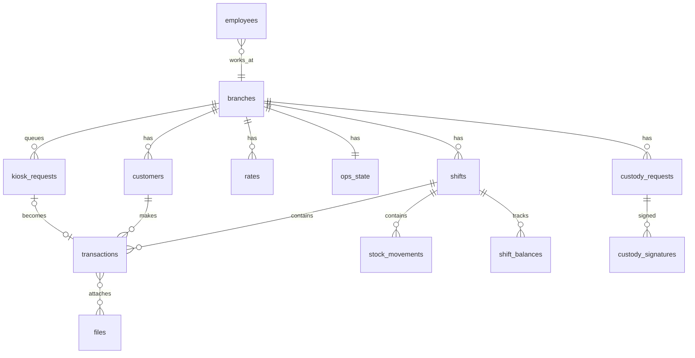
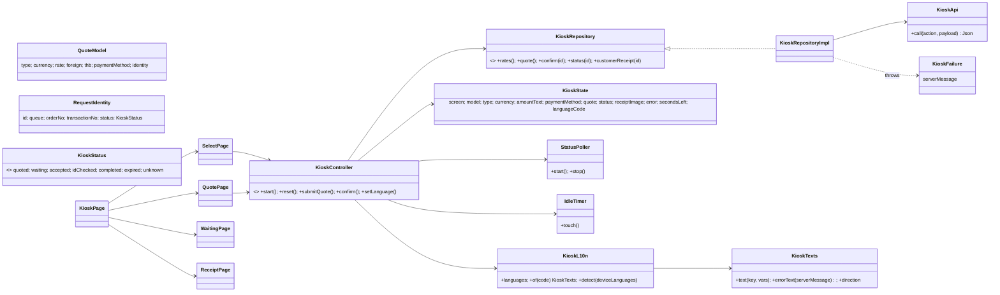

# XCHANGE — Flutter customer kiosk (phase 1), Rust + PostgreSQL server (phase 2)

> designed-by: claude/96f9c3ef · 2026-10-06 · reviewed on 108-Plaza/xchange PR 1 · what still blocks dispatching tickets is listed in §11

Design for the two phases the owner set on 2026-10-06:

| Phase | What changes | What stays |
|---|---|---|
| **1** | The customer-facing kiosk is rewritten in Flutter (§8) | The v2 Node server, its database, and the admin / desk / staff screens — untouched |
| **2** | The server becomes Rust + PostgreSQL, speaking the same HTTP contract (§3–§7) | The admin / desk / staff screens, and the phase 1 kiosk |

Rewriting the admin / desk / staff screens is not in either phase and is not designed here.

Phase 1 needs only §5.3's `/api/kiosk` row and §8. Everything else in this document is phase 2 and
can be reviewed later without holding phase 1 up.

## 0. What this was measured from, and what it was not

| Source | State |
|---|---|
| `xc-desk-v2-deployed-20261005-1758.zip` — built bundle, `SOURCE-VERSIONS.json` = `xchange-online@3ffc5a5`, `xchange-booking@206345c` | Read: all app code in `server.mjs` lines 5349–8301 (engine, operations, ledger, auth, kiosk, devices, routes), `schema.sql`, `cutover.sh`, `migrate-v1.mjs`, nginx configs |
| Source repos `xchange-online`, `xchange-booking` | **Not available** — not found under `108-Plaza`, `yuthstyle88`, or on this machine |
| Minified React (`public/staff.js`, `staff-report.js`), `kiosk.html`, embedded admin/desk HTML | **Not read** — screens in §8 are derived from the API they call, not from the UI code |
| Live database `xc_desk_v2` | **Not read** — row counts and real data shapes are unmeasured |

Line references below are `server.mjs:<line>` in that archive.

## 1. Root cause this design removes

The v2 code is a Google Apps Script program run inside two emulation layers
(Apps Script → Cloudflare D1/R2 → Node + PostgreSQL), never rewritten:

- Every business row is a JSON array in `ledger_rows(table_name,row_number,payload)`; branches are a table-name prefix (`server.mjs:6789`).
- Every request, reads included, loads the whole branch ledger, runs the engine in memory, diffs all rows (`server.mjs:7010-7068`).
- All writes in all branches serialise on one row, `ledger_control.id=1`, with 4 optimistic retries.
- Money is IEEE double (`cents_`, `server.mjs:6341`).
- A transaction belongs to a shift by spreadsheet row range (`startRow`/`endRow`, `server.mjs:6621`).
- Authorisation is decided in three places with different allow-lists (`server.mjs:7434`, `8080`, `5971`).
- Post-save work (print job, kiosk completion) runs outside the save, so "saved but post-save failed" exists (`server.mjs:7756`).

v3 stores typed rows, locks per branch, computes money in decimal, links by foreign key,
authorises in one module, and does post-save work in the same DB transaction.

## 2. Decisions

| # | Decision | Status |
|---|---|---|
| D1 | Phase 1: customer kiosk = Flutter, everything else as is. Phase 2: server = Rust + PostgreSQL behind the unchanged admin / desk / staff screens | **decided** (owner 2026-10-06) |
| D2 | sqlx 0.9, `rust_decimal`, actix-web (same as `pos108-core`, `jh-api`) | [required] — fleet contract |
| D3 | One repo `108-Plaza/xchange` with `api/` and `app/` | **decided** — repo created 2026-10-06 |
| D4 | Sign-in = port of v2's local owner/employee accounts and cookies | follows from D1: the kept `login.html` and `account-bar.js` post to `/api/auth` and rely on `__Host-xc_owner` / `__Host-xc_staff` |
| D5 | Bookings/members API: the kept admin screen has a "การจองออนไลน์" menu that calls `/api/bookings` | **open — owner**: port it (screen keeps working) or leave it returning an error. No public booking site is deployed (`server.mjs:5922`) |
| D6 | Whether v2 holds real shop data. The admin screen showed "ข้อมูลจริง" with one completed transaction on 2026-10-06 | **open — owner**. Decides how strict §7 must be |
| D7 | Service hours 11:00–22:50 / 23:00 stay hard-coded as in v2 (`server.mjs:6037`, `6876`) | [required] for parity; a setting would need a screen that does not exist |
| D8 | Kiosk delivery = Flutter **web** served on the customer host | **decided** (owner 2026-10-06) — the v2 server rejects any POST whose `Origin` is not its own host (`server.mjs:8050`), an installed app sends none, and phase 1 does not change the server |

## 3. Domain rules carried over (behaviour table)

These are the behaviours the Rust code must keep. Each row becomes an up-front failing test (§9).

| Area | Rule | v2 evidence |
|---|---|---|
| Amount | 0 ≤ n ≤ 100,000,000, at most 2 decimals; rate at most 4 decimals, > 0 | `6334`, `6515` |
| Principal | `principal = round_half_up(amount × rate, 2)` | `6448` |
| BUY (shop buys FX) | `paid = principal − fee`; fee ≤ principal; `received = 0` | `6450` (fee check), `6452` (paid) |
| SELL (shop sells FX) | `received = principal + fee`; `paid = 0` | `6451` |
| Stock delta | BUY: `+amount` FX; SELL: `−amount` FX. THB moves only when method is `Cash`: SELL `+(principal+fee)`, BUY `−(principal−fee)` | `6531-6540` |
| Stock guard | No currency balance may go below zero after the delta | `6554` |
| Rate guard | Submitted rate must equal the current counter rate for that side, unless the save is for a verified booking | `6742` |
| Shift | At most one OPEN shift per branch; a LIVE save needs one | `6526`, `6739` |
| Close shift | Client sends the expected balances it counted against; mismatch with server-computed ⇒ refuse. Non-zero difference needs a note | `6694-6696` |
| Save rate | `sell ≥ buy`; optimistic check on previous `updatedAt`; partner name and partner cost both or neither; BoT reference captured at save | `6705-6719`, `7017-7023` |
| Customer identity | Unique on (passportNo, nationality, mode) within a branch; ID `CX-%08d` from a counter (`TEST-` prefix in DEMO) | `6375-6378` |
| Document ref | `XC-yyyymmdd-%06d`, counter per (mode, Bangkok date), **global across branches** | `6476` |
| Idempotency | Same `submissionId` + same payload hash ⇒ return the saved result; different hash ⇒ refuse. Admin actions do the same on `requestId`; an abandoned `requestId` can never be applied | `6465-6473`, `6747-6762` |
| Payment | Methods: Cash, Bank Transfer, Credit Card, Alipay, PromptPay (`SCB Transfer` is read as Bank Transfer). Non-cash needs a payment ref and a slip file; passport file always | `6446-6453`, `6624` |
| Custody (when enabled) | Phases CLOSED → READY → OPEN → CUT_OFF → COUNTING; request kinds OPEN, HANDOVER, CLOSE, SAFE_OPEN, SAFE_IN/OUT, EXTERNAL_IN/OUT; one PENDING request at a time; signature rules per kind; Backend commits and must not be sender/receiver | `5969-6250` |
| Custody gate on save | Only the FRONT custodian, clocked in, in phase OPEN (or CUT_OFF with an open draft); customer must not be on hold | `6868-6877` |
| Kiosk | QUOTED → WAITING → ACCEPTED → ID_CHECKED → COMPLETED, with QUOTED → EXPIRED. A quote can be confirmed from 3 s (`7981`, enforced by the server) to 5 min (`7980`) after it was made; between 5 and 10 min its status reads `EXPIRED` (`7913`); after 10 min the row is deleted by the next quote (`7971`) and the answer is "not found". `confirm` on a row already past QUOTED returns its identity instead of failing (`7978`), so a retry is safe. Rate re-checked at confirm (`7983-7984`); only the accepting employee may continue | `7957-8045`, `8060-8075` |

Known differences v3 introduces on purpose:

- Decimal arithmetic can differ from v2's float at exact half-cent midpoints. §7 keeps stored v2 values and reports rows where recomputation differs.
- Transaction statuses `PENDING_FILES` / `ERROR` are never produced by v3: files are uploaded first and the save is one DB transaction. The screens already handle their absence (they are the error path).
- The receipt HTML is still generated and stored at save, byte-compatible in structure with v2, because the kept screens open it by URL and `receipt-image` parses its `<dt>/<dd>` rows (`server.mjs:7545`).

## 4. Data model

Types: money `NUMERIC(14,2)`, rate `NUMERIC(14,4)`, time `timestamptz`, ids `uuid` unless a human-facing code is noted.



| Table | Key columns | Replaces |
|---|---|---|
| `branches` | `id text` (keeps `MAIN`, `B<uuid>`), `name` unique (case-insensitive), `service_open`, `service_last_new`, `service_close` | `AdminBranches` |
| `currencies` | `code char(3)` PK, `name_th`, `name_en`, `symbol` | arrays at `6512`, `6626`, `src/currencies.mjs` |
| `rates` | append-only: `branch_id`, `code`, `buy`, `sell`, `partner_name`, `partner_cost`, `reference jsonb`, `updated_at`, `updated_by`, `request_id` unique | `AdminRates` |
| `customers` | `id text` (`CX-…`), `branch_id`, `name`, `passport_no`, `nationality`, `birth_date`, `passport_expiry`, `mode`, unique (`branch_id`,`passport_no`,`nationality`,`mode`) | `Customers` |
| `shifts` | `id`, `branch_id`, `status`, `opened_at/by`, `closed_at/by`, `close_note`, `open_request_id`, `close_request_id`; partial unique index on (`branch_id`) where `status='OPEN'` | `AdminShifts` |
| `shift_balances` | (`shift_id`,`code`) PK, `opening`, `expected`, `counted`, `difference` | Opening/Expected/Counted/Difference JSON |
| `stock_movements` | `id`, `shift_id`, `code`, `direction`, `amount`, `reason`, `request_id` unique | `AdminMovements` |
| `transactions` | `id`, `document_ref` unique, `branch_id`, `shift_id` FK (null in DEMO), `mode`, `status`, `type`, `code`, `amount`, `rate`, `reference_rate`, `principal`, `fee`, `bank_fee`, `received`, `paid`, `method`, `payment_ref`, `account`, `customer_id`, `staff_id`, `booking_no`, `notes`, `value_date`, `paid_at`, `recorded_at`, `submission_id` unique, `payload_hash`, `kiosk_request_id` | `Transactions`, `DemoTransactions` |
| `transaction_files` | (`transaction_id`,`kind`) PK → `files.key`; kind PASSPORT / SLIP / RECEIPT | columns 25–27 |
| `files` | `key`, `branch_id`, `owner_id`, `mime`, `sha256`, `created_at` | `file_records` |
| `counters` | `key` PK, `value bigint` | `ledger_control.properties` |
| `abandoned_requests` | `request_id` PK, `branch_id`, `at`, `actor` | `AdminRequests` |
| `ops_state` | `branch_id` PK, `enabled`, `phase`, `custodian_id`, `entity jsonb`, `target jsonb`, `safe jsonb`, `cutoff jsonb` | `OpsState` JSON blob |
| `attendance`, `custody_requests`, `custody_signatures`, `ops_events`, `cash_exceptions`, `customer_holds`, `tx_drafts` | one row per array element of the blob | arrays inside `OpsState` |
| `kiosk_requests`, `kiosk_currencies`, `kiosk_receipts` | as v2, `data` split into typed columns, `transaction_id` FK replaces `kiosk_transactions` | same names |
| `device_jobs`, `device_events`, `device_settings` | as v2 | same names |
| `employees`, `employee_audit`, `employee_sessions`, `owners`, `owner_sessions`, `auth_attempts` | as v2 | same names; `auth_attempts` replaces the reuse of `booking_limits` |
| `branch_versions` | `branch_id` PK, `version bigint` — the per-branch lock row, incremented inside every write transaction | new |

Concurrency: every write handler opens one transaction and takes `SELECT … FOR UPDATE` on that
branch's `branch_versions` row first. That gives per-branch serialisation (v2 serialised the whole system)
and makes "one PENDING custody request", "one OPEN shift" and the stock guard race-free without retries.

## 5. API (Rust)

### 5.1 Class diagram

```mermaid
classDiagram
  direction LR
  class Money { +Decimal value; +parse(str, max_dp) Result~Money~; +round_half_up_2() Money }
  class Rate { +Decimal value; +parse(str) Result~Rate~ }
  class Quote { +principal: Money; +received: Money; +paid: Money; +compute(side, amount, rate, fee) Result~Quote~ }
  class StockDelta { +fx: (Code, Money); +thb: Money; +for_tx(side, code, amount, rate, fee, method) StockDelta }
  class ShiftLedger { +expected(opening, txs, moves) Balances; +ensure_non_negative(bal, delta) Result; +difference(expected, counted) Balances }
  class CustodyMachine { +apply(state, cmd, actor, facts, now) Result~Transition~ }
  class KioskMachine { +next(status, event, actor, now) Result~KioskStatus~ }
  class Policy { +allow(actor, action, branch) Result }
  class Actor { +id; +kind: Owner|Staff; +role: Role; +branch_id: Option }

  class TxService { +reserve_customer(); +save_transaction(); +documents() }
  class ShiftService { +open(); +close(); +move_stock() }
  class RateService { +save_rate(); +current(); +history() }
  class CustodyService { +command(); +state() }
  class KioskService { +public_rates(); +quote(); +confirm(); +staff_action() }
  class DeviceService { +queue(); +process(); +retry() }
  class FileService { +upload(); +open() }
  class Store { +begin_branch_tx(branch) BranchTx }
  class CompatRpc { +dispatch(action, payload, actor) Result~Json~ }
  class SnapshotBuilder { +admin_snapshot(branch, actor) Json; +desk_config(branch) Json }
  class PageServer { +page(name, actor) Html; +static_file(path) }
  class RateSource { <<trait>> +fetch() Result~ReferenceRates~ }
  class DeviceDriver { <<trait>> +run(job) Result~JobOutcome~ }
  class BotRateSource
  class SimulatedDriver

  CompatRpc --> TxService
  CompatRpc --> ShiftService
  CompatRpc --> RateService
  CompatRpc --> CustodyService
  CompatRpc --> SnapshotBuilder
  SnapshotBuilder --> Store
  Quote --> Money
  Quote --> Rate
  StockDelta --> Quote
  ShiftLedger --> StockDelta
  TxService --> Quote
  TxService --> ShiftLedger
  TxService --> CustodyMachine : gate on save
  TxService --> KioskMachine : complete on save
  TxService --> DeviceService : queue receipt in same tx
  ShiftService --> ShiftLedger
  CustodyService --> CustodyMachine
  CustodyService --> ShiftService : open/close/move via commit
  RateService --> RateSource
  DeviceService --> DeviceDriver
  RateSource <|.. BotRateSource
  DeviceDriver <|.. SimulatedDriver
  TxService --> Store
  ShiftService --> Store
  Policy --> Actor
```



`RateSource` and `DeviceDriver` are traits because a second variant is already known
(KBank reference rates in `public/kbank-reference.json`; a real ESC/POS driver). `FileService` and
`Store` stay concrete — one variant, none planned.

### 5.2 Where each class lives

Two classes that different tickets touch are never in the same file.

| Class / module | File (under `api/crates/`) | Provides to |
|---|---|---|
| `Money`, `Rate` | `xc-domain/src/money.rs` | everything |
| `Quote` | `xc-domain/src/quote.rs` | `TxService`, `KioskService` |
| `StockDelta`, `ShiftLedger` | `xc-domain/src/stock.rs` | `TxService`, `ShiftService`, `CustodyMachine` |
| `CustodyMachine` + state types | `xc-domain/src/custody/{mod,state,commands}.rs` | `CustodyService`, `TxService` |
| `KioskMachine` | `xc-domain/src/kiosk.rs` | `KioskService`, `TxService` |
| `Actor`, `Role`, `Policy` | `xc-domain/src/policy.rs` | every handler |
| `Store`, `BranchTx` | `xc-store/src/lib.rs` | every service |
| repositories | `xc-store/src/{branches,rates,customers,shifts,transactions,custody,kiosk,devices,files,counters}.rs` — one file per aggregate | the matching service |
| migrations | `xc-store/migrations/NNNN_<aggregate>.sql` — one file per aggregate | — |
| `TxService` | `xc-api/src/services/tx.rs` | `routes/tx.rs` |
| `ShiftService` | `xc-api/src/services/shift.rs` | `routes/shift.rs`, `CustodyService` |
| `RateService`, `RateSource`, `BotRateSource` | `xc-api/src/services/rate.rs`, `xc-api/src/rate_source/{mod,bot}.rs` | `routes/rate.rs` |
| `CustodyService` | `xc-api/src/services/custody.rs` | `routes/custody.rs` |
| `KioskService` | `xc-api/src/services/kiosk.rs` | `routes/kiosk.rs` |
| `DeviceService`, `DeviceDriver`, `SimulatedDriver` | `xc-api/src/services/device.rs`, `xc-api/src/device_driver/{mod,simulated}.rs` | `routes/device.rs`, `TxService` |
| `FileService` | `xc-api/src/services/file.rs` | `routes/file.rs`, `TxService` |
| auth: sessions, cookies, login limiter → `Actor` | `xc-api/src/auth/` | every route |
| `CompatRpc` (action name → service call, v2 JSON in/out) | `xc-api/src/compat/rpc.rs` | `routes/rpc.rs` |
| `SnapshotBuilder` (the `adminSnapshot` / `adminDeskConfig` JSON) | `xc-api/src/compat/snapshot.rs` | `CompatRpc`, kiosk, devices |
| `PageServer` + the v2 pages and assets, copied unchanged | `xc-api/src/pages.rs`, `api/web/` | browser |
| DTOs | `xc-api/src/dto/<aggregate>.rs` | routes, Flutter client |
| version report | `xc-api/src/routes/health.rs` | ops |
| v2 importer | `xc-import/src/{main,read_ledger,map_*,verify}.rs` | cutover |

Fallback when a provider has not landed: the consuming ticket declares a stub with the diagram's
signature in its own file, marked `// moves to <file> with ticket <id>`. It does not wait and does not touch the provider's file.

### 5.3 HTTP contract [required] — identical to v2

The kept screens are the contract. Every route below answers with the same JSON shape, status codes,
Thai error strings and cookies as v2. Money stays a JSON **number** on the wire here, because the
screens do arithmetic on it; decimals exist only inside the server and the database.

| Route | Body | v2 handler |
|---|---|---|
| `GET /healthz` | — | `8262` |
| `GET /health/ready` → `version`, `build`, `builtAt`, `channel` | — | new (fleet versioning rule) |
| `POST /api/auth` | `{action: status\|login\|logout, payload}` | `7855` |
| `POST /api/rpc` | `{action, payload}` — `adminSnapshot`, `adminDeskConfig`, `adminOpenShift`, `adminCloseShift`, `adminMoveStock`, `adminSaveRate`, `adminCreateBranch`, `adminAbandonRequest`, `getConnectionStatus`, `reserveCustomer`, `saveTransaction` | `7108`, `8090`, hook `7728` |
| `POST /api/staff/{login,logout,password,me,rpc,upload}` · `GET /api/staff/file/{key}` | as v2; `rpc` also carries every `ops*` action | `7486-7519`, `7397` |
| `POST /api/upload?branch=` · `GET /files/{key}` · `GET /documents?branch=&ref=` | raw file body | `7154`, `7095`, `7769` |
| `POST /api/employees` | `{action: list\|create\|reset\|disable\|entity\|enable}` | `7371` |
| `POST /api/reference-rates` | — | `7275` |
| `POST /api/bookings` | `{action, payload}` | `7263` — subject to D5 |
| `POST /api/devices` · `GET /devices/receipt` | `{action: snapshot\|queue\|process\|retry\|printerOnline\|drawerObservation}` | `7665`, `7794` |
| `POST /api/kiosk` | `{action, payload}` — public: `rates`, `quote`, `confirm`, `status`, `customerReceipt`; staff: `notifications`, `list`, `accept`, `get`, `identityChecked`, `publishReceipt`, `manage`, `configure` | `8048` |
| Pages: `/`, `/desk`, `/staff`, `/staff/report`, `/staff/desk`, `/staff/documents`, `/login`, `/devices`, `/kiosk-queue.html`, `/kiosk-currencies.html`, `/staff-guide`, `/receipt-sample`, static assets | — | route table `8143-8188` |

Request rules carried over unchanged: `Origin` must equal the request origin and `X-Xchange-Request: 1`
on every POST (`5542`); body size limits per route; host split — the customer host serves only the
kiosk and `/api/kiosk` (`8263-8267`); staff are forced onto their own branch (`8280`).

Page serving carries over v2's rewriting, which the screens depend on: `window.XC_BRANCH` injection (`5549`),
per-role script injection (`8196-8207`), and the `/staff/desk` variant of the desk page with rewritten
URLs and the `opsBeginTransaction` draft hook (`7416-7418`). The admin and desk HTML are embedded in
the v2 bundle (`5357`, `5558`); the first ticket extracts them into `api/web/` byte-for-byte.

**Known debt, kept on purpose.** `adminSnapshot` returns the whole branch on every call and the screens
poll it. v3 builds it with SQL instead of replaying the ledger, and keeps v2's 10,000-row cap (`6600`),
but the response is still O(history). The root cause is the screens' contract, which this phase does not
change; it goes away when those screens are rewritten. The Flutter kiosk does not use `adminSnapshot`.

## 6. Authorisation

One function, `Policy::allow(actor, action, branch)`, called at the top of every service method.
Staff are pinned to their own branch; the owner may name any branch. The role table is the union of
v2's three lists and must be confirmed by the owner during review, because v2's lists disagree:
`staff-routes` lets BACKEND/MANAGER open and close shifts and FINANCE move stock (`8080-8086`),
`staff-bridge` lets them do neither (`7434`).

Sessions: opaque 32-byte token, SHA-256 at rest, 12 h, `version` column invalidates on
password change — as v2 (`7347`, `7354`). Password hashes migrate unchanged: scrypt N=16384, r=8, p=5, 32-byte key,
stored `salt_hex:key_hex`, and **the salt is fed to scrypt as the ASCII hex string, not decoded bytes** (`7292-7296`).

Kiosk quote creation gets a per-IP limit; v2 has none in the kiosk module (`7897-8076`) or in `nginx/xc-customer.spacing.cloud.conf`.

## 7. Data migration

Source: `ledger_rows` JSON arrays + side tables of `xc_desk_v2`. Target: §4. One-shot importer `xc-import`, run at cutover.

**(1) What each existing row becomes**

| v2 rows | v3 | Notes |
|---|---|---|
| `[<B>_]Transactions` / `DemoTransactions`, status `SAVED` | `transactions` (`COMPLETED`) + `transaction_files` | `shift_id` resolved from the shift whose `startRow..endRow` contains the row number |
| same, status `PENDING_FILES` or `ERROR` | **refused** — importer stops and lists them | v2 itself blocks shift open/close while one exists (`6640`); they must be finished or cancelled in v2 first |
| same, status `CANCELLED` | `transactions` (`CANCELLED`) | no v2 code path writes this status in the code read; expected count 0 |
| `Customers` | `customers` | leading `'` (spreadsheet-injection guard, `6344`) stripped |
| `AdminRates` | `rates` | `{$date}` → `timestamptz` |
| `AdminShifts` + JSON columns | `shifts` + `shift_balances` | |
| `AdminMovements`, `AdminRequests`, `AdminBranches` | `stock_movements`, `abandoned_requests`, `branches` | |
| `OpsState` row 2 | `ops_state` + child tables | arrays split one element per row |
| `ledger_control.properties` | `counters` | so `XC-…` and `CX-…` numbering continues |
| `file_records` + upload dir | `files` + same directory | bytes not rewritten; `sha256` re-verified |
| `employees`, `employee_audit`, `owners` | same | password hashes unchanged; sessions are dropped, everyone signs in again |
| `kiosk_*`, `device_*`, `receipt_images` | same names | in-flight `QUOTED` kiosk rows dropped |
| `bookings`, `members`, `member_registrations`, `booking_rules` | migrated as-is if D5 = port; otherwise left in the v2 database | `adminSnapshot` reads `members` to flag customers (`7038`) — if not ported, that flag is always false |

**(2) Backfill** — none after import; the importer writes final values. Measure before cutover:

```sql
SELECT table_name, count(*) - 1 AS data_rows FROM ledger_rows GROUP BY 1 ORDER BY 1;
SELECT count(*) FROM ledger_rows WHERE table_name LIKE '%Transactions' AND payload::jsonb->>1 IN ('PENDING_FILES','ERROR');
```

Verification the importer must pass before it commits (`verify.rs`):
- row counts per table equal;
- for every CLOSED shift, `ShiftLedger::expected` recomputed in decimal equals the stored `Expected JSON`;
- for every transaction, recomputed `principal/received/paid` equals stored — differences are reported per row and stored values kept;
- every `transaction_files` key exists on disk with matching hash.

**(3) Deploy order** — v3 uses a new database (`xc_v3`) and a new port; v2 keeps running untouched.
Cutover = stop v2 writes → import → verify → repoint nginx (same shape as `cutover.sh`) → fingerprint v2 again to prove nothing wrote during the switch.
The v2 binary never sees the v3 schema, so there is no old-binary/new-schema window.

**(4) What `down` loses** — rollback is repointing nginx to v2. Everything written to v3 after cutover is lost
unless re-entered; there is no v3→v2 exporter. This is the reason D6 needs an answer.

## 8. Flutter — customer kiosk only

[required] Scope is exactly four screens (owner, 2026-10-06), delivered as Flutter **web**:

1. choose buy/sell and currency, see the rates
2. the quote, with its countdown
3. waiting in the queue after confirming
4. the receipt the staff member publishes to the screen

Nothing else is built in Flutter. The staff queue page and the kiosk-currency page are staff screens and stay as they are.

Replaces `public/kiosk.html`, `kiosk.js`, `kiosk.css`, `kiosk-i18n.js`, `kiosk-language-extras.js`, `kiosk-fonts.css`.
It talks to the same `POST /api/kiosk` actions, so the staff side of the queue (`kiosk-queue.html`, `desk-kiosk.js`) is untouched.

The app follows the layout and stack of `108heros-flutter` (owner, 2026-10-06), so nothing has to be
re-shaped later: `app/` · `core/` · `features/<name>/{app,domain,infrastructure,presentation}` · `shared/` · `l10n/`,
with Riverpod 3, dio and go_router.



| Piece | Location (under `app/lib/`) |
|---|---|
| App shell, router | `app/app.dart`, `app/router/app_router.dart` |
| dio (same-origin base URL, `X-Xchange-Request` header), `BaseApiService` | `core/network/` |
| Browser seam (device languages, `?branch=`, `Intl` names and symbols, save image) with a VM stub for tests | `core/platform/` |
| Providers | `features/kiosk/app/kiosk_providers.dart` |
| `QuoteModel`, `RequestIdentity`, `KioskStatus`, rates models; `KioskFailure`; `KioskRepository` | `features/kiosk/domain/entities/kiosk_models.dart`, `features/kiosk/domain/kiosk_failure.dart`, `features/kiosk/domain/repository/` |
| `KioskApi`; `KioskRepositoryImpl` | `features/kiosk/infrastructure/data_sources/`, `features/kiosk/infrastructure/repositories/` |
| `KioskController` + `KioskState`, `StatusPoller`, `IdleTimer` | `features/kiosk/presentation/controllers/` |
| The frame and the four screens | `features/kiosk/presentation/pages/{kiosk,select,quote,waiting,receipt}_page.dart` |
| Shared kiosk widgets | `features/kiosk/presentation/widgets/` |
| Colours, theme | `shared/theme/` |
| `KioskL10n`, `KioskTexts`; texts moved 1:1 from `kiosk-i18n.js` and `kiosk-language-extras.js` | `l10n/kiosk_l10n.dart`, `assets/l10n/kiosk.json` |

Two places where this app differs from `108heros-flutter`, on purpose:
- Models are hand-written immutable classes, not freezed — six small read-only types. They sit where the freezed ones would, so switching is local to those files.
- Texts are a runtime JSON table, not `.arb` files: the customer picks among 16 languages on the screen itself, independent of the device locale, and the table is the v2 kiosk's own.

Fonts: Flutter web fetches the Noto fallback fonts for Thai, CJK, Arabic, Myanmar, Lao and Devanagari on demand.
Bundling them for a kiosk with a poor connection is not done yet.

**How it is served in phase 1** (no change to the v2 server): nginx on the customer host serves the
Flutter web build from a directory and proxies only `POST /api/kiosk` to `127.0.0.1:8093`. Today
`nginx/xc-customer.spacing.cloud.conf` proxies an allow-list of v2 kiosk files; that list is replaced by
a static `root` for the build plus the one proxied path. The page keeps the same URL and the same
`?branch=` parameter. Rollback is restoring the previous nginx file — the v2 kiosk files stay on disk.

Behaviour to keep (from `public/kiosk.js` and the server side at `7957-7998`): language starts from the
device language and returns to it on reset; quote must be shown at least 3 s before confirm and expires at 5 min;
server error messages are mapped to localised text; the status is polled every 5 s and the receipt every 3 s;
the screen restarts **30 seconds** after it sees the request completed (`public/kiosk.js:105`) — the 10-minute figure
in the server (`RECEIPT_TTL`, `server.mjs:7903`) is how long a published receipt image stays retrievable, not how long
it is displayed; before confirming, two minutes without a touch restart the screen, and the counter screens never idle out. The client shows amounts the server returned and never submits a rate or a THB figure of its own.

## 9. Tests written before implementation

`runEngine(action, input, tables, props, actor, files, booking)` and `runOperations(...)` in v2 are pure
functions (`server.mjs:6255`, `5969`). A small Node harness around the v2 bundle produces fixture files
`(input) → (result | error, table diff)` for every rule in §3; the Rust tests in `xc-domain/tests/` and
`xc-api/tests/` assert the same outcomes. The ticket author commits fixtures and failing tests first;
implementers may add tests but not edit those.

Not covered by fixtures, written by hand: per-branch locking under concurrency, `304` behaviour, policy table, importer verification.

## 10. Ticket split (after this document is reviewed and merged)

### Phase 1 — Flutter kiosk on the existing server

| # | Ticket | Files owned | Depends on |
|---|---|---|---|
| F1 | The kiosk app: network core, kiosk feature (domain, infrastructure, controllers, pages), texts, tests | `app/` | — |
| F5 | Flutter CI | `.github/workflows/app.yml` | F1 |
| F6 | nginx file for the customer host + deploy notes | `deploy/nginx/xc-customer.conf`, `deploy/README.md` | F1; applying it on the server is the owner's call |
| F7 | Bundle the fallback fonts so the kiosk does not depend on fetching them | `app/assets/fonts/`, `app/pubspec.yaml`, `app/lib/shared/theme/theme.dart` | F1 |

F1 was written in one piece by the session the owner gave it to; F5–F7 are independent of each other.
 All of phase 1 is developed and tested against the running v2 server.

### Phase 2 — Rust + PostgreSQL server

| # | Ticket | Files owned | Depends on |
|---|---|---|---|
| T1 | Workspace skeleton, Rust CI, `/healthz`, `/health/ready`, `Store`/`BranchTx`; extract v2 pages and assets into `api/web/`; `PageServer` | `api/Cargo.toml`, `xc-store/src/lib.rs`, `routes/health.rs`, `pages.rs`, `api/web/`, `.github/workflows/api.yml` | — |
| T2 | `Money`, `Rate`, `Quote` | `xc-domain/src/{money,quote}.rs` | — |
| T3 | `StockDelta`, `ShiftLedger` | `xc-domain/src/stock.rs` | T2 (stub allowed) |
| T4 | `Actor`, `Policy`; `/api/auth`, `/api/staff/{login,logout,password,me}`, `/api/employees` | `xc-domain/src/policy.rs`, `xc-api/src/auth/`, employee store/route files | T1 |
| T5 | Branches, currencies, rates, `RateSource`, `/api/reference-rates` | their store/service files + migration | T1 |
| T6 | Customers + files (`/api/upload`, `/files/`, `/documents`) | same pattern | T1 |
| T7 | Shifts + movements | same pattern | T1, T3 |
| T8 | Transactions: save, receipt HTML, documents | same pattern | T2, T3, T6, T7 |
| T9 | `CustodyMachine` | `xc-domain/src/custody/` | T3 |
| T10 | Custody service (`ops*`) | same pattern | T7, T9 |
| T11 | `SnapshotBuilder` + `CompatRpc` + `/api/rpc`, `/api/staff/rpc`, `/staff/desk` | `xc-api/src/compat/`, `routes/rpc.rs` | T5–T8, T10 (stubs allowed) |
| T12 | `KioskMachine` + `/api/kiosk` | kiosk domain/store/service/route files | T5, T8 |
| T13 | Devices (`/api/devices`, receipt image) | device files | T8 |
| T14 | `xc-import` | `api/crates/xc-import/` | T4–T10 schemas |
| T15 | Bookings/members (`/api/bookings`) | booking files | D5 |

Parity check before the phase 2 cutover: the kept screens and the phase 1 kiosk are driven against v3
and v2 side by side with the same inputs (§9 fixtures cover the RPC layer; a browser pass covers the page rewriting in T1/T11).

## 11. Open items that block specific tickets

| Item | Phase | Blocks | Who |
|---|---|---|---|
| Branch protection, CI runners, `tq` queue config, lane for this repo | 1 | dispatching any ticket | owner |
| Source repos `xchange-online`, `xchange-booking` | 1, 2 | phase 1 works from the readable `public/kiosk.js`; the phase 2 test harness is simpler with source | owner |
| D6 is v2 in real use + read access to `xc_desk_v2` | 2 | T14 strictness, §7(2) counts | owner |
| D5 port bookings/members or not | 2 | T15, and the member flag in T11 | owner |
| Role table in §6 (v2's two allow-lists disagree) | 2 | T4, T11 — v3 reproduces both paths as they are unless the owner says which is right | owner, at review |
