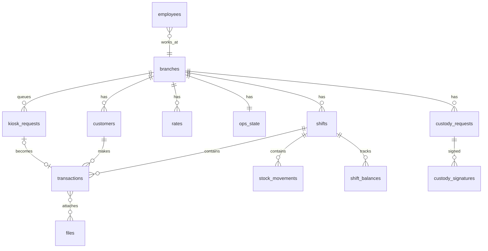
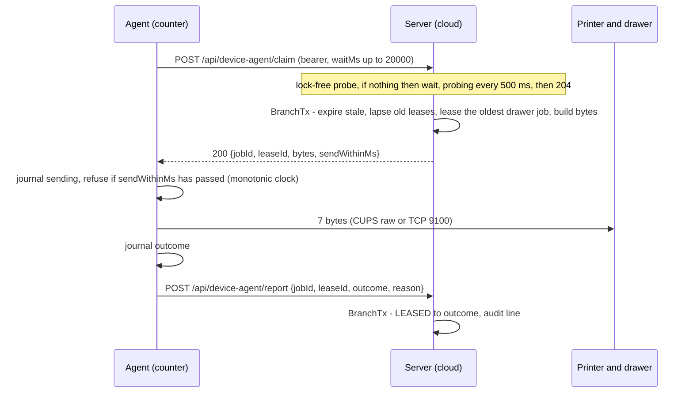
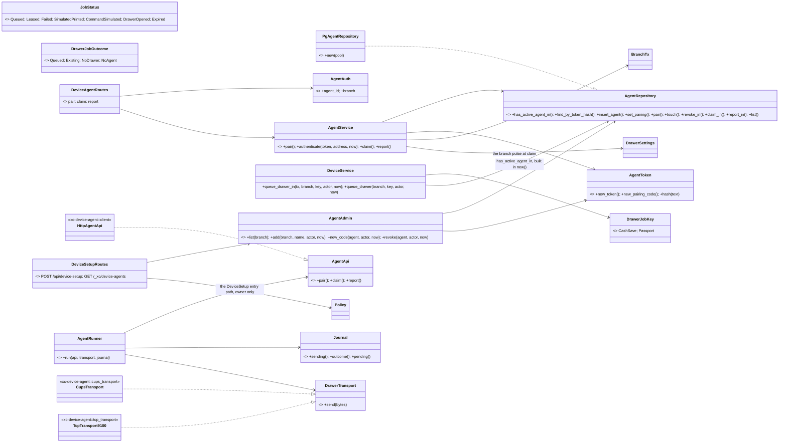

# XCHANGE — Flutter customer kiosk (phase 1), Rust + PostgreSQL server (phase 2)

> designed-by: claude/96f9c3ef · 2026-10-06 · reviewed on 108-Plaza/xchange PR 1 · what still blocks dispatching tickets is listed in §11

Design for the two phases the owner set on 2026-10-06:

| Phase | What changes | What stays |
|---|---|---|
| **1** | The customer-facing kiosk is rewritten in Flutter (§8) | The v2 Node server, its database, and the admin / desk / staff screens — untouched |
| **2** | The server becomes Rust + PostgreSQL, speaking the same HTTP contract (§3–§7) | The admin / desk / staff screens, and the phase 1 kiosk |

Rewriting the admin / desk / staff screens is not in either phase and is not designed here.

Phase 1 needs only §5.3's `/api/kiosk` row and §8. Everything else in this document is phase 2 and
can be reviewed later without holding phase 1 up.

## 0. What this was measured from, and what it was not

| Source | State |
|---|---|
| `xc-desk-v2-deployed-20261005-1758.zip` — built bundle, `SOURCE-VERSIONS.json` = `xchange-online@3ffc5a5`, `xchange-booking@206345c` | Read: all app code in `server.mjs` lines 5349–8301 (engine, operations, ledger, auth, kiosk, devices, routes), `schema.sql`, `cutover.sh`, `migrate-v1.mjs`, nginx configs |
| `XC-Desk-v2-Passport-Drawer-20261006.zip` — the **10-06 bundle**, sha256 `6514b4c8…`, manifest `passport-drawer-20261006`, `"deployed": false`; its `SOURCE-VERSIONS.json` is the same `xchange-online@3ffc5a5` as above, so it is told apart by its own hashes (§5.5) | Read for §5.5 only: the diff against the 10-05 bundle, its three server modules and `.sql`, its four notes files, and every changed or new `public/` file |
| Source repos `xchange-online`, `xchange-booking` | **Available since 2026-10-08**: the owner received the v2 source (`xc-desk-v2`, the same `xchange-online@3ffc5a5` / `xchange-booking@206345c`). It is kept read-only in the private repo `108-Plaza/xchange-v2-source`, commit `4d0bdbb`. Cite it as `xchange-v2-source@4d0bdbb:<path>`. Its add-on modules are newer than the 10-06 bundle: brokers and friend referrals (`src/referrals.mjs`) are **not** ported, because the central Broker-Platform owns brokers (owner, 2026-10-08). This document was written before the source arrived, and its rows still cite the bundle |
| Minified React (`public/staff.js`, `staff-report.js`), `kiosk.html`, embedded admin/desk HTML | **Not read** when this was written. §8 derives the screens from the API they call. Their source is now readable: `src/booking/app/staff/page.tsx`, `staff/report/page.tsx`, `src/online/lib/admin-html.ts`, `index-html.ts` in `xchange-v2-source@4d0bdbb` |
| Live database `xc_desk_v2` | **Not read** — row counts and real data shapes are unmeasured |

Line references below are `server.mjs:<line>` in that archive.

## 1. Root cause this design removes

The v2 code is a Google Apps Script program run inside two emulation layers
(Apps Script → Cloudflare D1/R2 → Node + PostgreSQL), never rewritten:

- Every business row is a JSON array in `ledger_rows(table_name,row_number,payload)`; branches are a table-name prefix (`server.mjs:6789`).
- Every request, reads included, loads the whole branch ledger, runs the engine in memory, diffs all rows (`server.mjs:7010-7068`).
- All writes in all branches serialise on one row, `ledger_control.id=1`, with 4 optimistic retries.
- Money is IEEE double (`cents_`, `server.mjs:6341`).
- A transaction belongs to a shift by spreadsheet row range (`startRow`/`endRow`, `server.mjs:6621`).
- Authorisation is decided in three places with different allow-lists (`server.mjs:7434`, `8080`, `5971`).
- Post-save work (print job, kiosk completion) runs outside the save, so "saved but post-save failed" exists (`server.mjs:7756`).

v3 stores typed rows, locks per branch, computes money in decimal, links by foreign key,
authorises in one module, and does post-save work in the same DB transaction.

## 2. Decisions

| # | Decision | Status |
|---|---|---|
| D1 | Phase 1: customer kiosk = Flutter, everything else as is. Phase 2: server = Rust + PostgreSQL behind the unchanged admin / desk / staff screens | **decided** (owner 2026-10-06) |
| D2 | sqlx 0.9, `rust_decimal`, actix-web 4, edition 2024, toolchain 1.98.1 — and **the workspace is laid out like `pos108-core`** (owner, 2026-10-06: "rust ให้ ดู โครง สร้างจาก 108pos"); see §5.2 | [required] |
| D3 | One repo `108-Plaza/xchange` with `api/` and `app/` | **decided** — repo created 2026-10-06 |
| D4 | Sign-in = v3's own owner/employee accounts in `xc-auth`, with v2's contract and cookies: the kept `login.html` and `account-bar.js` post to `/api/auth` and rely on `__Host-xc_owner` / `__Host-xc_staff` (§6) | **decided** (owner 2026-10-06, in the Identity session, relayed by claude/21bc39ab: "ให้ xc-auth เก็บบัญชีพนักงานเอง"). The same day the owner first asked whether Identity could be plugged in; measured at `108-platform-services` `46be83f`, it cannot create an account with a username only (`crates/auth/src/application/register.rs:101-116`; 400 `missing_identifier` on a running copy) nor let an administrator set another person's password (no such route), and the owner decided to add nothing to Identity because other systems share it ("เพราะ identity platfrom มันทำหน้าที่ แค่ authen"; its ticket 395 closed not planned) |
| D5 | Bookings/members API: the kept admin screen has a "การจองออนไลน์" menu that calls `/api/bookings` | **decided — port it** (owner 2026-10-08, confirmed to the lane controller claude/7ca80c, #377): staff and the owner create bookings (a new `create` action), no public booking site (`server.mjs:5922` `PUBLIC_BOOKING_URL: ""` stays), nothing imported from v2 (D6). Designed in §5.6 |
| D6 | v2 holds **test data only**; no real shop uses it (owner, 2026-10-06: "ตอนนี้ v2 ยังเป็นข้อมูลทดสอบ ยังไม่มีร้านจริง") | **decided**. v3 starts on an empty database; nothing is imported (§7). If a real shop starts on v2 before the cutover, this row and §7 must be reopened |
| D7 | Service hours 11:00–22:50 / 23:00 stay hard-coded as in v2 (`server.mjs:6037`, `6876`) | [required] for parity; a setting would need a screen that does not exist |
| D8 | Kiosk delivery = Flutter **web** served on the customer host | **decided** (owner 2026-10-06) and **extended by D9**. The reason first given here — "an installed app sends no `Origin`" — was wrong: measured 2026-10-06 on a local v2 copy, `POST /api/kiosk` answers 200 when the client itself sends `Origin: <the server's own origin>`, 400 with no `Origin`, 400 with another one. The check is a cross-site guard for browsers, not something an app cannot satisfy |
| D9 | The same kiosk is also an **Android app distributed through the Play Store** (owner 2026-10-06: "ต้องให้ ลูกค้า ทำผ่าน ทาง pay store", "ลูกค้าใช้ android"). Application id **`com.spacing.xchange`**, store name **`XC.Xchange`** (both typed by the owner). The web build stays; one code base, two targets (§8.1) | **decided** — store identity: never changed without the owner |
| D10 | v3 targets the kept screens of the **10-06 bundle**: payment settings per branch, queue work and the admin refresh are designed to be cut into tickets; the passport-step drawer is designed and **held** (§5.5) | **decided** (owner 2026-10-07, relayed by the lane controller claude/7ca80c: "B ทำเลย"; the drawer half stays under "ยังไม่integrate ตอนนี้", #274) |
| D11 | v3 runs in the **cloud**, one server for every branch; the cash drawer on the receipt printer's kick port is driven by a **counter drawer agent** — a small program on the counter computer that pulls its branch's drawer jobs from the server over HTTPS and sends the kick (option A, §5.4c). It controls the drawer only. The owner's "ทำเลย" also lifts the hold "ยังไม่integrate ตอนนี้" for this path (DRV-2) | **decided** (owner 2026-10-07, relayed by the lane controller claude/7ca80c: "คลาวด์ ใช้ A ทำเลย", then "แค่คุมลิ้นชัก") |

## 3. Domain rules carried over (behaviour table)

These are the behaviours the Rust code must keep. Each row becomes an up-front failing test (§9).

| Area | Rule | v2 evidence |
|---|---|---|
| Amount | 0 ≤ n ≤ 100,000,000, at most 2 decimals; rate at most 4 decimals, > 0 | `6334`, `6515` |
| Principal | `principal = round_half_up(amount × rate, 2)` | `6448` |
| BUY (shop buys FX) | `paid = principal − fee`; fee ≤ principal; `received = 0` | `6450` (fee check), `6452` (paid) |
| SELL (shop sells FX) | `received = principal + fee`; `paid = 0` | `6451` |
| Stock delta | BUY: `+amount` FX; SELL: `−amount` FX. THB moves only when method is `Cash`: SELL `+(principal+fee)`, BUY `−(principal−fee)` | `6531-6540` |
| Stock guard | No currency balance may go below zero after the delta | `6554` |
| Rate guard | Submitted rate must equal the current counter rate for that side, unless the save is for a verified booking | `6742` |
| Shift | At most one OPEN shift per branch; a LIVE save needs one | `6526`, `6739` |
| Close shift | Client sends the expected balances it counted against; mismatch with server-computed ⇒ refuse. Non-zero difference needs a note | `6694-6696` |
| Save rate | `sell ≥ buy`; optimistic check on previous `updatedAt`; partner name and partner cost both or neither; BoT reference captured at save | `6705-6719`, `7017-7023` |
| Customer identity | Unique on (passportNo, nationality, mode) within a branch; ID `CX-%08d` from a counter (`TEST-` prefix in DEMO) | `6375-6378` |
| Document ref | `XC-yyyymmdd-%06d`, counter per (mode, Bangkok date), **global across branches** | `6476` |
| Idempotency | Same `submissionId` + same payload hash ⇒ return the saved result; different hash ⇒ refuse. Admin actions do the same on `requestId`; an abandoned `requestId` can never be applied | `6465-6473`, `6747-6762` |
| Payment | Methods: Cash, Bank Transfer, Credit Card, Alipay, PromptPay (`SCB Transfer` is read as Bank Transfer). Non-cash needs a payment ref and a slip file; passport file always | `6446-6453`, `6624` |
| Custody (when enabled) | Phases CLOSED → READY → OPEN → CUT_OFF → COUNTING; request kinds OPEN, HANDOVER, CLOSE, SAFE_OPEN, SAFE_IN/OUT, EXTERNAL_IN/OUT; one PENDING request at a time; signature rules per kind; Backend commits and must not be sender/receiver | `5969-6250` |
| Custody gate on save | Only the FRONT custodian, clocked in, in phase OPEN (or CUT_OFF with an open draft); customer must not be on hold | `6868-6877` |
| Kiosk | QUOTED → WAITING → ACCEPTED → ID_CHECKED → COMPLETED; no way back, nothing cancels a request. `EXPIRED` is never stored: it is computed at read time, and is what a QUOTED row reads as from 300,001 ms after it was made (`7913`); only a quote expires. A quote can be confirmed from 3,000 ms (`7981`, enforced by the server) to 300,000 ms (`7980`), both inclusive. A QUOTED row is deleted only when a later quote arrives and its age then exceeds 600,000 ms (`7971`); from then on the answer is "not found". `confirm` on a row already past QUOTED returns its identity instead of failing (`7978`), so a retry is safe. Rate re-checked at confirm (`7983-7984`); only the accepting employee may continue. The kiosk's own amount cap is 10,000,000 (not the 100,000,000 of the Amount row). SELL takes an amount of **baht** and floors the foreign figure to two decimals; BUY takes the foreign amount; in both, baht = foreign × rate rounded half up. A published receipt is readable for strictly less than 600,000 ms. Kiosk refusal sentences are English, except the four of the save hook, which are Thai. Measured in the preparation of #67 | `7957-8045`, `8060-8075` |

Known differences v3 introduces on purpose:

- Decimal arithmetic can differ from v2's float at exact half-cent midpoints. §7 keeps stored v2 values and reports rows where recomputation differs.
- Transaction statuses `PENDING_FILES` / `ERROR` are never produced by v3: files are uploaded first and the save is one DB transaction. The screens already handle their absence (they are the error path).
- The receipt HTML is still generated and stored at save, byte-compatible in structure with v2, because the kept screens open it by URL and `receipt-image` parses its `<dt>/<dd>` rows (`server.mjs:7545`).
- Kiosk SELL quotes use the exact figure where v2's floating point gave one hundredth less: when the baht named buy an exact number of hundredths, v2's division landed just below (14.67 baht at 32.60: v2 hands over 0.44 for 14.34 baht, v3 0.45 for 14.67). Together with the half-hundredth case of the first item, 12 of the 219 quotes recorded from v2 differ (#67).
- `complete` on a kiosk request that was never passport-checked (QUOTED, WAITING, ACCEPTED) is refused; v2 silently stored the link to the saved document and left the status as it was (#67).
- Kiosk amounts must be plain decimals with at most two places; anything else (more places, exponent notation, spaces, a negative figure) is refused instead of being coerced the way JavaScript coerces it (#67).
- Custody: a request that cannot be read is refused before every other check. v2 read each field at the moment it used it, so with custody disabled it answered "custody is not enabled" even for a malformed request. The sentences are v2's; their precedence is not (#72).
- Custody: the payload hash of a proposal ignores key order (it is taken over the payload with its keys sorted), so two payloads that differ only in key order are the same request; v2 hashed the keys in the order the screen sent them (#72).
- Custody: a transfer note that would make the stock movement's reason exceed 200 characters is refused at propose time, with the shift's own sentence. v2 accepts it and refuses only at commit or reject, after the request is already in transit, which leaves it in transit for ever (#68).

## 4. Data model

Types: money `NUMERIC(20,2)` (an entered amount is capped at 100,000,000, but a computed baht figure is not — v2 stores 3,209,999,999.68 for 99,999,999.99 × 32.1), rate `NUMERIC(14,4)`, time `timestamptz`, ids `uuid` unless a human-facing code is noted.



| Table | Key columns | Replaces |
|---|---|---|
| `branches` | `id text` (keeps `MAIN`, `B<uuid>`), `name` unique (case-insensitive), `service_open`, `service_last_new`, `service_close` | `AdminBranches` |
| `currencies` | `code char(3)` PK, `name_th`, `name_en`, `symbol` | arrays at `6512`, `6626`, `src/currencies.mjs` |
| `rates` | append-only: `branch_id`, `code`, `buy`, `sell`, `partner_name`, `partner_cost`, `reference jsonb`, `updated_at`, `updated_by`, `request_id`, unique on (`branch_id`, `request_id`) — v2 keeps requests per branch | `AdminRates` |
| `customers` | `id text` (`CX-…`), `branch_id`, `name`, `passport_no`, `nationality`, `birth_date`, `passport_expiry`, `mode`, unique (`branch_id`,`passport_no`,`nationality`,`mode`) | `Customers` |
| `shifts` | `id`, `branch_id`, `status`, `opened_at/by`, `closed_at/by`, `close_note`, `open_request_id`, `close_request_id`; partial unique index on (`branch_id`) where `status='OPEN'` | `AdminShifts` |
| `shift_balances` | (`shift_id`,`code`) PK, `opening`, `expected` (a running total: set at open, added to by every movement and saved transaction, frozen at close — `xc-shift` may not read another context's tables to recompute it), `counted`, `difference` | Opening/Expected/Counted/Difference JSON |
| `stock_movements` | `id`, `shift_id`, `code`, `direction`, `amount`, `reason`, `branch_id`, `request_id`, unique on (`branch_id`, `request_id`) | `AdminMovements` |
| `transactions` | `id`, `document_ref` unique, `branch_id`, `shift_id` FK (null in DEMO), `mode`, `status`, `type`, `code`, `amount`, `rate`, `reference_rate`, `principal`, `fee`, `bank_fee`, `received`, `paid`, `method`, `payment_ref`, `account`, `customer_id`, `staff_id`, `booking_no`, `notes`, `value_date`, `paid_at`, `recorded_at`, `submission_id` unique, `payload_hash`, `kiosk_request_id` | `Transactions`, `DemoTransactions` |
| `transaction_files` | (`transaction_id`,`kind`) PK → `files.key`; kind PASSPORT / SLIP / RECEIPT | columns 25–27 |
| `files` | `key`, `branch_id`, `owner_id`, `mime`, `sha256`, `created_at` | `file_records` |
| `counters` | `key` PK, `value bigint` | `ledger_control.properties` |
| `abandoned_requests` | (`branch_id`, `request_id`) PK, `at`, `actor` — a request abandoned in one branch can be used in another, as in v2 | `AdminRequests` |
| `ops_state` | `branch_id` PK, `enabled`, `phase`, `custodian_id`, `entity jsonb`, `target jsonb`, `safe jsonb`, `cutoff jsonb` | `OpsState` JSON blob |
| `attendance`, `custody_requests`, `custody_signatures`, `ops_events`, `cash_exceptions`, `customer_holds`, `tx_drafts` | one row per array element of the blob | arrays inside `OpsState` |
| `kiosk_requests`, `kiosk_currencies`, `kiosk_receipts` | as v2, `data` split into typed columns, `transaction_id` FK replaces `kiosk_transactions` | same names |
| `device_jobs`, `device_events`, `device_settings` | as v2 | same names |
| `receipt_images` | [proposed] `branch_id`, `document_ref` → `transactions.document_ref`, `file_key` → `files.key`, `created_at`; PK (`branch_id`, `document_ref`) — columns not yet read from v2, §5.4 | same name |
| `employees`, `employee_audit`, `employee_sessions`, `owners`, `owner_sessions`, `auth_attempts` | as v2 | same names; `auth_attempts` replaces the reuse of `booking_limits` |
| `branch_versions` | `branch_id` PK, `version bigint` — the per-branch lock row, incremented inside every committed `BranchTx::run`, and, for the second branch, every `BranchTx::lock_also` inside one, whether or not it wrote anything (a repeated request counts): the version never misses a change but may rise when nothing changed — an equal version reads as "unchanged", a higher one as "may have changed" (#231) | new |
| `bookings`, `members` | as §5.6.6: `bookings` keyed by `id` (`BK-…`) with (`branch_id`, `request_id`) unique, `status` PENDING / CONFIRMED / USED / CANCELLED, money and rate in decimals, `transaction_ref` → `transactions.document_ref`; `members` unique on (`branch_id`, `customer_id`) and on `token_hash`. The booking rules are the `branch_settings` document `bookingRules` (§5.5.1) | `bookings`, `members`, `booking_rules`; `member_registrations` and `booking_limits` are not ported (§5.6.2) |

None of these tables exists in any v3 database yet (the first migrations are in tickets #54 and #48), so a change to this section before they merge migrates nothing; after that, a change here needs its own data-migration section.

Concurrency: a write handler opens a transaction and takes `SELECT … FOR UPDATE` on `branch_versions`. Most writes operate on a single branch (a write on `MAIN` alone, or on one other branch alone, takes one lock as before). That gives per-branch serialisation (v2 serialised the whole system) and makes "one PENDING custody request", "one OPEN shift" and the stock guard race-free without retries.

A write that depends on what two branches hold takes two locks. Lock order: `MAIN` first through `BranchTx::run`, then the other branch through `BranchTx::lock_also` — never the reverse. A transaction run on a branch other than `MAIN` never calls `lock_also` for `MAIN`. With one global lock order there is no cycle to deadlock in. `BranchService::create` (#117) is the one such write today. The doc comment of `BranchTx::lock_also` in `api/crates/xc-kernel/src/branch_tx.rs` records this rule in code.

[required] That lock is `BranchTx` (§5.1, §5.2: crate `xc-kernel`). `pos_infra::transactions::Transactor` gives a transaction but
nothing branch-scoped and no `FOR UPDATE` (`108-platform-services` `crates/pos-infra/src/transactions.rs`: `new`, `pool`, `run`).
A use case that writes **must** go through `BranchTx::run`, never through `Transactor::run` directly; calling the bare
transactor compiles, passes every single-threaded test of §9, and silently loses all three guarantees. The concurrency
tests named in §9 exist to catch exactly that.

## 5. API (Rust)

### 5.1 Class diagram

```mermaid
classDiagram
  direction LR
  class Money { +parse(str) Result~Money~; +minor() i64; +minor_i128() i128; +from_minor(i64) Result~Money~; +try_from_minor_i128(i128) Result~Money~; +is_zero() bool; +ZERO }
  class Rate { <<xc_kernel::money::rate>> +parse(str) Result~Rate~; +value() Decimal }
  class PlainDecimal { <<fn, xc-kernel::money>> +plain_decimal(text) Option~Decimal~ }
  class InputRules { <<fn, xc-kernel::input>> +text(raw, max_utf16, required) Result~str~; +calendar_date(text) Result~NaiveDate~; +number_error(NumberError) InputError; +DATE_FLOOR }
  class InputError { <<enum, xc-kernel::input>> Text; DateFormat; Date; Number; TooManyDecimals; +sentence() str }
  class Bangkok { <<fn, xc-kernel::time>> +bangkok() FixedOffset; +BANGKOK_OFFSET_SECONDS }
  class BranchId { <<xc-kernel::ids>> +new(text) BranchId; +as_str() str; +is_well_formed(text) bool }
  class Quote { +principal: Money; +received: Money; +paid: Money; +compute(side, amount, rate, fee) Result~Quote~ }
  class CurrencyCode { +parse(str) Result~CurrencyCode~; +THB; +as_str() str }
  class MoneyDelta { +minor: i128; +plus(Money) MoneyDelta; +minus(Money) MoneyDelta; +add(MoneyDelta) MoneyDelta; +checked_plus(Money) Result~MoneyDelta~; +checked_minus(Money) Result~MoneyDelta~; +checked_add(MoneyDelta) Result~MoneyDelta~; +to_money() Result~Money~; +is_negative() bool }
  class Balances { +get(CurrencyCode) Money; +apply(StockDelta) Result~Balances~ }
  class StockDelta { +fx: (CurrencyCode, MoneyDelta); +thb: MoneyDelta; +for_tx(side, code, amount, quote, cash) StockDelta; +for_movement(code, direction, amount) StockDelta }
  class ShiftLedger { +expected(opening, deltas) Result~Balances~; +ensure_non_negative(bal, delta) Result; +difference(expected, counted) StockDelta }
  class StockError { <<enum, xc-shift::domain::shift::value_objects::stock_delta>> NotAStockCurrency; Insufficient(CurrencyCode); OutOfRange }
  class CustodyMachine { +apply(state, cmd, actor, facts, now) Result~Transition~ }
  class KioskMachine { +authorize(action, actor) Result; +quote(input, facts, new_id, now) Result~KioskRequest~; +next(request, command, actor, facts, now) Result~Transition~; +identity(request, now) Result~RequestIdentity~; +check_get(request, actor) Result; +check_publish(request, actor) Result; +check_save(request, save, actor) Result; +complete(request, submission_id, document_ref) Result~Transition~; +is_purgeable(request, now) bool; +receipt_readable(published, now) bool }
  class Policy { +allow(actor: Option~Actor~, path: EntryPath, action: Action) Result; +branch(actor: Option~Actor~, named: Option~BranchId~) BranchId }
  class Actor { -id; -kind: ActorKind; -role: Role; -branch_id: Option~BranchId~; +owner(id) Actor; +staff(id, role, branch) Option~Actor~; +id() str; +kind() ActorKind; +role() Role; +branch_id() Option~BranchId~ }
  class ActorKind { <<enum>> Owner; Staff }
  class EntryPath { <<enum>> Rpc; StaffRpc; Upload; StaffUpload; File; StaffFile; StaffDesk; Devices; Kiosk; OwnerRoute; UserRoute; Custody }
  class Action { +new(name) Action; +as_str() str }
  class PolicyError { +status() u16 }
  class AccountService { +login(); +logout(); +status(); +change_password(); +employees(action); +disable_employee_in(tx, id, now, actor) }
  class EmployeeCustody { <<trait, application::custody>> +holds_cash_or_pending(branch, employee_id) bool; +holds_cash_or_pending_in(tx, branch, employee_id) bool }
  class DisableEmployee { <<application::workflows>> +run(custody, branch, employee_id, actor, now) DisableOutcome }
  class PasswordHasher { +hash(password) Result~String~; +verify(password, stored) bool }
  AccountService --> PasswordHasher
  DisableEmployee --> BranchTx : one run on the employee's branch
  DisableEmployee --> EmployeeCustody : asks again under the lock
  PgEmployeeCustody ..|> EmployeeCustody
  PgEmployeeCustody --> CustodyService : built by pg_custody_service
  CompatRpc --> CustodyService : built by pg_custody_service
  DisableEmployee --> AccountService : closes the account under the lock
  KioskService --> PlainDecimal : configure
  ShiftService --> PlainDecimal : the expected count of a close
  InputRules --> InputError : every refusal, with its sentence
  TxService ..> InputRules : the customer's details and the save form
  RateService ..> InputRules : texts and numbers of rates and branches
  ShiftService ..> InputRules : texts of a shift command
  TxService ..> Bangkok : the receipt's time and the document number's day
  CustodyService ..> Bangkok : the minute of the day
  BotRateSource --> PlainDecimal : the bank's rate

  class TxService { +reserve_customer(); +save_transaction(); +documents() }
  class ShiftService { +open(); +close(); +move_stock() }
  class RateService { +save_rate(); +current(); +history() }
  class CustodyService { +command(); +state() }
  class KioskService { +public_rates(); +quote(); +confirm(); +staff_action() }
  class KioskPorts { <<trait, xc-kiosk>> +branch_name(); +counter(); +counter_in(tx); +save_rate(); +record_in(tx, branch, line, at) }
  class PgKioskPorts { <<infrastructure::kiosk::kiosk_ports>> }
  class KioskAuditLog { <<trait, infrastructure::kiosk::kiosk_ports>> +record_in(tx, branch, line, at) }
  class KioskIds { <<trait, presentation::http::kiosk>> +new_id() String }
  KioskPorts <|.. PgKioskPorts
  PgKioskPorts --> KioskAuditLog : record_in on the step's transaction
  class DeviceRepository { <<trait, infrastructure::devices::device_repository>> +insert_event(tx, branch, event) bool }
  class ClientAddress { <<fn, presentation::http::client_address>> +client_address(req) str }
  KioskAuditLog --> DeviceRepository : insert_event into device_events (v2's place)
  KioskService --> ClientAddress : the route takes the quote's client address from client_address only (X-Real-IP)
  class DeviceService { +queue(); +process(); +retry(); +set_printer_online(); +drawer_observation(); +scan_imported(); +overview(); +require_count_confirmed(cash, confirmed)$; +after_save_in(tx, branch, saved, actor, now); +set_printer(); +set_drawer(); +drawer_settings(branch) DrawerSettings; +with_printer_models(models) }
  class SaveStep { <<trait, application::workflows::save_step>> +before_in(tx, ctx); +after_in(tx, ctx, saved) }
  class DeviceSaveStep { <<application::workflows::device_save_step>> +new(DeviceService) }
  class SavedExchanges { <<trait, infrastructure::devices::saved_exchanges>> +find(branch, ref) Option~ExchangeState~ }
  class PgSavedExchanges { <<infrastructure::devices::pg_saved_exchanges>> +new(TransactionService) }
  class ReceiptImageService { <<infrastructure::devices::receipt_image_service>> +image(branch, ref, actor, now) Result~ReceiptImage~ }
  SaveStep <|.. DeviceSaveStep
  SaveStep <|.. KioskSaveStep
  SaveStep <|.. CustodySaveStep
  DeviceSaveStep --> DeviceService : require_count_confirmed before, after_save_in after, on the save's tx
  DeviceService --> SavedExchanges : queue, drawerObservation
  SavedExchanges <|.. PgSavedExchanges
  PgSavedExchanges --> TxService : find(branch, ref), live only
  ReceiptImageService --> TxService : the exchange and its receipt key
  ReceiptImageService --> FileService : reads the receipt, stores the image
  class FileService { +upload(); +open(); +mime_in_branch(key, branch) Option~String~ }
  class DocumentsLookup { <<application::workflows>> +find(branch, ref) Result~Documents~ }
  class SameOrigin { <<fn, presentation::extractors::origin>> +same_origin(req) bool }
  class BranchTx { +run(branch, f) Result — locks the branch row, runs f, bumps the version, commits; the bump happens whether or not f wrote: higher = may have changed; +lock_also(tx, branch) }
  class CompatRpc { +dispatch(action, payload, actor) Result~Json~ }
  class SnapshotBuilder { +admin_snapshot(branch, actor) Json; +desk_config(branch) Json }
  class PageServer { +page(name, actor) Html; +static_file(path); +forms_script() JS — /_xc/forms.js, compiled in (FV) }
  class RateSource { <<trait>> +fetch() Result~ReferenceRates~ }
  class DeviceDriver { <<trait, async>> +mode() str; +run(kind, printer: PrinterSettings) JobStatus; +run_with(kind, printer, drawer: DrawerSettings) JobStatus }
  class PrinterSettings { <<infrastructure::devices::printer_settings>> +online: bool; +kind: PrinterKind; +read_in(tx, repo, branch) PrinterSettings }
  class PrinterKind { <<enum>> Simulated; Network(host, port) }
  class PrinterModel { <<infrastructure::devices::printer_models>> +id: String; +name: String; +paper_mm: u16; +drawer_pulse: Option~DrawerPulse~ }
  class DrawerSettings { <<infrastructure::devices::printer_models>> +model: String; +has_drawer: Option~bool~; +read_in(tx, repo, branch, models: PrinterModels) DrawerSettings }
  class DrawerPulse { +pin: u8; +on: u8; +off: u8; +kick_bytes() Vec~u8~ }
  class PrinterModels { <<registry, from Settings.devices.printer_models>> +new(models) Result~PrinterModels~; +get(id) Option~&PrinterModel~; +default_id() str }
  class EscposDriver { <<infrastructure::devices::escpos_driver>> +new(transport: Arc~dyn PrinterTransport~) }
  class PrinterTransport { <<trait>> +send(host, port, bytes) Result }
  class BotRateSource
  class SimulatedDriver

  CompatRpc --> TxService
  CompatRpc --> ShiftService
  CompatRpc --> RateService
  CompatRpc --> CustodyService
  CompatRpc --> SnapshotBuilder
  DocumentsLookup --> FileService : the type of each file, from its record, no bytes
  CompatRpc ..> SameOrigin : both RPC routes
  SnapshotBuilder --> BranchTx : reads the version (higher = may have changed; equal = unchanged)
  Quote --> Money
  Quote --> Rate
  StockDelta --> Quote
  StockDelta --> MoneyDelta
  StockDelta --> CurrencyCode
  Balances --> CurrencyCode
  ShiftLedger --> Balances
  ShiftLedger --> StockDelta
  TxService --> Quote
  TxService --> ShiftLedger
  TxService --> CustodyMachine : gate on save
  TxService --> KioskMachine : complete on save
  TxService --> DeviceService : queue receipt in same tx (through DeviceSaveStep, §5.4)
  ShiftService --> ShiftLedger
  CustodyService --> CustodyMachine
  CustodyService --> ShiftService : open/close/move via commit
  RateService --> RateSource
  DeviceService --> DeviceDriver
  RateSource <|.. BotRateSource
  DeviceDriver <|.. SimulatedDriver
  DeviceDriver <|.. EscposDriver
  EscposDriver --> PrinterTransport : Network kind only; Simulated kind answers as SimulatedDriver
  DeviceService --> PrinterSettings : read on the process tx (jobs with no printer only, §5.4c)
  DrawerSettings --> PrinterModels : printerModel names one printer model
  EscposDriver --> DrawerPulse : the kick bytes of the branch model
  TxService --> BranchTx
  ShiftService --> BranchTx
  CustodyService --> BranchTx
  RateService --> BranchTx
  KioskService --> BranchTx
  class SaveAction { <<application::compat::actions::save>> +new(workflow, devices, kiosk, custody) SaveAction; +handles(route, action) bool; +run(call) V2Json }
  SaveAction --> SaveTransactionWorkflow : save_as, with the three steps registered
  SaveAction ..> DeviceSaveStep : registers first
  SaveAction ..> KioskSaveStep : registers second
  SaveAction ..> CustodySaveStep : registers third
  Policy --> Actor
  Policy --> EntryPath
  Policy --> Action
  Policy ..> PolicyError : refuses with
  Actor --> ActorKind
```

[required] `Policy` and `KioskMachine` are drawn as their tickets pin them (#65, #67); the diagram shortens the Rust, which is:

```rust
Policy::allow(actor: Option<&Actor>, path: EntryPath, action: &Action) -> Result<(), PolicyError>
Policy::branch(actor: Option<&Actor>, named: Option<&BranchId>) -> BranchId
KioskMachine::next(request: Option<&KioskRequest>, command: &KioskCommand, actor: &KioskActor,
                   facts: &CounterFacts, now: KioskTime) -> Result<Transition, KioskError>
```

`KioskMachine::next` takes the whole request and returns the whole request, not a status: the rules need when the quote was made, who holds the request and the rate it was quoted at. The machine is pure — the counter facts (shift open, the counter rate now), the new id and the time are handed in. `xc-kiosk` has its own `KioskActor` and `KioskRole` because a context crate does not import `xc-auth` (dependency rule, §5.2).

**Money arithmetic is checked in the core** (#37; owner's decision 2026-10-07, option A, recorded on #37 issuecomment-6030840634). An amount nobody can reach in a shop must still never become a silently wrong total: it becomes a refusal.

| Piece | Rule |
|---|---|
| `MoneyDelta::checked_plus(Money)`, `checked_minus(Money)`, `checked_add(MoneyDelta)` **[required]** (`xc-kernel/src/money/money_delta.rs`) | `i128` `checked_add` / `checked_sub`; `None` ⇒ `Err(NumberError::Invalid)`. Same result as `plus` / `minus` / `add` whenever those do not overflow |
| `Money::try_from_minor_i128(i128)` **[required]**, public (`xc-kernel/src/money/money.rs`) | negative, or above what `Decimal` holds at scale 2 (2^96 − 1 hundredths) ⇒ `Err(NumberError::Invalid)`; otherwise the exact amount, `minor_i128()` returning the same `i128`. Replaces the crate-private `from_minor_i128`; `MoneyDelta::to_money` uses it |
| `ShiftLedger::expected` and `ensure_non_negative` **[required]** (`xc-shift/.../entities/shift_ledger.rs`) | sum with `checked_add`; an overflow, or an end balance `to_money` refuses, is `Err(StockError::OutOfRange)` — never left out of the result. `Insufficient` keeps its place: a negative end balance is still that |
| `StockError::OutOfRange` **[required]** (`xc-shift/.../value_objects/stock_delta.rs`) | mapped by `ShiftService` to `ShiftError::AmountInvalid` (`จำนวนเงินต้องไม่ติดลบ ไม่เกิน 100,000,000 และมีทศนิยมไม่เกิน 2 ตำแหน่ง`) at every place it maps `StockError` today (`application/shift/service.rs`) |
| the safe in `CustodyMachine` (`SafeOut` at dispatch, `SafeIn` at commit) **[required]** (`xc-shift/.../custody/entities/custody_machine.rs`) | `MoneyDelta::from(current).checked_minus(amount)` / `checked_plus(amount)`, then `to_money()`; any `Err` ⇒ `CustodyError::AmountInvalid`, the state unchanged. No `Money::minor()` (an `i64` that cuts above 2^63 hundredths) on this path |

What stays unchecked, and why: `MoneyDelta::{plus, minus, add}` remain for building a `StockDelta` (`StockDelta::of`, `for_tx`, `for_movement`) and for `ShiftLedger::difference` — each operand there is one `Money` (below 2^96 hundredths) and at most two are combined, so the result cannot leave `i128`. `Money::minor()` stays `i64` for its callers that hold input-sized amounts; no new caller on a computed balance. No `Balances` method changes.

`RateSource` and `DeviceDriver` are traits because a second variant is already known
(KBank reference rates in `public/kbank-reference.json`; a real ESC/POS driver). `FileService` and
`BranchTx` stay concrete — one variant, none planned.

### 5.2 Where each class lives — the `pos108-core` layout

Measured from `108-Plaza/pos108-core` at `405605de` and reproduced here so nothing has to be re-shaped later:

| `pos108-core` | here |
|---|---|
| The root manifest is both the workspace and the `pos108` binary package; its `src/` holds `application/ bootstrap/ config/ infrastructure/ presentation/{dto,extractors,http,middleware,responses} shared/ telemetry/` | `api/Cargo.toml` is both the workspace and the `xchange` binary package, with the same `src/` tree |
| One crate per bounded context, `crates/pos-<context>/`, each `src/{application,domain,infrastructure}/<context>/` | `api/crates/xc-<context>/`, same three layers |
| `domain/<context>/{entities,value_objects,repositories,commands}/` — repositories are **traits** | same |
| `application/<context>/<use_case>.rs` — one file per use case, `pub async fn execute(cmd, repo: &Arc<R>, transactor: &Transactor) -> AppResult<…>`, plus `service.rs` | same |
| `infrastructure/<context>/<x>_repository.rs` — the sqlx implementation of the trait | same |
| Each crate's `lib.rs` re-exports `crate::shared::error::{AppError, AppResult}` | same |
| `pos-kernel`, `pos-error`, `pos-infra` come from `108-platform-services` as git dependencies pinned to one `rev` in `[workspace.dependencies]` | **reused, not copied**: `pos-error` (`AppError`/`AppResult`), `pos-infra` (`Transactor`, config, telemetry) — same pinning rule |
| `migrations/`, `configuration/`, `tests/`, `deny.toml`, `rust-toolchain.toml` at the workspace root | under `api/` |
| edition 2024, `rust-version = "1.85"`, toolchain `1.98.1` | same |

Two things are **not** taken from `pos-kernel`, with the reason:
- `pos_kernel::money::Money::new` rounds with `round_dp(2)` (banker's rounding) and has no input cap. An exchange principal must round **half up** and an entered amount is capped at 100,000,000 (§3). This server therefore has its own `Money`, `Rate`, `Side` and `Quote`, and they live in **`xc-kernel`** (`src/money/`), not in a context crate: the quote is needed by the exchange (save), the kiosk (quote action) and the shift (stock delta), and context crates do not depend on one another (rule below). [required] No file of this server imports `pos_kernel::money`; the direct dependency and the re-export were removed so the wrong `Money` cannot be imported, as a `Money` taken from there would round a principal differently without any test noticing a type error.
- `pos_kernel::ids` are UUID newtypes. A branch id here is text (`MAIN`, `B<request id>`) because the kept screens create and send it; ids are newtypes local to each crate.

**How much of it fits.** `pos108-core` is 42 crates for a multi-tenant product with sync, outbox and
back-office; this server is the Rust form of about 2,950 lines of v2 logic for one shop. The layering,
the file-per-use-case rule, the repository traits and the shared error/transaction crates fit as they are.
The crate count does not: a crate per small context would be mostly manifests. So the same shape is
used with **five** context crates and one small kernel crate, a context crate holding more than one sub-context directory where the contexts are
small and change together (`pos108-core` crates already nest `domain/<context>/`):

| Crate | Sub-contexts (`domain/<x>/`, `application/<x>/`, `infrastructure/<x>/`) | Classes of §5.1 |
|---|---|---|
| `xc-kernel` | no layers — the few things every context crate needs and `pos-kernel` cannot supply: `ids.rs` (`BranchId` and the other text ids; `BranchId::is_well_formed(text: &str) -> bool` is the one rule for the shape of a branch name — 1 to 70 characters of `A-Za-z0-9-`, v2 `server.mjs:6999` — and `BranchId::new` stays a plain wrapper that checks nothing), `branch_tx.rs` (`BranchTx`, a wrapper over `pos_infra`'s `Transactor` that takes `SELECT … FOR UPDATE` on the branch's `branch_versions` row, runs the closure, increments the version — whether or not the closure wrote, so a higher version means "may have changed" and never misses a change — commits), and `money/` — one file per type: `money.rs` (`Money`, `NumberError`), `rate.rs`, `side.rs`, `quote.rs`, `money_delta.rs` (`MoneyDelta`, a signed amount in hundredths for stock changes and count differences), `currency_code.rs` (`CurrencyCode`, the stock register of v2 `server.mjs:6512`, `THB` first) | `BranchTx`, `Money`, `Rate`, `Quote`, `MoneyDelta`, `CurrencyCode` |
| `xc-exchange` | `exchange` (transactions, document numbers), `customer`, `booking` | `TxService` |
| `xc-shift` | `shift` (shifts, balances, stock movements), `custody` (the custody state machine and its records) | `Balances`, `StockDelta`, `ShiftLedger`, `ShiftService`, `CustodyMachine`, `CustodyService` |
| `xc-rate` | `branch`, `rate` (currencies, counter rates, reference-rate sources) | `RateService`, `RateSource`, `BotRateSource` |
| `xc-kiosk` | `kiosk` (requests, kiosk currencies, published receipts) | `KioskMachine`, `KioskService` |
| `xc-auth` | `account` (owners, employees, sessions), `policy` | `Actor`, `ActorKind`, `EntryPath`, `Action`, `PolicyError`, `Policy`, `AccountService`, `PasswordHasher` |
| root package `xchange` | `presentation/http` (routes of §5.3), `presentation/dto`, `application/compat/` (`CompatRpc`, `SnapshotBuilder`), `application/workflows/` (a save that crosses exchange, shift, custody, kiosk and devices in one transaction), `infrastructure/{files,devices}/` (`FileService`, `DeviceService`, drivers), page serving, bootstrap | `CompatRpc`, `SnapshotBuilder`, `PageServer`, `FileService`, `DeviceService`, `DeviceDriver` |
| root package `xchange`, `application/custody_role.rs` (#233) | the one mapping from a person's role to its part in custody, used by every caller (RPC actor, the saver of an exchange, an employee row): `pub fn custody_role_of(role: Role) -> CustodyRole` — one exhaustive `match`, no `_` arm (`Owner`, `Front`, `Finance`, `Monitor`, `Manager`, `Backend` to their namesakes; `Rates`, `System`, `Documents`, `DocumentReview` to `Other`); `pub fn employee_custody_role(stored: &str) -> CustodyRole` — `Role::parse(stored)`, `None` → `Other`, `Some(Role::Owner)` → `Other` (an employee is never the owner), any other role through `custody_role_of`. It sits in the root package because it needs both `Role` (`xc-auth`) and `CustodyRole` (`xc-shift`), and a context crate may not depend on another (dependency rule below) | `CustodyRole` (`xc-shift`), `Role` (`xc-auth`); no class — two free functions |

Files and devices stay in the root package's `infrastructure/` until they grow: one local file store and
one simulated driver do not earn a crate. They move out the day a second variant is written.

[required] **Dependency rule.** A context crate depends on `xc-kernel` and the three `pos-*` crates, never on another context crate (measured on `main` `4d515d7`: no `xc-*` manifest names another context crate). What two contexts must share is either a pure value that belongs in `xc-kernel`, or is composed in the root package's `application/workflows/`. This is what moved the money types: `StockDelta` in `xc-shift` needs the quote that `xc-exchange` first held.

File rule that keeps tickets from colliding, as in `pos108-core`: one value object, entity or use case per file; a `mod.rs` only re-exports. Two tickets never share a file other than a `mod.rs`, and every `mod.rs` a later ticket would need is created — with all its `pub mod` lines — by the restructuring ticket below, so later tickets do not edit them.

[required] **Route rule.** Routes are registered in exactly one place, and no feature ticket edits it. Ticket T1b gives every handler file under `api/src/presentation/http/` except `health.rs` a `pub fn configure(cfg: &mut web::ServiceConfig, state: &AppState)` (empty until its ticket fills it; `health.rs` keeps its `configure(cfg)`, which T1a's tests pin), makes `presentation::http::configure` in `http/mod.rs` call each of them, and makes `bootstrap::configure` call that one function before the default service. The default service itself moves into `api/src/presentation/pages.rs` as `pages::fallback` — in T1b it answers 404 `Not found` exactly as today; T1c fills it (v2 serves a static file as the last step before its 404, `server.mjs:8286-8289`) and adds the page routes in `pages::configure(cfg, state)`, which T1b also creates empty and calls. So neither T1c nor any other ticket edits `bootstrap/mod.rs` after T1b. A handler module builds its own service from `state.db` and registers it as `web::Data` inside its `configure`; `AppState` gains no field per feature. `configure` runs once per worker, so a service registered there holds no state of its own beyond the pool: state that must be shared (the kiosk's per-IP limit of §6 is the first case) lives in the database, or is built once before `HttpServer::new` and passed through `AppState`. T1b also splits `bootstrap::connect(settings) -> Result<PgPool>` (pool, eager `SELECT 1`, migrations) out of `Application::build`, so a command-line sub-command can use the database without binding a port. After T1b a ticket with HTTP routes edits only its own `http/<name>.rs`. (The state before T1b, measured on `main` `2a998ef`: `api/src/bootstrap/mod.rs:71-74` registers `health::configure` only, and `Application::build` at `:87-107` opens the pool, migrates and binds in one function.) After T1b, at `main` `e2790ac`: `presentation::http::configure` in `api/src/presentation/http/mod.rs` is the one route table (`health::configure(cfg)`, then the ten `configure(cfg, state)`); `bootstrap::configure` (`api/src/bootstrap/mod.rs:71-75`) calls it, then `pages::configure`, then sets `pages::fallback` as the default service — the pages seam, both still empty of pages; and `bootstrap::connect` (`:79`) is a function of its own that `Application::build` calls (`:105`).

**State of the code against this layout.** T2 (PR 14) wrote `Money`, `Rate` and `Quote` in a flat crate; T2b (PR 22, `c04f346`) moved them unchanged to `api/crates/xc-exchange/src/domain/exchange/value_objects/{money,rate,side}.rs` and `…/entities/quote.rs` and created every crate, layer and `mod.rs`. That placement was this document's and it is wrong by the dependency rule above. **T2c** moves the four types, their two test files and the fixture to `api/crates/xc-kernel/src/money/` and `api/crates/xc-kernel/tests/`, unchanged apart from `use` lines and the visibility the new neighbours need, and adds `MoneyDelta` and `CurrencyCode`. `BranchTx` is still a comment-only stub (`api/crates/xc-kernel/src/branch_tx.rs` on `main` `4d515d7`: five `//!` lines); it is its own ticket, **T2d**, with the concurrency test.

Fallback when a provider has not landed: the consuming ticket declares a stub with the diagram's
signature in its own file, marked `// moves to <file> with ticket <id>`. It does not wait and does not touch the provider's file.

### 5.3 HTTP contract [required] — identical to v2

The kept screens are the contract. Every route below answers with the same JSON shape, status codes,
error strings (Thai, except the kiosk's — §3) and cookies as v2. Money stays a JSON **number** on the wire here, because the
screens do arithmetic on it; decimals exist only inside the server and the database.

| Route | Body | v2 handler |
|---|---|---|
| `GET /healthz` | — | `8262` |
| `GET /health/ready` → `version`, `build`, `builtAt`, `channel` | — | new (fleet versioning rule) |
| `POST /api/auth` | `{action: status\|login\|logout, payload}` | `7855` |
| `POST /api/rpc` | `{action, payload}` — `adminSnapshot`, `adminDeskConfig`, `adminOpenShift`, `adminCloseShift`, `adminMoveStock`, `adminSaveRate`, `adminCreateBranch`, `adminAbandonRequest`, `getConnectionStatus`, `reserveCustomer`, `saveTransaction` | `7108`, `8090`, hook `7728` |
| `POST /api/staff/{login,logout,password,me,rpc,upload}` · `GET /api/staff/file/{key}` | as v2; `rpc` also carries every `ops*` action | `7486-7519`, `7397` |
| `POST /api/upload?branch=` · `GET /files/{key}` · `GET /documents?branch=&ref=` | raw file body | `7154`, `7095`, `7769` |
| `POST /api/employees` | `{action: list\|create\|reset\|disable\|entity\|enable}` | `7371` |
| `POST /api/reference-rates` | — | `7275` |
| `POST /api/bookings` | `{action, payload}` — owner only: `list`, `get`, `create` (new), `confirm`, `cancel`, `member`, `settings`, `registrations`, `approveRegistration` | `7263` (10-05; 10-06 `7271`); §5.6 |
| `POST /api/staff/bookings` | as `/api/bookings`, the counter roles on their own branch (§5.6.4) | v2 refused every call (10-06 `7493-7498`); new in v3, §5.6.4 |
| `POST /api/devices` · `GET /devices/receipt` | `{action: snapshot\|queue\|process\|retry\|printerOnline\|drawerObservation}` | `7665`, `7794` |
| `POST /api/kiosk` | `{action, payload}` — public: `rates`, `quote`, `confirm`, `status`, `customerReceipt`; any signed-in role: `notifications`; OWNER, FRONT, BACKEND, MANAGER: `list`, `accept`, `get`, `identityChecked`, `publishReceipt`; OWNER and RATES: `manage`, `configure`. The 10-06 bundle moves `list` to any signed-in role and changes `rates`, `quote`, `confirm`, `notifications`, `list` and `accept` (§5.5.2, §5.5.3) | `8048` |
| `POST /api/payment-methods` (10-06 bundle) | `{action: list\|save, payload}` | 10-06 `8154`; §5.5.2 |
| `POST /api/drawer-passport` (10-06 bundle) | `{branchId, orderId, kiosk, mode}` | 10-06 `8153`; §5.5.5 — switched off until AG-PD (which replaces PD-1) |
| `POST /api/device-agent/{pair,claim,report}` (new, §5.4c) | JSON as §5.4c *Claim*, *Record*, *Identity*; bearer agent token, **not** the same-origin rule | none — v2's server sat on the counter machine |
| `POST /api/device-setup` · `GET /_xc/device-agents` (new, §5.4c) | `{action: list\|add\|newCode\|revoke, payload}` — the owner's page: pair, list, revoke | none |
| Pages: `/`, `/desk`, `/staff`, `/staff/report`, `/staff/desk`, `/staff/documents`, `/login`, `/devices`, `/kiosk-queue.html`, `/kiosk-currencies.html`, `/staff-guide`, `/receipt-sample`, static assets | — | route table `8143-8188` |
| `GET /_xc/desk.js` · `GET /_xc/staff-password.js` (compiled in, as FV's `/_xc/forms.js`) | — | v3 only; rows DK-1, SP-1 (*Compiled-in page scripts after FV*, below) |
| `POST /api/staff/password` when `mustChange` is false | `{payload: {password, currentPassword}}` — v2 read `password` only | v3 differs on purpose: row SP-1 (*The staff's own password change*, below) |

Request rules carried over unchanged: `Origin` must equal the request origin and `X-Xchange-Request: 1`
on every POST (`5542`) — except the three `/api/device-agent/*` routes, which are called by a program, not a page, and
authenticate with a bearer token instead (§5.4c *Security*); body size limits per route; host split — the customer host serves only the
kiosk and `/api/kiosk` (`8263-8267`); staff are forced onto their own branch (`8280`).

Page serving carries over v2's rewriting, which the screens depend on: `window.XC_BRANCH` injection (`5549`),
per-role script injection (`8196-8207`), and the `/staff/desk` variant of the desk page with rewritten
URLs and the `opsBeginTransaction` draft hook (`7416-7418`). The admin and desk HTML are embedded in
the v2 bundle (`5357`, `5558`). [required] v3 serves these pages and v2's `public/` files from a directory named by the
setting `web.dir`, read at run time; **no v2 file is committed to this repository** (the owner's rule for the deployed
bundle). A script in the repository, `api/tools/extract-v2-pages.mjs`, writes that directory from a v2 bundle on the
server at deploy time (the embedded pages byte-for-byte, `public/` copied). `PageServer`'s tests use small pages of their own.

#### The shared form helper (row FV, owner 2026-10-07)

Owner, on the kept "สร้างบัญชีพนักงาน" dialog after `t1` as รหัสบัญชี answered only `ข้อมูลพนักงานไม่ครบหรือไม่ถูกต้อง`:
*"มันต้อง focus.ไป ที่ช่อง ที่มันผิดแล้วมี cursor กระพริบ"* · *"ควรเปลี่ยนสีตรงช่องที่ผิดด้วย"* · and for password fields
*"ตรง รหัส ให้ เปิดดู ได้ ด้วยบางที ลืม"*.

The `server.mjs` and `create-owner.mjs` lines cited in this section are those of the **10-06 bundle** (sha256
`6514b4c8…4375f570`, §5.5; re-checked 2026-10-08), except the route table, whose range is given in both bundles. Both bundles
carry `xchange-online@3ffc5a5`, so the sha256 is what tells them apart; the bundle on the staging host is a third one with
other line numbers (review of PR 316, issuecomment-6039510747).

Root cause, measured on the v2 bundle 2026-10-07: the kept pages carry their own client rules, but two of them never run.
`public/employees.js` renders `<input id="employee-username" pattern="[a-z0-9._-]{3,40}" required>` and `public/login.html`
renders `pattern="[a-zA-Z0-9._-]{3,30}"`. Current browsers compile `pattern` with the `v` flag, where a `-` that ends a
character class is a syntax error (`Invalid character in character class`); a pattern that does not compile is ignored, so
the form submits. The server then answers one sentence for four different fields (`EMPLOYEE_DATA`,
`api/crates/xc-auth/src/application/account/service.rs:19`, `:391-412` — username, name, role and branch all refuse with it),
and nothing tells the screen which field it was.

[required] **v2's files stay untouched.** They are the extracted bundle under `web.dir` and are not in this repository (above);
editing them would be lost at the next extraction. Instead v3 adds **one** script of its own to every HTML page it serves, on
the seam the version line uses (`add_version_line`, `api/src/presentation/pages.rs`, #293):

- [required] The tag is exactly `<script src="/_xc/forms.js" defer></script>`, placed **immediately before** the version
  line's `<div id="xc-version"`, on both page paths (plain and `/staff/desk`). The version line therefore still ends right
  before `</body>`, which `api/tests/pages_version_test.rs` pins, and a page byte-compare strips the two together.
  Static files, redirects, 400s and 404s carry neither.
- [required] `GET /_xc/forms.js` is a route registered in `pages::configure`, not a file in `web.dir`: the script is compiled
  into the binary (`include_str!` of `api/static/xc-forms.js`), so it is always the one that matches the running build, and
  a file of the same name in `web.dir` cannot replace it. Headers as a static file (`text/javascript; charset=utf-8`,
  `Cache-Control: no-cache`, `X-Content-Type-Options: nosniff`); any other method is the plain 404. `/_xc/` was chosen
  because v2 has no such directory or route (its `public/` and route table `server.mjs:8143-8188` of the 10-05 bundle, sha256
  `4d99a8de…6c93e02`, which is `:8152-8199` of the 10-06 bundle; measured 2026-10-07),
  so it cannot shadow a kept file.
- [proposed] The CSS travels inside the script (one `<style id="xc-forms-style">` added to `<head>` once), so a page
  carries one tag and the asset is one file.

What the script does, on load and again on every DOM change (`MutationObserver`; the kept pages render their forms
into dialogs after load):

| # | Behaviour | Pure part the JS test pins |
|---|---|---|
| 1 | **Repair a broken `pattern`.** A pattern that does not compile with `new RegExp('^(?:'+p+')$','v')` is rewritten only if escaping each unescaped `-` that ends a character class (`_-]` → `_\-]`) makes it compile; otherwise it is left alone. A per-pattern override table may replace a pattern whole (login, below). | `fixPattern(p)` → the new text or `null` |
| 2 | **An invalid form does not submit.** Forms without `novalidate` are blocked by the browser itself once (1) has run: it focuses the first invalid field (caret blinking) and shows its message. For a form with `novalidate`, a capture-phase `submit` listener does the same (`checkValidity` false → `preventDefault`, focus the first invalid field, `reportValidity`). Measured: the v2 bundle has no `novalidate` form (the hits in `staff.js`/`staff-report.js` are React's attribute table) and the employee dialog submits through a real `<form>` (`onsubmit`), so no click hook is needed. | `firstInvalid(elements)` |
| 3 | **The wrong field turns red.** A capture-phase `invalid` listener adds class `xc-invalid` and `aria-invalid="true"`; `:user-invalid` is styled the same; the mark goes when the field is edited and valid again. | `markInvalid(el)`, `clearMark(el)`, `CSS` |
| 4 | **A server refusal points at its field**, only where the sentence names exactly one field. One table, `REFUSALS`: error element id → sentence → field id. The script watches those error elements; when one shows a listed sentence, it marks that field, sets it as the field's custom validity (cleared on the next edit) and focuses it. | `fieldFor(errorId, text)` |
| 5 | **Show / hide a password.** Every `<input type="password">` becomes a *PasswordField* (#378): it is wrapped in place in `<span class="xc-password">`, and one `<button type="button" class="xc-reveal">` follows it inside the wrapper, pinned to the field's right edge, with an eye icon, `aria-label` `แสดงรหัสผ่าน` / `ซ่อนรหัสผ่าน` and `aria-pressed`. A click (or Enter/Space — it is a button, in the tab order) flips the type `password`↔`text` and gives focus back with the caret where it was. It never submits (`type="button"`), and on submit every revealed field turns back to `password` first, so the browser does not keep the typed password as text in its form history. The script never reads a field's value. A button whose field has left the document is removed. | `flipReveal(input)`, `revealLabel(shown)`, `makeRevealButton(doc, input)`, `concealAll(inputs)`, `wrapPasswordField(doc, input)` |

[required] `REFUSALS` holds only sentences that name one field, each cited from v3's code:

| error element | sentence | field | source |
|---|---|---|---|
| `employee-error` | `ไม่พบสาขาที่เลือก กรุณารีเฟรช` | `employee-branch` | `api/src/presentation/http/employees.rs:149-157` → `BranchService::require` (`api/crates/xc-rate/src/application/branch/service.rs:33-37`) |
| `employee-error` | `รหัสผ่านต้องมี 12–128 ตัวอักษร` | `employee-password` | `PasswordHasher::hash` (`api/crates/xc-auth/src/domain/account/value_objects/password_hasher.rs:12`, `:41`), called on create |
| `reset-error` | `รหัสผ่านต้องมี 12–128 ตัวอักษร` | `reset-employee-password` | the same hash, on reset (`service.rs:455`) |

Not mapped, on purpose: `ข้อมูลพนักงานไม่ครบหรือไม่ถูกต้อง` (four fields, above — the username case is caught by (1) before
the request is sent) and the sign-in sentence `ชื่อบัญชีหรือรหัสผ่านไม่ถูกต้อง` (it must not say which half was wrong).

**The sign-in username range.** `login.html` says 3–30, but the door it posts to (`/api/auth` `login`) takes the owner
**and** every employee: an unknown owner name falls through to the employee path, in v2 (`server.mjs:7871-7883`) and in v3
(`service.rs:150-197`, `None => self.login_employee`). Owners are 3–30 (`create-owner.mjs:5521`; v3 `create_owner`,
`service.rs:523`), employees 3–40 (`server.mjs:7323`, refused above 40 at `7346`; v3 `service.rs:393`, `:215`). So 3–30 is
the owner's rule only; repaired as written it would newly stop an employee whose name is 31–40 characters from signing in
on `/login`, which no current browser stops today. [required] The override table therefore maps `[a-zA-Z0-9._-]{3,30}`
to `[a-zA-Z0-9._\-]{3,40}` — the range the door accepts. The server is not changed.

Known difference: v3's pages now validate in the browser where v2's rule was silently dropped, and add the password button
(`docs/design/xchange-v3-known-differences.md`, row *Pages · shared form helper*).

#### The form helper's source is TypeScript (row FV-TS, #378, owner 2026-10-08)

Owner, on the employee dialog: the eye rendered under the field (*"ไม่สวย เลย"*); wanted one border and the eye inside
the field (*"เอาแบบนี้ ดิ"*), as one reusable component (*"ทำเป็น คอมโพเน้นท์แล้ว reuse"*), and the helper in TypeScript
(*"refactor to type script"*). Root cause of the look: FV inserted the eye as the input's next sibling, and the kept
stylesheets make every input `display:block;width:100%`, so the eye started a new line; the invalid style added a pink fill
under the page's 3 px focus ring.

[required] The source lives in `api/web/forms/src/*.ts` (strict `tsc --noEmit`), and esbuild bundles it into **the same
classic script** `api/static/xc-forms.js`, committed. The server still embeds that file (`include_str!`), so `cargo build`
never needs Node. The script keeps FV's Node contract (`module.exports` of the pure parts, nothing installed under Node), so
`api/tests/js/xc_forms.test.mjs` runs unchanged. [required] CI runs `npm --prefix api/web/forms run check`, which fails when
the committed script is not the build of its source.

```mermaid
classDiagram
  class index { <<api/web/forms/src/index.ts>> module.exports | install(document) }
  class install { <<install.ts>> +install(doc) }
  class patterns { <<patterns.ts>> +PATTERN_OVERRIDES +fixPattern(p) +repairDashes(p) }
  class marks { <<marks.ts>> +firstInvalid(els) +markInvalid(el) +clearMark(el) }
  class refusals { <<refusals.ts>> +REFUSALS +fieldFor(errorId, text) }
  class PasswordField { <<password-field.ts>> +wrapPasswordField(doc, input) +makeRevealButton(doc, input) +flipReveal(input) +revealLabel(shown) +concealAll(inputs) +syncReveal(button, shown) }
  class style { <<style.ts>> +CSS +STYLE_ID }
  index --> install
  index --> patterns
  index --> marks
  index --> refusals
  index --> PasswordField
  index --> style
  install --> patterns : repair on every scan
  install --> PasswordField : wrap every password input
  install --> refusals : point a refusal at its field
  install --> marks
  install --> style : one style element
```

| Module | File | Provides | Used by |
|---|---|---|---|
| entry | `src/index.ts` | the Node exports / the browser install | `build.mjs` |
| `install` | `src/install.ts` | scan + observers + `invalid`/`input`/`submit` listeners | entry |
| `patterns` | `src/patterns.ts` | behaviour 1 | `install`, tests |
| `marks` | `src/marks.ts` | behaviours 2–3 | `install`, tests |
| `refusals` | `src/refusals.ts` | behaviour 4 | `install`, tests |
| `PasswordField` | `src/password-field.ts` | behaviour 5: the wrapper `<span class="xc-password">` (input + eye), idempotent; moves the input's vertical margins onto the wrapper so the eye is centred | `install`, tests |
| `style` | `src/style.ts` | the one style sheet: invalid = red border only (no fill, no outer ring when focused); a focused PasswordField changes its border to the page's `--brand` | `install`, tests |

The eye stays the input's **next sibling** (inside the wrapper), which the submit handler and the orphan sweep rely on; a
sweep that removes an orphaned eye also removes its wrapper when it is left empty. Pinned by
`api/tests/js/xc_password_field.test.mjs`.

Not in this row: the other compiled-in scripts (`xc-desk.js`, `xc-staff-password.js`, `xc-device-agents.html`) stay as they
are; moving every screen to TypeScript is the separate front-end design the owner asked for next (phase 2).

**Known debt, kept on purpose.** `adminSnapshot` returns the whole branch on every call and the screens
poll it. v3 builds it with SQL instead of replaying the ledger, and keeps v2's 10,000-row cap (`6600`),
but the response is still O(history). The root cause is the screens' contract, which this phase does not
change; it goes away when those screens are rewritten. The Flutter kiosk does not use `adminSnapshot`.

#### Compiled-in page scripts after FV (rows DK-1, SP-1)

FV's seam — a script of v3's own, compiled into the binary and served under `/_xc/`, while v2's files stay untouched — is
used twice more, each by a script file of its own, so the two tickets share no script, no test and no route:

| Script | Pages | Row | Ticket |
|---|---|---|---|
| `/_xc/desk.js` ← `api/static/xc-desk.js` | `/desk`, `/staff/desk` | DK-1 | #332 |
| `/_xc/staff-password.js` ← `api/static/xc-staff-password.js` | `/staff` | SP-1 | #331 |

[required] The route and the tag, for both:

- The route answers as FV's does: GET → the `include_str!` bytes with `text/javascript; charset=utf-8`, `Cache-Control:
  no-cache`, `X-Content-Type-Options: nosniff`, no session read; any other method → `fallback` (the plain 404); a file of the
  same name under `web.dir` never replaces it. DK-1 adds **one private helper** to `pages.rs`,
  `compiled_script(cfg, path: &'static str, body: &'static str)`, which registers exactly that resource; each script is then
  **one call** in `configure`. FV's own registration (`forms_script`) is left as it is.
- The tag is **one entry in the page's `scripts` list** (`PAGE_SPECS`, `pages.rs:46-147`), so `add_scripts` writes
  `<script src="/_xc/…"></script>` (no `defer`) after the page's v2 scripts and therefore **immediately before FV's tag**.
  DK-1 appends `"/_xc/desk.js"` as the **last** entry of `DESK_SCRIPTS`; SP-1 sets `/staff`'s list to
  `&["/_xc/staff-password.js"]`. A script at the end of the list runs after the page's inline scripts, after
  `STAFF_DESK_SCRIPT` (which `page_handler` inserts before the tags) and after every v2 add-on, so its wrappers are the
  outermost ones. Row PG later inserts the 10-06 desk scripts after `/account-bar.js` and **before** `"/_xc/desk.js"`: v2's
  order is kept and v3's script stays last.
- So each ticket's edit of `pages.rs` is two single lines — the tag entry and the `compiled_script` call — plus, in DK-1
  only, the helper. The route line cannot be avoided: the script is compiled in (FV's rule), and a shared table of compiled
  scripts would be one more file both tickets edit.
- [required] **The byte compare.** `every_page_answers_as_v2_does` (`api/tests/pages_test.rs:305`) strips FV's tag and the
  version line (`without_version_line`, `:279-302`). DK-1's provided tests widen that strip once, the way FV did: it also
  removes the run of `<script src="/_xc/…"></script>` tags (no `defer`) that ends immediately before FV's tag, and nothing
  else. Which pages carry which `/_xc/` script is pinned by each row's own page test (`pages_desk_script_test.rs`,
  `pages_staff_password_test.rs`), so the widened strip hides no misplaced tag. SP-1's `/staff` tag relies on that strip:
  SP-1 is handed out after DK-1 has merged.

#### The kept desk's dead ends (row DK-1, #332)

Three dead ends on the kept desk page (measured on `/staff/desk` as FRONT, `origin/main` `2e36b18`; #332 §2 has the chain):
the passport step answers any server refusal with a sentence about the browser's counter (`desk.html:109`); on `/staff/desk`
the staff code `#staff` is free text that the printed receipt shows although the ledger records the signed-in user
(`desk.html:116`, `:118`; `save_transaction.rs:190`); and after a LIVE save the server refused, Retry is the only control
(`desk.html:148-150`). All three are v2 behaviour served as it is. `api/static/xc-desk.js` fixes them by re-assigning the
page's globals, the pattern v2's own add-ons use (`desk-skip.js`, `desk-devices.js`); it sends no new kind of request.

[required] **A definite refusal and an unknown outcome are told apart by observing `fetch`, never by the error text.**
The transports throw `Error(result.error)` for every non-2xx answer (`public/transport.js`, `public/staff-transport.js`), so a
400 and a 500 reach the page as the same kind of error. The script wraps `window.fetch`; for a `POST` to `/api/rpc` or
`/api/staff/rpc` whose JSON body names an action, it records that action's last answer: `{status, json, error}` read from a
clone of the response, or `{failed: true}` when `fetch` itself rejected. For one attempt to save (`gasCall('saveTransaction')`):

| What was observed for `saveTransaction` | Outcome |
|---|---|
| nothing — the page refused before sending (`desk-devices.js`'s `ยังไม่ยืนยันการนับเงิน`), or an upload failed before the RPC | **refused** |
| status 400–499 and a JSON body whose `error` is a non-empty string (401 included: nothing was written) | **refused** |
| `fetch` rejected (network); status 5xx; a body that is not JSON; a 2xx without `saved: true`; anything else | **unknown** |

A refusal wrote nothing: a save is one database transaction, and a repeat of an already saved `submissionId` answers the
first save, not a refusal. An unknown outcome may have been recorded, so Retry — which re-sends the same `s.cloudPayload` and
`submissionId` — stays its only exit.

[required] **`staffDraftId`.** `STAFF_DESK_SCRIPT` (`pages.rs:53`) begins one custody draft at the first `reserveCustomer` of a
page load and never clears it. Since #154 a save completes a draft only when the draft's side, currency and amount equal the
exchange's (`custody_machine.rs:78-83`), and from 22:50 or after the cut-off a save needs such a draft, its own and of the open shift (`:1202-1212`). So on
`/staff/desk` the script sets `staffDraftId = ''` **on the way back and on every New that goes ahead** (saved or not): the next
customer step then begins a fresh draft with the figures of that moment, exactly as the page's first exchange did. The
draft left behind stays `Open`. It changes no balance: `holds()` (`api/src/infrastructure/custody/employee_custody.rs:114-120`)
looks only at the custodian and pending requests, and the only other decision that reads an open draft is the match of a
save. It stays **visible**, though:
the ops snapshot prints every draft with its status (`api/src/application/compat/v2_json.rs:806`, `draft_json`, listed under
`operations.drafts` at `:509`), so drafts the way back left behind are shown there as `OPEN`. `STAFF_DESK_SCRIPT` itself is
not edited.

**Follow-ups from the review of PR 336** (reviewer claude/087e0c, issuecomment-6041622769). [required] **The observation is
cleared at each attempt.** The record the `fetch` wrapper keeps for `saveTransaction` is cleared when an attempt starts, that
is, when `gasCall('saveTransaction')` is called, before anything is sent. Otherwise a save the page refuses before sending
(the count check, a failed upload) would read the previous attempt's answer and could show **unknown** or **refused** for the
wrong reason; with the record cleared, "nothing observed" means this attempt sent nothing, which is row 1 of the table above.
DK-1's JS test (`xc_desk.test.mjs`) pins it with a case: an attempt that answered 5xx, then an attempt refused before sending,
reads **refused**. The second follow-up, that abandoned open drafts stay visible in the ops snapshot, is the paragraph above.

Behaviour (each row is a case of the JS test or of the browser check in #332):

| # | Case | Required |
|---|---|---|
| 1 | LIVE (`cloudOnline`), passport step, the server refused `opsBeginTransaction` or `reserveCustomer` with a JSON `error` | `#customerError` = that `error` as is (custody off on `/staff/desk`: `เจ้าของต้องเปิดใช้ขั้นตอนรับ–ส่งเงินก่อน`); step stays 1; the button is enabled again (v2 does that). No customer is reserved: the hook asks for the draft first |
| 2 | LIVE, the request got no JSON answer (network, 5xx page, not JSON) | `#customerError` = `สร้างรหัสลูกค้าไม่ได้ เชื่อมต่อเซิร์ฟเวอร์ไม่ได้ กรุณาลองใหม่` |
| 3 | not LIVE (the browser's counter) | v2's sentence, unchanged |
| 4 | the skip button `#skipCustomer` | unchanged: it already shows `ข้ามไม่สำเร็จ: <reason>` |
| 5 | `/staff/desk`, booking step | `#staff` = the signed-in username, `readOnly`, `title` `รหัสจากบัญชีที่เข้าสู่ระบบ`; `s.staff` = the username unless `s.cloudResult?.saved`; re-applied on every change under `#panel` (`MutationObserver`), as `fillStaff` does on `/desk` (`account-bar.js:40-41`). The username comes from `POST /api/auth {action:"status"}`; when that fails, `#staff` stays as v2 leaves it |
| 6 | `/desk` | `#staff` left to `account-bar.js`, unchanged |
| 7 | LIVE save **refused** | the result box keeps v2's sentence and **ลองบันทึกซ้ำ**, and gains `<button id="xc-back" type="button">← กลับไปแก้ไขรายการ</button>`. It does what v2's `#cancel` does (`desk.html:117`) and more: `s` keeps the customer, passport, staff, value date, type, currency and amount, and loses `booking`, `bookedAt`, `cloudPayload`, `cloudResult`, `cloudError`, `submissionId`, `paidAt`, `receipt`, `documentRef`; `ref` = `''`; `step = 0`; `render()`; on `/staff/desk` `staffDraftId = ''`. The next pay builds a new payload with a new `submissionId`. **ทำรายการใหม่** is enabled and runs v2's own confirm for an unsaved exchange |
| 8 | LIVE save refused, **พิมพ์ใบเสร็จ** | disabled: no receipt for an exchange that was not recorded |
| 9 | LIVE save **unknown** | v2's box with Retry only; New and Print disabled; plus `<p id="xc-save-unknown">` `ยังไม่ทราบผลการบันทึก กด "ลองบันทึกซ้ำ" ได้ ระบบไม่บันทึกรายการเดียวกันซ้ำ` |
| 10 | LIVE save saved | unchanged (New and Print enabled); on `/staff/desk` New also clears `staffDraftId` |
| 11 | DEMO | unchanged |
| 12 | a refused save, then Retry refused again | the way back is still offered |

Not in this row: the connection bar's `มีกะเปิดพร้อมทำรายการ` while custody is off (`desk.html:173`) — the real reason is shown
where the refusal happens (row 1).

[required] The pure parts, exported through `module.exports` under Node exactly as FV's script does (`xc-forms.js`), and
pinned by `api/tests/js/xc_desk.test.mjs`:

| Function | Answer |
|---|---|
| `rpcAction(url, init)` | the `action` of a `POST` to `/api/rpc` or `/api/staff/rpc` whose body is JSON text naming one, else `null` |
| `readAnswer(status, text)` | `{status, json, error}`: `json` true for a JSON object, `error` its string `error` or `null` |
| `saveOutcome(observed)` | `'refused'` or `'unknown'`, by the table above (`observed` = `null`, `{failed: true}` or `readAnswer`'s value) |
| `customerErrorText(online, observed)` | `null` when not online (keep v2's sentence); the observed `error` when it is a non-empty string; else `CUSTOMER_UNREACHED` |
| `fillsStaff(pathname, user)` | `true` only on `/staff/desk` with a non-empty `user.username` |
| `backToEdit(state)` | a new object as row 7 describes; the argument is not changed |
| `buttons({recordMode, cloudSaving, saved, outcome})` | `{back, newEnabled, printEnabled, unknownNote}` per rows 7–11 |
| `BACK_LABEL`, `UNKNOWN_NOTE`, `CUSTOMER_UNREACHED`, `STAFF_TITLE` | the four sentences above |

#### The staff's own password change (row SP-1, #331)

The account bar's **เปลี่ยนรหัสผ่าน** (`account-bar.js:11`, a v2 file) sends every role but OWNER to `/staff`, which offers a
password field only while `mustChange` is true (`staff.js:11`). v2 never had a voluntary change, and its one door,
`POST /api/staff/password`, does not ask for the current password (v3: `service.rs:352-370`; v2 `server.mjs:7370-7375`).
A page-only form would let anyone at a counter left signed in set a new password and lock the employee out (a change bumps
`version`, which ends every session). Lane controller's decision (#331, option A; security decisions are delegated to the lane
controller): the door asks for the current password whenever `must_change` is false.

[required] `AccountService::change_password(&self, staff_token, payload, now)` keeps its signature (so
`presentation/http/auth.rs` is not edited) and reads `payload.currentPassword` beside `payload.password`. In this order, each
refusal writing nothing and ending no session:

| # | Check | Refusal |
|---|---|---|
| 1 | the staff session, first-password sessions allowed (unchanged; the session is looked at before anything else — fixture step 57) | 401 `EMPLOYEE_AUTH_REQUIRED` |
| 2 | `must_change` true → **the first-password path, unchanged**: `currentPassword` is neither asked nor read; go to 6 | — |
| 3 | **counted as a sign-in attempt:** the name counter `USER:<username>` + 1 in the current 15-minute window — the same row a sign-in of that employee counts (`login_employee`, `service.rs:228-233`); above 10 → refused. Every voluntary attempt is counted before the check, right or wrong, as a sign-in is (§6) | 400 `ลองเข้าสู่ระบบเกินกำหนด กรุณารอ 15 นาที` (v2's `LIMIT`, as is) |
| 4 | the stored hash is read with the employee's row (`find_employee_by_username(employee.username)`); **a row whose `version` is no longer the session's — or no row — means the session has ended** (another change landed first) | 401 `EMPLOYEE_AUTH_REQUIRED` |
| 4a | `currentPassword` verified at full cost against that hash (`PasswordHasher::verify_at_full_cost`). Missing, not a string, or wrong are one answer | 400 `รหัสผ่านปัจจุบันไม่ถูกต้อง` (new constant `CURRENT_WRONG`) |
| 5 | the new password is exactly the current one | 400 `รหัสผ่านใหม่ต้องไม่ซ้ำกับรหัสผ่านปัจจุบัน` (new constant `SAME_PASSWORD`) |
| 6 | the new password's length (`PasswordHasher::hash`, unchanged) | 400 `รหัสผ่านต้องมี 12–128 ตัวอักษร` |
| 7 | stored against the session's `version` (unchanged); a lost race | 401 `EMPLOYEE_AUTH_REQUIRED` |

Success is unchanged: 200 `{saved: true, loginAgain: true}`, the staff cookie cleared, every session of the employee ended.

Why check 4 compares the version: without it, of several changes sent at once with one session, the ones that read the hash
after the first change landed see the new hash and answer `CURRENT_WRONG` instead of the 401 a finished session answers.
Measured on the provided branch with a throwaway implementation: `concurrent_password_changes_with_one_session_change_it_once`
(`account_test.rs`) counted 1 ok, 4 × 401, 3 × `CURRENT_WRONG` without it, and 1 ok, 7 × 401 with it (three runs).

Why the name counter and not the address counter: this door can only ever try the one account its session names, so the
per-account counter is the guard that matters, and sharing it with sign-in means guesses here and at the sign-in door draw on
the same ten. The address counter (30 per address) guards against trying many names from one place, which this door cannot
do; counting it here would let one employee's typos use up the sign-in budget of every till behind the shop's address.
The owner's door is not touched (§6: no owner password change is designed).

[required] **The page half**, `api/static/xc-staff-password.js` on `/staff`. On load it sends `POST /api/staff/me` (the call
`staff.js:9` makes) and renders only on a 200 whose `employee.mustChange` is `false`; otherwise it renders nothing, and the
first-password form of `staff.js` is the only one. It inserts, before `#root` (which `staff.js` renders into and the script
never touches), `<details id="xc-staff-password">` with `<summary>เปลี่ยนรหัสผ่าน</summary>`, open when
`location.hash === '#password'`, holding a form with `#xc-current-password` (`type=password`, `autocomplete=current-password`,
required), `#xc-new-password` and `#xc-new-password-again` (`type=password`, `autocomplete=new-password`, `minlength=12`,
`maxlength=128`, required), a submit button `บันทึกรหัสผ่านใหม่` and `<p id="xc-staff-password-error" role="alert">`. FV's helper
gives each password field its show/hide button. Submitting sends `{payload: {currentPassword, password}}`; on success the page
shows `เปลี่ยนรหัสผ่านแล้ว กรุณาเข้าสู่ระบบด้วยรหัสผ่านใหม่` and goes to `/login`.

The pure parts, exported under Node and pinned by `api/tests/js/xc_staff_password.test.mjs`:

| Function | Answer |
|---|---|
| `shouldOffer(status, body)` | `true` only for 200 with `body.employee.mustChange === false` |
| `checkLocal(current, next, again)` | the first that applies, else `null`: empty current → `กรุณากรอกรหัสผ่านปัจจุบัน`; `next` outside 12–128 UTF-16 units → `รหัสผ่านต้องมี 12–128 ตัวอักษร`; `next !== again` → `รหัสผ่านใหม่ทั้งสองช่องไม่ตรงกัน`; `next === current` → `SAME_PASSWORD` |
| `requestBody(current, next)` | `{payload: {currentPassword: current, password: next}}` |
| `outcome(status, text)` | `{kind, message, field}`: 200 with `saved: true` → `saved`, `SAVED`; 401 → `signedOut`, `เซสชันสิ้นสุด กรุณาเข้าสู่ระบบใหม่` (account bar's sentence); other 4xx with a JSON `error` → `refused`, that sentence, `fieldFor(it)`; anything else → `failed`, `เชื่อมต่อเซิร์ฟเวอร์ไม่ได้ กรุณาลองใหม่` |
| `fieldFor(sentence)` | `'current'` for `CURRENT_WRONG`; `'new'` for `SAME_PASSWORD` and the length sentence; else `null` (the attempt limit names no field) |
| `CURRENT_WRONG`, `SAME_PASSWORD`, `LENGTH`, `CURRENT_EMPTY`, `MISMATCH`, `SAVED`, `SIGNED_OUT`, `FAILED` | the sentences above |

No database change: the check reads the existing `employees.password_hash` and the counter writes the existing
`auth_attempts` rows. No migration, no backfill.

#### Class diagram additions (DK-1, SP-1)

```mermaid
classDiagram
  direction LR
  class PageServer { <<presentation/pages.rs>> +compiled_script(cfg, path, body) — one GET route per compiled-in script (DK-1); +forms_script() (FV, unchanged) }
  class DeskScript { <<api/static/xc-desk.js>> +rpcAction(url, init); +readAnswer(status, text); +saveOutcome(observed); +customerErrorText(online, observed); +fillsStaff(pathname, user); +backToEdit(state); +buttons(view) }
  class StaffPasswordScript { <<api/static/xc-staff-password.js>> +shouldOffer(status, body); +checkLocal(current, next, again); +requestBody(current, next); +outcome(status, text); +fieldFor(sentence) }
  class AccountService { <<xc-auth application/account/service.rs>> +change_password(staff_token, payload, now) — currentPassword when must_change is false }
  class AccountRepository { <<trait, xc-auth>> +increment_attempt(key, window_start); +find_employee_by_username(username) }
  class PasswordHasher { +verify_at_full_cost(password, stored, spare) bool; +hash(password) }
  PageServer --> DeskScript : /_xc/desk.js on /desk and /staff/desk
  PageServer --> StaffPasswordScript : /_xc/staff-password.js on /staff
  StaffPasswordScript ..> AccountService : POST /api/staff/me, /api/staff/password
  DeskScript ..> CompatRpc : observes the answers to saveTransaction, reserveCustomer, opsBeginTransaction
  AccountService --> AccountRepository : USER:name counter, shared with sign-in
  AccountService --> PasswordHasher : the current password, at full cost
```

| Provided | By row | Used by |
|---|---|---|
| `compiled_script` in `pages.rs`; the widened strip of `pages_test.rs` | DK-1 | SP-1 (one call and one tag line); any later compiled-in script |
| `/_xc/desk.js` | DK-1 | the kept `desk.html` on `/desk` and `/staff/desk` |
| `currentPassword` on `POST /api/staff/password` | SP-1 | `/_xc/staff-password.js` |
| `/_xc/staff-password.js` | SP-1 | the kept `staff.html` on `/staff` |

### 5.4 Devices after T13a: the save step and the two routes (T8c-2b, T13b)

T13a (PR 107, ticket #106) put `DeviceService`, `DeviceRepository`, `SavedExchanges` (trait only) and the three device
tables on `main`. Nothing outside the tests builds a `DeviceService` yet, `http/devices.rs` has the empty `configure` of
T1b, and the two methods the save needs — `require_count_confirmed` and `after_save_in` — have no caller
(measured at `main` `c224276`). Two tickets close that, and they share no file, so they run side by side:

| Class | File | Provided by | Used by |
|---|---|---|---|
| `SaveStep`, `SaveContext`, `SaveExtras` (with `count_confirmed`) | `api/src/application/workflows/save_step.rs` | T8c-1 (merged, PR 148) | `DeviceSaveStep` |
| `DeviceService::require_count_confirmed`, `::after_save_in`; `SavedExchange` | `api/src/infrastructure/devices/{device_service,device_commands}.rs` | T13a (merged, PR 107) | `DeviceSaveStep` |
| [required] `DeviceSaveStep` — `new(devices: DeviceService)`, `impl SaveStep` | `api/src/application/workflows/device_save_step.rs` | **T8c-2b** | the `saveTransaction` arm (P2-S), which registers it **first** in `with_steps` (v2 asks the device before the kiosk and custody — open item of #153) |
| `SavedExchanges` (trait), `ExchangeState` | `api/src/infrastructure/devices/saved_exchanges.rs` | T13a (merged) | `DeviceService::queue`, `::drawer_observation` |
| [proposed] `PgSavedExchanges` — `new(transactions: TransactionService)`, `impl SavedExchanges` | `api/src/infrastructure/devices/pg_saved_exchanges.rs` | **T13b-S** (#237) | `http/devices.rs`; P2-S, to build the `DeviceService` it hands `DeviceSaveStep` |
| [proposed] `ReceiptImageService`; `ReceiptImageRepository` (trait) and `PgReceiptImageRepository` | `api/src/infrastructure/devices/{receipt_image_service,receipt_image_repository,pg_receipt_image_repository}.rs` | **T13b** | `GET /devices/receipt` |
| [required] the route `POST /api/devices`, the route `GET /devices/receipt`, building `DeviceService` with `PgSavedExchanges` and `UuidJobIds` | `api/src/presentation/http/devices.rs` (`configure`) | **T13b** | the kept devices screen (`/devices`) and receipt links |
| [proposed] the request and answer shapes of the two routes | `api/src/presentation/dto/device.rs` | **T13b** | `http/devices.rs` |

**T8c-2b — `DeviceSaveStep`.** [required] behaviour:

| Case | Result |
|---|---|
| a `DEMO` exchange (`ctx.form.customer.mode != Mode::Live`) — both `before_in` and `after_in` | `Ok` and nothing written: no count check, no device line, no job. The same rule as the other two steps (`kiosk_save_step.rs:78`, `custody_save_step.rs:51`), and a `PRINT_RECEIPT` queued for a DEMO save could never run, since `PgSavedExchanges` answers `None` for it. Decided by the lane controller; v2's DEMO answer is not in the recording (all 20 `countConfirmed` cases are live first saves) — if a later recording differs, it is a known difference (§2) |
| `before_in` on a repeat of the same submission (`save_as` runs `before_in` on repeats, `save_transaction.rs:244-258`) | `Ok`, no count check: the repeat answers the first save's document and writes no money, so asking the count again could only refuse a save that already happened. Decided by the lane controller |
| `before_in`: method `Cash` and `extras.count_confirmed` false | refused with `ยืนยันการนับเงินก่อนบันทึกรายการเงินสด` (`DeviceService::require_count_confirmed`); nothing of the save is written |
| `before_in`: any other method | `Ok`, whatever `count_confirmed` says |
| `after_in`, first save | `after_save_in` on the save's own transaction, with `SavedExchange { cash: method is Cash, submission_id, document_ref, currency, amount, rate, passport_key: Some(..), slip_key }` from the saved `Transaction` and the actor's **id** (`SaveActor.id` is the identity every other context is given, `save_step.rs:22-24`): the count line when cash, the link line, one `PRINT_RECEIPT` job `QUEUED` and its line |
| `after_in` on a repeat of the same submission (live) | the same call; `after_save_in` adds nothing the second time (its keys, #106 §8.8) |
| the save is refused after `before_in` passed (counter rate moved, no open shift) | no device line, no job |
| a device write fails | the error is passed on and the whole save is undone (one transaction) |

[proposed] `amount` and `rate` reach `SavedExchange` as exact decimals without a change to `xc-kernel` (`Money::value` and
`Rate::value` are `pub(crate)`): `Decimal::new(amount.minor(), 2)` and the rate's `Display` text parsed back;
`api/tests/devices_exact_test.rs` already pins that the product is never a float.

Not T8c-2b's: turning the payload's `countConfirmed` into `SaveExtras.count_confirmed` — `true` only for the JSON value
`true` (the string `"true"`, `1` and absence are not confirmation: 20 cases, `countConfirmed` in
`api/tests/fixtures/devices/v2_device_cases.json`) — and registering the step; both are the `saveTransaction` arm (P2-S).

**T13b — the two routes.** [required] `POST /api/devices` takes `{action, payload}` with the six actions of §5.3, applies the
same-origin rule (`presentation::extractors::origin::same_origin`, #161) and v2's body limit (20,000 characters, #106),
asks `Policy::allow(actor, EntryPath::Devices, action)` (the role lists recorded in `v2_policy_cases.json`: every
signed-in role may `snapshot`; not signed in → 401 `กรุณาเข้าสู่ระบบ`; a role outside an action's list → 400
`บทบาทนี้ไม่มีสิทธิ์ทำขั้นตอนนี้`), resolves the branch with `Policy::branch`, and calls the one `DeviceService` method of the
action; `snapshot` answers `DeviceService::overview` together with the admin snapshot as `model`
(`SnapshotBuilder::admin_snapshot`, #106). `GET /devices/receipt?branch=&ref=` is on `EntryPath::UserRoute`, not
`Devices` (`v2_policy_cases.json`): every signed-in role may ask; nobody signed in is answered 303. The service decides; the
route only reads, asks the policy and writes v2's envelope.

[required] `PgSavedExchanges::find` answers from `TransactionService::find` (no SQL of its own): `None` when the branch has
no exchange with that document number or it is a `DEMO` one (`saved_exchanges.rs`: only live exchanges count),
otherwise `Some(Completed)` — v3 stores no `PENDING_FILES` or `CANCELLED` exchange (§3), so `NotCompleted` is never
answered. It is called before the branch transaction (`device_service.rs:176`, `:383`), so reading from the pool holds
no second connection under the lock.

What T13b may not guess, and must take from a recording of v2's own code before its tests are written (the T13a
recording, `gen_devices.mjs`, drove the service functions, not the HTTP wrapper, and never ran a `receipt_images`
statement):

- the envelope `POST /api/devices` answers with (keys, statuses, the sentence for an unknown action, which every role
  reaches — `nope` is allowed for every signed-in role in `v2_policy_cases.json`);
- what `GET /devices/receipt` returns (type, body, the answer for an unknown or another branch's `ref`), whether the
  image is made at save or on the first request, and the columns of `receipt_images` (`server.mjs:7545` for how the
  receipt's `<dt>/<dd>` rows are read, `7562-7766` for the archive, `7794` for the route).
- whether drawing the receipt image needs a renderer crate (v3 has none today). If it does, T13b also owns
  `api/Cargo.toml` and `api/Cargo.lock`, and the queue hands it out alone among tickets that hold `Cargo.lock`.

**Data migration — `receipt_images` (T13b, `api/migrations/*_receipt_images.sql`).**

1. *Existing rows.* None: the table is new and no existing table or column changes. v3 starts on an empty database
   (D6) and no v3 database is installed yet.
2. *Backfill.* None at migration time. If v2 makes the image on the first request, an exchange saved before the
   migration gets its image when it is first asked for, like any other. If v2 makes it at save, exchanges saved by a
   binary without T13b have none; measure on the database before deploying T13b:
   `SELECT count(*) FROM transactions t LEFT JOIN receipt_images r ON r.branch_id = t.branch_id AND r.document_ref = t.document_ref WHERE t.mode = 'LIVE' AND r.document_ref IS NULL;`
   — expected 0 on every database while D6 holds; a backfill is Data Risk and is asked for, not run.
3. *Deploy order.* The migration runs at start-up of the binary that contains it (`bootstrap::connect`), before it
   binds. An older binary never names the table and keeps working against the new schema.
4. *What `down` loses.* There are no down migrations in `api/migrations/`; dropping the table by hand loses which
   stored file is the image of which receipt. The image files stay in `files` (unreferenced); the receipt HTML they
   were made from stays with its exchange (`transaction_files`, kind `RECEIPT`).

### 5.4b A real cash drawer (#274)

Owner's decisions 2026-10-07 on #274: **A1** a network printer per branch that the server reaches (TCP, ESC/POS), **B2**
the drawer opens by itself after every CASH save and on a staff request with a reason, **C2** `POST /api/devices` is built
from this design, not from a v2 recording (v2 never drove real hardware: every recorded case is `SIMULATION`).

The logic is pos108's (pos108-core `4f8717f`, crate `pos-printer` of `108-platform-services` @ `8b53cee`): the backend
decides and sends; the bytes are `ESC @` + `ESC p 0 25 250` (`pos-printer/src/escpos.rs:77-78`, `render_drawer_kick`);
the transport is a raw TCP write (`network_printer::send`); a kick older than 120 s is never delivered
(`DRAWER_KICK_FRESHNESS_SECS`, `receipt_printer.rs:33`). `api/deny.toml:54-56` already allows that repository as a git source.

**Superseded in part by D11 (owner 2026-10-07, "คลาวด์ ใช้ A ทำเลย").** A1 assumed the server reaches the printer. A cloud
server cannot reach a printer on a shop's LAN or on a counter's USB port, and a browser page cannot open a USB device, so the
kick moves to the **counter drawer agent** of §5.4c and DRV-2 is rewritten as the AG rows of §10. What stays from this
section, unchanged in meaning:

- [required] **No device I/O inside a branch transaction.** The three steps are kept, but split across the wire:
  (1) **claim** — on the server, on a branch tx, a `QUEUED` drawer job becomes `LEASED` (DRV-2 called it `SENDING`) for the
  branch's agent, and the kick bytes are built there; (2) **send** — on the agent, outside any server transaction, through
  its transport; (3) **record** — on the server, on a new branch tx, the agent's report moves the job from `LEASED` to its result
  and the event line is written with `"physicalAction": true` when hardware was touched (§5.4c *Claim → send → record*).
- [required] **The freshness rule**, tightened from pos108's 120 s (`DRAWER_KICK_FRESHNESS_SECS`) to **10 s** [proposed]
  (§5.4c): a `DRAWER_REQUEST` whose `created_at` is more than 10 s before `now` is `EXPIRED`, never sent. It is checked on
  both sides: by the server at claim, and by the agent just before it writes the bytes (on its monotonic clock, so a wrong
  clock on a counter machine cannot widen it).
- [required] **A lost send is never repeated by itself.** A lease that lapses (DRV-2's "found `SENDING`") becomes `FAILED`
  with reason `LEASE_LAPSED`; `retry` of a `DRAWER_REQUEST` puts it back to `QUEUED` with its first `created_at`, so retrying
  one older than 10 s always ends `EXPIRED`: a drawer is opened by a new request, never by an old one.
- B2 stands: a cash save queues a drawer job (reason `CASH_EXCHANGE`) and a staff member can request one with a reason.

What DRV-2 had that is **dropped**: `DeviceService::new` keeps `SimulatedDriver` in production (it never installs
`EscposDriver` with `TcpTransport` — the server has no printer to reach); there is no server-side `DeviceWorker` and nothing is
spawned in `bootstrap/mod.rs`; the request-id prefix `auto-drawer:` is replaced by the one scheme of §5.4c *Server-made drawer jobs*.
The branch setting `printerKind = NETWORK` (DRV-1, DRV-3b) stays accepted, so its provided tests stay green, but no production
path sends from the server: the drawer of a LAN printer is driven by the branch's agent (§5.4c), and the owner's agent page
does not offer the branch-level `NETWORK` kind.

| Class | File | What |
|---|---|---|
| `DeviceDriver` (changed) | `simulated_driver.rs` | `#[async_trait]`, `run(kind, &PrinterSettings) -> JobStatus`; `SimulatedDriver` answers as today from `printer.online` |
| `PrinterSettings`, `PrinterKind` | `printer_settings.rs` (new) | read from `device_settings`: `PRINTER_ONLINE` (as today), `PRINTER_KIND` (`SIMULATED` default, `NETWORK`), `PRINTER_HOST`, `PRINTER_PORT` (default 9100) |
| `EscposDriver`, `PrinterTransport`, `TcpTransport` | `escpos_driver.rs` (new) | `Simulated` kind → as `SimulatedDriver`; `Network` → `DRAWER_REQUEST` sends the kick through the transport → `DRAWER_OPENED`, or `FAILED` on any send error; `PRINT_RECEIPT` stays `SIMULATED_PRINTED` until T13b decides the renderer. `TcpTransport` wraps `pos_printer::network_printer::send` |
| `JobStatus` (changed) | `device_job.rs` | DRV-1 added `DrawerOpened`; AG-1 adds `Leased`, `Expired` |
| `DeviceService` (changed) | `device_service.rs` | DRV-1: `process` awaits the async driver with `PrinterSettings` and `set_printer` (owner only) writes the three settings. AG-3: `process` leaves a drawer job of a branch with an active agent to the agent; `queue_drawer[_in]` for the server-made drawer jobs; the cash-save drawer job (§5.4c) |
| route | `presentation/http/devices.rs`, `presentation/dto/device.rs` | `POST /api/devices` `{action: snapshot\|queue\|process\|retry\|printerOnline\|setPrinter\|setDrawer\|drawerObservation, ...}` answering `DeviceOverview`/the job; roles as `Policy::allow_devices` (`xc-auth/.../policy.rs:230`); `setPrinter` and `setDrawer` OWNER only (DRV-3b, #300) |

#### Printer models and the drawer switch (owner 2026-10-07, #274)

Owner, verbatim: "ยังไม่integrate ตอนนี้" · "ทำให้ คอนฟิก ได้ ว่าจะรุ่นไหน" · "ว่า มีลิ้นชัก หรือไม่มี" · "เอารุ่น นี้ ใส่เข้าไปก่อน"
(the v2 devices page) · "NEOCAL NTP เครื่องพิมพ์" · "แล้วคอนฟิก เพิ่มได้". So:

- [required] **Printer models are configuration, not code.** The NEOCAL NTP-8220BT is the receipt **printer** (80 mm); a cash
  drawer is a separate device plugged into the printer's drawer port, so a model says how *that printer* pulses its port.
  `Settings.devices.printer_models` (`api/configuration/base.yaml`, `devices: printerModels:`) is a list of
  `{id, name, paperMm, drawerPulse: {pin, on, off} | null}`; adding a model is a config edit and a restart, never a code
  change. The first entry is `NEOCAL_NTP_8220BT` with pulse [proposed] `pin 0, on 25, off 250` — the same bytes DRV-1
  sends today, unmeasured on the device; v2's counter used `25/125` (`passport-drawer.mjs`, 20261006 bundle).
  `PrinterModels::new` refuses a duplicate id, an empty list, or a pulse outside `pin 0..=1`, `on/off 1..=255`;
  `Settings::load_from` runs it, so a bad list stops the server at startup with a `ConfigError`.
- [required] **Nothing DRV-1 provided changes shape** (its tests in `api/tests/escpos_driver_test.rs` stay untouched):
  `PrinterSettings { online, kind }`, `PrinterSettings::read_in`, `DeviceService::set_printer(branch, kind, actor, now)`,
  `EscposDriver::new(transport)` and `DeviceService::new` keep their signatures and meaning.
- [required] **The drawer is its own setting.** `DrawerSettings { model: String, has_drawer: Option<bool> }` in
  `printer_models.rs`, with its own `DrawerSettings::read_in(tx, repo, branch, models: &PrinterModels)` (the registry gives the default) from `device_settings` keys `printerModel`
  (default = the first model) and `hasDrawer` (`None` when the row does not exist). `DeviceService::set_drawer(branch,
  model, has_drawer, actor, now)` (owner only, unknown model → `ตั้งค่าเครื่องพิมพ์ไม่ถูกต้อง`) is the only writer;
  `set_printer` never writes `hasDrawer`, so `process_hands_the_driver_the_branch_printer` keeps passing unchanged.
- [required] **How the model reaches the driver:** `DeviceDriver` gains a default method
  `run_with(kind, &PrinterSettings, &DrawerSettings) -> JobStatus` that calls `run(kind, printer)`; `process` calls
  `run_with` (reading `DrawerSettings` on the same claim tx); `SimulatedDriver` and every existing implementation are
  untouched. `EscposDriver` overrides `run_with` and builds `ESC @` + `ESC p pin on off` from the branch model's pulse; a
  model without a pulse, or `has_drawer == Some(false)`, answers `FAILED` without sending. Its registry comes from a new
  constructor `EscposDriver::with_models(transport, Arc<PrinterModels>)`; `EscposDriver::new(transport)` keeps a built-in
  registry holding only the NEOCAL entry. No production code builds `with_models` yet (not integrated).
- `queue` refuses a `DRAWER_REQUEST` with `สาขานี้ไม่มีลิ้นชัก` only when `hasDrawer` is explicitly `0`. A branch with no
  `hasDrawer` row keeps today's answer, so the v2 fixtures (`v2_device_cases.json`, all `SIMULATION`) stay green.
- **Integration (D11):** the hold "ยังไม่integrate ตอนนี้" is lifted for the agent path. `DeviceService::new` still keeps
  `SimulatedDriver`; a drawer opens only through the branch's counter drawer agent (§5.4c). The branch's `printerModel` gives
  the pulse the agent is sent, and `hasDrawer = 0` stops drawer jobs being queued at all.

**Data migration** (`device_jobs.status`): DRV-2's migration (`20261007200000_device_job_statuses.sql`) was never written;
the widening of the CHECK, with the new columns, is AG-1's migration, whose data-migration section is in §5.4c.

### 5.4c Counter drawer agent (D11, owner 2026-10-07)

Owner, verbatim (relayed by the lane controller claude/7ca80c): **"คลาวด์ ใช้ A ทำเลย"** — v3 runs in the cloud, one
server for every branch, and the drawer is driven by option A, a small local agent in the shop; then **"แค่คุมลิ้นชัก"** —
the agent controls the cash drawer and nothing else. "ทำเลย" lifts the hold "ยังไม่integrate ตอนนี้" (#274) for this path;
the passport step follows the kiosk batch (§11).

**Why an agent, measured from what v2 did.** v2 opened a drawer only because its server ran **on the counter Mac**, with a
POS80 printer on USB: it sent `ESC p 0 25 125` (`1B 70 00 19 7D`) with `lp -d POS80_ -o raw` (10-06 bundle,
`passport-drawer.mjs:2-12`). A browser page cannot open a USB device, and a cloud server cannot reach a device on a shop's
LAN (private address, the shop's router accepts no connection in). So something in the shop must send the kick, and it must
**call out**: the server never connects to a shop.

**Why it pulls jobs.** A drawer opening is asked for by machines other than the one the drawer hangs off: the kiosk's
passport step runs on the kiosk, the cash save comes from the desk page, a staff request from the devices page. So the
server queues a `DRAWER_REQUEST` job as today, and the agent on the counter computer pulls it and sends the kick.

**What the agent drives.** A cash drawer has no network port: it hangs off the receipt printer's RJ11/12 kick port and opens
when the printer is sent the pulse (§5.4b *Printer models*). The agent only ever sends those 7 bytes to that printer; it
prints nothing. The printer's connection decides the transport, set in the agent's own configuration at install:

| Printer connection | Transport on the agent | Where the agent must run | Row |
|---|---|---|---|
| USB | CUPS raw queue: `lpstat -o <queue>` must show no pending job (else `QUEUE_BUSY`, as v2 checked), then `lp -d <queue> -o raw` with the bytes on stdin | on the machine the printer is plugged into | AG-5 |
| LAN | raw TCP write to `host:9100`, `pos_printer::network_printer::send` (already a workspace dependency, pinned) | anywhere on the shop's LAN | AG-5 |
| USB on Windows · Bluetooth | spooler RAW · serial port | — | AG-W, AG-BT (later) |

#### One agent, one drawer, one per branch

[required] An agent is paired to **one branch** and drives **one drawer**; its target (`CUPS` + queue name, or `TCP` +
host:port) is in its local configuration and reported to the server at every claim, so the owner's page shows it. A branch
has **at most one active agent** (unique partial index); pairing a second is refused `สาขานี้มีเครื่องคุมลิ้นชักแล้ว`
until the first is revoked. So every drawer job of a branch is for that agent, and no job, cookie or page has to say which
counter. Several drawers in one branch, which would need that choice, is row AG-M (later).

[required] Which path a `DRAWER_REQUEST` takes is decided by whether the branch has an active agent:

| Branch | Path |
|---|---|
| no active agent | today's: the job waits for `process` (the devices page), which answers through `SimulatedDriver`; every v2 fixture and provided device test is this case. Server-made drawer jobs (below) are **not** queued |
| an active agent | the agent claims it; `process` on it answers the job as it stands and calls no driver |

`PRINT_RECEIPT` jobs are not touched by any of this (receipts on an agent are AG-R, later).

**The bytes.** [required] Built by the server at claim from the branch's existing drawer settings (DRV-4: `printerModel` →
the model's pulse in `devices.printerModels`; `DrawerPulse::kick_bytes`, `ESC @` + `ESC p pin on off`). No new setting, no
registry on the agent, no kick code on the agent: it sends the bytes it is given. `AgentService` reads the branch's `DrawerSettings`
(`DrawerSettings::read_in`) on the claim transaction, with the registry built once in `http/device_agent.rs`'s `configure`
from `state.settings.devices.printer_models` (`PrinterModels::new`, as `Settings::load_from` already checks it). A branch with `hasDrawer = 0`, or whose
model has no pulse, gets no drawer job queued at all (below), and a claim that finds one anyway fails it `NO_PULSE`.

#### Server-made drawer jobs: one entry and one id scheme

The review of PR 323 by claude/087e0c found that `DeviceService::queue` takes only the 36-character request ids of a
client (`device_service.rs:93-98`, checked at `:192`), and that this is also where the `hasDrawer` refusal lives
(`:223-231`). The drawer jobs the server makes itself (cash save, passport step) need an entry of their own.

[required] **One id scheme for every server-made job**: `auto:<branch>:<ref>` stays the receipt's, as on `main`
(`device_service.rs:628`, pinned by `api/tests/devices_test.rs:1001` and the v2 fixture `v2_device_cases.json` lines
303–308), and every other one is `auto:<branch>:<purpose>:<key>`:

| Job | Request id |
|---|---|
| receipt of a save (unchanged, not routed through the new entry) | `auto:<branch>:<document ref>` |
| drawer after a cash save | `auto:<branch>:drawer:<document ref>` |
| drawer at the passport step, kiosk or desk (AG-PD) | `auto:<branch>:passport:<KIOSK\|DESK>:<orderId>` |

They cannot collide: a document ref is `XC-…` (§3), never `drawer` or `passport`; a client id is 36 characters of
`0-9 a-f -` and never starts with `auto:`. DRV-2's `auto-drawer:` is not used anywhere.

[required] `DeviceService::queue_drawer_in(tx, branch, key: DrawerJobKey, actor, now) -> AppResult<DrawerJobOutcome>` runs on
the caller's transaction (the save's own, which already holds the branch); `queue_drawer(branch, key, actor, now)` runs the
same in its own `BranchTx::run` (the passport route). `DrawerJobKey::{CashSave{reference}, Passport{source, order_id}}` builds
the id and the fixed reason (`CASH_EXCHANGE`, `PASSPORT_STEP`).

| Rule | Client `queue` | `queue_drawer[_in]` |
|---|---|---|
| request id: 36 of `0-9 a-f -` | refused `รหัสคำขอไม่ถูกต้อง` | skipped — the id comes from `DrawerJobKey` |
| branch shape | refused | refused (same sentence) |
| a reason, at most 200 UTF-16 units | refused | kept (the reasons are fixed) |
| `hasDrawer = 0` | refused `สาขานี้ไม่มีลิ้นชัก` | `DrawerJobOutcome::NoDrawer`, one line `DRAWER_SKIPPED`, nothing queued — never an error, so a save is never undone by it |
| no active agent in the branch | queued (today's path) | `DrawerJobOutcome::NoAgent`, nothing queued, no line |
| the same id again | the earlier job, or refused when its content changed | `DrawerJobOutcome::Existing(job)`: the caller compares the actor (rows 10–11 of §5.5.5) |
| freshness | at claim | at claim |

`after_save_in` keeps its lines and its receipt job exactly as today (the fixtures pin them) and, for a LIVE **cash** save,
then calls `queue_drawer_in(… CashSave …)` — so a branch without an agent writes exactly what it writes today (B2 applies once
the shop has an agent).

[required] **How `DeviceService` reaches the agent table without new wiring.** `DeviceService::new(branch_tx, exchanges, ids)`
keeps its signature; it is called at `api/src/presentation/http/devices.rs:43` and `api/src/presentation/http/rpc.rs:300`,
which AG-3 does not own. Inside `new` it builds `PgAgentRepository::new(branch_tx.pool().clone())`, the same way
`device_service.rs:138` builds `PgDeviceRepository`, and asks it `has_active_agent_in(tx, branch)` on the transaction it
already holds. Nothing under `api/src/infrastructure/` or `api/src/application/` imports `crate::presentation` (measured on
`main` `d6084ea`: `grep -rn 'use crate::presentation' api/src/infrastructure api/src/application` finds nothing), and the
rows below keep it so: the agent's identity reaches `AgentService` as plain arguments from the route, never through a
request-scoped value.

#### Claim → send → record



[required] **Freshness: 10 s** [proposed value] (`DRAWER_FRESH_SECS`). pos108 allows 120 s; a drawer that opens two
minutes after it was asked for is the danger this rule exists for, and with a long-polling agent a job normally goes out
within a second. A `DRAWER_REQUEST` whose `created_at` is more than 10 s before `now` is `EXPIRED` and never sent; the lease
is 10 s; the agent's send limit is 5 s.

[required] **Claim** (`AgentService::claim`, `POST /api/device-agent/claim`, body `{waitMs, version, build, os, host,
drawer: {transport, target}}`):
1. The token gives the agent and its branch (*Identity*); the body names no branch. A body carrying a `branchId` other than
   the token's is refused 403 `AGENT_BRANCH_MISMATCH`, with a line on the token's branch.
2. Rate: at most 60 claims per agent per minute (`claim_window_start` / `claim_count` on the agent's row, read and updated in
   one statement); beyond it 429 `RATE_LIMITED` with `Retry-After`.
3. The agent's row takes `last_seen_at`, version, build, os, host and drawer target from the body.
4. A lock-free probe on the partial index (`device_jobs_drawer_queued_idx`): is there a `QUEUED` `DRAWER_REQUEST` of the
   branch, or a `LEASED` one whose lease has lapsed? If not, the server waits, probing every 500 ms, up to `waitMs`
   (≤ 20,000), then answers **204** — O(1), no branch lock (the fleet's polled-endpoint rule).
5. Otherwise, in one `BranchTx::run` (no I/O inside): `QUEUED` drawer jobs older than 10 s → `EXPIRED`; `LEASED` jobs whose
   `lease_until` has passed → `FAILED` `LEASE_LAPSED`; then the oldest `QUEUED` drawer job becomes `LEASED` (`lease_id` a new
   UUID, `leased_by` the agent, `lease_until = now + 10 s`), with a line `JOB_LEASED`. Each change writes its own line.
6. Answer 200 `{jobId, leaseId, bytes (base64 of the 7 kick bytes), sendWithinMs = created_at + 10 s − now}`. [required]
   Nothing else — no document number, amount, customer or employee: a kick needs none, and the counter machine is the least
   protected place in the system.

[required] **Send** (agent): it writes `sending` to its journal, refuses (`EXPIRED`) when `sendWithinMs` has passed on its
**monotonic** clock since the answer arrived (a wrong wall clock on the counter cannot widen the window), sends through its
transport within 5 s, writes the outcome, then reports. For CUPS, `lp`'s `request id is …` goes in the report's
`detail.cupsJob`.

[required] **Record** (`AgentService::report`, `POST /api/device-agent/report` `{jobId, leaseId, outcome: DRAWER_OPENED |
FAILED | EXPIRED, reason, detail}`): accepted when the job is in the token's branch, `leased_by` is this agent, `lease_id`
matches and the job is `LEASED` — or `FAILED` `LEASE_LAPSED` under the same lease: a late report tells what really happened
at the drawer and replaces the lapse. The same report again answers 200 and writes nothing; any other 409; a job id of
another branch 404. A report never puts a job back to `QUEUED`.

**Restart and offline.** On start the agent reads its journal: a lease with `sending` and no outcome is reported `FAILED`
`AGENT_RESTARTED` (the kick may have gone out — it is never sent again); an unacknowledged outcome is reported again, with
backoff, for 24 hours. Connection errors back off exponentially (1 s doubling to 60 s, ±20 % jitter). While the agent is away,
drawer jobs expire after 10 s and never fire late. A 401 stops claiming; the agent logs *re-pair needed* and checks again every
10 minutes.

[required] **Who writes `device_jobs.status`** — two writers once both rows land, each owning disjoint changes; every
`UPDATE` names the status it changes from in its `WHERE` and runs inside `BranchTx::run` of the job's branch, so the two never
interleave on one job:

| Change | Writer (file) | Row |
|---|---|---|
| insert `QUEUED` (client `queue`, `after_save_in`, `queue_drawer[_in]`) | `DeviceService` → `PgDeviceRepository::insert_job` | today, AG-3 |
| `QUEUED` → `FAILED` / `SIMULATED_PRINTED` / `COMMAND_SIMULATED` / `DRAWER_OPENED` by `process` — only for a job no agent will take (a receipt, or a drawer job of a branch with no active agent) | `DeviceService::process` → `PgDeviceRepository::set_job_status` | today; AG-3 adds the "left to the agent" rule |
| `FAILED` → `QUEUED` (`retry`) | `DeviceService::retry` | today |
| `QUEUED` → `EXPIRED`; `QUEUED` → `LEASED`; `LEASED` → `FAILED` `LEASE_LAPSED`; `LEASED` → `FAILED` `NO_PULSE` | `AgentService::claim` → `PgAgentRepository` | AG-2 (SQL in AG-1) |
| `LEASED` or `FAILED` `LEASE_LAPSED` → `DRAWER_OPENED` / `FAILED` / `EXPIRED` (report) | `AgentService::report` → `PgAgentRepository` | AG-2 (SQL in AG-1) |
| `QUEUED` drawer jobs → `FAILED` `AGENT_REVOKED` when the agent is revoked | `AgentAdmin::revoke` → `PgAgentRepository` | AG-4 (SQL in AG-1) |

`retry` of a drawer job keeps its first `created_at`, so retrying one older than 10 s ends `EXPIRED` at the next claim: a
drawer is opened by a new request, never by an old one.

#### Identity

[required] One credential per agent, scoped to **one branch** and to the three `/api/device-agent/*` routes only.

1. The owner adds an agent on the owner's page (a name, e.g. `Mac เคาน์เตอร์ 1`) and gets a **one-time pairing code**: 10
   characters of Crockford base32 (50 bits taken from a UUID v4), shown once as `XXXXX-XXXXX`, valid 10 minutes, single use;
   only its SHA-256 is stored.
2. On the counter machine: `xc-device-agent install --server https://<desk host> --code XXXXX-XXXXX --cups-queue <q>` (or
   `--tcp <host>:9100`). `POST /api/device-agent/pair` `{code, host, os, version, build}` answers `{agentId, token, branchId,
   agentName}`; the token is `xcda_` + the 64 hex digits of two UUID v4 values (244 random bits from the OS generator — `uuid`
   and `sha2` are already dependencies, so no crate is added). The server stores **only its SHA-256** (unique index) and marks
   the code used. Unknown, expired and used codes get one answer, 400 `PAIRING_CODE_INVALID`. Attempts are limited per
   `X-Real-IP` through `auth_attempts` (key `PAIR:<address>`, 10 per 15 minutes), like the sign-in doors (§6).
3. The agent keeps the token in a file only its service user can read (0600). No owner or employee password is ever on the
   agent, and the token opens no page and no other route: it is not an `Actor`, so `Policy` never sees it.
4. A new code for the same agent re-pairs it: on success the old token stops working.
5. **Revoke** (owner): `revoked_at` is set, the token answers 401 everywhere, the branch's `QUEUED` drawer jobs become `FAILED`
   `AGENT_REVOKED`; `LEASED` ones lapse. The hash is kept for the audit trail.
6. Failed token checks are limited per `X-Real-IP` (`auth_attempts` key `AGENT:<address>`, 30 per 15 minutes → 429).

#### Security

- [required] **The same-origin rule is not applied to the agent routes, and they are closed to browsers instead.** The rule
  (`same_origin`, `api/src/presentation/extractors/origin.rs`) is called by each route itself, not by a middleware (measured:
  `devices.rs:100`, `rpc.rs:151`, `kiosk.rs:138` and others each call it), so the agent routes, in their own file
  `http/device_agent.rs`, simply do not call it. CSRF needs a credential the browser sends by itself; these routes read **no
  cookie**, only `Authorization: Bearer xcda_…`, which a page on another site cannot set without a CORS preflight, and the
  server sends no CORS headers. A request to them that carries an `Origin` or a `Cookie` header is refused 400
  `NOT_FOR_BROWSERS`.
- [required] A claim returns only the token's branch's drawer jobs and only the four fields above.
- [required] **An audit line for every drawer opening**, in `device_events` of the branch, written on the report's
  transaction: kind `DRAWER_OPENED`, actor `agent:<agent id>`, detail `{job, reason, queuedBy, queuedAt, agent, agentName,
  agentVersion, drawerTarget, leaseId, leasedAt, reportedAt, cupsJob, physicalAction: true, physicalOpenConfirmed: false}` —
  who queued it and why, which agent fired, on which drawer, when. The `JOB_LEASED`, `FAILED` and `EXPIRED` lines carry the same
  identities.
- The agent talks HTTPS only (rustls; `http://` refused except `localhost`, for tests); the token never appears in a log line.
- nginx: the agent uses the desk/admin host (`deploy/nginx/xc-v3-desk.conf.example`, whose `location /api/` already proxies
  it); the customer host lets only the kiosk through and stays so.

#### The owner's page: pair, list, revoke

[required] A v3 page, **`GET /_xc/device-agents`** (owner only; anyone else is sent to `/login`, as the kept pages are),
compiled into the binary (`api/static/xc-device-agents.html`, `include_str!`, inline script), calling `POST /api/device-setup`
(same-origin rule, `EntryPath::DeviceSetup`: owner only). Not the kept `/devices` page: its code is v2's, extracted into
`web.dir` and never committed (§5.3), so an edit would be lost at the next extraction, and a pairing code shown once should not
depend on minified markup v3 does not own. There is no link from the kept page; the install notes (AG-6) give the URL.

| Shows, per branch | Actions |
|---|---|
| the agent: name, state (`PENDING` until paired, `ONLINE` seen within 60 s, `OFFLINE`, `REVOKED`), last seen, version and build, machine and OS, drawer target | `list` · `add {branchId, name}` → the pairing code once · `newCode {agentId}` (re-pair) · `revoke {agentId}` |

Unknown action → 400 `คำขอไม่ถูกต้อง`, as `/api/devices` (C2).

#### Distribution and versioning

- **Build** (AG-6): `.github/workflows/device-agent.yml`, by hand (`workflow_dispatch`), on `release/**`, and on a PR that
  changes the workflow file itself (as A5); `api.yml` already builds, lints and tests the crate on every PR as a workspace
  member. macOS on `[self-hosted, macOS, ARM64]`: `aarch64-apple-darwin` and `x86_64-apple-darwin` joined by `lipo` into one
  universal binary; Linux on `[self-hosted, Linux, X64]`: `x86_64-unknown-linux-gnu`, with the glibc check of
  `deploy/server/build.md` §2. Artifacts `xc-device-agent-<version>-<short sha>-<target>.tar.gz` with a `.sha256`.
- **Version:** the crate's `version` (`1.MINOR.PATCH`, bumped only in a release commit); `build` and `builtAt` baked by its
  `build.rs` from `XC_AGENT_BUILD_SHA` / `XC_AGENT_BUILT_AT`, as `api/build.rs` does; `channel` from its configuration.
  `xc-device-agent --version` prints all four; every claim carries `version` and `build`, and the owner's page shows them.
- **Install:** `install` pairs, writes the configuration and the service: on macOS a **LaunchAgent**
  `~/Library/LaunchAgents/com.spacing.xc-device-agent.plist` (`RunAtLoad`, `KeepAlive`, `ThrottleInterval 30`) — per user,
  because CUPS jobs go out as the counter's signed-in user; on Linux a systemd unit `xc-device-agent.service`
  (`User=xc-agent` in group `lp`, `Restart=always`). `uninstall` removes both and the token. Copying the binary to a shop
  machine is an install, which is the owner's act.

#### Class diagram additions



[required] Where each lives — two classes that different rows touch never share a file:

| Class | File | Row |
|---|---|---|
| `JobStatus::{Leased, Expired}` (added) | `api/src/infrastructure/devices/device_job.rs` | AG-1 |
| `AgentRepository`, `PgAgentRepository` (all SQL on `device_agents`, and the agent-side `device_jobs` changes of the writers' table) | `api/src/infrastructure/device_agents/{agent_repository,pg_agent_repository}.rs` | AG-1 |
| `AgentToken` | `api/src/infrastructure/device_agents/agent_token.rs` | AG-1 |
| `AgentService` and its claim/report blocks | `api/src/infrastructure/device_agents/{agent_service,claim,report}.rs` | AG-2 |
| `AgentAuth` | `api/src/presentation/extractors/agent_auth.rs` | AG-2 |
| `DeviceAgentRoutes`, its DTOs | `api/src/presentation/http/device_agent.rs`, `api/src/presentation/dto/device_agent.rs` | AG-2 |
| `DrawerJobKey`, `DrawerJobOutcome` | `api/src/infrastructure/devices/drawer_job.rs` | AG-3 |
| `DeviceService` (changed) | `api/src/infrastructure/devices/device_service.rs` | AG-3 |
| `AgentAdmin` | `api/src/infrastructure/device_agents/agent_admin.rs` | AG-4 |
| `DeviceSetupRoutes`, its DTOs, the page | `api/src/presentation/http/device_setup.rs`, `api/src/presentation/dto/device_setup.rs`, `api/static/xc-device-agents.html` | AG-4 |
| everything of the agent | `api/crates/xc-device-agent/` | AG-5 |

[required] AG-1 creates every new file above that a later row fills (empty, with a `//!` line) and every `mod.rs` line they
need — `device_agents/mod.rs`, one line each in `infrastructure/mod.rs`, `devices/mod.rs`, `extractors/mod.rs`, `dto/mod.rs`
and `http/mod.rs` (with the two `configure` calls) — so AG-2, AG-3 and AG-4 edit no `mod.rs`.

[required] **Dependency rule.** `xc-device-agent` depends on nothing of this workspace except `pos-printer` (for the TCP write):
not the root package (it must not pull in sqlx or actix). The wire between agent and server is the request/answer shapes in
*Claim*, *Record* and *Identity* above; each side pins them in its own tests, and AG-6 runs the built agent against a
running server once. No crate is added for the server side: the kick bytes come from `DrawerPulse::kick_bytes`, already on
`main`.

#### Who provides, who uses

| Provided | By | Used by |
|---|---|---|
| the migration, `JobStatus::{Leased, Expired}`, `AgentRepository`, `AgentToken`, the empty files and `mod.rs` lines | AG-1 | AG-2, AG-3, AG-4 |
| `AgentService`, `/api/device-agent/*` | AG-2 | AG-5 (over HTTP), AG-6 (the end-to-end run) |
| `queue_drawer[_in]`, the cash-save drawer job, `process` leaving drawer jobs to the agent | AG-3 | AG-PD; the save (through `after_save_in`, signature unchanged) |
| the owner's page | AG-4 | the owner, to pair and revoke |
| the agent binary | AG-5 | AG-6 (builds it), the owner (installs it) |

Fallback while a provider has not landed (§5.2): AG-5 tests its runner against a fake `AgentApi` and needs no server row.

#### Data migration — `20261008120000_device_agents.sql` (AG-1)

What it does: creates `device_agents` (`id uuid` PK, `branch_id` → `branches`, `name`, `created_at`, `created_by`,
`pair_code_hash` unique null, `pair_code_expires_at`, `token_hash` unique null, `paired_at`, `revoked_at`, `revoked_by`,
`last_seen_at`, `agent_version`, `agent_build`, `agent_os`, `agent_host`, `drawer_transport` CHECK `CUPS`/`TCP` null,
`drawer_target` null, `claim_window_start`, `claim_count int default 0`; unique partial index on `branch_id` where
`revoked_at IS NULL` — one active agent per branch); adds to `device_jobs` the nullable columns `lease_id uuid`, `leased_by` →
`device_agents`, `lease_until timestamptz`, `outcome_reason text`; replaces the `status` CHECK with one that also admits
`LEASED`, `DRAWER_OPENED`, `EXPIRED`; adds the partial indexes `device_jobs_drawer_queued_idx (branch_id, created_at) WHERE
status = 'QUEUED' AND kind = 'DRAWER_REQUEST'` and `device_jobs_leased_idx (branch_id, lease_until) WHERE status = 'LEASED'`.

**It fixes a latent bug on `main`.** Measured on `main` `d6084ea`: the `status` CHECK of `device_jobs`
(`api/migrations/20261007180000_devices.sql:8`) admits only `QUEUED`, `FAILED`, `SIMULATED_PRINTED`, `COMMAND_SIMULATED`,
although `JobStatus::DrawerOpened` exists (`api/src/infrastructure/devices/device_job.rs`). A `NETWORK` branch whose drawer
opened would fail at `set_job_status` (`pg_device_repository.rs:240-241`), roll back the whole `process` transaction and leave
the job `QUEUED`: until this migration a `NETWORK` drawer job cannot record success. It cannot happen in production today:
nothing outside the tests installs `EscposDriver` (`DeviceService::new` keeps `SimulatedDriver`; `with_driver` is called only by
tests), and the database tests of `process` use drivers that answer `CommandSimulated`. AG-1's provided test pins that a job
can be stored as `DRAWER_OPENED`.

1. *Existing rows.* Every `device_jobs` row gets `NULL` in the four new columns — no lease — and keeps its status, which the
   widened CHECK still admits. `device_agents` is new and empty, so every branch has no active agent and every drawer job
   keeps today's path.
2. *Backfill.* None: no existing row needs a value. Measure before deploy, to prove the CHECK can be replaced:
   `SELECT status, count(*) FROM device_jobs GROUP BY status;` — every status must be one of the four of today.
3. *Deploy order.* The migration runs at start-up of the binary that contains it (`bootstrap::connect`), before it binds. An
   older binary never names the new table or columns; a row with a new status (written only by AG-2's claim and report) read
   by an old binary would fail `JobStatus::parse` — one binary runs at a time, so this does not happen. No agent can pair
   before a binary with AG-2 runs (the routes answer 404 until then).
4. *What `down` loses.* There are no down migrations in `api/migrations/`. Dropping `device_agents` by hand loses every
   pairing (each agent must be paired again) and the agent identities the audit lines name; dropping the new columns loses each
   job's lease; narrowing the CHECK fails while any row holds a new status — those rows must be deleted or converted first.

No v3 install exists yet (D6; owner 2026-10-06), so this falls in the owner's approval of v3 migrations until the first install.

#### PD-1 (the passport drawer of §5.5.5) becomes an agent job

PR 323 (merged, `d6084ea`) drew PD-1 as running DRV-2's three-step `process` on the job, with `DeviceWorker` as the fallback
and the id `auto-drawer:<branch>:passport:…`. None of those exists under D11. [required] The row that delivers it is **AG-PD**,
which replaces PD-1, keeps its files and the rows 8–12 of §5.5.5, and covers both sources of the passport step, the kiosk
(`KIOSK`) and the desk (`DESK`):

- `DevicePassportDrawer::request` calls `DeviceService::queue_drawer` with `DrawerJobKey::Passport{source, order_id}` (id
  `auto:<branch>:passport:<KIOSK|DESK>:<orderId>`; the `(branch_id, request_id)` key keeps "once per order"; `Existing(job)`
  with another actor → row 10, the same actor → row 11). `NoDrawer` → `UNCERTAIN`; `NoAgent` → `SIMULATED`; nothing is sent
  in either case.
- It never sends. It reads the job (pool, no lock) every 250 ms for at most 5 s [proposed] — within the 10 s freshness — and
  answers the state then: `QUEUED`, `LEASED` → `REQUESTED`; `DRAWER_OPENED` → `SUBMITTED_TO_CUPS` (v2's word, which the kept
  script knows); `FAILED`, `EXPIRED` → `UNCERTAIN`.
- The switch `devices.passportDrawerBranches` [proposed] stays as §5.5.5 has it.

AG-PD ships in the same batch as the kiosk work (owner 2026-10-07, §11).

### 5.5 The add-ons of the 10-06 bundle (owner 2026-10-07, "B ทำเลย")

The owner asked for every add-on the newer v2 bundle has and v3 lacks, designed in one go (decision D10). The kept screens
of that bundle are the contract (§5.3); this section says what v3 must add so they work unchanged.

**The two bundles, told apart.** Both carry the same `SOURCE-VERSIONS.json` (`xchange-online@3ffc5a5`,
`xchange-booking@206345c`): the add-ons are an overlay that is not in `xchange-online`'s history, so that hash cannot
tell the bundles apart. They are named here by their own hashes:

| Name here | File | sha256 | `server.mjs` sha256 |
|---|---|---|---|
| **10-05 bundle** (what §0 to §5.4b read) | `xc-desk-v2-deployed-20261005-1758.zip` | `4d99a8de…6c93e02` | `3578465b…325ec4` |
| **10-06 bundle** | `XC-Desk-v2-Passport-Drawer-20261006.zip` (= the folder `~/Downloads/xc-desk-v2/` less two `.DS_Store`) | `6514b4c8…4375f570` | `99ddcd10…8a1b0b` |

The 10-06 bundle's `ADMIN-REFRESH-MANIFEST.json` names itself `passport-drawer-20261006`, gives the 10-05 zip as its
source (`sourceSHA256` `4d99a8de…`, matching), and says `"deployed": false`. Its four notes files say no add-on has run
against a real PostgreSQL or real hardware. Line numbers below are `server.mjs:<line>` **of the 10-06 bundle** and
`<file>:<line>` of its add-on scripts.

**What the diff shows** (`diff -rq` of the two, measured 2026-10-07): 13 new files (4 notes, the manifest, 3 server
modules with their 3 `.sql`, and `public/{admin-payments,admin-queue,admin-workspace,desk-passport-drawer,desk-payments,queue-panel}.js`,
`admin-workspace.css`, `queue-panel.css`), 5 changed files (`server.mjs`, `schema.sql`, `public/account-bar.js`,
`public/kiosk.js`, `public/kiosk-queue.html`). The embedded `admin.html`, `desk.html` and `receipt-sample.html` are
byte-identical (`extract-v2-pages.mjs --check` on both bundles: same sha256), so every add-on reaches the screens as an
injected script. `server.mjs` changes only where the three modules plug in (`5916-5922`, `7047`, `7062`, `7937`, `7978`,
`7982`, `7993`, `8015-8018`, `8026`, `8051-8055`, `8083-8084`, `8150-8154`, `8177-8178`, `8208-8209`); besides those,
`deviceAfterSave` moved from before the after-hooks to after them (`7761`) and `/api/staff/rpc` now runs the save hooks
when sign-in is on (`8177`) — v3 already runs every save step on both RPC routes (P2-S), so neither needs work.

| Add-on | Notes file | Server module · SQL | Pages |
|---|---|---|---|
| Payment settings (§5.5.2) | `PAYMENT-SETTINGS-NOTES.md` | `payment-settings.mjs` · `payment-settings.sql` | `admin-payments.js`, `desk-payments.js`, `kiosk.js` (changed) |
| Queue work (§5.5.3) | `QUEUE-WORK-NOTES.md` | `queue-work.mjs` · `queue-work.sql` | `queue-panel.js/.css`, `admin-queue.js`, `account-bar.js` (changed), `kiosk-queue.html` (rewritten) |
| Admin refresh (§5.5.4) | `ADMIN-REFRESH-NOTES.md` + manifest | none | `admin-workspace.js/.css` |
| Passport drawer (§5.5.5) — **HELD** | `PASSPORT-DRAWER-NOTES.md` | `passport-drawer.mjs` · `passport-drawer.sql` | `desk-passport-drawer.js` |

Nothing else differs. **Not designed, because the owner has not asked:** branch details beyond the name (address,
phone, tax ID, receipt header); the 10-06 bundle does not add them either.

#### 5.5.1 The shared core: one per-branch setting store with history

Of the four add-ons, one keeps a per-branch setting that is versioned and audited (payment settings: `version`, a
409 on a stale save, the last 20 changes with before/after). The passport drawer has a per-branch on/off switch too, but
it is a device setting: it is read where `DrawerSettings` is read, on the device job's claim (§5.4b), and needs no
history in v2. Queue work and the admin refresh keep no setting.

What exists: `device_settings` (`api/migrations/20261007180000_devices.sql`) is per-branch key → text, with no version,
no history and no actor, written only by `DeviceService` (`set_printer_online`, `set_printer`, `set_drawer`). Putting the
payment table in it would need a version and a history it does not have, and would make devices the owner of a money rule.

[required] So the core is a **new store for versioned per-branch documents**, keyed by (branch, name), knowing nothing of
payments. Payment settings are its first document (`name = 'paymentMethods'`). A second versioned setting later is one more small service
over the same store and the same tables, with no migration and no copy of the version, conflict and history logic.
There is no trait over "a document" yet: one document exists and no second is planned, and a single variant stays
concrete until a second one is. The passport switch goes to configuration (§5.5.5), not here.

| Class | File | What |
|---|---|---|
| `BranchSettingStore` | `api/src/infrastructure/settings/branch_setting_store.rs` | `new(pool)`; `read(branch, name) -> Option<StoredSetting>` (pool); `read_in(tx, branch, name)`; `write_in(tx, branch, name, expected_version: i64, first_before: &Value, body: &Value, actor: &str, at) -> Result<StoredSetting, VersionConflict>`; `history(branch, name, limit) -> Vec<SettingChange>`, newest first. `write_in` must run inside `BranchTx::run` of that branch (the branch lock replaces v2's `FOR UPDATE`); it compares the stored version (no row = 0) with `expected_version`, writes version + 1, and writes the history row in the same transaction, with `before` = the stored body or `first_before` when there was no row |
| `StoredSetting`, `SettingChange`, `VersionConflict` | `api/src/infrastructure/settings/stored_setting.rs` | `{version, body, updated_at, updated_by}`; `{version, actor, at, before, after}`; the stale-version refusal (the document's service gives it its sentence) |

**Data migration — `branch_settings` and `branch_setting_history`** (row SET, `api/migrations/20261008100000_branch_settings.sql`):

```sql
CREATE TABLE branch_settings (
    branch_id  text        NOT NULL REFERENCES branches (id),
    name       text        NOT NULL CHECK (name ~ '^[a-z][A-Za-z0-9]{0,39}$'),
    version    bigint      NOT NULL CHECK (version >= 1),
    body       jsonb       NOT NULL,
    updated_at timestamptz NOT NULL,
    updated_by text        NOT NULL,
    PRIMARY KEY (branch_id, name)
);
CREATE TABLE branch_setting_history (
    branch_id text        NOT NULL,
    name      text        NOT NULL,
    version   bigint      NOT NULL,
    actor     text        NOT NULL,
    at        timestamptz NOT NULL,
    before    jsonb       NOT NULL,
    after     jsonb       NOT NULL,
    PRIMARY KEY (branch_id, name, version),
    FOREIGN KEY (branch_id, name) REFERENCES branch_settings (branch_id, name)
);
```

1. *Existing rows.* None: two new tables, no existing table or column changes.
2. *Backfill.* None. A branch with no row reads as version 0 with v2's defaults (`payment-settings.mjs:20`), the same
   answer v2 gives before a branch's first save. `SELECT count(*) FROM branch_settings;` is 0 on every database at deploy.
3. *Deploy order.* The migration runs at start-up of the binary that contains it, before it binds. An older binary never
   names the tables and keeps working against the new schema.
4. *What `down` loses.* No down migrations exist; dropping the tables by hand loses every branch's payment settings and
   their history, and every branch falls back to the defaults (all five channels on).

v2 differs in two ways that no caller can see: it stores times as text (`payment-settings.sql`), and it bumps the global
`ledger_control.revision` on every save (`payment-settings.mjs:34`) so that a save in flight in *any* branch is
retried. In v3 the settings write and every exchange save take the same branch lock, so only that branch's saves wait.

#### 5.5.2 Payment settings — per branch

**For a user.** Admin → *เงินและรายงาน* → *วิธีชำระเงิน* (`/#payments`, `admin-payments.js:3-6`). The branch picked at
the top is the branch edited. Five channels (Cash, Credit Card, Alipay, PromptPay, Bank Transfer), each with: on/off;
*รับเงินบาทจากลูกค้า* (SELL); *จ่ายเงินบาทให้ลูกค้า* (BUY, only Cash and Bank Transfer); an account / point name shown to
staff (≤ 100); an instruction shown to the customer (≤ 400). Save shows who and when; a *ประวัติการตั้งค่า* list shows
the last 20 changes. **The owner edits; any signed-in employee reads only their own branch** (the branch is forced for
staff, `payment-settings.mjs:45`); staff see no history (`:51`). The kiosk (`kiosk.js:42`, `51-54`) and the desk
(`desk-payments.js:5-21`) offer only what is on for the direction and show the instruction; the server checks again
on the kiosk quote, the kiosk confirm and the LIVE save. Saved exchanges never change.

**Routes and actions.**

| Where | Request | Answer | Source |
|---|---|---|---|
| `POST /api/payment-methods` (new) | `{action: "list" \| "save", payload: {branchId?, version?, methods?}}` | `{branchId, version, methods: [{id, enabled, buy, sell, account, instruction}] ×5 in the order above, updatedAt \| null, updatedBy \| null, canEdit, history}`; `history` = `[{version, actor, created_at, before_methods, after_methods}]` newest first, ≤ 20, owner only, else `[]` (the keys are snake_case in v2 and stay so) | `server.mjs:8154`, `payment-settings.mjs:38-54` |
| `POST /api/kiosk` `rates` | as today | adds `paymentMethods: [{id, enabled, buy, sell, instruction}]` (no `account`) after `rates`, before `simulation` | `server.mjs:7937` |
| `POST /api/kiosk` `quote` | as today | refused `Payment method unavailable. Please contact staff.` when the method is off for the direction — after `Invalid payment method.`, the last check | `server.mjs:7978` |
| `POST /api/kiosk` `confirm` | as today | the same sentence, after the 3-second check and before the rate check; a request already past QUOTED still answers its identity | `server.mjs:7993` |
| `POST /api/rpc`, `/api/staff/rpc` `adminDeskConfig` | as today | adds `paymentMethods` = the branch's full rows (with `account`) | `server.mjs:7047` |
| `POST /api/rpc`, `/api/staff/rpc` `saveTransaction` | as today | a **first LIVE** save whose `method` (`SCB Transfer` read as Bank Transfer) is off for its `type` is refused `Payment method unavailable. Please contact staff.`; a repeat of a saved submission and every DEMO save are not checked | `server.mjs:7062` (after the unchanged-replay return at `7058-7060`) |

[required] Refusals of `/api/payment-methods`, in v2's order (status, sentence):

| # | When | Status | Sentence |
|---|---|---|---|
| 1 | nobody signed in (router) | 401 | `กรุณาเข้าสู่ระบบ` (`server.mjs:8289`) |
| 2 | `Origin` / `X-Xchange-Request` | 403 | `Request rejected.` |
| 3 | body longer than 12,000 characters | 400 | `คำขอใหญ่เกินกำหนด` |
| 4 | `payload` not an object | 400 | `คำขอไม่ถูกต้อง` |
| 5 | branch (staff: their own; owner: `payload.branchId` or `MAIN`) not 1–70 of `A-Za-z0-9-` | 400 | `สาขาไม่ถูกต้อง` |
| 6 | `action` not `list`/`save` | 400 | `คำขอไม่ถูกต้อง` |
| 7 | `save` by anyone but the owner | 403 | `เฉพาะเจ้าของระบบเท่านั้นที่ตั้งค่าวิธีชำระเงินได้` |
| 8 | the branch does not exist | 400 | `ไม่พบสาขา` |
| 9 | `methods` not 5 rows with 5 distinct `id` | 400 | `กรุณาตั้งค่าให้ครบทั้ง 5 ช่องทาง` |
| 10 | per channel, in the order above: missing, or `enabled`/`buy`/`sell` not JSON booleans | 400 | `ข้อมูลช่องทางชำระเงินไม่ถูกต้อง` |
| 11 | … `buy` on a channel other than Cash / Bank Transfer | 400 | `การจ่ายเงินบาทให้ลูกค้ารองรับเงินสดและโอนธนาคาร` |
| 12 | … on, with neither direction | 400 | `ช่องทางที่เปิดต้องเลือกการรับเงินหรือจ่ายเงินอย่างน้อยหนึ่งประเภท` |
| 13 | … `account` / `instruction` not a string, longer than 100 / 400 UTF-16 units **before** trimming, or holding a control character U+0000–0008, U+000B, U+000C, U+000E–001F | 400 | `ข้อความยาวเกินกำหนดหรือไม่ถูกต้อง` |
| 14 | no channel on for BUY, or none for SELL | 400 | `ต้องเหลือช่องทางรับเงินและจ่ายเงินบาทอย่างน้อยประเภทละ 1 ช่องทาง` |
| 15 | `version` not a whole number ≥ 0 | 400 | `เวอร์ชันข้อมูลไม่ถูกต้อง` |
| 16 | `version` ≠ the stored one | 409 | `มีผู้แก้ไขการตั้งค่านี้แล้ว กรุณาโหลดล่าสุดก่อนบันทึก` |
| 17 | a database failure | 500 | `โหลดการตั้งค่าไม่ได้ กรุณาตรวจการเชื่อมต่อและติดตั้งตารางวิธีชำระเงิน` |

Texts are stored trimmed. `updatedBy` and the history's `actor` are the saver's username. Every answer carries
`Cache-Control: no-store`. A body that is not JSON is a known difference (v2 answers row 17's 500; v3 answers 400
`คำขอไม่ถูกต้อง`, as `/api/rpc` does — `docs/design/xchange-v3-known-differences.md`).

**Data.** v2: `payment_method_settings` (one row per branch: `version`, `methods jsonb`, `updated_at text`,
`updated_by`) and `payment_method_audit` (`(branch_id, version)`, `before_methods`, `after_methods`) — additive
(`payment-settings.sql`). v3: the core of §5.5.1, `name = 'paymentMethods'`, `body` = the five rows.

**v3 today** (searched at `main` `3828abb`: `git grep` of `payment_method_settings`, `paymentMethods`, `payment-methods`,
`Payment method unavailable`): nothing. The two `PaymentMethod` enums (`xc-exchange/.../value_objects/payment_method.rs`,
`xc-kiosk/.../value_objects/payment_method.rs`) parse the five names; nothing switches one off. The Flutter kiosk
offers fixed lists (`app/lib/features/kiosk/presentation/controllers/kiosk_controller.dart:17-26`).

**Gap and design.**

| Class | File | Row | What |
|---|---|---|---|
| `PaymentRules`, `ChannelRule`, `METHODS` | `api/crates/xc-kernel/src/payment/{payment_rules.rs,channel_rule.rs}` | PM-R | pure, in the kernel because the kiosk crate needs them (dependency rule). `PaymentRules::defaults()` (`payment-settings.mjs:3`), `rows() -> &[ChannelRule; 5]`, `rule(method)`, `allows(method: &str, side: Side) -> bool` (`:17`; `SCB Transfer` read as Bank Transfer, `:2`; `Side::Buy` reads `buy`), `PaymentRules::from_rows(rows) -> Option<Self>` (refuses rows that break rows 11, 12, 14 — the parser below has already given the sentence) |
| `BranchSettingStore` | §5.5.1 | SET | |
| `PaymentSettingsService` | `api/src/application/settings/payment_settings.rs` | PM-API | `new(branch_tx, store, branches)`; `rules(branch) -> PaymentRules` and `rules_in(tx, branch)` (no row → defaults); `view(branch, actor)`; `save(branch, version, methods, actor, now)` through `BranchTx::run` |
| `parse_methods`, `parse_version` | `api/src/application/settings/payment_input.rs` | PM-API | rows 9–15 over `serde_json::Value`, in v2's order, with v2's sentences |
| `rules_json(full: bool)` | `api/src/application/settings/payment_json.rs` | PM-API | the five rows as `V2Json`; `full = false` drops `account` (`payment-settings.mjs:18`) |
| route | `api/src/presentation/http/payment_methods.rs`, `api/src/presentation/dto/payment_methods.rs` | PM-API | rows 1–8 and 16–17; `Policy::allow(actor, EntryPath::PaymentMethods, action)` for rows 1, 6, 7; `Policy::branch` for the branch |
| `KioskPorts::payment_rules(branch)`, `payment_rules_in(tx, branch)` | `api/crates/xc-kiosk/src/domain/kiosk/repositories/kiosk_ports.rs` (trait, default methods answer `PaymentRules::defaults()` so the test fakes compile unchanged), `api/src/infrastructure/kiosk/kiosk_ports.rs` (`PgKioskPorts` overrides through `PaymentSettingsService`) | PM-K | [required] `PgKioskPorts` builds its `PaymentSettingsService` from the pool it already holds (`kiosk_ports.rs:122-126`); `PgKioskPorts::new` keeps its signature, so neither of its callers (`presentation/http/kiosk.rs:278`, `presentation/http/rpc.rs:290`) is edited |
| `PaymentGate` | `api/crates/xc-kiosk/src/domain/kiosk/entities/payment_gate.rs` | PM-K | pure: `quote(request, rules) -> Result<(), PaymentUnavailable>` after `KioskMachine::quote` succeeded (v2's last check); `confirm(machine_result, request, rules) -> Result<Transition, GateRefusal>` — when the machine answered the step to WAITING **or** `RateChangedOrClosed`, an off method wins (v2 checks it first); an identity answer of a request already past QUOTED passes unchanged. `KioskMachine` is not edited |
| `PublicRates.payment` | `api/crates/xc-kiosk/src/domain/kiosk/value_objects/public_rates.rs` | PM-K | the branch's `PaymentRules`, printed public by K-HTTP |
| `SnapshotSources::payment_rules(branch)` | `api/src/application/compat/snapshot_sources.rs` (default: defaults), `api/src/infrastructure/compat/snapshot_sources.rs` | PM-D | `SnapshotBuilder::desk_config` adds `paymentMethods` (full). [required] `ServiceSnapshotSources` builds its `PaymentSettingsService` from what it already holds — the `BranchTx` of its `TransactionService` (`TransactionService::branch_tx`, `xc-exchange/src/application/exchange/service.rs:33`), whose pool the store uses; `ServiceSnapshotSources::new` keeps its signature, so `presentation/http/rpc.rs:315` is not edited |
| `PaymentSaveStep` | `api/src/application/workflows/payment_save_step.rs` | PM-S | `impl SaveStep`: `before_in` nothing; `after_in` on a first save (`ctx.prior` is `None`) of a LIVE exchange reads `rules_in(tx, branch)` on the save's own transaction and refuses when `!allows(method, side)` — the save is undone. Registered **last**, after custody (v2 checks after the engine): `SaveAction::with_payment_check(self, payments) -> Self` appends it, so `SaveAction::new` and its callers keep their signature |

[required] **Per branch everywhere:** the store's key is the branch; the API's branch is `Policy::branch` (staff → their
own, whatever they name); the kiosk reads the kiosk request's branch; the desk config reads the desk's branch; the save
step reads the save's branch on the save's own transaction, under the same branch lock as the settings write, so a save
that started before a channel was switched off either commits first or sees the new rule.

#### 5.5.3 Queue work — who took a kiosk request, and for how long

**For a user.** A bar under the branch picker on every admin page (`admin-queue.js:6`): waiting count, working count,
and who is working on what since when; *เปิดคิว / รับเรื่อง* opens a dialog with three tabs — waiting / working /
done — 50 per page, polled every 5 s (`queue-panel.js:9-37`). A small toast on a new request (`admin-queue.js:19`).
*รับเรื่องนี้* claims the request; others then see the holder's name and start time and no button; the holder gets
*ทำรายการต่อ →* to the desk. The time runs from the claim to the save of the exchange, breaks included; old rows show
"no data", never a guess. `kiosk-queue.html` is now the same panel on its own page (it lost its own *Passport checked*
button; the desk's `desk-kiosk.js` still sends `identityChecked`). Per branch (staff are forced onto their own).
Who: listing — anyone signed in (it moved above the staff check, `server.mjs:8026`); claiming — OWNER, FRONT, BACKEND,
MANAGER, as before.

**Routes and actions** (all on `POST /api/kiosk`).

| Action | Request | Answer | Source |
|---|---|---|---|
| `notifications` | as today | adds, **first**: `serverNow` (ISO), `workingCount`, `working` = up to 10 `{id, queue, staff, startedAt, status}` of ACCEPTED/ID_CHECKED requests ordered by start time (none last), then id | `server.mjs:8015-8018` |
| `list` | `{filter: "waiting" \| "working" \| "completed" \| "all" (absent = all), page: 0 … 100000 (absent = 0)}` | `{branchId, serverNow, page, hasMore, requests}` — ≤ 50, newest first then id descending, QUOTED never; each `{paymentMethod, type, currency, rate, foreign, thb, inputAmount, branchName, id, branch, status, created, staff, queue, orderNo, transactionNo, startedAt, completedAt, durationSeconds, canAccept, canContinue}` — `canAccept` = a claiming role and WAITING; `canContinue` = a claiming role, the holder, ACCEPTED or ID_CHECKED; `durationSeconds` = whole seconds from start to completion, `null` unless both exist | `queue-work.mjs:14-20` |
| `accept` | `{id}` | first claim: `{saved: true, claimed: true, startedAt, completedAt: null, durationSeconds: null}`; the holder again while ACCEPTED or ID_CHECKED: `{saved: true, startedAt, completedAt, durationSeconds}`, start time unchanged, no audit line | `queue-work.mjs:6-13`, `server.mjs:8052-8055` |
| the save of a kiosk exchange | as today | stamps `completed_at` the first time only; a repeat never rewrites it | `queue-work.mjs:30` |

[required] New refusals (kiosk answers are 400 `{error}`): `list` — `หน้าข้อมูลไม่ถูกต้อง` (page not a whole number in
range, after JavaScript's `Number(page \|\| 0)`), `ตัวกรองไม่ถูกต้อง`; `accept` — `ออเดอร์นี้มี <holder's username>
กำลังทำรายการแล้ว` when the request has a holder (including the caller's own COMPLETED one, as v2 does), otherwise
`คิวนี้ไม่พร้อมรับเรื่อง กรุณาโหลดล่าสุด` (replacing `This request is already assigned or unavailable.`). A `list` by
nobody signed in keeps `Staff access required.`

**Data.** `ALTER TABLE kiosk_requests ADD COLUMN started_at timestamptz, ADD COLUMN completed_at timestamptz` — additive,
old rows NULL (`queue-work.sql`).

**v3 today.** `KioskService::list` (`api/crates/xc-kiosk/src/application/kiosk/service.rs:299`) answers the newest 100
without filter, page or times, desk roles only (`KioskMachine::authorize`, `kiosk_machine.rs:38-45` at `f72b979`); `accept`
(`:320`) refuses everything but WAITING; `notifications` (`:283`) has no `working`; `kiosk_requests` has no time
columns (`api/migrations/20261007170000_kiosk.sql`). `git grep` of `started_at`, `startedAt`, `workingCount`,
`serverNow`, `hasMore`, `canAccept`: no hit in the kiosk.

**Gap and design.**

| Class | File | Row | What |
|---|---|---|---|
| `WorkTimes` | `api/crates/xc-kiosk/src/domain/kiosk/value_objects/work_times.rs` | Q1 | `{started_at, completed_at}`, `duration_seconds()` (`queue-work.mjs:3`) |
| `QueueFilter`, `QueuePage`, `QueueItem` | `.../value_objects/{queue_filter.rs,queue_page.rs}` | Q1 | `QueueFilter::parse(Option<&Value>)`, `QueuePage::parse` with v2's two sentences; `QueueItem {request, identity, times}`; a page answer `{page, has_more, items}` |
| `AcceptOutcome` | `.../value_objects/accept_outcome.rs` | Q1 | `Claimed(WorkTimes)`, `AlreadyMine(WorkTimes)`, `HeldBy(staff id)`, `Unavailable` — the route turns the last two into the sentences, because only it maps an account id to a username (it does so for `list` today) |
| `Notifications` (changed) | `.../value_objects/notifications.rs` | Q1 | gains `working: Vec<WorkingRequest>` (≤ 10) and `working_count` |
| `KioskMachine` (changed) | `.../entities/kiosk_machine.rs` | Q1 (after POL) | `Accept` by the holder of an ACCEPTED or ID_CHECKED request → `Ok`, request unchanged, no event. Who may `list` is not the machine's any more (§5.5.7 *Policy*) |
| `KioskRepository` (changed) | `.../repositories/kiosk_repository.rs`, `api/crates/xc-kiosk/src/infrastructure/kiosk/kiosk_repository.rs` | Q1 | `queue_page(branch, filter, page)` (51 rows read, 50 kept), `working(branch, 10)`, `mark_started_in(tx, branch, id, at)`, `mark_completed_in(tx, branch, id, at)` (`COALESCE`); the times are read beside the entity, so `KioskRequest` keeps its shape and its literals in the provided tests compile unchanged |
| `KioskService` desk methods | `api/crates/xc-kiosk/src/application/kiosk/desk.rs` (after S0) | Q1 | `list(branch, actor, filter, page, now) -> QueuePage`, `accept(...) -> AcceptOutcome` (stamps the start in the claim's transaction), `notifications` with `working` |
| `KioskService::complete_in` | `api/crates/xc-kiosk/src/application/kiosk/save_hooks.rs` (after S0) | Q1 | stamps `completed_at` on the save's transaction when the event is `Completed` |
| route + JSON | `api/src/presentation/http/kiosk.rs`, `api/src/presentation/dto/kiosk.rs` | K-HTTP | the three answers above, with v2's key order; `staff` and the holder in the sentence as usernames, looked up once per answer |

The audit lines `KIOSK_ACCEPTED` / `KIOSK_COMPLETED` keep v3's detail: v2 copies the times into them (`server.mjs:8054`,
`8084`); v3 keeps them once, on the request (known difference).

**Data migration — `kiosk_requests.started_at`, `completed_at`** (row Q1, `api/migrations/20261008110000_kiosk_work_times.sql`):

1. *Existing rows.* Both columns NULL; `list` prints `null` and the panel shows *ยังไม่มีข้อมูล* / *ไม่มีเวลาย้อนหลัง*
   (`queue-panel.js:20-21`) — v2's rule: unknown times stay unknown.
2. *Backfill.* None, on purpose. Before deploy, the rows that will show no time:
   `SELECT count(*) FROM kiosk_requests WHERE status IN ('ACCEPTED','ID_CHECKED','COMPLETED');`
3. *Deploy order.* Migration at start-up, before the binary binds. The older binary inserts with a column list
   (`kiosk_repository.rs:211` at `f72b979`) and never reads the new columns, so it works on the new schema.
4. *What `down` loses.* Dropping the two columns loses every start and finish time; nothing else reads them.

#### 5.5.4 Admin refresh — presentation only

**For a user.** The admin's side menu grouped (*งานหน้าร้าน / เงินและรายงาน / ข้อมูลและทีม / เครื่องมือ*) with a menu
search; account and sign-out moved to the top; report tabs; stock shows non-zero rows first; a PENDING filter option;
the wine-red theme; phone layout (`ADMIN-REFRESH-NOTES.md`). Everything is client-side over the unchanged `admin.html`
(`admin-workspace.js:1`: "Existing RPCs, permissions and ledger remain authoritative") — no route, no table. Its menu
links `/kiosk-queue.html` (intercepted by `admin-queue.js:23`) and `/kiosk`, both served by v3 (`PAGE_SPECS`,
`api/src/presentation/pages.rs:55-147`).

**v3 today / gap.** `admin-workspace.js` is not injected. The only gap is the script list (row PG), and its order: it
must come **after** `admin-payments.js`, whose menu item it regroups (`admin-workspace.js:13`).

#### 5.5.5 Passport drawer — **HELD** (owner: "ยังไม่integrate ตอนนี้", #274)

**For a user (v2).** When the desk draws the passport step (step 1) of a LIVE exchange, it asks once per order to open
the cash drawer (`desk-passport-drawer.js:9-18`) and shows the answer as a notice; never retried by itself. Per order:
the kiosk request id, or for a walk-in a draft id kept in the tab's `sessionStorage` until the save
(`:6`, `:17`). The save carries `drawerOrderId`. Roles OWNER, FRONT, BACKEND, MANAGER; for a kiosk order only its
holder. On in v2 only when `AUTH_ENABLED=1`, `XC_PASSPORT_DRAWER=1` **and** the branch equals `XC_DRAWER_BRANCH` —
one branch per server, from the environment (`passport-drawer.mjs:13`).

**Route.** `POST /api/drawer-passport` `{branchId, orderId, kiosk: bool, mode}` (`server.mjs:8153`,
`passport-drawer.mjs:39-42`). Order of checks and answers (all refusals 400 `{error}` except the router's 401):

| # | When | Answer |
|---|---|---|
| 1 | nobody signed in | 401 `กรุณาเข้าสู่ระบบ` |
| 2 | `Origin` / `X-Xchange-Request` | `Request rejected` (no full stop) |
| 3 | body longer than 2,000 characters | `Request too large` |
| 4 | role not OWNER/FRONT/BACKEND/MANAGER | `บัญชีนี้ไม่มีสิทธิ์เปิดลิ้นชัก` |
| 5 | branch shape | `สาขาไม่ถูกต้อง` |
| 6 | `mode` ≠ `LIVE` | 200 `{state: "SIMULATED", physicalResultConfirmed: false}` |
| 7 | switched off for the branch | 200 `{state: "DISABLED", physicalResultConfirmed: false}` |
| 8 | `orderId` not 36 of `[a-f0-9-]` | `รหัสออเดอร์ไม่ถูกต้อง` |
| 9 | kiosk order not held by the caller in ACCEPTED/ID_CHECKED | `ต้องเป็นผู้รับเรื่องของคิวนี้ก่อนเปิดลิ้นชัก` |
| 10 | the order already asked, by someone else | `ออเดอร์นี้เป็นของพนักงานคนอื่น` |
| 11 | the order already asked, by the caller | 200 the earlier state + `duplicate: true` |
| 12 | first ask | the request is stored (`REQUESTED`), the pulse is sent, 200 `SUBMITTED_TO_CUPS` or `UNCERTAIN` |

The desk script reads only `state` (labels for `SIMULATED`, `DISABLED`, `REQUESTED`, `SUBMITTED_TO_CUPS`, `UNCERTAIN`;
anything else → *โปรดตรวจลิ้นชัก*) and `error` (`desk-passport-drawer.js:7`, `14`).

**Data (v2).** `passport_drawer_commands` (`(branch_id, order_key)` PK, `actor`, `state`, `requested_at`, `updated_at`,
`cups_job`, `detail`, `transaction_ref`) plus `device_events` lines `PASSPORT_DRAWER_REQUEST` / `PASSPORT_DRAWER_<state>`;
the save links `transaction_ref` (`passport-drawer.mjs:43`). Additive.

**Bytes and transport.** v2 sends `ESC p 0 25 125` (`1B 70 00 19 7D`, no `ESC @`) through CUPS: `lp -d POS80_ -o raw`,
after checking with `lpstat` that the queue is the expected USB printer and empty (`passport-drawer.mjs:2-12`); the
owner confirmed that it opens a real drawer (notes: job `POS80_-501`); open/closed is not sensed. Under D11 the v3
server never sends: the branch's counter drawer agent (§5.4c) does, through CUPS raw for a USB printer (with the same
`lpstat` queue check) or TCP 9100 for a LAN one, and the bytes are `ESC @` + `ESC p pin on off` of **the branch's printer
model**, built by the server at claim with `DrawerPulse::kick_bytes` (the bytes `EscposDriver::run_with` also sends); the
NEOCAL entry is `0/25/250` [proposed], unmeasured; v2's counter used `25/125`. The passport trigger uses the model's pulse,
never bytes of its own.

**v3 today.** `git grep` of `drawer-passport`, `passport_drawer`, `PassportDrawer`: nothing. Drawer requests exist only
as `DRAWER_REQUEST` jobs (§5.4b), which the branch's counter drawer agent sends (§5.4c).

**Design — two rows.** The route must exist before the desk script is injected (row PG): without it every passport
step would print *ตรวจคำสั่งเปิดลิ้นชัก: …* with a parse error. So the route lands now in v2's switched-off state —
what every v2 server without `XC_PASSPORT_DRAWER=1` answers — and the integration is a held row.

| Class | File | Row | What |
|---|---|---|---|
| `PassportDrawerDevice` (trait), `passport_drawer_device(state) -> Option<Arc<dyn PassportDrawerDevice>>` answering `None` | `api/src/application/workflows/passport_drawer_device.rs` (trait), `api/src/infrastructure/devices/passport_drawer_device.rs` (the builder) | S0 creates both as seams; AG-PD (which replaces PD-1) fills the builder | `request(branch, order_key, actor, now) -> PassportDrawerState` |
| `PassportDrawerWorkflow` | `api/src/application/workflows/passport_drawer.rs` | PD-0 | rows 4–11 above in v2's order; `device: None` → `DISABLED` at row 7 for every branch; with a device, row 7 asks the switch |
| `PassportDrawerState` | `api/src/application/workflows/passport_drawer_device.rs` | S0 | the five state words v2's desk script knows, beside the trait that returns them |
| route + JSON | `api/src/presentation/http/drawer_passport.rs` (file from S0), `api/src/presentation/dto/drawer_passport.rs` | PD-0 | rows 1–3, `Policy::allow(actor, EntryPath::DrawerPassport, …)` for rows 1 and 4, `Policy::branch` |
| the switch `devices.passportDrawerBranches` | `api/configuration/base.yaml`, `api/src/config/mod.rs` | AG-PD (replaces PD-1) | [proposed] a list of branch ids, empty by default — v2's `XC_DRAWER_BRANCH` widened to several branches; configuration because v2 has no screen for it |
| `DevicePassportDrawer` | `api/src/infrastructure/devices/passport_drawer_device.rs` | **AG-PD** (replaces PD-1) | as §5.4c *PD-1 becomes an agent job* draws it, for the kiosk and the desk: queues through `DeviceService::queue_drawer` with `DrawerJobKey::Passport` (id `auto:<branch>:passport:<KIOSK\|DESK>:<orderId>`; the `device_jobs (branch_id, request_id)` key gives the once-per-order rule; `Existing` with another actor → row 10, the same actor → row 11 with the job's state); `NoDrawer` → `UNCERTAIN`, `NoAgent` → `SIMULATED`, nothing sent. It never sends: it reads the job for at most 5 s [proposed] while the agent claims and reports, then maps QUEUED, LEASED → `REQUESTED`; `DRAWER_OPENED` → `SUBMITTED_TO_CUPS` (sent, physical result unconfirmed — the word stays because the kept script only knows v2's words); FAILED, EXPIRED → `UNCERTAIN` |

**Notes on PD-1, added after the review of PR 323, and how §5.4c settles them** (lane controller 2026-10-07). PD-1 is
replaced by row **AG-PD**, which keeps its files and its rows 8–12:

- (a) `DeviceService::queue` takes only 36-character request ids of `0-9 a-f -` (`device_service.rs:93-98`, refused
  `รหัสคำขอไม่ถูกต้อง`) and holds the `hasDrawer = 0` refusal (DRV-4), so the passport id cannot go through it. Settled:
  the internal entry `DeviceService::queue_drawer[_in]` (row AG-3, §5.4c *Server-made drawer jobs*) skips the client-id rule
  and keeps the `hasDrawer` and freshness rules; AG-PD calls it.
- (b) The cash save's job id is `auto:<branch>:<ref>` on `main` (`device_service.rs:628`), while §5.4b / DRV-2 planned
  `auto-drawer:`. Settled: one scheme, `auto:<branch>:<ref>` for the receipt and `auto:<branch>:<purpose>:<key>` for the
  rest — the passport id is `auto:<branch>:passport:<KIOSK|DESK>:<orderId>`; `auto-drawer:` is not used anywhere.

Not designed for v3, with the reason (known difference, for when AG-PD lands): no `passport_drawer_commands` table — the
device job and its event lines are the record; no link from the drawer job to the saved exchange (`drawerOrderId` is
ignored by the save) — the job and the exchange are both logged with person and time. The "queue busy" check is kept on
the agent for a CUPS printer (§5.4c *Send*); a LAN printer has no queue, and the 10 s freshness rule (§5.4c) stops a late kick.

[required] A save whose payload carries `drawerOrderId` is answered exactly as the same save without it (PD-0 pins this,
because the desk script adds the key to every save, `desk-passport-drawer.js:17`).

#### 5.5.6 Pages: the scripts the 10-06 bundle injects

v2's lists (`server.mjs:8208-8209`) gain, in this order: admin `"/admin-payments.js", "/admin-workspace.js",
"/queue-panel.js", "/admin-queue.js"` after `account-bar.js`; desk and `/staff/desk` `"/desk-payments.js",
"/desk-passport-drawer.js"` after `account-bar.js`. v3's `PAGE_SPECS` (`api/src/presentation/pages.rs:46-147`) gain the same,
in the same order (row PG). The files come from `web.dir`: a v3 install takes `web.dir` from the **10-06 zip** only once PG
is merged — the new `kiosk-queue.html` calls `list` with `filter`/`page` and the new `account-bar.js` raises the events
`admin-queue.js` listens to, so an earlier extraction would show a queue with no buttons. Extract from the zip, not from
the Finder folder: `extract-v2-pages.mjs --check` on the folder lists `.DS_Store` as a public file.

`desk-payments.js` disables *บันทึก* whenever `deskConfig.paymentMethods` is missing (`desk-payments.js:14-16`), so PG
must not be merged before PM-D; `admin-payments.js` needs PM-API; the queue scripts need K-HTTP; `desk-passport-drawer.js`
needs PD-0.

#### 5.5.7 Class diagram additions


Paths in `<<…>>` are under `api/src/` unless they name a crate (`api/crates/<crate>/src/domain/kiosk/…` for the kiosk ones).

[required] **Policy** (row POL, `api/crates/xc-auth/src/domain/policy/{entities/policy.rs,value_objects/entry_path.rs,value_objects/policy_error.rs}`):
two new entry paths. `PaymentMethods`: nobody → `SignIn` (401); `list` any signed-in caller; `save` the owner only, else
`PaymentOwnerOnly` (403 `เฉพาะเจ้าของระบบเท่านั้นที่ตั้งค่าวิธีชำระเงินได้`); any other name → `InvalidRequest` (400
`คำขอไม่ถูกต้อง`). `DrawerPassport`: nobody → `SignIn`; OWNER, FRONT, BACKEND, MANAGER; else `DrawerRoleNotAllowed`
(400 `บัญชีนี้ไม่มีสิทธิ์เปิดลิ้นชัก`).

[required] **The kiosk's role table gets one home: `Policy`** (lane controller 2026-10-07, on the review of PR 323). Today it
has two: `Policy::allow_kiosk` (`policy.rs:275`), which no route asks (`git grep "EntryPath::Kiosk"` hits only `policy.rs`
and its tests), and `KioskMachine::authorize` (`kiosk_machine.rs:25` at `f72b979`), which decides — the route asks it at
`presentation/http/kiosk.rs:237` and the service again through its `allow` helper (`service.rs:65`, before each staff
method). POL makes the route ask `Policy::allow(actor, EntryPath::Kiosk, action)` like every other route (an employee who
must change the password is nobody, as the route treats them today), removes `KioskMachine::authorize` and the service's
`allow` calls, and keeps the machine's non-role checks: a step that needs a holder still refuses a caller without a
username (`KioskActor::Customer`) with `Staff access required.`. The sentences are already equal (`PolicyError` R14–R16 =
`KioskError::{OwnerOrRatesRequired, StaffRequired}`), and the recorded fixtures of both pin that nothing else changes.
The 10-06 change — `Kiosk` `list` for any signed-in caller, as `notifications` — then lands in `Policy` only.
`policy_common::path_name` is exhaustive on purpose, so POL's ticket author updates it and re-records
`v2_policy_cases.json` from the 10-06 bundle (`gen_policy.mjs` with that bundle's `server.mjs`; the add-on modules beside it).

#### 5.5.8 Who provides, who uses

| Provided | By row | Used by |
|---|---|---|
| `PaymentRules`, `ChannelRule` | PM-R | PM-API, PM-K, PM-D, PM-S, K-HTTP |
| `BranchSettingStore` + its two tables | SET | PM-API (the only writer and reader) |
| `EntryPath::{PaymentMethods, DrawerPassport}`; the kiosk role table in `Policy` only, `list` for any signed-in caller | POL | PM-API, PD-0, the kiosk route (K-HTTP builds on POL's call site) |
| empty `configure` of `http/payment_methods.rs`, `http/drawer_passport.rs`; the kiosk service split (`customer.rs`, `desk.rs`, `currencies.rs`, `save_hooks.rs`); the passport-drawer seams | S0 | PM-API, PD-0, PM-K, Q1, PD-1 |
| `PaymentSettingsService` (`rules`, `rules_in`, `view`, `save`), `rules_json` | PM-API | PM-K (`PgKioskPorts`), PM-D, PM-S, K-HTTP |
| `KioskPorts::payment_rules[_in]`, `PaymentGate`, `PublicRates.payment` | PM-K | K-HTTP (`rates` answer); the Flutter kiosk through it (F8) |
| `QueuePage`, `AcceptOutcome`, `WorkTimes`, `Notifications.working`, the two columns | Q1 | K-HTTP |
| `/api/kiosk` answers of the 10-06 bundle | K-HTTP | `queue-panel.js`, `admin-queue.js`, `account-bar.js`, `kiosk-queue.html`; F8 |
| `/api/payment-methods` | PM-API | `admin-payments.js` |
| `adminDeskConfig.paymentMethods` | PM-D | `desk-payments.js` |
| the payment check of a save | PM-S | every save, both RPC routes |
| `/api/drawer-passport` (switched off) | PD-0 | `desk-passport-drawer.js` |
| the script lists | PG | the kept admin and desk pages |
| `DevicePassportDrawer`, the switch | AG-PD (replaces PD-1) | PD-0's workflow, through the S0 builder |

### 5.6 Online bookings and members (T15, D5 = port)

> designed-by: claude/7ca80c (design subagent) · 2026-10-08 · ticket #377 · every `file:line` of this repository below is at `main` `7210f93`

The kept admin menu *การจองออนไลน์* and the desk's booking hand-off call `/api/bookings`, which v3 does not answer yet:
`api/src/presentation/http/bookings.rs:8` is an empty `configure`, so the request falls through to `pages::fallback` and its
plain-text `Not found`, and the screen prints the JSON parser's error (#377). D5 is decided: **port it**. This section is
the design T15's tickets are cut from.

**Decided by the owner** (2026-10-08, recorded by the lane controller on #377): D5 = port to v3; staff and the owner create
bookings, so the API gains a `create` action; there is no public booking site (`PUBLIC_BOOKING_URL` stays `""`); v2 rows
are test data and v3 starts empty (D6), so nothing is imported; migrations of v3 are approved until the first install
(owner 2026-10-06); **no new feature on the kept v2 pages** — the owner, in the lane controller's session on 2026-10-08,
when it turned out the v2 pages use no framework: stop adding features to them and rebuild them in phase 2 instead
("ตามนั้น ทำเลย"; PG #330 was closed `not planned` and SP-1 #331 narrowed to its server half on that basis; recorded on
#377, https://github.com/108-Plaza/xchange/issues/377#issuecomment-6050446334). So `public/bookings.js` must work against v3 unchanged, and the SolidJS rewrite
(`docs/design/xchange-v3-web.md` §6 row 2, ticket V2-bookings in its §8) redoes the screen later.

[required] **`create` is API-only until phase 2** (lane controller, option A, 2026-10-08, https://github.com/108-Plaza/xchange/issues/377#issuecomment-6050446334): the kept
`bookings.js` has no create form (`bookings.js:7-16`) and gets none, so until the V2-bookings screen gives `create` a form,
the action is exercised only by tests. Since v3 starts empty (D6), `list`, `confirm`, `cancel` and the desk hand-off have no
booking to act on before then; the V2-bookings ticket carries the create form, and its behaviour table uses the `create`
row of §5.6.3. Bookings are one domain with no second variant in sight,
so the design is concrete: no trait over "a kind of booking".

**Sources.** Line numbers are `server.mjs:<line>` **of the 10-06 bundle** (§5.5). The booking code is byte-identical in the
10-05 bundle, eight lines earlier (`diff` of 10-06 `7150-7290` against 10-05 `7142-7282`: no difference); #377 cites the
10-05 numbers (`7182`, `7263-7273`, `8158`, `7417`). Screens: `public/bookings.js` and `public/registrations.js` (both
loaded by the embedded admin page, `server.mjs:5531`; sha256 of `bookings.js` `2498ea62…`, the same in both bundles), and
the desk's own hand-off script embedded at `server.mjs:5735-5748`.

#### 5.6.1 What v2 does

| Piece | v2 | Source |
|---|---|---|
| Route | `POST /api/bookings`, access `owner`: nobody → 401 `กรุณาเข้าสู่ระบบ`, an employee → 403 `เฉพาะเจ้าของระบบเท่านั้น` (router), then `POST3` | `server.mjs:8169`, `8289-8290`, `7271-7280` |
| Envelope | `authorizeWrite` (Origin + `X-Xchange-Request: 1`, else the error text `ORIGIN_REJECTED`); body > 8,000 characters → `ข้อมูลมากเกินไป`; `JSON.parse`; `payload \|\| {}`. Every refusal is `{error}` with 400, except `AUTH_REQUIRED` → 401; `Cache-Control: no-store` on every answer | `5540-5543`, `7271-7280` |
| Branch | `payload.branchId \|\| "MAIN"`; **every** action first runs `adminSnapshot` on it, so a malformed branch answers `สาขาไม่ถูกต้อง` and an unknown one the snapshot's `ไม่พบสาขาที่เลือก กรุณารีเฟรช` before anything else | `7191`, `7003-7005` |
| Actions | `registrations`, `approveRegistration`, `list`, `settings`, `member` by name; every other name reads `payload.id` and the booking first, then `get`, `cancel`, `confirm`; a name matching none answers `คำขอไม่ถูกต้อง` only after the booking was found | `7190-7268` |
| Booking JSON | `publicBooking`: `{id, branchId, name, phone, member, type, currency, amount, rate, status, createdAt, expiresAt, transactionRef}`; `status` is `EXPIRED` when the stored status is `CONFIRMED` and `expiresAt` ≤ now — never stored | `6969-6972` |
| Who made bookings | the public booking site (`xchange-booking`), through a bridge secret — not deployed; nothing in this server inserts into `bookings` or `member_registrations` | `5926-5928`, `7185-7189` |
| Staff path | `/staff/desk` rewrites `/api/bookings` → `/api/staff/bookings` (`7425`), but the staff door allows only `login`, `logout`, `password`, `me`, `rpc`, `upload` (`7493`, `7498`): **every** call to `/api/staff/bookings` answers 400 `คำขอไม่ถูกต้อง`. A booking could never be used from `/staff/desk` | `7425`, `7493-7498` |
| Using a booking | the desk opened with `?booking=<id>` reads it with `get` (refusing anything not `CONFIRMED` on its own side), locks type, currency, amount and rate, asks for a tick *ตรวจตัวตนลูกค้าตรงกับผู้จอง …*, and adds `onlineBookingId`, `booking`, `onlineBookingCustomerConfirmed: true` to `saveTransaction` | `5735-5748` |
| The save with a booking | `validateBookingForExchange` before the engine; the counter-rate check is skipped for a verified booking; at commit the booking becomes `USED` with `submission_id` and `transaction_ref`, guarded on it still being `CONFIRMED` and unexpired (or `USED` by the same submission) | `6961-6968`, `7031-7039`, `6749`, `7064`, `7071` |
| Member flag | `adminSnapshot` sets `member` and `memberVerifiedAt` on every customer from `members` of the branch | `7043-7046` |
| Tables | `booking_limits` (`schema.sql:29`), `booking_rules` (`:35`), `bookings` (`:41`), `members` (`:64`), `member_registrations` (`:104`) | 10-06 `schema.sql` |

**v3 today** (`main` `7210f93`): the booking directories exist and are empty — `api/crates/xc-exchange/src/domain/booking/{entities/booking.rs,repositories/booking_repository.rs,commands/mod.rs,value_objects/mod.rs}`,
`application/booking/service.rs`, `infrastructure/booking/booking_repository.rs` and `api/src/presentation/dto/booking.rs`
hold one `//!` line each. `/api/staff/bookings` falls through to the same 404. The snapshot already prints the member
flag from `SnapshotSources::members` (`api/src/application/compat/snapshot.rs:98`, `:113`, `with_members` `:225`), whose
real source answers nobody (`api/src/infrastructure/compat/snapshot_sources.rs:102-105`). The save has no booking:
`SaveExtras` (`api/src/application/workflows/save_step.rs:36`) carries no `onlineBookingId`, and the rate check refuses
every rate that is not the counter rate (`api/src/application/workflows/save_transaction.rs:296`).

#### 5.6.2 What v3 keeps, drops and adds

| v2 | v3 | Why |
|---|---|---|
| `bookings` | **kept**: table `bookings` (§5.6.6), money and rate in decimals | the screen lists, confirms and cancels them |
| `members` | **kept**: table `members` | the member dialog, the member flag of the snapshot, member bookings |
| `booking_rules` | **moved** to the per-branch setting store of §5.5.1, document name `bookingRules`, body `{enabled, minutes}` | a per-branch setting is that store's job ("a second versioned setting later is one more small service over the same store", §5.5.1); no table of its own |
| `member_registrations` | **not ported** [proposed] — `registrations` answers an empty page, `approveRegistration` answers `ไม่พบการลงทะเบียนของสาขานี้` after its id check | only the public site wrote it (`7185-7189`); with no public site (owner) no row can exist, and a table no code writes is dead. The day a public site is decided, it brings its table |
| `booking_limits` | **not ported** | it rate-limited the public site and v2's sign-in; v3's sign-in has `auth_attempts` (§6), and no public booking endpoint exists |
| `bookings.request_hash`, `status_token_hash` | `request_hash` kept for `create`'s idempotency; `status_token_hash` dropped | the status token let a public customer read their booking; there is no public reader |
| `members.token_hash` = SHA-256 of `BOOKING_BRIDGE_SECRET + ":" + code` (`7185`) | SHA-256 hex of the code alone [proposed] | v3 has no bridge secret; the code is a random UUID made by the browser (`bookings.js:13`, `crypto.randomUUID()`), so a pepper adds nothing; nothing reads the hash until a public site exists |
| no `create` (the public site created) | **new** `create` action (§5.6.3) | owner 2026-10-08: staff and the owner create bookings |
| `/api/staff/bookings` always 400 | **new**: the staff route answers the counter roles (§5.6.4) | owner 2026-10-08: staff create bookings; and `/staff/desk`'s hand-off needs `get` |

#### 5.6.3 Behaviour per action

Common to every action, on both routes, after the envelope of §5.6.4: the branch (§5.6.4) must exist, else 400
`ไม่พบสาขาที่เลือก กรุณารีเฟรช` (`CustomerService`'s `NO_SUCH_BRANCH`, `api/crates/xc-exchange/src/application/customer/service.rs:16`).
[required] Every answer of `POST` on either path is JSON, and every refusal is `{"error": <sentence>}` — **never** the plain-text
404 of #377. `Cache-Control: no-store` is on **every 200 and every refusal except two**, as v2 and as the helpers on
`main` do it: (a) the owner route's step-1 401/403 (§5.6.4) carry no `Cache-Control`, as v2's router (`server.mjs:8289-8290`)
and `reference_rates.rs`'s `policy_refusal_response` (`api/src/presentation/http/reference_rates.rs:34-41`, `answer(…, false)`);
(b) a database failure answers the shared 500, `server_error()` (`api/src/presentation/extractors/actor.rs:68-72`), which
sets no `Cache-Control`, as v2's top-level handler. Every other refusal is built with `refuse(status, sentence)`
(`actor.rs:64-66`, `answer(…, true)`), so it carries `no-store` as v2's `POST3` catch (`7277-7278`) and staff-door catch
do. A `GET` on either path is no route in v2 (`8169` is `POST` only) nor in v3, and gets the fallback.
Times print as `time_json` (`api/src/application/compat/v2_json.rs:274`: ISO-8601 UTC with milliseconds); money and rates
print as JSON numbers (§5.3). "Text" below is v2's `text(v, max)` (`7175-7178`): a JSON string, trimmed, 1 to `max` UTF-16
units — the kernel's `text(raw, max, true)` (`api/crates/xc-kernel/src/input/text.rs:6`) — else
`กรอกข้อมูลให้ครบและไม่เกินกำหนด`. "Phone" is v2's `phone` (`7180-7183`): text of at most 30, only `+0-9 ()-`, at least 7
digits, else `เบอร์ติดต่อไม่ถูกต้อง`.

[required] **The booking as printed** (`publicBooking`, `6969-6972`), the shape `bookings.js:10` and the desk (`5738-5745`) read:
`{id, branchId, name, phone, member: bool, type: "BUY"|"SELL", currency, amount: number, rate: number, status, createdAt,
expiresAt: string|null, transactionRef: string|null}` — `member` is "the booking names a member", `status` the shown one:
`EXPIRED` when stored `CONFIRMED` and `expiresAt ≤ now`, else the stored one.

**States.** Stored: `PENDING` (a member's booking waiting for the counter to set its expiry), `CONFIRMED` (rate locked until
`expiresAt`), `USED` (an exchange was saved from it), `CANCELLED`. Shown only: `EXPIRED`.

```
create (not a member) ──► CONFIRMED ──save with it──► USED
create (a member)     ──► PENDING ──confirm──► CONFIRMED
PENDING, CONFIRMED (also shown EXPIRED) ──cancel──► CANCELLED
```
Nothing leaves `USED` or `CANCELLED`. A `CONFIRMED` booking past its expiry stays stored `CONFIRMED`; it can be cancelled,
not confirmed again, not used.

| Action | Payload (besides `branchId`) | Answer | State | Refusals, in order (all 400) | v2 |
|---|---|---|---|---|---|
| `list` | — | `{bookings: [booking…], members: [{id, customer_id, name, phone, verified_at}], rules, publicUrl: ""}` — bookings newest first (`created_at` desc, then `id` desc); members in `verified_at`, `id` order (v2: unordered); `rules` = the stored document printed `{branch_id, enabled: 1\|0, minutes}`, or `{enabled: 1, minutes: 30}` when the branch has none (the keys of members and rules stay snake_case, as v2's rows) | none | more than 1,000 bookings in the branch → `ประวัติจองเกิน 1,000 รายการ กรุณาติดต่อผู้ดูแลเพื่อเพิ่มการแบ่งหน้า` (read 1,001, as v2) | `7225-7231` |
| `get` | `id` | the booking, plus `customerId`: the member's customer id, or `null` | none | `id` not text ≤ 60 → `กรอกข้อมูลให้ครบและไม่เกินกำหนด`; no booking with that id **in this branch** → `ไม่พบการจอง` | `7246-7250` |
| `create` **(new)** — API-only until phase 2; statuses [required] (owner 2026-10-08, https://github.com/108-Plaza/xchange/pull/395#issuecomment-6050139400); payload and the two new sentences [proposed] | `requestId` (text ≤ 60), `name` (text ≤ 100), `phone`, `type` (`BUY`\|`SELL`), `currency`, `amount`, `expectedRate`, `customerId` (optional) | `{saved: true, booking}` | → `CONFIRMED`, `rate` = the counter rate, `expiresAt` = now + `minutes` of the branch's rules — or, when `customerId` is given, → `PENDING` with that member, `rate` = the counter rate (the screen's *~เรท*), `expiresAt` null | 1 `requestId`, 2 `name` → `กรอกข้อมูลให้ครบและไม่เกินกำหนด`; 3 phone; 4 `type` not `BUY`/`SELL`, or `currency` not a stock currency other than THB → `ข้อมูลรายการไม่ครบ` (`api/crates/xc-exchange/src/domain/exchange/value_objects/transaction_form.rs:17`); 5 `amount`, 6 `expectedRate` → `Money::parse` / `Rate::parse` of the number's text: `จำนวนเงินหรือเรทไม่ถูกต้อง` / `ทศนิยมเกินกำหนด` / `ยอดเงินสูงเกินขอบเขตระบบ` (`transaction_form.rs:15`, `:16`, `:19`), an amount of zero → `จำนวนเงินหรือเรทไม่ถูกต้อง`; 7 a booking with this `requestId` in the branch: same request hash (over the parsed command) → answer it as stored, `{saved: true, booking}`, with no further check; another hash → `รายการเดิมมีข้อมูลเปลี่ยน ห้ามใช้รหัสส่งซ้ำกับข้อมูลใหม่` (the save's `CHANGED`, `api/src/application/workflows/save_transaction.rs:35`); 8 `customerId` given but no LIVE customer of the branch with a member row → `ไม่พบ Member ของลูกค้านี้ในสาขานี้` (new sentence); 9 rules `enabled` false → `ปิดรับจองใหม่` (the screen's own words, `bookings.js:9`); 10 no OPEN shift → `กรุณาเปิดกะจากหน้าแอดมินก่อน` (`ShiftError::NoOpenShift`, `api/crates/xc-shift/src/domain/shift/value_objects/shift_error.rs:27-28`); 11 no counter rate for the currency and side, or ≠ `expectedRate` → `เรทเปลี่ยน กรุณาโหลดใหม่` | none — v2's public site, not read |
| `confirm` | `id`, `expiresAt` (RFC 3339 text), `expectedRate` | `{saved: true}` | `PENDING` (member) → `CONFIRMED`, `rate` = the counter rate now, `expiresAt` as sent, `confirmed_at`/`confirmed_by` set | 1–2 as `get`; 3 `expiresAt` not a time, or ≤ now → `วันหมดอายุต้องอยู่ในอนาคต`; 4 **double confirm**: stored `CONFIRMED` with the same `expiresAt` to the millisecond → `{saved: true}`, nothing written, no rate check; 5 not `PENDING`, or no member → `ยืนยันได้เฉพาะคำขอ Member ที่รอยืนยัน` (a second confirm with another expiry, a confirm after cancel or use, a non-member booking); 6 no counter rate for its currency and side, or ≠ `expectedRate` → `เรทเปลี่ยน กรุณาโหลดใหม่`; 7 the guarded write (`WHERE status = 'PENDING'`) changed nothing → `สถานะเปลี่ยน กรุณาโหลดใหม่` (cannot happen under the branch lock; kept as the guard's answer) | `7256-7265` |
| `cancel` | `id` | `{saved: true}` | `PENDING`/`CONFIRMED` → `CANCELLED`; **cancel after cancel** → `{saved: true}`, nothing written | 1–2 as `get`; 3 stored `USED` → `การจองถูกใช้ทำรายการแล้ว` | `7251-7255` |
| `member` (owner) | `customerId`, `identityConfirmed`, `phone`, `memberSecret` | `{saved: true, name, memberCode}` — `name` the customer's, `memberCode` the secret sent | a `members` row for (branch, customer): new with id `MB-<uuid>`, or the existing one's `name`, `phone`, `token_hash`, `verified_at`, `verified_by` replaced (its id kept, so its bookings still point at it; the old code no longer matches — the dialog says so, `bookings.js:13`) | 1 no LIVE customer of the branch with that id, or `identityConfirmed` not JSON `true` → `ต้องเลือกลูกค้าและยืนยันตรวจตัวตนหน้าร้านก่อน`; 2 phone; 3 `memberSecret` not text ≤ 80 → `กรอกข้อมูลให้ครบและไม่เกินกำหนด`; 4 not `^[a-f0-9-]{36}$` → `รหัสสมาชิกไม่ถูกต้อง`; 5 the hash is another member's (unique `token_hash`) → `รหัสสมาชิกไม่ถูกต้อง` [proposed; v2 surfaced the database's message] | `7238-7245` |
| `settings` (owner) | `minutes`, `enabled` | `{saved: true}` | the branch's `bookingRules` document, last write wins (the screen sends no version) | `minutes` not a JSON integer 5–1440, or `enabled` not a JSON boolean → `กำหนดเวลา 5–1440 นาที` | `7232-7237` |
| `registrations` (owner) | `page`, `query` | `{items: [], hasMore: false, page}` — `page` = `floor(Number(page))` clamped to 0–100,000, 0 when not a number (`7193`) | none | none | `7192-7196` |
| `approveRegistration` (owner) | `id`, … | — | none | `id` not text ≤ 60 → `กรอกข้อมูลให้ครบและไม่เกินกำหนด`; else → `ไม่พบการลงทะเบียนของสาขานี้` (no registration can exist, §5.6.2) | `7197-7199` |
| any other name | — | — | none | `คำขอไม่ถูกต้อง` | `7267` |

**Using a booking at the desk** (the save, not an action of `/api/bookings`; row T15-h). When `saveTransaction` carries a
non-empty `onlineBookingId`, inside the save's branch transaction, after the form is judged and before the rate check:

| # | When | Answer |
|---|---|---|
| 1 | no booking with that id in the save's branch | `ไม่พบการจองของสาขานี้` (`6962`) |
| 2 | stored `USED` by another `submissionId` | `การจองนี้ถูกใช้ทำรายการแล้ว` (`6964`) — `USED` by this one is a repeat and passes |
| 3 | not `USED`, and not `CONFIRMED` or `expiresAt` ≤ now | `การจองยังไม่ยืนยัน หมดอายุ หรือถูกยกเลิกแล้ว` (`6965`) |
| 4 | mode not LIVE, or `type`, `currency`, `amount`, `rate` differ from the booking, or `booking` ≠ the id, or `onlineBookingCustomerConfirmed` not JSON `true` | `ข้อมูลรายการไม่ตรงกับการจอง หรือยังไม่ยืนยันลูกค้า` (`6966`) |
| 5 | a member's booking and `customerId` ≠ the member's customer | `ลูกค้าไม่ตรงกับ Member ที่จอง` (`7037`) |
| — | passed | the counter-rate check is **skipped** (`6749`: the booked rate stands); after the exchange is stored, a first save writes `USED`, `submission_id`, `transaction_ref` = its document ref; a repeat writes nothing |

#### 5.6.4 Routes, roles and branch

[required] Two routes, one handler file (`api/src/presentation/http/bookings.rs`), one service. In order:

| # | `POST /api/bookings` (owner) | `POST /api/staff/bookings` (staff) [required] (owner 2026-10-08, https://github.com/108-Plaza/xchange/pull/395#issuecomment-6050139400) |
|---|---|---|
| 1 | nobody → 401 `กรุณาเข้าสู่ระบบ`; an employee → 403 `เฉพาะเจ้าของระบบเท่านั้น` — `Policy::allow(actor, EntryPath::OwnerRoute, …)`, as `reference_rates.rs:52-55` | Origin / `X-Xchange-Request` → 400 `คำขอไม่ถูกต้อง` (the staff door's first check, `7496`) |
| 2 | Origin / `X-Xchange-Request` → 400 `ORIGIN_REJECTED` (thrown at `5542` by `authorizeWrite`, called at `7273`; the catch at `7277-7278` answers 400; as `reference_rates.rs:57-60`) | body > 8,000 UTF-16 units → 400 `ข้อมูลมากเกินไป` |
| 3 | body > 8,000 UTF-16 units → 400 `ข้อมูลมากเกินไป` (`7274`) | not JSON, or `payload` neither absent, `null` nor an object → 400 `คำขอไม่ถูกต้อง` |
| 4 | not JSON, or `payload` neither absent, `null` nor an object → 400 `คำขอไม่ถูกต้อง` | `Policy::allow(actor, EntryPath::StaffBookings, action)` — below |
| 5 | branch = `payload.branchId` when a non-empty string, else `MAIN` (`Policy::branch`); not 1–70 of `A-Za-z0-9-` → 400 `สาขาไม่ถูกต้อง` (`7005`) | branch = **the employee's own**, whatever is named (`Policy::branch`) |
| 6 | the action (§5.6.3) | the action (§5.6.3) |

[required] **`EntryPath::StaffBookings`** (new, `xc-auth`; owner 2026-10-08, https://github.com/108-Plaza/xchange/pull/395#issuecomment-6050139400): nobody, or only an owner's session → 401 `EMPLOYEE_AUTH_REQUIRED`
(the staff bridge's, `7471`); roles FRONT, BACKEND, MANAGER — the counter roles that the kiosk's staff actions and the
passport drawer already allow (§5.3, §5.5.7) — may `list`, `get`, `create`, `confirm`, `cancel`; the same roles asking
`member`, `settings`, `registrations` or `approveRegistration` → 403 `เฉพาะเจ้าของระบบเท่านั้น` (`PolicyError::OwnerOnly`); any
other role → 400 `บทบาทนี้ไม่มีสิทธิ์ทำรายการ` (`PolicyError::RoleNotAllowed`); an unknown name → 400 `คำขอไม่ถูกต้อง`
(`PolicyError::InvalidRequest`). No new `PolicyError`. The owner route keeps v2's `OwnerRoute` check and needs no new
path: the action name is judged by `BookingAction::parse`.

[required] **Per branch everywhere.** Every read and write names the branch: a booking is found by (`id`, `branch_id`), so
an id from another branch answers `ไม่พบการจอง`; members by (`branch_id`, `customer_id`); rules by branch; the save's
booking by the save's branch. Every write runs in `BranchTx::run` of that branch (§4), so a confirm, a cancel and a save
using the same booking are serialised, and the guarded `UPDATE … WHERE status …` of v2 can never lose a race.

#### 5.6.5 Classes

```mermaid
classDiagram
  direction LR
  class Booking { <<xc-exchange domain/booking/entities/booking.rs>> +id: String; +branch_id: BranchId; +name: String; +phone: String; +member_id: Option~String~; +side: Side; +currency: CurrencyCode; +amount: Money; +rate: Rate; +status: BookingStatus; +created_at; +created_by: String; +expires_at: Option; +confirmed_at: Option; +confirmed_by: Option~String~; +submission_id: Option~String~; +transaction_ref: Option~String~; +shown_status(now) str; +is_member() bool }
  class Member { <<xc-exchange domain/booking/entities/member.rs>> +id: String; +branch_id: BranchId; +customer_id: String; +name: String; +phone: String; +token_hash: String; +verified_at; +verified_by: String }
  class BookingMachine { <<xc-exchange domain/booking/entities/booking_machine.rs>> +create(cmd, facts: CreateFacts, now)$ Result~NewBooking~; +confirm(booking, cmd, counter: Option~Rate~, now)$ Result~ConfirmStep~; +cancel(booking)$ Result~CancelStep~; +redeem(booking, member, cmd: RedeemBooking, now)$ Result~RedeemStep~ }
  class BookingSteps { <<enums, xc-exchange domain/booking/entities/booking_steps.rs>> +ConfirmStep Unchanged or Confirm; +CancelStep Unchanged or Cancel; +RedeemStep Repeat or Use; +CreateFacts rules, open_shift, counter, member_id; +NewBooking; +StoredRequest booking and hash; +LiveCustomer id and name }
  class BookingStatus { <<xc-exchange domain/booking/value_objects/booking_status.rs>> Pending; Confirmed; Used; Cancelled; +as_str() str; +parse(str) Option }
  class BookingAction { <<xc-exchange domain/booking/value_objects/booking_action.rs>> List; Get; Create; Confirm; Cancel; Member; Settings; Registrations; ApproveRegistration; +parse(str) Option; +owner_only() bool }
  class BookingRules { <<xc-exchange domain/booking/value_objects/booking_rules.rs>> +enabled: bool; +minutes: u16; +DEFAULT$; +parse(enabled: Value, minutes: Value)$ Result }
  class BookingError { <<enum, xc-exchange domain/booking/value_objects/booking_error.rs>> the sentences of §5.6.3; +Display = v2 sentence; +status() u16 }
  class BookingInput { <<fn, xc-exchange domain/booking/value_objects/booking_input.rs>> +required_text(Value, max)$ Result~String~; +contact_phone(Value)$ Result~String~; +member_secret(Value)$ Result~String~; +token_hash(secret)$ String }
  class CreateBooking { <<xc-exchange domain/booking/commands/create_booking.rs>> +request_id; +name; +phone; +side; +currency; +amount: Money; +expected_rate: Rate; +customer_id: Option; +request_hash() String }
  class ConfirmBooking { <<xc-exchange domain/booking/commands/confirm_booking.rs>> +id; +expires_at: Option~DateTime~ (None = unreadable); +expected_rate: Option~Rate~ }
  class IssueMember { <<xc-exchange domain/booking/commands/issue_member.rs>> +customer_id; +identity_confirmed: bool; +phone; +secret }
  class RedeemBooking { <<xc-exchange domain/booking/commands/redeem_booking.rs>> +booking_id; +submission_id; +live: bool; +side; +currency; +amount: Money; +rate: Rate; +form_booking; +customer_id; +customer_confirmed: bool }
  class BookingRepository { <<trait, xc-exchange domain/booking/repositories/booking_repository.rs>> +list(branch, limit) Vec~Booking~; +find(branch, id) Option; +find_in(tx, branch, id) Option; +find_request_in(tx, branch, request_id) Option~StoredRequest~; +insert_in(tx, NewBooking); +confirm_in(tx, branch, id, rate, expires_at, at, by) bool; +cancel_in(tx, branch, id) bool; +mark_used_in(tx, branch, id, submission_id, document_ref) bool }
  class MemberRepository { <<trait, xc-exchange domain/booking/repositories/member_repository.rs>> +list(branch) Vec~Member~; +find(branch, id) Option; +find_in(tx, branch, id) Option; +by_customer_in(tx, branch, customer_id) Option; +upsert_in(tx, Member) Result~Member, TokenTaken~ }
  class BookingPorts { <<trait, xc-exchange domain/booking/repositories/booking_ports.rs>> +branch_exists(branch) bool; +live_customer(branch, id) Option~LiveCustomer~; +rules(branch) Option~BookingRules~; +rules_in(tx, branch) Option~BookingRules~; +has_open_shift_in(tx, branch) bool; +counter_rate_in(tx, branch, code, side) Option~Rate~ }
  class BookingIds { <<trait, xc-exchange domain/booking/repositories/booking_ids.rs>> +booking_id() String; +member_id() String }
  class BookingService { <<xc-exchange application/booking/service.rs>> +new(branch_tx, bookings, members, ports, ids); +branch_exists(branch) }
  class BookingReads { <<impl BookingService, application/booking/list.rs>> +list(branch, now) BookingList; +get(branch, id) BookingView }
  class BookingCreate { <<impl BookingService, application/booking/create.rs>> +create(branch, cmd, actor, now) Booking }
  class BookingChanges { <<impl BookingService, application/booking/change.rs>> +confirm(branch, cmd, actor, now); +cancel(branch, id) }
  class BookingMembers { <<impl BookingService, application/booking/members.rs>> +issue_member(branch, cmd, actor, now) Member; +members(branch) Vec~Member~ }
  class BookingRedeem { <<impl BookingService, application/booking/redeem.rs>> +redeem_in(tx, branch, cmd, now) RedeemStep; +use_in(tx, branch, id, submission_id, document_ref) }
  class PgBookingRepository { <<xc-exchange infrastructure/booking/booking_repository.rs>> }
  class PgMemberRepository { <<xc-exchange infrastructure/booking/member_repository.rs>> }
  class UuidBookingIds { <<xc-exchange infrastructure/booking/booking_ids.rs>> BK-uuid, MB-uuid }
  class BookingRulesService { <<application/bookings/booking_rules_service.rs>> +new(branch_tx, store); +rules(branch) Option; +rules_in(tx, branch) Option; +save(branch, rules, actor, now) }
  class PgBookingPorts { <<infrastructure/bookings/booking_ports.rs>> +new(pool) }
  class BookingJson { <<fn, presentation/dto/booking.rs>> +booking_json(Booking, member_customer, now); +list_json(BookingList, now); +rules_json(branch, Option~BookingRules~) }
  class BookingsRoute { <<presentation/http/bookings.rs>> +configure(cfg, state); POST /api/bookings; POST /api/staff/bookings }
  class BookingSaveStep { <<application/workflows/booking_save_step.rs>> +new(bookings) }
  class BookingClaim { <<application/workflows/save_step.rs>> +booking_id; +customer_confirmed: bool }
  class SaveStep { <<trait, application/workflows/save_step.rs>> +before_in; +after_in; +vouches_for_rate(ctx) bool = false }
  class ServiceSnapshotSources { <<infrastructure/compat/snapshot_sources.rs>> +members(branch) }
  class BranchSettingStore { <<§5.5.1>> }
  class Policy { <<xc-auth>> +allow(actor, StaffBookings, action) }

  BookingService --> BookingRepository
  BookingService --> MemberRepository
  BookingService --> BookingPorts
  BookingService --> BookingIds
  BookingService ..> BookingMachine : every transition, pure
  BookingReads ..> BookingService : impl block
  BookingCreate ..> BookingService : impl block
  BookingChanges ..> BookingService : impl block
  BookingMembers ..> BookingService : impl block
  BookingRedeem ..> BookingService : impl block
  BookingMachine --> BookingSteps
  Booking --> BookingStatus
  PgBookingRepository ..|> BookingRepository
  PgMemberRepository ..|> MemberRepository
  UuidBookingIds ..|> BookingIds
  PgBookingPorts ..|> BookingPorts
  PgBookingPorts --> BookingRulesService : rules, rules_in
  BookingRulesService --> BranchSettingStore : name bookingRules, under BranchTx
  BookingsRoute --> BookingService
  BookingsRoute --> BookingRulesService : settings
  BookingsRoute --> BookingJson
  BookingsRoute ..> Policy : OwnerRoute, StaffBookings
  BookingSaveStep ..|> SaveStep
  BookingSaveStep --> BookingService : redeem_in, use_in on the save's tx
  BookingSaveStep --> BookingClaim
  ServiceSnapshotSources --> PgMemberRepository : members of the branch
```



`BookingReads` … `BookingRedeem` are not types: they name the `impl BookingService` block each file holds, so the use cases
live one per file (§5.2 file rule) and two rows never edit one file. Paths are under `api/src/` unless they name a crate
(`api/crates/xc-exchange/src/…`).

[required] **Dependency rule** (§5.2). `xc-exchange` cannot call `xc-rate` (counter rate), `xc-shift` (open shift) or the
root's `BranchSettingStore` (rules), so they reach `BookingService` through `BookingPorts`, implemented in the root by
`PgBookingPorts` — the `KioskPorts`/`PgKioskPorts` pattern (§5.5.7). `PgBookingPorts::new(pool)` builds what it needs from
the pool: `RateService::rate_in` (`api/crates/xc-rate/src/application/rate/service.rs:294`), the shift repository's
`active_in` (`api/crates/xc-shift/src/application/shift/service.rs:417`), `CustomerService::find` (`customer/service.rs:108`;
a LIVE customer only), `PgBranchRepository`, and a `BookingRulesService` over `BranchSettingStore`. The live customer is a
port too, although it is the same crate, so the service's tests can run on fakes without a customer table.

[required] **The save seam** (row T15-h), so no test that builds a `SaveExtras` literal changes (`api/tests/device_save_step_test.rs:50`
is one of eight such literals in six test files): `SaveExtras` is **not** edited. `SaveContext` (`save_step.rs:47`, built only in
`save_transaction.rs`) gains `booking: Option<&'a BookingClaim>`; `SaveStep` gains a provided method
`vouches_for_rate(&self, ctx) -> bool { false }`; `SaveTransactionWorkflow` gains `save_as_booked(branch, cmd, extras,
booking: Option<BookingClaim>, actor, now)`, and `save_as` (`save_transaction.rs:182`) becomes `save_as_booked(…, None, …)`
with its signature kept. The rate check (`:296`) is skipped when a registered step vouches. `BookingSaveStep::before_in`
refuses rows 1–5 of *Using a booking*; `vouches_for_rate` answers `ctx.booking.is_some()` — safe because a claim that
`before_in` did not refuse has the booked rate equal to the form's; `after_in` calls `use_in` on a first save. `SaveAction`
reads the claim (`onlineBookingId`, `onlineBookingCustomerConfirmed`) beside `parse_extras` (`api/src/application/compat/actions/save.rs:132`)
and gains `with_booking_check(self, bookings) -> Self`, chained in `registered_actions` (`api/src/presentation/http/rpc.rs:280`)
as PM-S (#345) is planned to chain `with_payment_check` (§5.5.2; not on `main` `7210f93`, where the steps are chained in
`SaveAction::new`, `api/src/application/compat/actions/save.rs:47`, called at `rpc.rs:314`); `SaveAction::new` keeps its signature.

#### 5.6.6 Data migration — `bookings` and `members` (rows T15-b, T15-e)

`api/migrations/<timestamp>_bookings.sql`, the timestamp later than every migration on `main` when it merges (on
`7210f93` the last is `20261008120000_device_agents.sql`):

```sql
CREATE TABLE members (
    id          text        PRIMARY KEY,                 -- MB-<uuid>
    branch_id   text        NOT NULL REFERENCES branches (id),
    customer_id text        NOT NULL REFERENCES customers (id),
    name        text        NOT NULL,
    phone       text        NOT NULL,
    token_hash  text        NOT NULL UNIQUE,
    verified_at timestamptz NOT NULL,
    verified_by text        NOT NULL,
    UNIQUE (branch_id, customer_id)
);

CREATE TABLE bookings (
    id              text          PRIMARY KEY,           -- BK-<uuid>
    branch_id       text          NOT NULL REFERENCES branches (id),
    request_id      text          NOT NULL,
    request_hash    text          NOT NULL,
    name            text          NOT NULL,
    phone           text          NOT NULL,
    member_id       text          REFERENCES members (id),
    type            text          NOT NULL CHECK (type IN ('BUY', 'SELL')),
    code            char(3)       NOT NULL REFERENCES currencies (code),
    amount          numeric(20,2) NOT NULL CHECK (amount > 0),
    rate            numeric(14,4) NOT NULL CHECK (rate > 0),
    status          text          NOT NULL CHECK (status IN ('PENDING', 'CONFIRMED', 'USED', 'CANCELLED')),
    created_at      timestamptz   NOT NULL,
    created_by      text          NOT NULL,
    expires_at      timestamptz,
    confirmed_at    timestamptz,
    confirmed_by    text,
    submission_id   text,
    transaction_ref text          REFERENCES transactions (document_ref),
    UNIQUE (branch_id, request_id),
    CHECK (status <> 'PENDING'   OR (member_id IS NOT NULL AND expires_at IS NULL)),
    CHECK (status <> 'CONFIRMED' OR expires_at IS NOT NULL),
    CHECK ((status = 'USED') = (submission_id IS NOT NULL AND transaction_ref IS NOT NULL))
);
CREATE INDEX bookings_branch_created_idx ON bookings (branch_id, created_at DESC, id DESC);
```

The booking rules need no table: they are the `branch_settings` document `bookingRules` (§5.5.1, table on `main` in
`api/migrations/20261008100000_branch_settings.sql`), body `{"enabled": bool, "minutes": 5..1440}`.

1. *Existing rows.* None. Two new tables; no existing table, column, constraint or default changes; `branch_settings`
   gains rows only when an owner saves booking settings. No v2 row is imported (D6, and the owner on #377 2026-10-08):
   v2's `bookings`, `members`, `member_registrations`, `booking_rules` stay in the v2 database.
2. *Backfill.* None: there is nothing to fill. A branch with no `bookingRules` document reads `{enabled: 1, minutes: 30}`,
   the answer v2 gives before a branch's first save (`7229-7230`). Measured on every database at deploy, all three `0`:
   `SELECT count(*) FROM bookings; SELECT count(*) FROM members; SELECT count(*) FROM branch_settings WHERE name = 'bookingRules';`
3. *Deploy order.* The migration runs at start-up of the binary that contains it, before it binds (`bootstrap::connect`,
   §5.2). An older binary never names the tables and keeps working against the new schema; its `/api/bookings` still
   answers the 404 of #377 until the binary with T15-f is deployed.
4. *What `down` loses.* No down migrations exist. Dropping the two tables by hand (`members` after `bookings`) loses every
   booking and every issued member code; customers lose their member flag in the snapshot. The `bookingRules` documents
   survive in `branch_settings` and are removed with
   `DELETE FROM branch_setting_history WHERE name = 'bookingRules'; DELETE FROM branch_settings WHERE name = 'bookingRules';`

#### 5.6.7 Known differences (rows for `docs/design/xchange-v3-known-differences.md`, written by T15-f)

| Area | v2 | v3 |
|---|---|---|
| `/api/staff/bookings` | always 400 `คำขอไม่ถูกต้อง` (`7493-7498`) | answers the counter roles (§5.6.4) |
| `create` | no such action; a name that is no action reads `payload.id` first (`7246`), so it answers `กรอกข้อมูลให้ครบและไม่เกินกำหนด` or `ไม่พบการจอง` before `คำขอไม่ถูกต้อง` | `create` exists; any other unknown name answers `คำขอไม่ถูกต้อง` at once |
| Body not JSON | the parser's English message | `คำขอไม่ถูกต้อง` (as `/api/rpc`) |
| `payload` a non-object (`"x"`, `[]`) | read as an object with no keys | `คำขอไม่ถูกต้อง` |
| Text fields given as numbers (`id: 5`) | coerced with `String()` | refused as not text |
| `expiresAt` | anything `new Date()` reads (a number of milliseconds, a date without a zone) | RFC 3339 text only |
| `minutes` given as text (`"30"`) | coerced with `Number()` | refused |
| `branchId` given as a number (`5`) | coerced to text, passes the branch check (`7005`) | refused `สาขาไม่ถูกต้อง` (§5.6.4 step 5: a non-empty string only) |
| Registrations | rows from the public site | none exist; `registrations` is always empty |
| `token_hash` reuse | the database's error text | `รหัสสมาชิกไม่ถูกต้อง` |
| A bad form with a bad booking | the booking's refusal (checked before the engine) | the form's refusal (`before_in` runs after the form is judged) |
| Member flag | from `members` | the same, from T15-g; the row "Customer JSON · Member fields pending D5" is removed |

#### 5.6.8 Edge cases and the test of each

| Edge | Expected | Test (row) |
|---|---|---|
| a CONFIRMED booking at exactly `expiresAt` | shown `EXPIRED`; cancel works; confirm refuses rule 5; a save refuses row 3 | `booking_machine_test.rs::expiry_is_inclusive_of_the_instant` (T15-a) |
| confirm twice with the same `expiresAt` | second `{saved: true}`, nothing written, even when the counter rate moved since | `booking_machine_test.rs::double_confirm_same_expiry_is_unchanged` (T15-a); `booking_service_test.rs::double_confirm_writes_nothing` (T15-c) |
| confirm twice with another `expiresAt` | `ยืนยันได้เฉพาะคำขอ Member ที่รอยืนยัน` | `booking_machine_test.rs::reconfirm_other_expiry_refused` (T15-a) |
| cancel after cancel | `{saved: true}`, nothing written | `booking_machine_test.rs::cancel_twice_is_unchanged` (T15-a) |
| cancel a USED booking | `การจองถูกใช้ทำรายการแล้ว` | `booking_machine_test.rs::cancel_used_refused` (T15-a) |
| confirm a non-member booking still PENDING | impossible: the table's CHECK forbids PENDING without a member | `booking_repository_db_test.rs::pending_needs_a_member` (T15-b) |
| `confirm` with `expectedRate` ≠ counter, or no counter rate | `เรทเปลี่ยน กรุณาโหลดใหม่` | `booking_machine_test.rs::confirm_rate_moved` (T15-a) |
| a booking id from another branch | `ไม่พบการจอง`, on both routes | `booking_service_test.rs::other_branch_is_not_found` (T15-c); `bookings_http_test.rs::staff_cannot_read_another_branch` (T15-f) |
| a FRONT naming another branch on `/api/staff/bookings` | runs on their own branch | `bookings_http_test.rs::staff_branch_is_forced` (T15-f) |
| more than 1,000 bookings | `list` refuses with v2's sentence; 1,000 exactly is listed | `booking_service_test.rs::list_caps_at_one_thousand` (T15-c) |
| `create` repeated with the same `requestId` and payload | the stored booking, no second row; another payload → `CHANGED` | `booking_service_test.rs::create_is_idempotent` (T15-c) |
| `create` while rules are off, no shift open, or the rate moved | refusals 9, 10, 11 in that order | `booking_machine_test.rs::create_refusal_order` (T15-a) |
| `create` for a member | PENDING with the member, `expiresAt` null | `booking_machine_test.rs::member_booking_waits` (T15-a) |
| `member` re-issued for the same customer | same member id, new hash, old code no longer matches | `booking_repository_db_test.rs::reissue_keeps_id_replaces_hash` (T15-b) |
| `member` for a DEMO customer, or `identityConfirmed: "true"` | `ต้องเลือกลูกค้าและยืนยันตรวจตัวตนหน้าร้านก่อน` | `booking_service_test.rs::member_needs_a_live_customer_and_true` (T15-c) |
| `settings` with `minutes: 4`, `1441`, `30.5`, `"30"`, or `enabled: 1` | `กำหนดเวลา 5–1440 นาที` | `booking_values_test.rs::rules_parse` (T15-a) |
| no `bookingRules` stored | `list` prints `{enabled: 1, minutes: 30}` without `branch_id`; `create` uses 30 minutes | `booking_ports_test.rs::rules_default` (T15-e); `bookings_http_test.rs::list_default_rules_shape` (T15-f) |
| an employee on `/api/bookings` | 403 `เฉพาะเจ้าของระบบเท่านั้น`, before the Origin check | `bookings_http_test.rs::owner_route_refusal_order` (T15-f) |
| `/api/staff/bookings` with only an owner's session | 401 `EMPLOYEE_AUTH_REQUIRED` | `policy_staff_bookings_test.rs` (T15-d); `bookings_http_test.rs` (T15-f) |
| a RATES employee, or a FRONT asking `member` | 400 `บทบาทนี้ไม่มีสิทธิ์ทำรายการ`; 403 `เฉพาะเจ้าของระบบเท่านั้น` | `policy_staff_bookings_test.rs` (T15-d) |
| any refusal of either route | JSON `{error}`, never plain text; `Cache-Control: no-store` on every refusal except the owner route's step-1 401/403 and the 500, which carry none (§5.6.3) | `bookings_http_test.rs::every_refusal_is_json` — asserts the body on every refusal, the header present on the rest and absent on those three (T15-f) |
| the kept `bookings.js` against v3 | `list`, `confirm`, `cancel`, `member`, `settings` parse and draw | `bookings_http_test.rs::kept_screen_shapes` — the five requests exactly as `bookings.js:5` builds them (T15-f) |
| the desk's `get` on `/staff/desk` | the booking with `customerId` | `bookings_http_test.rs::staff_desk_get` (T15-f) |
| two saves using one booking, different submissions | one saves, the other gets `การจองนี้ถูกใช้ทำรายการแล้ว` | `booking_save_step_test.rs::second_submission_refused` (T15-h) |
| the same save repeated | the stored answer; the booking stays USED by it | `booking_save_step_test.rs::repeat_passes` (T15-h) |
| a booked rate that is no longer the counter rate | saved at the booked rate | `booking_save_step_test.rs::booked_rate_skips_counter_check` (T15-h) |
| a save with no `onlineBookingId` | unchanged — the counter-rate check still refuses a wrong rate | `booking_save_step_test.rs::no_claim_keeps_rate_check` (T15-h) |
| a member booking saved for another customer | `ลูกค้าไม่ตรงกับ Member ที่จอง` | `booking_save_step_test.rs::member_customer_must_match` (T15-h) |
| a booking cancelled, or expired, between `get` and the save | `การจองยังไม่ยืนยัน หมดอายุ หรือถูกยกเลิกแล้ว`, nothing saved | `booking_save_step_test.rs::cancelled_or_expired_refused` (T15-h) |
| the admin snapshot after `member` | `member: true`, `memberVerifiedAt` its time; the six write answers still strip both (`snapshot.rs:183`) | `snapshot_members_test.rs` (T15-g) |

Tests that need the database follow the repository's opt-in (`TEST_DATABASE_URL`); `booking_machine_test.rs`,
`booking_values_test.rs` and the policy test need none. There is no v2 recording of these actions to replay (§9): v2's
booking module reads tables the recording harness does not hold, so the ticket author writes the failing tests from this
table and from the cited lines.

#### 5.6.9 Who provides, who uses

| Provided | By row | Used by |
|---|---|---|
| `Booking`, `Member`, `BookingStatus`, `BookingAction`, `BookingRules`, `BookingError`, the input functions, the four commands, `BookingMachine` and its step types; the three traits and `BookingIds`; every `mod.rs` of the booking directories with all their `pub mod` lines | T15-a | every other row |
| the two tables; `PgBookingRepository`, `PgMemberRepository`, `UuidBookingIds` | T15-b | T15-c (its database tests), T15-g, T15-f (wiring) |
| `BookingService` and its five use-case files | T15-c | T15-f, T15-h |
| `EntryPath::StaffBookings` | T15-d | T15-f |
| `BookingRulesService`, `PgBookingPorts` | T15-e | T15-f (wiring, `settings`, `list`'s rules) |
| `/api/bookings`, `/api/staff/bookings` | T15-f | `bookings.js`, `registrations.js`, the desk hand-off (`5738`) on `/desk` and `/staff/desk` |
| the member flag of `adminSnapshot` | T15-g | the admin customer view |
| the booking check of a save | T15-h | every `saveTransaction` that names `onlineBookingId`, both RPC routes |

## 6. Authorisation

Two pure functions of `Policy` in `xc-auth` (`domain/policy/entities/policy.rs`; signatures in §5.1), which every route and service asks:
`allow(actor, path, action)` — may this caller do this on this entry path — and `branch(actor, named)` — the branch the call runs on.
Both were measured in the preparation of #65 by sending every caller × action through v2's own request handler and custody module
(1,370 recorded answers over 12 paths and 11 callers, 225 branch probes, 20 distinct refusals).

[required] The types, one per file under `domain/policy/value_objects/`:

| Type | Shape |
|---|---|
| `EntryPath` | the twelve places where v2 checks: `Rpc`, `StaffRpc`, `Upload`, `StaffUpload`, `File`, `StaffFile`, `StaffDesk`, `Devices`, `Kiosk`, `OwnerRoute`, `UserRoute`, `Custody` |
| `Actor` | fields private; built only by `Actor::owner(id)` (kind and role Owner, no branch) and `Actor::staff(id, role, branch) -> Option<Actor>` (`None` for the owner's role), so an owner with a branch or an employee without one cannot exist. `None` in place of an actor = nobody is signed in |
| `ActorKind` | `Owner`, `Staff` |
| `Action` | a newtype over the name the screens send, kept as text — not an enum: one path lets through every name that starts with `ops`, known or not, and each path refuses an unknown name in its own sentence |
| `PolicyError` | `Display` is v2's sentence byte for byte, `status()` the HTTP status beside it |

**Branch.** v2 never refuses on branch. A staff caller's named branch is overwritten with their own, whatever they name; the owner, and a caller who is not signed in, work on the branch named, and on `MAIN` when none is.
That is why the branch is a second function and `allow` takes the entry path instead: the branch never changes `allow`'s answer.

**Role table.** It reproduces v2's entry paths as they are — in particular its two RPC paths, `Rpc` (`staff-routes`, `8080-8086`) and `StaffRpc` (`staff-bridge`, `7434`), each with its own list. It is **not** a union of them (§11 keeps the owner's option to say which is right). For an employee the two disagree in these cells:

| Action | `Rpc` | `StaffRpc` (the staff bridge) |
|---|---|---|
| `adminOpenShift`, `adminCloseShift` | BACKEND, MANAGER | nobody |
| `adminMoveStock` | FINANCE | nobody |
| `adminDeskConfig` | all staff | FRONT only |
| `documents` | nobody | all but RATES and SYSTEM |
| names starting with `ops` | nobody — they are reachable only through the staff bridge | all staff, except `opsEnable` and `opsSetEntity` |
| refusal sentence for a role | `บทบาทนี้ไม่มีสิทธิ์ทำรายการนี้` | `บทบาทนี้ไม่มีสิทธิ์ทำรายการ` |

The full table of every path is the one recorded in #65's fixture (`api/crates/xc-auth/tests/fixtures/v2_policy_cases.json`).

**Custody.** The `Custody` path answers only what the caller alone decides for the `ops*` actions. The role checks made inside a custody transition stay in `CustodyMachine` (`xc-shift`), because for twelve of the fifteen custody actions v2 checks "enabled" (`server.mjs:6015`) and "clocked in" (`:6032`) before the role (from `:6034` on), and the machine keeps that order. The other three differ: `opsSetEntity` and `opsEnable` check the owner role first (`:5999`, `:6008`, before the enabled check), and `opsClock` comes before the clocked-in check. (Order of checks measured in the review of PR 74.)

Sessions: opaque 32-byte token, SHA-256 at rest, 12 h, `version` column invalidates on
password change — as v2 (`7347`, `7354`).

Accounts (D4) are v3's own, with v2's behaviour: usernames lower-cased and trimmed (`7865` at the shared login, `7314` at creation, `7337` at the staff login), a username
longer than 40 characters refused as wrong credentials (`7338`), passwords of 12–128 characters (`7293`), an employee's
initial password that must be changed at first sign-in (`mustChange`, employees only), an owner resetting or disabling
an employee through `/api/employees` (`7371`), and every such action written to `employee_audit`. The Thai sentences
are v2's, pinned by a fixture recorded from v2.

Attempt limit, as v2 (`7340`, `7845`; v2 keeps the rows in `booking_limits` under an `AUTH:` key, v3 in `auth_attempts`):
every sign-in attempt is recorded **before** the password is checked, right or wrong; within a 15-minute window more than
30 attempts from one IP address, or more than 10 for one username, are refused with v2's sentence.
An employee's voluntary password change (`mustChange` false) asks for the current password and counts on the same
per-username row; the first-password change does neither (row SP-1, §5.3 *The staff's own password change*).

Password hashing: [required] one type, `PasswordHasher`, in
`api/crates/xc-auth/src/domain/account/value_objects/password_hasher.rs`, is the only code that hashes or verifies.
[required] Argon2id (version 0x13) through the `argon2` crate, stored as a PHC string — the same algorithm and crate the
fleet's Identity uses (`108-platform-services` `crates/auth/Cargo.toml:23`, `argon2_hasher.rs:81-83` at `46be83f`);
`xc-auth` depends on the `argon2` crate itself, never on Identity's crate. [proposed] the cost parameters. v2's scrypt format (N=16384, r=8, p=5,
`salt_hex:key_hex`, the salt fed as the ASCII hex string, `7292-7296`) is **not** ported: v3 starts empty (D6), so
no v2 hash is ever loaded.

First owner: v2 always answers `setupRequired: false` and has its owner in the database from installation.
v2 has no way for an owner to change the password: every statement on `owners` is a `SELECT` (`7825`, `7866`), the owner's
login answer carries no `mustChange` (`7870`), and the kept `login.html` sends a must-change user to `/staff`, whose
password route needs a staff session (`7356`). [required] v3 therefore has a one-shot command
`xchange create-owner --username <u>` that reads the password from standard input and creates the `owners` row with
that password as the real one — no must-change for owners — and refuses when an owner exists. It is not an HTTP route;
it uses `bootstrap::connect` (route rule, §5.2). Changing an owner's password later is not designed here.

Kiosk quote creation gets a per-IP limit; v2 has none in the kiosk module (`7897-8076`) or in `nginx/xc-customer.spacing.cloud.conf`.

## 7. Data migration

**Decision D6 applies: nothing is migrated.** v2 holds test data only, so v3 starts on an empty
database, the owner account and employees are created fresh, and rates are entered again. The importer
(ticket T14) is **not built**. The mapping below is kept as the record of what an import would have to do,
for the day D6 changes; it is not work to schedule.

What still matters at cutover without an import:
- Deploy order is unchanged: v3 on a new database and port, v2 untouched, switch by repointing nginx, roll back by pointing it back.
- Nothing is lost by rolling back, because nothing real was entered — again only while D6 holds.
- The document-number and customer-number counters start from 1.

Source, had there been one: `ledger_rows` JSON arrays + side tables of `xc_desk_v2`. Target: §4.

**(1) What each existing row becomes**

| v2 rows | v3 | Notes |
|---|---|---|
| `[<B>_]Transactions` / `DemoTransactions`, status `SAVED` | `transactions` (`COMPLETED`) + `transaction_files` | `shift_id` resolved from the shift whose `startRow..endRow` contains the row number |
| same, status `PENDING_FILES` or `ERROR` | **refused** — importer stops and lists them | v2 itself blocks shift open/close while one exists (`6640`); they must be finished or cancelled in v2 first |
| same, status `CANCELLED` | `transactions` (`CANCELLED`) | no v2 code path writes this status in the code read; expected count 0 |
| `Customers` | `customers` | leading `'` (spreadsheet-injection guard, `6344`) stripped |
| `AdminRates` | `rates` | `{$date}` → `timestamptz` |
| `AdminShifts` + JSON columns | `shifts` + `shift_balances` | |
| `AdminMovements`, `AdminRequests`, `AdminBranches` | `stock_movements`, `abandoned_requests`, `branches` | |
| `OpsState` row 2 | `ops_state` + child tables | arrays split one element per row |
| `ledger_control.properties` | `counters` | so `XC-…` and `CX-…` numbering continues |
| `file_records` + upload dir | `files` + same directory | bytes not rewritten; `sha256` re-verified |
| `employees`, `employee_audit`, `owners` | not migrated — v3 starts empty (D6) | accounts are created again through `create-owner` and the employee screen; no v2 password hash is loaded |
| `kiosk_*`, `device_*`, `receipt_images` | same names | in-flight `QUOTED` kiosk rows dropped |
| `bookings`, `members`, `member_registrations`, `booking_rules` | not migrated — v3 starts empty (D6; the owner on #377, 2026-10-08) | D5 = port: v3 has its own `bookings` and `members` (§5.6.6); the member flag of `adminSnapshot` (`7038`) reads v3's `members` (T15-g) |

**(2) Backfill** — none after import; the importer writes final values. Measure before cutover:

```sql
SELECT table_name, count(*) - 1 AS data_rows FROM ledger_rows GROUP BY 1 ORDER BY 1;
SELECT count(*) FROM ledger_rows WHERE table_name LIKE '%Transactions' AND payload::jsonb->>1 IN ('PENDING_FILES','ERROR');
```

Verification the importer must pass before it commits (`verify.rs`):
- row counts per table equal;
- for every CLOSED shift, `ShiftLedger::expected` recomputed in decimal equals the stored `Expected JSON`;
- for every transaction, recomputed `principal/received/paid` equals stored — differences are reported per row and stored values kept;
- every `transaction_files` key exists on disk with matching hash.

**(3) Deploy order** — v3 uses a new database (`xc_v3`) and a new port; v2 keeps running untouched.
Cutover = stop v2 writes → import → verify → repoint nginx (same shape as `cutover.sh`) → fingerprint v2 again to prove nothing wrote during the switch.
The v2 binary never sees the v3 schema, so there is no old-binary/new-schema window.

**(4) What `down` loses** — rollback is repointing nginx to v2. Everything written to v3 after cutover is lost
unless re-entered; there is no v3→v2 exporter. This is the reason D6 needs an answer.

## 7b. Backups and log retention of the v3 server (row BK, #121 D)

Owner, 2026-10-07, verbatim: *"ตามที่เสนอทุกข้อ backup วันละครั้ง เก็บ 7 ชุด"* (recorded on #228,
comment `6035849925`). The proposal it accepts: once a day, a `pg_dump -Fc` of the v3 database and an archive of
the uploads directory, taken together as one set; keep 7 sets; one off-host copy on Dell under `/data`.
`deploy/README.md` §5 lists all three (database, uploads, log retention) as not written (`deploy/README.md:155-163`,
`main` `3a23eb9`).

**No database schema change** — no table, column, constraint or migration is added, so there is no data-migration part.
Nothing here runs on a host by being merged: installing the units, enabling the timer and creating the off-host key are
the owner's acts (`deploy/README.md`, top).

Paths and names below are the defaults of `deploy/server/common.sh:9-23` and `env.example:30-48`: database `xc_v3`
(`APP_DATABASE__DATABASE_NAME`), role `xc_v3`, uploads `/var/lib/xc-v3/uploads` (`APP_FILES__DIR`, owner `xc-v3`,
mode 700), env file `/etc/xc-v3/env`.

**Implemented** — measured on `main` `9ee5635`: `deploy/server/backup.sh` (PR 305, `86ba000`), `restore.sh`, the units
and the self-test `deploy/server/scripts.test.sh` (cases B1–B10); `update.sh` backs up first (#290, PR 310, `de22d99`;
cases U1–U5c). Until BK-ENC (below) merges, a set is two **plain** files: `backup.sh:62-66` writes
`db-<stamp>.dump` and `uploads-<stamp>.tar.gz`, and `backup.sh:98-111` copies them as they are to `XC_BACKUP_OFFHOST`
— Dell, a machine the whole fleet shares. The bullets below describe the design after BK-ENC.

**Encryption of every set** [required] (BK-ENC; lane controller, 2026-10-07, answering the owner's question whether
the system needs AES "because this is finance")
- Transport is already TLS (§7c); the exposure this closes is **at rest**: a set holds password hashes, customer names,
  passport numbers and the uploaded passport and slip images, and it is copied to a shared machine.
- Each piece of a set is encrypted with **age** to an X25519 **recipient** (a public key) before it leaves the working
  directory: `db-<stamp>.dump.age` and `uploads-<stamp>.tar.gz.age`. The server holds only the public half
  (`XC_BACKUP_RECIPIENTS`, default `/etc/xc-v3/backup.age-recipients`, one `age1…` line per recipient, root 0644);
  the private half (the *identity*) is made and kept by the owner off the server. A compromised server, or anyone
  who can read Dell's `/data`, therefore cannot read any set — not even the ones the server itself made.
- Why age and not AES-256-GCM: age is public-key, streaming, authenticated encryption (X25519 + ChaCha20-Poly1305 in
  64 KiB chunks) with one fixed algorithm and no options to get wrong; `openssl enc` refuses AEAD modes and has no
  public-key recipient, and gpg's default is AES-256 in CFB with an MDC (not GCM) and needs a keyring under the unit's
  `ProtectHome=read-only` — ChaCha20-Poly1305 meets the same audit wording, "256-bit authenticated encryption".
- **No plaintext leaves the working directory.** `backup.sh` may write the plain dump inside `.work-<stamp>` (root 0700,
  on the same disk as the live database), checks it, encrypts it, and removes it before the rename; the uploads archive
  may be streamed straight into `age`. When the rename happens the set holds exactly the two `.age` files and nothing
  else. When any step fails, the working directory — plain files included — is removed, nothing is pruned, and the run
  exits non-zero.
- **A missing key is a failed backup, never a plain one.** Before `pg_dump` runs, `backup.sh` refuses (non-zero, one
  line naming `XC_BACKUP_RECIPIENTS`) when `age` is not installed, or the recipients file is missing, unreadable, or
  holds no line starting `age1`. There is no setting that turns encryption off.
- **The dump is checked before it is encrypted.** Once encrypted the server cannot read it, so the check #290 put in
  `update.sh` (`pg_restore --list` succeeds and lists `_sqlx_migrations`, `update.sh:55-63`) moves into `backup.sh`,
  on the plain dump in the working directory; a dump that fails it makes no set. `update.sh` keeps a check it can still
  make: the new set holds `db-<stamp>.dump.age` and `uploads-<stamp>.tar.gz.age`, each starting with the line
  `age-encryption.org/v1`, and no plain `db-<stamp>.dump`; anything else stops the update before `systemctl stop`.
- Retention and the off-host copy act on these sets only, and the off-host filter sends only `*.age` files of the set
  directories (*Off-host copy*, below).
- Measured 2026-10-07 in a throw-away `ubuntu:24.04` container (age 1.1.1, rsync 3.2.7): encrypting to a recipients
  file of two lines, either identity decrypts; the ciphertext does not contain the plaintext; a missing file, an empty
  file and a comment-only file each make `age -R` exit 1 and write no output file; a wrong identity exits 1
  (`no identity matched any of the recipients`).

**One set** [required]
- The stamp is `date -u +%Y%m%dT%H%M%SZ`, taken once per run. A set is the directory `$XC_BACKUP_DIR/<stamp>/` holding
  `db-<stamp>.dump.age` (`pg_dump -Fc` of `APP_DATABASE__DATABASE_NAME`, then age) and `uploads-<stamp>.tar.gz.age`
  (`tar -cz` of `APP_FILES__DIR`, then age).
- `XC_BACKUP_DIR` is root:root, mode 0700 — a set holds password hashes and customer data. The `deploy/README.md`
  install step creates it before the timer is enabled (`install -d -m 0700 -o root -g root <XC_BACKUP_DIR>`, with the
  value set in `/etc/xc-v3/env`), because the unit cannot start without it (Scheduling, below). `backup.sh` still
  creates it with that mode when it is missing (a guard; under the unit the README's `install -d` step has already created it); one that exists with another mode, or owned by another user than the one running the
  script (root under the unit), is refused before anything is written and is not changed (as `common.sh` `judge_dir`
  does for the install's own directories). Each set directory is mode 0700.
- The set is built in a working directory inside `XC_BACKUP_DIR` named `.work-<stamp>` — a leading dot, so it can never
  match the set pattern or the off-host include pattern below — and renamed to `<stamp>` only when both pieces exited 0. When either fails, the working directory is removed, nothing is pruned,
  and `backup.sh` exits non-zero. A `<stamp>` directory that already exists is refused (non-zero), never overwritten.
- The dump is taken first, the archive second. The server writes a file before its `files` row and deletes a file only
  when that insert failed (`api/src/infrastructure/files/file_service.rs:141-157`), so every row in the dump names a file
  that was on disk before the archive started. A file uploaded between the two lands in the archive with no row — harmless.
- The password goes from `APP_DATABASE__PASSWORD` into `pg_dump`'s environment (`PGPASSWORD`), never onto a command line.
- When `APP_DATABASE__HOST` is not a local host (the rule of §7c *The database link*), `pg_dump` runs with
  `PGSSLMODE=require` in its environment, never weaker; a local host is left as it is.
- [proposed] One run at a time: `flock` on `$XC_BACKUP_DIR/.lock`; a second run while one holds it exits non-zero with one line.
- The last line `backup.sh` writes to standard output is the finished set's path, `$XC_BACKUP_DIR/<stamp>` — after the
  off-host copy or its skip line. It lands in the unit's journal; `update.sh` (#290) finds the same set as the newest
  `<stamp>/` in `XC_BACKUP_DIR` once `systemctl start` has returned.
- `backup.sh` takes its settings only from its environment, and that environment is the unit's
  `EnvironmentFile=/etc/xc-v3/env`. It is always run through the unit — by the timer, by hand
  (`sudo systemctl start xc-v3-backup.service`) and by `update.sh` — never as a plain command.

**Retention** [required] — after a set succeeded, the entries of `XC_BACKUP_DIR` that are directories named
`^[0-9]{8}T[0-9]{6}Z$` are sorted by name and all but the newest `XC_BACKUP_KEEP` (default 7) are removed. Nothing
else in the directory is touched. A failed run prunes nothing.

**Off-host copy** [required] — runs last: local set, then local prune, then the copy.
- `XC_BACKUP_OFFHOST` empty: one line `off-host copy skipped: XC_BACKUP_OFFHOST is empty`, exit 0.
- `XC_BACKUP_OFFHOST` set (e.g. `<user>@<dell host>:/data/xc-v3-backups`): the *contents* of `XC_BACKUP_DIR` with a
  filter, over `ssh -i $XC_BACKUP_SSH_KEY -o BatchMode=yes`:
  ```
  rsync -a [--delete] --include='/[0-9][0-9][0-9][0-9][0-9][0-9][0-9][0-9]T[0-9][0-9][0-9][0-9][0-9][0-9]Z/***' \
        --exclude='*' "$XC_BACKUP_DIR"/ "$XC_BACKUP_OFFHOST"/
  ```
  That is the filter on `main` (`backup.sh:107-108`). After BK-ENC [required] it sends only the encrypted files of the
  set directories — the include that sends a whole `<stamp>/` becomes two, [proposed]:
  ```
  --include='/<stamp glob>/' --include='/<stamp glob>/*.age' --exclude='*'
  ```
  so a plain file inside a set directory (a set made before BK-ENC, or anything left there by hand) is never sent.
  Measured with rsync 3.2.7 on scratch directories (same container as above): with `--delete`, a `<stamp>/` on the
  target missing locally was removed; `*.age` files of the local sets were sent; a plain `db-*.dump` in a local set,
  `.work-*`, `.lock` and `notes.txt` were not; other names on the target were kept. A target `<stamp>/` that still
  holds a plain file is not removed (`cannot delete non-empty directory`, exit 0) — the plain file is an excluded
  name and so protected; removing the plain sets already on Dell is the owner's one-time step (`deploy/README.md` §5).
  The include matches only a top-level `<stamp>/`; `.work-<stamp>`, `.lock` and anything else are excluded. Passing the set directories themselves as sources would not do: `--delete` acts only inside the
  directories transferred, so an old `<stamp>/` on Dell would never be removed (review of PR 295, comment
  `6036113182`). Excluded names on Dell are protected from `--delete` (no `--delete-excluded`), so Dell keeps anything
  else in the target. Checked with rsync 3.2.7 (Ubuntu 24.04) on scratch directories: with `--delete` an old `<stamp>/`
  missing locally was removed, `.work-*`, `.lock` and `notes.txt` were not sent, and other names already on the target
  were kept. A failed copy exits non-zero; the local set stays, already complete.
- Off-host keeps 7 as well: the copy passes `--delete` only when the local directory holds `XC_BACKUP_KEEP` sets, so
  off-host then mirrors the local 7 and an off-host set no longer held locally is removed. With fewer local sets — a new host, or one whose disk was replaced — it copies
  without `--delete`, so the first runs on an empty disk cannot erase the off-host sets a restore would need; off-host
  comes back to 7 on the day the local directory reaches 7.

**Restore rehearsal** [required] — `restore.sh <set-dir> <scratch-database> <scratch-uploads-dir>`.
- It reads the live database name and uploads directory from `XC_ENV_FILE` (default `/etc/xc-v3/env`) key by key, never
  sourcing the file; a missing file or key is a refusal, since what is live cannot be told.
- It refuses, before creating anything: a scratch name equal to the live name; a scratch name that is not a plain
  PostgreSQL name (`^[a-z_][a-z0-9_]{0,62}$`, as `common.sh` `check_names`); a scratch database that already exists;
  a scratch directory that is the live uploads directory, lies inside it or contains it; a scratch directory that exists
  and is not empty; a set directory missing either piece.
- Then it creates the scratch database as the PostgreSQL superuser — `runuser -u postgres -- createdb <scratch>` — because
  the role `xc_v3` has no `CREATEDB` (`install.sh:96` creates it `LOGIN` only; the database itself is made by the
  superuser at `install.sh:104`). The existence check runs the same way. `pg_restore` runs as `postgres` too, but
  `postgres` cannot open a path under `XC_BACKUP_DIR` (root 0700, each set 0700), so `restore.sh` opens the dump as root
  and hands it over on standard input — pg_restore reads a custom-format archive from stdin when no file is named:
  `runuser -u postgres -- pg_restore --no-owner -d <scratch> < "<set-dir>/db-<stamp>.dump"` (review of PR 295, comment
  `6036246361`). Only the database steps run as `postgres`; root extracts the archive with `tar` into the scratch
  directory. It prints what it made with the
  commands that remove them (`runuser -u postgres -- dropdb <scratch>`, `rm -rf <scratch-dir>`). When `pg_restore` or
  the extraction fails, it drops the scratch database it created (`runuser -u postgres -- dropdb`), removes the scratch
  directory, and exits non-zero. `restore.sh` runs as root (`runuser` needs it). It never stops or starts `xc-v3`,
  never writes the live uploads directory, the live database or the env file.
- After BK-ENC [required]: `restore.sh` needs the identity, given as a path in `XC_BACKUP_IDENTITY` (no default). It
  refuses, before creating anything, when that variable is empty, the file is missing, or the file is readable by group
  or others (mode not `0600`/`0400`). The set must hold both `.age` files. The dump is decrypted as root and piped into
  `pg_restore` on standard input (`age -d -i "$XC_BACKUP_IDENTITY" <set>/db-<stamp>.dump.age | runuser -u postgres --
  pg_restore --no-owner -d <scratch>`), the archive the same way into `tar -xz -C <scratch-dir>`; a failed decryption
  (wrong identity, damaged file) is a failed step and drops what the rehearsal made, as a failed `pg_restore` does.
  The identity is never copied into `XC_BACKUP_DIR`, never written to the env file, and `restore.sh` never prints it.
  The owner brings it to the server only for a restore — the README's step puts it on tmpfs
  (`/run/xc-v3-restore/identity`, root 0600) and removes it afterwards.
- **The check that a restore works needs no server** [required, README]: on the owner's machine, with the identity,
  for a set copied from Dell: `age -d -i <identity> db-<stamp>.dump.age | pg_restore --list` succeeds and lists
  `_sqlx_migrations`, and `age -d -i <identity> uploads-<stamp>.tar.gz.age | tar -tzf -` lists the files. This also
  proves the off-host copy is usable and that the identity the owner holds matches the recipient on the server.
- **Keys** [required, README]: the owner makes the identity with `age-keygen` on a machine they control, and keeps two
  copies apart (or two identities, both listed as recipients) — a lost identity makes every set unreadable, with no way
  back. Only `age-keygen -y <identity>` (the `age1…` line) goes to the server. Rotating means adding the new recipient
  line, then removing the old one after 7 days, when no local set needs it any more.
- A real restore (stop the server, replace `xc_v3` and the uploads) is written in `deploy/README.md` as commands the
  owner runs; it is not scripted. After BK-ENC its commands decrypt with `age -d -i <identity>` piped into
  `pg_restore` and `tar`, as above.

**Scheduling** [required]
- `xc-v3-backup.service`: `Type=oneshot`, `EnvironmentFile=/etc/xc-v3/env`, `ExecStart=/opt/xc-v3/backup.sh`, run as
  root — it must read the uploads directory (`xc-v3`, 700) and the off-host key. Hardening (lane controller,
  2026-10-07, kept): `ProtectSystem=strict`, `ReadWritePaths=/var/backups/xc-v3` (the value of `XC_BACKUP_DIR`; edited
  together when it differs), `PrivateTmp=true`, `NoNewPrivileges=true`, `ProtectHome=read-only` (root's `known_hosts`
  is read). A `ReadWritePaths=` path that does not exist stops the unit before `backup.sh` runs (`226/NAMESPACE`), and
  a `-` prefix would leave `/var` read-only so the `mkdir` fails instead — hence the README creates the directory first
  (see `XC_BACKUP_DIR` above). A failed run is a failed unit (`systemctl --failed`, the journal).
- `xc-v3-backup.timer`: `OnCalendar=daily`, `Persistent=true` (a day missed while the host was off runs at the next
  boot), `WantedBy=timers.target`.

**Log retention** — `deploy/server/journald-xc-v3.conf`, an example installed as
`/etc/systemd/journald.conf.d/xc-v3.conf`: `[Journal]` `SystemMaxUse=1G`, `MaxRetentionSec=30day`. journald's limits
are host-wide, not per unit, so the host's owner applies it; the two numbers are a proposal the owner has not ruled on.

**Settings** — the `XC_BACKUP_*` names live in the same `/etc/xc-v3/env`; the server reads only names with the `APP_`
prefix (`api/src/config/mod.rs:118`), so it ignores them.

| Setting | Default | Read by |
|---|---|---|
| `XC_BACKUP_DIR` | `/var/backups/xc-v3`; root:root, 0700, created by the README install step (and by `backup.sh` when missing); also the unit's `ReadWritePaths=` | `backup.sh` |
| `XC_BACKUP_KEEP` | `7`; an integer of at least 1, anything else refused | `backup.sh` |
| `XC_BACKUP_OFFHOST` | empty (copy skipped) | `backup.sh` |
| `XC_BACKUP_SSH_KEY` | `/etc/xc-v3/backup-offhost.key`; read only when `XC_BACKUP_OFFHOST` is set | `backup.sh` |
| `XC_BACKUP_RECIPIENTS` (BK-ENC) | `/etc/xc-v3/backup.age-recipients`; one `age1…` public key per line; missing, unreadable or without an `age1` line = the backup fails before `pg_dump` | `backup.sh` |
| `XC_BACKUP_IDENTITY` (BK-ENC) | no default; the path of the owner's age identity, given on the command line of a restore only — never in `/etc/xc-v3/env` | `restore.sh` |
| `APP_DATABASE__HOST`, `APP_DATABASE__PORT`, `APP_DATABASE__USERNAME`, `APP_DATABASE__PASSWORD`, `APP_DATABASE__DATABASE_NAME` | the server's own: `127.0.0.1`, `5432`, `xc_v3`, generated by `install.sh`, `xc_v3` | `backup.sh` (environment) |
| `APP_FILES__DIR` | `/var/lib/xc-v3/uploads` | `backup.sh` (environment), `restore.sh` (from the file) |
| `XC_ENV_FILE` | `/etc/xc-v3/env` | `restore.sh` |

**The off-host key** is set up by the owner at install: an ed25519 key at `XC_BACKUP_SSH_KEY` (root, 600) on the v3
host, its public half authorised on Dell for a user that can write only the `/data` target, and Dell's host key in
root's `known_hosts`. Nothing in this repository holds a key, a host key or the real target.

Not in BK: `install.sh` and `update.sh` do not install the backup files (installing them is a `deploy/README.md` step
the owner runs); a scheduled, automatic restore rehearsal is not designed. `update.sh`'s use of the backup is #290's
(below).

**Overlap with #290** (a dump before `update.sh` stops the service, opened 2026-10-07 by another session): it proposes
`BACKUP_DIR` defaulting to `/var/backups/$SERVICE_NAME` — the same directory as `XC_BACKUP_DIR` here — with its own
file names (`<stamp>-<sha>.dump`), its own retention (10) and its own `pg_dump` call, and it reserves
`deploy/server/scripts.test.sh` and `deploy/README.md` as BK does. Each prunes only its own name pattern, so neither
deletes the other's files, but that is two dump paths and two retentions in one directory. **Decided (lane controller,
2026-10-07): one dump path.** #290 therefore writes no `pg_dump` of its own, adds no `BACKUP_DIR`, and is cut after BK
merges; it touches `update.sh`, its cases in `scripts.test.sh`, and the README step. What #290's `update.sh` does
[required]:
- Before `systemctl stop`, it runs `sudo systemctl start xc-v3-backup.service`. Starting a oneshot waits until the run
  ends and fails when the run failed, so the update and the timer share one environment (the unit's `EnvironmentFile`)
  and one lock. `update.sh` never runs `backup.sh` directly. A non-zero start stops the update with the old service still
  running. The pre-update set is a full set (database and uploads), counted in the same 7.
- On a host where `xc-v3-backup.service` is not installed, `update.sh` refuses to update, with a message naming BK
  (`deploy/README.md` §5 installs it). There is no fallback without a backup — the right default before production.
- #290 keeps its own checks on the set it just caused: it reads the newest `<stamp>/` in `XC_BACKUP_DIR` (the value in `/etc/xc-v3/env`, read like `common.sh` `env_value`,
  default `/var/backups/xc-v3`), runs
  `pg_restore --list` on its `db-<stamp>.dump` (must succeed and list `_sqlx_migrations`) before `systemctl stop`, and,
  after an update that applied migrations, prints a NOTE naming that dump with the restore commands. BK does not run
  `pg_restore --list`. **After BK-ENC this paragraph is replaced** by *Encryption of every set* above: `backup.sh` runs
  the `pg_restore --list` check on the plain dump before encrypting it, and `update.sh` checks only that the new set
  is encrypted (both `.age` files, each starting `age-encryption.org/v1`, no plain dump); the NOTE names
  `db-<stamp>.dump.age`.

## 7c. Data in transit and at rest (lane controller, 2026-10-07)

The owner asked whether the system needs an AES channel "because this is finance". Answer, decided by the lane
controller (security decisions are delegated to it): **no application-level AES layer**. What travels is already
carried by TLS (AES-GCM or ChaCha20-Poly1305 suites) — where TLS is actually in place. The work is to put it in place
on the one leg where it is missing, to encrypt the backups (§7b), and to keep the database link from ever going out
in the clear.

**No database schema change** in this section — no table, column, constraint or migration, so there is no
data-migration part.

### The leg from Cloudflare to the server (TLS-ORIGIN)

**Before 2026-10-07 ~16:00Z** — measured by the lane controller on the v3 host (`do-sgp1`, read-only; not re-measured
here): `/etc/nginx/sites-enabled/xc-v3.spacing.cloud.conf:4-8` said TLS terminates at Cloudflare and listened on plain
HTTP only — `listen 80`, `proxy_pass http://127.0.0.1:8094`; the zone's SSL/TLS mode is **Flexible** (named in
`chain-slip.conf:6-8` on the same host); `ss -ltn` showed only `0.0.0.0:80` and `[::]:80`. Between Cloudflare and the
server, passwords, session cookies, quotes and passport images crossed the internet in plain HTTP, and port 80
answered anyone, not only Cloudflare.

**On the host now** — done by the lane controller on the owner's order *"ทำ config 443 ทุก vhost เลย"* (2026-10-07),
live from about 16:00Z, as the controller reported it (not re-measured here): certbot 2.9 with a webroot issues one
Let's Encrypt certificate per name (14 names), renewed by `certbot.timer` with a deploy hook that reloads nginx;
`/etc/nginx/snippets/acme-challenge.conf` (`location ^~ /.well-known/acme-challenge/`, `auth_basic off`) and
`/etc/nginx/snippets/ssl-params.conf` (TLSv1.2 and TLSv1.3 only, session tickets off); each vhost's single server
block gained `listen 443 ssl http2` and the certificate lines, its port-80 listeners unchanged; on all 14 names :443
answers what :80 answers, and xc-v3 negotiates TLSv1.3 with `TLS_AES_256_GCM_SHA384`. Backup of the previous nginx
tree: `/root/nginx-backup-20261007T155048Z.tgz`.

**The repository still has the old shape** (`main` `9ee5635`): `deploy/nginx/xc-v3-desk.conf.example:11-13`,
`:20-21` (`listen 80` only), `:52-56` (`X-Forwarded-Proto https` fixed); `xc-v3-customer.conf.example:14-20`,
`:68-71`; the phase-1 file `xc-customer.conf:2-4`, `:23`; `deploy/README.md:313-330` and `:338` describe TLS ending
at Cloudflare. A fresh install from the repository would come up plain-:80 again. TLS-ORIGIN makes the repository
match the host.

**Decided** [required] — the shape of every xc server block, in the repository and on the host:
- **One server block** per host name listening on both `80` and `443 ssl` (as on the host), with
  `include snippets/acme-challenge.conf;` and `include snippets/ssl-params.conf;`, and the certificate lines
  `ssl_certificate /etc/letsencrypt/live/<name>/fullchain.pem;` `ssl_certificate_key /etc/letsencrypt/live/<name>/privkey.pem;`.
  The two snippets ship as examples in `deploy/nginx/snippets/` with the content above. `http2` is [proposed]: the
  host's nginx takes `listen 443 ssl http2`; nginx 1.25.1 and later want `http2 on;` instead — the example says which.
- `ssl_protocols TLSv1.2 TLSv1.3` (in `ssl-params.conf`) — nothing older.
- **Port 80 never serves the application, and always serves the ACME challenge** [required]. certbot's webroot
  renewal is an HTTP-01 check, so `/.well-known/acme-challenge/` must answer `200` on port 80 before any redirect.
  The redirect is therefore written **inside the locations**, never at server level:
  `if ($scheme = http) { return 301 https://$host$request_uri; }` as the first line of `location /` and of every
  other location that serves or proxies the application (the customer files' `location = /api/kiosk` and their
  cache location; the desk file's `location /api/`). A server-level `if`/`return` runs in nginx's server rewrite
  phase, before any location is chosen, so it redirects the challenge too however it is ordered against the
  challenge location (review of PR 351, comment `6041947088`, measured on nginx 1.31.6: server-level `if` → `301`
  for `/.well-known/acme-challenge/t1`; the same `if` inside `location /` → `200`). A port-80-only block whose
  only locations are the challenge include and `location / { return 301 https://$host$request_uri; }` is
  equivalent; the single 80+443 block (as on the host) with the per-location `if` is [proposed]. Measured
  2026-10-07 on nginx 1.27.5 (`nginx:1.27-alpine`, self-signed certificate), one 80+443 block shaped like the
  customer file with the per-location `if`: on 80, the challenge `200`, `GET /`, `/index.html`, `GET`/`POST
  /api/kiosk` `301 https://…`; on 443, all `200` with `Strict-Transport-Security`.
- **HSTS** on HTTPS answers only: `add_header Strict-Transport-Security "max-age=31536000" always;`, without
  `includeSubDomains` or `preload` — the zone serves other applications this lane does not control.
- `X-Forwarded-Proto $scheme`, replacing the fixed `https`: on 443 it is `https`; on 80 nothing is proxied once the
  redirect is in, and until then a plain request is honestly reported as `http` (so `same_origin` refuses a POST that
  arrived in the clear — the right answer).
- The README's install steps gain the certbot webroot steps (install certbot, create the webroot, `certbot certonly
  --webroot -w <webroot> -d <name>`, the deploy hook `systemctl reload nginx`, `certbot renew --dry-run`) in the order
  the host used them: snippets and port-80 block first, certificate second, `listen 443 ssl` third.

**The application needs no change** (measured on `main` `9ee5635`):
- The scheme the server believes is `https` exactly when `X-Forwarded-Proto` is the bytes `https`, else `http`:
  `api/src/presentation/extractors/origin.rs:20-28` (the same-origin rule of every write), and the three redirect
  builders `api/src/presentation/http/documents.rs:61-72`, `api/src/presentation/http/files.rs:63-74`,
  `api/src/presentation/pages.rs:346-358`. Through Cloudflare on 443, `$scheme` is `https`, the value the examples
  fix today, so `same_origin` and redirects behave as now.
- The session cookies are `__Host-xc_owner` / `__Host-xc_staff` (`api/src/presentation/extractors/actor.rs:23-24`),
  always set `Path=/; HttpOnly; Secure; SameSite=Strict` (`actor.rs:47-52`). The `__Host-` prefix and `Secure` are
  judged by the browser against the scheme *it* used — `https` to Cloudflare, before and after — so nothing changes.
- The server listens on `127.0.0.1` only (`deploy/server/env.example:15-17`), so `X-Forwarded-Proto`, `X-Real-IP` and
  `Host` can still come from nginx alone; `cloudflare-realip.conf.example` stays as it is (the peer is still a
  Cloudflare address).

**Owner checklist** [required — owner steps; nothing in the repository performs them]. Order matters.
1. *(done on `do-sgp1`, 2026-10-07)* Certificates by certbot webroot, `listen 443 ssl` on every vhost, the two snippets.
2. Cloudflare → SSL/TLS: set **Full (strict)** for the xc hostnames — zone-wide is now possible, since every vhost on
   the host answers on 443 with a valid certificate; a Configuration Rule per hostname is the alternative if another
   name in the zone lives elsewhere. Then check every xc name through Cloudflare: `curl -sI https://<name>/healthz`
   (xc-v3) or `/` answers as before, no 525/526.
3. Once step 2 is verified, **lock the origin to Cloudflare**: Authenticated Origin Pulls (Cloudflare presents a
   client certificate; nginx `ssl_client_certificate <Cloudflare origin-pull CA>` + `ssl_verify_client on` on 443)
   [recommended], or a firewall admitting 80 and 443 from Cloudflare's published ranges only
   (`https://www.cloudflare.com/ips-v4`, `/ips-v6`). The zone-level origin-pull certificate is the same for every
   Cloudflare customer, so AOP and the allowlist together are stronger than either. Every xc name must stay proxied
   (orange cloud): a DNS-only name would send Let's Encrypt's renewal check straight to the origin, which the
   allowlist would refuse — and a name switched to DNS-only later breaks renewal silently, 90 days on. After the
   lock, `sudo certbot renew --dry-run` succeeds for every name.
4. **Port 80 redirect-only**: apply the TLS-ORIGIN nginx files (or the same lines by hand: the `if ($scheme = http)
   { return 301 https://$host$request_uri; }` inside `location /` and every other application location, never at
   server level), `sudo nginx -t`, reload. Then, on the origin, `curl -s -o /dev/null -w '%{http_code}'
   -H 'Host: <name>' http://127.0.0.1/.well-known/acme-challenge/<a file placed in the webroot>` answers `200`;
   through Cloudflare `curl -s -o /dev/null -w '%{http_code} %{redirect_url}\n' http://<name>/` answers `301
   https://<name>/`; and `sudo certbot renew --dry-run` still succeeds.
5. **HSTS**: comes with the step-4 files; `curl -sI https://<name>/ | grep -i strict-transport-security` shows
   `max-age=31536000`. Cloudflare → Edge Certificates: **Always Use HTTPS** on, **Minimum TLS Version** 1.2.

### The database link (DB-LINK)

Measured on `main` `9ee5635`: the server connects to PostgreSQL with `settings.database.with_db()`
(`api/src/bootstrap/mod.rs:87`), from the shared `pos_infra` `DatabaseSettings` (`api/src/config/mod.rs:8`; the crate
is pinned at `108-platform-services` `8b53cee`, `crates/pos-infra/src/config/settings.rs:584-617`). `require_ssl:
false` — the default in `api/configuration/base.yaml:15`, left commented in `deploy/server/env.example:36-37` —
becomes sqlx `PgSslMode::Prefer`: TLS if the server offers it, plain otherwise, the certificate never checked; `true`
becomes `Require`. `APP_DATABASE__HOST` is any string (`base.yaml:10` `localhost`, `env.example:26` `127.0.0.1`,
`install.sh:70` writes `$DB_HOST`, `common.sh:24` default `127.0.0.1`, overridable).

Today's install is local by construction — `install.sh` creates the role and database through the local superuser
(`common.sh:61`, `sudo -u postgres psql`) and `restore.sh` restores through `runuser -u postgres` — but nothing stops
the setting from naming another host, and then the password and every row would cross the network under `Prefer`.

**Rule** [required], in `Settings::load_from` (`api/src/config/mod.rs:143-151`, beside the existing checks): a
database host that is not local requires `database.require_ssl = true`; otherwise loading the settings fails with a
message naming `database.require_ssl` and the host, and the server does not start. *Local* means: `localhost` (any
letter case), an IP address that is loopback (`127.0.0.0/8`, `::1`), or a path starting with `/` (a Unix socket
directory). Everything else — including `localhost.example.com` and `0.0.0.0` — is not local. `backup.sh` follows the
same rule for `pg_dump` (§7b). [proposed] One private function `is_local_database_host(&str) -> bool` in the same
file; no new type, no public signature, no new file (the 📐 exception for a one-file change), tests in a new file.

`Require` encrypts but does not check the server's certificate (sqlx); checking it (`verify-full`) needs a root
certificate setting the shared `DatabaseSettings` does not have. A v3 database on another host is not a supported
installation today (install and restore are local); moving it is a design change that adds `verify-full` first (§11).

### At rest on the server

The live database files and the uploads directory (`/var/lib/xc-v3/uploads`: passport and slip images) are plain
files on the server's disk, protected by file modes (uploads `xc-v3` 0700, backups root 0700) and by whatever disk
encryption the hosting provider applies. That cannot be measured from the repository — it is an owner item (§11).
The backups are encrypted by the application itself (§7b), because they leave the server.

## 8. Flutter — customer kiosk only

[required] Scope is exactly four screens (owner, 2026-10-06), delivered as Flutter **web**:

1. choose buy/sell and currency, see the rates
2. the quote, with its countdown
3. waiting in the queue after confirming
4. the receipt the staff member publishes to the screen

Nothing else is built in Flutter. The staff queue page and the kiosk-currency page are staff screens and stay as they are.

Replaces `public/kiosk.html`, `kiosk.js`, `kiosk.css`, `kiosk-i18n.js`, `kiosk-language-extras.js`, `kiosk-fonts.css`.
It talks to the same `POST /api/kiosk` actions, so the staff side of the queue (`kiosk-queue.html`, `desk-kiosk.js`) is untouched.

The app follows the layout and stack of `108heros-flutter` (owner, 2026-10-06), so nothing has to be
re-shaped later: `app/` · `core/` · `features/<name>/{app,domain,infrastructure,presentation}` · `shared/` · `l10n/`,
with Riverpod 3, dio and go_router.


| Piece | Location (under `app/lib/`) |
|---|---|
| App shell, router | `app/app.dart`, `app/router/app_router.dart` |
| dio (base URL = the endpoint's server origin — the page's own origin on the web, §8.1; `X-Xchange-Request` header), `BaseApiService` | `core/network/` |
| Browser seam (device languages, `?branch=`, `Intl` names and symbols, save image) with a VM stub for tests | `core/platform/` |
| Providers | `features/kiosk/app/kiosk_providers.dart` |
| `QuoteModel`, `RequestIdentity`, `KioskStatus`, rates models; `KioskFailure`; `KioskRepository` | `features/kiosk/domain/entities/kiosk_models.dart`, `features/kiosk/domain/kiosk_failure.dart`, `features/kiosk/domain/repository/` |
| `KioskApi`; `KioskRepositoryImpl` | `features/kiosk/infrastructure/data_sources/`, `features/kiosk/infrastructure/repositories/` |
| `KioskController` + `KioskState`, `StatusPoller`, `IdleTimer` | `features/kiosk/presentation/controllers/` |
| The frame and the four screens | `features/kiosk/presentation/pages/{kiosk,select,quote,waiting,receipt}_page.dart` |
| Shared kiosk widgets | `features/kiosk/presentation/widgets/` |
| Colours, theme | `shared/theme/` |
| `KioskL10n`, `KioskTexts`; texts moved 1:1 from `kiosk-i18n.js` and `kiosk-language-extras.js` | `l10n/kiosk_l10n.dart`, `assets/l10n/kiosk.json` |

Two places where this app differs from `108heros-flutter`, on purpose:
- Models are hand-written immutable classes, not freezed — six small read-only types. They sit where the freezed ones would, so switching is local to those files.
- Texts are a runtime JSON table, not `.arb` files: the customer picks among 16 languages on the screen itself, independent of the device locale, and the table is the v2 kiosk's own.

Fonts: Flutter web fetches the Noto fallback fonts for Thai, CJK, Arabic, Myanmar, Lao and Devanagari on demand.
Bundling them for a kiosk with a poor connection is not done yet.

**How it is served in phase 1** (no change to the v2 server): nginx on the customer host serves the
Flutter web build from a directory and proxies only `POST /api/kiosk` to `127.0.0.1:8093`. Today
`nginx/xc-customer.spacing.cloud.conf` proxies an allow-list of v2 kiosk files; that list is replaced by
a static `root` for the build plus the one proxied path. The page keeps the same URL and the same
`?branch=` parameter. Rollback is restoring the previous nginx file — the v2 kiosk files stay on disk.

Behaviour to keep (from `public/kiosk.js` and the server side at `7957-7998`): language starts from the
device language and returns to it on reset; quote must be shown at least 3 s before confirm and expires at 5 min;
server error messages are mapped to localised text; the status is polled every 5 s and the receipt every 3 s;
the screen restarts **30 seconds** after it sees the request completed (`public/kiosk.js:105`) — the 10-minute figure
in the server (`RECEIPT_TTL`, `server.mjs:7903`) is how long a published receipt image stays retrievable, not how long
it is displayed; before confirming, two minutes without a touch restart the screen, and the counter screens never idle out. The client shows amounts the server returned and never submits a rate or a THB figure of its own.

### 8.1 Android app (D9)

[required] One code base. The four screens, the controller, the repository and the texts are not copied or forked for Android; the only code that differs per target is behind the two seams below. The app keeps the same `POST /api/kiosk` contract and needs no server change (D8, measured).

**What the web build takes from the page, and an installed app has to be given.** Read at `main` `2e79ace`:

| Need | Web today | Android |
|---|---|---|
| Where the server is | `browser.pageOrigin()` → `apiBaseUrlProvider` (`app/lib/core/network/dio_provider.dart:8`) | the endpoint stored on the device |
| Which branch | `browser.branchFromUrl()` → `kioskBranchProvider` (`app/lib/features/kiosk/app/kiosk_providers.dart:12`) | the endpoint stored on the device |
| `Origin` header | sent by the browser; a script may not set it, so the web build must not try | set by the app **in the device build only**: `Origin: <server origin>`, beside `X-Xchange-Request: 1` (it is `DeviceEndpointStore`'s side that adds it — `EndpointStore.originHeader()` returns `null` on the web) |
| Device languages | `browser.deviceLanguages()` (`kiosk_providers.dart:16`); the stub answers `['en']` (`browser_stub.dart:1`) | `DeviceActions.languages()` → `PlatformDispatcher.instance.locales` |
| Currency symbol and name, region name | `Intl.NumberFormat` / `Intl.DisplayNames` (`browser_web.dart`) | a bundled table (below) |
| Save the receipt image (`receipt_page.dart:75`), open the Telegram link (`waiting_page.dart:92`) | `saveDataUrl`, `openExternal` (`browser_web.dart`); the stub does nothing | `DeviceActions.saveImage` → the system share sheet (`share_plus`), `DeviceActions.openExternal` → the system browser (`url_launcher`) |


| Class | File | Provided by | Used by |
|---|---|---|---|
| `KioskEndpoint` | `app/lib/core/endpoint/kiosk_endpoint.dart` | ticket A1 | dio provider, branch provider, `SetupController` |
| `EndpointStore`, `endpointStoreProvider`, `createEndpointStore()` (the one factory: picks `PageEndpointStore` or `DeviceEndpointStore` by conditional import; new code uses it rather than adding another); `KioskEndpointNotifier` with `kioskEndpointProvider` (a `NotifierProvider<KioskEndpointNotifier, KioskEndpoint?>` — a notifier, not a value, so that setup can change it) | `app/lib/core/endpoint/endpoint_store.dart` | A1 | everything that needs the server or the branch; `SetupController` calls `set(endpoint)` |
| `PageEndpointStore` | `app/lib/core/endpoint/endpoint_store_web.dart` | A1 | web build |
| `DeviceEndpointStore` | `app/lib/core/endpoint/endpoint_store_io.dart` | A1 | Android build |
| `DisplayNames`, `displayNamesProvider` | `app/lib/core/platform/display_names.dart` | A2 | `currencyName` in `kiosk_widgets.dart`; `regionDisplayName` and `currencySymbol` in `select_page.dart` (`:51`, `:168`) |
| `BrowserDisplayNames` | `app/lib/core/platform/display_names_web.dart` | A2 | web build |
| `BundledDisplayNames` + `app/assets/l10n/display_names.json` | `app/lib/core/platform/display_names_io.dart` | A2 | Android build |
| start-up: load the endpoint before the first frame, start the kiosk controller only when one is stored | `app/lib/main.dart` | A1 | — |
| `DeviceActions`, `deviceActionsProvider`; `BrowserDeviceActions`; `NativeDeviceActions` | `app/lib/core/platform/{device_actions,device_actions_web,device_actions_io}.dart` | A2 | language detection (`kiosk_providers.dart`), `receipt_page.dart`, `waiting_page.dart` |
| `KioskController.reportError(String textKey)` — new public method: sets `state.error` to that text in the current language, exactly as the controller's own failures do (`kiosk_controller.dart:231`, `:315`, `:353`, `:378`); pages have no other way to show an error | `app/lib/features/kiosk/presentation/controllers/kiosk_controller.dart` | A2 | `receipt_page.dart`, `waiting_page.dart` when a device action fails |
| `SetupPage`, `SetupController` | `app/lib/features/setup/presentation/{pages/setup_page.dart,controllers/setup_controller.dart}` | A3 | the router, when no endpoint is stored |
| Android platform folder, manifest, icons, signing config read from a properties file | `app/android/` | A4 | the build |
| Android build workflow: on the release branch and by hand (APK, and the signed app bundle when the signing secrets are present, as artifacts); not on every PR (#51, owner's option B — see row A5 for the release-branch trigger and the controller's addition) | `.github/workflows/app-android.yml` | A5 | the owner, who uploads to the Play Console |

After A2 the conditional-import file `app/lib/core/platform/browser.dart` and its two halves are gone: every function they held has moved behind `EndpointStore`, `DisplayNames` or `DeviceActions`.

**Start-up, because a router guard alone is not enough.** Today `main.dart:22` starts the controller unconditionally (it requests the rates at once) and `app.dart:13` watches the controller before any route. So: `main()` awaits `EndpointStore.load()` before `runApp`, the same way it already awaits the texts, and seeds `kioskEndpointProvider` with the result (the notifier is created with the loaded value through an override of its initial-value provider, so tests can still override it as `kiosk_api_test.dart:50-51` does today); it calls `start()` on the kiosk controller only when an endpoint is present. `apiBaseUrlProvider` and `kioskBranchProvider` read that provider and stay synchronous. Without an endpoint the controller is never started, so nothing calls the network; `app.dart` may go on watching it for the language. When setup succeeds, `SetupController.save()` stores the endpoint, calls `set(endpoint)` on the notifier and starts the controller. `usePathUrlStrategy()` in `main.dart` is a no-op off the web and stays.

[required] **Behaviour**

| Case | Result |
|---|---|
| Web build | exactly as today: endpoint from the page, no setup screen, no route to it |
| Android, nothing stored | the app opens `SetupPage`; the kiosk screens are unreachable |
| Setup: server address without a scheme | `https://` is assumed |
| Setup: an `http://` address | refused in a **release** build with a sentence saying the server must use https; accepted in a **debug** build only, for testing against a local copy. Decided by the controller as a security choice (the owner delegates those): Android blocks cleartext traffic by default and cannot allow it for a host typed at run time, only globally — a store build that talks plain http to any host is not something to ship. The release manifest therefore does **not** set `usesCleartextTraffic`; `android/app/src/debug/AndroidManifest.xml` does |
| Setup: "test connection" | calls `rates` for that branch with the `Origin` header set; shows the branch name the server answered with, or the server's own error sentence; nothing is saved until it has succeeded once |
| Android, endpoint stored | starts on the select screen as the web build does |
| Changing the endpoint later | a long press of ten seconds on the logo opens `SetupPage` again (a kiosk has no menu, and a customer must not reach it by accident) |
| Android, endpoint stored, server does not answer at start-up | the kiosk page shows its existing error state with retry (`kiosk_page.dart:87-101`); the logo is still on screen (`:155`), so the long press still reaches setup; the stored endpoint is kept |
| Server unreachable while in use | the existing offline message of the kiosk; the stored endpoint is kept |
| Currency or region name the bundled table lacks | the code is shown, as the web build does when the browser has no name |
| Android, device language is none of the 16 | the kiosk starts in English — `KioskL10n.detect` already returns `en` when nothing matches (`app/lib/l10n/kiosk_l10n.dart:83-91`); `NativeDeviceActions.languages()` only supplies the list |
| Android, "save receipt" pressed (`receipt_page.dart:75`) | the system share sheet opens with the receipt image as a PNG file named as the web build names it; choosing a target or dismissing the sheet returns to the receipt screen unchanged, and the 30-second restart timer keeps running as on the web |
| Android, saving fails (no space, the plugin throws) | the page calls `KioskController.reportError('errGeneric')`; the sentence appears in the kiosk's one error line (`kiosk_page.dart:87-101`, fed by `state.error`), as every other failure does; the receipt stays |
| Android, Telegram button pressed (`waiting_page.dart:92`) | the link opens in the system's handler for it (the Telegram app, or the browser) through `launchUrl`; `NativeDeviceActions` does **not** ask `canLaunchUrl` first |
| Android, nothing can open the link (`launchUrl` answers false or throws) | the page calls `KioskController.reportError('errGeneric')` (same error line); the QR code of the same link is already on that page (`assets/img/telegram_qr.png`) and stays the way to reach it |

`display_names.json` is recorded from Chrome for the 16 languages, the same way and with the same tool as `app/tool/cjk_currency_names.json` (ticket #6), so both targets show the same names; the CJK subset fonts already cover those names.

**Who installs it — assumed, to be confirmed by the owner at review:** the shop installs the app from the Play Store on its own Android tablet and types the server address and branch code once. A QR code issued by the admin screen would be friendlier but needs a change to the admin screen, which this phase does not touch (D1); `EndpointStore` does not care how the endpoint arrived, so a QR scan can be added later without reshaping anything.

**Not decided, and not blocking A1–A3:** which Play Console account publishes the app (it decides who holds the upload key). A4 reads the signing config from a properties file that is never committed, so the code does not depend on the answer; A5 produces a signed bundle and stops there — uploading to the store is the owner's act.

**Data:** nothing on the server changes. On the device, two strings in `shared_preferences`; uninstalling removes them.


## 9. Tests written before implementation

`runEngine(action, input, tables, props, actor, files, booking)` and `runOperations(...)` in v2 are pure
functions (`server.mjs:6255`, `5969`). A small Node harness around the v2 bundle produces fixture files
`(input) → (result | error, table diff)` for every rule in §3; the Rust tests in each crate's `tests/` and
in `api/tests/` assert the same outcomes. The ticket author commits fixtures and failing tests first;
implementers may add tests but not edit those.

Not covered by fixtures, written by hand: per-branch locking under concurrency, `304` behaviour, importer verification. (The policy table is recorded from v2 like the rest: `v2_policy_cases.json`, #65.)

## 10. Ticket split (after this document is reviewed and merged)

### Phase 1 — Flutter kiosk on the existing server

| # | Ticket | Files owned | Depends on |
|---|---|---|---|
| F1 | The kiosk app: network core, kiosk feature (domain, infrastructure, controllers, pages), texts, tests | `app/` | — |
| F5 | Flutter CI (#4) | `.github/workflows/app.yml` | F1 |
| F6 | nginx file for the customer host + deploy notes | `deploy/nginx/xc-customer.conf`, `deploy/README.md` | F1; applying it on the server is the owner's call |
| F7 | Bundle the fallback fonts so the kiosk does not depend on fetching them | `app/assets/fonts/`, `app/pubspec.yaml`, `app/lib/shared/theme/theme.dart` | F1 |
| F8 | The kiosk offers only the channels the branch has switched on for the chosen direction and shows the channel's instruction, from `rates.paymentMethods` (§5.5.2; v2 `kiosk.js:42`, `51-54` of the 10-06 bundle); review is blocked while the chosen channel is off. [proposed] When the answer has no `paymentMethods` (the deployed v2 server, or v3 before K-HTTP), today's fixed lists stay | `app/lib/features/kiosk/domain/entities/kiosk_models.dart`, `app/lib/features/kiosk/presentation/controllers/kiosk_controller.dart`, `app/lib/features/kiosk/presentation/pages/select_page.dart`; provided: `app/test/features/kiosk/payment_methods_test.dart` | F1; #321 (merged, PR 322 — re-read the controller and select page it changed); K-HTTP to run it against v3 |

F1 was written in one piece by the session the owner gave it to; F5–F7 are independent of each other.
 All of phase 1 is developed and tested against the running v2 server.

### Phase 1b — the kiosk as an Android app (D9, §8.1)

| # | Ticket | Files owned | Depends on |
|---|---|---|---|
| A1 | `KioskEndpoint`, `EndpointStore` and its two implementations; `main.dart` loads the endpoint and starts the controller only when one is stored; dio and the branch provider read the endpoint, the device build sends `Origin`; `pageOrigin` / `branchFromUrl` leave the browser seam | `app/lib/core/endpoint/`, `app/lib/main.dart`, `app/lib/core/network/dio_provider.dart`, `app/lib/features/kiosk/app/kiosk_providers.dart`, `app/lib/core/platform/{browser_stub,browser_web}.dart`, `app/pubspec.yaml`, `app/pubspec.lock`, `app/test/core/endpoint/` | — |
| A2 | The rest of the browser seam: `DisplayNames` (two implementations, `display_names.json`, its recorder) and `DeviceActions` (two implementations: languages, save image, open link); the seam files are deleted | `app/lib/core/platform/`, `app/assets/l10n/display_names.json`, `app/tool/record_display_names.mjs`, `app/lib/features/kiosk/app/kiosk_providers.dart`, `app/lib/features/kiosk/presentation/widgets/kiosk_widgets.dart`, `app/lib/features/kiosk/presentation/controllers/kiosk_controller.dart` (one new method, `reportError`), `app/lib/features/kiosk/presentation/pages/{select_page,receipt_page,waiting_page}.dart`, `app/pubspec.yaml`, `app/pubspec.lock`, `app/test/core/platform/` | A1 (shared: the seam files, `kiosk_providers.dart`, `pubspec.yaml`) |
| A3 | `SetupPage`, `SetupController`, the route and its guard, the long-press entry | `app/lib/features/setup/`, `app/lib/app/router/app_router.dart`, `app/lib/features/kiosk/presentation/pages/kiosk_page.dart`, `app/assets/l10n/setup.json`, `app/pubspec.yaml` (the asset line), `app/test/features/setup/` | A2 (shared: `pubspec.yaml`), and through it A1 |
| A4 | Android platform: application id `com.spacing.xchange`, label `XC.Xchange`, icons, internet permission, landscape and portrait, cleartext allowed in the debug manifest only, a `<queries>` entry for the `https` `VIEW` intent (Android 11+ package visibility, for `url_launcher`; declared although A2 does not call `canLaunchUrl`, so a later check cannot fail silently), release signing from `android/key.properties` (not committed, example file committed) | `app/android/`, `app/.gitignore`, `app/.metadata` | A1 |
| A5 | CI builds the Android app — the APK, and the signed app bundle when the signing secrets are present — and keeps them as artifacts, **only on the release branch and by hand** (`workflow_dispatch`); not on every PR (owner 2026-10-07, #51 option B, verbatim "51 B"). xchange has no release branch yet (measured 2026-10-07: `main` is the only long-lived branch), so the release half is the trigger `push: branches: ['release/**']`, inert until such a lane exists. Added by the lane controller, not part of option B: the workflow also runs on a PR that changes the workflow file itself — a `workflow_dispatch` workflow cannot be started before it is on `main`, so this is the only way its own PR proves it runs | `.github/workflows/app-android.yml` (`app.yml` is not touched) | A4 |

A1 → A2 → A3 are in sequence: each row's Depends-on says which files it shares with the one before. A4 shares no file with A2 or A3 (`flutter create` writes `app/android/` and `app/.metadata` only) and can run beside them once A1 has landed. Uploading a bundle to the Play Console is not a ticket: it is the owner's act.


### Phase 2 — Rust + PostgreSQL server

| # | Ticket | Files owned | Depends on |
|---|---|---|---|
| T1 | (cut into T1a, T1b and T1c below; kept as the name other rows' Depends-on cells use) | — | T2b |
| T1a | Bootstrap, configuration, `/healthz`, `/health/ready` — **merged** (PR 44) | `api/src/{main.rs,bootstrap/mod.rs,config/mod.rs,presentation/http/health.rs}`, `api/build.rs`, `api/configuration/` | T2b |
| T1c | `PageServer`: the pages of §5.3 and static files from `web.dir`, with v2's rewriting (branch injection, per-role scripts, the `/staff/desk` variant); `extract-v2-pages.mjs` | `api/src/presentation/pages.rs`, `api/tools/extract-v2-pages.mjs`, `api/tests/pages_test.rs`, `api/tests/fixtures/pages/`, `api/src/config/mod.rs`, `api/configuration/base.yaml` (the `web.dir` key) | T1b (which gives `pages.rs` its `configure` and `fallback`; `bootstrap/mod.rs` is not touched here); the per-role part needs `Actor` (T4a) |
| T2 | `Money`, `Rate`, `Quote` — **merged** (PR 14) in the flat crate `xc-domain` | `api/crates/xc-domain/src/{money,quote}.rs` | — |
| T1b | The route table and `bootstrap::connect` (route rule, §5.2): a `configure(cfg, state)` in every `http/*.rs`, `presentation::http::configure`, one call from `bootstrap::configure` — **merged** (PR 64, `main` `e2790ac`) | `api/src/bootstrap/mod.rs`, `api/src/presentation/http/mod.rs`, `api/src/presentation/http/{auth,bookings,customers,devices,documents,employees,files,kiosk,reference_rates,rpc}.rs` (one empty function each), `api/src/presentation/pages.rs` (`configure` empty, `fallback` = today's 404), `api/tests/routes_test.rs` | T1a |
| T2b | Restructure to the `pos108-core` layout (§5.2) — **merged** (PR 22, `c04f346`): root package, `xc-kernel` and the five context crates with their three layers and every `mod.rs`, kernel git dependencies, T2's code and tests moved unchanged, `xc-domain` deleted. `BranchTx` was left a stub and is T2d | `api/Cargo.toml`, `api/src/`, `api/crates/`, `api/deny.toml` | T2 |
| T2c | Money types to the kernel: move `Money`, `NumberError`, `Rate`, `Side`, `Quote` with their tests and fixture, unchanged; add `MoneyDelta` and `CurrencyCode` | `api/crates/xc-kernel/Cargo.toml`, `api/crates/xc-kernel/src/lib.rs`, `api/crates/xc-kernel/src/money/`, `api/crates/xc-kernel/tests/`, `api/crates/xc-exchange/src/domain/exchange/{value_objects,entities}/` (the four files leave, their `mod` lines with them), `api/crates/xc-exchange/tests/`, `api/Cargo.lock`, `api/tools/v2-fixtures/README.md` | T2b |
| T2d | `BranchTx` with its concurrency test (two tasks on one branch serialise; two branches do not wait) | `api/crates/xc-kernel/src/branch_tx.rs`, `api/crates/xc-kernel/tests/branch_tx_test.rs`, `api/crates/xc-kernel/Cargo.toml`, `api/Cargo.lock`, `api/migrations/*_branch_versions.sql` | T2c (both change `xc-kernel/Cargo.toml` and `Cargo.lock`) |
| T3 | `Balances`, `StockDelta`, `ShiftLedger` | `api/crates/xc-shift/src/domain/shift/value_objects/{stock_delta,balances}.rs`, `…/domain/shift/entities/shift_ledger.rs`, `api/crates/xc-shift/tests/{stock_delta_test.rs,shift_ledger_test.rs}`, `api/crates/xc-shift/tests/fixtures/v2_stock_cases.json` | T2c |
| T4a | `Actor`, `Policy` (pure) — **merged** (PR 70, `main` `2314003`) | `api/crates/xc-auth/src/domain/policy/`, `api/crates/xc-auth/tests/policy_test.rs` | T2c |
| T4b | `AccountService`, `PasswordHasher`, sessions, `auth_attempts`, `create-owner` (§6) | `api/crates/xc-auth/src/{domain,application,infrastructure}/account/`, `api/crates/xc-auth/tests/account_test.rs`, `api/crates/xc-auth/tests/fixtures/`, `api/crates/xc-auth/Cargo.toml`, `api/Cargo.lock`, `api/migrations/*_accounts.sql`, `api/src/main.rs` (the `create-owner` sub-command, through `bootstrap::connect`) | T1b, T2d, T4a. Holds `api/Cargo.lock`, as T5a (#54), T6a (#55), T7 (#48) and T10 (#72) do: the queue hands these out one at a time, in the order given under this table |
| T4c | `/api/auth`, `/api/staff/{login,logout,password,me}`, `/api/employees` | `api/src/presentation/{extractors/actor.rs,http/auth.rs,http/employees.rs}` — routes are registered inside these files' `configure` (route rule, §5.2); `bootstrap/mod.rs` is not touched | T1b, T4b |
| T5a | Branches, currencies, rates: `RateService` through `BranchTx` (ticket #54) | `api/crates/xc-rate/src/` except `infrastructure/rate/bot_rate_source.rs`, `api/crates/xc-rate/Cargo.toml`, `api/Cargo.lock`, `api/migrations/20261007100000_branches_rates.sql` | T2c, T2d |
| T5b | `BotRateSource` (the reference-rate fetch) and `/api/reference-rates` | `api/crates/xc-rate/src/infrastructure/rate/bot_rate_source.rs`, `api/crates/xc-rate/Cargo.toml` (the HTTP client, after T5a), `api/src/presentation/http/reference_rates.rs`, `api/Cargo.toml`, `api/Cargo.lock` | T1b, T5a |
| T6a | Customers: reserve, confirm, number (ticket #55) | `api/crates/xc-exchange/src/{domain,application,infrastructure}/customer/`, `api/crates/xc-exchange/Cargo.toml`, `api/Cargo.lock`, `api/migrations/20261007120000_customers.sql` | T5a (foreign key to `branches`) |
| T6b | Files: `FileService`, `/api/upload`, `/files/{key}` | `api/src/infrastructure/files/`, `api/src/presentation/http/{customers,files}.rs`, `api/src/presentation/dto/{customer,file}.rs`, `api/Cargo.toml`, `api/Cargo.lock`, `api/migrations/*_files.sql`, `api/src/config/mod.rs` and `api/configuration/base.yaml` (the upload directory setting, after T1c) | T1b, T1c, T6a |
| T7 | Shifts + movements: `ShiftService` through `BranchTx`, and the `*_in(tx, …)` forms T8 and T10 call inside their own transaction (ticket #48) | `api/crates/xc-shift/src/{application,infrastructure}/shift/`, `api/crates/xc-shift/src/domain/shift/{commands/,repositories/,entities/shift.rs,entities/stock_movement.rs,value_objects/shift_error.rs,value_objects/mod.rs}`, `api/crates/xc-shift/Cargo.toml`, `api/Cargo.lock`, `api/migrations/20261007110000_shifts.sql` (no dto file: the commands read the RPC payload themselves) | T2d, T3, T5a (foreign key to `branches`) |
| T8 | Transactions: save, receipt HTML, documents (`/documents` reads transactions, so it is here, not in T6) | `api/crates/xc-exchange/src/{application,infrastructure}/exchange/`, `api/crates/xc-exchange/src/domain/exchange/{entities/transaction.rs,repositories/,commands/}`, `api/src/application/workflows/save_transaction.rs`, `api/src/presentation/dto/transaction.rs`, `api/src/presentation/http/documents.rs`, `api/migrations/*_transactions.sql` | T2c, T2d, T3, T5a, T6a, T7; the HTTP part T1b |
| T8c-2b | `DeviceSaveStep` (§5.4): the device's part in the save of an exchange — a cash exchange is refused unless counted (`DeviceService::require_count_confirmed`, before the save), and the count line, the link line and the receipt's print job are written on the save's own transaction (`DeviceService::after_save_in`). Registering it and reading `countConfirmed` from the payload are the `saveTransaction` arm's (P2-S) | `api/src/application/workflows/device_save_step.rs` (new), one `pub mod device_save_step;` line in `api/src/application/workflows/mod.rs`; the provided tests `api/tests/device_save_step_test.rs` (reusing `api/tests/save_common/` and `api/tests/devices_common/` unchanged) | T8c-1 (#138, `SaveStep`), T13a (#106, the two `DeviceService` methods) — both merged. Not T13b: neither method asks `SavedExchanges`, and the tests use the fake of `devices_common` |
| T9 | `CustodyMachine` | `api/crates/xc-shift/src/domain/custody/`, `api/crates/xc-shift/tests/custody_machine_test.rs` | T2c |
| T10 | Custody service (`ops*`): `CustodyService`, its repository, the stored event, and the trait `CustodyPorts` through which custody asks the other contexts (ticket #72). T10 defines the trait and tests with a fake; the real implementation is ticket T10b | `api/crates/xc-shift/src/{application,infrastructure}/custody/`, `api/crates/xc-shift/src/domain/custody/repositories/`, `api/crates/xc-shift/src/domain/custody/entities/stored_event.rs` (and its line in `entities/mod.rs`), `api/crates/xc-shift/Cargo.toml`, `api/Cargo.lock`, `api/migrations/20261007140000_custody.sql`; the provided tests: `api/crates/xc-shift/tests/{custody_service_test.rs,custody_service_common/mod.rs,fixtures/v2_custody_service_cases.json}`, `api/tools/v2-fixtures/gen_custody_service.mjs` | T7, T9 |
| T10b | The real `CustodyPorts` (`outside_facts`, `customer_known`, `evidence_owned`, `employee_role`) in the root package. It sits in the root package because it reads what four other contexts own (rates, transactions, customers and files, employees) and a context crate may not depend on another (dependency rule, §5.2); and under `infrastructure/` because it is the implementation of a trait declared in a `domain/<context>/repositories/` directory, which §5.2's layout puts in `infrastructure/<context>/` — `application/workflows/` holds use cases that cross contexts, not trait implementations | `api/src/infrastructure/custody/custody_ports.rs` (new, with `api/src/infrastructure/custody/mod.rs` and one `pub mod custody;` line in `api/src/infrastructure/mod.rs`, which today declares `devices` and `files` only), `api/tests/custody_ports_test.rs` | T10, T4b, T5a, T6a, T8 (the tables it reads) |
| T11a | `CompatRpc`: `/api/rpc` and `/api/staff/rpc` dispatch v2's twelve engine actions (`documents`, handled outside the action map at `server.mjs:6884` and served by T8's documents use case, and the eleven of the map: `adminSnapshot`, `adminDeskConfig`, `adminOpenShift`, `adminCloseShift`, `adminMoveStock`, `adminSaveRate`, `adminCreateBranch`, `adminAbandonRequest`, `getConnectionStatus`, `reserveCustomer`, `saveTransaction`; `server.mjs:6861`) and the fifteen `ops*` actions to their services, with v2's envelope, error sentences and `Policy` (the staff bridge's own lists, `7433-7438`). `adminSnapshot` and `adminDeskConfig` answer v2's generic error here; T11b and T11c add those two arms. v2 restores every sheet when an `ops*` action fails (`6863`): in v3 that is the single `BranchTx` transaction of T10, nothing to build here | `api/src/application/compat/rpc.rs`, `api/src/presentation/http/rpc.rs`, `api/tests/rpc_test.rs` | T1b, T4a, T4b (the staff bridge reads `employees` to check the receiver of `opsPropose`, `7439-7441`), T4c (the actor comes from the session through `extractors/actor.rs`), T5a, T6a, T7, T8, T10, T10b (the `CustodyService` it dispatches to is built with the real `CustodyPorts`) |
| T11b | `SnapshotBuilder::admin_snapshot` — the one read the admin and desk screens poll | `api/src/application/compat/snapshot.rs`, `api/src/application/compat/rpc.rs` (the two dispatch arms, after T11a), `api/tests/snapshot_test.rs`, `api/tests/fixtures/snapshot/` | T11a, T4b (the snapshot carries the employee list, `7444-7446`), T5a, T6a, T7, T8, T10 |
| T11c | `SnapshotBuilder::desk_config` and the `/staff/desk` variant | `api/src/application/compat/snapshot.rs` and `api/src/application/compat/rpc.rs` (after T11b), `api/src/presentation/pages.rs` (after T1c) | T11b, T1c |
| PD (#147) | `plain_decimal`: the one rule for "a plain decimal" — ASCII digits with at most one dot that has a digit on each side; no trimming, sign, underscore or exponent — and the three request/bank sites on it | `api/crates/xc-kernel/src/money/{plain_decimal.rs,mod.rs,money.rs}`, `api/crates/xc-kernel/tests/plain_decimal_test.rs`, `api/crates/xc-rate/src/infrastructure/rate/bot_rate_source.rs`, `api/crates/xc-kiosk/src/application/kiosk/service.rs`, `api/crates/xc-kiosk/tests/kiosk_plain_decimal_test.rs`, `api/crates/xc-shift/src/application/shift/service.rs`, `api/crates/xc-shift/tests/expected_plain_decimal_test.rs` | T2c, T5b, T7, T12b (all merged) |
| DE (#157) | `DisableEmployee`: the owner's `disable` asks custody again and closes the account in one `BranchTx::run` of the employee's branch. `EmployeeCustody` gains the provided `holds_cash_or_pending_in`; `AccountService`/`AccountRepository` gain `disable_employee_in` | `api/src/application/workflows/{disable_employee.rs,mod.rs}`, `api/src/presentation/http/employees.rs`, `api/src/infrastructure/custody/employee_custody.rs`, `api/crates/xc-auth/src/{application/account/service.rs,domain/account/repositories/account_repository.rs,infrastructure/account/account_repository.rs}`, `api/crates/xc-auth/tests/disable_employee_in_test.rs`, `api/tests/disable_lock_test.rs` (provided) | T4c, T10b, T11a-E (#149), #84, T8c-1 (#138) |
| SO (#161) | `same_origin`: the one same-origin rule — v2's: header `X-Xchange-Request: 1`; `Origin` present and compared as sent; the expected origin is the scheme (`https` only when `X-Forwarded-Proto` is exactly `https`) and the `Host` header lower-cased with the scheme's default port (`:80` / `:443`) removed. Replaces the copies in `extractors/actor.rs` (re-exported under the same name, so its callers are not edited), `http/files.rs` and `http/reference_rates.rs` | `api/src/presentation/extractors/{origin.rs,mod.rs,actor.rs}`, `api/src/presentation/http/{files.rs,reference_rates.rs}`, `api/tests/origin_rule_test.rs` (provided) | T4c, T6b-2, #145 |
| DM (#139) | `FileService::mime_in_branch`: the stored type of a file's record in a branch, without reading its bytes (v2 `SELECT mime FROM file_records WHERE key=$1 AND branch_id=$2`); `DocumentsLookup::find` takes the type of each link from it. The documents pages read the first of a repeated query name and answer a malformed branch name `สาขาไม่ถูกต้อง` | `api/src/infrastructure/files/file_service.rs`, `api/src/application/workflows/documents.rs`, `api/src/presentation/http/documents.rs`, `api/src/presentation/pages.rs` (`is_valid_branch` made `pub(crate)`), `api/tests/documents_query_test.rs` and the re-recorded `api/tests/fixtures/documents/v2_document_cases.json` (provided) | T6b, T8d (#127) |
| IN-K (#88) | `xc-kernel::input` and `xc-kernel::time`: the input rules and sentences written three times — a text (trimmed, counted in UTF-16 units, required or not, `ข้อมูลข้อความไม่ครบหรือยาวเกินกำหนด`), a calendar date (`dddd-dd-dd`, a real day, not before `1920-04-02`; `รูปแบบวันที่ไม่ถูกต้อง` / `วันที่ไม่ถูกต้อง`), the mapping of `NumberError` (`จำนวนเงินหรือเรทไม่ถูกต้อง` / `ทศนิยมเกินกำหนด`) — as `InputError` with its sentence; and Bangkok's fixed offset (UTC+7) written four times. New files only; no caller moves here | `api/crates/xc-kernel/src/{lib.rs,input/mod.rs,input/input_error.rs,input/text.rs,input/date.rs,input/number.rs,time.rs}`, `api/crates/xc-kernel/Cargo.toml` (`chrono`), `api/Cargo.lock`, `api/crates/xc-kernel/tests/input_test.rs` (provided) | T2c |
| IN-1 (#88) | the customer's details on `input` | `api/crates/xc-exchange/src/domain/customer/value_objects/customer_details.rs` | IN-K |
| IN-2 (#88) | the save form on `input` | `api/crates/xc-exchange/src/domain/exchange/value_objects/transaction_form.rs` | IN-K |
| IN-3 (#88) | the receipt's time and the document number's day on `time::bangkok` | `api/crates/xc-exchange/src/domain/exchange/{entities/receipt.rs,value_objects/document_ref.rs}` | IN-K |
| IN-4 (#88) | `xc-rate`'s `validate_text` and `map_number_error` on `input` (same names kept, so their callers do not move) | `api/crates/xc-rate/src/domain/validation.rs` | IN-K |
| IN-5 (#88) | `xc-shift`'s `read_text` on `input::text` (its `ShiftError` kept) and `CustodyTime::bangkok_minute_of_day` on `time` | `api/crates/xc-shift/src/domain/shift/commands/payload.rs`, `api/crates/xc-shift/src/domain/custody/value_objects/custody_time.rs` | IN-K |
| T-37 (#37) | Checked money arithmetic (§5.1, *Money arithmetic is checked in the core*): the three `checked_*` of `MoneyDelta`, a public `Money::try_from_minor_i128`; `ShiftLedger::expected` / `ensure_non_negative` and the safe of `CustodyMachine` return the error instead of dropping or cutting; `StockError::OutOfRange` → `ShiftError::AmountInvalid` | `api/crates/xc-kernel/src/money/{money.rs,money_delta.rs}`, `api/crates/xc-shift/src/domain/shift/{entities/shift_ledger.rs,value_objects/stock_delta.rs}`, `api/crates/xc-shift/src/application/shift/service.rs`, `api/crates/xc-shift/src/domain/custody/entities/custody_machine.rs`; the provided tests: `api/crates/xc-kernel/tests/money_checked_test.rs`, `api/crates/xc-shift/tests/money_ceiling_test.rs` | T2c, T9 |
| BS (#163) | `BranchId::is_well_formed`: the shape of a branch name (1–70 of `A-Za-z0-9-`, v2 `server.mjs:6999`), written once in `xc-kernel::ids`; the eight copies on `main` `a42f252` call it, each keeping its own answer and its place in its order of checks | `api/crates/xc-kernel/src/ids.rs`, `api/crates/xc-kernel/tests/branch_id_shape_test.rs` (provided), `api/crates/xc-auth/src/application/account/service.rs`, `api/src/application/compat/rpc.rs`, `api/src/application/workflows/save_transaction.rs`, `api/src/infrastructure/files/file_service.rs`, `api/src/presentation/pages.rs`, `api/src/infrastructure/custody/employee_custody.rs`, `api/src/infrastructure/devices/device_service.rs`, `api/src/presentation/http/kiosk.rs` | IN-K (#188), #139 (merged); #169 (holds `rpc.rs`), #145 (holds `kiosk.rs`); #158 also lists `employee_custody.rs` — the lane controller orders the two |
| T12 | (cut into T12a and T12b below) | — | — |
| T12a | `KioskMachine`: the kiosk's rules as a pure domain layer — no database, no clock, no HTTP (ticket #67) | `api/crates/xc-kiosk/src/domain/kiosk/{commands,entities,value_objects}/`; the provided tests: `api/crates/xc-kiosk/tests/{kiosk_machine_test.rs,kiosk_common/mod.rs,fixtures/v2_kiosk_cases.json}`, `api/tools/v2-fixtures/gen_kiosk.mjs` — no `Cargo.toml`, no `api/Cargo.lock` | T2c |
| T12b | Kiosk service, repository, migration and HTTP `/api/kiosk` | `api/crates/xc-kiosk/src/{application,infrastructure}/kiosk/`, `api/crates/xc-kiosk/src/domain/kiosk/repositories/`, `api/src/presentation/http/kiosk.rs`, `api/src/presentation/dto/kiosk.rs`, `api/migrations/*_kiosk.sql`, `api/crates/xc-kiosk/Cargo.toml` and `api/Cargo.lock` (the crate's manifest has no `sqlx`: on `main` `f4c4678` its dependencies are the three `pos-*` crates, `xc-kernel`, `rust_decimal`, `serde`, `serde_json`, `thiserror`, so the repository cannot be written without adding it) | T12a, T5a, T8, T1b. Holds `api/Cargo.lock`: last in the order given under this table |
| T12c (#172) | `POST /api/kiosk`: the route (`http/kiosk.rs` `configure`, `KioskIds`), its DTOs, and the real `KioskPorts` (`PgKioskPorts`) with the swappable `KioskAuditLog`, which writes v2's audit lines into `device_events` through `DeviceRepository::insert_event` (T13a) — the HTTP half of T12b's row. The per-address quote limit (§6) takes the caller's address from `presentation::http::client_address::client_address(req)` only (`X-Real-IP`, #130); the route reads no address header itself | `api/src/presentation/http/kiosk.rs`, `api/src/presentation/dto/kiosk.rs`, `api/src/infrastructure/kiosk/{mod.rs,kiosk_ports.rs}` (new), one line in `api/src/infrastructure/mod.rs`, the provided tests `api/tests/{kiosk_http_test.rs,kiosk_http_common/mod.rs,fixtures/kiosk/}`, `api/tools/v2-fixtures/gen_kiosk_http.mjs` | T12b, T13a (`device_events`), T1b |
| T13 | (cut into T13a and T13b below) | — | — |
| T13a | `DeviceService`, `DeviceRepository`, `SavedExchanges` (trait), the tables `device_jobs`, `device_events`, `device_settings` — **merged** (PR 107, ticket #106) | `api/src/infrastructure/devices/` (the ten files of #106), `api/migrations/20261007180000_devices.sql` | T2d, T5a |
| T13b | Devices over HTTP (§5.4): `POST /api/devices` (the six actions of §5.3, `snapshot` with the admin snapshot as `model`) and `GET /devices/receipt`, building `DeviceService` with T13b-S's `PgSavedExchanges`; the receipt image and its table `receipt_images`, with §5.4's data-migration section. The receipt half waits for a recording of v2 (§11) | `api/src/presentation/http/devices.rs`, `api/src/presentation/dto/device.rs`, `api/src/infrastructure/devices/{receipt_image_service,receipt_image_repository,pg_receipt_image_repository}.rs` (new), the `pub mod` lines of those three in `api/src/infrastructure/devices/mod.rs`, `api/migrations/*_receipt_images.sql`; the provided tests `api/tests/{devices_http_test.rs,devices_http_common/mod.rs,fixtures/devices_http/}`, `api/tools/v2-fixtures/gen_devices_http.mjs`; `api/Cargo.toml` and `api/Cargo.lock` **only if** the receipt image needs a renderer crate (§5.4, must take from the v2 recording) | T13a, T13b-S (#237), T8, T11b (`model`), T6b (`FileService`), T4c (the actor), SO (#161), T1b. Shares no file with T8c-2b |
| T14 | `xc-import` — **not built** while D6 holds (v2 has test data only) | `api/crates/xc-import/` | reopens only if D6 changes |
| T15 | (cut into T15-a … T15-h, *Online bookings* below; kept as the name other rows' Depends-on cells use) | — | D5 (decided, §5.6) |
| P2-S (#236) | The save family on both RPC routes: `SaveAction` answers `saveTransaction` (the owner and FRONT on `/api/rpc`, FRONT on `/api/staff/rpc`; `Policy` has judged the role before). `run` reads the payload into `SaveTransaction` (the 23 fields as `rpc_common::save_behind` reads them; a `passport`/`slip` that is present and truthy but carries no text `uploadKey` is the key `""`, so the save answers `ไฟล์แนบไม่ถูกต้อง`, `engine_actions.json` #108, v2 `server.mjs:6987-6988`), `SaveExtras` (`staffDraftId`, `kioskRequestId` as text; `countConfirmed` only for the JSON `true`, §5.4) and `SaveActor` (the account's id, the caller's username, the employee's id for staff, the role), calls `SaveTransactionWorkflow::save_as`, and prints v2's nine keys in v2's order: `saved`, `mode`, `documentRef`, `receiptNo` (the document number), `passportUrl`, `slipUrl`, `receiptUrl`, `folderUrl` = `/documents?branch=<branch>&ref=<number>`, `sheetUrl` = `/?branch=<branch>#transactions` (`server.mjs:6853`; the staff route's dispatcher rewrites links, `staff_view.rs`). [required] `SaveAction::new(workflow, devices: DeviceService, kiosk: KioskService, custody: CustodyService)` registers the steps in v2's order — `DeviceSaveStep`, `KioskSaveStep`, `CustodySaveStep` (count check in v2's proxy, then the kiosk's `beforeSave`, then custody in the engine; #153) — and `registered_actions` builds the two new services. Its tests are provided on `feat/save-action-p2s`: `gap_save::WIRED = true`, `Desk::state()` sharing the upload directory, and `rpc_save_test.rs` (the named draft completed, the branch in both links, a kiosk request nobody made refused) | `api/src/application/compat/actions/save.rs`, `api/src/presentation/http/rpc.rs` (`registered_actions` only); provided: `api/tests/rpc_save_test.rs`, `api/tests/rpc_common/{gap_save.rs,mod.rs}` | T11a-0 (#155), T8c-1 (#138), T8c-2a (#153), #154 (a save completes only the saver's own matching draft); T8c-2b (#234, `DeviceSaveStep`), T13b-S (#237, `PgSavedExchanges`, the `SavedExchanges` `registered_actions` builds `DeviceService` with) |
| T13b-S (#237) | `PgSavedExchanges`: the server's `SavedExchanges`, split out of T13b because nothing of it waits for the recording T13b needs (lane controller, 2026-10-07). [required] `new(transactions: TransactionService)`; `find(branch, reference)` answers from `TransactionService::find` with no SQL of its own: `Some(Completed)` for a live exchange of that branch with exactly that document number, `None` when there is none or it is `DEMO` (only live exchanges count, `saved_exchanges.rs`), the error on a database failure. v3 stores no pending or cancelled exchange, so `NotCompleted` is never answered. Its stub and tests are provided on `feat/pg-saved-exchanges-t13b-s` | `api/src/infrastructure/devices/pg_saved_exchanges.rs` and its `pub mod` line in `api/src/infrastructure/devices/mod.rs`; provided: `api/tests/pg_saved_exchanges_test.rs` | T8 (`TransactionService::find`), T13a (`SavedExchanges`) — both merged |
| CS (#158) | One home for the custody port and one way to build `CustodyService`. `EmployeeCustody` moves, unchanged, to `application::custody::employee_custody` (new file); `presentation::http::employees` keeps the name with `pub use`, so the provided tests compile unchanged. `pg_custody_service(pool: &PgPool, shifts: &ShiftService, branch_tx: &BranchTx) -> CustodyService` (new file `infrastructure/custody/custody_service.rs`, the body of `rpc.rs`'s private `custody_service`) is the only place the four parts are put together: `rpc.rs` and `PgEmployeeCustody::new(pool)` (same signature) both call it. No `crate::presentation` import remains under `application` or `infrastructure` | `api/src/application/mod.rs`, `api/src/application/custody/{mod.rs,employee_custody.rs}`, `api/src/application/workflows/disable_employee.rs`, `api/src/presentation/http/{employees.rs,rpc.rs}`, `api/src/infrastructure/custody/{mod.rs,custody_service.rs,employee_custody.rs}` | DE (#157), #145 (both merged); BS (#163, merged) also edited `employee_custody.rs` |
| DRV-1 (#274) | The driver layer (§5.4b): `DeviceDriver` async with `PrinterSettings`; `EscposDriver` + `PrinterTransport` + `TcpTransport` over `pos_printer::network_printer` (a `NETWORK` drawer request sends `ESC @ ESC p 0 25 250` → `DRAWER_OPENED`); `process` awaits it on the tx (only `SimulatedDriver` is installed — `new` is not changed here); `DeviceService::set_printer`; the `pos-printer` git dependency | `api/src/infrastructure/devices/{simulated_driver.rs,printer_settings.rs,escpos_driver.rs,device_service.rs,device_job.rs,mod.rs}`, `api/Cargo.toml`, `api/Cargo.lock`, `api/tests/escpos_driver_test.rs` | T13a (merged) |
| DRV-2 (#274) | **Replaced by the AG rows below (D11, §5.4c)** — never cut. Its claim → send → record and its freshness rule (now 10 s) are kept on the agent's side of the wire (§5.4b); its `DeviceWorker`, the `EscposDriver` installed by `new`, the bootstrap spawn, the `auto-drawer:` prefix and the migration `20261007200000_device_job_statuses.sql` are dropped; the cash-save drawer job is AG-3's and the status migration AG-1's | — | — |
| DRV-3 (#274) | `POST /api/devices` (C2) with the actions of §5.4b | `api/src/presentation/http/devices.rs`, `api/src/presentation/dto/device.rs`, `api/tests/devices_route_test.rs` | DRV-1 (`set_printer`); runs beside DRV-2 — no shared file |
| DRV-4 (#274) | Printer models from configuration and the per-branch drawer switch (§5.4b *Printer models and the drawer switch*): `Settings.devices.printer_models` seeded with `NEOCAL_NTP_8220BT`; `PrinterModels`, `DrawerSettings` and `DeviceService::set_drawer`; the default trait method `DeviceDriver::run_with`, which `process` calls; `EscposDriver::with_models` and its override building the kick from the model; `queue` refuses a drawer request where `hasDrawer = 0`. DRV-1's provided tests and every caller of `new` stay untouched | `api/configuration/base.yaml`, `api/src/config/mod.rs`, `api/src/infrastructure/devices/printer_models.rs`, `api/src/infrastructure/devices/simulated_driver.rs`, `api/src/infrastructure/devices/escpos_driver.rs`, `api/src/infrastructure/devices/device_service.rs`, `api/src/infrastructure/devices/mod.rs`, `api/tests/printer_models_test.rs` | DRV-1 (#280) |
| DRV-3b (#274) | `setPrinter` and `setDrawer` on `POST /api/devices` (owner only, `Policy::allow_devices` gains both arms; staff refused with `บทบาทนี้ไม่มีสิทธิ์ทำขั้นตอนนี้`): `setPrinter` → `set_printer(kind, host, port)`, `setDrawer` → `set_drawer(printerModel, hasDrawer)`; `snapshot` gains two keys, `printerModel` (the model id) and `hasDrawer` (`true`/`false`/`null`); the key `model` stays T13b's admin snapshot (§5.4), so the same name never carries two meanings; the snapshot reads them through `DeviceService::drawer_settings(branch)`, which uses the service's own registry | `api/crates/xc-auth/src/domain/policy/entities/policy.rs`, `api/src/presentation/http/devices.rs`, `api/src/presentation/dto/device.rs`, `api/src/infrastructure/devices/device_service.rs` (the one reader), `api/tests/devices_set_printer_test.rs` | DRV-4 |
| BK (#121) | Backups and log retention of the v3 server (§7b): `backup.sh` makes one set (`pg_dump -Fc` + uploads archive, one UTC stamp, both or nothing), keeps the newest 7, copies off-host by `rsync` of the directory's contents filtered to the set directories (`--delete` only once the local directory holds 7); runs only through the unit and prints the set's path last; `restore.sh` rehearses a restore into a scratch database (made as `postgres` through `runuser`, the dump handed to `pg_restore` on stdin) and directory and refuses the live ones; a oneshot service (hardened, `ReadWritePaths=` the backup directory) with a daily `Persistent=true` timer; a journald drop-in example; the `XC_BACKUP_*` settings; the README install step creates `XC_BACKUP_DIR` (`install -d -m 0700 -o root -g root`) before the timer is enabled | `deploy/server/backup.sh`, `deploy/server/restore.sh`, `deploy/server/xc-v3-backup.service`, `deploy/server/xc-v3-backup.timer`, `deploy/server/journald-xc-v3.conf`, `deploy/server/env.example`, `deploy/server/scripts.test.sh`, `deploy/README.md` | — |
| BK-ENC (#357) | Encrypted backups (§7b *Encryption of every set*): `backup.sh` refuses before `pg_dump` without `age` or a recipients file holding an `age1` line; checks the plain dump with `pg_restore --list` (`_sqlx_migrations`); a set holds exactly `db-<stamp>.dump.age` and `uploads-<stamp>.tar.gz.age`, no plain file survives a run that succeeds or fails; `PGSSLMODE=require` toward a non-local host; the off-host filter sends only `*.age` of the set directories; `restore.sh` decrypts with `XC_BACKUP_IDENTITY` (refused when empty, missing or group/other-readable) and drops what it made when decryption fails; `update.sh` checks the new set is encrypted instead of running `pg_restore`; `print_rollback` names the identity; README §5 (keys, recipients file, restore and off-server check, one-time removal of plain sets on Dell) | `deploy/server/backup.sh`, `deploy/server/restore.sh`, `deploy/server/update.sh`, `deploy/server/common.sh`, `deploy/server/env.example`, `deploy/README.md`; provided: `deploy/server/scripts.test.sh` | BK, #290 (both merged) |
| TLS-ORIGIN (#358) | The repository's nginx files follow the host (§7c *Decided*): one server block on `80` and `443 ssl` with the Let's Encrypt certificate lines, `include snippets/acme-challenge.conf` and `snippets/ssl-params.conf` (both shipped as examples), port 80 answering only the ACME challenge and a 301 to https, HSTS on HTTPS answers, `X-Forwarded-Proto $scheme`; README §1/§6 and the customer-host guide gain the certbot webroot steps and the owner checklist. No application change (§7c) | `deploy/nginx/xc-v3-desk.conf.example`, `deploy/nginx/xc-v3-customer.conf.example`, `deploy/nginx/xc-customer.conf`, `deploy/nginx/snippets/acme-challenge.conf.example` (new), `deploy/nginx/snippets/ssl-params.conf.example` (new), `deploy/README.md` | BK-ENC (both hold `deploy/README.md`; or the reverse order) |
| DB-LINK (#359) | A non-local database host requires `database.require_ssl = true` (§7c *The database link*), in `Settings::load_from` | `api/src/config/mod.rs`; provided: `api/tests/database_link_test.rs` (new), `api/tests/config_test.rs` (one test gains `APP_DATABASE__REQUIRE_SSL=true`) | — |
| FV | The shared form helper (§5.3 *The shared form helper*): every HTML page gets the one tag `<script src="/_xc/forms.js" defer></script>` immediately before the version line, on both page paths; `GET /_xc/forms.js` answers the compiled-in script; the script repairs a `pattern` the `v` flag rejects (and maps login's 3–30 to the door's 3–40), lets the browser block an invalid submit with focus on the field, marks invalid fields red, points the cited server refusals at their field, and gives every password field a show/hide button. v2's files are not edited; the server's validation rules are not changed. A Node step in `api.yml` runs the helper's pure-function test | `api/src/presentation/pages.rs`, `api/static/xc-forms.js` (new), `api/tests/pages_forms_test.rs` and `api/tests/js/xc_forms.test.mjs` (new, provided), `api/tests/pages_test.rs` (its strip helper, provided), `.github/workflows/api.yml` (the Node step) | — |
| FV-TS (#378) | The form helper's source becomes TypeScript under `api/web/forms/src` (§5.3 *The form helper's source is TypeScript*), bundled by esbuild into the committed `api/static/xc-forms.js`; password fields become the PasswordField component (eye inside the field); the invalid style loses its fill. CI checks the committed script equals the build | `api/web/forms/**` (new), `api/static/xc-forms.js` (generated), `api/tests/js/xc_password_field.test.mjs` (new, written first), `.github/workflows/api.yml` (the check step) | FV (merged, PR 320) |
| DK-1 (#332) | The kept desk's dead ends (§5.3 *The kept desk's dead ends*): `GET /_xc/desk.js` compiled in through the new helper `compiled_script`, tagged as the last entry of `DESK_SCRIPTS` (both desk paths); the script shows the server's own refusal on the passport step, fills and locks `#staff` on `/staff/desk`, and after a **refused** LIVE save offers a way back to the rate step and enables New (Print stays disabled), Retry staying the only exit after an **unknown** outcome; on `/staff/desk` it clears `staffDraftId` on the way back and on New. v2's files, `STAFF_DESK_SCRIPT`, `xc-forms.js` and the server's rules are not edited | `api/src/presentation/pages.rs` (the helper, one `compiled_script` call, one entry in `DESK_SCRIPTS`), `api/static/xc-desk.js` (new); provided on `fix/desk-dead-ends-332` (tests `5f8d6b8`): `api/tests/pages_desk_script_test.rs`, `api/tests/js/xc_desk.test.mjs` (new), `api/tests/pages_test.rs` (the widened strip) | FV (merged, PR 320). Holds `pages.rs`: first in the order below |
| SP-1 (#331) | The staff's own password change (§5.3 *The staff's own password change*; lane controller's option A): `AccountService::change_password` asks for `currentPassword` when `must_change` is false, counts the attempt on the employee's sign-in name counter, refuses a wrong or missing one with `รหัสผ่านปัจจุบันไม่ถูกต้อง` and an unchanged one with `รหัสผ่านใหม่ต้องไม่ซ้ำกับรหัสผ่านปัจจุบัน`; the first-password path is unchanged. `GET /_xc/staff-password.js` (one `compiled_script` call) on `/staff` (its `scripts` list) renders the form when `mustChange` is false. `auth.rs`, the owner's door and `/api/employees` are not edited | `api/crates/xc-auth/src/application/account/service.rs`, `api/src/presentation/pages.rs` (one `compiled_script` call, `/staff`'s `scripts` list), `api/static/xc-staff-password.js` (new); provided on `fix/staff-password-331` (tests `5358040`): `api/crates/xc-auth/tests/account_voluntary_password_test.rs`, `api/tests/pages_staff_password_test.rs`, `api/tests/js/xc_staff_password.test.mjs` (new), `api/crates/xc-auth/tests/account_test.rs` (the eight-changes test sends the current password), `api/crates/xc-auth/tests/account_common/mod.rs` (the v2 replay sends the password of the session's sign-in as `currentPassword`; v2's screen never had a voluntary change) | DK-1 (`compiled_script` and the widened strip of `pages_test.rs`; until DK-1 merges, `every_page_answers_as_v2_does` cannot pass with the `/staff` tag); T4b, T4c (merged) |

[required] Every row that owns a file under `api/src/presentation/http/` depends on T1b, whether or not its cell says so (T4c, T5b, T6b, T8, T11a, T12b, T13, T15); and "T1" in a Depends-on cell means T1a **and** T1b are merged. The T1 row is the name of the original undivided ticket; T1a, T1b and T1c are its parts.

Tickets that hold `api/Cargo.lock` are handed out one at a time: T5a (merged, PR 60), T6a, T7, T10, T4b, T5b, T6b, T12b, in that order unless one is not ready when its turn comes.

Tickets that hold `api/src/presentation/pages.rs` are handed out one at a time, in this order: **DK-1 (#332), SP-1 (#331),
PG**. DK-1 is first because it provides `compiled_script` and the widened strip of `pages_test.rs` that SP-1's `/staff` tag
needs. PG is last because it also waits for PM-API, PM-D, K-HTTP and PD-0; it then inserts the 10-06 desk scripts after
`/account-bar.js` and before `"/_xc/desk.js"`, which stays the last entry of `DESK_SCRIPTS`. Each of these edits `pages.rs`
in single lines (a list entry, a `compiled_script` call). The one place two of them meet is `DESK_SCRIPTS` (DK-1 and PG): a
PG branch cut before DK-1 merged resolves it by keeping every entry, in the order just given — never by taking one side.
The queue's file lock is what keeps them one at a time.

**For whoever watches the queue:** T2c's file scope takes four files out of `xc-exchange` and changes `xc-kernel`'s manifest and `lib.rs`; T2d changes the same manifest and so follows it. Everything that uses `Money`, `Rate` or `BranchTx` waits for them: after T2c only T3 and T9 can start, and T5a and T7 need T2d as well. That narrow start is intended.

Parity check before the phase 2 cutover: the kept screens and the phase 1 kiosk are driven against v3
and v2 side by side with the same inputs (§9 fixtures cover the RPC layer; a browser pass covers the page rewriting in T1c/T11c).

#### The 10-06 add-ons (§5.5, D10)

Among the rows that can run side by side, no file is shared; a `mod.rs` line is the only shared edit (§5.2 file rule).
POL and then S0 run first, one after the other, as seams: a later row edits a file of theirs only after they merged
(POL → `kiosk_machine.rs`, `presentation/http/kiosk.rs`, the kiosk tests it re-records; S0 → the files it creates), the
same pattern as T1b's empty route files. POL takes the kiosk role move instead of K-HTTP because that keeps K-HTTP an
HTTP-only row and lets PM-K and Q1 start after the two seams instead of after the largest row. Files that rows outside
this set hold are named in Depends-on. Fixtures are recorded from the **10-06 bundle** by the ticket author, through a
script that reads the bundle from a path given at run time (`api/tools/v2-fixtures/README.md`: no v2 function body is
committed); the add-on modules sit beside `server.mjs` in that bundle and are loaded from there.

| # | Ticket | Files owned | Depends on |
|---|---|---|---|
| PM-R | `PaymentRules`, `ChannelRule`, `METHODS` (§5.5.2): defaults, `allows(method, side)` with `SCB Transfer` read as Bank Transfer, `from_rows` refusing rows that break the BUY-channel, direction and one-per-side rules. Pure; no `Cargo.toml` change | `api/crates/xc-kernel/src/lib.rs` (one `pub mod payment;`), `api/crates/xc-kernel/src/payment/{mod.rs,payment_rules.rs,channel_rule.rs}`; provided: `api/crates/xc-kernel/tests/payment_rules_test.rs`, `api/crates/xc-kernel/tests/fixtures/v2_payment_rules_cases.json`, `api/tools/v2-fixtures/gen_payment_rules.mjs` | T2c (merged) |
| SET | `BranchSettingStore`, `StoredSetting`, `SettingChange`, `VersionConflict` and the two tables (§5.5.1, with its data-migration section): version check, history row in the same transaction, no row = version 0 | `api/src/infrastructure/settings/{mod.rs,branch_setting_store.rs,stored_setting.rs}`, one `pub mod settings;` line in `api/src/infrastructure/mod.rs`, `api/migrations/20261008100000_branch_settings.sql`; provided: `api/tests/branch_setting_store_test.rs` (database; two branches never see each other's document; a stale version is refused and writes no history) | T2d, T5a (merged) |
| POL | All authorisation of §5.5 (§5.5.7 *Policy*): `EntryPath::PaymentMethods`, `EntryPath::DrawerPassport`, `PolicyError::{PaymentOwnerOnly, DrawerRoleNotAllowed}`; the kiosk role table's one home — the kiosk route asks `Policy::allow(actor, EntryPath::Kiosk, action)` at its one check (`kiosk.rs:237`), `KioskMachine::authorize` and the service's `allow` calls go, the machine's non-role checks stay; then `list` for any signed-in caller in `Policy` only. The ticket author moves the role cases of `kiosk_machine_test.rs` / `v2_kiosk_cases.json` to the policy tests | `api/crates/xc-auth/src/domain/policy/entities/policy.rs`, `api/crates/xc-auth/src/domain/policy/value_objects/{entry_path.rs,policy_error.rs}`, `api/crates/xc-kiosk/src/domain/kiosk/entities/kiosk_machine.rs`, `api/crates/xc-kiosk/src/application/kiosk/service.rs` (the `allow` helper and its calls, before S0 splits the file), `api/src/presentation/http/kiosk.rs` (the check at `:237` and building the policy `Actor`); provided and re-recorded from the 10-06 bundle: `api/crates/xc-auth/tests/{policy_test.rs,policy_common/mod.rs,fixtures/v2_policy_cases.json}`, `api/tools/v2-fixtures/gen_policy.mjs`, `api/crates/xc-kiosk/tests/{kiosk_machine_test.rs,fixtures/v2_kiosk_cases.json}` (role cases out) | T4a, DRV-3b (merged); PR 318 (#315, merged `f72b979`) also edited `kiosk_machine.rs` |
| S0 | Seams, no behaviour (every existing test passes unchanged): `http/payment_methods.rs` and `http/drawer_passport.rs` with an empty `configure(cfg, state)`, declared and called in the one route table; `KioskService`'s methods moved unchanged into `impl` blocks by family — `customer.rs` (`public_rates`, `quote`, `confirm`, `status`, `customer_receipt`), `desk.rs` (`notifications`, `list`, `accept`, `identity_checked`, `get`, `publish_receipt`), `currencies.rs` (`manage`, `configure`), `save_hooks.rs` (`check_save_in`, `complete_in`); `service.rs` keeps the struct, `new` and the helpers; the passport-drawer seams of §5.5.5 (`PassportDrawerDevice`, `PassportDrawerState`, and the builder answering `None`) | `api/src/presentation/http/{mod.rs,payment_methods.rs,drawer_passport.rs}`, `api/crates/xc-kiosk/src/application/kiosk/{mod.rs,service.rs,customer.rs,desk.rs,currencies.rs,save_hooks.rs}`, `api/src/application/workflows/passport_drawer_device.rs` (+ its line in `workflows/mod.rs`), `api/src/infrastructure/devices/passport_drawer_device.rs` (+ its line in `devices/mod.rs`) | POL (it edits `service.rs` before the split); T1b, T12b (merged) |
| PM-API | `PaymentSettingsService`, `parse_methods`/`parse_version`, `rules_json`, and `POST /api/payment-methods` with the seventeen answers of §5.5.2 in v2's order | `api/src/application/settings/{mod.rs,payment_settings.rs,payment_input.rs,payment_json.rs}`, one `pub mod settings;` line in `api/src/application/mod.rs`, `api/src/presentation/http/payment_methods.rs`, `api/src/presentation/dto/payment_methods.rs` (+ its line in `dto/mod.rs`); provided: `api/tests/payment_methods_http_test.rs`, `api/tests/fixtures/payment_methods/`, `api/tools/v2-fixtures/gen_payment_methods.mjs` | PM-R, SET, POL, S0; T4c (merged) |
| PM-K | The kiosk honours the branch's channels: `KioskPorts::payment_rules[_in]` (defaults in the trait) and `PgKioskPorts`'s override; `PaymentGate` (`quote` last, `confirm` before the rate check); `PublicRates.payment`. `KioskMachine` is not edited. [required] `PgKioskPorts` builds its `PaymentSettingsService` from the pool it already holds (`kiosk_ports.rs:122-126`): no change to `PgKioskPorts::new`, no edit at `presentation/http/kiosk.rs:278` or `presentation/http/rpc.rs:290` | `api/crates/xc-kiosk/src/domain/kiosk/repositories/kiosk_ports.rs`, `api/src/infrastructure/kiosk/kiosk_ports.rs`, `api/crates/xc-kiosk/src/domain/kiosk/entities/payment_gate.rs` (+ its line in `entities/mod.rs`), `api/crates/xc-kiosk/src/domain/kiosk/value_objects/public_rates.rs`, `api/crates/xc-kiosk/src/application/kiosk/customer.rs`; provided: `api/crates/xc-kiosk/tests/kiosk_payment_test.rs`, `api/crates/xc-kiosk/tests/fixtures/v2_kiosk_payment_cases.json`, `api/tools/v2-fixtures/gen_kiosk_payment.mjs`, `api/tests/kiosk_ports_payment_test.rs` | PM-R, PM-API, S0 |
| PM-D | `adminDeskConfig` carries `paymentMethods` (full rows): `SnapshotSources::payment_rules` (defaults in the trait) and its real source. [required] `ServiceSnapshotSources` builds its `PaymentSettingsService` from what it already holds (the `BranchTx` of its `TransactionService`, hence its pool): no change to `ServiceSnapshotSources::new`, no edit at `presentation/http/rpc.rs:315` | `api/src/application/compat/{snapshot.rs,snapshot_sources.rs}`, `api/src/infrastructure/compat/snapshot_sources.rs`; provided: `api/tests/desk_config_payment_test.rs` | PM-API; T11c (merged) |
| PM-S | `PaymentSaveStep` and `SaveAction::with_payment_check`, chained in `registered_actions`: a first LIVE save on a switched-off channel is refused and undone; repeats and DEMO are not checked | `api/src/application/workflows/payment_save_step.rs` (+ its line in `workflows/mod.rs`), `api/src/application/compat/actions/save.rs`, `api/src/presentation/http/rpc.rs` (`registered_actions` only); provided: `api/tests/payment_save_step_test.rs` | PM-API; P2-S (merged); PR 317 (#314) holds `rpc.rs` |
| Q1 | Queue work in the kiosk context (§5.5.3 with its data-migration section): the two time columns, `WorkTimes`, `QueueFilter`, `QueuePage`, `AcceptOutcome`, `Notifications.working`; `KioskMachine` (the holder's repeat `accept`; roles are POL's); the repository's `queue_page`, `working`, `mark_started_in`, `mark_completed_in`; the desk methods and `complete_in` stamping | `api/migrations/20261008110000_kiosk_work_times.sql`, `api/crates/xc-kiosk/src/domain/kiosk/entities/kiosk_machine.rs`, `api/crates/xc-kiosk/src/domain/kiosk/value_objects/{work_times.rs,queue_filter.rs,queue_page.rs,accept_outcome.rs,notifications.rs}` (+ their lines in `value_objects/mod.rs`), `api/crates/xc-kiosk/src/domain/kiosk/repositories/kiosk_repository.rs`, `api/crates/xc-kiosk/src/infrastructure/kiosk/kiosk_repository.rs`, `api/crates/xc-kiosk/src/application/kiosk/{desk.rs,save_hooks.rs}`; provided, re-recorded from the 10-06 bundle where the `accept` and `list` answers changed: `api/crates/xc-kiosk/tests/{kiosk_machine_test.rs,kiosk_service_test.rs,kiosk_queue_work_test.rs}`, `api/crates/xc-kiosk/tests/fixtures/{v2_kiosk_cases.json,v2_kiosk_service_cases.json,v2_queue_work_cases.json}`, `api/tools/v2-fixtures/{gen_kiosk.mjs,gen_kiosk_service.mjs,gen_queue_work.mjs}` | POL (after it, edits `kiosk_machine.rs` and the two kiosk test files again), S0; PR 318 (#315, merged `f72b979`) also edited `kiosk_machine.rs` and the infrastructure `kiosk_repository.rs` |
| K-HTTP | `POST /api/kiosk` as the 10-06 bundle answers it: `rates` with `paymentMethods` (public), `notifications` with `serverNow`/`workingCount`/`working`, `list` with filter and page, `accept` with the claim and its times and the two Thai refusals, usernames for `staff` | `api/src/presentation/http/kiosk.rs`, `api/src/presentation/dto/kiosk.rs`; provided, re-recorded from the 10-06 bundle: `api/tests/{kiosk_http_test.rs,kiosk_http_common/mod.rs,fixtures/kiosk/}`, `api/tools/v2-fixtures/gen_kiosk_http.mjs` | POL (after it, edits `kiosk.rs` again), PM-K, Q1, PM-API (`rules_json`) |
| PD-0 | `POST /api/drawer-passport` in v2's switched-off state (§5.5.5 rows 1–7; row 7 answers `DISABLED` in every branch because the S0 builder gives no device): `PassportDrawerWorkflow` and the route; a save carrying `drawerOrderId` is answered as without it | `api/src/application/workflows/passport_drawer.rs` (+ its line in `workflows/mod.rs`), `api/src/presentation/http/drawer_passport.rs`, `api/src/presentation/dto/drawer_passport.rs` (+ its line in `dto/mod.rs`); provided: `api/tests/drawer_passport_route_test.rs`, `api/tests/fixtures/drawer_passport/`, `api/tools/v2-fixtures/gen_drawer_passport.mjs` | POL, S0; P2-S (merged) |
| PD-1 | **Replaced by AG-PD** (§5.4c *PD-1 becomes an agent job*, §5.5.5) — never cut. Its files, switch and rows 8–12 of §5.5.5 move to AG-PD, which queues through `DeviceService::queue_drawer` (AG-3) under the id `auto:<branch>:passport:<KIOSK\|DESK>:<orderId>` and lets the branch's drawer agent send | — | — |
| PG | The kept pages load the 10-06 scripts in v2's order (§5.5.6). `web.dir` of an install is extracted from the 10-06 zip from this row on | `api/src/presentation/pages.rs` (the two script lists only); provided: `api/tests/pages_addon_scripts_test.rs` | FV (merged, PR 320), PM-API, PM-D, K-HTTP, PD-0 |

#### The counter drawer agent (§5.4c, D11)

Every row owns its files alone. AG-5 holds `api/Cargo.lock` and is handed out with the others that hold it; no server row adds
a crate.

| # | Ticket | Files owned | Depends on |
|---|---|---|---|
| AG-1 | Table and seams: the migration with its data-migration section (§5.4c), which **also fixes the latent bug on `main`** that the `device_jobs` status CHECK (`api/migrations/20261007180000_devices.sql:8`) lacks `DRAWER_OPENED` — until it lands a `NETWORK` drawer job cannot record success (it cannot happen in production today: nothing outside the tests installs `EscposDriver`); `JobStatus::{Leased, Expired}`; `AgentRepository` + `PgAgentRepository` (every SQL statement on `device_agents`, and the agent-side `device_jobs` changes of §5.4c *Who writes*), `AgentToken`; every new file a later AG row fills, created empty, with every `mod.rs` line and the two `configure` calls in the route table | `api/migrations/20261008120000_device_agents.sql`, `api/src/infrastructure/devices/device_job.rs`, `api/src/infrastructure/device_agents/{mod,agent_repository,pg_agent_repository,agent_token,agent_service,claim,report,agent_admin}.rs`, `api/src/infrastructure/devices/{mod,drawer_job}.rs` (the line and the empty file), `api/src/infrastructure/mod.rs` (one line), `api/src/presentation/extractors/{mod,agent_auth}.rs`, `api/src/presentation/dto/{mod,device_agent,device_setup}.rs`, `api/src/presentation/http/{mod,device_agent,device_setup}.rs`; provided: `api/tests/agent_repository_test.rs` (with a job stored as `DRAWER_OPENED`) | DRV-4 (merged). Shares `mod.rs` lines with rows of *The 10-06 add-ons*: S0 (`http/mod.rs`, `devices/mod.rs`), SET (`infrastructure/mod.rs`), PD-0 (`dto/mod.rs`) — handed out one after the other |
| AG-2 | The agent's side of the server: `AgentService` (pair with its attempt limit, authenticate with its attempt limit, claim with the long-poll, expiry, lapse, lease and the kick bytes from the branch's drawer settings, report with lease match, late report and repeat), the audit lines; `AgentAuth` (bearer only; `Origin` or `Cookie` → 400 `NOT_FOR_BROWSERS`); `POST /api/device-agent/{pair,claim,report}` | `api/src/infrastructure/device_agents/{agent_service,claim,report}.rs`, `api/src/presentation/extractors/agent_auth.rs`, `api/src/presentation/http/device_agent.rs`, `api/src/presentation/dto/device_agent.rs`; provided: `api/tests/agent_claim_test.rs`, `api/tests/device_agent_http_test.rs` | AG-1 |
| AG-3 | The device service's side: `DrawerJobKey`, `DrawerJobOutcome`, `queue_drawer[_in]` (the id scheme and rule table of §5.4c); `after_save_in` adds the cash-save drawer job; `process` leaves a drawer job of a branch with an active agent to the agent. `DeviceService::new` keeps its signature and builds `PgAgentRepository` from `branch_tx.pool()` as `device_service.rs:138` builds `PgDeviceRepository`, so `http/devices.rs:43` and `http/rpc.rs:300` are not edited | `api/src/infrastructure/devices/{drawer_job,device_service}.rs`; provided: `api/tests/device_drawer_job_test.rs` | AG-1; runs **beside AG-2 and AG-4** |
| AG-4 | The owner's page: `EntryPath::DeviceSetup` (owner only); `AgentAdmin` (`list`, `add` with the code shown once, `newCode`, `revoke` failing the branch's `QUEUED` drawer jobs); `POST /api/device-setup`; `GET /_xc/device-agents` and its compiled-in page | `api/crates/xc-auth/src/domain/policy/{entities/policy.rs,value_objects/entry_path.rs}`, `api/src/infrastructure/device_agents/agent_admin.rs`, `api/src/presentation/http/device_setup.rs`, `api/src/presentation/dto/device_setup.rs`, `api/static/xc-device-agents.html`; provided: `api/tests/device_setup_http_test.rs` | AG-1; POL (§10 *The 10-06 add-ons*) — both edit `policy.rs` and `entry_path.rs`, so the queue hands them out one after the other |
| AG-5 | The agent `xc-device-agent`: CLI (`install`, `run`, `uninstall`, `status`, `--version`), configuration and token file, the runner (long-poll, backoff, monotonic freshness, report retry), the journal, `CupsTransport` (`lpstat -o` check, `lp -d <queue> -o raw`), the TCP 9100 write (`pos_printer::network_printer::send`), `HttpAgentApi` (rustls, HTTPS only), the LaunchAgent plist and the systemd unit, `build.rs` for `version`/`build`/`builtAt` | `api/crates/xc-device-agent/` (new, every file), `api/Cargo.lock`; provided: `api/crates/xc-device-agent/tests/{runner_test,journal_test,cups_transport_test}.rs` (a fake `AgentApi`, a fake `lp`/`lpstat`) | — (runs **from the start**, beside every server row) |
| AG-6 | Build and ship the agent: `device-agent.yml` (`workflow_dispatch`, `release/**`, and a PR that changes the workflow file itself, as A5): universal macOS binary on `[self-hosted, macOS, ARM64]`, Linux x86_64 on `[self-hosted, Linux, X64]` with the glibc check, artifacts with `.sha256`; one end-to-end run of the built agent against a server with AG-2 (pair, claim, report through a fake `lp`); install notes with the owner page's URL | `.github/workflows/device-agent.yml`, `deploy/agent/README.md`, `deploy/agent/e2e.sh` | AG-5, AG-2 |
| AG-PD | **Replaces PD-1** (§5.4c *PD-1 becomes an agent job*, §5.5.5), for the kiosk and the desk: `DevicePassportDrawer` queues through `queue_drawer` and answers from the job's state after at most 5 s; `SIMULATED` on a branch with no agent; the switch `devices.passportDrawerBranches` [proposed]. Ships in the same batch as the kiosk work (owner 2026-10-07, §11) | PD-1's files: `api/src/infrastructure/devices/passport_drawer_device.rs`, `api/configuration/base.yaml`, `api/src/config/mod.rs`; provided: `api/tests/passport_drawer_device_test.rs` | PD-0, S0 (§10 *The 10-06 add-ons*), AG-3 |
| AG-M | **Later.** Several drawers in one branch: which counter a job is for, and more than one active agent per branch | decided when needed | AG-1 … AG-4 |
| AG-W | **Later.** Windows: spooler RAW transport and a Windows service; a build on `[self-hosted, Windows, X64]` | `api/crates/xc-device-agent/src/{win_raw_transport,install/windows_service}.rs`, `api/Cargo.lock`, `.github/workflows/device-agent.yml` | AG-5, AG-6 |
| AG-BT | **Later.** A printer on Bluetooth: a serial transport, the `drawer_transport` CHECK widened with its own data-migration section | `api/crates/xc-device-agent/src/serial_transport.rs`, a new migration | AG-5, AG-1 |
| AG-R | **Later.** Receipts on the agent, once T13b decides the renderer | decided with T13b | T13b |

**In parallel:** **AG-1 and AG-5** start together. After AG-1, **AG-2, AG-3 and AG-4** run side by side. AG-6 needs AG-5
and AG-2; AG-PD needs AG-3 and PD-0/S0.

#### Online bookings (§5.6, D5 = port)

Every row owns its files alone; a `mod.rs` the later rows need is created whole by T15-a (or, for the root's two
`bookings/` directories, by T15-e), so no other row edits it. Fixtures: none from v2 (§5.6.8); the ticket author commits
the failing tests named in §5.6.8 first, on the branch the PR will come from. All rows are [required] for D5 except where
§5.6 marks a choice [proposed]; those choices are named in the row so the owner can overrule one without re-cutting.

| # | Ticket | Files owned | Depends on |
|---|---|---|---|
| T15-a | The booking domain, pure: `Booking`, `Member`, `BookingStatus`, `BookingAction`, `BookingRules` (`DEFAULT` enabled 30 min, `parse`), `BookingError` (the sentences of §5.6.3), `booking_input` (text, phone, member secret, `token_hash` = SHA-256 hex [proposed]), the four commands with `CreateBooking::request_hash`, `BookingMachine` and its step types (every transition and refusal order of §5.6.3, including `create`: statuses [required], payload [proposed]); the traits `BookingRepository`, `MemberRepository`, `BookingPorts`, `BookingIds`; every `mod.rs` of the three booking directories with all their `pub mod` lines, and one-line `//!` stubs for the files T15-b and T15-c fill; `sha2` and `uuid` (both already workspace dependencies, `api/Cargo.toml:44-45`) added to `xc-exchange` | `api/crates/xc-exchange/src/domain/booking/**`, `api/crates/xc-exchange/src/application/booking/mod.rs`, `api/crates/xc-exchange/src/infrastructure/booking/mod.rs`, the stubs `application/booking/{list,create,change,members,redeem}.rs` and `infrastructure/booking/{member_repository,booking_ids}.rs` of that crate, `api/crates/xc-exchange/Cargo.toml`, `api/Cargo.lock`; provided: `api/crates/xc-exchange/tests/{booking_machine_test,booking_values_test}.rs` | none |
| T15-b | The two tables of §5.6.6 with its data-migration section; `PgBookingRepository`, `PgMemberRepository` (`upsert_in` maps the `token_hash` unique violation to `TokenTaken`), `UuidBookingIds` (`BK-<uuid>`, `MB-<uuid>`) | `api/migrations/<timestamp>_bookings.sql`, `api/crates/xc-exchange/src/infrastructure/booking/{booking_repository,member_repository,booking_ids}.rs`; provided: `api/crates/xc-exchange/tests/booking_repository_db_test.rs` | T15-a |
| T15-c | `BookingService` (`new`, `branch_exists`) and its use cases, one `impl` block per file: `list`/`get`, `create`, `confirm`/`cancel`, `issue_member`/`members`, `redeem_in`/`use_in`; every write through `BranchTx::run` of the branch, every transition through `BookingMachine` | `api/crates/xc-exchange/src/application/booking/{service,list,create,change,members,redeem}.rs`; provided: `api/crates/xc-exchange/tests/booking_service_test.rs` (database, with a fake `BookingPorts`) | T15-a, T15-b |
| T15-d | `EntryPath::StaffBookings` [required role table, §5.6.4; owner 2026-10-08]: nobody or an owner alone → `EmployeeAuthRequired`; FRONT, BACKEND, MANAGER may `list`, `get`, `create`, `confirm`, `cancel`; the same roles on the four owner actions → `OwnerOnly`; other roles → `RoleNotAllowed`; unknown → `InvalidRequest`. No new `PolicyError`; `policy_common::path_name` (`api/crates/xc-auth/tests/policy_common/mod.rs:85`) gains the variant | `api/crates/xc-auth/src/domain/policy/value_objects/entry_path.rs`, `api/crates/xc-auth/src/domain/policy/entities/policy.rs`, `api/crates/xc-auth/tests/policy_common/mod.rs` (`path_name` only); provided: `api/crates/xc-auth/tests/policy_staff_bookings_test.rs` | none — but not handed out while another row holds `policy.rs` |
| T15-e | `BookingRulesService` over `BranchSettingStore` (§5.5.1, document `bookingRules`; `save` reads the stored version inside the branch's `BranchTx` and writes the next, last write wins) [proposed: the store instead of a `booking_rules` table]; `PgBookingPorts::new(pool)` (§5.6.5 *Dependency rule*) | `api/src/application/bookings/{mod.rs,booking_rules_service.rs}`, `api/src/infrastructure/bookings/{mod.rs,booking_ports.rs}`, one `pub mod bookings;` line each in `api/src/application/mod.rs` and `api/src/infrastructure/mod.rs`; provided: `api/tests/booking_ports_test.rs` | T15-a |
| T15-g | The member flag: `ServiceSnapshotSources::members` reads `PgMemberRepository::list` of the branch (`MemberMark { customer_id, verified_at }`); [required] `ServiceSnapshotSources::new` keeps its signature and builds the repository from the pool it already holds (as it builds `PaymentSettingsService`, `snapshot_sources.rs:51-55`), so `presentation/http/rpc.rs` is not edited | `api/src/infrastructure/compat/snapshot_sources.rs`; provided: `api/tests/snapshot_members_test.rs` | T15-b |
| T15-f | The two routes of §5.6.4 and the answers of §5.6.3 in `http/bookings.rs`'s `configure`, building `BookingService` with `PgBookingPorts`, the Pg repositories and `UuidBookingIds` from `state.db`; the JSON of `dto/booking.rs`; the known-difference rows of §5.6.7, replacing the two D5 rows of `xchange-v3-known-differences.md` (#376) | `api/src/presentation/http/bookings.rs`, `api/src/presentation/dto/booking.rs`, `docs/design/xchange-v3-known-differences.md`; provided: `api/tests/bookings_http_test.rs` | T15-c, T15-d, T15-e, T15-g (the known-differences file is this row's alone) |
| T15-h | Using a booking at the desk (§5.6.3 *Using a booking*, §5.6.5 *The save seam*): `BookingClaim`, `SaveContext.booking`, `SaveStep::vouches_for_rate`, `save_as_booked`, the rate check consulting the steps, `BookingSaveStep`, `SaveAction::with_booking_check` chained in `registered_actions` | `api/src/application/workflows/{booking_save_step.rs,save_step.rs,save_transaction.rs}`, `api/src/application/workflows/mod.rs` (one line), `api/src/application/compat/actions/save.rs`, `api/src/presentation/http/rpc.rs` (`registered_actions` only); provided: `api/tests/booking_save_step_test.rs` | T15-b, T15-c, and **PM-S (#345)**, which edits `save.rs`, `registered_actions` and `workflows/mod.rs` too |

**In parallel:** **T15-a and T15-d** start together. After T15-a, **T15-b and T15-e** run side by side. After T15-b,
**T15-c and T15-g** run side by side. **T15-f** waits for T15-c, T15-d, T15-e and T15-g; **T15-h** for T15-c and PM-S —
T15-f and T15-h share no file and run side by side. The kept screen works once T15-f is deployed; a booking can be used
at the desk once T15-h is.

## 11. Open items that block specific tickets

| Item | Phase | Blocks | Who |
|---|---|---|---|
| Branch protection on `main` | 1, 2 | nothing — set 2026-10-06 on the owner's decision: required checks `app` and `api`, `strict` (`gh api repos/108-Plaza/xchange/branches/main/protection`); `enforce_admins` is off and no review is required by GitHub, so the reviewer's verdict remains a process rule (#20) | — |
| Rust CI | 2 | nothing — `.github/workflows/api.yml` is on `main` (PR 21, then PR 24 for the shared build decision); `api` reported `success` on `main` `4d515d7` | — |
| Lane for this repo in the fleet's lane table | 1, 2 | workers on other machines cannot verify who controls it | owner |
| Source repos `xchange-online`, `xchange-booking` | 1, 2 | phase 1 works from the readable `public/kiosk.js`; the phase 2 test harness is simpler with source | owner |
| D5 port bookings/members or not | 2 | nothing — **answered**: port it (owner 2026-10-08, #377); §5.6. The staff role table (§5.6.4) and `create`'s statuses are [required] (owner 2026-10-08, https://github.com/108-Plaza/xchange/pull/395#issuecomment-6050139400); `create` is API-only until phase 2 (option A, https://github.com/108-Plaza/xchange/issues/377#issuecomment-6050446334). The choices §5.6 still marks [proposed] — `create`'s payload and its two new sentences, registrations not ported, rules in the setting store, the unpeppered member-code hash — are technical and judged by the design reviewer | owner |
| A recording of v2's devices HTTP wrapper and receipt archive (`server.mjs:7545`, `7562-7766`, `7794`): the `/api/devices` envelope, what `/devices/receipt` returns, the columns of `receipt_images` (§5.4) | 2 | T13b's tests; `POST /api/devices` could go first if T13b is cut in two | lane controller (the bundle is not in this repository) |
| Role table in §6 (v2's two allow-lists disagree) | 2 | nothing — the decision in force is that both paths are reproduced as recorded from v2, and `Policy` is on `main` that way (PR 70, `2314003`); T11a is not blocked by it. The owner may still rule which path is right for the cells listed in §6; that ruling would change the merged table and T11a's behaviour | owner, if and when |
| Integrate the passport-step drawer (D10, §5.5.5) | 2 | nothing — **answered**: the owner, 2026-10-07, asked whether D11's "ทำเลย" also lifts this hold: "ทำเป็น ชุดเดียวกับ kioks" (recorded on #274, issuecomment-6040657227). AG-PD (which replaces PD-1) ships in the same batch as the kiosk work. Still open inside AG-PD: whether branches are switched on by configuration ([proposed] `devices.passportDrawerBranches`) | — |
| The 10-06 bundle is undeployed and untested against PostgreSQL (manifest `"deployed": false`; its notes: mock database only) | 2 | nothing — §5.5's fixtures are recorded from its code, not from a running server; a later bundle that changes these add-ons reopens the recording | lane controller |
| macOS code signing / notarization of `xc-device-agent` (§5.4c *Distribution and versioning*) | 2 | nothing for a test install (the binary is copied, not downloaded, and run by launchd); a download from a page would be stopped by Gatekeeper | owner (an Apple developer account) — **proposed:** no notarization for the first shops; the install copies the binary and removes the quarantine attribute |
| The drawer pulse of the NEOCAL NTP-8220BT: `0/25/250` [proposed] or v2's `0/25/125` | 2 | nothing — a configuration edit (§5.4b); the agent sends what the branch's model says | owner, measured on the device at the first install: **proposed** keep `0/25/250` unless the drawer fails to open |
| Freshness of a drawer job: 10 s [proposed] (pos108 allows 120 s) | 2 | nothing — one constant (§5.4c) | lane controller; owner may widen it if a slow counter network misses kicks |
| Disk encryption at rest on the v3 host: the live database and `/var/lib/xc-v3/uploads` (passport and slip images) rely on the hosting provider's disk encryption (§7c *At rest on the server*); it cannot be measured from the repository | 2 | nothing in the repository; the answer decides whether the first release needs more | owner — confirm with the hosting provider for `do-sgp1` (and any later host) |
| The backup identity (§7b *Encryption of every set*): made with `age-keygen` by the owner off the server, two copies kept apart, the `age1…` line placed in `/etc/xc-v3/backup.age-recipients` | 2 | every backup after BK-ENC merges and is installed: without the recipients file the timer's runs fail, and so does `update.sh` | owner |
| The Cloudflare steps of TLS-ORIGIN (§7c *Owner checklist* 2–5): Full (strict), then lock the origin to Cloudflare (Authenticated Origin Pulls and/or an allowlist), port 80 redirect-only, HSTS. Step 1 (certificates, `listen 443 ssl`) is done on `do-sgp1` (2026-10-07) | 2 | until step 2, Cloudflare still reaches the origin in plain HTTP (Flexible), whatever the origin offers | owner |
| Other applications on the v3 host and zone (ledger, txlog, botadmin, chain-slip, rate) have the same nginx-behind-Cloudflare shape | — | nothing in this lane | outside this lane |
| A v3 database on another host would need `verify-full` and a root-certificate setting the shared `DatabaseSettings` lacks (§7c *The database link*) | 2 | nothing — install and restore are local-only today | lane controller, if a remote database is ever wanted |
