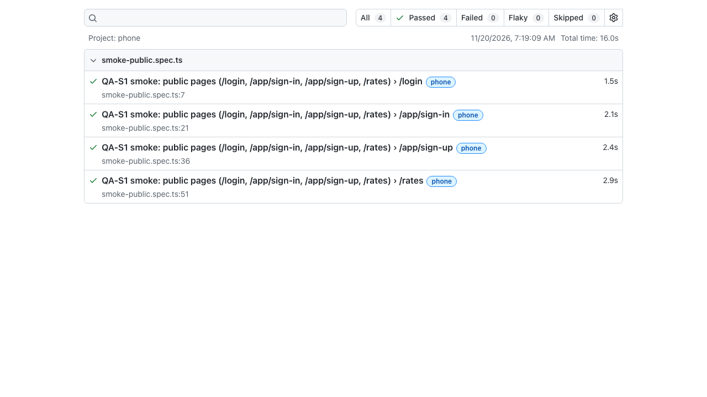
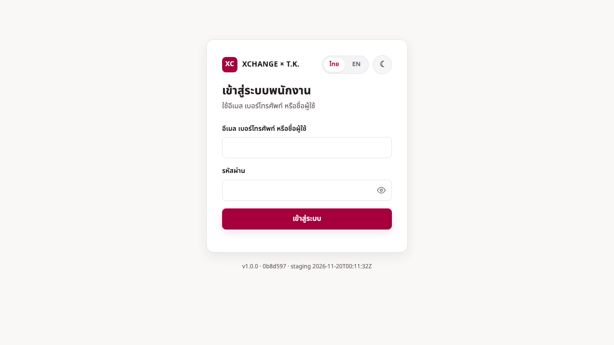
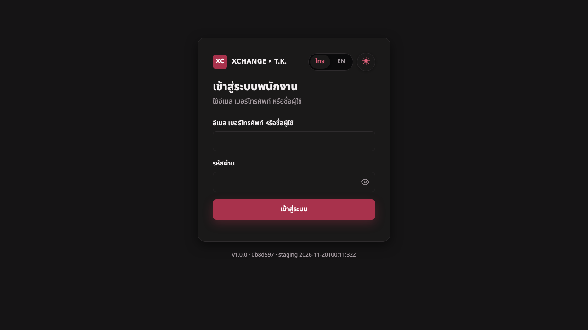

# xchange end-to-end suite (Playwright)

This suite drives a **running** v3 host through a real browser: the public pages, the customer app, the staff desk, admin and the money flows.

- Design: `docs/design/qa-e2e.md`.
- Specs: one file per area under `tests/`, all built on `tests/helpers.ts`.
- Who runs it: the owner, or someone the owner hands the test passwords to. It signs in with real test accounts (rule E-3).

> ### Got only this file? Ask the owner for these three things first
> 1. **Read access to the GitHub repo `108-Plaza/xchange`.** It is private, so `git clone` fails without it. Send the owner your GitHub username.
> 2. **The file `users.json`,** sent privately, never in chat groups or tickets. It holds the test accounts and passwords.
> 3. *(Only if you will run `reseed.sh`)* **SSH access to the test host.** Send the owner your SSH public key. Without SSH you can still run every test, as long as the owner has already seeded the accounts.
>
> With those three, follow section 1 from the top. You need nothing else.

**Contents:**
1. Install from zero: a new machine, step by step, with a check after each step.
2. Quick start: when it is already installed.
3. User manual: what to run, and when.
4. For an AI agent: the same steps as an exact sequence, plus the rules.
5. Reference: `users.json`, `reseed.sh`, outputs, specs, writing a spec, troubleshooting.

---

## 1. Install from zero

Every step ends with a check. Do not go on until the check passes.

**Step 1 — Tools.** You need git, Node 24 through nvm, and ssh. If `nvm` is missing, install it first from https://github.com/nvm-sh/nvm#installing-and-updating, then open a new terminal.
```bash
git --version                                   # any recent git
nvm install 24 && nvm use 24 && node --version  # v24.x
ssh -V
```

**Step 2 — Get the code.** Use `main`, the commit the host runs (see step 6).
```bash
git clone https://github.com/108-Plaza/xchange.git && cd xchange/qa/e2e
```
- In an existing clone, use a worktree instead: `git worktree add ../xchange-e2e origin/main`.
- Check: `ls package.json playwright.config.ts users.example.json` lists all three.

**Step 3 — Dependencies and the browser.**
```bash
npm ci
npx playwright install chromium
```
- Check: `npx playwright --version` prints 1.56.x.
- Check: `npx playwright test --list` ends with `Total: N tests in M files`. This works with no `users.json` and no host.

**Step 4 — The roster file `users.json`.** It holds the test passwords and is never in git.
- 🔑 **Ask the owner for it.** It is the one thing this README cannot give you. Without it, steps 5 to 8 cannot run, but `--list` and `tsc` still work.
- **Already made:** copy it from whoever has it, into `qa/e2e/users.json`, with `chmod 600 users.json`.
- **Making it the first time:**
  1. Copy `users.example.json` to `users.json`.
  2. Create each account in the admin UI on the host. Use the role and branch the key names (see Reference → `users.json`).
  3. Put each phone and password in the file.
- Check: `node -e "const u=require('./users.json'); console.log(u.baseUrl, Object.keys(u).length)"` prints the host and the key count. It must not print a password.

**Step 5 — SSH to the host** (only for `reseed.sh`). `reseed.sh` connects to `do-sgp1` as root by default.
- 🔑 **Ask the owner to add your public key to the host.** Then add a `Host do-sgp1` entry with the host's IP and your key to `~/.ssh/config`.
- **Without SSH you can still run the tests,** as long as the accounts in `users.json` already exist on the host: skip steps 7 and 8's reseed.
- Check: `ssh do-sgp1 true` exits 0 with no password prompt.

**Step 6 — The host runs the commit you test.**
```bash
curl -s "$(node -p "require('./users.json').baseUrl")/health/ready"   # look at "build"
git rev-parse HEAD
```
- Check: the two shas match. If they do not, the host needs a deploy first (`deploy/server/build.md`, owner's order). Otherwise tests for newer features fail on the host, not in the code.

**Step 7 — The seed script on the host.** Copy it from the host's build commit (why: Reference → `reseed.sh`).
```bash
BUILD=$(curl -s "$(node -p "require('./users.json').baseUrl")/health/ready" | node -pe "JSON.parse(require('fs').readFileSync(0)).build")
git show "$BUILD":deploy/server/seed-test-booking.sh > /tmp/seed-test-booking.sh
scp /tmp/seed-test-booking.sh do-sgp1:/tmp/seed-test-booking.sh && ssh do-sgp1 'chmod 755 /tmp/seed-test-booking.sh'
```
- Check: `ssh do-sgp1 'bash /tmp/seed-test-booking.sh --help 2>&1 | head -1'` prints a usage line that **contains `--users`**. A line without `--users` means an old copy.

**Step 8 — Seed the roster, then a first run.**
```bash
bash scripts/reseed.sh                       # ends with "==> 6. roster from users.json" and one line per account
npx playwright test tests/smoke-public.spec.ts
```
- Check: reseed exits 0, and the smoke file passes.
- The machine is ready.

---

## 2. Quick start (already installed)

```bash
cd qa/e2e                       # always from here
bash scripts/reseed.sh          # cheap and idempotent; run it before each session
npx playwright test             # everything: one worker, files in name order
npx playwright show-report      # HTML report
```

🔴 **Run from `qa/e2e`.** From any other folder, `npx playwright test` runs whatever project is there, so you get some other repo's tests.
🔴 **The host must run your commit** (step 6).

---

### What a working run looks like

These screens were captured on 2026-11-20 against `https://xc-v3.spacing.cloud` at build `0b8d597`.

**Terminal**, for `npx playwright test tests/smoke-public.spec.ts`:
```
  ✓  1 [phone] › tests/smoke-public.spec.ts:7:3 › QA-S1 smoke: public pages (/login, /app/sign-in, /app/sign-up, /rates) › /login (1.5s)
  ✓  2 [phone] › tests/smoke-public.spec.ts:21:3 › QA-S1 smoke: public pages … › /app/sign-in (2.1s)
  ✓  3 [phone] › tests/smoke-public.spec.ts:36:3 › QA-S1 smoke: public pages … › /app/sign-up (2.4s)
  ✓  4 [phone] › tests/smoke-public.spec.ts:51:3 › QA-S1 smoke: public pages … › /rates (2.9s)

  4 passed (16.0s)
```

**`bash scripts/reseed.sh`**, first run on a host with accounts missing (phones shortened here):
```
==> 1. host xc-v3.spacing.cloud → org XC
    owner (+6690…): already present
==> 2. branch MAIN: booking on, Asia/Bangkok, 00:00–23:59 daily
==> 2b. branch TEST2: booking off, Asia/Bangkok, 00:00–23:59 daily
…
==> 6. roster from users.json
    teller (+6681…): created (TELLER on MAIN)
    branchManager2 (+6686…): created (BRANCH_MANAGER on B9082fb6…)
```

**The HTML report** (`npx playwright show-report`) lists every test with its time. Click a test for its steps, its screenshots and its trace.



**The host's sign-in page** in light and dark mode. Staff pages follow the device setting, and the ☾ / ☀ button switches between them.

| Light | Dark |
|---|---|
|  |  |

**The public rate board** at phone size: `/rates?branch=MAIN`, which `smoke-public` checks.


---

## 3. User manual — what to run, and when

| Situation | Run | Read |
|---|---|---|
| **Right after a deploy** | `npx playwright test tests/smoke-*.spec.ts` (10 files, minutes) | Every smoke spec green ⇒ every screen family loads and signs in |
| **Before a release, or after a big merge** | `npx playwright test` (all 50 files; long) | The HTML report: every red test with its trace |
| **One area changed** (e.g. cash) | `npx playwright test tests/flow-cash.spec.ts`, or `-g "<title>"` | That file's tests |
| **A whole business day, end to end** | `npx playwright test tests/journey-*.spec.ts` | The journey screenshots in `results/` |
| **A new role or account is needed** | Add it to `users.json` → `bash scripts/reseed.sh` | The line `created (<ROLE> on <branch>)` |
| **A password changed** | Update `users.json`; nothing else | — |
| **A test failed** | `npx playwright show-trace test-results/<test>/trace.zip` | The step, the network call and the screenshot where it broke |

**Reading a result:**
- **Green** means the flow worked against the live host.
- **Skipped** with `no <role> account …` means the roster lacks that role. Fix `users.json` and reseed; it is not a pass.
- **Red** has three likely causes:
  1. a real bug: open a ticket with the trace;
  2. the host is behind your commit (step 6);
  3. the data changed on the host, for example someone closed the shift or used up a slot.
- **Leftovers.** The suite writes real test data: bookings, exchanges, counts. Run it only on a test host.

---

## 4. For an AI agent

Follow section 1 in order and stop at the first failing check.

**Rules:**
- **Never print, log, commit or paste** `users.json`, a password or a token.
  - Read only the keys you need, e.g. `baseUrl`.
  - Mask secrets in any output you show.
- **Never edit the host's database by hand.** When the seed fails, fix `deploy/server/seed-test-booking.sh` in a PR. Its test is `seed-test-booking.test.sh` and needs `SEED_TEST_DATABASE_URL`.
- **Deploying the host needs the owner's order** (`deploy/server/build.md`). Running the suite does not deploy anything.
- **Run commands from `qa/e2e`,** and check the exit code, not only the summary line.
- **Report the counts** (passed / failed / skipped) and the name of each failed test with its first error line. Name the commit and the host `build` you tested.

**Exact sequence for a run:**
```bash
cd <repo>/qa/e2e
test -f users.json || { echo "users.json missing: ask the owner"; exit 1; }
npm ci && npx playwright install chromium
curl -s "$(node -p "require('./users.json').baseUrl")/health/ready"   # compare build with: git rev-parse HEAD
bash scripts/reseed.sh
npx playwright test; echo "exit=$?"
```

---

## 5. Reference

---

## What you need

| Item | Where it comes from |
|---|---|
| Node 24 (nvm) | `npm ci` installs Playwright 1.56.x from `package-lock.json` |
| Chromium for Playwright | `npx playwright install chromium`, once per machine |
| `users.json` | Made **once** through the admin UI, then copied between machines by hand. It is in `.gitignore` and never goes in git or a ticket. |
| SSH to the host as root | `scripts/reseed.sh` defaults to host `do-sgp1` and base URL `https://xc-v3.spacing.cloud` |
| `/tmp/seed-test-booking.sh` on the host | A copy of `deploy/server/seed-test-booking.sh` from **the same commit as the host's build** (see below) |

### `users.json`

Its shape is `users.example.json`, and the type is `Users` in `tests/helpers.ts`.

| Key | Meaning |
|---|---|
| `baseUrl` | The host every test signs in to, e.g. `https://xc-v3.spacing.cloud` |
| `customer`, `teller`, `teller2`, `branchManager`, `finance`, `marketing`, `executive`, `admin`, `owner` | One account per role: `phone` (or `identifier` for `admin`) and `password` |
| `branchManager2`, `finance2` | Staff on the second branch, for branch-to-branch transfers |
| `branch`, `branch2` | Branch codes, `MAIN` and `TEST2` |
| `referralCode`, `currency`, `quantity` | Inputs some flows use |

- **A role with no real password is skipped, not failed.** A placeholder `<…>` counts as no password (`hasAccount()` in `helpers.ts`), and the log says `no <role> account in users.json: run scripts/reseed.sh`.
- **An account that must change its password first** stops its tests with `must change its password first`. Sign in once by hand, change it, then update `users.json`.
- **Without a `users.json`,** `--list` and `tsc` still work on `users.example.json`, but a real run fails at sign-in. That is intended.

---

## `scripts/reseed.sh`: make the roster exist on the host

```bash
bash scripts/reseed.sh [ssh-host] [base-url]     # defaults: do-sgp1  https://xc-v3.spacing.cloud
```

It sends `users.json` over ssh to `/tmp/seed-test-booking.sh --users - <base-url>` on the host.

**What the seed does.** Every step is idempotent, so running it again changes nothing it already did.
- It makes sure the host maps to org XC.
- It sets up branch `MAIN` (booking on) and branch `TEST2` (booking off). If `TEST2` was already made through the admin UI, the seed finds it by **code** and uses its real id.
- It creates the slot rule, 7 days of open slots, the TERMS and MARKETING consent texts, a published rate set, the cash-transfer policy and the rate-alert settings, each only when missing.
- It creates every account listed in `users.json` that is missing, with that slot's role and branch.
- It never adds an account the file does not list, and never rewrites `users.json`.

**Keep the host's copy of the seed in step with the host's build.** The host keeps the script in `/tmp`, so it goes stale. An old copy answers `usage: /tmp/seed-test-booking.sh https://<host>`, because it predates `--users`. Copy it from the commit the host runs:

```bash
git show <host build sha>:deploy/server/seed-test-booking.sh > /tmp/seed-test-booking.sh
scp /tmp/seed-test-booking.sh do-sgp1:/tmp/seed-test-booking.sh
ssh do-sgp1 'chmod 755 /tmp/seed-test-booking.sh'
```

**Reading the output:**
- `created (<ROLE> on <branch>)` means the account was missing and was made with the password from `users.json`.
- `already present` or `ensured` means nothing changed.
- `ERROR: duplicate key …` stops the run, and nothing after that step happens. Read which step it names. Seed bugs are fixed in `deploy/server/seed-test-booking.sh` (its test is `seed-test-booking.test.sh`), never by editing the host's database.

---

## Running a part of the suite

```bash
npx playwright test --list                          # what would run (no host needed)
npx playwright test tests/flow-cash.spec.ts         # one file
npx playwright test -g "QA-S7"                      # by test title
npx tsc -p .                                        # type-check the specs (no host needed)
```

- **The order matters.** It is one worker, with files in name order. `flow-cash` funds the safe and opens a shift before `flow-queue` needs one.
- **Customer screens run at phone size**: `smoke-public`, `smoke-app-*`, `flow-booking` and `flow-xapp-*` (see `PHONE` in `playwright.config.ts`). Everything else runs at desktop size.

## Outputs

| Where | What |
|---|---|
| `results/` | Screenshots: one per step, plus each customer screen in th, en and zh |
| `test-results/` | Traces and screenshots of failed tests (`npx playwright show-trace <zip>`) |
| `playwright-report/` | The HTML report (`npx playwright show-report`) |
| the test log | Booking numbers and every refusal message |

All of these are git-ignored.

---

## The specs

**Tiers.** The tier is the file-name prefix.
- `smoke-*`: one quick pass over each screen family. There are 10 files.
- `flow-*`: one business flow end to end (cash, queue, rates, approvals, bookings, transfers, users …). There are 37 files.
- `journey-*`: a whole day or a whole customer journey across flows. There are 2 files.

`npx playwright test --list` gives the full, current list. At `main` on 2026-11-20 it was 193 tests in 50 files.

**Not automated.** Each of these needs a state the seed does not make, so do them by hand and attach screenshots:
- the booking refusals `capacityFull`, `slotUnavailable` and `bookingsClosed`;
- the admin capacity change and closure, which write shared data.

## Writing a spec

- **Never point a run at a host while you write.** Check with `npx playwright test --list` and `npx tsc -p .`; both work without `users.json`.
- **Import only from `./helpers`,** and never edit `helpers.ts`. A missing helper goes on your ticket.
- **Use `owner` for steps that need ADMIN + EXECUTIVE,** such as `userEnable`.
- **Skip with a reason when an account is missing:** `test.skip(!hasAccount('teller'), 'no teller account in users.json: run scripts/reseed.sh')`.
- **Write with `writeHeaders(key)`.** An API write needs the same-origin header and an idempotency key.

## Troubleshooting

| You see | Cause | Do |
|---|---|---|
| Unrelated unit tests run (e.g. `cartCore.test.ts`) | Started outside `qa/e2e` | `cd qa/e2e` first |
| Many specs fail on features merged recently | The host runs an older build | Compare `/health/ready` `build` with your `HEAD`; deploy first (`deploy/server/build.md`) |
| `usage: /tmp/seed-test-booking.sh https://<host>` | The seed copy on the host predates `--users` | Copy the seed from the host's build commit (above) |
| `no <role> account in users.json` | That role has no real password in `users.json` | Fill it in, then `bash scripts/reseed.sh` |
| `must change its password first` | That account has a temporary password | Change it by hand once, then update `users.json` |
| `Postgres … did not become ready` or other CI-only lines | You are reading the API CI log, not this suite | This suite does not run in CI |
